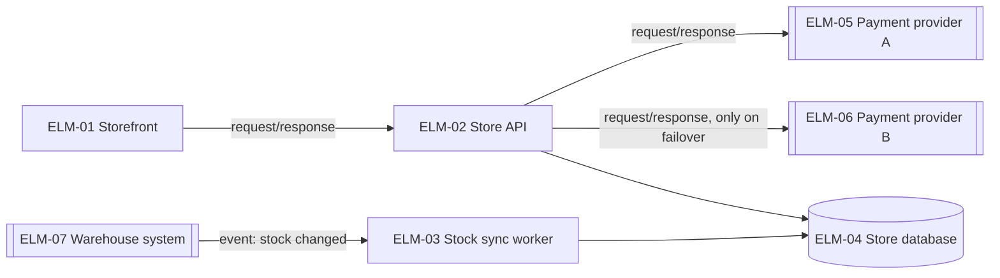
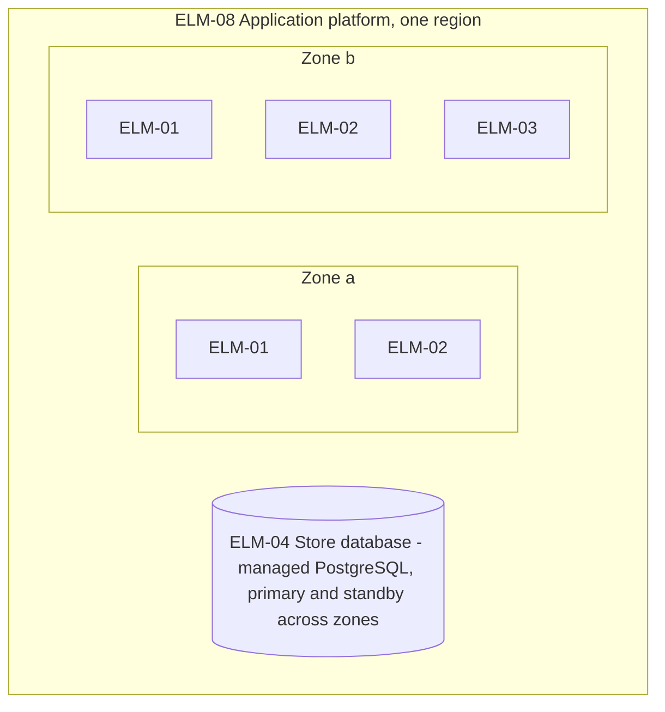

# Stage 2 report template and worked example

## Contents
- Report template (`docs/design/2-architecture.md`)
- Worked example: online store
- Example items

Write the report in the working language. Translate the headings. Keep the IDs as they are, and write the basis marks and statuses with the glossary's terms for the working language. Write each decision's question and chosen option in the "Decisions" table; elsewhere, refer to decisions by ID.

## Report template

```markdown
# Architecture: <system name>

Status: draft | answers applied · Updated: <date> · Stage 2 of 4

## Summary
<Two or three sentences: the overall structure, the decisions the primary drivers forced, the drivers at risk, what needs agreement.>

## Inputs
| Source | What it gave |
|---|---|

## Overall structure
<The structure in two or three sentences, with the decisions that set it, and the comparison table of its options.>

## Decisions
| DEC | Question | Chosen | Addresses | Rejected | Basis |
|---|---|---|---|---|---|
<Under the table, one comparison table for every decision that addresses a primary driver, as in decisions.md.>

## Design concerns
| Concern | Settled by, or why standard practice is enough |
|---|---|

## Threat model
<The data flow diagram with trust boundaries, then the table of flows, threats and counters.>

## Elements
| ELM | Kind | Name | Responsibility | FRs | Drivers | Team | As-is | Basis |
|---|---|---|---|---|---|---|---|---|

## Views
### Context
### Runtime
### Deployment
### Information
### Code structure
<One Mermaid diagram each, with a short table under it when needed.>

## Walkthroughs
### CUJs
<One table per CUJ, as in views.md.>
### Primary drivers
<One table, as in views.md.>

## Design parameters
| Parameter | Value | Basis | Decision |
|---|---|---|---|

## Debt and deferred decisions
| DEC | Debt or deferral | Why | Repay or revisit when |
|---|---|---|---|

## Cost and team
<Running cost from stated prices or placeholders; the work to build it; the skills it needs; the verdict.>

## Findings
| FND | From | Decision | What changed |
|---|---|---|---|
<Findings addressed to this stage that this run processed, and findings this stage raised for stage 1.>

## Issues for the quality chain
| # | Issue | Chain items | Suggested change | Quality-chain stage |
|---|---|---|---|---|

## Needs agreement
| Item | What to agree | Approver candidates |
|---|---|---|

## Questions and answers
| # | Question | Drafted answer | Answer | What changed |
|---|---|---|---|---|

## Open gaps
## Out of scope
## Next
<Run `design-review` on this stage in a fresh context; re-run this stage to resolve its findings; then run `architecture-to-high-level-design`.>
```

## Worked example: online store

Decisions (excerpt):

| DEC | Question | Chosen | Addresses | Rejected |
|---|---|---|---|---|
| DEC-01 | How is the system split? | One application with enforced modules (ELM-02), a separate stock sync worker (ELM-03) and a server-rendered storefront (ELM-01) | DRV-09, DRV-01, DRV-03 | Separate services per capability: a team of four with no operations engineer cannot run them by the sale |
| DEC-02 | How does checkout survive a provider outage? | Fail over to a second provider behind one payment interface | DRV-02, DRV-10 | One provider with retries: fails DRV-02 |
| DEC-03 | How does stock reach the cart in time? | The warehouse's stock events go to ELM-03, which updates ELM-04; ELM-02 caches stock for at most T_stock / 2 | DRV-03 | Polling the warehouse every minute: adds load and misses T_stock at peak |
| DEC-06 | How does fraud screening fit in 1.5 s? | Use each provider's screening inside its charge call | DRV-01, DRV-06 | A separate fraud check before the charge: adds a round trip (up to 0.2 s at its p99) to every checkout |
| DEC-09 | How do card numbers stay off our servers? | The provider's hosted card fields | DRV-08 | None: TC-01 leaves no other option |

Runtime view:



ELM-01's pages load a checkout script in the buyer's browser, and that script calls ELM-02 directly, through the load balancer where SLI-02 is measured.

Deployment view:



Design concerns (excerpt):

| Concern | Settled by, or why standard practice is enough |
|---|---|
| Concurrency | DEC-05 (idempotency keys for payments); stock reservations use the database's row locks (DEC-10) |
| Distribution | DEC-01, DEC-04: two zones in one region; one region is enough this cycle (QR-16 excluded; DRV-12 keeps region settings in one place) |
| Variability | Standard practice is enough: one market, one currency, no tenants |

Walkthrough of DRV-01 (excerpt):

| DRV | Where the stimulus enters | Decisions that shape the response | Meets the measure? | Remaining risk |
|---|---|---|---|---|
| DRV-01 | ELM-01's checkout script → ELM-02 | DEC-01, DEC-06, DEC-03 (cached stock) | Likely: the charge at the provider's stated 99.9th percentile (1.0 s) leaves 0.5 s for our own work and the database | During failover (DEC-02), checkouts are slower until the failing provider's breaker opens: stage 3 must check that against NFR-01's error budget, and must settle the first provider's outcome before charging the second (DRV-05) |

## Example items

`docs/design/dec/DEC-01.yaml`:

```yaml
id: DEC-01
title: One application with enforced modules
status: draft
version: 1
basis: inferred
basis_note: Team size and the deadline are stated; the choice is a proposal
needs_agreement: true
approver_candidates: [Tech lead, Product owner]
stage: architecture
question: How is the system split into deployable parts?
addresses: [DRV-09, DRV-01, DRV-03]
options:
  - name: One application with enforced modules, a stock sync worker and a server-rendered storefront
    effect: One deployment pipeline and one database to run; modules can be split out later
    cost: Everything scales together; module boundaries need automated dependency checks
  - name: Separate services for catalog, cart, checkout, payment and stock
    effect: Each part scales and deploys alone
    cost: Five services to build, deploy and observe; consistency across services
chosen: One application with enforced modules, a stock sync worker and a server-rendered storefront
rationale: DRV-09 (four developers, no operations engineer, release before the sale) rules out running five services; no driver needs a part to scale or fail alone, except stock sync, which is the separate worker
rejected:
  - {option: "Separate services for catalog, cart, checkout, payment and stock", reason: The team cannot build and run them by the release date (DRV-09)}
gains: [One pipeline and one database, Simple transactions for orders and payments (DRV-05)]
costs: [All modules scale together, Boundaries decay without automated dependency checks]
sensitive_points: [Module boundaries must be checked in CI; otherwise the application turns into one tangled module]
trade_offs: [{with: DRV-12, note: Moving to several regions later means moving one large application}]
assumptions: [The platform offers managed containers and managed PostgreSQL (TC-02)]
depends_on: []
parameters: []
debt: null
deferred: false
revisit_when: null
as_is: new
changelog:
  - {version: 1, date: 2026-11-03, change: Created, reason: Stage 2 draft}
```
