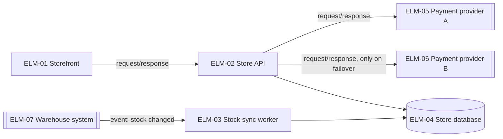
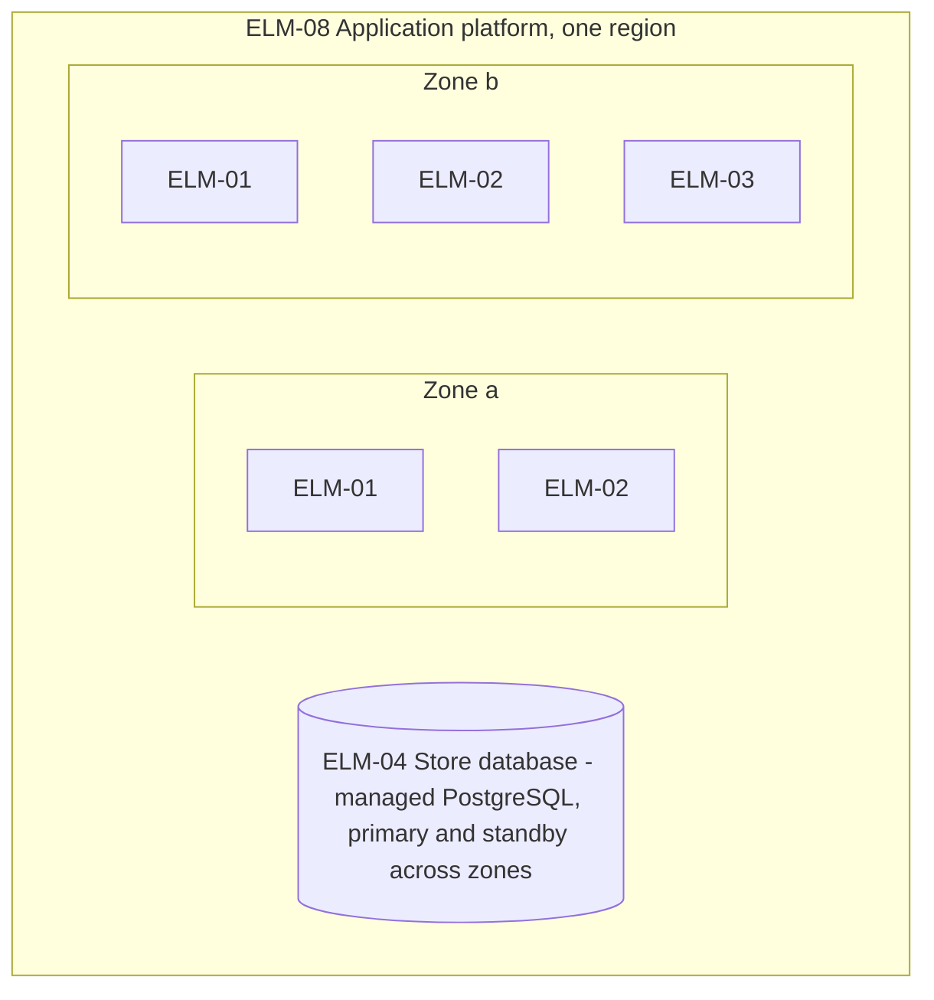

# Stage 2 report template and worked example

## Contents
- Report template (`docs/design/2-architecture.md`)
- Worked example: online store
- Example items

Write the report in the working language. Translate the headings. Keep the IDs as they are, and write the basis marks, statuses, kinds and ratings with the glossary's terms for the working language.

The report indexes the items and never restates what an item says. Refer to decisions and elements by ID and title, and leave their options, rationales, responsibilities, parameter values and other text to the YAML. Only the report holds the summary, the comparison tables of options, the design concerns, the threat model, the views, the walkthroughs, the cost check, the questions and their answers, the placeholders, the open gaps and what is out of scope. The requests to the quality chain are QCR items, which `quality-chain-requests.md` lists; the report does not.

`scripts/tables.py` writes the tables between `<!-- generated: <name> -->` and `<!-- /generated -->` from the items ("Scripts" in `conventions.md`): the design decisions, the elements, the design parameters, the findings, the hand-offs and the open assumptions. Do not edit them by hand. In them, the report writes only these cells, which the script keeps: where each parameter was decided, and the breadth and severity of a quality-chain assumption as this stage rates it (the script starts them from the QAS's own). Every other table is written by hand.

## Report template

```markdown
# Architecture: <system name>

Status: draft | waiting for answers | answers applied · Updated: <date> · Inputs as of: <commit, or "none"> · Stage 2 of 4

## Summary
<Two or three sentences: the overall structure and the platforms, the decisions the primary drivers forced, the drivers at risk, and the open assumptions that matter most.>

## Inputs
| Source | What it gave |
|---|---|

## Overall structure
<The decisions that set the structure and the platforms, by ID, with the comparison table of their options, as in decisions.md. The views show the result.>

## Design decisions
<!-- generated: decisions -->
| DEC | Title | Addresses | Basis |
|---|---|---|---|
<!-- /generated -->
<The decisions of stage `architecture`. Under the table, one comparison table for every other decision that addresses a primary driver, as in decisions.md.>

## Design concerns
| Concern | Settled by, left to a later stage, or why standard practice is enough |
|---|---|
<For what this stage leaves of a concern: the stage that decides it and its trigger, with the hand-off when there is one.>

## Threat model
<The data flow diagram with trust boundaries, then the table of flows, threats and counters, as in views.md.>

## Elements
<!-- generated: elements -->
| ELM | Name | Kind | Team | As-is |
|---|---|---|---|---|
<!-- /generated -->

## Views
### Context
### Runtime
### Deployment
### Information
<One Mermaid diagram each, with a short table under it when needed. How the code is organized is stage 2b's, in its report.>

## Walkthroughs
### CUJs
<One table per CUJ, as in views.md.>
### Primary drivers
<One table, as in views.md.>

## Design parameters
<!-- generated: parameters -->
| Parameter | DEC | Decided in |
|---|---|---|
<!-- /generated -->
<One row per entry of the decisions' `parameters`: only the values this stage sets, those that size something paid for or hard to change once built, and any other that rates high (decisions.md, "Design parameters"). Decided in, by hand: the question under "Decisions" that settled it, or the DAS that adopted it provisionally. A sensitive point whose value a later stage sets is under "Hand-offs".>

## Debt and deferrals
| Item | Debt, or deferral of a full-depth kind | Decided in |
|---|---|---|
<By hand. A debt is on its DEC; a deferral of a point of this stage's full-depth kinds, or of one that rates high, is a hand-off (HND). Decided in: the question under "Decisions", or the DAS of kind decision.>

## Cost and team
<The running cost from stated prices or placeholders, computed with a script; the work to build it; the skills it needs; the verdict.>

## Findings
<!-- generated: findings -->
| FND | Title | Severity | Raised by | To | Status | Items changed |
|---|---|---|---|---|---|---|
<!-- /generated -->
<The findings addressed to this stage, and those this stage raised for stage 1. Items changed are the items whose `basis_note` cites the finding.>

## Hand-offs
<!-- generated: handoffs -->
| HND | Title | From | To | Component | Status | Decided in |
|---|---|---|---|---|---|---|
<!-- /generated -->
<The hand-offs this stage wrote, and those addressed to it: the values of sensitive points that a later stage sets, the deferrals under "Debt and deferrals", and any other point left to a later stage that it would not take up otherwise. Decided in: the items whose `basis_note` cites the hand-off. The point, its bounds, its trigger and why one was passed on are in the HND file; one that this stage passed on is listed by the stage it went to.>

## Unanswered questions
| # | Question | Why unsure | Options | Items | Answer |
|---|---|---|---|---|---|
<Only while rows wait: the questions this run could not ask because nobody could answer during the run, in the order it would ask them, and the corrections to assumptions that the user gave after such a run ("Draft first, ask afterwards", step 7, and "Finishing a run", step 1, in conventions.md). #: the number the row keeps under "Decisions". Options: 2 to 4, the drafted one first and marked as drafted; a multi-select question lists up to 4 items and the drafted choice. Answer: what the user answered, written by the user or by the agent that started the run; empty until then. A question about a request to the quality chain names the request among its items, and its answer may be written under the request in `quality-chain-requests.md` instead. The next run moves each answered row to "Decisions".>

## Decisions
| # | Question | Answer | Items |
|---|---|---|---|
<Questions asked and answers in effect, numbered per stage and continued on re-runs; an overturning answer replaces the row.>

## Open assumptions
<!-- generated: assumptions -->
| ID | Title | Kind | Breadth | Severity | Items that depend on it |
|---|---|---|---|---|---|
<!-- /generated -->
<The open DAS this stage wrote, and the open DAS and QAS its items depend on, highest first. Breadth and severity of a QAS, by hand: as this stage rates it.>

## Placeholders
| Name | Stands for | Used in |
|---|---|---|

## Open gaps
<Only what this stage could not close and no later stage will take up: a walkthrough gap that no decision closes, a value cut off at ` #` in a file another stage wrote, for that stage to fix. A point left to a later stage or to implementation is under "Hand-offs"; one that only a change in the quality chain would close is a request to the quality chain, which `quality-chain-requests.md` lists.>

## Out of scope
## Next
<While questions wait for answers: answer them under "Unanswered questions", then run this stage again; neither its review nor a later stage runs until then. Otherwise, run `design-review` on this stage in a fresh context when it has not been reviewed yet, or when a critical or major finding changed its items since its last review; re-run this stage for the critical or major findings a review addresses to it, not for minor ones; then run `architecture-to-technical-policy`, and after it `architecture-to-high-level-design`.>
```

## Worked example: online store

Header:

```markdown
Status: answers applied · Updated: 2026-11-03 · Inputs as of: 3f2a9c1 · Stage 2 of 4
```

Design decisions (excerpt):

| DEC | Title | Addresses | Basis |
|---|---|---|---|
| DEC-01 | One application with enforced modules, a stock sync worker and a server-rendered storefront | DRV-09, DRV-01, DRV-03 | inferred |
| DEC-02 | Fail over to a second payment provider | DRV-02, DRV-10 | assumed |
| DEC-03 | Stock changes arrive as events; ELM-02 keeps a short stock cache | DRV-03 | inferred |
| DEC-06 | Fraud screening inside each provider's charge | DRV-01, DRV-06 | inferred |
| DEC-09 | The provider's hosted card fields | DRV-08 | inferred |
| DEC-10 | Browsers the storefront supports | DRV-11 | confirmed |

DEC-02 is assumed because it depends on an open assumption (DAS-02). DEC-03 lists DAS-01, which question 3 confirmed, and is not assumed on its account; the lifetime of its stock cache is a value that stage 3 sets (HND-03), so it needs no assumption here. DEC-10 is confirmed by question 1. DEC-01 was not a question: the stated team and deadline behind DRV-09 leave no doubt about it, so it stays inferred.

Elements (excerpt):

| ELM | Name | Kind | Team | As-is |
|---|---|---|---|---|
| ELM-01 | Storefront | component | TEAM-01 | new |
| ELM-02 | Store API | component | TEAM-01 | new |
| ELM-03 | Stock sync worker | component | TEAM-01 | new |
| ELM-04 | Store database | data store | TEAM-01 | new |
| ELM-05 | Payment provider A | external system | — | new |
| ELM-06 | Payment provider B | external system | — | new |
| ELM-07 | Warehouse system | external system | — | new |
| ELM-08 | Application platform | node | TEAM-01 | new |

ELM-05 and ELM-06 both play the role of EXT-01 in `context.yaml` and list it in `premises`; ELM-06 exists because of DEC-02. ELM-07 plays the role of EXT-02.

Runtime view:



ELM-01's pages load a checkout script in the buyer's browser, and that script calls ELM-02 directly, through the load balancer in front of ELM-02: the system boundary, which is SLI-02's vantage.

Deployment view:



Design concerns (excerpt):

| Concern | Settled by, left to a later stage, or why standard practice is enough |
|---|---|
| Concurrency | DEC-05 (payments are idempotent, with one key per order); stage 4, at its run for ELM-02: how a reservation of the last items in stock stays correct when buyers reserve them at once (stage 4 decides the concurrency of such a module in full, so no hand-off is needed) |
| Distribution | DEC-01, DEC-04: two zones in one region; one region is enough this cycle (QR-16 excluded; DRV-12 keeps region settings in one place) |
| Variability | DEC-10 for the browsers (TC-03 fixes a web app); otherwise standard practice is enough: one market, one currency, no tenants |

Walkthrough of DRV-01 (excerpt):

| DRV | Where the stimulus enters | Decisions that shape the response | Meets the measure? | Remaining risk |
|---|---|---|---|---|
| DRV-01 | ELM-01's checkout script → ELM-02 | DEC-01, DEC-06, DEC-03 (cached stock) | Likely: the charge at the provider's stated 99.9th percentile (1.0 s) leaves 0.5 s for our own work and the database | During failover (DEC-02), checkouts are slower until the failing provider's breaker opens, and each one waits until the first provider's outcome is settled before the second is charged (DEC-05): stage 3 sets the threshold and checks the failover path against NFR-02's error budget (HND-02) |

Design parameters: none. No value in this architecture sizes a contract or the stored data, so no decision has `parameters` and the script writes an empty table. The error threshold at which checkout fails over (DEC-02) and the lifetime of ELM-02's stock cache (DEC-03) are sensitive points whose values stage 3 sets: see "Hand-offs".

Debt and deferrals (excerpt):

| Item | Debt, or deferral of a full-depth kind | Decided in |
|---|---|---|
| DEC-02 | debt: failover ships right after the spring sale | stage 1, question 5 |

Hand-offs (excerpt):

| HND | Title | From | To | Component | Status | Decided in |
|---|---|---|---|---|---|---|
| HND-02 | The error threshold at which checkout fails over | architecture-drivers-to-architecture | architecture-to-high-level-design | — | open | — |
| HND-03 | How long ELM-02 keeps a stock count it has read | architecture-drivers-to-architecture | architecture-to-high-level-design | — | open | — |

Both are sensitive points whose values this stage does not set, so each gets a hand-off. Both values lie on paths that stage 3 budgets: the threshold on the paths of NFR-02 and of money, the cache lifetime on the path of NFR-03, whose threshold is T_stock_lag. Deciding them here would fix numbers before the budgets they must fit exist.

Decisions (excerpt):

| # | Question | Answer | Items |
|---|---|---|---|
| 1 | TC-03 keeps the storefront a web app. Which browsers must browsing and checkout work in? | The current and the previous major version of Safari and Chrome on phones, and of Chrome, Edge, Safari and Firefox on computers, as drafted. | DEC-10, ELM-01 |
| 2 | Checkout must keep confirming orders through a payment provider outage (DRV-02). Fail over to a second provider, at the cost of a second contract, or keep one provider with retries, which cannot ride out an outage? | Fail over to a second provider, as drafted. The running cost of the second contract is accepted. | DEC-02, ELM-06 |
| 3 | Stage 1 assumed, without asking, that the warehouse system announces stock changes (DAS-01). The structure now rests on it: DEC-03, the stock sync worker (ELM-03) and the runtime view. Does the warehouse system send an event when a stock count changes? | Yes: it sends one event per stock change; the warehouse team confirmed it. | DAS-01, DEC-03, ELM-03 |

Question 3 asks about an assumption that stage 1 wrote: the structure rests on it (DEC-03, ELM-03 and the runtime view), so its breadth is high, and this stage asked it ("Assumptions" in `conventions.md`). DAS-01 records the answer in `answer`, with `answered_in` set to "stage 2, question 3", and its status is `confirmed`. DEC-03 and ELM-03 list DAS-01 in `premises` and cite the answer in `basis_note`; stage 1 applies it to DRV-03 when it runs again.

When this stage runs where nobody can answer, as a subagent of another agent, its first run ends with these three questions under "Unanswered questions", the items as drafted, and `Status: waiting for answers` in the header. Question 2 then reads:

| # | Question | Why unsure | Options | Items | Answer |
|---|---|---|---|---|---|
| 2 | Checkout must keep confirming orders through a payment provider outage (DRV-02). Fail over to a second provider, at the cost of a second contract, or keep one provider with retries, which cannot ride out an outage? | Only failover meets DRV-02 during an outage, but it ties the store to a second vendor and adds a running cost, and the budget is not set yet (PC-03) | 1. Fail over to a second provider (drafted) 2. Keep one provider, with retries and back-off | DEC-02, ELM-06 | |

The next run applies the answer written in the last cell, and moves the question to "Decisions" with the same number, as above.

Open assumptions (excerpt):

| ID | Title | Kind | Breadth | Severity | Items that depend on it |
|---|---|---|---|---|---|
| DAS-02 | The second payment provider works like the first | judgment | medium | low | DEC-02, ELM-06 |

Placeholders (excerpt):

| Name | Stands for | Used in |
|---|---|---|
| T_stock_lag | The time within which a stock change must be shown (QR-03) | DEC-03, HND-03 |
| A_failover | The share of checkouts that must succeed during a provider outage (DRV-02) | Walkthroughs: DRV-02 |

## Example items

`docs/design/dec/DEC-02.yaml`:

```yaml
id: DEC-02
title: Fail over to a second payment provider
status: active
basis: assumed
basis_note: The second provider confirmed in question 2; the debt, failover shipping right after the spring sale, decided in stage 1, question 5; the second provider working like the first assumed (DAS-02); the rest inferred
premises: [TC-01, CHG-01, DAS-02]
stage: architecture
question: How does checkout keep confirming orders when the payment provider fails?
addresses: [DRV-02, DRV-10]
options:
  - name: One provider, retries with back-off
    effect: Rides out short errors; an outage still stops checkout
    cost: Little work
  - name: Fail over to a second provider
    effect: Checkout continues while either provider is down
    cost: A second contract and integration; reconciliation across two providers
chosen: Fail over to a second provider
rationale: DRV-02 asks checkout to continue through a provider outage, which retries cannot do; CHG-01 already plans a second provider
rejected:
  - {option: "One provider, retries with back-off", reason: Does not meet DRV-02 during an outage}
gains: [Checkout survives an outage of either provider]
costs: [A second integration to build and test, Reconciliation must cover two providers]
sensitive_points: [The error threshold that opens a provider's breaker - too low switches back and forth; too high keeps buyers waiting on a failing provider]
trade_offs: [{with: DRV-07, note: A second contract raises running cost}]
assumptions: ["The second provider works like the first: hosted card fields, and fraud screening inside its charge (DAS-02)"]
depends_on: [DEC-01]
parameters: []
debt:
  what: Failover ships right after the spring sale; until then an outage of the provider stops checkout
  why_accepted: "The business keeps the date and accepts the risk (stage 1, question 5)"
  repay_when: Right after the spring sale
as_is: new
```

`docs/design/hnd/HND-02.yaml`, the value of DEC-02's sensitive point. Stage 2 names the threshold and what its value must keep, and leaves the number to stage 3; it is neither asked nor an assumption here:

```yaml
id: HND-02
title: The error threshold at which checkout fails over
status: open
basis: inferred
basis_note: null
premises: []
from: architecture-drivers-to-architecture
to: architecture-to-high-level-design
component: null
origin: [DEC-02]
what: The value of the error threshold that opens a provider's breaker, after which checkout charges the other provider (DEC-02's sensitive point)
bounds: NFR-02 error budget, which the failover path must fit; DEC-02 failover; DEC-05 an outcome settled before the other provider is charged
trigger: The next run of stage 3
resolution: null
```
