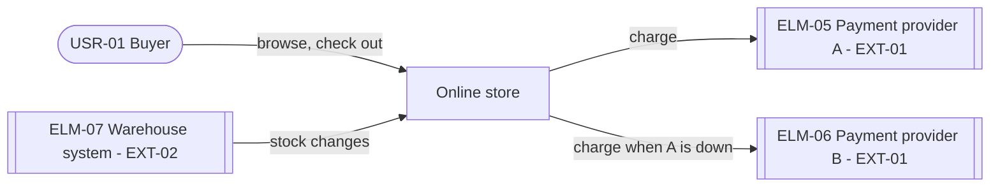

# Views

## Contents
- The four views
- Consistency rules
- Walkthroughs
- Threat model
- Teams
- Large systems

## The four views

Draw each view as a Mermaid diagram in the report, with a short table under it when the diagram cannot carry the detail. Label every box with its element ID and name.

How the code is organized (its repositories, directories and packages, which may depend on which, and which team owns each) is not a view of this stage. Stage 2b draws it in its report and holds it with dependency rules that CI checks, from the elements, the deployment and the teams that these views show.

### Context

The system as one box; users by kind (USR in `context.yaml`); the external systems, which are the EXT entries in `context.yaml` that the design deals with, plus any that a decision adds; data producers; the main flows between them. Label each external system with its element ID and the EXT whose role it plays. It answers: what is inside, what is outside, and what crosses the line.

### Runtime

Components and data stores, and how they interact at run time. Label each connector with its style (request and response, event, file, schedule) and its direction. It answers: what calls what, and what waits for what.

### Deployment

Nodes (environments, zones, managed services), which components and data stores run on which node, how many instances, and the network boundaries between them. It answers: what fails together, what scales separately, and where the data physically is.

### Information

The main data, the element that owns each piece (the only one that writes it), and how data flows between elements and from data producers. Stage 3 details the entities; here the point is ownership and flow.

## Consistency rules

- Every element appears in the views where its kind belongs: components in runtime and deployment; data stores in runtime, deployment and information; external systems in context and runtime.
- The same element has the same ID and name in every view.
- Every connector in the runtime view joins elements that exist, and every data flow in the information view follows a connector in the runtime view.
- Every component runs on a node in the deployment view.

## Walkthroughs

A CUJ walkthrough, one table per CUJ:

| Step | FRs | Elements | Interactions | Gap |
|---|---|---|---|---|
| Payment | FR-01 | ELM-01, ELM-02, ELM-05 | ELM-01 → ELM-02 checkout request; ELM-02 → ELM-05 charge | none |

A driver walkthrough, one row per primary driver:

| DRV | Where the stimulus enters | Decisions that shape the response | Meets the measure? | Remaining risk |
|---|---|---|---|---|
| DRV-02 | ELM-02's call to ELM-05 | DEC-02, DEC-05 | Yes, once failover ships, if it starts within the threshold | Until failover ships right after the spring sale, an outage of the provider stops checkout (DEC-02's debt); failover adds time to checkout (DRV-01) |

A step or a driver that cannot be walked through is a gap: fix the design, or record it under "Open gaps" or as a request to the quality chain.

## Threat model

1. Draw the data flows from the runtime and information views, with the trust boundaries: the user's device, the public internet, the system's own network, each external system.
2. Mark the assets that the security drivers name (card data, personal data, accounts, payment results).
3. For each flow that crosses a boundary, walk six kinds of threat: someone pretending to be someone else; data changed in transit or at rest; an action later denied by whoever did it; data leaking to someone who should not see it; service stopped or slowed on purpose; someone gaining rights they should not have.
4. For each threat that applies, write the decision that counters it. When the inputs do not say whether a threat matters, rate it as an uncertain point ("Draft first, ask afterwards" in `conventions.md`); a threat to money or personal data has high severity, so it is asked.

| Flow | Crosses | Threat | Countered by |
|---|---|---|---|
| Buyer's browser (ELM-01's checkout script) → ELM-02 checkout | public internet | The amount is changed in the browser | DEC-07: the server recalculates every amount |
| ELM-05 → ELM-02 payment result | external system | A forged payment notice | DEC-08: verify the provider's signature |

## Teams

When the design context names teams, mark each component with its owning team. Look for components that two teams must change together for most change scenarios: they slow both teams down. Either move the boundary, or record the risk. Stage 2b then splits the repositories along these owners.

## Large systems

When a view grows past about twenty boxes, split it by area (one per group of CUJs, for example) and keep one overview that shows only the areas and the connections between them.
