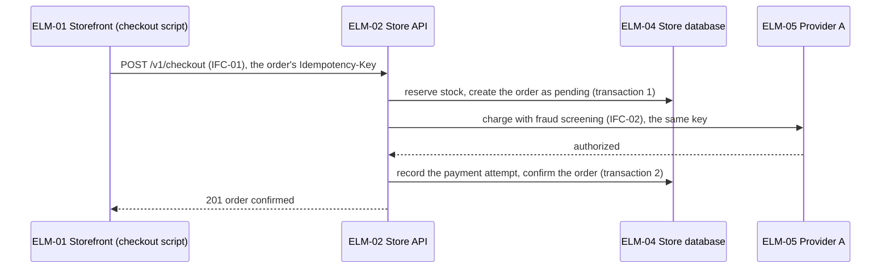
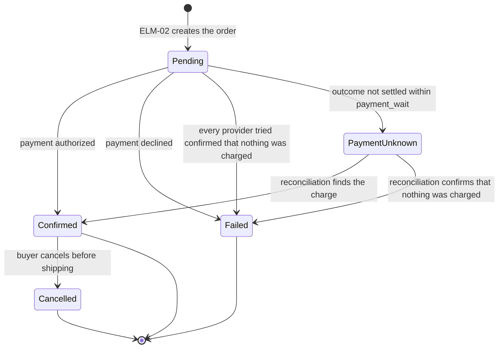

# Flows, latency budgets, screens and states

## Contents
- End-to-end flows
- Failure paths
- Latency budgets
- Failure paths and the error budget
- Screen flows
- States across elements

## End-to-end flows

Draw one Mermaid sequence diagram for every CUJ and every primary driver's scenario. Participants are elements, with their IDs; messages are IFC operations, with their IDs. Show where data is written, in which transaction, and where the flow returns to the person.

## Failure paths

For each flow, add the paths for: a timeout of each call (an unknown outcome when the call changes something; see "Unknown outcomes" in `interfaces.md`); a business refusal (declined, out of stock); a crash halfway (what state is left, and what cleans it up); a duplicate request, including one that arrives while the first is still running; a failover. Mermaid `alt` and `opt` blocks keep them in the same diagram; draw a second diagram when the first becomes hard to read.

## Latency budgets

For every SLO with a time threshold, check the flow's normal path:

1. Start from the threshold and from where it is measured (the SLI's measurement point). Only the time inside that point counts.
2. List the serial hops of the flow inside it: our own processing, each database call or group of calls, each call to another element or an external system, waits in queues. Calls made in parallel count as one hop, at the slowest of them.
3. Percentiles do not add up: a rare stall in any one hop can push the whole flow past the sum of the hops' 99th percentiles. To bound the flow with a sum, give each of the n serial hops a budget at the 1 − (1 − target)/n percentile, which for a 99% SLO and three hops is the 99.67th. If no hop exceeds its budget more often than that, the whole flow stays within the sum at least 99% of the time.
4. Take external systems' numbers at that percentile from their stated SLAs or measurements; a stated 99.9th percentile is a safe stand-in. For our own work, propose provisional values with their basis.
5. Keep a margin, and show the sum: the hops plus the margin must not exceed the threshold. Compute it with a script, and put the script's output in the report.
6. When the numbers at that percentile are not known, say so, and make a load test of the whole flow before release a gate.

| Hop | Budget (99.67th percentile) | Basis |
|---|---|---|
| ELM-02 own work | 0.15 s | Provisional |
| ELM-04 reads and writes, both transactions | 0.15 s | Provisional |
| Charge with fraud screening at ELM-05 | 1.00 s | Provider's stated 99.9th percentile |
| Margin | 0.20 s | |
| Total | 1.50 s | NFR-01 threshold: 1.5 s, measured at the load balancer in front of ELM-02 |

The budgets are not timeouts. Set the timeouts as `interfaces.md` ("Timing") describes.

## Failure paths and the error budget

An SLO of 99% lets 1% of valid events be slow or fail. A failure path does not have to fit the threshold; it has to fit the error budget.

1. For each failure path inside the SLO's valid events, estimate how long it takes and how many valid events take it, per incident and per window, from stated volumes.
2. A path that many events take (a retry after a common error) must fit the threshold, like the normal path.
3. A path that few events take (a failover, until a breaker opens) must fit the error budget: the events it makes slow, over the incidents a window may hold, stay well within the error budget volume. Show the arithmetic.

Example: provider A fails at peak. Until A's breaker opens after 10 s of timeouts (`failover_after`), each checkout waits for A's timeout and for A's settlement before B is tried, several seconds in all. That is at most 10 s × 300 requests/s = 3,000 slow checkouts per outage, 3.6% of NFR-01's error budget of 84,000 checkouts per 28 days.

## Screen flows

For each CUJ with screens, draw a Mermaid flowchart of the screens and the actions that move between them, including the error and empty states the acceptance criteria name. One box per screen, labelled with the IFC it belongs to.

## States across elements

For each entity whose life spans several elements, draw a Mermaid state diagram. Label each transition with its trigger and the element that causes it, and include timeouts and cancellations. Every state has a way out, or is final. A state that money, goods or a booking can still leave is never final: a payment whose outcome is unknown waits in its own state until it is settled.

