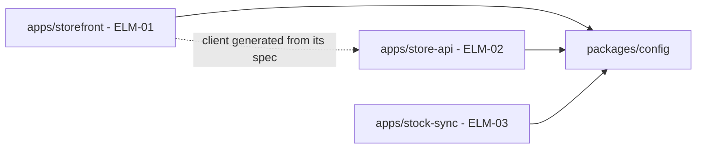
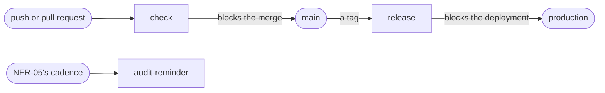

# Stage 2b report template and worked example

## Contents
- Report template (`docs/design/2b-technical-policy.md`)
- Worked example: online store
- Example items

Write the report in the working language. Translate the headings. Keep the IDs, paths, commands and names of tools as they are, and write the basis marks, statuses, scopes and kinds with the glossary's terms for the working language.

The report indexes the items and never restates what an item says: no stacks, rules, layers, bindings, steps or spec rules copied from the YAML. It holds what only the report records: what was already decided and which policy follows it, the comparison tables of the decisions, the directory tree, the diagram of the pipeline, the kinds of interface that stage 2's views show and the spec rule that covers each, and the decisions. The requests to the quality chain are QCR items, which `quality-chain-requests.md` lists; the report does not.

`scripts/tables.py` writes the tables between `<!-- generated: <name> -->` and `<!-- /generated -->` from the items ("Scripts" in `conventions.md`): the technical policies, the design decisions, the gate bindings, the audit bindings, the findings, the hand-offs and the open assumptions. Do not edit them by hand. In them, the report writes only these cells, which the script keeps: the request that replaces the binding of a gate or an audit that nothing can bind, and the breadth and severity of a quality-chain assumption as this stage rates it (the script starts them from the QAS's own). Every other table is written by hand.

## Report template

```markdown
# Technical policy: <system name>

Status: draft | waiting for answers | answers applied · Updated: <date> · Inputs as of: <commit, or "none"> · Stage 2b of 4

## Summary
<Two or three sentences: the stack of each kind of component, the repositories, how many gates are bound and audits placed and which became requests to the quality chain, the questions asked and the open assumptions that matter most.>

## Inputs
| Source | What it gave |
|---|---|

## What was already decided
| Source | Fixes | Followed by |
|---|---|---|
<One row per technology constraint, decision of stage 2, convention of the existing code or hand-off that fixes part of a policy: its ID, a short label of what it fixes, and the POLs that follow it. A finding raised against one of them is under "Findings".>

## Technical policies
<!-- generated: policies -->
| POL | Title | Scope | Addresses | Decisions | Basis |
|---|---|---|---|---|---|
<!-- /generated -->
<One POL per scope. Its rules, stacks, repositories, layers, doubles, environments, bindings, steps and spec rules are in its file.>

## Design decisions
<!-- generated: decisions -->
| DEC | Title | Addresses | Basis |
|---|---|---|---|
<!-- /generated -->
<The decisions of stage `technical-policy`. Under the table, a comparison table for each decision whose options were close: the options against the drivers they touch, in rank order.>

## Repositories and directories
<The code structure, which stage 2 leaves to this stage: the tree of directories of each repository, two or three levels deep, with the component, the owning team when the design context names several, or the purpose of each top-level directory; then a Mermaid flowchart of the dependencies that the dependency rules allow between those directories, and the rules that hold the boundaries inside a component. It shows what a change scenario touches, and which teams. The rules that the tree follows, and the dependency rules with their checks, are in the repository POL.>

## Pipeline
<A Mermaid flowchart of the pipeline's steps, from a push to a release, with what each one blocks. The steps themselves are in the pipeline-and-code POL.>

## Gate bindings
<!-- generated: gate-bindings -->
| NFR | Title | Where | Bound in | Request instead |
|---|---|---|---|---|
<!-- /generated -->
<One row per NFR of kind gate in the quality chain. Where: the gate's `where`, as the quality chain gives it. Bound in: the POLs whose `gate_bindings` name it. Request instead, by hand, only for a gate that nothing binds: the request to the quality chain that replaces its binding, an open or answered QCR with the gate in `targets`.>

## Audit bindings
<!-- generated: audit-bindings -->
| NFR | Title | Placed in | Request instead |
|---|---|---|---|
<!-- /generated -->
<One row per NFR of kind audit in the quality chain. Placed in: the POLs whose `audit_bindings` name it. Request instead, by hand, as for a gate.>

## Interface kinds
| Kind of interface | Seen in | Spec rule |
|---|---|---|
<By hand: each kind of interface that stage 2's context and runtime views show, the connectors or elements where it appears, and the entry of the specs POL that covers it.>

## Findings
<!-- generated: findings -->
| FND | Title | Severity | Raised by | To | Status | Items changed |
|---|---|---|---|---|---|---|
<!-- /generated -->
<The findings addressed to this stage, those raised by implementation included, and those this stage raised for stages 1 and 2. Items changed are the items whose `basis_note` cites the finding.>

## Hand-offs
<!-- generated: handoffs -->
| HND | Title | From | To | Component | Status | Decided in |
|---|---|---|---|---|---|---|
<!-- /generated -->
<The hand-offs this stage wrote, and those addressed to it. Decided in: the items whose `basis_note` cites the hand-off.>

## Unanswered questions
| # | Question | Why unsure | Options | Items | Answer |
|---|---|---|---|---|---|
<Only while rows wait: the questions this run could not ask because nobody could answer during the run, in the order it would ask them, and the corrections to assumptions that the user gave after such a run ("Draft first, ask afterwards", step 7, and "Finishing a run", step 1, in conventions.md). #: the number the row keeps under "Decisions". Options: 2 to 4, the drafted one first and marked as drafted; a multi-select question lists up to 4 items and the drafted choice. Answer: what the user answered, written by the user or by the agent that started the run; empty until then. A question about a request to the quality chain names the request among its items, and its answer may be written under the request in `quality-chain-requests.md` instead. The next run moves each answered row to "Decisions".>

## Decisions
| # | Question | Answer | Items |
|---|---|---|---|
<Questions asked and answers in effect, numbered per stage and continued on re-runs; an overturning answer replaces the row.>

## Open assumptions
<!-- generated: assumptions -->
| ID | Title | Kind | Breadth | Severity | Items that depend on it |
|---|---|---|---|---|---|
<!-- /generated -->
<The open DAS this stage wrote, and the open DAS and QAS its items depend on, highest first. Breadth and severity of a QAS, by hand: as this stage rates it.>

## Placeholders
| Name | Stands for | Used in |
|---|---|---|

## Open gaps
<Only what this stage could not close and no later stage will take up. A point left to a later stage or to implementation is under "Hand-offs"; a problem in an earlier stage's items is a finding; one that only a change in the quality chain would close is a request to the quality chain, which `quality-chain-requests.md` lists.>

## Out of scope
## Next
<While questions wait for answers: answer them under "Unanswered questions", then run this stage again; neither its review nor a later stage runs until then. Otherwise, run `design-review` on this stage in a fresh context when it has not been reviewed yet, or when a critical or major finding changed its items since its last review; re-run this stage for the critical or major findings a review addresses to it, not for minor ones; then run `architecture-to-high-level-design`. On a re-run that changed a policy, name the later stages and the components whose items or code must follow it.>
```

## Worked example: online store

Header:

```markdown
Status: answers applied · Updated: 2026-11-04 · Inputs as of: 5b8e0d2 · Stage 2b of 4
```

What was already decided (excerpt):

| Source | Fixes | Followed by |
|---|---|---|
| DEC-01 | One application with enforced modules, a stock sync worker and a server-rendered storefront | POL-01, POL-02 |
| DEC-04 | Node.js, in containers on the application platform | POL-01 |
| DEC-02 | An adapter for each payment provider | POL-03 |
| DEC-09 | The providers' hosted card fields | POL-01 |
| PC-02 | A team of four that knows TypeScript and PostgreSQL | POL-01 |
| TC-02 | The company's cloud account, in one region | POL-04 |

The store has no code yet, so no convention of existing code binds a policy, and no hand-off is addressed to this stage.

Technical policies:

| POL | Title | Scope | Addresses | Decisions | Basis |
|---|---|---|---|---|---|
| POL-01 | Stacks of the store's components | technology | DRV-09, DRV-01 | DEC-01, DEC-04, DEC-09, DEC-11 | inferred |
| POL-02 | One repository, laid out by business capability | repository | DRV-10, DRV-12 | DEC-01, DEC-12 | inferred |
| POL-03 | Test strategy, gates and audits | testing | DRV-02, DRV-05 | DEC-02 | assumed |
| POL-04 | Pipeline and the conventions inside the code | pipeline-and-code | DRV-08, DRV-09 | — | assumed |
| POL-05 | How specs are made | specs | DRV-09 | DEC-11 | inferred |
| POL-06 | How coding agents find the design and bring findings back | implementation-feedback | — | — | inferred |

POL-01 is inferred although question 1 confirmed its frameworks: its libraries and shared tools are this stage's own judgment, and the weakest judgment gives the basis. POL-03 rests on DAS-03 (who performs NFR-05's audit), DAS-04 (the CI) and DAS-05 (the staging environment), and POL-04 on DAS-04, so both are assumed. POL-06 serves no driver: it serves the chain's own rule for findings from implementation.

Design decisions:

| DEC | Title | Addresses | Basis |
|---|---|---|---|
| DEC-11 | Frameworks of the store's components | DRV-09, DRV-01 | confirmed |
| DEC-12 | Directories by business capability inside each component | DRV-10, DRV-12 | inferred |

DEC-11 was asked (question 1): no technology constraint fixes the frameworks, and every component of each kind is built on its choice, so both ratings are high. DEC-12 follows from DEC-01's enforced modules and from the change scenarios DRV-10 (add a payment provider) and DRV-12 (keep the region's settings in one place), which each touch one business capability; it stays inferred.

| Driver (rank) | Fastify, no framework for the worker, Next.js | NestJS for both services, Next.js | Next.js for everything |
|---|---|---|---|
| DRV-01 checkout latency (1) | meets | meets | in part: the API scales with the pages, against DEC-01 |
| DRV-09 release date (3) | meets: close to what PC-02's team knows | in part: a large framework to learn before the sale | meets |

Repositories and directories:

```
store/
├── apps/
│   ├── storefront/        ELM-01
│   ├── store-api/         ELM-02
│   │   └── src/
│   │       ├── checkout/  domain/, application/, adapters/
│   │       ├── payments/  domain/, application/, adapters/provider-a/, adapters/provider-b/
│   │       ├── catalog/
│   │       └── stock/
│   └── stock-sync/        ELM-03
├── packages/
│   └── config/            the shared lint, type and format settings
└── infra/                 the platform's definitions (ELM-08)
```



No app imports another (no-cross-app): the storefront reaches the Store API only through the client generated from its spec. Inside a component, a capability reaches another only through its index.ts (capability-entry), nothing under a domain/ directory imports a framework, the database client or an adapter (pure-domain), nothing under an application/ directory imports an adapter (adapters-inward), and only payments/adapters/ imports the payment providers' client libraries (provider-sdk-in-adapters). TEAM-01 owns every directory, so the tree names no team.

Pipeline:



Gate bindings:

| NFR | Title | Where | Bound in | Request instead |
|---|---|---|---|---|
| NFR-06 | Payments followed from order to charge | Definition of Done | POL-03 | — |

Audit bindings:

| NFR | Title | Placed in | Request instead |
|---|---|---|---|
| NFR-05 | Card data protection through audits and fix deadlines | POL-03 | — |

The quality chain's other NFRs are SLOs, which stage 3 binds through their SLIs, and monitors.

Interface kinds:

| Kind of interface | Seen in | Spec rule |
|---|---|---|
| HTTP called from the buyers' browsers | The checkout script that ELM-01 serves, calling ELM-02 (runtime view) | POL-05, the first entry |
| HTTP between the store's own components | ELM-01's server calling ELM-02 (runtime view) | POL-05, the first entry |
| The payment providers' APIs | ELM-02 calling ELM-05 and ELM-06 (context view) | POL-05, the second entry |
| The warehouse's stock events | ELM-07 sending to ELM-03 (context view) | POL-05, the second entry |
| The buyers' screens | USR-01 using ELM-01 (context view) | POL-05, the fourth entry |

No interface of the store is built by another party against a contract the store sets, so POL-05's third entry, the rule for writing a spec by hand, applies to none of them today. This run wrote no hand-off: no library that only one component needs shapes a module that stage 4 designs in full.

Decisions:

| # | Question | Answer | Items |
|---|---|---|---|
| 1 | No technology constraint fixes the frameworks, and every component of each kind is built on the choice. Drafted: Fastify for the Store API, no framework for the stock sync worker, Next.js for the storefront. The alternatives are NestJS for both Node.js services, or Next.js for everything with the API as its route handlers. Which? | Fastify, no framework for the worker, and Next.js, as drafted. | DEC-11, POL-01 |

Open assumptions:

| ID | Title | Kind | Breadth | Severity | Items that depend on it |
|---|---|---|---|---|---|
| DAS-03 | The security team performs NFR-05's audit of card payments | judgment | low | medium | POL-03 |
| DAS-04 | The code host's CI runs the pipeline | judgment | medium | low | POL-03, POL-04 |
| DAS-05 | A staging environment started only for the release step | decision | low | low | POL-03 |

DAS-05 is a cost in money, a business decision: its ratings are low, since the environment runs only while a release is checked and is easy to keep running later, so it is adopted provisionally. Out of scope (excerpt): who signs off NFR-05's audit, and how its findings are followed to closure. That is a business procedure; POL-03 only places the audit where the pipeline can support it.

## Example items

`docs/design/pol/POL-01.yaml`:

```yaml
id: POL-01
title: Stacks of the store's components
status: active
basis: inferred
basis_note: The frameworks are confirmed in question 1 (DEC-11); Node.js follows DEC-04, and TypeScript the team's skills (PC-02); the libraries and the shared tools are inferred
premises: [PC-02]
scope: technology
addresses: [DRV-09, DRV-01]
decisions: [DEC-01, DEC-04, DEC-09, DEC-11]
rules:
  - rule: One package manager, pnpm, with one workspace per repository and one lockfile at its root
    check: The pipeline installs with the lockfile frozen, and fails when it would change
  - rule: Each component is compiled with tsc, the storefront with next build, and runs from its build output; the release step builds each component's image once
    check: The check step builds every component
  - rule: Every change to the database's schema is a Drizzle migration, which the release step runs before the new version starts
    check: The check step fails when the schema in the code differs from what the migrations build
  - rule: Every component runs on a developer's machine with PostgreSQL in a container, at the major version of ELM-04, and with the test doubles of POL-03
    check: The review of the pull request that changes how the components run locally
stack:
  - kind: HTTP service
    elements: [ELM-02]
    language: TypeScript 5, strict
    runtime: Node.js 22 (DEC-04)
    framework: Fastify 5 (DEC-11)
    libraries: [Drizzle ORM for ELM-04, Zod for the schemas of requests and responses, pino for logs]
  - kind: Event worker
    elements: [ELM-03]
    language: TypeScript 5, strict
    runtime: Node.js 22 (DEC-04)
    framework: None - a Node.js process with the client library of the warehouse's broker (DEC-11)
    libraries: [Drizzle ORM for ELM-04, Zod for the schemas of messages, pino for logs]
  - kind: Server-rendered web app
    elements: [ELM-01]
    language: TypeScript 5, strict
    runtime: Node.js 22 (DEC-04)
    framework: Next.js 15 (DEC-11)
    libraries: [The providers' hosted card fields (DEC-09), Zod for forms, the client generated from the Store API's spec (POL-05)]
as_is: new
```

`docs/design/pol/POL-02.yaml`, whose dependency rules each name the check that fails on a breach:

```yaml
id: POL-02
title: One repository, laid out by business capability
status: active
basis: inferred
basis_note: One repository follows TEAM-01, which builds and releases every component, and DEC-01; the layout follows DEC-12
premises: [TEAM-01]
scope: repository
addresses: [DRV-10, DRV-12]
decisions: [DEC-01, DEC-12]
rules:
  - rule: Each component is a workspace package under apps/ - apps/storefront for ELM-01, apps/store-api for ELM-02, apps/stock-sync for ELM-03
    check: The review of the pull request
  - rule: Inside a component, the code is grouped by business capability under src/<capability>/, each with domain/, application/ and adapters/
    check: The dependency rules below
  - rule: Code that two components share lives in a package under packages/, whose README names its owner and why it is shared
    check: The review of the pull request
  - rule: Tests live next to the code they test. Generated files live under generated/ in their package; the generated API spec is committed, so that its changes show in review
    check: The review of the pull request
repositories:
  - name: store
    holds: [ELM-01, ELM-02, ELM-03]
dependency_rules:
  - rule: Nothing under apps/<a>/ imports from apps/<b>/; components talk only through their interfaces
    check: dependency-cruiser rule no-cross-app, in the pipeline's check step
  - rule: Only src/payments/adapters/ of apps/store-api imports the payment providers' client libraries
    check: dependency-cruiser rule provider-sdk-in-adapters, in the pipeline's check step
  - rule: Nothing under a domain/ directory imports a framework, the database client or an adapter
    check: dependency-cruiser rule pure-domain, in the pipeline's check step
  - rule: Nothing under an application/ directory imports from adapters/; each adapter implements an interface that its capability's application/ or domain/ defines
    check: dependency-cruiser rule adapters-inward, in the pipeline's check step
  - rule: A capability imports another only through the other's index.ts
    check: dependency-cruiser rule capability-entry, in the pipeline's check step
as_is: new
```

`docs/design/pol/POL-04.yaml` (excerpt), the pipeline whose steps the bindings of POL-03 name:

```yaml
id: POL-04
title: Pipeline and the conventions inside the code
status: active
basis: assumed
basis_note: The CI that runs the steps is assumed (DAS-04); the secret store follows TC-02; the rest is inferred
premises: [TC-02, DAS-04]
scope: pipeline-and-code
addresses: [DRV-08, DRV-09]
decisions: []
rules:
  - rule: A failure the caller must handle is returned as a value of a result type; one the module cannot handle is thrown with its cause, and each component turns it into the error format of stage 3's conventions in one handler at its boundary
    check: A unit test of each component's error handler, and the review of the pull request
  - rule: Logs are written with pino, one JSON object per line, with request_id on every line; the logger removes the fields of personal and payment data
    check: A test that logs a payment and finds no card number, name or address in the output
  - rule: Settings come from environment variables, which each component validates when it starts, refusing to start when one is missing. Secrets come from the secret store of the cloud account (TC-02)
    check: A test that starts each component without one of its settings; a secret scan in the check step
  - rule: The storefront's texts for buyers live in one message file per language under apps/storefront/messages/, and its pages hold keys; dates and amounts are shown with one formatter, from the buyer's language and the order's currency
    check: The lint rule that forbids literal text in the storefront's pages, in the check step
pipeline:
  - step: check
    when: Every push and every pull request
    runs: Types, lint, format, the dependency rules, the unit and integration tests, the dependency scan
    blocks: The merge into main
  - step: release
    when: A tag on main
    runs: Builds each component's image once, runs the migrations and then the end-to-end and contract tests on staging, and deploys the same images to production
    blocks: The deployment to production
  - step: audit-reminder
    when: On a schedule, at the cadence that NFR-05 sets
    runs: Opens the ticket of NFR-05's audit from its template
    blocks: Nothing
as_is: new
```

`docs/design/pol/POL-05.yaml`:

```yaml
id: POL-05
title: How specs are made
status: active
basis: inferred
basis_note: That no interface of the store is built by another party against a contract the store sets follows the context view and TEAM-01; the generation follows DEC-11
premises: [TEAM-01]
scope: specs
addresses: [DRV-09]
decisions: [DEC-11]
rules: []
specs:
  - interfaces: HTTP between the store's own components, and HTTP called from the pages and scripts that the storefront serves to buyers
    made: from-code
    how: OpenAPI 3.1, generated from the Fastify route schemas of ELM-02 at every build into apps/store-api/generated/; the check step fails when a change breaks the spec of the last release, and the storefront's client is generated from it
  - interfaces: The payment providers' APIs and the warehouse's stock events
    made: owner
    how: Their owners' documents, which the IFCs link; contract tests of the adapters against the providers' sandboxes in the release step
  - interfaces: HTTP or events that another party builds against a contract the store sets
    made: by-hand
    how: None today. When one appears, stage 3 writes its OpenAPI or AsyncAPI document under ifc/specs/, and contract tests in the check step hold the provider to it
  - interfaces: The buyers' screens
    made: none
    how: The screen IFCs are the contract, and the end-to-end layer checks them
as_is: new
```

`docs/design/pol/POL-06.yaml`:

```yaml
id: POL-06
title: How coding agents find the design and bring findings back
status: active
basis: inferred
basis_note: Follows the hand-off to implementation that stage 4 writes in the detailed design index
premises: []
scope: implementation-feedback
addresses: []
decisions: []
rules:
  - rule: AGENTS.md at the root of the store repository tells coding agents to read, before any change, docs/design/2b-technical-policy.md and the POL files, then the hand-off to implementation in docs/design/4-detailed-design.md and the report of the component they change. Implementation writes and keeps the file
    check: The review of the pull request that creates it
  - rule: Before an agent finishes a change, it runs pnpm check, which runs the static checks, the dependency rules and the unit and integration tests of the check step
    check: The check step runs the same command, and blocks the merge when it fails
  - rule: A finding written by implementation goes under docs/design/fnd/, as the hand-off to implementation describes; one about a POL is addressed to architecture-to-technical-policy
    check: The check step runs check.py --skill implementation from .claude/skills/design-review/scripts/
  - rule: The summary of a change names each finding it wrote, and the stage to re-run
    check: The review of the pull request
as_is: new
```

`docs/design/dec/DEC-11.yaml`:

```yaml
id: DEC-11
title: Frameworks of the store's components
status: active
basis: confirmed
basis_note: Confirmed in question 1; Node.js follows DEC-04, and TypeScript PC-02
premises: [PC-02]
stage: technical-policy
question: On which frameworks are the Store API, the stock sync worker and the storefront built?
addresses: [DRV-09, DRV-01]
options:
  - name: Fastify for the Store API, no framework for the worker, Next.js for the storefront
    effect: Each kind gets a framework that fits it, and the two Node.js services share their data access, validation and logging
    cost: Two frameworks to keep up to date
  - name: NestJS for the Store API and the worker, Next.js for the storefront
    effect: One structure, with dependency injection, for both Node.js services
    cost: A large framework that the team does not know, to learn before the spring sale
  - name: Next.js for everything, the Store API as its route handlers
    effect: One framework for every component
    cost: The Store API would be deployed and scaled with the storefront, which DEC-01 keeps apart
chosen: Fastify for the Store API, no framework for the worker, Next.js for the storefront
rationale: DRV-09 leaves no time to learn a large framework; Fastify's route schemas validate input at the boundary and generate the Store API's spec (POL-05); Next.js renders the storefront's pages on the server, as DEC-01 decides
rejected:
  - {option: "NestJS for the Store API and the worker, Next.js for the storefront", reason: Learning it before the spring sale puts DRV-09 at risk}
  - {option: "Next.js for everything, the Store API as its route handlers", reason: It ties the Store API's deployment to the storefront against DEC-01}
gains: [Frameworks close to what the team knows, Input validation and the spec come from one schema]
costs: [Two frameworks to keep up to date]
sensitive_points: []
trade_offs: []
assumptions: []
depends_on: [DEC-01, DEC-04]
parameters: []
debt: null
as_is: new
```

`docs/design/das/DAS-03.yaml`:

```yaml
id: DAS-03
title: The security team performs NFR-05's audit of card payments
status: open
stage: 2b
kind: judgment
statement: The company's security team performs NFR-05's audit, from the ticket that POL-03 opens for it
why_unsure: NFR-05 names the audit and its cadence but not who performs it; the security team's memo is the only input about card payments
breadth: low
severity: medium
rating_note: Only POL-03 depends on it; if another party performs the audit, only where its ticket goes changes
answer: null
answered_in: null
```
