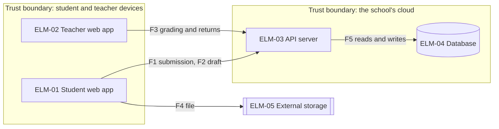
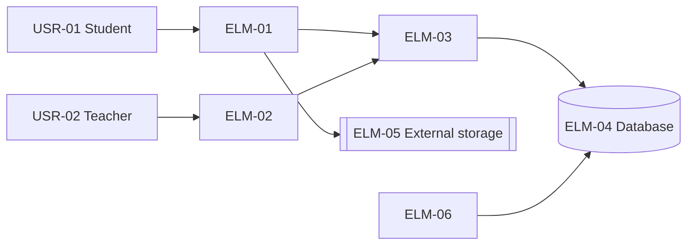
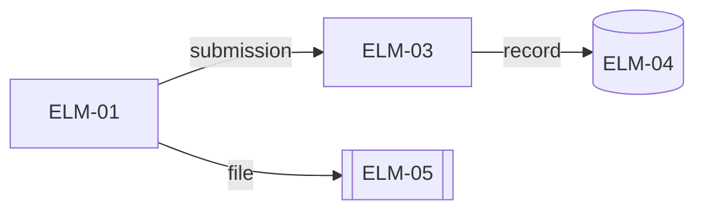
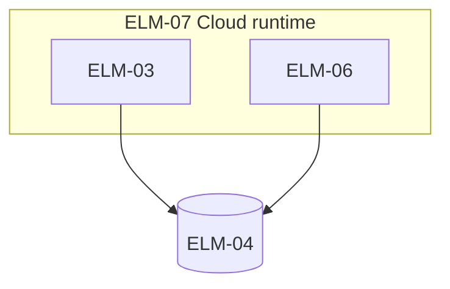
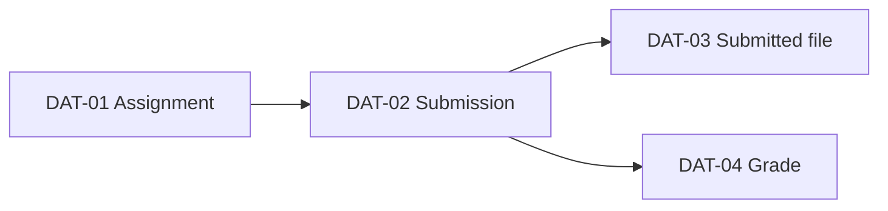
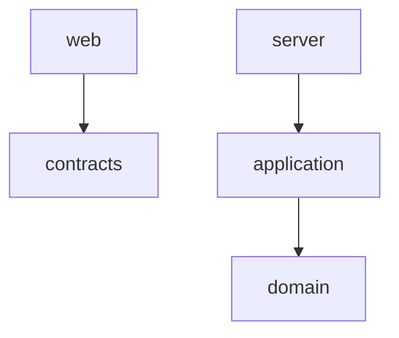

# Architecture: Homework submission service

Status: answers applied · Updated: 2026-09-18 · Stage 2 of 4

## Summary

One API server and two web apps; files go straight to the storage.

## Overall structure

One API server (ELM-03) takes requests from the two web apps (ELM-01, 02). Submitted files go straight to the external storage (ELM-05) through signed URLs (DEC-02).

| Driver (rank) | One API server, and web apps for students and teachers | A service per function | Serverless functions |
|---|---|---|---|
| DRV-01 (1) | Meets | Meets | Meets |
| DRV-06 (5) | Meets | Fails | Partly |

## Decisions

| DEC | Question | Chosen | Addresses | Rejected | Basis |
|---|---|---|---|---|---|
| DEC-01 | How is the system divided, and where does it run? | One API server, and web apps for students and teachers | DRV-06, DRV-01, DRV-04 | A service per function (Two developers cannot run it (DRV-06)). Serverless functions (Does not run the same way locally) | Inferred |
| DEC-02 | How are submitted files stored without passing through the server? | Direct upload with a signed URL | DRV-01, DRV-05, DRV-02 | The server receives and stores the file (Chokes before deadlines (DRV-01)) | Inferred |
| DEC-03 | How do receipts stay in line with the submission records? | Write the record in one transaction, then return the receipt | DRV-03, DRV-09 | Return the receipt first and write the record later (Records can go missing (DRV-03 version 2)) | Inferred |
| DEC-04 | When is the monthly submission report built? | A nightly batch | DRV-06, DRV-03 | Count on every submission (Slows submissions (DRV-02)) | Inferred |
| DEC-05 | How are the records of one submission linked? | The browser creates the trace ID and passes it in a header | DRV-07 | The server creates the ID (Browser failures are not linked (question 4, FND-02)) | Inferred |

### DEC-02 How files are stored

| Driver (rank) | Direct upload with a signed URL | The server receives and stores the file |
|---|---|---|
| DRV-01 (1) | Meets | Fails |

- Gains: the server does not choke before deadlines.

## Design concerns

| Concern | Settled by, or why standard practice is enough |
|---|---|
| Concurrency | Retried submissions are made one by idempotency keys (DEC-08) |
| Data persistence | The record and the receipt are written in one transaction (DEC-03). The previous version showed the receipt first. |
| Error handling and fault tolerance | On a storage outage, submissions stop and ask to try again |
| Variability | Standard practice is enough |

## Threat model

Assets: students' answers, submission records, grades.

| Flow | Crosses | Spoofing | Tampering |
|---|---|---|---|
| F1 ELM-01 → ELM-03 submission | device → school cloud | Submitting as someone else: session (DEC-01) | Changing the deadline: the server decides |
| F2 ELM-01 → ELM-03 draft | device → school cloud | Reading someone else's draft: owner only (DRV-08) | — |
| F3 ELM-02 → ELM-03 grading and returns | device → school cloud | A teacher who does not teach the class grades: the class is checked (FND-02) | Changing a grade: it is recorded |
| F4 ELM-01 → ELM-05 file | device → external service | Uploading with a stolen URL: 15-minute expiry (DEC-02 version 2) | — |
| F5 ELM-03 → ELM-04 reads and writes | inside the school cloud | — | — |

## Elements

| ELM | Kind | Name | Responsibility | FR | Drivers | Team | As-is | Basis |
|---|---|---|---|---|---|---|---|---|
| ELM-01 | Component | Student web app | Opens assignments, uploads files straight to the storage, submits and shows receipts. Saves drafts | FR-01, FR-02, FR-06 | DRV-01, DRV-02, DRV-03 | TEAM-01 | New | Inferred |
| ELM-02 | Component | Teacher web app | Opens submissions, grades and returns them. Shows the monthly report | FR-03, FR-05, FR-08 | DRV-08 | TEAM-01 | New | Inferred |
| ELM-03 | Component | API server | Confirms submissions and receipts, issues signed URLs, grading and returns, records trace IDs | FR-01, FR-02, FR-03, FR-04, FR-06, FR-08 | DRV-01, DRV-02, DRV-03, DRV-07, DRV-08 | TEAM-01 | New | Inferred |
| ELM-04 | Data store | Database | Holds assignments, submission records and grades | — | DRV-03 | TEAM-01 | New | Inferred |
| ELM-05 | External system | External storage | Keeps the submitted files (ObjectStore) | — | DRV-05 | — | New | Inferred |
| ELM-06 | Component | Nightly batch | Builds the submission report every night | FR-05 | DRV-06 | TEAM-01 | New | Inferred |
| ELM-07 | Node | Cloud runtime | Runs the API server and the nightly batch | — | — | TEAM-01 | New | Inferred |

## Views

### Context

### Runtime

| Waits | Waited on | Limit |
|---|---|---|
| ELM-01 | ELM-03 | 10 s |
| ELM-03 | ELM-04 | 2 s |

### Deployment

| Node | Runs | Count | When | Fails with |
|---|---|---|---|---|
| ELM-07 | ELM-03, ELM-06 | 1 | Always | Submissions and grading |

### Information

### Code structure

Dependency rules (checked in CI):

- `domain` depends on nothing.

## Walkthroughs

### CUJs

**CUJ-01 Submit homework**

| Step | FR | Elements | Interactions | Gap |
|---|---|---|---|---|
| Open the assignment | FR-01 | ELM-01, ELM-03 | ELM-01 → ELM-03 gets the assignment | none |
| Attach a file | FR-01 | ELM-01, ELM-05 | ELM-01 → ELM-05 upload with a signed URL | none |
| Submit | FR-01, FR-02 | ELM-01, ELM-03, ELM-04 | ELM-03 writes the record and returns the receipt | none |

**CUJ-02 Grade and return**

| Step | FR | Elements | Interactions | Gap |
|---|---|---|---|---|
| Open the submission | FR-03 | ELM-02, ELM-03, ELM-05 | ELM-02 → ELM-03 list and contents | none |
| Grade | FR-03 | ELM-02, ELM-03 | Saves the grade | none |
| Return | FR-03, FR-08 | ELM-02, ELM-03 | Returns and notifies | none |

**CUJ-03 Investigate a failed submission**

The developer who gets the notice traces the logs with the trace ID and fixes the cause (DEC-05). Too few steps for a table.

**CUJ-04 Check monthly submissions**

| Step | FR | Elements | Interactions | Gap |
|---|---|---|---|---|
| Open the report | FR-05 | ELM-02, ELM-03, ELM-06 | The report up to the previous day | none |

### Primary drivers

| DRV | Where the stimulus enters | Decisions that shape the response | Meets the measure? | Remaining risk |
|---|---|---|---|---|
| DRV-01 | ELM-03 | DEC-01, DEC-02 | Likely | A storage outage |
| DRV-03 | ELM-03 | DEC-03 | Yes | None |
| DRV-05 | ELM-01 | DEC-02 | Yes | None |
| DRV-02 | ELM-03 | DEC-03 | Likely (stage 3 budget) | A slow write |

## Design parameters

| Parameter | Value | Basis | Decision |
|---|---|---|---|
| Signed URL expiry | 15 minutes | Provisional; the time from opening the screen to submitting | DEC-02 |
| Batch start | Daily at 02:00 | Four hours before NFR-02's 6:00 | DEC-04 |

## Debt and deferred decisions

| DEC | Debt or deferral | Why | Repay or revisit when |
|---|---|---|---|
| DEC-04 | Debt: The report only covers up to the previous day | The office reads it monthly (CUJ-04) | When same-day numbers are asked for |
| DEC-06 | Deferred: Which web app gets the parents' screens, and how? | Whether to build the parents' screens is not decided yet (CHG-01). | When the parents' screens are decided on |

## Cost and team

### Running cost

| Cost driver | Usage | Price and free tier | Cap |
|---|---|---|---|
| Runtime | One, always | 10,000 yen a month | Budget alert |
| Storage | 50 GB a year | 2,000 yen a month | None |

## Questions and answers

| # | Question | Drafted answer | Answer | What changed |
|---|---|---|---|---|
| 4 | Where is the trace ID created? | The browser | As drafted | DEC-05 |
