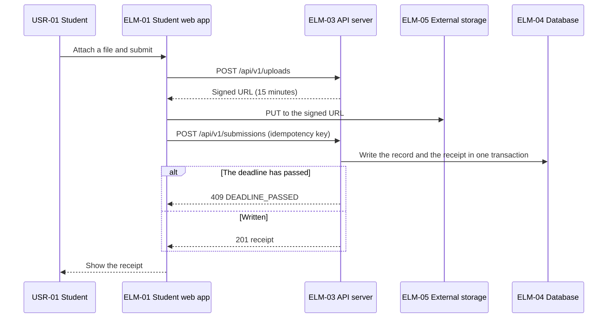
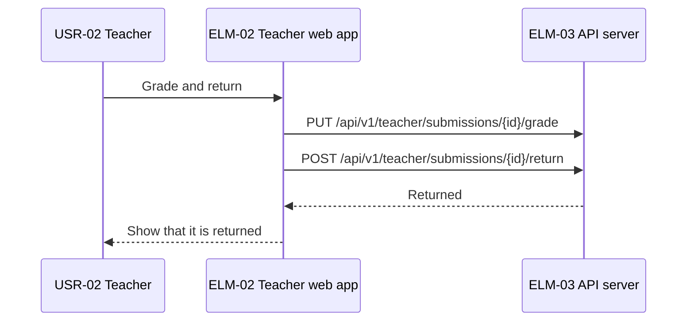
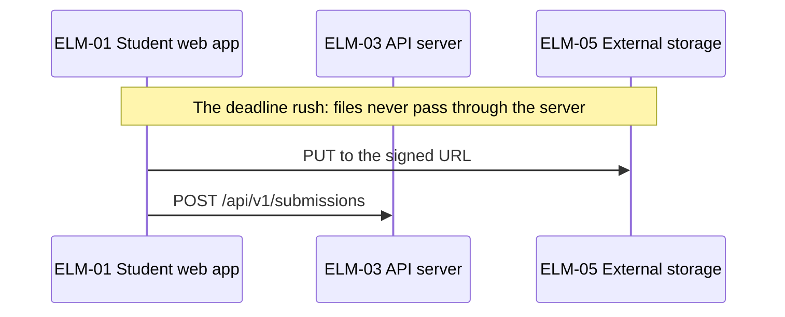
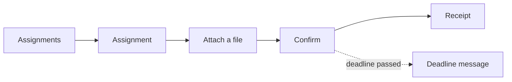
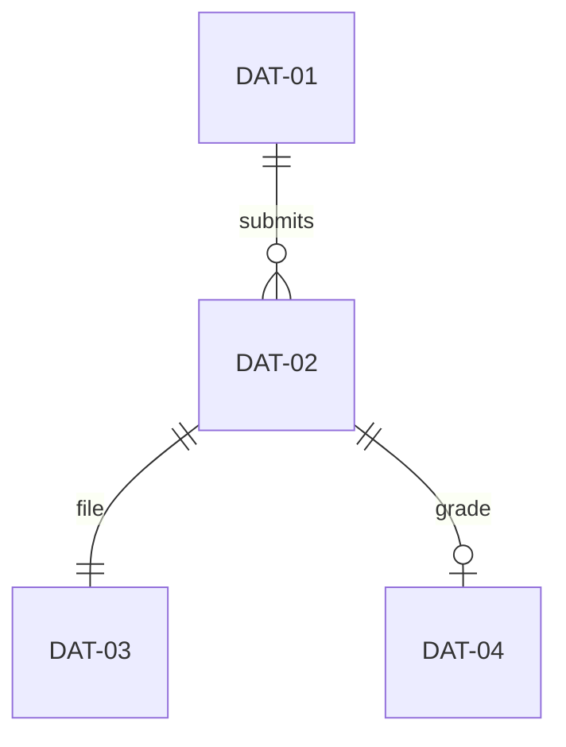
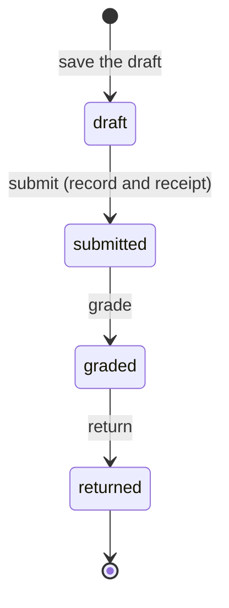

# High-level design: Homework submission service

Status: answers applied · Updated: 2026-09-22 · Stage 3 of 4

## Summary

Four interfaces; the confirmation budget fits in 3 seconds.

## Shared conventions

| Convention | Decided | DEC |
|---|---|---|
| Errors | Problem details with a code and a traceId | DEC-07 |
| Idempotency keys and retries | An Idempotency-Key on every state-changing request | DEC-08 |

## Decisions

| DEC | Question | Chosen | Rejected | Basis |
|---|---|---|---|---|
| DEC-07 | In which shape do all APIs return errors? | Problem details (RFC 9457) with a code and a traceId | Our own {code, message} | Inferred |
| DEC-08 | Which requests are idempotent? | An idempotency key on every state-changing request | An idempotency key on submissions only | Inferred |

## Interfaces

| IFC | Kind | Name | Provider | Consumers | Operations | FR | Spec | Basis |
|---|---|---|---|---|---|---|---|---|
| IFC-01 | HTTP | Submission API | ELM-03 | ELM-01 | 4 | FR-01, FR-02, FR-06 | submissions.openapi.yaml | Inferred |
| IFC-02 | HTTP | Grading API | ELM-03 | ELM-02 | 4 | FR-03, FR-05, FR-08 | teacher.openapi.yaml | Inferred |
| IFC-03 | File | Files in the storage | ELM-05 | ELM-01, ELM-03 | 1 | FR-01 | — | Inferred |
| IFC-04 | Batch | Nightly submission report | ELM-06 | ELM-02 | 1 | FR-05 | — | Inferred |

## Error contracts

| IFC | Operation | Case | Signal | The caller |
|---|---|---|---|---|
| IFC-01 | POST /api/v1/submissions | the deadline has passed | 409 DEADLINE_PASSED | Show that the deadline has passed |
| IFC-01 | POST /api/v1/submissions | the file is not in the storage | 422 FILE_MISSING | Upload the file again |
| IFC-01 | Common | not signed in | 401 UNAUTHENTICATED | Go to the sign-in screen |
| IFC-01 | Common | the request is malformed | 400 INVALID_REQUEST | Fix the fields |
| IFC-02 | POST /api/v1/teacher/submissions/{id}/return | not graded yet | 409 NOT_GRADED | Ask for the grade first |
| IFC-02 | Common | not signed in | 401 UNAUTHENTICATED | Go to the sign-in screen |
| IFC-02 | Common | the request is malformed | 400 INVALID_REQUEST | Fix the fields |
| IFC-03 | — | The URL has expired | 403 (ObjectStore) | Get a new URL |
| IFC-04 | — | The previous day is not finished | Continues from the unfinished day | Nothing |

## End-to-end flows

### CUJ-01 Submit homework

### CUJ-02 Grade and return

### DRV-01 Keep accepting

## Latency budgets

The budgets are not timeouts.

### NFR-06 (the 95th percentile of submission confirmation within 3 seconds)

Measured from the browser sending the request to the receipt being shown.

| Hop | Budget (99th percentile, 4 hops) | Basis |
|---|---|---|
| ELM-01 sends the request | 0.30 s | Provisional |
| ELM-03 own work | 0.20 s | Provisional |
| Write the record and the receipt in ELM-04 (DEC-03) | 0.50 s | Provisional; the 99th percentile of the write |
| Back to the browser and shown | 0.50 s | Provisional |
| Margin | 1.50 s |  |
| Total | 3.00 s | NFR-06 threshold |

### NFR-02 (the nightly report finishes by 6:00)

It starts at 02:00, with four hours to spare (DEC-04). Too few hops for a table.

### Failure paths and error budgets

| SLO | Valid events in 28 days | Error budget volume | How failure paths count |
|---|---|---|---|
| NFR-01 (SLI-01) | 40,000 submissions | 200 | Failures during a storage outage count against the budget |

## Screens

### CUJ-01 Submit homework

### CUJ-02 Grade and return

## Data

| DAT | Entity | Owner | Store | Consistency | Retention | Classification | Basis |
|---|---|---|---|---|---|---|---|
| DAT-01 | Assignment | ELM-03 | ELM-04 | Written per request from teachers | Until the end of the school year | internal | Inferred |
| DAT-02 | Submission | ELM-03 | ELM-04 | The record and the receipt are written in one transaction (DEC-03). The receipt number comes from the record's ID | One year after graduation | personal | Inferred |
| DAT-03 | Submitted file | ELM-01 | ELM-05 | Uploaded once through a signed URL | One year after graduation | personal (students' answers) | Inferred |
| DAT-04 | Grade | ELM-03 | ELM-04 | Written per grading | One year after graduation | personal | Inferred |

### Data quality flows

The numbers of the monthly report (QR-08):

| Requirement | Comes from | Checked by | Passed on by | Compared with |
|---|---|---|---|---|
| QR-07 | ELM-03 | Receipts against records every night | ELM-06 | Receipts and records |

## States across elements

### Submission (ELM-01, ELM-03)

It becomes submitted only after the record is written (DRV-09).

## Measurement points

| SLI | Produced by | Fields |
|---|---|---|
| SLI-01 | ELM-03's request log | route, status, trace_id |
| SLI-02 | ELM-06's completion record | finished_at |

## Acceptance criteria trace

| FR | Criterion | IFC | Flow |
|---|---|---|---|
| FR-01 | Confirming a submission shows a receipt | IFC-01 | CUJ-01 |
| FR-01 | No submission after the deadline | IFC-01 | CUJ-01 |
| FR-03 | A submission can be graded and returned | IFC-02 | CUJ-02 |

## Design parameters

| Parameter | Value | Basis | Item |
|---|---|---|---|
| Idempotency key retention | 24 hours | Provisional | DEC-08 |
