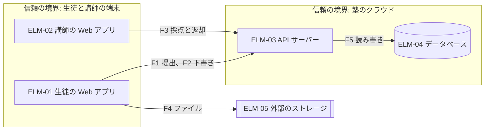
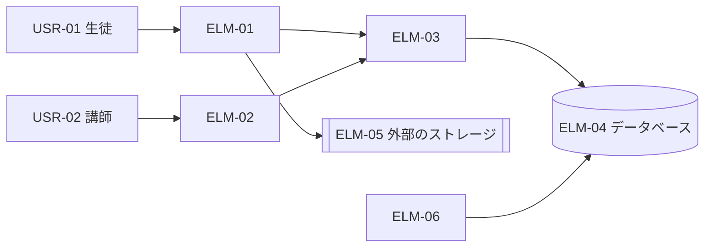
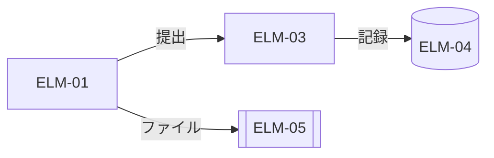
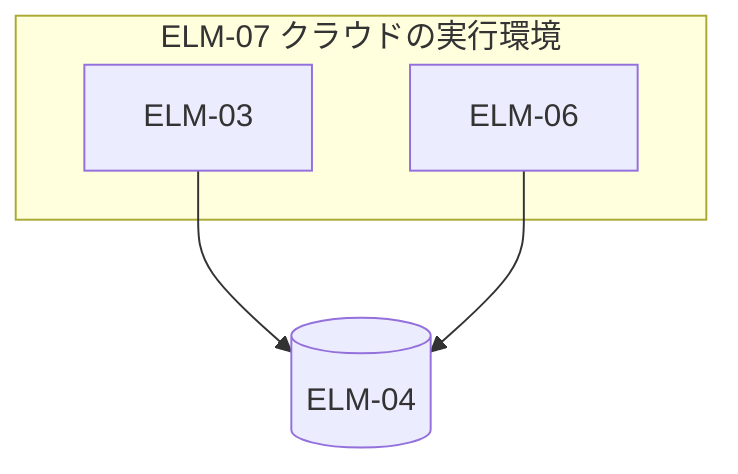
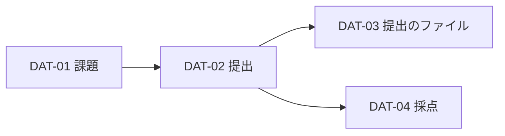
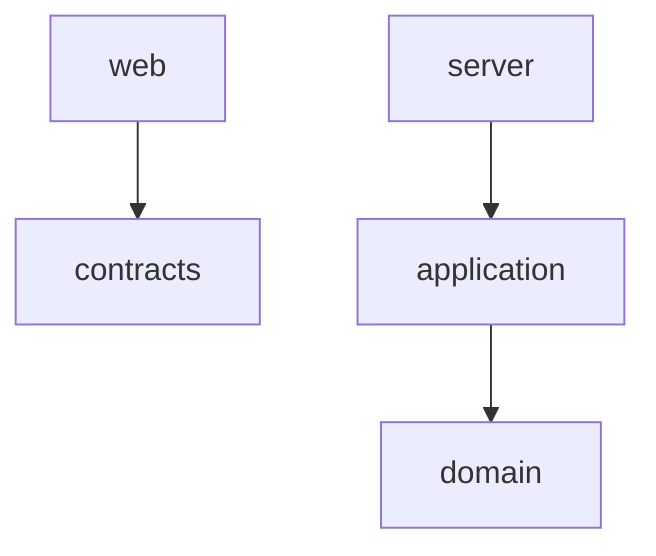

# アーキテクチャ: 課題提出サービス

状態: 回答反映済み · 更新: 2026-09-18 · 第 2 段階（全 4 段階）

## 要約

一つの API サーバーと二つの Web アプリ。ファイルはストレージに直接置く。

## 全体の構造

一つの API サーバー（ELM-03）が、二つの Web アプリ（ELM-01、02）からの要求を受ける。提出のファイルは署名付き URL で外部のストレージ（ELM-05）に直接置く（DEC-02）。

| 要求（順位） | 一つの API サーバーと、生徒と講師の Web アプリ | 機能ごとのサービス | サーバーレスの関数 |
|---|---|---|---|
| DRV-01（1） | 満たす | 満たす | 満たす |
| DRV-06（5） | 満たす | 満たさない | 一部 |

## 設計の決定

| DEC | 問い | 選んだ案 | 対象 | 退けた案 | 根拠 |
|---|---|---|---|---|---|
| DEC-01 | システムをどう分け、どこで動かすか | 一つの API サーバーと、生徒と講師の Web アプリ | DRV-06、DRV-01、DRV-04 | 機能ごとのサービス（2 人では動かせない（DRV-06））。サーバーレスの関数（手元で同じ形にならない） | 推定 |
| DEC-02 | 提出のファイルを、サーバーを通さずにどう置くか | 署名付き URL で直接置く | DRV-01、DRV-05、DRV-02 | サーバーが受けて置く（締め切り前に詰まる（DRV-01）） | 推定 |
| DEC-03 | 受領の表示を、提出の記録とどう一致させるか | 一つのトランザクションで記録を書き、受領を返す | DRV-03、DRV-09 | 受領を先に返し、記録は後で書く（記録が欠けうる（DRV-03 版 2）） | 推定 |
| DEC-04 | 月次の提出状況のレポートをいつ作るか | 毎晩のバッチ | DRV-06、DRV-03 | 提出のたびに数える（提出が重くなる（DRV-02）） | 推定 |
| DEC-05 | 一つの提出の記録をどうつなぐか | ブラウザがトレース ID を作り、見出しで渡す | DRV-07 | サーバーが ID を作る（ブラウザの失敗がつながらない（質問 4、FND-02）） | 推定 |

### DEC-02 ファイルの置き方

| 要求（順位） | 署名付き URL で直接置く | サーバーが受けて置く |
|---|---|---|
| DRV-01（1） | 満たす | 満たさない |

- 得るもの: 締め切り前もサーバーが詰まらない。

## 設計の観点

| 観点 | 決めた決定、または標準のやり方で足りる理由 |
|---|---|
| 並行性 | 同じ提出の送り直しは冪等キーで一つにする（DEC-08） |
| データの永続化 | 記録と受領を一つのトランザクションで書く（DEC-03）。前の版は受領を先に示していた。 |
| エラー処理と障害許容 | ストレージの障害では提出を止め、もう一度試すよう示す |
| 可変性 | 標準のやり方で足りる |

## 脅威のモデル

守るもの: 生徒の答案、提出の記録、採点。

| 流れ | 越える境界 | なりすまし | 書き換え |
|---|---|---|---|
| F1 ELM-01 → ELM-03 提出 | 端末 → 塾のクラウド | 他人になりすまして提出する: セッション（DEC-01） | 期限を書き換える: サーバーが判定する |
| F2 ELM-01 → ELM-03 下書き | 端末 → 塾のクラウド | 他人の下書きを読む: 本人だけ（DRV-08） | — |
| F3 ELM-02 → ELM-03 採点と返却 | 端末 → 塾のクラウド | 担当でない講師が採点する: 担当を確かめる（FND-02） | 点数を書き換える: 記録を残す |
| F4 ELM-01 → ELM-05 ファイル | 端末 → 外部サービス | URL を盗んで置く: 15 分の期限（DEC-02 版 2） | — |
| F5 ELM-03 → ELM-04 読み書き | 塾のクラウドの中 | — | — |

## 要素

| ELM | 種類 | 名前 | 責務 | FR | 要求 | チーム | 差分 | 根拠 |
|---|---|---|---|---|---|---|---|---|
| ELM-01 | コンポーネント | 生徒の Web アプリ | 課題を開き、ファイルをストレージに直接置き、提出して受領を示す。下書きを保存する | FR-01、FR-02、FR-06 | DRV-01、DRV-02、DRV-03 | TEAM-01 | 新設 | 推定 |
| ELM-02 | コンポーネント | 講師の Web アプリ | 提出を開き、採点して返却する。月次のレポートを見る | FR-03、FR-05、FR-08 | DRV-08 | TEAM-01 | 新設 | 推定 |
| ELM-03 | コンポーネント | API サーバー | 提出の確定と受領、署名付き URL、採点と返却、トレース ID の記録 | FR-01、FR-02、FR-03、FR-04、FR-06、FR-08 | DRV-01、DRV-02、DRV-03、DRV-07、DRV-08 | TEAM-01 | 新設 | 推定 |
| ELM-04 | データの置き場所 | データベース | 課題、提出の記録、採点を持つ | — | DRV-03 | TEAM-01 | 新設 | 推定 |
| ELM-05 | 外部システム | 外部のストレージ | 提出のファイルを置く（ObjectStore） | — | DRV-05 | — | 新設 | 推定 |
| ELM-06 | コンポーネント | 夜間のバッチ | 毎晩、提出状況のレポートを作る | FR-05 | DRV-06 | TEAM-01 | 新設 | 推定 |
| ELM-07 | 実行環境 | クラウドの実行環境 | API サーバーと夜間のバッチを動かす | — | — | TEAM-01 | 新設 | 推定 |

## ビュー

### 外部との関係

### 実行時の構成

| 待つもの | 待たれるもの | 待つ上限 |
|---|---|---|
| ELM-01 | ELM-03 | 10 秒 |
| ELM-03 | ELM-04 | 2 秒 |

### 配置

| 実行環境 | 動くもの | 数 | いつ | 一緒に止まるもの |
|---|---|---|---|---|
| ELM-07 | ELM-03, ELM-06 | 1 | いつも | 提出と採点 |

### 情報

### コードの分け方

依存の規則（CI で確かめる）:

- `domain` は何にも依存しない。

## 通し確認

### CUJ

**CUJ-01 課題の提出**

| 手順 | FR | 要素 | やり取り | 欠け |
|---|---|---|---|---|
| 課題を開く | FR-01 | ELM-01, ELM-03 | ELM-01 → ELM-03 課題の取得 | なし |
| ファイルを添付する | FR-01 | ELM-01, ELM-05 | ELM-01 → ELM-05 署名付き URL で置く | なし |
| 提出する | FR-01, FR-02 | ELM-01, ELM-03, ELM-04 | ELM-03 が記録を書いて受領を返す | なし |

**CUJ-02 採点と返却**

| 手順 | FR | 要素 | やり取り | 欠け |
|---|---|---|---|---|
| 提出を開く | FR-03 | ELM-02, ELM-03, ELM-05 | ELM-02 → ELM-03 一覧と内容 | なし |
| 採点する | FR-03 | ELM-02, ELM-03 | 採点を保存する | なし |
| 返却する | FR-03, FR-08 | ELM-02, ELM-03 | 返却して通知する | なし |

**CUJ-03 提出の失敗の調査**

知らせを受けた開発者が、トレース ID でログをたどり、原因を直す（DEC-05）。手順ごとの表にするほどの手順はない。

**CUJ-04 月次の提出状況の確認**

| 手順 | FR | 要素 | やり取り | 欠け |
|---|---|---|---|---|
| レポートを開く | FR-05 | ELM-02, ELM-03, ELM-06 | 前の日までのレポート | なし |

### 主な設計を動かす要求

| DRV | 刺激が入る所 | 応答を形づくる決定 | 測定量を満たすか | 残る危険 |
|---|---|---|---|---|
| DRV-01 | ELM-03 | DEC-01, DEC-02 | 満たす見込み | ストレージの障害 |
| DRV-03 | ELM-03 | DEC-03 | 満たす | なし |
| DRV-05 | ELM-01 | DEC-02 | 満たす | なし |
| DRV-02 | ELM-03 | DEC-03 | 満たす見込み（第 3 段階の予算） | 書き込みの遅れ |

## 設計上の値

| 値 | 仮の値 | もと | 決定 |
|---|---|---|---|
| 署名付き URL の有効期限 | 15 分 | 仮。提出の画面を開いてから送るまでの時間 | DEC-02 |
| バッチの起動 | 毎日 02:00 | NFR-02 の 6:00 まで 4 時間 | DEC-04 |

## 技術的負債と先送りした決定

| DEC | 負債か先送りか | 理由 | 返す・見直すとき |
|---|---|---|---|
| DEC-04 | 負債: レポートは前の日までの分しか出ない | 塾の事務は月次で見る（CUJ-04） | 当日の数字が要ると言われたとき |
| DEC-06 | 先送り: 保護者向けの画面を、どの Web アプリにどう足すか | 保護者の画面を作るかが、まだ決まっていない（CHG-01）。 | 保護者の画面を作ると決めたとき |

## 費用と体制

### 走る費用

| 費用のもと | 使う量 | 値段と無料の枠 | 上限の仕組み |
|---|---|---|---|
| 実行環境 | 一つ、いつも | 月 1 万円 | 予算の知らせ |
| ストレージ | 年 50 GB | 月 2 千円 | なし |

## 質問と回答

| # | 質問 | 下書きの答え | 回答 | 変わったこと |
|---|---|---|---|---|
| 4 | トレース ID はどこで作るか | ブラウザ | そのとおり | DEC-05 |
