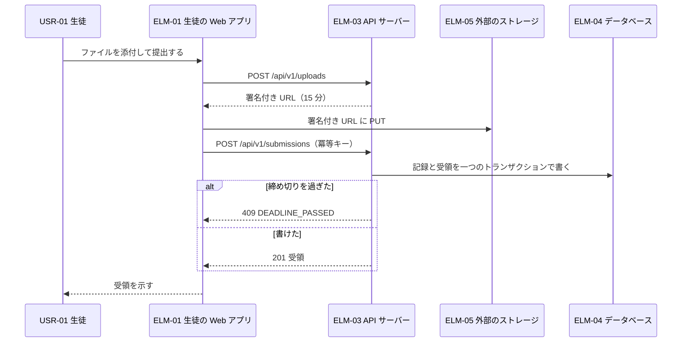
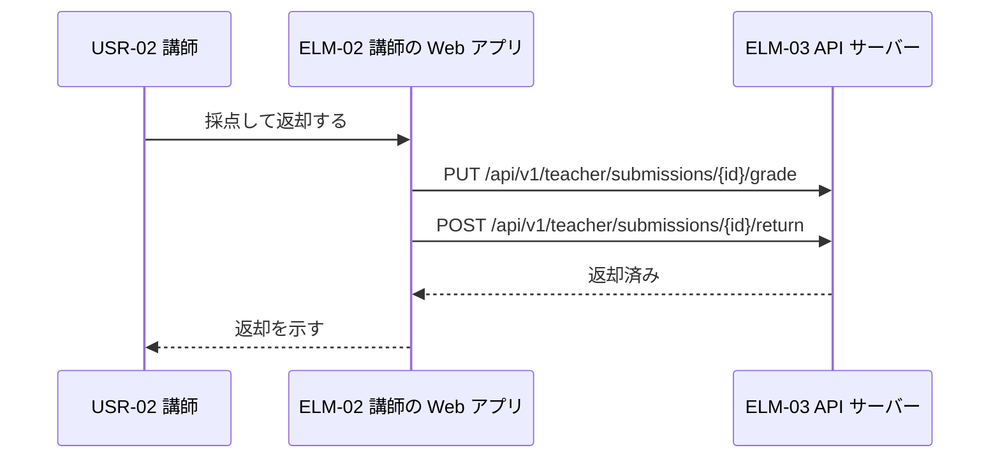
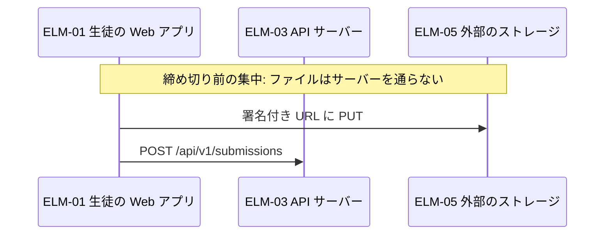
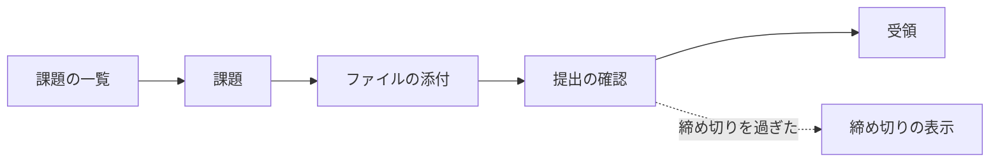
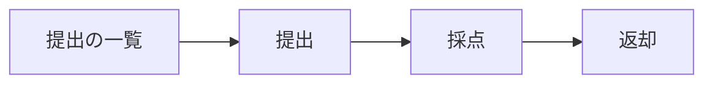
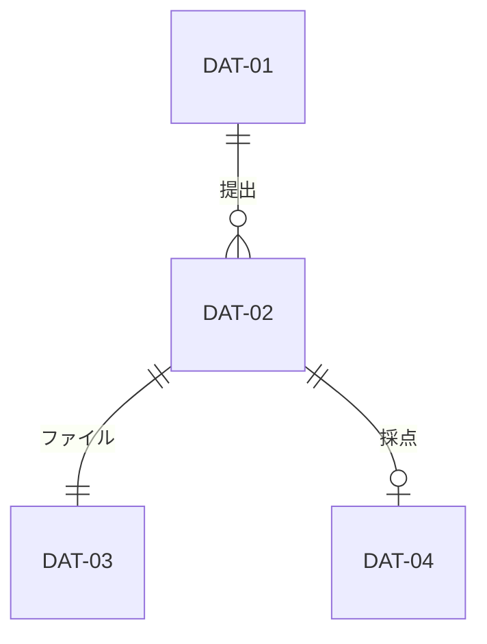
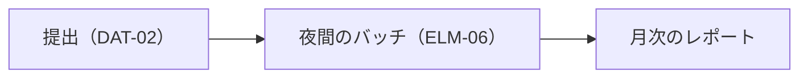
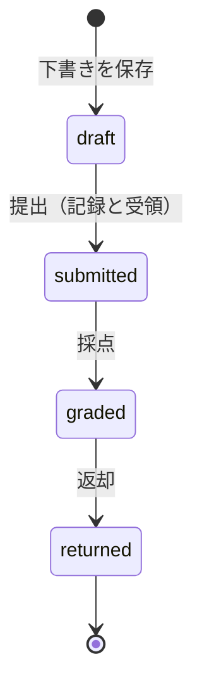

# 概要設計: 課題提出サービス

状態: 回答反映済み · 更新: 2026-09-22 · 第 3 段階（全 4 段階）

## 要約

インタフェースは四つ。確定の予算は 3 秒に収まる。

## 共通の約束事

| 約束事 | 決めたこと | DEC |
|---|---|---|
| エラー | 問題の詳細に code と traceId | DEC-07 |
| 冪等キーと送り直し | 状態を変える要求すべてに Idempotency-Key | DEC-08 |

## 設計の決定

| DEC | 問い | 選んだ案 | 退けた案 | 根拠 |
|---|---|---|---|---|
| DEC-07 | すべての API で、エラーをどの形で返すか | 問題の詳細（RFC 9457）に code と traceId を足す | 独自の {code, message} | 推定 |
| DEC-08 | どの要求を冪等にするか | 状態を変える要求すべてに冪等キー | 提出だけに冪等キー | 推定 |

## インタフェース

| IFC | 種類 | 名前 | 提供側 | 利用側 | 操作 | FR | 仕様 | 根拠 |
|---|---|---|---|---|---|---|---|---|
| IFC-01 | HTTP | 提出の API | ELM-03 | ELM-01 | 4 | FR-01、FR-02、FR-06 | submissions.openapi.yaml | 推定 |
| IFC-02 | HTTP | 採点の API | ELM-03 | ELM-02 | 4 | FR-03、FR-05、FR-08 | teacher.openapi.yaml | 推定 |
| IFC-03 | ファイル | ストレージへのファイル | ELM-05 | ELM-01、ELM-03 | 1 | FR-01 | — | 推定 |
| IFC-04 | バッチ | 夜間の提出状況レポート | ELM-06 | ELM-02 | 1 | FR-05 | — | 推定 |

## エラーの決まり

| IFC | 操作 | 場合 | 知らせ方 | 呼ぶ側 |
|---|---|---|---|---|
| IFC-01 | POST /api/v1/submissions | 締め切りを過ぎた | 409 DEADLINE_PASSED | 締め切りを過ぎたと示す |
| IFC-01 | POST /api/v1/submissions | ファイルがストレージにない | 422 FILE_MISSING | もう一度ファイルを置く |
| IFC-01 | 共通 | ログインしていない | 401 UNAUTHENTICATED | ログインの画面へ |
| IFC-01 | 共通 | 要求の形が違う | 400 INVALID_REQUEST | 欄を直す |
| IFC-02 | POST /api/v1/teacher/submissions/{id}/return | 採点が済んでいない | 409 NOT_GRADED | 採点を促す |
| IFC-02 | 共通 | ログインしていない | 401 UNAUTHENTICATED | ログインの画面へ |
| IFC-02 | 共通 | 要求の形が違う | 400 INVALID_REQUEST | 欄を直す |
| IFC-03 | — | URL の期限切れ | 403 (ObjectStore) | 新しい URL をもらう |
| IFC-04 | — | 前の日の分が終わっていない | 終わっていない日から続ける | なし |

## 端から端の流れ

### CUJ-01 課題の提出

### CUJ-02 採点と返却

### DRV-01 受け付け続ける

## 遅延の予算

予算はタイムアウトではない。

### NFR-06（提出の確定の 95 パーセンタイルが 3 秒以内）

測る区間は、ブラウザが送ってから受領を示すまで。

| 区間 | 予算（99 パーセンタイル。4 区間） | もと |
|---|---|---|
| ELM-01 が要求を送る | 0.30 秒 | 仮 |
| ELM-03 の処理 | 0.20 秒 | 仮 |
| ELM-04 に記録と受領を書く（DEC-03） | 0.50 秒 | 仮。書き込みの 99 パーセンタイル |
| ブラウザに戻って示す | 0.50 秒 | 仮 |
| 余り | 1.50 秒 |  |
| 合計 | 3.00 秒 | NFR-06 のしきい値 |

### NFR-02（夜間レポートが 6:00 までに終わる）

02:00 に起動し、4 時間の余裕がある（DEC-04）。区間の表にするほどの区間はない。

### 失敗したときの流れとエラーバジェット

| SLO | 28 日の有効な出来事 | 許容される失敗の件数 | 失敗したときの流れの扱い |
|---|---|---|---|
| NFR-01（SLI-01） | 提出 4 万件 | 200 件 | ストレージの障害の間の失敗はバジェットに入る |

## 画面

### CUJ-01 課題の提出

### CUJ-02 採点と返却

## データ

| DAT | 実体 | 持ち主 | 置き場所 | 整合の取り方 | 保持期間 | 扱いの区分 | 根拠 |
|---|---|---|---|---|---|---|---|
| DAT-01 | 課題 | ELM-03 | ELM-04 | 講師の要求ごとに書く | 学年の終わりまで | internal | 推定 |
| DAT-02 | 提出 | ELM-03 | ELM-04 | 提出の記録と受領を一つのトランザクションで書く（DEC-03）。受領の番号は記録の ID から作る | 卒業の後 1 年 | personal | 推定 |
| DAT-03 | 提出のファイル | ELM-01 | ELM-05 | 署名付き URL で一度だけ置く | 卒業の後 1 年 | personal（生徒の答案） | 推定 |
| DAT-04 | 採点 | ELM-03 | ELM-04 | 講師の採点ごとに書く | 卒業の後 1 年 | personal | 推定 |

### データの品質の流れ

月次のレポートの数（QR-08）:

| 要求 | どこから来るか | どう確かめるか | どう伝わるか | 何と何を照らすか |
|---|---|---|---|---|
| QR-07 | ELM-03 | 毎晩、受領と記録を照らす | ELM-06 | 受領と記録 |

## 要素をまたぐ状態

### 提出（ELM-01、ELM-03）

submitted になるのは記録を書いた後だけ（DRV-09）。

## 測定点

| SLI | 出どころ | 欄 |
|---|---|---|
| SLI-01 | ELM-03 の要求のログ | route, status, trace_id |
| SLI-02 | ELM-06 の終わりの記録 | finished_at |

## 受け入れ基準のトレース

| FR | 基準 | IFC | 流れ |
|---|---|---|---|
| FR-01 | 提出を確定すると受領が出る | IFC-01 | CUJ-01 |
| FR-01 | 締め切りの後は提出できない | IFC-01 | CUJ-01 |
| FR-03 | 採点して返却できる | IFC-02 | CUJ-02 |

## 設計上の値

| 値 | 仮の値 | もと | 項目 |
|---|---|---|---|
| 冪等キーの保持 | 24 時間 | 仮 | DEC-08 |
