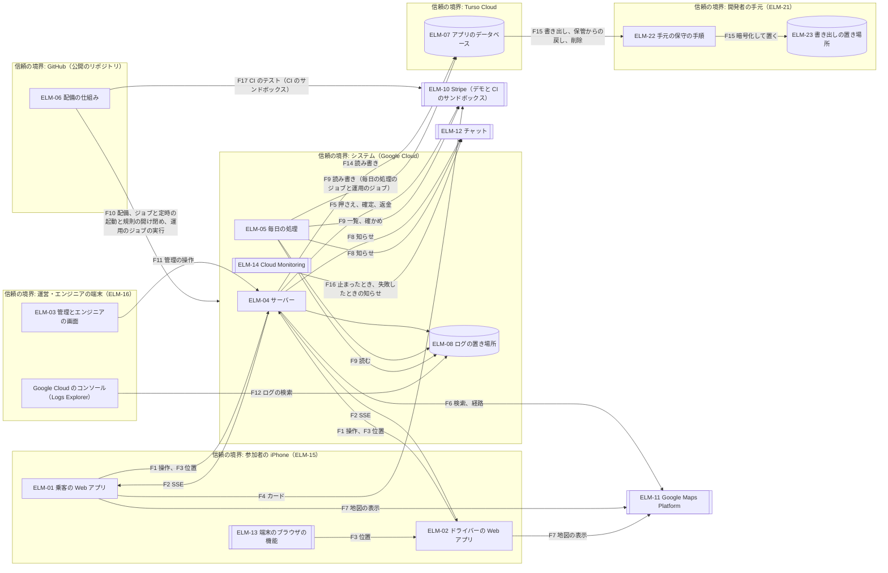
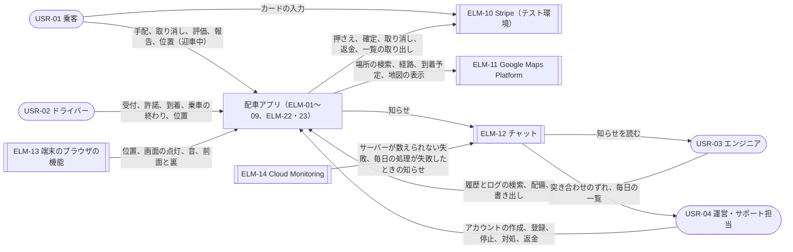
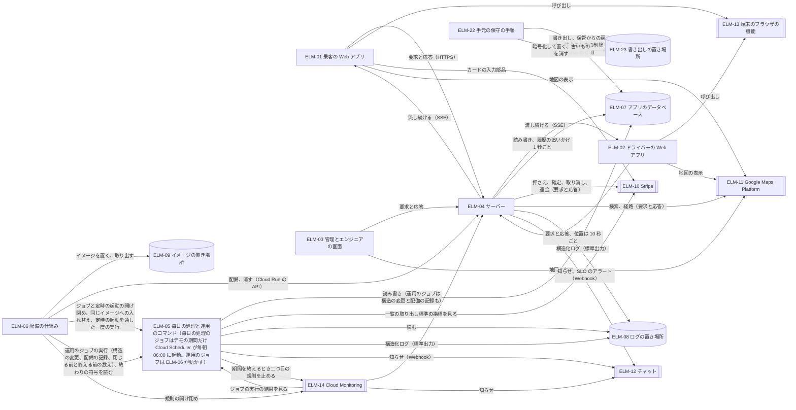
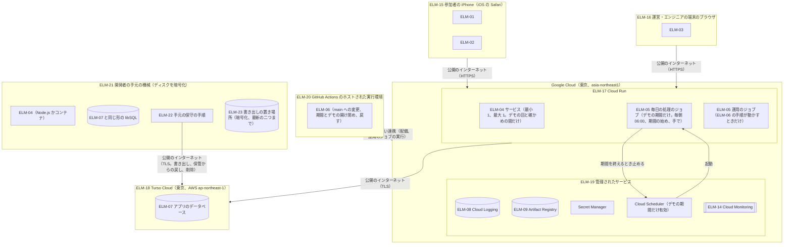
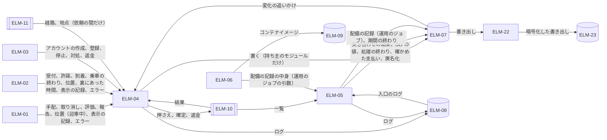
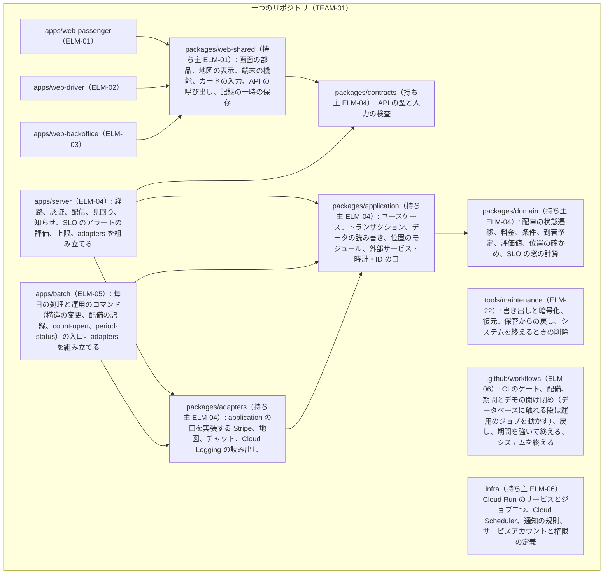

# アーキテクチャ: 配車アプリ（ride-hailing-app-demo）

状態: 回答反映済み（再実行、4 回目） · 更新: 2026-11-04 · 第 2 段階（全 4 段階）

## 再実行（2026-11-03、4 回目: 品質チェーンの再実行と第 1 段階の 3 回目の再実行への追随）

きっかけは、品質チェーンの再実行（2026-11-03、コミット `896be5c`）と、それに追随した第 1 段階の 3 回目の再実行。品質チェーンは、設計の連鎖が返した課題 16 件への利用者の回答（`docs/quality-chain-answers.md`）を反映し、この段の品質チェーンへの課題 1〜3・5〜9 にすべて答えた（課題 4 は決着済み）。第 1 段階は FND-27 を受け入れて PC-06（URL の公開と招待制）を足し、DRV 19 件を直した（順位と主な要求 16 件は変わらない）。この段への未解決の指摘はない。

品質チェーンの答えのうち、この段の決定を動かしたもの:

- 招待制（課題 9。FR-01 版 3、FR-48 版 2、PC-06）: アカウントは運営・サポート担当が参加者にだけ作り、乗客もドライバーも一度だけ使える設定の符号でパスワードを決める。参加者でない人はログインより先に進めない。
- 確認コードを両方向の確かめに使う（第 1 段階の課題 5。FR-26 版 2）。
- 手配から T_request_max を過ぎた許諾のない依頼をシステムが取り消す（課題 7。FR-08 版 2）。
- 押さえの結果が分からないときの扱い（課題 1。FR-05 版 3、FR-12 版 4。T_hold_wait の値は第 3 段階の DEC-52）。
- 失敗と分かった後のやり直しは新しいキー（FR-30 版 4、FR-50 版 4）。
- 疑わしい到着にも規則どおり請求し、担当が毎日の一覧で見て返金する（課題 2。QR-49 版 3、NFR-45 版 2）。
- 位置を求めるのは場所で行う四つの操作だけ（課題 5。FR-39 版 3、SLI-05 版 2）。苦情の調べは記録した位置で示す（課題 3。FR-45 版 2、FR-17 版 2）。
- 押さえ直しを二重の押さえから除き、古い押さえを残さない（課題 6。QR-09 版 5、NFR-07 版 3）。
- SLI-03 を確かめ直しの形に書き直した（課題 8。SLI-03 版 2）。デモの回の開け閉めの時刻を配備の記録に残す（FR-41 版 4。FRP-11）。本番に出すまでの時間は main に入って CI が通るまでで測る（QIU-28〜30 版 3、FR-41 版 3）。

| 変わった項目 | 何が変わったか | きっかけ |
|---|---|---|
| DEC-21（版 5） | 招待制で参加者でない人は流れも地図も使えないので、版 4 の流れの優先、地図の取り置き（R_maps_reserve）、アカウントの作成の回数の制限を外した。負債を返した。ブラウザの地図の鍵をログインした人にだけ渡し、設定の符号の入口に IP ごとの回数の制限を置く。残る危険は、多くの IP からのログインより前の大量の要求 | 課題 9、PC-06、DRV-29 版 2 |
| DEC-22（版 3） | 地図の 1 日の呼び出しの数えと取り置きをやめ、1 日の上限は Google Cloud の API ごとの割り当てに任せる | DEC-21 版 5 |
| DEC-30（版 2） | 先送りを閉じた。確認コードを両方向の確かめに使い、運転の開始は担当のドライバーのアカウントがコードを送って一致したときだけ記録し、乗客の画面の乗車中はその記録を受けたときだけ示す | 第 1 段階の課題 5、FR-26 版 2、DRV-29 版 2 |
| DEC-04（版 3） | 時刻の規則に、T_request_max でのシステムの取り消しと T_hold_wait までの押さえの確かめを足した。サービスが消えた後に残った許諾のない依頼は毎日の処理が取り消す | 課題 1・7、FR-05・08・12、DRV-05 版 3、DRV-33 版 3 |
| DEC-37（版 4） | (A) に T_request_max を過ぎた許諾のない依頼を足し、(B) を許諾の後の依頼に縮めた | 課題 7、DRV-33 版 3 |
| DEC-09（版 2） | 状態遷移表に入れるもの（押さえを確かめている間、システムの取り消しと許諾のぶつかり、担当のドライバーのコードの一致を条件にした運転の開始）を書いた | FR-05・08・26、DRV-05 版 3 |
| DEC-10（版 3）、DEC-11（版 2）、DEC-12（版 4）、DEC-13（版 4） | 押さえを取り消す場合に、システムの取り消しと手配をやめたときを足した。押さえ直しの結果が分からないときの扱いと、古い押さえを残さないことを書いた。押さえの結果が分からないときの扱いと失敗の後の新しいキーを根拠に書き、キーの表を直した。突き合わせが誤りとして数える場合を NFR-07 版 3 に合わせた | 課題 1・6、FR-05・08・12・30・50、QR-09 版 5、NFR-07 版 3、DRV-04 版 4、DRV-30 版 2 |
| DEC-15（版 5）、DEC-16（版 5） | 位置を持つ変化を場所で行う四つの操作に絞った。毎日の SLI-03 は SLI-03 版 2 と同じ形で、回の開け閉めの時刻を配備の記録から取る。SLI-05 版 2 と NFR-25 版 3 の数え方を足した | 課題 3・5・8、DRV-27 版 3、DRV-32 版 3 |
| DEC-20（版 4） | 招待制のアカウントの作り方（設定の符号、出し直し、パスワードの再設定、決め直したらほかのセッションを終える、符号の入口の回数の制限）を書いた | 課題 9、FR-01・48、DRV-29 版 2 |
| DEC-27（版 4） | 配備の記録に、各変更の最初のコミットの時刻と main に入って CI が通った時刻、デモの回を開いた時刻と閉じた時刻を残す | QIU-28〜30 版 3、FR-41 版 3・4、DRV-16 版 2 |
| DEC-29（版 2） | 疑わしい到着の料金の扱いを根拠に書いた | 課題 2、QR-49 版 3 |
| DEC-31（版 2） | 記録する管理の操作に、参加者のアカウントの作成と設定の符号の出し直しを足した | FR-48 版 2、QR-22 版 2、DRV-25 版 2 |
| DEC-35（版 4） | 前提の「デモの回の外」の記述を、品質チェーンが NFR-01〜03 から外したと書き替えた | NFR-01〜03 版 2 |
| ELM-01（版 3）、ELM-03（版 3）、ELM-04（版 5）、ELM-05（版 4） | 設定の符号の画面、押さえを確かめている間の画面、乗る前の案内、参加者のアカウントの作成、見回りの規則、流れの優先と地図の数えの削除、毎日の処理が T_request_max で残った依頼を取り消すこと | 上の決定 |
| 脅威のモデル | F1・F2 を招待制で書き直し、設定の符号の横取りを足した。F11 に参加者のアカウントの作成を、F13 に DEC-30 版 2 を書いた | 上の決定 |
| 通し確認、表 | CUJ と主な要求の残る危険から、決着した課題の欠けを外し、新しい扱いを書いた。設計上の値から R_maps_reserve とアカウントの作成の制限を外した。品質チェーンへの課題をすべて決着にした | 上の決定 |

質問 27（前提 4 件: 流れの優先と地図の取り置きとアカウントの作成の制限を外す、ブラウザの地図の鍵はログインした人にだけ渡す、地図の 1 日の数えをやめる、パスワードを決め直したらほかのセッションを終える）は回答がなく、推定のまま。

決定は 37 件、要素は 23 件で、数は変わらない。全体の構造も変えていない。今回は、品質チェーンが機能で答えた分だけ設計が軽くなった（DEC-21 の優先と取り置き、DEC-22 の数え、DEC-30 の先送り、DEC-37 の (B) の大半）。足したのは、時刻の規則一つ（T_request_max）と押さえを確かめている間の扱いで、どちらも見回りとキーの表の今の仕組みに載る。

後の段への影響: 第 3 段階の再実行で、IFC-01（`POST /api/v1/auth/signup` を外し、設定の符号の入口を乗客にも使う。`GET /api/v1/config` の地図の鍵をログインの後に回す）、IFC-06（参加者のアカウントの作成。設定の符号を設定の後にも出し直せるようにし、409 SETUP_ALREADY_DONE を外す）、IFC-08（流れの優先を外す）、IFC-02（見積もりと場所の検索の取り置きを外す。押さえを確かめている間の応答）、DEC-55（アカウントの作成の制限を外し、設定の符号の IP ごとの制限を参加者全員に使い、ログインの止め方を DEC-20 の組の形に）、DEC-52（FR-05・12 の形に合わせる。FND-31）、DEC-48・50、時刻の規則の流れ（T_request_max）、運転の開始の流れ（乗客の画面の乗車中）、DAT-02（設定の符号）、DAT-25・26（配備の記録の中身）、地図の 1 日の呼び出しの数の実体が変わる。第 3 段階への未解決の指摘 FND-30〜43・45〜48 と、品質チェーンへの回答のうち第 3 段階が扱うもの（設計 3-2 の返金のキー、レビュー 3-1 の NFR-25）も同じ再実行で扱う。

## 再実行（2026-11-03、3 回目: 二つのレビューと第 3 段階の指摘への対応）

きっかけは、この段への未解決の指摘 12 件。第 2 段階の再実行分のレビュー（`reviews/2026-11-03-architecture-2.md`）の FND-19〜26（中 3 件、軽微 5 件）、第 3 段階（`architecture-to-high-level-design`）が出した FND-28・29（軽微）、第 3 段階のレビュー（`reviews/2026-11-03-high-level-design.md`）の FND-44・49（軽微）。あわせて、第 1 段階の 2 回目の再実行（FND-18 の受け入れ。TC-07 に期間の延長が入り、DRV-18・DRV-04 が版 3）に追随した。品質チェーンは変わっていない。第 1 段階への FND-27（URL の公開と PC-05）は未解決のまま。

12 件すべてを受け入れた。質問 20〜24 は、FND-21 の質問 22 を除いて下書きどおりと確認できた。質問 22 の答えで、FND-21 は下書き（確定を応答の後に続ける）ではなく、乗車の終了と降車場所の変更の確定の経路だけ上限を 20 秒にする形にした。質問 25・26（前提 8 件）は何も選ばれず、推定のまま。第 3 段階が先に決めた形（DEC-48 の冪等キー、DEC-51 の配信の出どころ、DEC-53 の運用のコマンド、DEC-54 の一つ目の規則、DEC-55 の回数の制限、IFC-13 の Stripe に送るもの）は、この段の決定の側をそれに合わせた。全体の構造は変えていない。

| 指摘 | 変わった項目 | 何が変わったか |
|---|---|---|
| FND-19（中） | DEC-34、DEC-27、DEC-28、DEC-37、ELM-05、ELM-06、脅威のモデル F9・F10・F15 | 配備の仕組み（ELM-06）からデータベースの資格情報をなくした。構造の変更、配備の記録、閉じる前と終える前の数えは、同じイメージの運用のコマンドを Cloud Run の運用のジョブ（ELM-05 の別の動かし方。自分のサービスアカウントで Turso のトークンを読む）で動かし、ELM-06 は鍵を置かない連携で起こして終わりの符号だけを受ける。前の版は、すべての表を読めるトークンを公開のリポジトリの CI に置きながら「書き出せるのは開発者の手元のログインだけ」としていた |
| FND-20（中） | DEC-35、DEC-17、DEC-16、ELM-14 | サーバーが数えられないものに「Turso に届かないか遅いとき」を足した。一つ目の規則は入口で数えた 5xx と 429 をアプリが返したものも含めて見る（指標で分けられない。第 3 段階の DEC-54）ので、Turso の障害でアプリが返す 503 で鳴る。知らせは送ってから記録を書く。毎日の SLI-03 は、サーバーの確かめの記録ではなく受信と状態の記録から確かめ直して数える（確かめられなかった分を落とさない） |
| FND-21（軽微） | DEC-12、DEC-33 | お金の操作ごとに、要求の中の Stripe の呼び出しの回数と最悪の時間を表にした。乗車の終了（確定を同じキーで 3 回まで。ふだん 9.35 秒、Turso が T_db で止まると 15.05 秒）と降車場所の変更の確定（新しい押さえと古い押さえの取り消し。5.45 秒、13.05 秒）の経路だけ、上限を T_route_long（20 秒）にした（質問 22）。ほかの経路は T_route（10 秒）のままで、最悪は 2.85 秒、遅くても 8.55 秒（計算）。前の版の T_route のもとはこの二つを見ていなかった。お金を動かす操作はすべて操作キーを持つ（第 3 段階の DEC-48 に合わせた） |
| FND-22（軽微） | DEC-37、DEC-05、DEC-27、ELM-05、ELM-06 | 期間の終わりは毎日の処理が自分で決める。最後の回を閉じたと記録された後の実行が、残りを 0 件と記録したら、定時の起動と二つ目の規則を止めて知らせる。残りを、毎日の処理が片付けられるもの（確かめ中、状態を取り出せる押さえ）と、サービスか参加者でしか片付かないもの（終わっていない依頼とその押さえ）に分け、後者が残るときは待たずに知らせる。負債の返すときを直した |
| FND-23（中） | DEC-21、DEC-22、脅威のモデル F1・F2 | URL を公開する前提で決め直した。運営が登録したドライバー、運営とエンジニア、割り当て済みの乗客の流れは、全体が 40 本でも優先でない流れのうち最も古いものを閉じて入れる。地図は割り当て済みの依頼の分を 1 日 300 回取り置く。前提の「公開していない URL」を外し、残る危険を計算した数で書き直した（割り当て前の乗客は参加者でない人と流れと地図を分け合う） |
| FND-24（軽微） | DEC-35、DEC-16 | 後から届いた裏の記録で、アラートの確かめを除き直し、外れたら外れたと送る。毎日の SLI-03 は確かめ直しなので後から届いた記録も効く。回の始めに少ない古い確かめで鳴ることを応答を左右する点に書いた |
| FND-25（軽微） | DEC-15 | 最後の位置の読める相手に、配信（相手を確かめて返す）と測るモジュール（座標を除いた受けた時刻だけ）を足した。受信の記録の毎日の処理の用途を、確かめ直しに合わせた |
| FND-26（軽微） | DEC-10、DEC-36、ELM-10、ELM-22 | Stripe には内部の ID だけを送り、メールアドレスと名前を送らない（第 3 段階の IFC-13 のとおり）。システムを終える手順の最後に、Stripe のデモと CI のサンドボックスを消す |
| FND-28（軽微） | DEC-03、DEC-15、DEC-22、「費用と体制」 | 配信の出どころにドライバーの受付の記録と、相手の位置と到着予定の今の値を足した（第 3 段階の DEC-51）。読み出しは 1 回の回で 32,400 回。経路を求める場面に依頼の内容を足し、1 回の回の地図の見込みを 198 回（Q_maps_day に 5.05 倍）に直した |
| FND-29（軽微） | DEC-12、DEC-13 | キーの表に未払いの支払い（自動で確定する PaymentIntent）を足した。突き合わせはこれを依頼の請求として数える |
| FND-44（軽微） | DEC-20 | ログインの一時の停止を、アカウントと IP の組で数える形にした。アカウント全体を止めると、メールアドレスを知る人が本人を 15 分締め出せる |
| FND-49（軽微） | ELM-02 | functions に FR-47 を足した |
| 第 1 段階の 2 回目の再実行 | DEC-05、DEC-37、報告書の FND-18 の行、DRV-18 の通し確認、未解決の点 | TC-07 に期間の延長が入ったので、「TC-07 への追記は FND-18」「足すまでは TC-07 の文の外で動く」を外した |

後の段への影響: 第 3 段階の再実行で、IFC-02（降車場所の変更の確定の上限 20 秒、見積もりと場所の検索の取り置き）、IFC-03（乗車の終了の上限 20 秒）、IFC-08（流れの優先）、IFC-10・IFC-11（運用のジョブ、期間の終わり、最後の回の印）、IFC-12（サンドボックスを消す）、IFC-14（請求先の情報を集めない）、IFC-19（二つ目の規則は毎日の処理のジョブだけ）、IFC-21（運用のジョブの実行、毎日の処理による定時の起動と規則の停止）、DAT-21・24・25・26（確かめ直し、期間の終わり、配備の記録の持ち主）、DEC-48（T_op_stale のもと）、DEC-50（T_route と T_route_long、その二つの経路のブラウザのタイムアウト）、DEC-53、DEC-55（ログインの止め方、地図の取り置き）、CUJ-11〜13 と DRV-01・04 の流れ、デモの期間と回の状態遷移図、SLI-03 の測定点が変わる。品質チェーンへの課題を二つ足した（8: SLI-03 の確かめられなかった分、9: 参加者でない人の登録と利用）。

## 再実行（2026-11-03、2 回目: 第 1 段階の再実行への追随）

きっかけは、第 1 段階（`requirements-to-architecture-drivers`）の再実行。この段が出した指摘 FND-01〜03 を第 1 段階がすべて受け入れ、DRV 15 件を版 2 にし、設計の前提に PC-05（規模）を足し、TC-07・TC-08 を直した。順位と主な要求（16 件）は変わっていない。品質チェーンも変わっていない。この段への未解決の指摘はない。

第 1 段階の質問 13 の答え（NFR の量を受け入れて進み、品質チェーンは直さない）が、DEC-35 の先送りを見直す条件と DEC-17 の負債を返す条件（どちらも「第 1 段階の課題 2 に答えが出たとき」）を満たした。そのため、この再実行の中心はこの二つになった。

| 変わった項目 | 何が変わったか | きっかけ |
|---|---|---|
| DEC-35 | 先送りをやめた。NFR-01〜03 のバーンレートのアラートは、サーバーが毎分 Turso の記録から数え、DEC-17 の知らせの道でチャットに送る。サーバーが数えられないものは DEC-17 の一つ目の規則が見る。前の版は三つのアラートをまとめて「知らせが出ないか、1 件で出て何も見分けない」としていた。SLI ごとに計算すると、SLI-03 のアラートはこの規模でも位置が止まったことを見分ける。この判断は前の版の誤りだったので直した | 第 1 段階の質問 13 |
| DEC-17 | 負債のうち「止まったときの知らせの粗い条件」を返した。NFR-01 のアラートは DEC-35 が作るので、一つ目の規則はサーバーが数えられないもの（アプリが止まったとき、入口が返した 5xx と 429）だけを見ればよい。定時の起動が止められたときの負債は、もとの課題 2 とは関係がないので、返す条件を直して残した | 第 1 段階の質問 13 |
| DEC-16 | SLO のアラートのための 1 分ごとの数と SLI-03 の毎分の確かめはサーバーが書き、毎日の処理は SLI-03 をその確かめから数える | DEC-35 |
| ELM-04、ELM-14 | ELM-04 の責務に SLO のアラートの評価を足した。ELM-14 の一つ目の規則の役目を書いた | DEC-35、DEC-17 |
| DEC-05 | 失うものから「TC-07 の文と食い違う」を外し、デモの期間の読み方の出どころを TC-07 にした（第 1 段階の質問 12 で確認済み） | FND-02 の受け入れ |
| DEC-15 | DRV-32 の版 2 はこの分け方と同じことを求める。そのため根拠から「食い違いは FND-01 にした」を外した | FND-01 の受け入れ |
| DEC-01、02、21、ELM-15 | 規模の出どころを、この段の質問 7 から PC-05 にした | FND-03 の受け入れ |
| FND-18（新）、DEC-37 | TC-07 はデモの期間を「最後の回の翌朝の処理が終わるまで」とする。この文には、DEC-37 による延長（確かめ中のお金の操作、確定も解放もしていない押さえ、終わっていない依頼が 0 件になるまで）がない。TC-07 に足すよう第 1 段階に提案する（質問 17）。DEC-37 の根拠と前提にこの関係を書いた | 第 1 段階の再実行で、TC-07 に期間の読み方が入った |
| 品質チェーンへの課題 4、番号のない行 | 課題 4 は第 1 段階の質問 13 で決着した。番号のない行（第 1 段階の課題 1 の一部は設計で解ける）は、第 1 段階が課題 1 を絞って取り込んだので閉じた | 第 1 段階の再実行 |
| 通し確認、表 | DRV-18 の残る危険から TC-07 との食い違いを外し、期間の終わりの食い違いに置き換えた。DRV-01〜03・27 と CUJ-10 に DEC-35 を足した。iPhone 2 台とデモの期間の読み方を未解決の点から外した | 同上 |

質問 17（期間の延長を残して TC-07 に足す）と質問 18（アラートはサーバーが数える）は下書きどおりと確認できた。質問 19（前提 3 件）は何も選ばれず、推定のまま。

決定は 37 件、要素は 23 件で、数は変わらない。新しい指摘は一つ（FND-18）。後の段への影響: 第 3 段階（`architecture-to-high-level-design`）はまだ動いていないので、直す成果物はない。第 3 段階は、前回の前提に加えて、DEC-35 のアラートの記録と知らせの形、DEC-17 の一つ目の規則の条件を前提にする。

## 再実行（2026-11-03、1 回目: レビューの指摘への対応）

きっかけは、この段への指摘 FND-04〜17（`design-review`、`reviews/2026-11-03-architecture.md`。中 7 件、軽微 7 件）。品質チェーンと第 1 段階の項目は、前回の実行から変わっていない。14 件すべてを受け入れた。FND-17 の 2 点目だけは、勧めのとおり DEC-17 に先送りの印を付けるのではなく、先送りの部分を DEC-35 に分けて受け入れた。

| 変わった項目 | 何が変わったか | もとの指摘 |
|---|---|---|
| DEC-12 | 返金の Stripe へのキーを返金の要求ごとにし、一つの依頼に何度も起きうるお金の操作ごとにキーの決め方を表にした。要求の中では同じキーでだけ送り直し、Stripe の状態の取り出しは見回りと毎日の処理に移した（最悪 9.2 秒。計算）。お金の操作を三つのトランザクションに分けた | FND-04、11、15 |
| DEC-08 | トランザクションは外部の呼び出しをまたがず、短く書く。Turso の無料の枠は 10 日使われないデータベースを保管に回す（Turso の文書）ことを前提に書いた | FND-15、17 |
| DEC-33（新） | SSE 以外の経路を T_route（10 秒）、Turso の呼び出しを T_db（2 秒）で、サーバーの中で切る | FND-07 |
| DEC-21、DEC-02、DEC-03 | SSE の流れの本数の上限（アカウントごと 2 本、IP ごと 6 本、全体 40 本）と、アカウントの作成の回数の制限を置いた。全体の上限は同時の要求の数の半分 | FND-08 |
| DEC-17、DEC-35（新） | 毎日の処理のジョブが失敗したら知らせる Cloud Monitoring の規則を足し、ジョブは処理を終えられなかったら失敗として終わる。SLO の速い条件のアラートの先送りは DEC-35 に分けた | FND-06、17 |
| DEC-37（新）、DEC-05、DEC-06、DEC-04 | デモを閉じるのは、終わっていない依頼と確かめ中の操作がないときだけ。期間を終えるのは、確かめ中、確定も解放もしていない押さえ、終わっていない依頼がどれも 0 件と記録されたときだけ | FND-05 |
| DEC-27、ELM-06、ELM-09 | サービスとジョブをいつも同じイメージに替え、配備の記録が指すイメージを消さない。期間を始める手順は、Turso が答えるかを確かめ、定時の起動を通してジョブを一度動かす | FND-14、06、17 |
| DEC-28、DEC-34（新）、ELM-22（新）、ELM-23（新） | 書き出しの流れ（だれが、どの資格情報で、どこに、いくつ置き、いつ消すか）を書いた。資格情報を使うものごとに分けて権限を絞る決定を置いた。脅威のモデルに F15〜F17 を足した | FND-09、13 |
| DEC-36（新）、DEC-05、ELM-05 | 最後の期間を終えるときに、システムを終える手順で Turso のデータベースと手元の書き出しを消す。DRV-21 の判定を「一部」にした | FND-10 |
| DEC-15、DEC-14 | 座標を持つ三つの表を位置のモジュールだけが読み、表ごとに読める相手を決めた。乗客の最後の位置は示すのをやめるときに、ドライバーの分は受付を止めたときに消す | FND-12 |
| DEC-16 | URL に位置、連絡先、名前、検索の語を入れない（第 3 段階の共通の約束事にする）。設計上の値を要合意にした | FND-13、17 |
| DEC-26、DEC-25 | 外部サービスの口は application に置き、adapters が実装し、server と batch が組み立てる | FND-16 |
| DEC-20、DEC-06 | パスキーとクッキーが、作り直しても変わらない決まった形の URL に頼ることを前提に書いた（Cloud Run の文書で確かめた） | FND-17 |
| ビュー、通し確認、表 | ELM-05 → ELM-08 の矢印、CUJ-01 の FR-01、DRV-01 の残る危険を足し、退けた案を先送りの表から外した | FND-17 |

決定は 37 件（新しく 5 件）、要素は 23 件（新しく 2 件）。後の段への影響: 第 3 段階（`architecture-to-high-level-design`）はまだ動いていないので、直す成果物はない。第 3 段階は、DEC-12 のキーの表と確かめ中の扱い、DEC-33 の上限、DEC-21 の流れの上限（429 の扱い）、DEC-16 の URL の決まり、DEC-37 の手順の確かめを前提にする。

## 要約

全体の構造は、Hono のサーバー一つ（ELM-04）に API、状態の変化の配信、時刻の見回り、知らせをまとめ、乗客・ドライバー・管理とエンジニアの三つの React の Web アプリ（ELM-01〜03）を同じ入口から配る形にした。毎日の処理（ELM-05）は同じコードの別の入口として Cloud Run のジョブにし、デモの期間だけ Cloud Scheduler が毎朝起動する。配備は GitHub Actions の手順（ELM-06）だけで行う（DEC-01）。状態はすべて Turso（ELM-07）に置き、Cloud Run のインスタンスは使い捨てにする（DEC-02、DEC-08）。開発者の手元には、書き出し、復元、システムを終えるための手順（ELM-22）と、暗号化した書き出し（ELM-23）がある。

主な設計を動かす要求が強いた決定は次の五つ（前回と同じ。3 の結果が分からないときの扱いは再実行で直した）。

1. Cloud Run はインスタンスの上限を一時的に超えることがあり、インスタンスを入れ替えもする（Cloud Run の文書）。そのため画面への配信は、各インスタンスが状態の履歴の表を 1 秒ごとに追いかけ、SSE で送る（DEC-03）。
2. サーバーはデモの回にしか動かない。そのため毎日の処理はサーバーと別の Cloud Run のジョブにし、デモの期間だけ毎朝動かす。動かなかった日の分は次の実行で続ける（DEC-05。質問 1 の回答で決まり、第 1 段階が TC-07 に書いた）。
3. お金は、手動で確定する押さえ一つにつき確定を一回だけにする。Stripe へのキーはお金の操作ごとに決める。結果が分からない操作は、要求の中では同じキーでだけ送り直し、要求の外で Stripe の状態を取り出して確かめてから送る（DEC-10、DEC-12）。Stripe を要求の中で二度以上呼ぶ乗車の終了と降車場所の変更の確定は、経路の上限を 20 秒にする（3 回目の再実行。DEC-33）。
4. Stripe の押さえの増額は使わない。日本のアカウントの円の取引では Mastercard に使えず、標準の料金では申し込みが要るため。料金が上がる降車場所の変更は押さえ直す（DEC-11）。
5. 位置は状態の履歴とログから切り離し、権限のある役割だけが読める表に置く（DEC-15）。

1 回目の再実行では、お金と個人情報が「ふだんの流れ」の外に出る所を閉じた。同じ依頼の二度目の返金、デモの回と期間の終わりに残る押さえ、毎日の処理が落ちたとき、書き出し、最後の期間の後がそれに当たる。一つのサービスの設定がすべての要求に効く所（要求のタイムアウト、同時の要求の枠）も閉じた。全体の構造は変えていない。その代わり、手順の確かめ、規則、上限が増え、一人で作る量はさらに増えた（「費用と体制」）。

規模はデモが全体で 1〜2 回、参加者は 2 人、乗車はデモ 1 回で 2〜3 回、1 回のデモは 1〜2 日で 1 日に 3 時間の回が一つ（PC-05）。この規模では走る費用は小さく、費用の心配は公開した入口の乱用だけになる。28 日の SLO は全期間で数件しか数えない。それでも NFR の量は受け入れて進むと決まった（第 1 段階の質問 13）。そのため SLO のバーンレートのアラートを作る（DEC-35）。計算すると、見分けるのは位置の新しさ（NFR-03）だけだった。可用性（NFR-01）はサーバーのエラー 1〜3 件で鳴り、FR-36 の知らせと重なる。届ける速さ（NFR-02）は、ふつうの乗車だけなら窓が N_alert_min に届かず鳴らない。

危険が残る要求は四つ。DRV-29 は、位置の偽りを見分けて印を付け、担当が毎日の一覧で見て返金で直すところまで（DEC-29、QR-49 版 3）。ドライバーを装う人には確認コードで備える（DEC-30）が、乗客が画面を確かめずに乗ると防げない（どちらの残る危険も、利用者が品質チェーンへの回答で受け入れた）。デモの URL は公開するが、アカウントは参加者にだけ作る（招待制。PC-06）ので、参加者でない人はログインより先に進めず、流れも地図も使えない。残るのは、多くの IP からのログインより前の大量の要求で同時の要求の枠が埋まる危険（DEC-21。Cloud Armor の月の費用と引き換え）。DRV-13 は、無料の枠の復元が 24 時間までに限られる（質問 6 で受け入れた）。DRV-26 は、一人で作る量が多い（量は受け入れた。第 1 段階の質問 13）。DRV-21 は、最後の期間の後の個人情報を、システムを終える手順（DEC-36。質問 13 で確認済み）を動かしたときだけ守れる。要合意の項目には、費用の上限の値、エンジニアの検索の画面を二つに分けた技術的負債、SLO のアラートをサーバーで数えること（DEC-35）、上限と規則の値、ログインより前の入口への大量の要求の危険（DEC-21）、ログインの止め方（DEC-20）、最後の期間の後の扱いがある。4 回目の再実行で、品質チェーンへの課題はすべて決着した。決定は 37 件、要素は 23 件（数は変わらない）。

## 入力

| 出どころ | 得たもの |
|---|---|
| `docs/design/1-architecture-drivers.md`、`drv/` | 設計を動かす要求 32 件（廃止の DRV-19 を除く）。主なもの 16 件と順位、競合、品質チェーンへの課題 1〜5。第 1 段階の再実行（2026-11-03）で 15 件が版 2 になった（順位と主なものは変わらない。課題 2 は決着） |
| `docs/design/design-context.yaml` | 技術制約 TC-01〜14、費用・納期・体制の制約 PC-01〜05、チームの構成 TEAM-01、利害関係者 STK-01。今の構造はない（すべて新設）。再実行で PC-05（規模）が足され、TC-07・08 はサーバーはデモの回と確かめの間だけ、毎日の処理のジョブと定時の起動はデモの期間だけ動くと書くようになった |
| 第 1 段階の再実行（2026-11-03。2 回目の再実行のきっかけ） | FND-01〜03 の受け入れ（DRV-32、TC-07・08・DRV-18・DRV-33、PC-05）。第 1 段階の質問 11〜15 の回答: 1 日に 3 時間の回が一つ、デモの期間はデモごと（最初の回の日から最後の回の翌朝の処理が終わるまで）、NFR の量を受け入れて進む（品質チェーンは直さない）、iPhone は 2 台そろう。質問 15（前提 3 件）は回答なし |
| `docs/quality/context.yaml` | 利用者、CUJ とその手順、制約、運用の事実（一系統・少人数、デモ 1 回 3 時間） |
| `docs/quality/fr/` | FR 54 件（廃止の FR-35 を除く）と受け入れ基準。コンポーネントへの割り当ての対象 |
| `docs/quality/qr/`、`nfr/`、`sli/` | 設計を動かす要求の裏付け。とくに SLI-01〜05 の測定点、NFR-24（3 秒）と NFR-25（10 秒）、QR-39 の「伏せるか、権限のある人だけが読める形」 |
| この段への指摘 | 2 回目の再実行の時点で、未解決の指摘はない。FND-04〜17（`design-review`、2026-11-03。`reviews/2026-11-03-architecture.md`）は 1 回目の再実行で受け入れた。この段が第 1 段階へ出した FND-01〜03 は、第 1 段階が受け入れた |
| Cloud Run の文書（Context7、2026-11-02） | 要求のタイムアウトは最大 60 分。WebSocket と流し続ける応答も要求として扱われ、つなぎ直しは別のインスタンスに行きうる。インスタンスの上限は、入れ替えや急な増加のとき一時的に超えうる（週に数回。猶予は最大 15 分か要求のタイムアウト）。インスタンス単位の課金では要求の外でも CPU が割り当てられ、最小のインスタンスを置くにはこの課金が要る。止める前に SIGTERM から 10 秒の猶予がある。コンテナのログは `logging.googleapis.com/trace` の欄で入口の要求のログに結び付く |
| Turso の文書（Context7、2026-11-02） | 時点を指定した復元は、無料の枠で直近 24 時間、Developer の契約で 10 日。復元は新しいデータベースとして作る |
| Stripe の文書（Context7 と docs.stripe.com、2026-11-02） | 押さえ（`capture_method=manual`）と、押さえより少ない額の確定（残りは解放）。未確定の押さえは既定で 7 日で取り消される。冪等キーは少なくとも 24 時間保たれ、その後は消えうる。押さえの増額は、Mastercard では日本のアカウントの円の取引が対象外で、IC+ の料金でない利用者はサポートへの申し込みが要る |
| GitHub | リポジトリ（Taro000/ride-hailing-app-demo）は公開（`gh repo view`）。定時実行は混む時間に遅れうること、動きのない公開のリポジトリでは 60 日で止まることは、GitHub の公式ではない複数の情報源による |
| 質問 13〜16 の回答（2026-11-03、再実行） | 最後の期間を終えるときに、システムを終える手順でデータベースと書き出しを消す（質問 13）。毎日の処理のジョブの失敗を知らせる Cloud Monitoring の規則を一つ足す（質問 14）。質問 15・16（前提 8 件）は回答なし |
| 再実行で確かめた文書（2026-11-03） | Turso（Context7）: 無料の枠では 10 日使われないデータベースは保管に回り、`turso group unarchive` で戻す。トークンは一つのデータベースに限れ、読むだけにも、期限付きにもできる。`.dump` で書き出し、新しいデータベースに読み込んで戻す。有料の枠では消したデータベースを 5 日まで戻せる（無料の枠の記述はない）。Stripe（Context7）: 冪等キーの応答は 5xx も含めて保たれ、同じキーには同じ応答を返す。同じキーの要求が動いている間は 409 を返す。引数を変えるときと保たれた失敗を越えるときは、元の操作が起きておらず動いてもいないと確かめてから新しいキーを使う。返金は残りの額まで何度でもでき、PaymentIntent ごとに一覧を取れ、メタデータを持てる。Hono（Context7）: タイムアウトのミドルウェアは流れには使えない。libSQL の TypeScript のクライアント（Context7）: `timeout` の設定は手元のファイルだけに効き、`fetch` を差し替えられる。Cloud Run（Context7 と指標の一覧）: 同時の要求の数は最大 1,000（既定 80）。ジョブの一回の上限は既定 10 分・最大 168 時間、やり直しは既定 3 回。ジョブの実行の結果の指標 `run.googleapis.com/job/completed_execution_count`（`result` のラベル。60 秒ごとに取り、最大 120 秒遅れて見える）がある。サービスの決まった形の URL `https://SERVICE-PROJECT_NUMBER.REGION.run.app` は、名前とプロジェクトの番号の部分が 63 文字以内のときに付き、作る前から決まる |
| リポジトリ | 製品のコードと基盤の定義はない |
| 2 回目の再実行で読んだもの | `docs/quality/nfr/NFR-01〜06`、`sli/SLI-01〜03`、`ebp/EBP-01`（アラートの窓、バーンレート、N_alert_min、呼び出しとチケット、出来事の単位）。新しい文書は読んでいない |
| この段への指摘（3 回目の再実行のきっかけ） | FND-19〜26（`reviews/2026-11-03-architecture-2.md`。中 3 件、軽微 5 件）、FND-28・29（第 3 段階）、FND-44・49（`reviews/2026-11-03-high-level-design.md`）。どれも未解決だった。第 1 段階への FND-27 も未解決 |
| 第 2 段階のレビューの質問 1・2 の回答（2026-11-03） | デモの URL を発表、ブログ、動画などで示す。デモの回の最中や次のデモより前にも示す |
| 第 1 段階の 2 回目の再実行（2026-11-03） | FND-18 の受け入れ。TC-07 にデモの期間の延長（確かめ中、確定も解放もしていない押さえ、終わっていない依頼が残れば、毎日の処理が 0 件と記録するまで延びる。上限なし）。DRV-18・DRV-04 が版 3 |
| 第 3 段階の成果物（`3-high-level-design.md`、`ifc/`、`dat/`、DEC-38〜55） | この段の指摘に先回りして決めた形: 状態を変える要求すべての冪等キーと T_op_stale 30 秒（DEC-48）、配信の出どころ（DEC-51）、運用のコマンド count-open と period-status と終わりの符号（DEC-53、IFC-10）、一つ目の規則は 5xx と 429 を入口とアプリを分けずに数え、知らせは記録を書けなくても先に送る（DEC-54）、回数の制限の値（DEC-55）、Stripe の顧客には内部の ID だけ（IFC-13）。遅延の予算（手配の確定 2.85 秒、Turso が遅いと 8.55 秒、降車の確定 9.2 秒と 13.0 秒）、Turso の読み出し 32,400 回、地図 198 回 |
| 3 回目の再実行で確かめた文書（Context7、2026-11-03） | Cloud Run: ジョブは実行ごとに引数と環境変数を替えて動かせる（`run.jobs.runWithOverrides` の権限）。タスクの結果に終わりの符号（`exitCode`）が残る。Turso: データベースのトークンは、読むだけ、表と操作ごと、期限付きにできる。無効にするのはデータベース（とそのグループ）のトークンを一度にすべて（一つずつは無効にできない） |
| 質問 1〜8 の回答（2026-11-03） | 毎日の処理は Cloud Scheduler と Cloud Run のジョブにし、デモの期間だけ有効にする。ログは Cloud Logging と Logs Explorer。料金が上がる降車場所の変更は押さえ直す。管理とエンジニアの役割はパスキーも求める。アプリが止まったときの知らせの規則を一つ置く。Turso は無料の枠と書き出し。規模はデモ 1〜2 回で終わり、参加者 2 人（乗客とドライバー）、1 回の乗車 2〜3 回、1 回のデモ 1〜2 日。通知先のチャットは未定のまま。質問 9〜12（前提 15 件）は回答なし |
| 品質チェーンへの回答（`docs/quality-chain-answers.md`、2026-11-03。4 回目の再実行のきっかけ） | 設計の連鎖が返した課題 16 件への利用者の回答と、品質チェーンのあとで設計の連鎖が扱うものの見込み（この段では DEC-21 の負債を返す、DEC-30 の先送りを閉じる、DEC-04 に T_request_max を足して DEC-37 の (B) を縮める） |
| 品質チェーンの再実行（2026-11-03、コミット `896be5c`） | context.yaml（招待制と URL の公開、USR-08）、QIU-28〜30 版 3、FR-01・05・08・12・17・26・30・39・41・45・48・50・55、QR 17 件、NFR-01〜45 の条件と NFR 18 件の中身、SLI-03 版 2・04・05 版 2、FRP-11。指す先として FR-05・08・12・17・26・30・39・41・45・48・50、QR-09・20・49、NFR-07・25・45、SLI-03・05 を読んだ |
| 第 1 段階の 3 回目の再実行（2026-11-03） | FND-27 の受け入れ。PC-06（URL を発表、ブログ、動画で、デモの回の最中や前にも示す。アカウントは参加者にだけ作り、参加者でない人はログインより先に進めない）、PC-05（招待制なので使う人の数の上限として使える）。DRV-01〜05・07・11・12・15・16・18・21・25・27〜30・32・33 を直した（順位と主な要求 16 件は変わらない）。第 1 段階の質問 16 の回答: DRV-33 に T_request_max を足す、DRV-29 の残る危険は品質チェーンへの回答で受け入れ済み、運転の開始は DRV-02 に足さない |
| 第 3 段階の成果物（4 回目の再実行で読んだもの） | IFC-01・06（signup、driver-setup、setup-code、409 SETUP_ALREADY_DONE）、DAT-02（設定の符号のハッシュと期限 24 時間。パスワードの変更でセッションを消す）、DEC-55（回数の制限の値。確認コードは一つの割り当てで 10 回違ったら止める） |

## 全体の構造

一つのサーバー（ELM-04、Node.js の上の Hono）が、三つの Web アプリ（ELM-01〜03）の静的なファイル、API、SSE の配信を同じ入口から出す。サーバーは Cloud Run の一つのサービスで、デモの回と確かめの間だけ置く（DEC-02、DEC-06）。状態は Turso の一つのデータベース（ELM-07）にだけ置き、インスタンスには持たない。毎日の処理（ELM-05）は、同じリポジトリのドメインの規則とデータの読み書きをそのまま使う別の入口で、同じイメージを Cloud Run のジョブとして動かす。デモの期間だけ Cloud Scheduler が毎朝起動する（DEC-05）。配備は GitHub Actions の手順（ELM-06）だけで行う（DEC-27）。開発者の手元では、デモの回の終わりの書き出し、Turso の保管からの戻し、システムを終えるときの削除を、リポジトリの中の手順（ELM-22）で行う（DEC-28、DEC-36）。

DEC-01 の案の比べ（主な設計を動かす要求を順位の順に。DRV-20・07・24・22・25・21・17 はどの案でも同じに満たせるので省く）:

| 要求（順位） | 一つのサーバーと、別の入口の毎日の処理 | 機能ごとの複数のサービス | 関数の実行と外部のリアルタイムのサービス |
|---|---|---|---|
| DRV-18 デモの回は Cloud Run と Turso、手元で同じ形（1） | 満たす: コンテナ一つを手元でもそのまま動かせる | 一部: 手元で 4 つ以上をそろえて動かす | 一部: 外部のリアルタイムのサービスは手元で同じ形にならない |
| DRV-26 一人・個人の費用（2） | 満たす: 配備、ログ、監視の対象が一つ | 満たさない: 一人で 4 つ以上を作って動かす | 一部: 学ぶ外部サービスが一つ増え、無料の枠の外は費用になる |
| DRV-04 お金を一度だけ（3） | 満たす: 依頼の状態とお金の記録を一つのトランザクションで書ける | 一部: 配車と決済がサービスをまたぎ、整合を取り直す | 一部: 関数ごとに一度だけの扱いをそろえる |
| DRV-03・02 現在地と配信（4・5） | 満たす（DEC-03、DEC-14） | 満たす | 満たす（そのサービスの得意な分野） |
| DRV-27 測定点の記録（9） | 満たす: ログの流れが一つ | 一部: サービスごとのログをつなぐ | 一部: 外部のサービスの中の出来事が見えにくい |
| DRV-29 守る（10） | 満たす: 守る入口が一つ | 一部: 入口が増える | 一部: ブラウザが外部のデータに直接書く規則では QR-21・38 をそろえにくい |
| DRV-05 配車の規則（11） | 満たす: 状態を変える場所が一つ | 一部: 割り当てと停止が別のサービス | 一部: 規則が関数ごとに散らばる |
| DRV-01 受け付け続ける（12） | 一部: 一つのサービスが一つの障害の単位。止まったインスタンスは Cloud Run が入れ替える | 一部: 一つが止まると流れが止まる | 満たす |

上位二つ（DRV-18、DRV-26）で決まる。DRV-01 は第 3 の案が勝つが、順位が下で、一系統・少人数のデモでは一つのサービスの障害の単位を受け入れる（引き換え）。

## 設計の決定

| DEC | 問い | 選んだ案 | 対象 | 退けた案 | 根拠 |
|---|---|---|---|---|---|
| DEC-01 | システムをどう分け、どこで動かすか | 一つのサーバー（API、配信、時刻の見回り、知らせ）、役割ごとの三つの Web アプリ、同じコードの別の入口の毎日の処理、配備の手順 | DRV-18、26、04、27、29、05、17 | 機能ごとの複数のサービス（一人で動かせない）。関数の実行と外部のリアルタイムのサービス（手元で同じ形にならず、外部サービスが増える） | 推定 |
| DEC-02 | Cloud Run のインスタンスの入れ替えと増減があっても同じに動くにはどうするか | インスタンスに状態を持たず、状態はすべて Turso に置く。デモの間はインスタンス単位の課金で、最小 1、最大 1（参加者 2 人）。同時の要求の 80 の枠のうち、SSE は 40 本まで（DEC-21） | DRV-18、01、16、02、03 | インスタンスを一つに固定してメモリに状態を持つ（上限超えと版の切り替えで壊れる）。共有のキャッシュと配信の仕組みを足す（費用と運用） | 推定 |
| DEC-03 | 状態の変化を相手の画面に T_deliver（5 秒）以内にどう届けるか | 画面ごとの SSE の流れ。各インスタンスが状態の履歴とドライバーの受付の記録を 1 秒ごとに追いかけ、迎車中・乗車中の相手の位置と到着予定は今の値を 1 秒ごとに読み、相手が見てよい変化を送る。つなぎ直しでは最後の通し番号から送り直し、前面に戻ると最新の状態を取り直す。流れの本数の上限と優先は DEC-21、短い要求の上限は DEC-33 | DRV-02、18、12、27 | WebSocket（双方向は要らず、つなぎ直しを自作する）。数秒ごとの問い合わせ（遅れ、電池、要求の数）。Web Push（ホーム画面に入れたときだけで、裏の制約は受け入れ済み） | 推定 |
| DEC-04 | 時刻で決まる規則をどこで判定するか | 期限は依頼に時刻で持ち、操作と読み出しのときと、5 秒ごとの見回りで判定する。時刻で起きる変化も条件付きの書き込みで、二度起きても一度だけ効く。T_request_max を過ぎた許諾のない依頼はシステムが取り消し（許諾とぶつかっても一方だけ）、押さえの結果が分からない手配と降車場所の変更は T_hold_wait まで確かめる。見回りはサービスの中でしか動かないので、消す前に確かめ中を片付け（DEC-37）、消した後に残った許諾のない依頼は毎日の処理が取り消す | DRV-05、04、18、33、15 | 期限ごとの Cloud Tasks（呼び出し先がデモの回にしかない）。画面の時計（信用できない） | 推定 |
| DEC-05 | 毎日の処理を、サーバーがデモの回にしか動かないなかで、いつどこで動かすか | 同じイメージを Cloud Run のジョブとして動かし、デモの期間だけ Cloud Scheduler が毎朝 06:00 に起動する。期間を始める手順は定時の起動を通して一度動かして確かめ、手でも動かせる。日ごとの終わりの記録を持ち、終わっていない日をすべて続ける。期間を終えるのは DEC-37 の条件を満たしたときで、毎日の処理が自分で定時の起動を止める | DRV-33、04、21、27、18、26 | GitHub Actions の定時実行（本番の資格情報を公開のリポジトリに置き、遅れや停止がある）。サーバーが動くときだけ（押さえの期限と朝の締めに間に合わない）。手元の機械（動いていないことがある） | 推定（選んだ案は確認済み） |
| DEC-06 | デモの回の外で、公開した入口と費用をどう扱うか | デモの回と確かめの間の始めにサービスを作り、終わりに消す（終わっていない依頼と確かめ中がないと確かめてから。DEC-37）。期間を終える手順とデモの期間の毎日の処理が、消し忘れたサービスを知らせる | DRV-18、26、29 | サービスを残して公開をやめる（TC-07 の文言と違う）。公開したまま 0 まで縮める（TC-07 に反し、大量の要求が費用になる） | 推定 |
| DEC-07 | サーバーとデータベースをどの地域に置くか | Cloud Run も Turso も東京 | DRV-02、01、21、11 | 米国の地域（参加者とデータベースへの往復が延びる） | 推定 |
| DEC-08 | データをどこに置き、どの単位で書くか | Turso のデータベース一つ。表ごとに書くモジュールは一つ。状態と履歴、お金の記録とその履歴、管理の操作とその記録は、それぞれ一つのトランザクションで書く。トランザクションは外部の呼び出しをまたがず、短く書く。履歴などは追記だけ | DRV-31、04、05、13、27、18、02、03 | 個人情報を別のデータベースに分ける（状態と履歴を一度に書けない） | 推定 |
| DEC-09 | 配車依頼の状態を、どの経路でも規則どおりに一か所で変えるにはどうするか | 配車のモジュールだけが変える。許される変化は一つの状態遷移表で定め、変化はすべて条件付きの書き込みにし、割り当ての条件は同じトランザクションで確かめ直す。一意の制約を守りの二段目にする | DRV-05、31、04、01、23 | 機能ごとに書いて一意の制約で守る（QR-45 に反する）。依頼ごとにメモリで一つずつ処理する（インスタンスが二つで壊れる） | 推定 |
| DEC-10 | 押さえ、請求、キャンセル料、不在の料金、返金を Stripe でどう行うか | 手配のときに確定した料金の額を押さえ（手動で確定する PaymentIntent）、乗車の終わりに確定する。キャンセル料と不在の料金は押さえから 500 円だけを確定して残りを解放し、無料の取り消し（許諾の前、迎車の遅れ、T_request_max でのシステムの取り消し）と、押さえの結果が分からないまま手配や変更をやめたときに残っていた押さえは取り消す。カードは Stripe の入力部品で登録する。Webhook は使わない。Stripe に送るのは内部の ID だけ（メールアドレスと名前を送らない） | DRV-04、30、22、11、26 | 押さえずに終わりに請求する（FR-05 を満たさない）。支払いごとにホストされた画面（FR-29 を満たさない） | 推定 |
| DEC-11 | 降車場所の変更で料金が上がるとき、押さえた額をどう増やすか | 押さえ直す。新しい料金の額で押さえ、できたら古い押さえを取り消す。できなければ降車場所を変えない。新しい押さえの結果が分からなければ降車場所を変えずに確かめ中と示し、T_hold_wait までに分からなければ変えずに新しい押さえを解放する | DRV-04、26、30 | 押さえの増額（円の取引で使えないことがあり、申し込みも要る）。上がる変更を断る（FR-12 が実質使えない）。多めに押さえる（NFR-08 に反する） | 推定（選んだ案は確認済み） |
| DEC-12 | お金の操作を、二度届いても、応答がなくても、一度だけにするにはどうするか | 三重にする。お金を動かす操作すべての操作キーと最初の結果の記録、お金の操作ごとに決まる Stripe へのキー（押さえは何番目か、確定と取り消しは押さえごと、未払いの支払いは何回目か、返金は返金の要求ごと）、応答がないときは要求の中では同じキーでだけ送り直し（やり直すのは降車のときの確定だけ）、確かめ中は見回りと毎日の処理が Stripe の状態を取り出してから片付ける。トランザクションは Stripe の呼び出しをまたがない | DRV-30、04、11 | Stripe の冪等キーだけ（24 時間を過ぎると消えうる）。一意の制約だけ（二度目にエラーを返す） | 推定 |
| DEC-13 | 自分の記録を Stripe の記録とどう突き合わせるか | 毎日の処理が Stripe の一覧の API で前日分を取り出し、依頼ごとに比べて結果を追記する（未払いの支払いも依頼の請求として数える）。結果が分からない操作もここで確かめる | DRV-04、27、33 | Webhook で写しを持ち続ける（サーバーが常に動かず、入口が増える）。Stripe の有料の報告 | 推定 |
| DEC-14 | 現在地をどう受け取り、新しさをどう保つか | ブラウザが 10 秒ごとに HTTP で送り、サーバーは最後の位置を上書きし、受けた記録を追記し、配信に載せる。裏に回った時刻を送り、30 秒より古いドライバーは受付中に数えない。乗客の最後の位置は示すのをやめるときに、ドライバーの分は受付を止めたときに消す | DRV-03、12、21、27、20 | WebSocket で送る（別の接続が要る）。動いたときだけ送る（止まったドライバーが古く見える） | 推定 |
| DEC-15 | 状態の履歴に要る位置を、個人情報を守りながらどう持つか | 位置は位置の記録、位置の受信の記録、最後の位置の三つの表に分け、履歴は参照だけを持つ。座標の表は位置のモジュールだけが読み書きし、表ごとに読める相手を決める（配信には相手を確かめて返し、測るモジュールには受けた時刻だけを返す）。ログには座標を書かない | DRV-21、32、27、29 | 履歴の行に入れて API で限る（DRV-32 に反する）。丸めて入れる（NFR-14 の 50 m と SLI-05 を満たさない） | 推定 |
| DEC-16 | 測定点の出来事とログをどこに残し、だれが数えるか | 入口の要求のログは Cloud Run が書く Cloud Logging のもの。アプリのログは構造化ログで Cloud Logging へ。業務の出来事の記録は Turso。SLI と毎日の監視は毎日の処理が数える。SLO のアラートのための 1 分ごとの数と SLI-03 の毎分の確かめはサーバーが Turso に書く（DEC-35。アラートだけに使う）。毎日の SLI-03 は受信と状態の記録から確かめ直す。URL には位置、連絡先、名前、検索の語を入れない（入口のログは URL をそのまま残す） | DRV-27、28、21、32、26、18 | すべてをアプリが Turso に書く（アプリの前の入口で測れない）。外部の監視のサービス（PC-04 に合わない） | 推定（選んだ案は確認済み） |
| DEC-17 | 異常をどうエンジニアに知らせるか | サーバーが種類ごとに 1 分まとめてチャットに送り、送ってから記録を残す（記録を書けなくても送る。SLO のアラートも同じ道。DEC-35）。毎日の処理は毎日の結果を送り、処理を終えられなかったときは失敗として終わる。Cloud Monitoring の規則を二つ置く（サーバーが数えられないもの: アプリが止まったとき、Turso に届かないか遅いとき、入口が返した 5xx・429。入口とアプリを分けずに数える。毎日の処理のジョブが失敗したとき） | DRV-28、01、27、04 | すべてを Cloud Monitoring の規則にする（トレース ID の例を添えにくい）。サーバーの中だけ（止まると知らせられない）。8:30 にジョブをもう一度動かして確かめる（同じ理由で一緒に落ちる） | 推定（規則を二つ置くことは確認済み） |
| DEC-18 | 一つの操作の記録を、ブラウザから外部の呼び出しまでどうつなぐか | ブラウザが操作ごとにトレース ID を作って見出しで送り、入口のログ、サーバーのログ、外部の呼び出しのログ、エラーの応答、状態の履歴、ブラウザのエラーの記録に同じ ID を残す | DRV-28、27 | OpenTelemetry と Cloud Trace（設定と費用。CUJ-10 は今期重視しない） | 推定 |
| DEC-19 | エンジニアがログと状態の履歴を探す画面をどう用意するか | 状態の履歴は管理とエンジニアの画面で探し、各変化のトレース ID から Logs Explorer を開く。ログは Logs Explorer で探す | DRV-28、25、26 | 履歴とログを一つの時刻順に並べる画面を作る（手間）。ログを Turso にも写す（二重に持つ） | 確認済み |
| DEC-20 | 本人だけがログインでき、役割の画面を役割のアカウントだけに使わせるにはどうするか | サーバーの中の認証のライブラリで、パスワード、クッキーのセッション、回数の制限と一時の停止（アカウントと IP の組で数える）を行う。管理とエンジニアの役割はパスキーも求める。役割は経路のまとまりごとに一か所で確かめる | DRV-29、25、21、26 | 外部の認証のサービス（外部サービスが増える）。全員パスキー（全員の登録とやり直しの流れ） | 推定（パスキーの範囲は確認済み） |
| DEC-21 | 公開した入口への攻撃と鍵の乱用で、費用が予算を超えず、同時の要求の枠を使い切られないようにするにはどうするか（参加者でない人はログインより先に進めない） | 上限を重ねる。デモの外はサービスがない、最大のインスタンス、SSE の流れの本数（ログインした人だけ。アカウントごと 2、IP ごと 6、全体 40）、地図の API ごとの 1 日の割り当て、鍵の制限（ブラウザの地図の鍵はログインした人にだけ渡す）、アカウントと IP ごとの回数の制限（ログインと設定の符号は IP ごとにも）、ログインの一時の停止、予算の知らせ | DRV-29、26、01、02、11 | 上限を重ね、参加者を先に通す（版 4。招待制で優先と取り置きが働く場面がない）。外部の負荷分散と Cloud Armor（月の費用）。アプリの回数の制限だけ（上限にならない）。最大のインスタンスを 2 にする（費用の上限が 2 倍） | 推定 |
| DEC-22 | Google Maps Platform をどう呼び、費用と待ち時間と失敗をどう抑えるか | 検索と経路と到着予定はサーバーの地図のモジュール一つから呼ぶ。経路は決まった場面（見積もり、依頼の内容、許諾、運転の開始、降車場所の変更）で一度ずつ求め、到着予定は 1 分ごとにだけ取り直す。1 日の上限は Google Cloud の API ごとの割り当てに任せる（DEC-21）。一覧と条件は直線の距離で判定する。Google の内容は依頼の間だけ持つ | DRV-11、26、06、08、14、28 | ブラウザから直接呼ぶ（鍵の乱用、トレースが残らない）。位置が届くたびに求め直す（費用が 6 倍） | 推定 |
| DEC-23 | 三つの画面をどう作り、端末の機能とカードの入力をどう閉じ込めるか | 一つの React のコードから役割ごとの三つの SPA を作り、同じ入口から配る。端末の機能、地図の表示、カードの入力は、それぞれ一つのモジュールだけが使う。記録は端末に一時に保存して送る。読み込めるスクリプトを限る | DRV-20、07、14、22、12、27、32、09 | サーバーで組み立てる画面（地図と配信の画面で結局 React が要る）。全役割で一つの SPA（読み込む量が増える） | 推定 |
| DEC-24 | 地図が中心の画面で WCAG 2.2 AA をどう満たすか | アクセシビリティに配慮した部品のライブラリで作り、地図の操作にはすべてドラッグしない代わりを用意する。axe の自動の確かめを画面のテストに入れる | DRV-24、08、15 | 部品を自作して ARIA を手で付ける（漏れやすい） | 推定 |
| DEC-25 | 主要な流れと外部の失敗を、実時間と本物のサービスを待たずにどう確かめるか | 外部サービス、時計、ID の生成を差し替える口を application に置き（DEC-26）、CI では失敗や無応答を起こせる偽物を使う。位置の列を流す道具を作る。Stripe はテスト環境でも少数のテストを動かす | DRV-15、14、11、04 | いつも本物で確かめる（障害を起こせない）。通信の記録と再生（壊れやすい） | 推定 |
| DEC-26 | コードをどう分け、どの依存を許すか | 一つのリポジトリをドメインの規則、ユースケース、外部サービスの包み、API の約束、サーバー、毎日の処理、三つの Web アプリ、共通の画面の部品、手元の保守の手順に分け、依存の規則を CI で確かめる。外部サービスの口は application に置き、adapters が実装し、server と batch が組み立てる | DRV-14、31、26、17、15、10、23 | フォルダーだけで分ける（崩れやすい）。リポジトリを分ける（一人で版を合わせる手間） | 推定 |
| DEC-27 | 変更をどう出し、どう戻し、データベースの構造をどう変えるか | GitHub Actions の手順だけで配備する。ゲートを通ったイメージを一つ作り、デモを開くときに構造の変更（足すだけ）を当て、サービスと二つのジョブを同じイメージにして配備し、記録を残す。構造の変更、配備の記録、閉じる前と終える前の数えは運用のジョブで動かし、手順はデータベースの資格情報を持たない。戻しは前のイメージをサービスとジョブに配備する。配備の記録に、各変更の最初のコミットの時刻と main に入って CI が通った時刻、デモの回を開いた時刻と閉じた時刻を残す。閉じる前に確かめ、期間は毎日の処理が終える（DEC-37）。構造の変更は二つの版に分ける。GCP へは鍵を置かない連携で入る | DRV-16、15、18、17、04 | Cloud Build（CI が二か所に分かれる）。手元からの配備（NFR-36 に反しやすい） | 推定（運用のジョブは確認済み） |
| DEC-28 | 障害やまちがった書き込みのあと、記録を障害の直前までどう戻すか | Turso の時点を指定した復元（無料の枠で 24 時間）と、デモの回の終わりごとに開発者が手元で書き出して暗号化し、最新の二つまで置く（システムを終えるときに消す） | DRV-13、04、26、21、29 | 有料の契約で 10 日（月の費用）。別の場所へ写し続ける（作る手間）。運用のジョブが非公開の Cloud Storage に書き出す（質問 6 の答えを変え、個人情報を置く場所が一つ増える） | 推定（選んだ案は確認済み） |
| DEC-29 | ドライバーが位置を偽って到着を知らせることに、どう備えるか | サーバーで位置の列を確かめ、疑わしい到着に印を付け、NFR-45 の毎日の一覧で示す | DRV-29、04、20 | 端末の確かめ（Safari の Web アプリでは使えない）。何もしない（DRV-29 を満たさない） | 推定 |
| DEC-30 | 手配したドライバーを装う人に、どう備えるか | 確認コードを両方向の確かめに使う。運転の開始は、担当のドライバーのアカウントが乗客から聞いたコードを送って一致したときだけ記録し、乗客の画面の乗車中はその記録を受けたときだけ示す（画面が自分で変えない）。乗客が画面を確かめずに乗る危険は受け入れる | DRV-29 | 受け入れて何もしない（版 1 の先送り。品質チェーンが FR-26 版 2 で確かめ方を決めた）。乗客の確かめを別に作る（品質チェーンにない機能） | 推定 |
| DEC-31 | 管理の画面の操作を担当一人ひとりにたどれるよう、どう残すか | 操作（参加者のアカウントの作成と設定の符号の出し直しを含む）と同じトランザクションで、担当、時刻、対象、理由を追記だけの表に書く | DRV-29、25、21 | ログに残す（落ちうるうえ 30 日で消える）。Turso の監査ログ（意味がなく保持が短い） | 推定 |
| DEC-32 | 何の上で動かし、手元とデモの回で同じ形をどう保つか | Node.js の上の Hono。一つのコンテナイメージを手元と Cloud Run で動かす。設定は環境変数、秘密は Secret Manager（GitHub の秘密は CI の分だけ） | DRV-17、18、15 | Bun（ライブラリとの相性の確かめが要る）。Deno（道具が TC-04・05 と重なる） | 推定 |
| DEC-33 | SSE 以外の要求と Turso の呼び出しが、SSE のための 3,600 秒まで待たされないようにするにはどうするか | サーバーの中に上限を置く。SSE 以外の経路は T_route（10 秒）で切って 503 を返し、乗車の終了と降車場所の変更の確定の経路だけは T_route_long（20 秒）で切る。Turso の呼び出しは 1 回 T_db（2 秒）で切る。どの経路も、要求の中で待つ最悪（Turso が遅いとき）より上限を長くする。切っても進めていたお金の操作は止めず、結果は操作キーに残す | DRV-01、11、27、02、04 | SSE を別のサービスに分ける（負荷分散がないので別の入口になり、クッキーの認証と同じ入口が崩れる）。今のまま（最大 60 分待たせ、SLI-01 が良いに数える）。上限を 10 秒一つにする（前の版。乗車の終了は差が 0.65 秒で、Turso が遅いと超える）。要求の中で Stripe を呼ぶのは一度までにし、確定を応答の後に続ける（画面が配信で結果を待ち、乗車の終了の流れを作り直す） | 推定（経路ごとの上限は確認済み） |
| DEC-34 | Stripe、Turso、地図、チャット、GCP の資格情報を、だれがどの権限で持つか | 使うものごとに分けて絞る。サーバー、毎日の処理のジョブ、運用のジョブは別のサービスアカウントで Secret Manager から読む。Stripe は制限付きの鍵、Turso はデモのデータベースだけのトークン。配備の仕組みはデータベースの資格情報を持たない。組織全体の Turso のログインは開発者の手元だけ | DRV-29、21、22、18 | 権限の広いものを共有する（一つ漏れるとすべて）。CI に組織全体の Turso の鍵を置く（公開のリポジトリの CI から組織のすべてを消せる）。CI にデモのデータベースのトークンを置く（前の版。CI の環境が漏れると、すべての表を読めるトークンがそのまま使える） | 推定（選んだ案は確認済み） |
| DEC-35 | NFR-01〜03 の SLO のバーンレートのアラートを、どこでどう数えて知らせるか | サーバーが毎分、NFR-01〜03 のアラートの表に従って Turso の記録から数え、DEC-17 の道でチャットに送る（呼び出しは急ぐ印、チケットは急がない印で、次の毎日の結果にも載せる）。後から届いた裏の記録で確かめを除き直す。サーバーが数えられないもの（アプリが止まったとき、Turso に届かないか遅いとき、入口だけの失敗）は DEC-17 の一つ目の規則が見る | DRV-27、01、02、03 | Cloud Monitoring のログの指標と規則 9 件（費用。入口のログではテスト用アカウントを除けない。手元で動かない）。先送りを続ける（第 1 段階の質問 13 に反し、SLI-03 のアラートはこの規模でも見分ける） | 推定（選んだ案は確認済み） |
| DEC-36 | 最後のデモの期間の後に、個人情報を T_pii_retention（3 年）より長く残さないにはどうするか | システムを終える手順で、Turso のデータベースと手元の書き出し、ジョブ、秘密、Stripe のデモと CI のサンドボックスを消す | DRV-21、18、33 | データを残し、保存期間の処理だけを週に一度動かし続ける（TC-07 から外れ、3 年保つ）。最後にすべて匿名にする（FR-53 の変更で、品質チェーンが決める）。何もしない（DRV-21 を満たさない） | 推定（選んだ案は確認済み） |
| DEC-37 | デモの回を閉じるときと期間を終えるときに、終わっていない依頼とお金の操作を残さないにはどうするか | 手順と毎日の処理が自分で確かめる。閉じるのは、終わっていない依頼と確かめ中がないときだけ（運用のジョブで数える）。最後の回を閉じたと記録された後、毎日の処理が、確かめ中、確定も解放もしていない押さえ、T_request_max を過ぎた許諾のない依頼（システムの取り消しとして終える）を片付け、許諾の後の終わっていない依頼もなければ、自分で定時の起動と二つ目の規則を止めて期間を終える。許諾の後の終わっていない依頼は待たずに知らせる | DRV-04、33、18、27 | 今のまま（押さえが Stripe の側で 7 日で取り消され、確かめる実行がない）。期間を終える手順を人が動かす（前の版。一日遅れるごとにジョブが TC-07 の期間の外で動く）。許諾の後の依頼もシステムが取り消す（品質チェーンにない機能。FR-08 版 2 は許諾のない依頼だけ） | 推定（期間を延ばすことと、期間の終わりを毎日の処理が決めることは確認済み） |

主な設計を動かす要求に関わる決定ごとの案の比べと要点（DEC-01 は「全体の構造」）。「満たす / 一部 / 満たさない」は、その案がその要求の応答を生むかどうか。

### DEC-02 インスタンスに状態を持たない

| 要求（順位） | 状態を持たない（Turso） | 一つに固定してメモリに持つ | 共有のキャッシュと配信を足す |
|---|---|---|---|
| DRV-18（1） | 満たす: 入れ替えと上限超えでも同じに動く | 満たさない: 上限を超えて二つ並ぶ間に、メモリの状態が分かれる（Cloud Run の文書） | 満たす |
| DRV-26（2） | 満たす | 満たす | 満たさない: 常に動くサービスの費用と運用が増える |
| DRV-03・02（4・5） | 満たす（DEC-03、DEC-14） | 一部: 版の切り替えの間に配信が漏れる | 満たす |
| DRV-01（12） | 満たす: 止まったインスタンスを入れ替えても続く | 一部 | 満たす |

- 得るもの: 版の切り替えと戻し（DRV-16）、インスタンスの入れ替えで進行中の依頼が失われない。
- 失うもの: 状態の読み書きのたびにデータベースへの往復が要る（東京どうし。DEC-07）。デモの間は 1 インスタンス分の時間を払う（デモの回 1 回で 10,800 インスタンス秒。上限を一時的に超えた分を除く。「費用と体制」）。
- 最大を 1 にした理由: 参加者は 2 人（PC-05）で、一つのインスタンスで足りる。上限を一時的に超えて二つ並んでも、状態を持たないので害はない。
- 同時の要求の枠（再実行で書いた）: 最大 1 インスタンスなので、システム全体で同時に扱える要求は 80（計算）。SSE は一本を最長 30 分持ち、その間ずっと枠を一つ使う。そのため SSE の流れは全体で 40 本までにし（DEC-21）、短い要求の枠を 40 残す（計算）。枠は使い切られる側の資源で、乱用への備えは DEC-21 の上限が受け持つ（前回の脅威のモデルは、この枠を備えとして挙げていた。FND-08）。
- 応答を左右する点: 最大のインスタンスの数（費用の上限と、上限を超えた一時のインスタンス）、最小 1（デモの最初の要求の立ち上がり）、同時の要求の枠のうち SSE に使ってよい数（DEC-21）。

### DEC-03 状態の変化を画面に届ける方式

| 要求（順位） | SSE と履歴の追いかけ | WebSocket と履歴の追いかけ | 数秒ごとの問い合わせ |
|---|---|---|---|
| DRV-18（1） | 満たす: インスタンスの数と入れ替えに左右されない | 満たす | 満たす |
| DRV-26（2） | 満たす: つなぎ直しと送り直しはブラウザの仕組み | 一部: つなぎ直しと送り直しを自作する | 満たす |
| DRV-02（5） | 満たす: 追いかけ 1 秒で、残り 3.95 秒を回線と表示に使える（計算） | 満たす | 一部: 2 秒ほどの間隔でないと 5 秒の 95% に届かない |
| DRV-27（9） | 満たす: 配信のもとが状態の履歴そのもの | 満たす | 満たす |
| DRV-12（28、主でない） | 一部: 生存確認の通信（25 秒ごと） | 一部: 同じ | 満たさない: 2 秒ごとの通信 |

- 得るもの: 届かなかった変化はつなぎ直しで埋まる。配信のもとが状態の履歴と同じなので、履歴に残った変化は必ず配られる（DRV-31）。開発者は送り続ける仕組みを作った経験がある（PC-03）。
- 出どころ（3 回目の再実行で足した。FND-28）: 状態の履歴に加えて、ドライバーの受付の記録（受付の開始と停止、運営による停止。FR-17、FR-47）を同じく通し番号で追いかけ、迎車中・乗車中の相手の位置と到着予定は今の値を 1 秒ごとに読む（位置のモジュールが相手と状態を確かめて返す。DEC-15）。相手の位置（FR-10、11、24）、到着予定の取り直し（DEC-22）、ドライバーの停止は状態の履歴の変化ではないため。前の版は状態の履歴だけを出どころにし、これらが画面に届かなかった。第 3 段階が DEC-51 で足した形に合わせた。
- 失うもの: インスタンスごとに 1 秒に 3 回の読み出し（状態の履歴、受付の記録、今の値。デモの回 1 回で 32,400 回。計算。前の版は 10,800 回と見込んでいた）。流れは 30 分ごとにつなぎ直す（Cloud Run の要求のタイムアウトは最大 60 分）。
- 応答を左右する点: 追いかけの間隔 P_tail、生存確認の間隔、iOS の Safari で前面に戻ったときのつなぎ直し。
- 引き換え: DRV-12（生存確認の通信。位置の送信より少ない）、DRV-26（読み出しが Turso の使用量に入る）、DRV-01（再実行で足した。Cloud Run の要求のタイムアウトはサービスに一つで、SSE のための 3,600 秒が短い要求にもかかる。短い要求と Turso の呼び出しの上限はサーバーの中で置く。DEC-33）。
- 流れは自分のタイマーで 30 分で閉じる（Hono のタイムアウトのミドルウェアは流れに使えない）。流れを開けるのはログインした人だけで、本数の上限は DEC-21。
- 退けた案を考え直すとき: 裏に回った乗客への Web Push は、TC-09 を見直すとき（先送りした決定ではない）。

### DEC-04 時刻で決まる規則

| 要求（順位） | 期限を時刻で持ち、操作と見回りで判定 | 期限ごとの Cloud Tasks | 画面の時計 |
|---|---|---|---|
| DRV-18（1） | 満たす: サーバーが止まっても次の判定で正しい | 満たさない: 呼び出し先がデモの回にしかない | 満たす |
| DRV-04（3） | 満たす: キャンセル料の判定をサーバーで行う | 満たす | 満たさない: ブラウザは信用できない（DRV-29） |
| DRV-05（11） | 満たす: 条件付きの書き込みで一度だけ効く | 満たす | 満たさない |

- 得るもの: 見回りと操作が同時に同じ変化を起こしても一度だけになる。時計を差し替えれば実時間を待たずに確かめられる（DRV-15、DEC-25）。
- 失うもの: 見回りのためにインスタンス単位の課金が要る（DEC-02）。見回りはサービスの中でしか動かず、サービスを消すと時刻の判定と確かめ中の片付けが止まる。そのため、消す前に確かめ中が 0 件であることを手順が確かめ（DEC-37）、消した後に残った確かめ中は毎日の処理が片付ける（DEC-13）。
- 4 回目の再実行で足した規則: 手配から T_request_max（仮に 30 分。FR-08 版 2）を過ぎた許諾のない依頼は、見回りがシステムの取り消しとして終え、押さえをすべて解放し、キャンセル料をかけず、操作した人をシステムと記録する。許諾とほぼ同時に起きても、どちらも同じ条件付きの書き込みなので一方だけが効く（DRV-05 版 3）。サービスが消えた後に期限を過ぎて残った依頼は、翌朝の毎日の処理が同じ配車のモジュールで取り消す（DRV-33 版 3。DEC-37 の (A)）。押さえの結果が分からない手配と降車場所の変更は、見回りが T_hold_wait（第 3 段階の DEC-52 で 60 秒）まで Stripe の状態を取り出して確かめ、分からないまま過ぎたらやめる（FR-05 版 3、FR-12 版 4。DEC-12）。

### DEC-05 毎日の処理の動かし方

| 要求（順位） | Cloud Scheduler と Cloud Run のジョブ（デモの期間だけ） | GitHub Actions の定時実行 | サーバーが動くときだけ |
|---|---|---|---|
| DRV-18（1、交渉できない） | 満たす: TC-07 がこの動かし方と期間の終わりの延長を書いている（第 1 段階が FND-02・FND-18 を受け入れた）。期間の終わりは毎日の処理が自分で定時の起動を止める（DEC-37） | 満たす: サーバーは常時動かさない | 満たす |
| DRV-26（2） | 一部: 定時の起動を一つ持つ（費用は未定の値 C_scheduler） | 満たす | 満たす |
| DRV-04（3） | 満たす: 翌朝に突き合わせ、押さえの期限（7 日）より前に確かめる | 満たす | 満たさない: 次のデモまで動かず、押さえが期限で消えうる |
| DRV-27（9） | 満たす: 翌朝に履歴の確かめと SLI の集計 | 満たす | 一部: 遅れる |
| DRV-29（10） | 満たす: 秘密は Secret Manager、ログは Cloud Logging で公開されない | 一部: 本番の資格情報を公開のリポジトリの GitHub に置き、実行のログが誰でも読める | 満たす |
| DRV-21（13） | 一部: 期間の外は保存期間の処理も止まる | 満たす | 一部: 遅れる |

利用者は第 1 の案を、デモの期間だけ有効にする形で選んだ（質問 1）。デモの期間は、一つのデモの最初の回の日から、最後の回の翌朝の処理が終わるまで。ただし、確かめ中のお金の操作、確定も解放もしていない押さえ、終わっていない依頼が残っていれば、毎日の処理がそれらを 0 件と記録するまで延びる（TC-07。第 1 段階の質問 12 と、この段の質問 17 を受けた FND-18 の受け入れ）。

- しくみ: サーバーと同じイメージを、毎日の処理のコマンドで Cloud Run のジョブとして動かす。ジョブのイメージはいつもサービスと同じ（DEC-27）。Cloud Scheduler が毎朝 06:00（日本時間）に起動する。期間を始める手順（ELM-06）は、運用のジョブで Turso が答えるかを確かめ（保管に回っていれば手元で戻す。DEC-08、DEC-34）、ジョブと定時の起動を作って有効にし、定時の起動を通して一度動かして終わりを確かめる（定時の起動とジョブの権限をここで試す）。期間の終わりは毎日の処理が自分で決め、DEC-37 の条件を満たしたら定時の起動と二つ目の規則を止めて知らせる（3 回目の再実行。前の版は人が動かす「期間を終える」手順に頼っていた。FND-22）。期間を終える手順（ELM-06）は、理由を付けて強いて終えるときと、毎日の処理が止められなかったときに使う。どの処理も日ごとの終わりの記録を持ち、終わっていない日をすべて続ける（DRV-33）。その日の処理を終えたと記録できないときと、知らせを送れないときは、失敗として終わる（DEC-17 の規則が知らせる）。
- 得るもの: デモの翌朝に突き合わせ（FR-55）と知らせ（NFR-07）が終わり、NFR-06 の締め（8:30）に 2 時間 30 分の余裕がある（計算）。ジョブが落ちても、遅くとも 07:35 ごろに知らせが届く（計算。DEC-17）。GCP の中で完結し、秘密は Secret Manager、ログは Cloud Logging に置ける。Cloud Scheduler は時刻どおりに起動する（起動の呼び出しの失敗はやり直すが、起動した後のジョブの失敗は拾わないので、DEC-17 の規則で見る。前回は「失敗をやり直す」と書き、起動した後の失敗まで拾うように読めた。FND-06）。
- 失うもの: 期間の始めに、ジョブと定時の起動を有効にする手順が要る（終わりは毎日の処理が止めるので、そのジョブに定時の起動と二つ目の規則を止める権限が要る。DEC-34）。期間の外では毎日の処理が動かず、保存期間の処理（FR-53）と NFR-41 の監視も止まる。期間と期間の間は、次の期間の最初の実行で追いつく（T_pii_retention は 3 年）。最後の期間の後は DEC-36 で扱う（前回は「個人情報をすべて消す処理」に頼ったが、その処理はどの FR にもなかった。FND-10）。
- 応答を左右する点: 期間を終える条件と最後の回の印（DEC-37）。起動の時刻と NFR-06 の 8:30 の間。ジョブの一回の上限とやり直しの回数（DEC-17）。
- 引き換え: DRV-21（期間の外は保存期間の処理が止まる。最後の期間の後は DEC-36）、DRV-26（定時の起動という管理されたサービスが一つ増える。期間が延びた日の分も動く）。
- データの持ち主の例外: 毎日の処理は、サーバーと同じモジュールのコードで、サーバーが持つ表（支払いの状態、状態の履歴の匿名化）を書く。書くコードは一つで、動かす入口が二つになる（「情報」のビュー）。

### DEC-06 デモの外のサービスの扱い

| 要求（順位） | 回ごとに作って消す | 残して公開をやめる | 公開したまま 0 まで縮める |
|---|---|---|---|
| DRV-18（1、交渉できない） | 満たす: TC-07 の「デモの回と確かめの間だけ配備する」の文言どおり | 一部: 配備は残る | 満たさない |
| DRV-26（2） | 満たす: デモの外の費用はない | 満たす | 一部: 大量の要求が費用になる |
| DRV-29（10） | 満たす: デモの外は入口がない | 満たす | 満たさない |

- 失うもの: 回ごとに作って消す手順を動かす。Cloud Run の版の履歴は回をまたいで残らないので、回をまたぐ戻しはイメージを配備し直す（DEC-27）。消し忘れると最小 1 のインスタンスが動き続ける。デモの期間の毎日の処理と、期間を終える手順が、サービスが残っていないかを見て知らせる。GCP の予算の知らせも置く（DEC-21）。
- 消す前の確かめ（再実行で足した）: 「デモを閉じる」は、終わっていない依頼と確かめ中のお金の操作がないことを確かめてから消す（DEC-37）。見回り（DEC-04）はサービスの中でしか動かないため。
- 前提: Cloud Run のサービスの決まった形の URL（`https://SERVICE-PROJECT_NUMBER.REGION.run.app`）は、サービスの名前、プロジェクトの番号、地域から決まり、作り直しても同じになる（Cloud Run の文書で確かめた。名前とプロジェクトの番号の部分が 63 文字以内のとき）。地図の鍵の参照元の制限と、パスキーの RP ID とクッキー（DEC-20）がこれに頼る。

### DEC-07 置く地域

| 要求（順位） | 東京 | 米国の地域 |
|---|---|---|
| DRV-02（5） | 満たす: 往復が短い | 一部: 参加者との往復が太平洋を越える |
| DRV-01（12） | 満たす | 満たす |
| DRV-21（13） | 満たす: 個人情報を国内に置く（法令の中身の確かめは未解決の点） | 一部 |

- 前提: Turso に東京の地域（AWS の ap-northeast-1）がある。

### DEC-08 データの置き場所と書く単位

| 要求（順位） | Turso 一つ、一つのトランザクション | 個人情報を別のデータベースに分ける |
|---|---|---|
| DRV-18（1） | 満たす: 手元でも libSQL で同じ形 | 満たす |
| DRV-04（3） | 満たす: お金の記録と履歴を一度に書く | 一部: データベースをまたぐ |
| DRV-27（9） | 満たす: 状態を変えたら必ず履歴が残る | 満たさない: 状態と履歴を一度に書けない |
| DRV-05（11） | 満たす | 一部 |
| DRV-21（13） | 一部: 個人情報の範囲は DEC-15 と権限で狭める | 満たす |

- 失うもの: Turso の障害でシステム全体が止まる（Turso の約束は入力にない）。
- トランザクションの決まり（再実行で足した）: Turso（SQLite）は書き手が一つで、書くトランザクションの間、ほかの書き込みを待たせる。そのため、トランザクションは外部の呼び出し（Stripe、地図、チャット）をまたがず、短く書く（一度に送れる書き込みはまとめて送る）。お金の操作は、操作キーと「処理中」を書く、Stripe を呼ぶ、結果と状態と履歴を書く、の三つに分ける（DEC-12）。またぐと、最大 2.5 秒の Stripe の呼び出しの間、10 秒ごとの位置と状態の変化の書き込みが止まる（DRV-02、DRV-03。FND-15）。
- 前提（再実行で足した）: Turso の無料の枠では、10 日使われないデータベースは保管に回る（Turso の文書）。データは残り（TC-06 は守られる）、`turso group unarchive` で戻す。期間の間は毎日の処理が毎日使うので保管に回らない。期間と期間の間は保管に回りうるので、期間を始める手順が答えるかを確かめ、保管に回っていれば開発者が手元の手順（ELM-22）で戻す（DEC-27、DEC-34）。問い合わせで自動で戻るかは文書に書かれていないので、手で戻す前提にする。

### DEC-09 配車の状態を一か所で変える

| 要求（順位） | 配車のモジュールと条件付きの書き込み | 機能ごとに書いて一意の制約で守る | 依頼ごとにメモリで一つずつ |
|---|---|---|---|
| DRV-18（1） | 満たす | 満たす | 満たさない: インスタンスが二つで壊れる |
| DRV-04（3） | 満たす: 取り消しと許諾のぶつかりでお金の扱いを誤らない | 一部 | 一部 |
| DRV-05（11） | 満たす: 同時の許諾も一人だけ | 一部: 規則が散らばる | 満たす |
| DRV-31（原則） | 満たす | 満たさない（QR-45、NFR-11） | 満たす |

- 応答を左右する点: 割り当ての条件（しきい値、受ける条件、停止、迎車中・乗車中でないこと）を、書き込みと同じトランザクションの中で確かめ直すこと。

### DEC-10 Stripe でのお金の流れ

| 要求（順位） | 手動で確定する押さえ | 押さえずに終わりに請求 | 支払いごとのホストされた画面 |
|---|---|---|---|
| DRV-26（2） | 満たす: Stripe の標準の流れ。Webhook の入口を作らない | 満たす | 満たす |
| DRV-04（3） | 満たす: 一つの押さえは一回しか確定できない（Stripe が保証）ので、同じ押さえへの二重の請求が仕組みとして起きない | 満たさない: FR-05 の押さえがない | 満たさない: FR-29 は乗客の操作なし |
| DRV-22（16） | 満たす: カードは入力部品で登録（SetupIntent） | 満たす | 満たす |

- 応答を左右する点: 押さえの期限（既定で 7 日）。確定はその前に終える（デモの最中に確定し、残りは毎日の処理が確かめる）。
- Stripe に送るもの（3 回目の再実行で足した。FND-26）: 送る個人の情報は内部の ID だけ。顧客にはアカウントの ID だけを入れ、メールアドレスと名前を送らない。メタデータには依頼の ID とお金の操作の ID だけを入れる。カードの入力部品は請求先の名前、メールアドレス、住所を集めない。そうすると、データベースを消した後の Stripe の記録は誰にも結び付かない（DRV-21。DEC-36）。第 3 段階の IFC-13 が先にこの形にしていた。
- 前提: Stripe のアカウントは日本で、請求は円。テスト環境のカードで押さえと確定ができる。カードの入力部品は請求先の情報を集めない設定にできる（第 3 段階で確かめる）。

### DEC-11 料金が上がる降車場所の変更

| 要求（順位） | 押さえ直す | 押さえの増額 | 上がる変更を断る | 多めに押さえる |
|---|---|---|---|---|
| DRV-26（2） | 一部: 押さえが複数ある乗車の突き合わせが要る | 一部: 申し込みと、使えないカードの扱いが別に要る | 満たす | 満たす |
| DRV-04（3） | 満たす: 押さえの額はいつも確定した料金と同じ | 一部: 円の取引の Mastercard で使えない | 満たす | 満たさない: NFR-08（押さえは確定した料金と同じ）に反する |
| （FR-12、CUJ-03） | 満たす | 一部 | 満たさない: 遠くへの変更がいつも断られる | 満たす |

- 料金が下がるときは、新しい額で押さえ直し、できなければ古い押さえのまま下がった額だけを確定する（残りは解放）。
- 応答を左右する点: 登録した支払い手段での押さえ直しに本人の確かめ（3D セキュア）が求められると失敗し、降車場所は変わらない（FR-12 AC4）。テスト環境の普通のカードでは求められない。
- 新しい押さえの結果が分からないとき（4 回目の再実行で足した。FR-12 版 4）: 降車場所を変えずに「確かめています」と示し、乗客が変更を取り消せるようにする。T_hold_wait までに押さえたと分かれば変え、分からないまま過ぎるか乗客が取り消したら変えず、新しい押さえが残っていれば解放する。古い押さえを残さない（QR-09 版 5）。古い押さえの取り消しの結果が分からなければ確かめ中にし、見回りと毎日の処理が片付け、残れば毎日の突き合わせが誤りとして知らせる（NFR-07 版 3。DEC-12、DEC-13）。品質チェーンは押さえ直しを二重の押さえに数えないことにした（この段の課題 6 は決着）。
- 先送り: 押さえの増額は、Stripe がこのアカウントで使えるようにしたときに考え直す。
- この案は質問 3 で確認済み。

### DEC-12 お金の操作を一度だけにする

| 要求（順位） | 三重（操作キー、操作ごとのキー、確かめてから送る） | Stripe の冪等キーだけ | 一意の制約だけ |
|---|---|---|---|
| DRV-04（3） | 満たす: 返金のように一つの依頼に何度も起きる操作も、操作ごとのキーで一度ずつ起きる | 一部: キーは 24 時間を過ぎると消えうる。翌週の確かめで二重に返金しうる | 一部: 依頼の二重は防げるが返金の二重は防げない |
| DRV-11（14、主でない） | 満たす: 応答がないときは確かめ中にする | 一部 | 満たさない |
| DRV-30（原則） | 満たす | 一部 | 一部 |

- しくみ（1 回目の再実行で直し、3 回目の再実行で (a) と (c) を直した）:
  - (a) 操作キー: お金を動かす操作（手配、押さえ直し、取り消し、不在、乗車の終了、未払いの支払い、返金）はすべて、画面が操作ごとにキーを作り、送り直しでも同じキーを使う。サーバーは一つ目のトランザクションでキーを「処理中」として書き、Stripe を呼んだ後の二つ目のトランザクションで、結果、状態、履歴とともに最初の結果を書く。同じキーの二度目には、最初の結果か「処理中」を返す。トランザクションは Stripe の呼び出しをまたがない（DEC-08）。前の版は手配の確定と返金だけにキーがあり、T_route で切られた乗車の終了、取り消し、不在を送り直した画面が何を受けるかが決まっていなかった（FND-21）。第 3 段階の DEC-48 は、状態を変える要求すべてにキーを広げている。
  - (b) Stripe へのキー: 一度だけ起きるべきお金の操作そのものから決め、その操作の ID をメタデータにも入れる（下の表）。依頼とお金の操作の種類だけからは決めない。返金は一つの依頼に何度も起きうる（1 回目の再実行の前の決め方では、同じ依頼の二度目の一部返金が一度目と同じキーになった。FND-04）。
  - (c) 応答がないとき: 要求の中では、応答がない（時間切れ、接続の切れ）ときだけ同じキーで送り直す。やり直すのは降車のときの確定だけで、ほかの操作は要求の中で一度ずつ送る（下の表。3 回目の再実行で回数を書いた。FND-21）。Stripe は動き始めた要求の応答を少なくとも 24 時間保ち、同じキーには同じ応答を返し、同じキーの要求が動いている間は 409 を返す（Stripe の文書）。Stripe が 5xx を返したときは、送り直しても同じ応答が返るので送り直さず、確かめ中にする。処理中のまま T_op_stale を過ぎた操作も、確かめ中として扱う（インスタンスが途中で止まったとき）。T_op_stale は、処理が続きうる最長（降車のときの確定で、二つのトランザクションが T_db で止まったときの 13.0 秒。計算）より長くする（第 3 段階の DEC-48 は 30 秒）。前の版は「最悪の 9.2 秒より長く」として、Turso が遅いときの 13.0 秒を見ていなかった。
  - (d) 確かめ中の片付け: 見回り（DEC-04）と毎日の処理（DEC-13）が、まず Stripe の状態を取り出して照らし（下の表の右の列）、起きていれば記録する。起きていなければ、最初の送信から 24 時間の内で、保たれた失敗がないときは同じキーで送る。そうでなければ、試みの番号を進めた新しいキーで送る（Stripe の文書: 引数を変えるときと保たれた失敗を越えるときは、元の操作が起きておらず動いてもいないと確かめてから新しいキーを使う）。

| お金の操作 | 一つの依頼に何度起きうるか | Stripe へのキーのもと | 要求の中の Stripe の呼び出し | 要求の中の最悪（ふだん / Turso が T_db で止まったとき。計算） | 経路の上限（DEC-33） | 確かめで照らすもの |
|---|---|---|---|---|---|---|
| 押さえ（手配） | 押さえ直しのたびに一つ増える（DEC-11） | 依頼の ID と押さえの何番目か | 1 回 | 2.85 秒 / 8.55 秒 | T_route 10 秒 | 顧客の PaymentIntent の一覧の、メタデータの依頼の ID と何番目か |
| 押さえ直し（降車場所の変更の確定） | 同上 | 同上 | 2 回（新しい押さえと、できたら古い押さえの取り消し。取り消しは下の行のキー） | 5.45 秒 / 13.05 秒 | T_route_long 20 秒 | 同上と、古い PaymentIntent の状態 |
| 確定（運賃。乗車の終了） | 押さえ一つにつき一回（Stripe が保証。DEC-10） | 押さえ（PaymentIntent）の ID と「確定」 | 3 回まで（同じキー。0.5 秒、1 秒の待ち） | 9.35 秒 / 15.05 秒 | T_route_long 20 秒 | その PaymentIntent の状態 |
| 確定（キャンセル料、不在の料金） | 押さえ一つにつき一回 | 同上 | 1 回 | 2.85 秒 / 8.55 秒 | T_route 10 秒 | 同上 |
| 押さえの取り消し（無料の取り消し、位置を確かめられなかった不在、押さえ直しの古い押さえ、T_request_max でのシステムの取り消し、押さえの結果が分からないまま手配や変更をやめたときに残っていた押さえ） | 押さえ一つにつき一回 | PaymentIntent の ID と「取り消し」 | 1 回（押さえ直しの古い押さえは押さえ直しの要求の中。システムの取り消しと、手配や変更をやめたときの解放は、見回りか毎日の処理の中） | 2.85 秒 / 8.55 秒 | T_route 10 秒（要求の外のものは経路の上限を持たない） | その PaymentIntent の状態 |
| 未払いの支払い（自動で確定する PaymentIntent。FR-31 AC2） | 成功は一度。試みは失敗と確定するたびに一つ（3 回目の再実行で足した。FND-29） | 依頼の ID と「未払い」と何回目か。何回目かは前の試みが失敗と確定したときだけ進める（確かめ中か成功の試みがあれば新しい試みを受けない） | 1 回 | 2.85 秒 / 8.55 秒 | T_route 10 秒 | 顧客の PaymentIntent の一覧の、メタデータの依頼の ID と何回目か |
| 返金 | 返金できる残りの額の範囲で何度でも（FR-50、QR-17） | 返金の要求の ID（FR-50 AC3 の操作キー） | 1 回 | 2.85 秒 / 8.55 秒 | T_route 10 秒 | その PaymentIntent の返金の一覧の、メタデータの返金の要求の ID |

- 設計上の値: Stripe の呼び出しは 1 回 2.5 秒で切る（仮）。手配の確定は、セッションの読み出しとデータベースの二つのトランザクションを含めて最悪 2.85 秒で、NFR-24 の 3 秒の内（計算。第 3 段階の遅延の予算と同じ数）。この値は NFR-24 から決めていて、Stripe の正常なときの応答時間から決めていない（入力にない）。最初のデモの前のテスト環境への接続の確かめ（NFR-44）で応答時間を測り、正常な遅い応答を切らないよう見直す。降車のときの確定は、同じキーで 2 回までやり直す（0.5 秒、1 秒の待ち）。Stripe は最悪 9.0 秒、データベースの二つのトランザクションを含めて 9.2 秒で、NFR-25 の 10 秒の内（余り 0.8 秒。計算）。データベースも遅いときは 13.0 秒まで延びて 10 秒を超え、NFR-25 の知らせが出る（異常として知らせてよい）。セッションの読み出しを含めた要求の中の最悪は 9.35 秒と 15.05 秒で、どちらも T_route_long（20 秒）の内（DEC-33）。
- 前の版（版 2）は、要求の中のやり直しの回数を降車のときの確定にだけ書き、ほかの操作は一度だけ送る前提で計算していた。乗車の終了と押さえ直しの経路にも T_route（10 秒）がかかり、乗車の終了はふだんの最悪 9.35 秒との差が 0.65 秒しかなく、Turso が遅いと 15.05 秒で超えた（計算。FND-21）。1 回目の再実行の前の 9.0 秒は確定の呼び出しだけを数え、取り出しを数えていなかった（取り出しを 2 回入れると 14.0 秒。FND-11）。
- 応答を左右する点: Stripe のタイムアウトと、Stripe の正常なときの応答時間の差。正常でも遅い押さえを切ると、結果が分からない押さえが増える。結果が分からない押さえは、依頼をドライバーに示さず（降車場所の変更では降車場所を変えず）確かめ中にし、見回りが T_hold_wait まで Stripe の状態を取り出して照らし、分からないまま過ぎるか乗客が取り消したらやめて、押さえが残っていれば取り消す。「押さえていない」と示すのは Stripe が答えたときだけ（FR-05 版 3、FR-12 版 4。この段の課題 1 は決着。T_hold_wait は第 3 段階の DEC-52 で 60 秒）。T_op_stale（処理が続きうる最長 13.0 秒より長く）。
- 失敗と分かった後のやり直し（4 回目の再実行で書いた）: 未払いの支払いの何回目かは前の試みが失敗と確定したときだけ進め、返金のやり直しは新しい返金の要求にするので、どちらも新しいキーになる（FR-30 版 4、FR-50 版 4、DRV-30 版 2）。結果が分からないときは同じキーのまま確かめる。キーの決め方はもとからこの形で、変えていない。

### DEC-13 Stripe の記録との突き合わせ

| 要求（順位） | 毎日の処理が一覧を取り出す | Webhook で写しを持つ | Stripe の有料の報告 |
|---|---|---|---|
| DRV-18（1） | 満たす: サーバーが止まっていても動く | 一部: 止まっている間の出来事は取り直しが要る | 満たす |
| DRV-26（2） | 満たす | 一部: 署名を確かめる入口を作る | 満たさない: 有料 |
| DRV-04（3） | 満たす | 満たす | 満たす |
| DRV-29（10） | 満たす: 受ける入口が増えない | 一部 | 満たす |

- 前提: 押さえ、確定、返金、未払いの支払いに依頼の ID をメタデータとして付け、一覧から依頼ごとに集められる。
- 比べ方（3 回目の再実行で足した。FND-29）: 未払いの支払い（押さえを経ない、自動で確定する PaymentIntent）は、その依頼の請求として数える。一つの依頼に成功した未払いの支払いは一つで、失敗した試みは数えない。

### DEC-14 現在地の受け取り

| 要求（順位） | 10 秒ごとに HTTP で送る | WebSocket で送る | 動いたときだけ送る |
|---|---|---|---|
| DRV-18（1） | 満たす | 一部: DEC-03 と別の接続が要る | 満たす |
| DRV-03（4） | 満たす: 続けて 2 回届かなくても新しいと数えられる（計算） | 満たす | 満たさない: 止まったドライバーが古く見える |
| DRV-21（13） | 満たす: 乗客は迎車中で許可したときだけ送り、乗車が始まるか依頼が終わるとやめる（FR-24） | 満たす | 満たす |
| DRV-12（28、主でない） | 一部: 10 秒ごとの通信 | 一部 | 満たす |

- 失うもの: 参加者 1 人あたり 1 時間に 720 行を書く（計算）。
- 裏に回った時刻は、裏に回るときに送り、届かなくても前面に戻ったときに送り直す（ブラウザに保持する）。乗客の分も記録し、SLI-03 の見えない点を減らす。後から届いた裏の記録は、アラートの確かめ（DEC-35）と毎日の SLI-03（DEC-16）の両方で除き直す（3 回目の再実行。FND-24）。
- 最後の位置を消すとき（再実行で足した）: 乗客の最後の位置は、乗車が始まるか依頼が終わって示すのをやめるとき（FR-24 AC3）に消す。ドライバーの最後の位置は、受付を止めたとき（FR-17）に消す。どちらもその後に使う機能がない。読める相手は DEC-15。

### DEC-15 位置を状態の履歴とログから切り離す

| 要求（順位） | 座標の表に分け、参照だけを持つ | 履歴の行に入れて API で限る | 丸めて入れる |
|---|---|---|---|
| DRV-27（9） | 満たす: 場所で起きる変化（到着、運転の開始、乗車の終わり、不在）に位置がある（NFR-14、NFR-45）。位置のない変化は理由を持つ | 満たす | 満たさない: NFR-14 の 50 m を見分けられない |
| DRV-29（10） | 満たす: 座標の表は位置のモジュールだけが読み、読める相手を表ごとに決める | 一部 | 一部 |
| DRV-21（13） | 満たす: QR-39 の「権限のある人だけが読める形」。要らなくなった最後の位置は消す。保存期間の処理は位置の記録を消すだけ | 一部 | 満たす |
| DRV-32（原則） | 満たす: 履歴とログに座標がない（NFR-40） | 満たさない | 一部 |

- 座標を持つ表と読める相手（再実行で広げた。前回は位置の記録の表だけを限っていた。FND-12）:

| 表 | 中身 | 読める相手 | 消すとき |
|---|---|---|---|
| 位置の記録 | 状態の履歴が参照する位置（到着、運転の開始、乗車の終わり、不在など） | 運営・サポート担当とエンジニアの役割、配車のモジュール、毎日の処理（保存期間の削除） | T_pii_retention を過ぎたとき（FR-53） |
| 位置の受信の記録 | 受けた時刻、位置、誤差（DEC-14） | 運営・サポート担当とエンジニアの役割（苦情の調べと原因の特定）、位置の確かめ（DEC-29）、毎日の処理（SLI-03 の確かめ直しには受けた時刻だけを返す。DEC-16。保存期間の削除） | T_log_retention を過ぎたとき（毎日の処理） |
| 最後の位置 | 参加者ごとに一つ。上書きする | ドライバーの分は配車のモジュールと、迎車中・乗車中のその乗客。乗客の分は迎車中の担当のドライバーだけ（FR-24）。配信（DEC-03）には、位置のモジュールがこの相手と状態を確かめて返す。サーバーの測るモジュール（SLI-03 の毎分の確かめ。DEC-35）には、座標を除いた受けた時刻だけを返す | 乗客の分は示すのをやめるとき（FR-24 AC3）。ドライバーの分は受付を止めたとき（FR-17） |

- 3 回目の再実行で、最後の位置に配信と測るモジュールを足し、受信の記録の毎日の処理の用途を確かめ直し（DEC-16 の版 4）に合わせた。前の版は、2 回目の再実行で足した SLI-03 の毎分の確かめ（DEC-35）を読める相手に入れておらず、受信の記録の「毎日の処理（SLI-03）」は DEC-16 の版 3（確かめの記録から数える）と合っていなかった（FND-25）。配信は第 3 段階の DEC-51 が相手の位置を読む形にした（FND-28）。

- 座標を持つ表を読み書きするのは位置のモジュールだけで、依存の規則で CI が確かめる（DEC-26）。役割と相手の確かめはそこで一度だけ行う。
- 位置を持つのは、ドライバーが場所で行う四つの操作（迎車の到着、乗車の開始、不在、乗車の終了）の履歴だけで、現在地を得られなかったときは得られなかった印を持つ。ほかの変化は位置を持たない。品質チェーンがこの形に FR-39（版 3）と SLI-05（版 2）を直した（この段の課題 5 は決着）。位置の受信の記録は、T_log_retention の間、苦情の調べで記録した位置として示す（FR-45 版 2、FR-17 版 2。この段の課題 3 は決着）。前々回は「どの変化にも位置がある」としていた。
- 1 回目の再実行のとき、DRV-32 の文は QR-39 より狭く（伏せることだけを書いていた）、DRV-27 と食い違っていた。第 1 段階は FND-01 を受け入れ、DRV-32 を版 2 にした（履歴の記録には座標を書かず、履歴に要る位置は権限のある役割だけが読める形で持ち、変化に結び付ける）。今の DRV-32 は、この分け方と同じことを求める。

### DEC-16 記録と測定の置き場所

| 要求（順位） | Cloud Logging と Turso | すべてアプリが Turso に書く | 外部の監視のサービス |
|---|---|---|---|
| DRV-18（1） | 一部: 手元にはアプリの前の入口のログがない（SLI は本番だけで測るので足りる） | 満たす | 一部 |
| DRV-26（2） | 満たす: ログの保存と検索を作らない | 一部: 検索を作る | 一部: 外部サービスが増える |
| DRV-27（9） | 満たす: SLI-01 を Cloud Run が書く入口のログで測れる | 満たさない: アプリに届かなかった要求が見えない | 満たす |
| DRV-21（13） | 満たす: 既定の保持（30 日）は T_pii_retention を超えない | 満たす | 一部: 個人情報が外部に出る |
| DRV-32（原則） | 満たす: URL に個人情報を入れず、ログとエラーの記録に座標を書かない | 満たす | 一部 |

- PC-04 の「構造化ログを保存し、集計のスクリプトで数え、チャットに知らせる」のうち、保存は Cloud Logging が担い、数えるのと知らせるのは自前で行う（DEC-05、DEC-17）。この読み方は質問 2 で確認済み。
- SLI-01 のテスト用アカウントの除外は、入口のログとアプリのログをトレース ID で結んで行う。
- SLO のアラートのための数え（2 回目の再実行で足した）: アラートは毎分数えるので、毎日の処理では間に合わない。サーバーが、SLI-01 の六つの操作への自分の応答を、操作とアカウントの種類ごとに 1 分ごとに数えて Turso に書く。SLI-03 の確かめも毎分 0 秒に行って結果を書く（DEC-35）。これらはアラートだけに使う。毎日の SLI-01 の値は、これまでどおり入口のログから数え、測定点は変えない。
- 毎日の SLI-03（3 回目の再実行で直した。FND-20、24）: 毎日の処理が、位置の受信の記録（受けた時刻だけ。DEC-15）、受付と状態の記録、裏にあった時間の記録から、毎分 0 秒の確かめを同じ規則（ドメインの一つの計算）で確かめ直して数える。使用中の区間は受付と状態の記録から取り、デモの回の開いていた間（配備の記録）に限る。サーバーが確かめられなかった分（止まった分、Turso に届かなかった分）も、受信がなければ新しくないと数える。後から届いた裏の記録も除く。前の版（版 3）は毎日の値をサーバーの確かめの記録から数えたので、サーバーが Turso に届かなかった分は「古い」ではなく数えから消え、位置が届いていないのに値が良く見えた。版 2（1 回目の再実行）は受信の記録から数えていた。SLI-03 の inputs は受信の記録と受付・状態の記録なので、それに戻した。サーバーが確かめられなかった分の数え方は、品質チェーンが SLI-03 版 2 で同じ形に書いた（この段の課題 8 は決着）。デモの回が開いていた間は、配備の記録の回を開いた時刻と閉じた時刻（FR-41 版 4。DEC-27）から取る。
- SLI-05 と NFR-25（4 回目の再実行で足した）: SLI-05 版 2 は、場所で行う四つの操作は位置か得られなかった印、ほかの変化は時刻と操作した人があればそろったと数え、取り消しにはシステムの取り消しと押さえの結果が分からないまま手配をやめた依頼を含める。NFR-25 版 3 は、乗車の終了から 10 秒の内に請求の結果のない乗車（確かめ中）も超えたと数える。どちらも毎日の処理が状態の履歴と記録から数える。
- URL の決まり（再実行で足した）: URL（経路と問い合わせの文字列）には、位置、連絡先、名前、場所の検索の語を入れない。Cloud Run の入口の要求のログは URL をそのまま残し、アプリでは伏せられないので、入口のログで DRV-32 を守る手立てはこれしかない。これらは要求の本文で送る（場所の検索も本文で送る）。第 3 段階の共通の約束事にする（前回は脅威のモデルの表にだけ書いていた。FND-13）。
- 前提: Cloud Logging の既定の保持は 30 日で、T_log_retention（28 日、仮）を超える。この値は設計上の値なので要合意にした（前回は要合意の表になかった。FND-17）。

### DEC-17 エンジニアへの知らせ

| 要求（順位） | サーバーと毎日の処理が送り、サーバーが数えられないものとジョブの失敗は Cloud Monitoring | すべて Cloud Monitoring | サーバーの中だけ | 8:30 にジョブをもう一度動かして確かめる |
|---|---|---|---|---|
| DRV-26（2） | 一部: 規則を二つ持つ（費用は未定の値） | 一部: 規則の数だけ費用 | 満たす | 一部: 定時の起動が二つ |
| DRV-04（3） | 満たす: ジョブが落ちても、遅くとも 07:35 ごろに知らせる（NFR-06。計算） | 満たす | 満たさない: ジョブが落ちると何も知らせない | 一部: 同じイメージと資格情報で動くので、同じ理由で一緒に落ちる |
| DRV-27（9） | 満たす | 満たす | 一部: 同上 | 一部: 同上 |
| DRV-01（12） | 満たす: アプリが止まっても知らせが届く | 満たす | 満たさない: 止まると知らせられない | — |

- 規則（1 回目の再実行で一つ足し、3 回目の再実行で一つ目の範囲を直した）: 一つ目は、Cloud Run のサービスの標準の指標で、サーバーが数えられないものを見る。アプリが止まったとき、Turso に届かないか遅くて記録を読み書きできないとき（主要な流れの要求は T_db と T_route の後に 503 になる）、アプリに届く前に入口が返した 5xx と 429 がそれに当たる。入口とアプリの応答は指標のラベルで分けられない（第 3 段階が文書で確かめた）ので、5xx と 429 はアプリが返したものも含めて数える。条件は第 3 段階の DEC-54（5 分で 5 件以上か、インスタンスの指標が 10 分ないとき。Turso に届かないと最初の 503 から 4〜5 分で知らせる。計算）。デモを開く手順が有効にし、閉じる手順が止める。二つ目は、毎日の処理のジョブの実行の結果（`job/completed_execution_count` の `result` が失敗）を見る。運用のジョブ（DEC-34）は見ない。運用のコマンドは残りがあると 0 でない符号で終わるため。期間を始める手順が有効にし、期間を終えるときに毎日の処理が止める（DEC-37）。どちらも同じチャットに送る。前回は、ジョブが起動しないか知らせる前に落ちたとき、8:30 に何も知らせなかった（FND-06）。2 回目の再実行の版は、一つ目の規則を「入口が返した」ものに限って書き、Turso に届かないときにアプリが返す 503 を外していたので、Turso の障害で知らせが届く道が設計の上で一つも確かでなかった（FND-20）。
- 知らせと記録の順（3 回目の再実行で足した。FND-20）: サーバーの知らせは、送ってから記録を書く。記録を Turso に書けないときも送り、記録は構造化ログに残す（FR-36 AC2 の記録は、その間は Cloud Logging にある）。送れなかった知らせは、インスタンスのメモリに持って送り直す（インスタンスが止まると失うが、一つ目の規則は別に動く）。第 3 段階の DEC-54 がこの順を先に決めていた。
- ジョブは黙って成功しない: その日の処理を終えたと記録できないときと、知らせを送れないときは、失敗として終わる。こうすると、起動した後の落ち方（Secret Manager の権限、消えたイメージ、Turso のトークンの期限や保管、Stripe の取り出しの失敗、知らせの失敗）は、どれも二つ目の規則が拾う。
- 時間: ジョブの一回の上限は 45 分、やり直しは 1 回。06:00 に始めて遅くとも 07:30 に終わるか失敗する。指標が見えるまでの遅れ（Cloud Run の文書で最大 3 分）と知らせの時間を足しても 07:35 ごろで、NFR-06 の 8:30 に 55 分の余裕がある（計算）。
- 拾えないもの: 定時の起動そのものが止められているとき。期間を始める手順が定時の起動を通して一度動かして確かめ、止めるのは期間を終える手順だけにする。止めたままでも、期間を終える手順は翌朝の処理の記録がないと進まない（DEC-37）ので、遅くとも期間の終わりには気づく。ただし、その日の NFR-06 の 8:30 の知らせは出ない。運用者は一人なので、手で止めることは残る危険にする（負債）。
- 負債の見直し（2 回目の再実行）: 前の版の負債は二つあり、どちらも「第 1 段階の課題 2 でアラートの形が決まったとき」に返すとしていた。第 1 段階の質問 13 で、NFR-01〜03 のアラートは今の形のまま求められると決まった。一つ目の「止まったときの知らせは、SLI-01 の六つの操作やテスト用アカウントを分けない粗い条件」は、NFR-01 のアラートをサーバーが条件どおりに数える（DEC-35）ことで返した。一つ目の規則は NFR-01 のアラートの代わりではなくなり、サーバーが数えられないものを見る役目になる。この役目なら粗い条件で足りる。二つ目の「定時の起動が止められたとき」は、もとの課題 2 とは関係がない。そのため、返す条件を「止めたまま毎日の処理が抜けたことが一度でも起きたとき（三つ目の規則で、デモの期間に成功した実行が一日ないことを見る）」に直して残した。
- 設計上の値: まとめる間隔は 1 分（NFR-33 の 5 分に収まる）。
- Cloud Monitoring の規則を一つ置くことは質問 5、二つ目の規則を足すことは質問 14 で確認済み。
- SLO のバーンレートのアラートは DEC-35 で、サーバーが数えてこの決定の道で送る。1 回目の再実行で先送りの部分を DEC-35 に分けた（FND-17）。2 回目の再実行で先送りをやめた。

### DEC-18 トレース ID の引き継ぎ

| 要求（順位） | 自前の見出しと構造化ログ | OpenTelemetry と Cloud Trace |
|---|---|---|
| DRV-26（2） | 満たす | 一部: 設定と費用 |
| DRV-27（9） | 満たす | 満たす |

- 応答を左右する点: Cloud Run の入口の要求のログに同じトレース ID が残る見出しの形を選ぶこと（第 3 段階の共通の約束事）。
- 先送り: OpenTelemetry は CUJ-10 を重視に上げるときに考える。

### DEC-19 エンジニアの検索の画面

| 要求（順位） | 履歴は管理の画面、ログは Logs Explorer | 一つの時刻順に並べる画面を作る | ログを Turso にも写す |
|---|---|---|---|
| DRV-26（2） | 満たす | 一部: 画面とログの取り出しを作る | 一部: 二重に持つ |
| DRV-25（17） | 満たす: Logs Explorer は GCP の権限を持つ人だけ | 満たす | 満たす |

- 技術的負債: FR-40 AC1 の「履歴とログを時刻順に一つに示す」は二つの画面に分かれる（「技術的負債と先送りした決定」）。この案は質問 2 で確認済み。

### DEC-20 ログインと役割

| 要求（順位） | サーバーの中のライブラリ、管理の役割はパスキーも | 外部の認証のサービス | 全員パスキー |
|---|---|---|---|
| DRV-18（1） | 満たす: 手元でも同じ | 一部: 手元は模擬の環境 | 満たす |
| DRV-26（2） | 満たす | 一部: 外部サービスが一つ増える | 一部: 全員の登録とやり直しの流れ |
| DRV-29（10） | 一部: 乗客とドライバーは漏れたパスワードに回数の制限で備える | 一部 | 満たす |
| DRV-25（17） | 満たす | 満たす | 満たす |

- 応答を左右する点: ログインの失敗の上限、一時の停止の長さ、止める単位。クッキーは HttpOnly、Secure、SameSite にし、状態を変える要求では送り元（Origin）も確かめる。
- アカウントの作り方（4 回目の再実行で書いた。FR-01 版 3、FR-48 版 2、PC-06）: アカウントは運営・サポート担当が参加者にだけ作る（招待制）。乗客もドライバーも、一度だけ使える設定の符号で最初のパスワードを決める。符号は出し直せ、出し直すと前の符号は使えない。新しい符号でパスワードを決めると前のパスワードは使えず（パスワードの再設定を兼ねる。FR-48 AC6）、そのアカウントのほかのセッションを終える（QR-20。第 3 段階の DAT-02 はパスワードの変更でセッションを消す）。符号は推し量れない長さの乱数にし、元に戻せない形で期限とともに持つ（第 3 段階の DAT-02 は 24 時間）。設定の符号の入口もログインより前にあるので、IP ごとの回数の制限を置く（DEC-21。値は第 3 段階の DEC-55）。乗客が自分でアカウントを作る入口はなく、登録の画面がアカウントの有無を示すこともない（第 3 段階の品質チェーンへの課題 1 は消えた）。
- 止める単位（3 回目の再実行で直した。FND-44）: URL を公開するので、参加者のメールアドレスを知る人はログインを試せる。止める単位を比べた（数は計算）。

| 止め方 | 本人を締め出せるか | 総当たりの速さ | 選んだか |
|---|---|---|---|
| アカウント全体を 5 回で 15 分止める（前の版） | 締め出せる。一つの IP から 1 時間に 6 アカウント（IP ごとのログイン 30 回 ÷ 5）を、デモの回の最中に 15 分ずつ止められ、その間その人の CUJ-01〜09 は新しくログインできない | 一つのアカウントに 15 分で 5 回 | 退ける（DRV-01、DRV-29） |
| アカウントと IP の組で 5 回で 15 分止める | 締め出せない。止まるのは試した IP だけで、本人は別の IP から入れる | 一つの IP から一つのアカウントに 1 時間に 20 回。100 の IP なら 2,000 回 | 選ぶ |
| 止めずに待ち時間を延ばす | 締め出せる（本人の試みも待つ） | 待ち時間しだい | 退ける |
| デモの回の間は参加者のアカウントを止めない | — | — | 退ける。招待制でログインできるのは参加者と担当だけになったが、止めなければ参加者のアカウントへの総当たりを許す |

  組で止めると、多くの IP からの総当たりは IP の数だけ試せる（残る危険）。管理とエンジニアの役割はパスキーも求めるので、漏れたパスワードだけでは使えない。乗客とドライバーのアカウントで取れるのは、その人の乗車の記録とテスト環境での手配（TC-10）。参加者は前もってログインしておけば、ログインの停止はすでに開いたセッションを止めない。値は第 3 段階の DEC-55 が追随する。
- ライブラリの候補は Better Auth（第 4 段階で決める）。
- パスキーを管理とエンジニアの役割だけに求めることは質問 4 で確認済み。
- 前提（再実行で足した）: パスキーの RP ID とクッキーは、サービスの決まった形の URL の名前に結び付く。サービスを作り直しても、名前、プロジェクト、地域が同じなら変わらない（DEC-06）。名前かプロジェクトを変えると、登録したパスキーは使えなくなり、登録し直す（前回は DEC-06 の前提にだけ書いていた。FND-17）。

### DEC-21 乱用と費用の上限

4 回目の再実行で、招待制の前提で決め直した。品質チェーンは乗客のアカウントも運営・サポート担当が作る形にした（FR-01 版 3、FR-48 版 2。この段の課題 9 の答え）。ログインできるのは参加者 2 人、担当、テスト用アカウントだけになり（PC-05、PC-06）、流れを開くのも、地図を使う操作（場所の検索、見積もり、経路）も、ログインの後だけになった。版 4（3 回目の再実行）は、URL を見た参加者でない人が登録して乗客の画面を開き、流れと地図を使い切る場面に備えて、運営が作ったアカウントと割り当て済みの依頼を先に通していた。その場面はもう起きない。

| 要求（順位） | 上限を重ねる（招待制のもとで、参加者を先に通す仕組みを外す） | 上限を重ね、参加者を先に通す（版 4） | 外部の負荷分散と Cloud Armor | アプリの回数の制限だけ | 最大のインスタンスを 2 にする |
|---|---|---|---|---|---|
| DRV-26（2） | 満たす: 最悪の費用は上限の和のまま。優先の判定、地図の日ごとの数え、アカウントの作成の制限を作らずに済む | 一部: 働く場面のない優先と取り置きを作って確かめる | 満たさない: 月の費用 | 一部 | 一部: 費用の上限が 2 倍 |
| DRV-02（5） | 満たす: 流れを開けるのはログインした人だけで、全体の 40 本を埋めるには 20 のアカウントが要る（ログインできるアカウントでは届かない。計算） | 満たす | 満たす | 満たさない: ログインした人の流れで枠を使い切れる | 一部 |
| DRV-29（10） | 一部: 参加者でない人はログインより先に進めない。ログインより前の入口は IP ごとの回数の制限と最大のインスタンスで費用を縛るが、多くの IP からの大量の要求は止めない | 一部: 同じ | 満たす: 入口で多くの IP からの攻撃を抑える | 一部: 多くの IP からの要求と鍵の乱用に上限がない | 一部 |
| DRV-01（12） | 一部: 流れは全体の半分までで、短い要求の枠が 40 残る。多くの IP からのログインより前の大量の要求で枠が埋まると、主要な流れも 429 になる | 一部: 同じ | 満たす | 満たさない | 一部 |
| DRV-11（14、主でない） | 満たす: 地図を使うのはログインした人だけで、1 日の割り当てに届かない（デモの回 1 回の 198 回と、盗まれた参加者のアカウント一つの見積もりの上限 100 回で 298 回。計算） | 満たす | 満たす | 一部 | 一部 |

上位の DRV-26 で、版 4 を外す案が勝つ（版 4 の優先と取り置きは、招待制では働く場面がないのに作って確かめる手間だけが残る）。DRV-29・01 の多くの IP からの攻撃には Cloud Armor が勝つが、月の費用がかかり、DRV-26 に反する。

- 上限: デモの外はサービスがない（DEC-06）。Cloud Run は最大 1（DEC-02。費用の上限として保つ）。SSE の流れはログインした人だけが開け、アカウントごとに 2 本（超えると古い流れを閉じる）、IP ごとに 6 本、全体で 40 本まで（超えると 429 と再試行の時刻を返し、画面は 15 秒ごとの問い合わせと前面に戻ったときの取り直しで補う。第 3 段階の DEC-51）。全体の 40 は同時の要求の数 80 の半分で、短い要求の枠を 40 残す。Google Maps Platform は API ごとの 1 日の割り当て Q_maps_day = 1,000 回（仮。デモの回 1 回の呼び出しは最大 198 回で、5.05 倍。計算）。サーバーの鍵は外に出さず使う API だけに限る。ブラウザの地図の鍵は参照元と Maps JavaScript API だけに限り、地図を示す画面がすべてログインの後なので、ログインした人にだけ渡す（参加者でない人が鍵を拾えないようにする。どの API で渡すかは第 3 段階）。アカウントと IP ごとの回数の制限（値は第 3 段階の DEC-55）。ログインと設定の符号の入口には IP ごとの制限も置く。ログインの一時の停止（アカウントと IP の組。DEC-20）。GCP の予算の知らせ（知らせるだけで止めない）。
- 外したもの（4 回目の再実行）: 流れの優先（運営が作ったアカウントと割り当て済みの乗客の流れを、全体に達していても入れる）、地図の取り置き（R_maps_reserve 300 回）とそのための 1 日の呼び出しの数え（DEC-22）、アカウントの作成の回数の制限（乗客が自分で登録する入口がなくなった）。どれも参加者でない人の利用に備えたもので、招待制では働く場面がない。版 4 の負債（参加者でない人と流れと地図を分け合う）は、返すときとした「品質チェーンが課題 9 に答えたとき」になったので返した。
- 前々回は、脅威のモデルの F2 が「一人あたりの接続の数を限る（DEC-21）」としていたのに、この決定に流れの本数の上限がなかった。同時の要求の数（DEC-02）は使い切られる側の資源で、備えではなかった（FND-08）。
- 残る危険（要合意）: 多くの IP からの、ログインより前の入口（静的なファイル、ログイン、設定の符号）への意図した大量の要求で、同時の要求の 80 の枠が埋まると、その回の間は主要な流れも 429 になり、デモが止まる。Cloud Armor の月の費用（DRV-26）と引き換えに受け入れる。費用は最大のインスタンスで縛られる。運用者はデモを閉じて止められる。盗まれた参加者のアカウント一つで使えるのは、そのアカウントの上限まで（流れ 2 本、見積もり 1 日 100 回。DEC-55）。

### DEC-22 地図サービスの呼び出し方

| 要求（順位） | サーバーの地図のモジュールで、決まった場面だけ呼ぶ | ブラウザから直接呼ぶ | 位置が届くたびに求め直す |
|---|---|---|---|
| DRV-26（2） | 満たす: 呼び出しの数が乗車ごとにほぼ決まる | 一部: 鍵の乱用に上限がない | 満たさない: 1 乗車あたり 1 分に 6 回 |
| DRV-29（10） | 満たす: サーバーの鍵を出さない | 一部 | 満たす |
| DRV-27（9） | 満たす: 外部の呼び出しのログにトレース ID が残る（FR-37 AC2） | 満たさない | 満たす |

- 経路を求める場面: 見積もりごとに一度、依頼の内容を見たときに一度（ドライバーから乗車場所まで。FR-19 の乗車場所までの所要時間。60 秒の内の許諾ではこれを使い回す）、許諾のときに一度、運転の開始のときに一度、降車場所の変更のときに一度。迎車中と乗車中の到着予定は 60 秒ごとにだけ取り直し、その間は持っている経路で進める。一覧、受ける条件、近くのドライバーの数は直線の距離で判定する。場所の検索はセッションのトークンでまとめる。前の版は依頼の内容の場面を数えていなかった（第 3 段階が足した。FND-28）。デモの回 1 回の見込みは、到着予定の取り直し 180 回、許諾・運転の開始・降車場所の変更の経路 9 回、依頼の内容の経路 9 回で、多くて 198 回（計算）。
- 1 日の呼び出しの上限（4 回目の再実行で直した）: Google Cloud の API ごとの割り当て（Q_maps_day。DEC-21）に任せ、達したら決まった扱いに移る（DRV-11）。3 回目の再実行で足した、地図のモジュールが 1 日の呼び出しを数えて割り当て済みの依頼の分を取り置く仕組みは、招待制で地図を使うのがログインした人だけになったのでやめた（DEC-21 版 5）。
- 設計上の値: 呼び出しは 2 秒で切り、要求の中ではやり直さない（NFR-24 の 3 秒に 0.9 秒の余裕。計算）。
- 前提: Google Maps Platform の規約の、内容をためておくことの制限は、経路と地点の内容を依頼の間だけ持てば守れる（確かめる。未解決の点）。

### DEC-23 Web アプリの作り

| 要求（順位） | 役割ごとの SPA と、閉じ込めるモジュール | サーバーで組み立てる画面 | 全役割で一つの SPA |
|---|---|---|---|
| DRV-20（6） | 満たす | 満たす | 満たす |
| DRV-07（7） | 満たす: 端末の機能が一か所にまとまり、Safari の癖をそこで扱う | 一部: 状態を持つ画面の作りが二通りになる | 満たす |
| DRV-27（9） | 満たす: 表示の記録とエラーを端末に一時に保存して送る | 一部 | 満たす |
| DRV-22（16） | 満たす: カードの入力は入力部品を包む一つのモジュールだけ。読み込めるスクリプトは自分の入口、Stripe、Google Maps だけ | 満たす | 一部: 乗客の画面に管理のコードが届く |

- 同じ入口から配るので、クッキーで認証でき、CORS が要らない。エラーの記録には入力欄の値を入れない（DRV-32）。

### DEC-24 アクセシビリティの作り

| 要求（順位） | 配慮した部品のライブラリとドラッグの代わり | 部品の自作 |
|---|---|---|
| DRV-26（2） | 満たす: 人の確かめ（NFR-23）が軽くなる | 一部: 漏れを人が見つける |
| DRV-24（8） | 満たす | 一部 |

- 地図の操作の代わり: 場所の検索で選ぶ、ピンをボタンで少しずつ動かす、現在地を使う。ライブラリの候補は React Aria（第 4 段階で決める）。

### DEC-25 テストの差し替え口

| 要求（順位） | 差し替える口と偽物、テスト環境で少数 | いつも本物 | 通信の記録と再生 |
|---|---|---|---|
| DRV-26（2） | 満たす: 速く安定する | 一部: 遅く不安定、地図の費用 | 一部: 記録が古くなると壊れる |
| DRV-04（3） | 満たす: 無応答と二度の送信を起こせる。テスト環境でも確かめる | 一部: 障害を起こせない | 一部 |

- CI で Stripe のテスト環境を使う分は、デモの回が使うサンドボックスとは別のサンドボックスにし、その鍵だけを GitHub の秘密に置く（デモのデータと混ざらず、公開のリポジトリの CI から本番の記録に触れない）。鍵は制限付きにし、フォークからの pull request の手順には渡さない（DEC-34）。
- 差し替える口（インタフェース）は `packages/application` に置き、偽物も本物の包みもそれを実装する（DEC-26）。

### DEC-26 コードの分け方と依存の規則

| 要求（順位） | 一つのリポジトリ、パッケージと依存の規則 | フォルダーだけ | リポジトリを分ける |
|---|---|---|---|
| DRV-26（2） | 満たす | 満たす | 一部: 版を合わせる手間 |
| DRV-17（15） | 満たす | 満たす | 満たす |
| DRV-31（原則） | 満たす: 状態を書くのは配車のモジュールだけ、を CI で確かめる（NFR-11） | 一部 | 満たす |

- 依存の向き（再実行で直した）: 外部サービス、時計、ID の生成の口は `application` に置き、`adapters` がそれを実装し、`server` と `batch` が組み立てる。`application` は `adapters` を読み込まない。前回のコードの分け方は `application` から `adapters` への向きで、安定した部分が変わりやすい部分に依存していた（FND-16）。
- 座標を持つ表を読み書きするのは `application` の位置のモジュールだけ（DEC-15）。手元の保守の手順（`tools/maintenance`、ELM-22）は製品のコードを読み込まない。

### DEC-27 配備と戻し

| 要求（順位） | GitHub Actions の手順だけ | Cloud Build | 手元から配備 |
|---|---|---|---|
| DRV-18（1） | 満たす: 回ごとに作って消す手順と、期間を始めて終える手順も同じ所に置ける（DEC-05、DEC-06） | 満たす | 満たす |
| DRV-26（2） | 満たす: TC-14 の CI を使う | 一部: CI が二か所に分かれる | 満たす |
| DRV-04（3） | 満たす: 閉じる前と期間を終える前に、手順が確かめ中と押さえを数える（DEC-37） | 満たす | 一部: 確かめを人が守る |
| DRV-17（15） | 満たす | 満たす | 満たす |

- 手順（1 回目の再実行で直し、3 回目の再実行で運用のジョブと期間の終わりを直した）: main への変更ごとにゲートを通ったイメージを作って ELM-09 に置く。手順はデータベースの資格情報を持たない。データベースに触れる段（構造の変更、配備の記録、閉じる前と終える前の数え、Turso が答えるかの確かめ）は、同じイメージの運用のコマンド（第 3 段階の IFC-10）を運用のジョブ（ELM-05 の別の動かし方。DEC-34）で動かし、鍵を置かない連携で起こしてタスクの終わりの符号（0: 0 件・済み、10: 残りがある、20: Turso に届かない、1: そのほかの失敗）を読む。
  - 「期間を始める」: 運用のジョブで Turso が答えるかを確かめ（20 なら止まり、開発者が手元の手順 ELM-22 で保管から戻す）、毎日の処理のジョブ（最新の配備の記録のイメージ）と定時の起動を作って有効にし、二つ目の Cloud Monitoring の規則を有効にし（DEC-17）、定時の起動を通してジョブを一度動かして終わりを確かめる。
  - 「デモを開く」: 運用のジョブ、毎日の処理のジョブ、サービスを同じイメージ（同じダイジェスト）にし、運用のジョブで構造の変更（足すだけ）を当て、サービスを作って配備し、一つ目の規則を有効にし、運用のジョブで配備の記録（FR-41）に版を残す。
  - 「デモを閉じる」: 運用のジョブで終わっていない依頼と確かめ中の操作を数え、0 件のときだけ（DEC-37）一つ目の規則を止めてサービスを消す。そのデモの最後の回なら「最後の回」と記録する（期間を終える目印。DEC-37）。
  - 「戻す」: 前に配備したイメージを、サービスと二つのジョブにもう一度配備し、運用のジョブで記録する（FR-42）。
  - 「期間を終える」: ふだんは使わない。毎日の処理が、最後の回の後に残りを 0 件と記録したら、自分で定時の起動と二つ目の規則を止める（DEC-37）。この手順は、理由を付けて強いて終えるときと、毎日の処理が止められなかったときに、運用のジョブの period-status で確かめてから止め、サービスが残っていないかを確かめる。
  - 「システムを終える」: 最後の期間を終えるときに、ジョブ二つ、定時の起動、規則、秘密、地図の鍵を消す（DEC-36。データベースと書き出しと Stripe のサンドボックスは手元の手順が消す）。
- 運用のジョブにする理由（3 回目の再実行。FND-19）: 前の版は、構造の変更のための Turso のトークン（読み書き）を手順に渡していた。読み書きのトークンはすべての表を読めるので、公開のリポジトリの CI が全員の個人情報を読めた。それでも DEC-34・DEC-28 は「書き出せるのは開発者の手元のログインだけ」としていた。運用のジョブにすると、トークンは GCP の中のサービスアカウントだけが読み、手順の環境が漏れても使えるのは実行ごとに短い期限の連携のトークンだけになる。「終わっていない依頼」の決まりも、手順の中の問い合わせでなくドメインのコード一か所に置ける（第 3 段階の DEC-53）。
- ジョブとサービスは同じコードで同じ表を書くので、版を一緒に替える。前回は、期間の途中で二度配備するとジョブが二つ前の版のまま新しい構造に書き込みえた（NFR-35 が確かめるのは一つ前の版だけ。FND-14）。
- 配備の記録が指すイメージ（今と一つ前）は ELM-09 から消さない。消すと戻せず、ジョブも起動できない（起動できなければ DEC-17 の規則が知らせる）。
- 構造の変更は「足す → 使う → 古いものを外す」を二つの版に分け、一つ前の版の自動テストを新しい構造で動かす（NFR-35）。GCP へは鍵を置かない連携（Workload Identity Federation）で入り、使えるのは main の枝の手順だけにする。Cloud Run のサービスとジョブ二つ、定時の起動、通知の規則、サービスアカウントと権限の定義はリポジトリに置き、手順だけが変える。
- 配備できる者が持つ力（3 回目の再実行で書いた）: 配備できる者は、サービスアカウントで動くコードを配備できる。データを読むコードも配備できるので、データベースの資格情報を手順から外しても、手順が乗っ取られたときの危険は残る。そのため、連携は main の枝の手順だけに限り、手順が使う外部のアクションはコミットで固定して数を少なくし、配備するのはゲートを通ったイメージのダイジェストだけにする。配備は Cloud Audit Logs と配備の記録に残る。

### DEC-28 バックアップと復元

| 要求（順位） | 無料の枠の復元と、手元に暗号化した書き出し | 有料の契約（10 日） | 別の場所へ写し続ける | 運用のジョブが非公開の Cloud Storage に書き出す |
|---|---|---|---|---|
| DRV-26（2） | 満たす | 一部: 月の費用（未定の値） | 一部: 作る手間 | 一部: 置き場所とその権限と保持を作る |
| DRV-04（3） | 一部: 24 時間を過ぎて気づくと直前まで戻せない | 満たす | 満たす | 一部: 同じ |
| DRV-29（10） | 満たす: 書き出しに使う組織全体のログインは開発者の手元だけ。デモのデータベースを読めるトークンも GCP の中のサービスアカウントだけが読む（DEC-34） | 満たす | 一部 | 一部: 全員の個人情報を読める置き場所がクラウドに一つ増える |
| DRV-21（13） | 一部: 個人情報を手元に持つ（暗号化、最新の二つまで、終えるときに消す） | 満たす | 一部 | 一部: 個人情報をクラウドの置き場所に持つ |

- 障害の多くはデモの最中か翌朝の毎日の処理（06:00）で見つかり、24 時間の内に入る見込み。質問 6 で、無料の枠と書き出しを選び、書き出しは開発者の手元に暗号化して置く（公開のリポジトリの成果物には置かない）ことになった。
- 書き出しの流れ（再実行で書いた。前回は流れも資格情報も書いていなかった。FND-09）: デモの回の終わりに、開発者が手元の手順（ELM-22）で、自分の Turso のログインで `.dump` を取り、その場でパスフレーズで暗号化して（改ざんも見分ける暗号化。道具は第 4 段階で決める）、書き出しの置き場所（ELM-23）に置く。平文は残さない。パスフレーズは開発者のパスワードの管理に置き、手元の機械には置かない。手元の機械はディスクを暗号化している（前提）。置くのは最新の二つまで（最新が壊れていたときの備え）で、システムを終えるときにすべて消す（DEC-36）。復元は、書き出しを新しいデータベースに読み込み、接続先を設定で替えて配備し直す。
- 手元の機械をなくしたとき: 書き出しは暗号化されているので読めない。書き出しを失っても、Turso の元のデータと 24 時間の復元は残る。
- 非公開の Cloud Storage に書き出す案は、手で一段を動かさずに済むが、質問 6 の答え（手元に置く）を変え、全員の個人情報を読める置き場所をクラウドにもう一つ持つので取らない。前の版はこの案を「CI に全員の個人情報を読めるトークンを渡す」として退けたが、選んだ案でも CI の手順は構造の変更のためのトークンで同じものを読めたので、退けた理由が案の違いになっていなかった（FND-19）。3 回目の再実行で手順からデータベースの資格情報を外した（DEC-34）ので、書き出す主体は運用のジョブとして比べ直した。

### DEC-29 位置の偽りを見分ける

| 要求（順位） | サーバーで位置の列を確かめ、印を付けて一覧に | 端末の確かめ | 何もしない |
|---|---|---|---|
| DRV-20（6、交渉できない） | 満たす | 満たさない: Safari の Web アプリでは使えない | 満たす |
| DRV-04（3） | 一部: 一貫した偽りの道筋は見分けられない | 満たす | 満たさない |
| DRV-29（10） | 一部: 見分けて後から見つけるまで | 満たす | 満たさない |

- 確かめる点: あり得ない速さの飛び、誤差の不自然な値、到着の位置とそれまでの道筋の食い違い。疑わしい到着に印を付け、NFR-45 の毎日の一覧で運営・サポート担当に示す。料金は FR-25・27 の規則のまま（疑わしいだけでは止めない）。運営・サポート担当は毎日の一覧（NFR-45 版 2。印と、ドライバーごとの疑わしい到着の件数）を見て、偽りと判断したら返金する（QR-49 版 3、FR-50）。品質チェーンがこの形に決めた（この段の課題 2 は決着）。自動で無料にすると、位置の誤差で誤って印が付いたとき、ドライバーが正しい料金を失い取り戻す手段がない（品質チェーンへの回答の設計 2-2）。担当が一覧を見落とすと返金されない危険は、利用者が受け入れた。

### DEC-30 ドライバーを装う人

| 要求（順位） | 確認コードを両方向の確かめに使う | 受け入れて何もしない（版 1 の先送り） | 乗客の確かめを別に作る |
|---|---|---|---|
| DRV-29（10） | 満たす: 装う人は担当のドライバーのアカウントを持たないので、乗客からコードを聞いても乗客の画面を乗車中に変えられない。乗客が画面を確かめずに乗る危険は残る | 満たさない | 満たす |
| DRV-26（2） | 満たす: 今の確認コード（FR-26）、状態遷移（DEC-09）、配信（DEC-03）で足りる | 満たす | 一部: 画面と照らし合わせを足す |

- 4 回目の再実行で先送りを閉じた。品質チェーンは、新しい機能を足さず、確認コードを両方向の確かめに使うと決めた（FR-26 版 2、QR-14 版 2。第 1 段階の課題 5 の答え）。DRV-29 版 2 は、乗客が確認コードを伝えて自分の画面が乗車中に変わったことで手配したドライバーだと確かめられることを応答に、NFR-30（違うコードでは乗客の画面も乗車中に変わらない）を測定量に求める。
- しくみ: 運転の開始は配車のモジュールの状態遷移で、その依頼の担当のドライバーのアカウントであることとコードの一致を、書き込みと同じトランザクションで確かめる（DEC-09、DEC-20 の資源ごとの権限）。乗客の画面の乗車中は、その変化を配信か取り直しで受けたときだけ示し、画面が自分で先に変えない（DEC-03）。迎車中の乗客には、コードを伝えて画面が乗車中に変わってから乗るよう示す（FR-26 AC3）。
- 応答を左右する点: 乗客の画面が乗車中を示すのは、サーバーの記録した運転の開始を受けたときだけにすること。迎車中の乗客の流れを前面にある間は保ち、切れたらつなぎ直して最新の状態を取り直すこと（切れていると、正しい車でも画面が変わらず乗客が疑う）。
- 残る危険（利用者が品質チェーンへの回答で受け入れた。設計 1-5）: 乗客が画面を確かめずに乗ると防げない。
- 案 3 は品質チェーンにない機能を足すので取らない（品質チェーンは新しい機能を足さないと決めた）。

### DEC-31 管理の操作の記録

| 要求（順位） | 操作と同じトランザクションの追記だけの表 | ログに残す | Turso の監査ログ |
|---|---|---|---|
| DRV-29（10） | 満たす（QR-22、NFR-18） | 一部: 落ちうる | 満たさない: 誰が何をしたかの意味がない |
| DRV-25（17） | 満たす | 満たす | 一部 |
| DRV-21（13） | 満たす: 保存期間で担当を匿名化できる | 一部: 30 日で消える | 一部 |

### DEC-32 実行の形と道具

| 要求（順位） | Node.js の上の Hono、一つのコンテナイメージ | Bun | Deno |
|---|---|---|---|
| DRV-18（1） | 満たす | 満たす | 満たす |
| DRV-26（2） | 満たす: Stripe、libSQL、Hono の Node.js 向けの部品がそのまま使える | 一部: 相性の確かめ | 一部: 道具が重なる |
| DRV-17（15） | 満たす | 満たす | 一部: TC-04・05 と別の道具が混ざる |

- 足す道具（TC-13）: React の組み立ては Vite、画面の自動テストは Playwright、アクセシビリティの確かめは axe、依存の確かめは dependency-cruiser（候補）、データベースの構造の変更の道具（第 4 段階で決める）。書き出しの暗号化の道具（ELM-22。第 4 段階で決める）。

### DEC-33 SSE 以外の要求と Turso の呼び出しの上限（再実行で新設）

| 要求（順位） | サーバーの中に上限（経路と Turso の呼び出し） | SSE を別のサービスに分ける | 今のまま |
|---|---|---|---|
| DRV-18（1） | 満たす: 手元でも同じに動く | 一部: 回ごとに作って消すサービスが二つ | 満たす |
| DRV-26（2） | 満たす: ミドルウェアとクライアントの設定だけ | 満たさない: 負荷分散がない（DEC-21）ので別の入口になり、クッキーの認証と同じ入口（DEC-23）が崩れる | 満たす |
| DRV-04（3） | 満たす: 切っても進めていたお金の操作は止めず、結果は操作キーに残る。送り直すと同じ結果を受ける | 満たす | 一部: 乗客は送り直さずに待ち続ける |
| DRV-02（5） | 満たす: 追いかけの読み出しも T_db で切り、次の 1 秒でやり直す | 満たす | 一部: 追いかけの読み出しが詰まると配信が止まる |
| DRV-27（9） | 満たす: 待たされた要求は 503 として入口のログに残り、SLI-01 が失敗に数える | 満たす | 満たさない: 60 分の内に答えれば良いに数える |
| DRV-01（12） | 満たす | 満たす | 満たさない: 最大 60 分待たせる |

- しくみ: SSE 以外の経路は、Hono のタイムアウトのミドルウェアで上限を過ぎたら 503 と決まった符号を返す（流れには使えないので、SSE の経路には付けない。DEC-03）。上限は経路ごとに置き、ふだんは T_route、乗車の終了と降車場所の変更の確定の経路だけは T_route_long にする（3 回目の再実行。質問 22）。Turso への呼び出しは、libSQL のクライアントに渡す `fetch` に中止のタイマーを付けて、1 回 T_db で切る（クライアントの `timeout` の設定は手元のファイルにしか効かない）。経路を切っても、進めていたお金の操作は止めない（止められない）。結果は操作キーに残り、同じキーの送り直しに返す（DEC-12、第 3 段階の DEC-48）。画面のタイムアウトは、その経路の上限より長くする（値は第 3 段階の DEC-50）。
- 設計上の値（3 回目の再実行で T_route のもとを直し、T_route_long を足した）: どの経路も、要求の中で待つ最悪（Turso が T_db で止まったとき）より上限を長くする。T_route 10 秒は、Stripe を一度呼ぶお金の操作（手配、取り消し、不在、未払いの支払い、返金）の最悪 2.85 秒（Turso が遅いと 8.55 秒。T_route まで 1.45 秒）より長い。T_route_long 20 秒は、乗車の終了（確定を同じキーで 3 回まで。9.35 秒、遅いと 15.05 秒。余り 4.95 秒）と降車場所の変更の確定（新しい押さえと古い押さえの取り消し。5.45 秒、13.05 秒）より長い（計算。DEC-12 の表）。T_db 2 秒（データベースの仮の見込み 0.1 秒の 20 倍。三つの Turso の呼び出しが T_db で止まっても 8.55 秒で、T_route より先に切れる。計算）。

| 経路の上限の決め方 | 乗車の終了（ふだん / 遅いとき） | 画面と流れ | 選んだか |
|---|---|---|---|
| 上限を一つ（10 秒）のまま（前の版） | 9.35 秒（差 0.65 秒）/ 15.05 秒で 503（処理は続き、同じキーの送り直しで最初の結果を受ける。SLI-01 は失敗に数える） | 今のまま | 退ける（DRV-01、DRV-27） |
| 二つの経路だけ T_route_long（20 秒） | 9.35 秒 / 15.05 秒で、どちらも上限の内 | 今のまま（応答で結果を受ける）。画面のタイムアウトを延ばす | 選ぶ（質問 22） |
| 要求の中で Stripe を呼ぶのは一度までにし、確定と古い押さえの取り消しを応答の後に続ける | 0.25 秒 / 4.05 秒（確定の結果は配信で届く） | ドライバーの画面は配信で結果を待つ。第 3 段階の乗車の終了の操作と流れを作り直す。応答の後の処理がインスタンスの入れ替えで切れたときは T_op_stale に任せる | 退ける（質問 22 で選ばれなかった） |

- 前の版の T_route のもと（手配の確定と返金の 2.7 秒の 3.7 倍）は、同じ上限がかかる乗車の終了と押さえ直しを見ていなかった（FND-21）。1 回目の再実行の前は、要求のタイムアウトがサービスに一つで SSE のための 3,600 秒が短い要求にもかかること、Turso の呼び出しに上限がないことを書いていなかった（FND-07）。SLI-01 の OK は「入口の待ち時間の上限で切られなかった要求」なので、上限が 60 分のままでは待たされた要求が良いに数えられた。
- 引き換え: DRV-04（切られた操作は、同じキーで送り直すと最初の結果を受ける）。DRV-01（乗車の終了と降車場所の変更の確定は、待たされると最長 20 秒、同時の要求の枠を一つ使う。Turso が止まれば、どちらも T_db の後に 503 になるので、20 秒まで待つのは Stripe も遅いときだけ）。

### DEC-34 資格情報の分け方（再実行で新設）

| 要求（順位） | 使うものごとに分けて絞り、データベースのトークンは GCP の中だけ | 権限の広いものを共有する | CI に組織全体の Turso の鍵を置く | CI にデモのデータベースのトークンを置く（前の版） |
|---|---|---|---|---|
| DRV-18（1） | 満たす: 運用のコマンドも Cloud Run で動き、手元では同じコマンドを libSQL に向ける | 満たす | 満たす | 満たす |
| DRV-26（2） | 満たす: 運用のジョブの定義とサービスアカウントを一つずつ足す。運用のコマンドは第 3 段階で決めたもの（IFC-10）。Turso の保管からの戻しは手作業 | 満たす | 満たす: 戻しも手順にできる | 満たす |
| DRV-29（10） | 満たす: 公開のリポジトリの CI に、データを読める資格情報がない。CI の環境が漏れても使えるのは実行ごとに短い期限の連携のトークンで、データを読むにはコードを配備しなければならず、配備は記録に残る | 満たさない: 一つ漏れるとすべての操作ができる | 一部: 公開のリポジトリの CI から組織のすべてのデータベースを消せる | 一部: CI の環境が漏れる（たとえば手順が使う外部のアクションが乗っ取られて秘密を公開の実行のログに出す）と、すべての表を読めるトークンがそのまま使え、データベースのトークンをまとめて無効にするまで効く |
| DRV-21（13、交渉できない） | 満たす: 全員の個人情報を読めるのは、GCP の中の三つのサービスアカウントと開発者の手元のログインだけ | 一部 | 一部 | 一部: 公開のリポジトリの CI も読める |
| DRV-22（16） | 満たす: Stripe の鍵は使う操作だけの制限付きの鍵 | 一部 | 満たす | 満たす |

上位の DRV-18・26 は四つとも同じに満たし、DRV-29 で第 1 の案が勝つ。

| 使うもの | 資格情報 | 置き場所 | できること |
|---|---|---|---|
| サーバー（ELM-04） | Stripe の制限付きの鍵（デモのサンドボックス）、Turso のトークン（デモのデータベースだけ、読み書き）、地図のサーバーの鍵（使う API だけ。DEC-21）、チャットの Webhook の URL | Secret Manager。サーバーのサービスアカウントだけが読む | 押さえ、確定、取り消し、返金、顧客と支払い手段、一覧。デモのデータベースの読み書き |
| 毎日の処理のジョブ（ELM-05） | サーバーと同じ種類の、別の鍵とトークン | Secret Manager。毎日の処理のサービスアカウントだけが読む。このサービスアカウントには、自分の定時の起動と二つ目の規則を止める権限だけを足す（DEC-37） | 同上（確かめ中を片付けるので、確定、取り消し、返金も要る）。期間を終えるときに定時の起動と二つ目の規則を止める |
| 運用のジョブ（ELM-05 の運用のコマンド。3 回目の再実行で足した） | Turso のトークン（デモのデータベースだけ、読み書き。構造の変更に要る） | Secret Manager。運用のジョブのサービスアカウントだけが読む | 構造の変更、配備の記録、閉じる前と終える前の数え、Turso が答えるかの確かめ（IFC-10） |
| 配備の仕組み（ELM-06） | 鍵を置かない連携（main の枝の手順だけ。DEC-27）、CI の Stripe の制限付きの鍵（別のサンドボックス。DEC-25） | GCP の連携、GitHub の秘密（CI の鍵だけ。フォークからの pull request の手順には渡さない） | 配備、ジョブと定時の起動と規則の開け閉め、運用のジョブの実行と終わりの符号の読み出し、CI のテスト。データベースの資格情報は持たない |
| 手元の手順（ELM-22） | 開発者自身の Turso のログイン（組織全体） | 開発者の手元の機械だけ | 書き出し、保管からの戻し、データベースの作成と削除 |

- Turso のトークンには期限を付けない。期間の途中で切れるとジョブが落ちる（落ちれば DEC-17 の規則が知らせる）。Turso はデータベースのトークンを一つずつは無効にできず、データベース（とそのグループ）の分をまとめて無効にする（Turso の文書）。そのため漏れを疑ったら、まとめて無効にし、サーバー、毎日の処理、運用のジョブの三つを作り直して Secret Manager に入れ直す。
- 前の版（版 1）は、配備の仕組みに構造の変更のための Turso のトークンを渡していた。構造を変えられるのは読み書きのトークンで、すべての表を読める。配備の仕組みは公開のリポジトリの GitHub Actions のホストされた実行環境（ELM-20）で動く。それでも得るものに「全員の個人情報を書き出せるのは開発者の手元のログインだけ」と書き、脅威のモデルの F15 も「CI には書き出せる資格情報を置かない」としていた（FND-19）。
- 1 回目の再実行の前は、脅威のモデルの表に「制限付きの鍵」「データベースを限ったトークン」を書きながら、指している DEC にその決まりがなかった（FND-13）。
- CI に組織全体の Turso の鍵を置く案は、期間の始めの手作業（保管からの戻し）を減らすが、公開のリポジトリの CI に、組織のすべてのデータベースを消せる鍵を渡すので取らない。
- 残る危険: 配備できる者は、サービスアカウントで動くコード（データを読むコードも）を配備できる（DEC-27 の「配備できる者が持つ力」）。

### DEC-35 SLO のバーンレートのアラート（1 回目の再実行で DEC-17 から分け、2 回目の再実行で先送りをやめた）

見直しのきっかけ: 先送りの見直しの条件は「品質チェーンが第 1 段階の課題 2（この段の課題 4）に答えたとき」だった。第 1 段階の質問 13 の答えは「NFR の量を受け入れて進み、品質チェーンは直さない」。そのため NFR-01〜03 のアラート（1 時間と 5 分、6 時間と 30 分の呼び出し、3 日と 6 時間のチケット。どれも長い窓に N_alert_min = 10 件以上のときだけ）は、今の形のまま求められる。

窓に入る件数（PC-05 と、乗車ごとの要求の見込みから計算。作業用の `derive4.py`）:

| SLO | 出来事 | 一つのデモの回に入る数 | 鳴るための悪い出来事の数 | この規模で見分けるか |
|---|---|---|---|---|
| NFR-01（SLI-01、99%） | 六つの操作の要求。乗車 1 回で 7〜11 件と見込む | 8〜36 件（乗車 1〜3 回） | 1 時間と 5 分: 1 時間に 10 件以上あるときだけで、2〜6 件。6 時間と 30 分: 回の件数が 10〜16 件なら 1 件、22 件なら 2 件、36 件なら 3 件。3 日と 6 時間のチケット: 1 件 | 一部: サーバーのエラー 1〜3 件で鳴る。1 件ごとに送る FR-36 の知らせと重なる |
| NFR-02（SLI-02、95%） | 変化と相手の組。ふつうの乗車で 3 組（新しい依頼、許諾、迎車の到着） | 3〜9 組（取り消しと探し直しがあれば 15 組まで） | どの窓も 10 組に届かないと鳴らない。ふつうの乗車だけなら、デモ全体でも 6〜9 組 | 見分けない: ふつうの乗車だけなら鳴らない |
| NFR-03（SLI-03、95%） | 使用中の参加者の毎分の確かめ。ドライバーは回のあいだ受付中、乗客は迎車中に 5〜15 分 | 1 時間に 62〜75 回 | 1 時間と 5 分: 60 回のうち 44 回以上が古く、直近 5 回のうち 4 回。6 時間と 30 分: 180 回のうち 55 回、直近 30 回のうち 10 回。チケット: 回の中で 10 回 | 見分ける: 位置の送信が止まったことを、デモの最中に知らせる |

前の版は三つをまとめて「窓の中の出来事が N_alert_min に届かず知らせが出ないか、1 件の失敗で出て何も見分けない」とした。SLI-03 については誤りだった。

| 要求（順位） | サーバーが毎分 Turso の記録から数える | Cloud Monitoring のログの指標と規則 9 件 | 先送りを続ける |
|---|---|---|---|
| DRV-18（1） | 満たす: 手元でも同じに動く | 一部: 規則は GCP の中だけにあり、手元では同じ形にならない | 満たす |
| DRV-26（2） | 一部: 窓の計算と 1 分ごとの記録を作る。アラートの表を引数にした一つの計算で 9 件を作れ、規則の費用はない | 一部: 規則 9 件とログの指標の費用（未定の値）、PromQL の設定 | 満たす |
| DRV-03（4） | 満たす: 位置が止まったことを知らせる（上の表） | 満たす | 満たさない: 見分けられるアラートがない |
| DRV-02（5） | 一部: 作るが、ふつうの乗車だけなら鳴らない（上の表） | 一部: 同じ | 満たさない |
| DRV-27（9） | 満たす: アラートと SLI-03 の毎日の値が同じ記録から出る。テスト用アカウントを除ける | 一部: 入口のログにはアカウントの種類がなく、SLI-01 でテスト用アカウントを除けない（NFR-01 の条件と違う）。毎日の SLI と定義が二つになる | 一部: 記録はあるが速い知らせはない |
| DRV-01（12） | 一部: SLI-01 のアラートはサーバーの応答で数える。入口だけで起きた失敗は DEC-17 の一つ目の規則が見る | 満たす: 入口で数える（テスト用アカウントは除けない） | 満たさない |

- 選んだ案: 上位の DRV-18 と DRV-26 で、サーバーが数える案が Cloud Monitoring の案に勝つ。Cloud Monitoring の案は、テスト用アカウントを除けないので NFR-01 の条件も満たさない。先送りを続ける案は、第 1 段階の質問 13 の決めに反するうえ、SLI-03 のアラートが見分けるものを捨てる。
- しくみ: サーバーは毎分 0 秒に、SLI-03 の確かめ（使用中の参加者ごとに、最後に届いた位置が 30 秒以内か）を行って記録する。SLI-01 の六つの操作への自分の応答は、操作とアカウントの種類ごとに 1 分ごとに数えて書く。そのうえで、NFR-01〜03 のアラートの表（窓、バーンレート、N_alert_min、呼び出しかチケットか）に従って、三つの SLI の燃える速さを長い窓と短い窓で数える。SLI-02 は表示の記録（FR-54）から数える。条件を満たしたら、DEC-17 の知らせの道で同じチャットに送る。呼び出しは急ぐ印を付けてすぐ送る。チケットは急がない印で送り、次の毎日の結果にも載せる（チケットの仕組みは持たない。PC-04）。窓の計算はドメインの規則に置き、時計を差し替えて CI で確かめる（DRV-15、DEC-25）。
- サーバーが数えられないもの（3 回目の再実行で足した。FND-20）: アプリが止まったとき、Turso に届かないか遅くて記録を読み書きできないとき、アプリに届く前に入口が返した 5xx と 429。数えも、評価も、二重に送らないための条件付きの書き込みも Turso で行うので、Turso に届かなければアラートは動かない。これは DEC-17 の一つ目の規則が粗く見る。一つ目の規則は 5xx と 429 を入口とアプリを分けずに数えるので、Turso に届かないときにアプリが T_db と T_route の後に返す 503 も入り、最初の 503 から 4〜5 分で知らせる（第 3 段階の DEC-54 と遅延の予算）。前の版は「サーバーが数えられないもの」から Turso に届かないときを落とし、一つ目の規則も「入口が返した」ものに限って書いていた。
- 後から届いた裏の記録（3 回目の再実行で足した。FND-24）: 裏に回った時刻は、届かなければ前面に戻ったときに送り直す（DEC-14）。届くまでの間の確かめは古いと記録され、呼び出しが鳴りうる。届いたときに、その間の確かめを除き直し、次の評価で条件が外れれば外れたと送る（同じアラートの送り直しの決まりのとおり）。毎日の SLI-03 は確かめ直しで数える（DEC-16）ので、この食い違いは毎日の値に残らない。
- デモの回の外: サーバーはデモの回にしか動かず、デモの回の外には出来事がない。品質チェーンも NFR-01〜03 の版 2 で「デモの回の外では呼び出しをチケットに変える」を外した（品質チェーンへの回答の設計 1-1）。
- 二つのインスタンスが重なったとき: Cloud Run は上限を一時的に超えうる（DEC-02）。確かめは参加者と分ごとに一つ、アラートは一度だけになるよう、どちらも条件付きの書き込みにする（DEC-04 と同じやり方）。1 分ごとの数はインスタンスごとに書いて足し合わせる。
- 得るもの: 規則の費用なしに、NFR-01〜03 のアラートが条件どおり動く。位置が止まったときにデモの最中に知らせが届く。アラートと SLI-03 の毎日の値が同じ規則（ドメインの一つの計算）から出る（3 回目の再実行で「同じ記録から」を直した。DEC-16）。
- 失うもの: 窓の計算、1 分ごとの数、毎分の確かめを作る（一人の量に足される）。インスタンスが入れ替わると、その分の 1 分の数が落ちうる。SLI-01 のアラートは入口ではなくサーバーで数えるので、毎日の SLI-01（入口のログ）とずれうる。ずれるのは入口だけで起きた失敗で、一つ目の規則が見る。Turso に届かないときは数えも評価もできない（一つ目の規則が見る）。
- 応答を左右する点: 評価の間隔（1 分。いちばん短い窓 5 分を見分けられる細かさ）。表示の記録は通信が切れている間ブラウザに残るので遅れて届き、短い窓に間に合わない分は次の評価で入る。条件付きの書き込みで二重にならないこと。裏に回った時刻が遅れて届くこと（上）。回の始め（3 回目の再実行で足した。FND-24）: サーバーはデモの回にしか動かないので、窓は回の分しか埋まらない。上の表の「鳴るための悪い出来事の数」は窓が埋まったときの数で、回の始めは少ない古い確かめで鳴る。

| SLI-03 のアラート | 回の始めから 10 分の後に位置が止まったとき | 30 分の後 | 60 分の後 | 窓が埋まったとき（上の表） |
|---|---|---|---|---|
| 1 時間と 5 分（呼び出し） | 26 回 | 44 回 | 44 回 | 60 回のうち 44 回 |
| 6 時間と 30 分（呼び出し） | 5 回 | 13 回 | 26 回 | 180 回のうち 55 回 |
| 3 日と 6 時間（チケット） | 1 回 | 2 回 | 4 回 | 10 回 |

  計算は、ドライバー 1 人の毎分の確かめだけを数え、止まる前の確かめはすべて新しく、止まった後は毎分古いとし、窓を毎分滑らせて、長い窓に N_alert_min（10 回）以上あるときだけ数えた（作業用の `derive5b.py`）。回の始めは窓が回の分しか持たないので、少ない件数で鳴るのはこの規模の小さなエラーバジェットに合った動きと見る（第 2 段階のレビューの判断のとおり）。
- 引き換え: DRV-26（作る量）、DRV-27（SLI-01 のアラートと毎日の値のずれ。SLI-03 はサーバーが確かめられなかった分がアラートに入らず、毎日の値には入る）。
- 費用: 読み出しはデモの回 1 回で多くて 1,080 回、書き込みは 1 分ごとの数が 180 行と確かめが 225 行まで（計算）。追いかけの読み出し（32,400 回。DEC-03）の 3% で、Turso の使用量はほとんど変わらない。
- 品質チェーンとの関係: NFR-02 のアラートはふつうの乗車だけなら鳴らず、NFR-01 のアラートは FR-36 の知らせと重なる。それでも、第 1 段階の質問 13 で品質チェーンは直さないと決まったので、条件どおりに作る。一つの計算で 9 件を作るので、鳴らないアラートの分の手間は小さい。

### DEC-36 最後の期間の後の個人情報（再実行で新設）

| 要求（順位） | システムを終える手順で消す | データを残し、保存期間の処理だけを週に一度 | 最後にすべて匿名にする | 何もしない |
|---|---|---|---|---|
| DRV-18（1、交渉できない） | 満たす | 満たさない: TC-07 から外れ、ジョブと定時の起動を 3 年残す | 満たす | 満たす |
| DRV-26（2） | 満たす: 一度の手順 | 一部: 3 年の間、トークン、定時の起動、チャット、無料の枠の条件を保つ | 一部 | 満たす |
| DRV-21（13、交渉できない） | 満たす（手順を動かしたとき） | 満たす（3 年動き続けたとき） | 満たす（品質チェーンが機能を足したとき） | 満たさない: データベースは保管に回るだけで消えない |

- しくみ: 最後の期間を終えるとき、配備の仕組み（ELM-06）の「システムを終える」が、ジョブ二つ、定時の起動、規則、秘密、地図の鍵を消す。開発者が手元の手順（ELM-22）で、Turso のデータベースと手元の書き出し（ELM-23）を消し、最後に Stripe のダッシュボードでデモと CI のサンドボックスを消す（手順はそう示すだけで、消すのは人の手。3 回目の再実行で足した）。ログは Cloud Logging の保持（30 日）で消える。イメージには個人情報がない。無料の枠で消したデータベースが戻せるかは文書にない（有料の枠は 5 日まで戻せる）ので、消したら戻せないものとして扱う。
- Stripe に残るもの（3 回目の再実行で足した。FND-26）: サーバーは Stripe のデモのサンドボックスに顧客と支払い手段を作り、押さえ、確定、返金に依頼の ID と操作の ID をメタデータとして付ける。Stripe に送る個人の情報は内部の ID だけ（DEC-10）なので、データベースを消した後の Stripe の記録は誰にも結び付かない。それでも、Stripe の側には要求の記録（カードの入力部品が送る IP アドレスなど）が Stripe の保持のとおり残りうる。そのためサンドボックスごと消す。前の版は Stripe の側に残るものを扱っていなかった。
- これは機能ではなく、インフラの片付けとして扱う。デモの回ごとにサービスを消す DEC-06 と同じ種類の手順。質問 13 で、データを残す案 2・3 ではなく、この案を選んだ。
- 週に一度にする理由（案 2）: Turso の無料の枠は 10 日使われないデータベースを保管に回し（Turso の文書）、保管に回ると処理が接続できない。
- 残る危険: 最後の期間を「最後」と決めずに終えると、この手順は動かず、個人情報が残る。定時の起動を残さないので、気づかせる仕組みはない。返すのは最後の期間を終えるとき、遅くとも最後のデモの回から T_pii_retention（3 年）の内。
- 前回は「最後の期間を終えるときに個人情報をすべて消す処理を動かす（DEC-05）」と書いたが、その処理はどの FR にもなく、それでも DRV-21 を「満たす」としていた（FND-10）。

### DEC-37 閉じる前と終える前の確かめ（再実行で新設）

| 要求（順位） | 手順と毎日の処理が確かめ、期間の終わりは毎日の処理が決める | 手順が確かめ、期間を終える手順は人が動かす（前の版） | 今のまま（消し、時刻で終える） | 許諾の後の依頼もシステムが取り消す |
|---|---|---|---|---|
| DRV-18（1、交渉できない） | 満たす: 0 件と記録した実行が定時の起動を止めるので、TC-07 の期間を人の動きで越えない | 一部: 期間を終える手順を動かすのが一日遅れるごとに、ジョブが TC-07 の期間の外で一度動く | 満たす | 満たす |
| DRV-26（2） | 一部: 期間が延びることがある。確かめを作る。毎日の処理のジョブに定時の起動と二つ目の規則を止める権限を足す | 一部: 期間が延びることがある。確かめを作る | 満たす | 一部: 機能が増える |
| DRV-04（3） | 満たす: 確かめる仕組みが働くうちに、確かめ中と押さえを 0 件にする | 満たす | 満たさない: 押さえが Stripe の側で 7 日で取り消され、記録と食い違ったまま、確かめる実行がない | 満たす |
| DRV-27（9） | 満たす: NFR-04・07 を確かめられるうちは期間を終えない | 満たす | 満たさない | 満たす |
| DRV-33（原則） | 満たす | 満たす | 満たさない | 満たす |

上位の DRV-18 で、期間の終わりを毎日の処理が決める案が、人が動かす前の版に勝つ。

- しくみ（3 回目の再実行で期間の終わりを直した。FND-22）:
  - 「デモを閉じる」: 運用のジョブで終わっていない依頼と確かめ中の操作を数え（第 3 段階の count-open。数えるのはドメインのコード一か所）、あれば一覧を示して止まる。参加者が依頼を終えるか取り消し（FR-07、FR-28）、見回りが確かめ中を片付けたら、やり直す。そのデモの最後の回を閉じるときは「最後の回」と記録する（配備の記録）。
  - 期間の終わり: 毎日の処理が毎朝、期間を終える条件を記録し、毎日の結果の知らせに載せる。残りを二つに分ける。(A) 毎日の処理が片付けられるもの: 確かめ中の操作、Stripe から状態を取り出せる確定も解放もしていない押さえ、手配から T_request_max を過ぎた許諾のない依頼（毎日の処理がシステムの取り消しとして終え、押さえを解放する。DEC-04。4 回目の再実行で足した）。(B) サービスか参加者でしか片付かないもの: 許諾の後の終わっていない依頼とその押さえ（FR-08 版 2 がシステムに取り消させるのは許諾のない依頼だけ）。最後の回が閉じられていて、(A) も (B) も 0 件と記録したら、毎日の処理が自分で定時の起動と二つ目の規則を止め、期間を終えたと配備の記録に書いて知らせる。(A) だけが残るときは、次の実行で続ける（SLI-04 は分からない請求を翌日に判定し直すので、延びるのは 1〜2 日）。(B) が残るときは待たずに、「サービスを開いて参加者に依頼を終えてもらうか、強いて終える」と知らせる（人が動くまで毎朝知らせる）。(B) が残るのは、閉じる手順を強いて進めたときだけ。
- 強いて進めるとき: 閉じる手順も期間を終える手順（ELM-06）も、理由を付ければ進められ、配備の記録に残す。残った押さえは、次の期間の最初の実行が確かめる。次の期間がなければ、Stripe の側で 7 日で取り消され、誰も確かめない（残る危険）。
- 前の版は「期間を終える」を配備の仕組みの手順にし、誰がいつ動かすか、0 件になったと誰に知らせるかを書いていなかった。手で動かす手順として読め、動かすのが一日遅れるごとにジョブは TC-07 の期間の外で一度動いた。強いて閉じた後に残った終わっていない依頼は毎日の処理では終わらないので、「1〜2 日」の延長は (B) には当てはまらず、終わりがなかった。負債の返すとき「強いて進めたとき」は危険が生じるときで、返すときになっていなかった（FND-22）。
- 品質チェーンは課題 7 に答え、手配から T_request_max を過ぎた許諾のない依頼をシステムが取り消す機能を足した（FR-08 版 2）。そのため (B) は許諾の後の依頼だけに縮んだ。案 4（許諾の後の依頼もシステムが取り消す）は、品質チェーンが扱わないと決めた範囲なので取らない。
- 運用者は一人なので、手順の一段を人の注意に頼らず、手順の中で確かめる。レビューが「開け閉めの手順は設計が足した重さで、一段飛ばせば事故になる」と指摘した所への答え（FND-05）。3 回目の再実行で、期間の終わりも人の一段から外した（FND-22）。
- TC-07 との関係: 2 回目の再実行で、この決定の延長が TC-07 の文にないことを FND-18 にした（質問 17）。第 1 段階は FND-18 を受け入れ、TC-07 に「最後の回の翌朝の処理のあとに、確かめ中のお金の操作、確定も解放もしていない押さえ、終わっていない依頼が残っていれば、毎日の処理がそれらをどれも 0 件と記録するまで延びる（延びるのはそれらが残ったときだけ。上限は置かない）」を足した（第 1 段階の 2 回目の再実行）。DRV-18・DRV-04 の版 3 も、この延長で両者の競合を解いたと記録している。

## 設計の観点

| 観点 | 決めた決定、または標準のやり方で足りる理由 |
|---|---|
| 並行性 | 同時の許諾、取り消しとのぶつかり、評価や停止の変化は、条件付きの書き込みと一意の制約で一人だけに割り当てる（DEC-09）。二度の送信は操作キーで一つにする（DEC-12）。時刻で起きる変化も条件付きなので、二つのインスタンスの見回りが重なっても一度だけ効く（DEC-04）。インスタンスに状態を持たない（DEC-02）。一度に書く単位は DEC-08。Turso は書き手が一つなので、トランザクションは外部の呼び出しをまたがず短く書き、お金の操作は三つのトランザクションに分ける（DEC-08、DEC-12）。経路を切った後も続く操作には、処理中のまま T_op_stale（処理が続きうる最長 13.0 秒より長く）を過ぎるまで見回りは手を出さない（DEC-12） |
| 制御とイベント処理 | 画面の操作は要求で動き、変化は状態の履歴の追いかけで配る（DEC-03）。期限は時刻で持ち、操作と見回りで判定する（DEC-04。T_request_max でのシステムの取り消しと、T_hold_wait までの押さえの確かめを含む。サービスが消えた後に残った許諾のない依頼は毎日の処理が取り消す）。毎日の処理はデモの期間だけ定時で動き、動かなかった日を次の実行で続ける（DEC-05）。遅れて届く・二度届く出来事は、通し番号と操作キーで一度だけ扱う（DEC-03、DEC-12）。処理中のまま時間が過ぎたお金の操作は確かめ中として扱う（DEC-12）。取り消し済みの依頼への到着のような、予期しない出来事は状態遷移表で拒む（DEC-09）。サービスを消す前と期間を終える前に、終わっていない依頼と確かめ中を確かめ、期間の終わりは毎日の処理が自分で決めて定時の起動を止める（DEC-37）。SLO のアラートは毎分の評価で、二つのインスタンスが重なっても一度だけ送り、後から届いた裏の記録で除き直す（DEC-35） |
| データの永続化 | Turso 一つ、一つのトランザクション、履歴などは追記だけ（DEC-08）。位置は三つの表に分け、位置のモジュールだけが読む（DEC-15）。復元と、手元に暗号化した書き出し（DEC-28）。構造の変更は二つの版に分ける（DEC-27）。保存期間は毎日の処理（FR-53、DEC-05）と Cloud Logging の既定の保持（DEC-16）で守り、最後の期間を終えるときは、システムを終える手順でデータベースと書き出しを消す（DEC-36）。Turso の無料の枠は 10 日使われないデータベースを保管に回す（DEC-08）。Google の経路と地点の内容は依頼の間だけ持つ（DEC-22） |
| 分散 | 東京に置く（DEC-07）。インスタンスの増減と入れ替えには状態を持たないことで備える（DEC-02）。携帯の回線の切れには、つなぎ直しと最新の状態の取り直しで備える（DEC-03）。位置は 10 秒ごとに送る（DEC-14）。外部の呼び出しにはタイムアウトを置く（DEC-12、DEC-22）。公開のインターネットをまたぐ Turso の呼び出しと、SSE 以外の経路の全体にも、サーバーの中で経路ごとに上限を置く（DEC-33）。同時の要求の枠を SSE が使い切らないよう、流れの本数を限る（DEC-21） |
| エラー処理と障害許容 | 結果が分からないお金の操作は、要求の中では同じキーでだけ送り直し、要求の外で確かめてから送る（DEC-12）。待たされた要求は失敗として返す（DEC-33）。地図の失敗は決まった扱いに移る（DEC-22）。知らせる（DEC-17。毎日の処理が落ちても、Turso に届かなくても、Cloud Monitoring が知らせる。サーバーの知らせは記録を書けなくても送る）。SLO を速く割ったら、サーバーが毎分の評価で知らせる（DEC-35）。止まった分を続ける（DEC-04、DEC-05）。黙って失敗してはならないのは請求と返金で、未払いか確かめ中として必ず残し、毎日の突き合わせで拾い、確かめ中を残したまま期間を終えない（DEC-13、DEC-37） |
| 統合と相互運用 | Stripe は押さえと確定と一覧の取り出しで、Webhook は使わない（DEC-10、DEC-13）。地図はサーバーの一つのモジュールから呼ぶ（DEC-22）。外部のライブラリは包みの外から使わず、外部サービスの口は application に置いて包みが実装する（DEC-26）。ブラウザとサーバーの API の約束は型を共有する（DEC-26。仕様は第 3 段階で OpenAPI にする）。URL に個人情報を入れない（DEC-16。第 3 段階の共通の約束事） |
| 保証・セキュリティ・安全 | DEC-20（招待制のアカウントと設定の符号、ログインの停止はアカウントと IP の組）、21（上限を重ねる。参加者でない人はログインより先に進めない）、15、16（URL の決まり）、29、30（確認コードを両方向の確かめに使う）、31、23（読み込めるスクリプトとカードの入力）、34（資格情報。公開のリポジトリの CI にデータベースの資格情報を置かない）、10（Stripe に内部の ID だけ）と「脅威のモデル」。安全: 走行中の操作の制限（FR-21）は、ドライバーの Web アプリとサーバーの規則で行い、構造は決めない。人に害が及びうるのは、ドライバーを装う人で、乗客は確認コードと画面の乗車中で確かめる（DEC-30）。乗客が画面を確かめずに乗る危険は受け入れた |
| 可変性 | 標準のやり方で足りる。市場は一つ（日本、円）、ブラウザは一つ（iOS の Safari）、テナントはない。環境（手元、デモの回）の違いは設定で吸収する（DEC-32）。機能のしきい値（D_pickup_accuracy、T_match_wait など）は一つの設定のモジュールに置く |

## 脅威のモデル

守るもの（DRV-29、DRV-21、DRV-22 から）: アカウントとセッション、設定の符号、請求額と受取額、他人の依頼と乗車、位置情報と乗車の記録（個人情報）、データベースの書き出し（全員の個人情報）、管理の操作、料金の根拠になる到着と位置の記録、乗客が手配した車を見分けること、公開した入口とその費用、秘密（Stripe の鍵、地図の鍵、Turso のトークンと開発者の Turso のログイン、チャットの Webhook の URL）。

六つの脅威を、なりすまし（ほかの人のふりをする）、書き換え（通信中か保存中のデータを変える）、否認（した操作を後で否定する）、漏えい（見てはいけない人に見える）、妨害（わざと止めるか遅くする）、権限の奪取（持つべきでない権限を得る）と呼ぶ。「—」は当てはまらないもので、理由を添える。

| 流れ | 越える境界 | なりすまし | 書き換え | 否認 | 漏えい | 妨害 | 権限の奪取 |
|---|---|---|---|---|---|---|---|
| F1 乗客・ドライバーの操作（ELM-01・02 → ELM-04） | 端末 → 公開のインターネット → システム | 漏れたパスワード、総当たり: DEC-20（重い計算で保存、回数の制限、一時の停止）、DEC-21。一時の停止はアカウントと IP の組で数え、メールアドレスを知る人に本人を締め出させない（DEC-20。多くの IP からの総当たりは残る危険）。設定の符号の横取りと推し量り: 符号は推し量れない長さの乱数で、一度だけ使え、出し直すと前の符号は使えず、元に戻せない形で期限とともに持ち、入口に IP ごとの回数の制限を置く（DEC-20、DEC-21。渡す手段は範囲外）。参加者でない人: アカウントは参加者にだけ作るので、ログインより先に進めない（PC-06、DEC-20）。セッションの盗用と他サイトからの要求: HttpOnly・Secure・SameSite のクッキーと送り元の確かめ（DEC-20） | 額や他人の ID の書き換え: 額はサーバーが決める（DEC-10、12）。自分の依頼かは配車のモジュールで確かめる（DEC-09、20）。通信は HTTPS | 取り消しや到着を後で否定: 状態の履歴に操作した人、時刻、トレース ID（DEC-08、18） | 他人の依頼や位置を求める: 資源ごとの権限（DEC-20）。乗客の位置は迎車中の担当のドライバーにだけ（DEC-14、15）。URL に位置、連絡先、名前、検索の語を入れない（入口のログは URL をそのまま残す。DEC-16） | 大量の要求と費用: DEC-21（回数の制限、最大のインスタンス、デモの外はサービスがない）。待たせる要求は T_route で切る（DEC-33）。地図を使う操作はログインした人だけで、1 日の割り当てに達すると決まった扱いに移る（DEC-21、22）。多くの IP からのログインより前の大量の要求で同時の要求の枠が埋まると、その回はデモが止まる（残る危険。Cloud Armor は置かない） | 乗客のアカウントで管理の操作: 役割を経路のまとまりごとに確かめる（DEC-20）。管理の画面は別のアプリ（DEC-23） |
| F2 状態の変化の配信（ELM-04 → ELM-01・02、SSE） | システム → 公開のインターネット → 端末 | 他人の流れにつなぐ: 流れもセッションで確かめる（DEC-20） | 通信の書き換え: HTTPS | —（受け手の操作ではない。示した時刻は FR-54 で残る） | ほかの人の変化が流れる: 受け手が見てよい変化だけを送る（DEC-03） | 接続を大量に開く: 流れはログインした人だけで、アカウントごと 2 本、IP ごと 6 本、全体 40 本まで（DEC-21）。短い要求の枠を 40 残す（DEC-02）。参加者でない人は流れを開けず、全体を埋めるのに要る 20 のアカウントはログインできるアカウントでは届かない（計算） | —（流れは読むだけ） |
| F3 位置（ELM-13 → ELM-02・01 → ELM-04） | 端末 → システム | 他人の位置として送る: 送り手はセッションで決め、本文の ID を使わない（DEC-20） | 位置を偽る: DEC-29（見分けて印を付け、一覧に出す。一貫した偽りは残る危険） | 到着を知らせていないと言う: 到着の位置と時刻を履歴に（DEC-08、15） | 乗客の位置がほかのドライバーに: DEC-14、15 | 送る回数を増やす: 回数の制限（DEC-21） | —（位置を送っても権限は変わらない） |
| F4 カードの入力（ELM-01 → ELM-10） | 端末 → 外部 | 偽の入力欄でカードを盗む: 読み込めるスクリプトを限る（DEC-23）。入力欄は Stripe の枠の中 | —（Stripe の部品の中で送られる） | —（登録は Stripe の記録に残る） | カード番号がサーバーやログに: 入力部品だけで入れ、エラーの記録に入力欄の値を入れない（DEC-10、23） | カードの登録を繰り返してカードを試す: 回数の制限（DEC-21） | —（カードの登録は権限を変えない） |
| F5 お金の操作（ELM-04・05 → ELM-10） | システム → 外部 | 秘密の鍵が漏れて第三者が呼ぶ: 使える操作を絞った制限付きの鍵を Secret Manager に置き、サーバーとジョブで別にする（DEC-34）。CI の鍵は別のサンドボックス（DEC-25、34） | 通信は HTTPS。応答はメタデータと額で確かめる（DEC-13） | Stripe の要求の ID をログに残す（DEC-18） | カード情報を持たない（DEC-10）。Stripe に送る個人の情報は内部の ID だけで、メールアドレスと名前を送らない。サンドボックスはシステムを終えるときに消す（DEC-10、DEC-36） | Stripe の回数の上限: やり直しの回数を限る（DEC-12） | 鍵で使える操作を限る（DEC-34） |
| F6 地図の呼び出し（ELM-04 → ELM-11） | システム → 外部 | サーバーの鍵の乱用: 鍵を出さず、使う API だけに限る（DEC-21、22） | 通信は HTTPS | —（地図の呼び出しは記録の根拠にしない） | 経路を求める地点が Google に渡る: 求めるのに要る地点だけ（地図のサービスに渡すことは TC-11 の前提） | 1 日の割り当てに達する: DRV-11 の扱いに移る（DEC-22） | —（鍵は API ごとに限る） |
| F7 地図の表示（ELM-01・02・03 → ELM-11） | 端末 → 外部 | 公開される鍵をほかのサイトで使う: 参照元と API の制限、1 日の割り当て（DEC-21） | —（表示だけ） | —（表示だけ） | 表示する位置が Google に渡る: TC-11 の前提 | 割り当てに達すると地図が出ない: DRV-11 の扱い | — |
| F8 知らせ（ELM-04・05 → ELM-12） | システム → 外部 | Webhook の URL が漏れて偽の知らせ: 秘密として持つ（DEC-32） | 通信は HTTPS | 送った記録を残す（DEC-17） | 知らせに個人情報: 種類、件数、トレース ID、依頼 ID だけ（DRV-32） | 知らせが多すぎる: 1 分ごとにまとめる（DEC-17） | —（送るだけ） |
| F9 毎日の処理のジョブと運用のジョブ（ELM-05 → ELM-07、10、08。毎日の処理は ELM-19 の定時の起動と ELM-14 の二つ目の規則も止める） | Google Cloud → Turso Cloud・外部 | 秘密が盗まれて第三者が呼ぶ: 秘密は Secret Manager に置き、それぞれのジョブのサービスアカウントだけが読む。Cloud Logging はサービスアカウントの権限で読む（DEC-05、34） | ジョブの定義を書き換えて悪い処理を動かす: 定義を変えるのは配備の手順だけ（F10、DEC-27） | 処理の終わりの記録（DEC-05）、配備の記録（運用のジョブと期間の終わり）と Cloud Logging の記録 | ログに個人情報: 座標と連絡先を書かない（DEC-15、16）。ログは公開されない。運用のコマンドは依頼 ID と状態と数だけを出す | 定時の起動が止まる・ジョブが落ちる: 追いつき（DEC-05、DRV-33）と、毎日の処理のジョブの失敗を知らせる規則（DEC-17） | ジョブのサービスアカウントで余計なものに触れる: 要る権限だけを与え、Turso はデモのデータベースだけに限ったトークン。運用のジョブは Turso のトークンだけを読む。毎日の処理のジョブには、自分の定時の起動と二つ目の規則を止める権限だけを足す（DEC-34、DEC-37） |
| F10 配備、ジョブと定時の起動と規則の開け閉め、運用のジョブの実行（ELM-06 → ELM-17、19、09、14） | GitHub → システム | 他人が配備する: 鍵を置かない連携を main の枝の手順だけに限る（DEC-27、34） | 悪いイメージの配備: ゲートを通ったイメージのダイジェストだけ。サービスと二つのジョブは同じイメージ（DEC-27）。依存の脆弱性の調べ（NFR-17）。手順が使う外部のアクションはコミットで固定する | 配備の記録（FR-41）と Cloud Audit Logs | 秘密が実行のログに出る: 手順はデータベースの資格情報を持たない（構造の変更、配備の記録、閉じる前と終える前の数えは運用のジョブで動き、トークンはそのサービスアカウントが Secret Manager から読む。DEC-34）。手順が持つのは実行ごとに短い期限の連携のトークンと、CI のサンドボックスの Stripe の鍵だけ。秘密は手順の中で出さない（DEC-32）。前の版はここで、手順がすべての表を読めるトークンを持つことを確かめていなかった（FND-19） | —（デモの外は止まっていてよい） | 連携の権限を配備に要るものだけにする。組織全体の Turso の鍵もデモのデータベースのトークンも CI に置かない（DEC-27、34）。配備できる者はサービスアカウントで動くコードを配備できる（データを読むコードも）ので、手順が乗っ取られたときの危険は残る（配備は記録に残る） |
| F11 管理の操作（ELM-03 → ELM-04） | 端末 → 公開のインターネット → システム | 管理のアカウントの乗っ取り: パスキーも求める（DEC-20） | 返金の額の書き換え: 返金できる残りの額をサーバーで確かめる（FR-50、DEC-12） | 管理の操作の記録（参加者のアカウントの作成と設定の符号の出し直しを含む。DEC-31） | 役割を越えて位置や記録を見る: 役割ごとの権限（DEC-20、15）。設定の符号は作ったときと出し直したときに一度だけ示す | F1 と同じ（DEC-21） | 運営・サポート担当がエンジニアの画面を使う: 役割を分けて確かめる（DEC-20） |
| F12 ログの検索（エンジニア → ELM-08） | 端末 → システム | GCP のアカウントの乗っ取り: Google のアカウントの 2 段階の確かめ（標準のやり方） | —（Cloud Logging のログは書き換えられない） | —（読むだけ） | ログに個人情報: 座標と連絡先を書かない（DEC-15、16） | —（読むだけ） | GCP の権限は開発者本人だけ（DEC-19） |
| F14 データベースの読み書き（ELM-04・05 → ELM-07） | Google Cloud → 公開のインターネット → Turso Cloud | トークンの漏えい: Secret Manager、デモのデータベースだけに限ったトークン（DEC-34） | 通信は TLS | —（操作した人はアプリの履歴に残す） | 保存時の暗号化は Turso に任せる（前提） | Turso の障害: 残る危険（DRV-01、DEC-08）。遅いときは 1 回 T_db で切る（DEC-33）。届かないときの知らせは一つ目の規則（DEC-17。4〜5 分） | トークンの権限を限る（DEC-34） |
| F15 データベースの書き出し、保管からの戻し、削除（ELM-07 → ELM-22 → ELM-23） | Turso Cloud → 公開のインターネット → 開発者の手元 | ほかの人が書き出す: 開発者自身の Turso のログインだけで動く。CI にはデータベースの資格情報を一つも置かない（DEC-34。前の版は構造の変更のための読み書きのトークンを CI に置きながら「書き出せる資格情報を置かない」としていた。FND-19） | 手元で書き出しを書き換えて復元させる: 改ざんも見分ける暗号化（DEC-28）。通信は TLS | —（一人で行う。書き出しの日時はファイルに残る） | 機械をなくす、クラウドの同期に載る: その場で暗号化し、平文を残さない。パスフレーズは機械に置かない。ディスクの暗号化（前提）。最新の二つまでで、システムを終えるときに消す（DEC-28、DEC-36） | —（書き出せなくても、Turso のデータと 24 時間の復元は残る） | 手元のログインは組織全体に及ぶ: 手元の機械の守り（画面の鍵、ディスクの暗号化）は標準のやり方。CI には置かない（DEC-34） |
| F16 止まったとき、失敗したときの知らせ（ELM-14 → ELM-12） | Google Cloud → 外部 | Webhook の URL が漏れて偽の知らせ: URL は Cloud Monitoring の通知先の設定にだけ置き、見られるのはプロジェクトの権限を持つ開発者だけ（DEC-34） | 通信は HTTPS | —（Cloud Monitoring が出来事を残す） | 知らせに個人情報: 指標の名前と値だけで、個人情報を持たない | チャットが止まると知らせが届かない: 残る危険（二つ目の通知先を置くかは第 3 段階） | —（送るだけ） |
| F17 CI のテスト（ELM-06 → ELM-10 の CI のサンドボックス） | GitHub（公開のリポジトリ）→ 外部 | CI の鍵を盗んで呼ぶ: 別のサンドボックスの制限付きの鍵（DEC-25、34） | フォークからの変更が手順を書き換えて鍵を抜く: フォークからの pull request の手順には秘密を渡さない（GitHub の既定。DEC-34） | —（テストのデータだけ） | —（CI のサンドボックスにデモのデータはない） | CI のサンドボックスの回数の上限: Stripe を使うテストを少なくする（DEC-25） | デモのサンドボックスに触れる: 鍵が別（DEC-25） |
| F13 迎車の場所での出会い（ドライバー → 乗客。システムの外） | 現実の場所 | ドライバーを装う人: DEC-30（乗客は確認コードを伝え、自分の画面が乗車中に変わるかで確かめる。変わるのは担当のドライバーのアカウントがコードを送って一致したときだけ。乗客が画面を確かめずに乗る危険は受け入れた） | — | — | — | — | — |

入力が「重要かどうか」を語らない脅威は見つからなかった。質問 8（第 1 段階）で、インターネットからの攻撃、位置の偽り、ドライバーを装う人を扱うと決まっている。再実行で、表になかった流れ 3 本（F15〜F17）を足し、表が指していた DEC にない備えを DEC-16、DEC-21、DEC-34 に書いた（FND-08、09、13）。F12 は図にも足した。3 回目の再実行で、F10 の ELM-06 → ELM-07 の流れをなくし（運用のジョブで動かす。F9 に入る）、F10 の漏えいと権限の奪取、F15 のなりすましを直した（FND-19）。URL を公開するので、F1・F2 の妨害を参加者でない人の利用で書き直した（FND-23）。ログインの止め方を F1 のなりすましに足した（FND-44）。4 回目の再実行で、招待制（PC-06）に合わせて F1・F2 を書き直し、F1 に設定の符号の横取りと推し量りを、F11 に参加者のアカウントの作成と設定の符号の出し直しを、F13 に確認コードでの確かめ（DEC-30 版 2）を書いた。

## 要素

| ELM | 種類 | 名前 | 責務 | FR | 要求 | チーム | 差分 | 根拠 |
|---|---|---|---|---|---|---|---|---|
| ELM-01 | コンポーネント | 乗客の Web アプリ | ログインと、設定の符号で最初のパスワードを決める画面（自分でアカウントを作る画面はない）。手配、手配の状況（押さえを確かめている間の「確かめています」と取り消し、T_request_max でのシステムの取り消しの知らせ）、迎車と乗車の地図、迎車中の乗る前の案内（確認コードを伝え、画面が乗車中に変わってから乗る。乗車中はサーバーの記録した運転の開始を受けたときだけ示す。DEC-30）、降車場所の変更、評価、しきい値、報告、履歴、支払い手段の画面。位置の取得と送信（迎車中で許可したとき）、音、前面と裏の扱い、カードの入力部品、SSE の受信と最新の状態の取り直し、表示の記録とエラーの記録の一時の保存と送信 | FR-01〜14、24、26、28、29、31、37、38、43、44、51、54 | DRV-02、03、07、08、09、14、20、21、22、24、27、28、32 | TEAM-01 | 新設 | 推定 |
| ELM-02 | コンポーネント | ドライバーの Web アプリ | 受付、依頼の一覧と内容、許諾、迎車と乗車、到着、確認コード、不在、乗車の終わり、受取額、受ける条件の画面。停止されたときの受付の画面と依頼の一覧の変化（FR-47）。位置の 10 秒ごとの送信、画面の点灯、音、裏に回った時刻の記録と送信 | FR-01、07、12、16〜29、31〜34、37、38、47、52、54 | DRV-02、03、05、07、12、14、20、24、27、28、32 | TEAM-01 | 新設 | 推定 |
| ELM-03 | コンポーネント | 管理とエンジニアの画面 | 参加者のアカウントの作成（乗客、ドライバーと車両）と設定の符号の出し直し、停止と再開、苦情と対処、請求の記録、返金の画面。状態の履歴の検索と、Logs Explorer へのつなぎ | FR-01、37、40、45〜50 | DRV-21、25、28、29 | TEAM-01 | 新設 | 推定 |
| ELM-04 | コンポーネント | サーバー | API（認証と役割、配車の状態遷移、料金と到着予定、お金の操作、位置、評価、設定、苦情、管理）、SSE の配信（状態の履歴と受付の記録の追いかけ、相手の位置と到着予定の今の値）、時刻の見回り（T_request_max でのシステムの取り消し、T_hold_wait までの押さえの確かめを含む）、知らせ（送ってから記録を書く）、Web アプリの静的なファイルの配布、構造化ログ。SSE 以外の経路ごとの上限（乗車の終了と降車場所の変更の確定は 20 秒）と Turso の呼び出しの上限、流れの本数の上限、ログインと設定の符号の回数の制限とログインの停止（アカウントと IP の組）、座標の表を読む相手の確かめ（位置のモジュール）。SLO のアラートの毎分の評価（SLI-01 の 1 分ごとの数、SLI-03 の毎分の確かめ。DEC-35） | FR-01〜34、36〜40、43〜51、54 | DRV-01〜06、08、10、11、13〜18、20〜23、25〜33 | TEAM-01 | 新設 | 推定 |
| ELM-05 | コンポーネント | 毎日の処理と運用のコマンド | 同じイメージを二つの Cloud Run のジョブとして動かす（いつもサービスと同じイメージ）。毎日の処理のジョブは、デモの期間だけ毎朝 06:00 に動き、Stripe との突き合わせ、結果が分からない操作の確かめ（取り出して照らしてから送る）、保存期間の処理、履歴の確かめと SLI の集計（SLI-03 は受信と状態の記録から確かめ直す）、毎日の監視と知らせ、消し忘れたサービスの知らせ、終わっていない日の追いつき、手配から T_request_max を過ぎて残った許諾のない依頼の取り消しと押さえの解放（サービスが消えた後に残ったもの）、期間を終える条件の記録を行い、最後の回の後に残りが 0 件なら自分で定時の起動と二つ目の規則を止めて期間を終える。処理を終えられなかったときと知らせを送れなかったときは、失敗として終わる。運用のジョブは、配備の仕組みが動かすときだけ、構造の変更、配備の記録、閉じる前と終える前の数え、Turso が答えるかの確かめを行い、終わりの符号で結果を返す | FR-08、29、30、36、37、41、53、55 | DRV-04、16、18、21、26、27、29、32、33 | TEAM-01 | 新設 | 推定（動かし方は確認済み） |
| ELM-06 | コンポーネント | 配備の仕組み | ゲートを通ったイメージを作る。データベースの資格情報を持たず、データベースに触れる段は運用のジョブを動かして終わりの符号を読む。デモの期間を始めるときに Turso が答えるかを確かめ、ジョブと定時の起動と規則を有効にして一度動かす。デモを開くときに構造の変更を当て、サービスと二つのジョブを同じイメージで配備し、閉じるときは確かめてから消す（最後の回なら印を残す）。戻しは前のイメージをサービスとジョブに配備する。配備の記録を残す。期間を強いて終える。システムを終えるときに、ジョブ、定時の起動、規則、秘密を消す | FR-41、42 | DRV-04、15、16、17、18、21、26 | TEAM-01 | 新設 | 推定 |
| ELM-07 | データの置き場所 | アプリのデータベース（Turso） | すべての状態と業務の記録（「情報」のビュー）。無料の枠では 10 日使われないと保管に回る | — | DRV-04、05、13、18、21、27、31 | TEAM-01 | 新設 | 推定 |
| ELM-08 | データの置き場所 | ログの置き場所（Cloud Logging） | 入口の要求のログ（Cloud Run が書く。URL をそのまま残す）とアプリの構造化ログ。保持は既定の 30 日 | — | DRV-21、27、28、32 | TEAM-01 | 新設 | 推定 |
| ELM-09 | データの置き場所 | イメージの置き場所（Artifact Registry） | ゲートを通ったコンテナイメージ。戻しと回ごとの配備に使う。配備の記録が指すイメージ（今と一つ前）は消さない | — | DRV-16、18 | TEAM-01 | 新設 | 推定 |
| ELM-10 | 外部システム | Stripe（テスト環境） | カードの入力部品、顧客と支払い手段、押さえと確定と取り消し、返金、一覧の取り出し。システムが送るのは内部の ID だけ。デモと CI のサンドボックスは、システムを終えるときに消す。約束（SLA、上限）は入力にない | — | DRV-04、11、22、30 | — | 新設 | 推定 |
| ELM-11 | 外部システム | Google Maps Platform | 地図の表示（Maps JavaScript API）、場所の検索、経路と所要時間（渋滞を含む）。使った分の料金と無料の枠。約束は入力にない | — | DRV-06、08、11、26 | — | 新設 | 推定 |
| ELM-12 | 外部システム | チャット（通知先） | Webhook で知らせを受け、エンジニアと運営・サポート担当に示す。種類は未定 | — | DRV-28 | — | 新設 | 推定 |
| ELM-13 | 外部システム | 端末のブラウザの機能（iOS の Safari） | 位置情報、画面の点灯、音、前面と裏の知らせ。安全な文脈でだけ使え、裏に回ると止まる（TC-09、12） | — | DRV-03、07、12、14、20 | — | 新設 | 推定 |
| ELM-14 | 外部システム | Cloud Monitoring | Cloud Run のサービスの標準の指標とジョブの実行の結果を見て、サーバーが数えられないもの（アプリが止まったとき、Turso に届かないか遅いとき、入口が返した 5xx と 429。入口とアプリを分けずに数える）と、毎日の処理のジョブが失敗したとき（運用のジョブは見ない）に、チャットへ知らせる規則を二つ持つ | — | DRV-01、04、27、28 | — | 新設 | 推定 |
| ELM-15 | 実行環境 | 参加者の iPhone（iOS の Safari） | ELM-01、ELM-02 が動く。参加者 2 人に 1 台ずつ、2 台（PC-05） | — | DRV-07、12、20 | — | 新設 | 推定 |
| ELM-16 | 実行環境 | 運営・エンジニアの端末のブラウザ | ELM-03 が動く（PC のブラウザを想定） | — | DRV-25 | — | 新設 | 推定 |
| ELM-17 | 実行環境 | Cloud Run（東京） | ELM-04（サービス。デモの回と確かめの間だけ）と ELM-05（毎日の処理のジョブはデモの期間だけ、運用のジョブは配備の仕組みが動かすときだけ）が動く。HTTPS の入口と入口の要求のログを持つ | — | DRV-01、18、20、26、29、33 | — | 新設 | 推定 |
| ELM-18 | 実行環境 | Turso Cloud（東京） | ELM-07 が動く。データはデモとデモの間も残る。無料の枠では 10 日使われないと保管に回り、戻すまで答えない | — | DRV-13、18 | — | 新設 | 推定 |
| ELM-19 | 実行環境 | Google Cloud の管理されたサービス（東京） | ELM-08、ELM-09、ELM-14、Secret Manager、Cloud Scheduler（デモの期間だけ有効。期間の終わりに毎日の処理が止める） | — | DRV-16、27、28、33 | — | 新設 | 推定 |
| ELM-20 | 実行環境 | GitHub Actions のホストされた実行環境 | ELM-06 が動く（CI のゲート、配備、期間とデモの開け閉め） | — | DRV-15、16、26 | — | 新設 | 推定 |
| ELM-21 | 実行環境 | 開発者の手元の機械 | ふだんの開発で ELM-04（Node.js かコンテナ）と、ELM-07 と同じ形の libSQL、テストが動く。ELM-22 と ELM-23 が動く。ディスクを暗号化している（前提） | — | DRV-13、18、21 | — | 新設 | 推定 |
| ELM-22 | コンポーネント | 手元の保守の手順 | 開発者が手元で動かす、リポジトリの中の手順。デモの回の終わりのデータベースの書き出しと暗号化、書き出しの数の整理、復元（NFR-38 の訓練を含む）、Turso の保管からの戻し、システムを終えるときのデータベースと書き出しの削除と、Stripe のサンドボックスを消す案内（消すのはダッシュボードで人の手）。開発者自身の Turso のログインで動く | — | DRV-13、18、21、29 | TEAM-01 | 新設 | 推定 |
| ELM-23 | データの置き場所 | 書き出しの置き場所（開発者の手元） | デモの回の終わりのデータベースの書き出し（暗号化）。最新の二つまで。システムを終えるときに消す | — | DRV-13、21 | TEAM-01 | 新設 | 推定 |

チームは TEAM-01（開発者本人）一つなので、二つのチームが一緒に変えるコンポーネントはない。チームの境目の危険はない。

## ビュー

### 外部との関係

境界の中はシステムの 11 要素（コンポーネント 7、データの置き場所 4）。手元の保守の手順（ELM-22）と書き出しの置き場所（ELM-23）は開発者の機械の上にあるが、システムの一部として境界の中に数える。外は利用者 4 種類（USR-05〜07 は考慮しない）と外部システム 5 つ。境界を越えるのは、利用者の操作と位置、Stripe へのお金の操作とカードの入力、地図の呼び出しと表示、知らせの五種類。

### 実行時の構成

入口の要求のログは、ELM-04 の前にある Cloud Run（ELM-17）の入口が ELM-08 に書く（SLI-01 の測定点。URL をそのまま残す）。ELM-03 の Logs Explorer へのつなぎは、エンジニアのブラウザが Google Cloud のコンソールを開くだけで、ELM-03 から ELM-08 への呼び出しはない。ELM-22 は、開発者が手元で動かすときだけ動く。ELM-06 は ELM-07 に直接つながない（3 回目の再実行。データベースに触れる段は運用のジョブで動かす。DEC-34）。毎日の処理のジョブは、期間を終えるときに自分の定時の起動（ELM-19 の Cloud Scheduler）も止める（DEC-37）。

| 待つもの | 待たれるもの | 待つ上限 |
|---|---|---|
| 画面の要求（SSE 以外） | ELM-04 | 経路ごとに T_route 10 秒、乗車の終了と降車場所の変更の確定は T_route_long 20 秒（DEC-33）。中の Turso の呼び出しは 1 回 T_db 2 秒、地図は 2 秒、Stripe は 1 回 2.5 秒（DEC-12、22、33）。要求の中の最悪は、上限 10 秒の経路で 2.85 秒（Turso が遅いと 8.55 秒）、20 秒の経路で 9.35 秒（15.05 秒） |
| 降車のときの確定 | ELM-10 | 同じキーで 3 回まで。Stripe は最悪 9.0 秒、データベースを含めて 9.2 秒。乗客は待たない（FR-29） |
| 配信 | 状態の履歴と受付の記録の追いかけ、相手の位置と到着予定の今の値 | 最大 1 秒。読み出しは T_db で切り、次の 1 秒でやり直す。流れは 30 分で閉じる |
| ELM-05（毎日の処理のジョブ） | ELM-07、10、08 | Turso は 1 回 T_db。一回の上限 45 分、やり直し 1 回（DEC-17）。処理ごとの上限は第 3 段階 |
| ELM-06 の手順 | ELM-05（運用のジョブ） | 実行の終わりを待つ。Turso は 1 回 T_db。一回の上限は第 3 段階 |

### 配置

| 実行環境 | 動くもの | 数 | いつ | 一緒に止まるもの |
|---|---|---|---|---|
| ELM-15 | ELM-01、02 | 参加者の数 | 参加者が開いている間 | 一台の端末の中だけ |
| ELM-16 | ELM-03 | 1〜数台 | 必要なとき | 同上 |
| ELM-17 | ELM-04（サービス）、ELM-05（毎日の処理のジョブと運用のジョブ） | サービスは最小 1、最大 1（上限は一時的に超えうる）。ジョブは実行ごとに一つ | サービスはデモの回と確かめの間だけ（DEC-06）。毎日の処理のジョブはデモの期間だけ（DEC-05）。運用のジョブは期間とデモの開け閉めと戻しのときだけ（DEC-27） | Cloud Run の東京の地域 |
| ELM-18 | ELM-07 | 一つのデータベース | いつも（データはデモの間も残す。TC-06） | Turso の東京の地域。止まるとシステム全体が止まる |
| ELM-19 | ELM-08、09、14、Secret Manager、Cloud Scheduler | 管理されたサービス | いつも（Cloud Scheduler はデモの期間だけ有効） | Google Cloud |
| ELM-20 | ELM-06 | 実行ごとに一つ | main への変更、期間とデモの開け閉め、戻し | GitHub Actions |
| ELM-21 | ELM-04 と libSQL（開発用）、ELM-22、ELM-23 | 1 | 開発の間。ELM-22 はデモの回の終わり、期間の始め（保管に回っていたとき）、システムを終えるとき | 一台の機械（なくしても、書き出しは暗号化されている） |

データが物として置かれるのは Turso の東京（ELM-18）と Google Cloud の東京（ELM-19）。デモの回の書き出しは開発者の手元（ELM-23）に暗号化して、最新の二つまで置く（DEC-28）。

### 情報

| データ | 持ち主（書くもの） | 置き場所 | どこから来るか | 保持 |
|---|---|---|---|---|
| アカウント、役割、セッション、設定の符号 | ELM-04 の認証のモジュール | ELM-07 | ELM-01・02・03、運営・サポート担当が作る参加者のアカウント（FR-48） | 個人情報は T_pii_retention。設定の符号は使うか出し直すか期限で使えなくなる |
| ドライバーと車両 | ELM-04 の管理のモジュール | ELM-07 | ELM-03 | 同上 |
| 配車依頼と乗車の状態 | ELM-04 の配車のモジュールだけ（DRV-31） | ELM-07 | ELM-01・02 の操作、時刻の見回り | 依頼の記録として残し、個人に結び付く部分は T_pii_retention で匿名化 |
| 状態の履歴（追記だけ。通し番号付き） | 同上。状態と同じトランザクション。匿名化は ELM-05 が同じモジュールで行う | ELM-07 | 同上 | 変化の種類と時刻は残す。操作した人は T_pii_retention まで（FR-53） |
| 位置の記録（履歴が参照する位置） | ELM-04 の位置のモジュール（配車のモジュールの状態の変化と同じトランザクションで書く。読む相手は DEC-15） | ELM-07 | ELM-02・01 の位置 | T_pii_retention まで（DEC-15） |
| 最後の位置、位置の受信の記録 | ELM-04 の位置のモジュール（読む相手は DEC-15） | ELM-07 | ELM-01・02 | 最後の位置は上書きし、乗客の分は示すのをやめるとき、ドライバーの分は受付を止めたときに消す（DEC-14）。受信の記録は T_log_retention（毎日の処理が消す） |
| 押さえ、確定、返金の記録と支払いの状態 | ELM-04 の支払いのモジュール。デモの後の確かめは ELM-05 が同じモジュールで行う | ELM-07 | ELM-10 の結果 | お金の記録は消さず、個人に結び付く部分は T_pii_retention で匿名化（第 3 段階で詳しく） |
| 操作キーと最初の結果 | ELM-04（DEC-12） | ELM-07 | ELM-01・03 | 第 3 段階で決める |
| カード情報 | ELM-10 だけ。システムは Stripe の ID だけを持つ | ELM-10 | ELM-01 の入力部品 | — |
| 評価と評価値、しきい値、受ける条件 | ELM-04 の評価と設定のモジュール | ELM-07 | ELM-01・02 | T_pii_retention |
| 表示の記録、裏にあった時間、ブラウザのエラー | ELM-04 の測るモジュール | ELM-07（エラーは ELM-08 にも） | ELM-01・02（端末に一時に保存して送る） | T_log_retention |
| SLO のアラートのための記録（SLI-01 の六つの操作への応答の 1 分ごとの数、SLI-03 の毎分の確かめ、送ったアラート。アラートだけに使う） | ELM-04 の測るモジュール（DEC-35。確かめとアラートは条件付きの書き込みで一度だけ。後から届いた裏の記録で確かめを除き直す） | ELM-07 | ELM-04 の応答と毎分の評価 | T_log_retention（毎日の処理が消す）。確かめはアカウントに結び付くが、座標を持たない |
| 苦情、対処、管理の操作の記録 | ELM-04 の苦情と管理のモジュール | ELM-07 | ELM-01・03 | T_pii_retention |
| 突き合わせの結果、SLI の日ごとの値、処理の終わりの記録、期間を終える条件 | ELM-05 | ELM-07 | ELM-10 の一覧、ELM-07、ELM-08。SLI-03 は受信と受付・状態と裏にあった時間の記録から確かめ直す（DEC-16） | 個人情報を持たない |
| 知らせの記録 | ELM-04・05 の知らせるモジュール（同じコード） | ELM-07 | — | T_log_retention |
| 配備の記録（最後の回の印、期間の終わりを含む） | ELM-05 の運用のコマンド（中身は ELM-06 が渡す。ELM-06 はデータベースに直接書かない。DEC-34）。期間の終わりは毎日の処理のジョブが書く（DEC-37） | ELM-07 | GitHub のコミット、ELM-06 の手順 | 残す |
| コンテナイメージ | ELM-06 | ELM-09 | GitHub のコミット | 戻しに要る分を残し、古いものを消す（数は第 3 段階） |
| 入口の要求のログ | Cloud Run（ELM-17） | ELM-08 | — | 30 日（既定）。URL をそのまま残すので、URL に個人情報を入れない（DEC-16） |
| アプリのログ | ELM-04、ELM-05 | ELM-08 | — | 30 日（既定） |
| Google の経路と地点の内容 | ELM-11 | 依頼の間だけ ELM-07 | ELM-11 | 依頼が終わると消す（DEC-22） |
| データベースの書き出し（暗号化） | ELM-22 | ELM-23 | ELM-07（`.dump`） | 最新の二つまで。システムを終えるときに消す（DEC-28、DEC-36） |

毎日の処理（ELM-05）がサーバー（ELM-04）の持つ表（支払いの状態、状態の履歴の匿名化）を書くのは、同じモジュールのコードを別の入口から動かすため。書くコードは一つで、持ち主の規則（一つのものが書く）はモジュールの単位で守る（DEC-05）。配備の記録は、3 回目の再実行で書き手を ELM-06 から ELM-05 の運用のコマンドに移した（ELM-06 がデータベースの資格情報を持たないため。DEC-34）。

### コードの分け方

依存の規則（CI で確かめる。DEC-26）:

- `domain` は何にも依存しない（入出力を持たない）。
- `application` は `adapters` を読み込まない。外部サービス、時計、ID の生成の口は `application` に置き、`adapters` が実装し、`server` と `batch` が組み立てる（再実行で向きを直した。FND-16）。
- 配車依頼の状態を書くのは `application` の配車のモジュールだけ（NFR-11）。座標を持つ表（位置の記録、位置の受信の記録、最後の位置）を読み書きするのは `application` の位置のモジュールだけ（DEC-15）。
- Stripe、地図、チャットのライブラリを使うのは `adapters` の各包みだけ。位置情報と画面の点灯のブラウザの機能を使うのは `web-shared` の端末のモジュールだけ。Stripe の入力部品を使うのは `web-shared` のカードの入力のモジュールだけ（NFR-42）。
- Web アプリはサーバーのコードを読み込まない。`contracts` だけを共有する。
- `tools/maintenance` は製品のコードを読み込まない（Turso の CLI と暗号化の道具を呼ぶだけ）。

共有のパッケージには持ち主のコンポーネントを一つ決め（変更の責任の置き場所）、ほかのコンポーネントは読み込むだけにする。チームは一つなので、変更の合意の手間は生じない。

変更のシナリオで変える所の例: Stripe の版を上げる → `adapters` の Stripe の包みだけで、口は変えない（DRV-14）。料金の規則（R_fare）を変える → `domain` の料金だけ（DRV-23）。評価値の計算を変える → `domain` の評価値だけ（DRV-10）。

## 通し確認

### CUJ

**CUJ-01 配車手配（USR-01）**

| 手順 | FR | 要素 | やり取り | 欠け |
|---|---|---|---|---|
| 乗る場所・降りる場所を決める | FR-01、02 | ELM-01、13、04、11 | ELM-01 → ELM-13 で現在地と誤差を得る。ELM-01 → ELM-04 で場所を探し、ELM-04 → ELM-11 に問い合わせる（セッションのトークン）。ELM-01 が地図とピンを示し、ドラッグの代わりも用意する（DEC-24） | なし |
| 移動時間と料金を確認する | FR-03、51 | ELM-01、04、11、07 | ELM-01 → ELM-04 で見積もり、ELM-04 → ELM-11 で経路（2 秒で切る）。料金（R_fare）と到着予定の三つの要素は ELM-04 のドメインの規則で求める。近くのドライバーの数は ELM-07 の最後の位置から直線の距離で数える。見積もりは ELM-07 に置き、手配はその ID で行う。地図を使うのはログインした人だけで、1 日の割り当てに届かない（DEC-21） | 「ドライバーが見つかるまで」の見込みのもとがないのは精度の話で（DRV-06）、構造の欠けではない |
| 配車を手配する | FR-01、04〜08 | ELM-01、04、10、07、02、13 | 乗客は FR-01 のアカウントでログインしている（サーバーの中の認証とクッキーのセッション。DEC-20）。支払い手段は事前に ELM-01 の入力部品 → ELM-10 で登録する。ELM-01 → ELM-04 で手配を確定（操作キー。一つ目のトランザクションで処理中を書く）→ ELM-10 で押さえ（トランザクションの外。キーは依頼と押さえの何番目か。DEC-12）→ 二つ目のトランザクションで依頼と履歴を書く → 追いかけて ELM-02 の一覧に SSE で知らせる。要求は T_route で切れる（DEC-33）。許諾は ELM-02 → ELM-04 → SSE で ELM-01 に届き、音は ELM-13 で鳴らす。押さえの結果が分からなければ、依頼をドライバーに示さず「確かめています」と示し（乗客は取り消せる）、見回りが T_hold_wait まで Stripe の状態を確かめる。押さえたと分かれば示し、分からないまま過ぎるか乗客が取り消したら手配をやめ、押さえが残っていれば取り消す（FR-05 版 3。DEC-12、DEC-04）。T_match_wait は見回りで判定する（DEC-04）。手配から T_request_max を過ぎても許諾がなければ、見回りがシステムの取り消しとして終え、押さえを解放し、SSE で乗客に知らせる（FR-08 版 2。DEC-04、DEC-10）。取り消しは ELM-04 → ELM-10 で解放するか 500 円だけ確定する | なし（前の版の欠け、押さえの結果が分からないとき、誰も終えない依頼、参加者でない人の依頼は、品質チェーンの答え（FR-05 版 3、FR-08 版 2、招待制）で閉じた） |

**CUJ-02 乗車（乗客）**

| 手順 | FR | 要素 | やり取り | 欠け |
|---|---|---|---|---|
| 手配した車かどうかを確認する | FR-06、09、10、24 | ELM-01、04、07、11、13 | 許諾の変化を SSE で受け、車とドライバーの情報を ELM-04 から取る。ドライバーの位置は ELM-02 → ELM-04 → 最後の位置の今の値の読み出し → SSE で ELM-01 に届く（DEC-03）。迎車の到着予定は許諾のときに ELM-11 で求め、60 秒ごとに取り直す（DEC-22）。乗客は許可したときだけ位置を送る。迎車の到着（FR-25）を SSE と音で知る。手配した車かどうかは、FR-09 の表示に加えて、乗る前に確認コードを伝えて画面が乗車中に変わるかで確かめる（CUJ-07 の行。DEC-30） | なし |

**迎車（CUJ にない流れ。CUJ-02 と CUJ-07 の間。第 1 段階の未解決の点）**

| 手順 | FR | 要素 | やり取り | 欠け |
|---|---|---|---|---|
| 乗車場所に向かう | FR-10、23、24 | ELM-02、04、11、13 | ELM-02 が、許諾のときに ELM-04 が ELM-11 から求めた経路を示す。位置を 10 秒ごとに送る | なし |
| 乗車場所に着いたと知らせる | FR-25 | ELM-02、04、07 | ELM-02 → ELM-04 で到着を知らせる。D_arrival と誤差を確かめ、到着、位置、印を一つのトランザクションで書く。疑わしい位置には印を付ける（DEC-29）。SSE で ELM-01 に届く | なし |

**CUJ-03 降車（乗客）**

| 手順 | FR | 要素 | やり取り | 欠け |
|---|---|---|---|---|
| 正しい場所に到着したかを確認する | FR-11、12、28、29、31 | ELM-01、04、10、11、07 | 乗車中の位置を SSE で受ける。降車場所を変えるときは、ELM-01 → ELM-04 で見積もり（ELM-11）→ 乗客の承認（操作キー）→ ELM-10 で新しい額で押さえ直し、できたら古い押さえを取り消す（DEC-11、DEC-12。経路の上限は T_route_long 20 秒。DEC-33）→ 変化を SSE で ELM-02 に届ける。新しい押さえの結果が分からなければ降車場所を変えずに「確かめています」と示し、T_hold_wait までに分からなければ変えず、新しい押さえが残っていれば解放する（FR-12 版 4。DEC-11）。乗車の終わりと確定の結果（完了、確かめ中、未払い）を SSE で受ける | なし |

**CUJ-04 ドライバーの評価**

| 手順 | FR | 要素 | やり取り | 欠け |
|---|---|---|---|---|
| ドライバーを評価する | FR-13、15 | ELM-01、04、07 | ELM-01 → ELM-04 で評価を送る（二度目は拒む）。評価と評価値を一つのトランザクションで書く | なし |

**CUJ-05 評価のしきい値の設定**

| 手順 | FR | 要素 | やり取り | 欠け |
|---|---|---|---|---|
| しきい値を設定する | FR-14、15、16、51 | ELM-01、04、07 | ELM-01 → ELM-04 で設定し、次の手配から使う。依頼を示す相手の判定は ELM-04 の条件の規則で、一覧と許諾の両方で同じ規則を使う（DEC-09） | なし |

**CUJ-06 配車受付（USR-02）**

| 手順 | FR | 要素 | やり取り | 欠け |
|---|---|---|---|---|
| 配車依頼を選ぶ | FR-17、18、21、34、52 | ELM-02、04、07、13 | 受付を始めると位置の送信と画面の点灯（ELM-13）が始まる。一覧は ELM-04 が条件で絞って返し、変化は SSE で送る（第 3 段階の DEC-51 は一覧を丸ごと送る）。押さえを確かめている依頼は一覧に出ない（DEC-09）。走行中の操作は ELM-04 が位置の列から求めた速さで拒む | なし |
| 依頼内容を確認する | FR-19 | ELM-02、04、11 | 依頼の経路は見積もりのときに求めた経路（依頼の間だけ持つ）。乗車場所までの所要時間は、ドライバーから乗車場所までの経路を ELM-11 で求める（60 秒の内の許諾で使い回す。DEC-22） | なし |
| 依頼を許諾する | FR-20、22 | ELM-02、04、07 | ELM-02 → ELM-04 で許諾し、条件付きの書き込み（DEC-09）で一人だけに割り当てる。割り当てたドライバーと乗客に SSE で知らせ、ほかのドライバーの一覧から消す。間に合わなかったドライバーには「ほかのドライバーが許諾した」と返す | なし |

**CUJ-07 乗車（ドライバー）**

| 手順 | FR | 要素 | やり取り | 欠け |
|---|---|---|---|---|
| 依頼主かどうかを確認する | FR-24、25、26、27 | ELM-02、04、07、10 | 乗客の位置（許可したとき）を SSE で受ける。確認コードは ELM-04 で照らし合わせる。迎車中の乗客の画面は、コードを伝えて乗車中に変わってから乗るよう示す（FR-26 AC3）。乗車中への変化は、その依頼の担当のドライバーのアカウントがコードを送って一致し、サーバーが運転の開始を書いたときだけ、SSE か取り直しで乗客の画面に届く（DEC-30、DEC-09、DEC-03）。不在は T_noshow_wait を ELM-04 が判定し、ELM-10 で 500 円を確定する（位置を確かめられなかった到着なら全額を解放）。不在の操作は操作キーを持ち、T_route で切られても同じキーの送り直しで最初の結果を受ける（DEC-12） | なし |
| 運転を始める | FR-26、23 | ELM-02、04、11、07 | 運転の開始の時刻と位置を履歴に書く。降車場所までの経路を ELM-11 で求める | なし |

**CUJ-08 降車（ドライバー）**

| 手順 | FR | 要素 | やり取り | 欠け |
|---|---|---|---|---|
| 到着を確認する | FR-28 | ELM-02、04、07 | 乗車の終わりの時刻と位置を履歴に書く。最後に指定した降車場所から D_dropoff を超えるときは、ドライバーに確かめてから終える | なし |
| 決済を行う | FR-29〜32 | ELM-04、10、07、05、01、02 | ELM-02 → ELM-04 で乗車の終わり（操作キー）。乗車の終わりのトランザクションで確定を処理中として書き、ELM-04 → ELM-10 で確定する（同じキーで 3 回まで。Stripe は最悪 9.0 秒、データベースを含めて 9.2 秒で NFR-25 の 10 秒の内。セッションの読み出しを含めて 9.35 秒、Turso が遅いと 15.05 秒で、経路の上限 T_route_long 20 秒の内。計算）。結果を履歴に書き、SSE で両方の画面に届ける。応答がなければ確かめ中にして、見回り（DEC-04）とデモの後の ELM-05 が、Stripe の状態を取り出してから片付ける。確かめ中を残したままサービスを消さず、期間を終えない（DEC-37）。失敗は未払いにし（FR-31）、乗客が別の支払い手段で払う（未払いの支払い。キーは依頼と何回目かで、失敗と分かった後の払い直しは新しい試み。FR-30 版 4。DEC-12） | なし（前の版は経路の上限が 10 秒で、ふだんの最悪との差が 0.65 秒、Turso が遅いと超えた。FND-21。1 回目の再実行の前は取り出しを含めて最悪 14.0 秒だった。FND-11） |

**CUJ-09 受ける条件の設定**

| 手順 | FR | 要素 | やり取り | 欠け |
|---|---|---|---|---|
| 条件を設定する | FR-33、34 | ELM-02、04、07 | ELM-02 → ELM-04 で設定する。一覧は条件と直線の距離で絞る。ドライバーが動いて一覧が変わるときは、位置の送信の応答で知らせる | なし |

**CUJ-10 障害の原因の特定（USR-03）**

| 手順 | FR | 要素 | やり取り | 欠け |
|---|---|---|---|---|
| 異常・エラーの通知を受け取る | FR-36 | ELM-04、05、12、14、07 | サーバーが 1 分ごとにまとめて ELM-12 に送り、送ってから記録を書く（書けなければ構造化ログに残す。DEC-17）。SLO を速く割ると、サーバーが毎分の評価で呼び出しかチケットを ELM-12 に送る（ELM-07 の記録から数える。DEC-35）。アプリが止まったとき、Turso に届かないか遅いとき（アプリが 503 を返す）、入口だけで起きた失敗は ELM-14 の一つ目の規則が ELM-12 に送る（Turso に届かないと最初の 503 から 4〜5 分。第 3 段階の計算）。毎日の結果は ELM-05 から。ELM-05 の毎日の処理のジョブが落ちると ELM-14 が ELM-12 に送る（遅くとも 07:35 ごろ。DEC-17） | 定時の起動そのものが止められていると、どの規則も知らせない（期間を始める手順が確かめる。DEC-17 の負債）。前の版は、サーバーが動いていて Turso に届かないときに確かな知らせの道がなかった（FND-20） |
| ログやデータを調査する | FR-37〜40 | ELM-03、04、07、08 | ELM-03 で依頼 ID の状態の履歴を見て、各変化のトレース ID から Logs Explorer（ELM-08）を開く。ブラウザ、入口、サーバー、外部の呼び出しのログが同じ ID でつながる | 履歴とログが二つの画面に分かれる（DEC-19、技術的負債） |
| 障害の原因を特定する | FR-40 | 同上 | 同上 | 同上 |

**CUJ-11〜13 新しい機能の追加、既存の機能の修正、利用技術の版上げ（USR-03。手順は入力にない）**

変更のシナリオとして通した。コミット → ELM-06 がゲート（NFR-08・10・11・13・16・22・27・30・31・32・35・37・39・40・42）を通したイメージを ELM-09 に置く → 期間を始める手順が運用のジョブで Turso が答えるかを確かめ、定時の起動を通して毎日の処理のジョブを一度動かして終わっていない日を片付け、デモを開く手順が、サービスと二つのジョブの同じイメージでの配備、運用のジョブでの構造の変更（足すだけ）と配備の記録（FR-41。版）を行う → おかしければ前のイメージをサービスと二つのジョブに配備し、運用のジョブで記録する（FR-42）。ELM-06 はデータベースの資格情報を持たない（DEC-34）。版上げでは、包み（`adapters`）か端末のモジュールだけが変わる（DRV-14）。本番に出すまでの時間（QIU-28〜30 版 3）は main に入って CI が通るまでで測り、配備の記録に各変更の最初のコミットの時刻と CI が通った時刻を残す（DEC-27、FR-41 版 3）。欠けはない（前の版の欠けは第 1 段階の課題 1 の答えで閉じた）。

**CUJ-14 苦情への対応（USR-04。手順は入力にない。FR から組み立てた）**

| 手順 | FR | 要素 | やり取り | 欠け |
|---|---|---|---|---|
| 苦情を受ける | FR-43 | ELM-01、04、07 | 乗客の報告を、その乗車とドライバーに結び付けて書く | なし |
| 乗車とドライバーを特定する | FR-45 | ELM-03、04、07 | 苦情の一覧と詳細（状態の履歴、記録した位置、料金と請求、ドライバーと車、評価値、過去の苦情）。記録した位置は、履歴の四つの操作の位置と、T_log_retention の間は位置の受信の記録で示し、受信の記録が残っていなければそのことを示す（FR-45 版 2）。位置の記録と位置の受信の記録は、位置のモジュールが運営・サポート担当の役割で限って読む（DEC-15） | なし（前の版の欠け、FR-45 の「経路」は、品質チェーンが記録した位置で示すと決めた。課題 3） |
| 対処を決めて記録する | FR-46、47 | ELM-03、04、07、02 | 対処と停止を、管理の操作の記録とともに一つのトランザクションで書く（DEC-31）。停止は一覧と許諾の判定にすぐ効き、受付の記録の追いかけ（DEC-03）を通して SSE で ELM-02 の受付の画面と依頼の一覧を変える（ELM-02 に FR-47 を割り当てた。FND-49） | なし |

**CUJ-16 返金への対応（USR-04。手順は入力にない。FR から組み立てた）**

| 手順 | FR | 要素 | やり取り | 欠け |
|---|---|---|---|---|
| 請求を確かめる | FR-49 | ELM-03、04、07 | 依頼の料金、変更、確定、返金、突き合わせのずれ（ELM-05 の結果）を示す | なし |
| 返金する | FR-50 | ELM-03、04、10、07 | ELM-03 → ELM-04（操作キー）→ 返金できる残りの額を確かめる → ELM-10 で返金（キーは返金の要求ごと。返金の要求の ID をメタデータに入れる。要求の中の Stripe の呼び出しはこの一度。DEC-12）→ 返金と管理の操作の記録を書く。応答がなければ確かめ中にし、画面は同じ操作キーで送り直して最初の結果を受ける。確かめるときは PaymentIntent の返金の一覧を、メタデータの返金の要求の ID で照らす（DEC-12）。返金に失敗したと分かった後のやり直しは、新しい返金の要求（新しいキー）にする（FR-50 版 4） | なし（前回は、同じ依頼の二度目の一部返金が一度目と同じキーになっていた。FND-04。前の版は「同じキーで送り直す」がサーバーの要求の中のやり直しにも読め、回数がなかった。FND-21） |

### 主な設計を動かす要求

| DRV | 刺激が入る所 | 応答を形づくる決定 | 測定量を満たすか | 残る危険 |
|---|---|---|---|---|
| DRV-18 | 配備と実行の場所（制約） | DEC-01、02、06、27、32、05、37、36 | 満たす: コンテナ一つを手元と Cloud Run で動かし、デモの外はサービスがない。毎日の処理のジョブはデモの期間だけ動く（TC-07 がこの形を書いている）。Turso のデータは残る（無料の枠では 10 日使われないと保管に回るが、データは残る） | 消し忘れると最小 1 のインスタンスが動き続ける（期間の毎日の処理と、期間を終える手順が知らせる）。Cloud Run は上限を一時的に超えうるが、状態を持たないので害はない。期間の延長（DEC-37）は TC-07 に入った（第 1 段階が FND-18 を受け入れた）。期間の終わりは毎日の処理が自分で決めて定時の起動を止めるので、人の動きで TC-07 の期間を越えない（3 回目の再実行。FND-22）。ただし (B) の残り（強いて閉じた後の終わっていない依頼）は人が動くまで期間を延ばす。期間と期間の間に Turso が保管に回り、期間を始める前に手元で戻す（DEC-08、27） |
| DRV-26 | 作る量と費用（制約） | DEC-01、05、06、16、19、21、22、24、25、26、32、33、34、35、37 | 一部: 走る費用は、規模（PC-05）から使う量が小さく、上限の仕組みでも縛れる。値段（未定の値）が分からないので円では言えない。作る量は多い | 一人で作る量（量は受け入れた。第 1 段階の質問 13）。決済は初めて。1 回目の再実行で、手順の確かめ（DEC-37）、規則（DEC-17）、上限（DEC-21、DEC-33）、資格情報の分け方（DEC-34）、手元の手順（ELM-22）が増えた。2 回目の再実行で、SLO のアラートの評価（DEC-35）が増えた。3 回目の再実行で、運用のジョブ、経路ごとの上限、期間の終わりを毎日の処理が決めること、流れの優先と地図の取り置き、SLI-03 の確かめ直しが増えた。4 回目の再実行で、流れの優先、地図の取り置きと日ごとの数え、アカウントの作成の制限が招待制で要らなくなって減り、T_request_max の規則と押さえを確かめている間の扱いが増えた。規則の費用は増えていない |
| DRV-04 | ELM-04 のお金の操作（手配、取り消し、不在、乗車の終わり、返金）、見回りのシステムの取り消しと押さえの確かめ、ELM-05 の突き合わせ | DEC-08、10、11、12、13、05、09、37、33、17、04 | 見込みは満たす: 結果が分からない押さえは T_hold_wait まで確かめ、間に合わなければ手配や変更をやめて押さえを取り消す。システムが取り消した依頼は押さえをすべて解放し、料金を取らない。失敗と分かった後のやり直しは新しいキー（FR-30 版 4、FR-50 版 4）。一つの押さえは一回しか確定できず、Stripe へのキーは操作ごと（未払いの支払いは何回目か、返金は返金の要求ごと）。お金を動かす操作はすべて操作キーを持つ。要求の中の最悪は、どの経路もその上限より短い（乗車の終了 15.05 秒と降車場所の変更 13.05 秒は T_route_long 20 秒の内、ほかは 8.55 秒で T_route 10 秒の内。Turso が遅いとき。計算）。応答のない操作は、要求の中では同じキーでだけ送り直し、要求の外で確かめてから送る。降車のときの確定は最悪 9.2 秒で NFR-25 の 10 秒に収まる（計算）。トランザクションは Stripe の呼び出しをまたがない。サービスを消す前と期間を終える前に、確かめ中と押さえを 0 件にする（DEC-37）。突き合わせは翌朝で、ジョブが落ちても 8:30 より前に知らせる（NFR-04、06、07） | 決済の組み込みは初めて。Stripe のテスト環境の応答時間が分からない（2.5 秒は仮。最初のデモの前に測る）。押さえ直しが本人の確かめで失敗する場合。強いて閉じた・終えたときに残った許諾の後の依頼の押さえ（次の期間の最初の実行が確かめる。次の期間がなければ誰も確かめない）。T_hold_wait が短すぎると、押さえられていた手配までやめる（押さえは取り消すので二重にはならない）。押さえ直しは、品質チェーンが二重の押さえに数えないことにした（NFR-07 版 3。課題 6 は決着） |
| DRV-03 | ELM-02・01 の位置の送信 | DEC-14、03、02、23、35 | 満たす（前面のとき）: 10 秒ごとに送り、続けて 2 回届かなくても 30 秒の内（計算）。位置の送信が止まると、1 時間に 62〜75 回の確かめから NFR-03 のアラートが知らせる（DEC-35。回の始めは 6 時間と 30 分の呼び出しが 5〜13 回の古い確かめで鳴る。計算）。毎日の SLI-03 は受信と状態の記録から確かめ直すので、サーバーが確かめられなかった分も後から届いた裏の記録も効く（DEC-16） | iOS の Safari が位置の更新を間引く場合。携帯の回線の切れ。裏の時間は数えない（受け入れた制約）。裏に回った時刻が遅れて届くと、届くまで呼び出しが鳴りうる（届いたら除き直して外れたと送る） |
| DRV-02 | ELM-04 が状態の変化を書いたとき | DEC-03、09、08、02、21、33、35 | 見込みは満たす: 追いかけ 1 秒で、残り 3.95 秒を回線と表示に使える（計算）。トランザクションが短いので、状態の書き込みは Stripe の呼び出しを待たない（DEC-08） | iOS の Safari で前面に戻ったときのつなぎ直しの遅れ。表示の記録を送る前にタブが閉じられると遅く数えられる（SLI-02 の見えない点）。招待制なので、参加者でない人は流れを開けない（DEC-21）。多くの IP からのログインより前の大量の要求で同時の要求の枠が埋まると、つなぎ直しも 429 になる（DEC-21 の残る危険）。NFR-02 のアラートは作るが、ふつうの乗車だけなら窓が N_alert_min に届かず鳴らない（DEC-35。計算）。遅れは毎日の SLI-02 の値で知る |
| DRV-20 | 画面の実行の場所（制約） | DEC-23、06、07、14 | 満たす: Web アプリだけ。Cloud Run の HTTPS で安全な文脈になる | Safari の癖（音の再生の条件、画面の点灯） |
| DRV-07 | iPhone の Safari での操作 | DEC-23、03、14 | 見込みは満たす（NFR-20 の実機の確かめで判定する） | 画面の点灯と音の扱いが iOS の版で変わる |
| DRV-24 | 乗客とドライバーの画面 | DEC-24、23 | 見込みは満たす: 自動の確かめ（NFR-22）とドラッグの代わり | 人の確かめ（NFR-23）が一人の手間になる |
| DRV-27 | 測定点（入口、状態の変化、表示、位置の受信、突き合わせ、処理の終わり） | DEC-16、08、15、05、18、23、17、33、35 | 見込みは満たす: 状態と履歴を一つのトランザクションで書くので、履歴は欠けない（NFR-05）。履歴の位置は DRV-32 の版 3 のとおり、場所で行う四つの操作の分を座標の表に分けて権限のある役割だけが読む（DEC-15）。表示の記録は端末に保存して送る。待たされた要求は T_route で失敗として返り、SLI-01 が数える（DEC-33）。毎日の処理が落ちても知らせる（NFR-06、DEC-17）。SLI-03 の確かめはサーバーが毎分行ってアラートに使い、毎日の値は受信と状態の記録から同じ規則で確かめ直す（DEC-35、DEC-16）。Turso に届かないときも一つ目の規則が知らせる（DEC-17） | 入口のログとアプリのログをトレース ID で結ぶ集計の正しさ。Cloud Logging の取り込みの欠け（0.1% 未満と仮定）。前の版の欠け（SLI-05 の「どの変化にも位置」、SLI-03 の確かめられなかった分、参加者でない人の出来事）は、品質チェーンの答え（SLI-05 版 2、SLI-03 版 2、招待制）で閉じた。デモの回の開け閉めの記録が欠けると、SLI-03 の数える区間が決まらない（閉じる操作の失敗も記録する。FR-41 版 4） |
| DRV-29 | 公開した入口、設定の符号、位置、迎車の場所 | DEC-20、21、15、29、30、31、23、12、34、16、10、09 | 見込みは満たす（残る危険は受け入れ済み）: QR の脅威とインターネットからの攻撃には備える（1 回目の再実行で、流れの本数の上限と資格情報の分け方を足した。3 回目で、公開のリポジトリの CI からデータベースの資格情報を外し、ログインの停止をアカウントと IP の組にした）。4 回目で、招待制により参加者でない人はログインより先に進めなくなり、設定の符号は一度だけ使えて出し直すと前の符号が使えない（DEC-20）。位置の偽りは見分けて印を付け、担当が毎日の一覧で見て返金する（DEC-29）。ドライバーを装う人には、確認コードと乗客の画面の乗車中で備える（DEC-30） | 乗客が画面を確かめずに乗ること、担当が一覧を見落とすこと（どちらも利用者が品質チェーンへの回答で受け入れた）。一貫した位置の偽り（DEC-29）。多くの IP からのログインの総当たり（DEC-20）と、ログインより前の入口への大量の要求（DEC-21）。配備できる者がデータを読むコードを配備できること（DEC-34）。費用の上限の値が未定 |
| DRV-05 | ELM-04 の許諾、取り消し、停止、条件の変化、見回りのシステムの取り消し | DEC-09、04、03 | 満たす: 条件付きの書き込みで一人だけに割り当て、条件は同じトランザクションで確かめ直す。T_request_max でのシステムの取り消しも同じ条件付きの書き込みなので、許諾とほぼ同時でも一方だけが効く（DEC-04）。ドライバーは 1 人（PC-05）なので、二人の許諾のぶつかりは CI のテスト（NFR-10）で確かめる | 条件の組み合わせの漏れ（NFR-10 の境目のテストで見る） |
| DRV-01 | Cloud Run の入口（SLI-01） | DEC-02、01、07、08、17、33、21、35 | 見込みは満たす（アプリが原因のものについて）: 最小 1 で立ち上がりを待たせず、インスタンスの入れ替えでも続く。待たされた要求は経路の上限で切れて失敗に数える（DEC-33）。どの経路も要求の中の最悪がその上限より短い（乗車の終了と降車場所の変更の確定は 20 秒。計算）。流れは全体の半分までで、短い要求の枠が残り、ログインできるのは参加者と担当とテスト用アカウントだけ（DEC-21、PC-06）。NFR-01 のアラートはサーバーが数え、アプリが止まったとき、Turso に届かないとき、入口だけで起きた失敗は一つ目の規則が知らせる（DEC-35、DEC-17） | Turso の障害はそのまま失敗になる（約束は入力にない）。一つのサービスが一つの障害の単位（DEC-01）。多くの IP からのログインより前の大量の要求で同時の要求の枠が埋まると、主要な流れも 429 になる（DEC-21 の残る危険）。件数が少なく、数件の失敗でエラーバジェットを使い切りうる。NFR-01 のアラートはサーバーのエラー 1〜3 件で鳴る（計算） |
| DRV-21 | 位置と個人情報の保存と表示 | DEC-15、05、16、14、20、28、34、36、10 | 一部: 位置は三つの表に分けて位置のモジュールだけが読み（DEC-15）、URL とログに書かず（DEC-16）、要らなくなった最後の位置と期限を過ぎた記録を消す。書き出しは手元に暗号化して最新の二つまで（DEC-28）。全員の個人情報を読めるのは GCP の中の三つのサービスアカウントと開発者の手元のログインだけで、公開のリポジトリの CI は読めない（DEC-34。3 回目の再実行）。Stripe には内部の ID だけを送る（DEC-10）。最後の期間の後は、システムを終える手順（DEC-36。Stripe のサンドボックスも消す）を動かしたときだけ満たす（質問 13 で確認済み） | 法令の中身は確かめていない。Google の規約の確かめ。最後の期間を「最後」と決めずに終えると個人情報が残る（DEC-36）。手元の機械の守り（ディスクの暗号化）は前提。前回はこの行を「満たす」としていた（FND-10） |
| DRV-17 | 技術の選択（制約） | DEC-32、26、24、25 | 満たす | なし |
| DRV-22 | カードの入力 | DEC-10、23、16 | 満たす: 入力部品と、読み込めるスクリプトの制限 | スクリプトの差し込み（読み込めるスクリプトの制限で抑える） |
| DRV-25 | 管理とエンジニアの画面 | DEC-20、19、23 | 満たす: 役割を一か所で確かめ、Logs Explorer は GCP の権限で限る | なし |

主でない要求と原則:

| DRV | 満たす決定 | 判定 |
|---|---|---|
| DRV-11 | DEC-22、12、25、17、33、21、11、04 | 満たす（タイムアウトと決まった扱い。NFR-24・27・28。Turso の呼び出しと経路ごとにも上限。押さえの結果が分からないときは確かめ中と示し、T_hold_wait まで確かめる。地図の 1 日の割り当てに達すると決まった扱いに移る） |
| DRV-08 | DEC-22、24、25 | 満たす |
| DRV-23 | DEC-26（料金と受付の資格をドメインの一か所に置く）、DEC-09 | 満たす |
| DRV-06 | DEC-22、26 | 一部: 精度は見込み方と取り直しの間隔に左右される（NFR-12 の見直しで直す） |
| DRV-09 | DEC-23（画面の作り）、DEC-25（NFR-15 の操作の数を画面のテストで数える） | 満たす |
| DRV-10 | DEC-26（評価値の計算をドメインの一か所に置く） | 満たす（計算を一か所で変えられる）。測定量の NFR-19 は、ドライバーが 1 人（PC-05）なのでドライバーの間の分布を取れない。品質チェーンは直さないと決まった（第 1 段階の質問 13）ので、設計で補うものはない |
| DRV-15 | DEC-25、27、35 | 満たす（SLO の窓の計算、T_request_max と T_hold_wait の規則も、時計を差し替えて CI で確かめる） |
| DRV-16 | DEC-27、02、03 | 満たす（サービスと二つのジョブを同じイメージに替え、構造の変更は運用のジョブで当てる。配備の記録に、各変更の最初のコミットの時刻と main に入って CI が通った時刻を残し、QIU-28〜30 版 3 を測れる） |
| DRV-14 | DEC-26、22、23、10 | 満たす（外部サービスの口は application に置く） |
| DRV-13 | DEC-28 | 一部: 24 時間を過ぎて気づくと、最後のデモの回の終わりの書き出しまでしか戻せない |
| DRV-28 | DEC-16、17、18、19 | 一部: 履歴とログが二つの画面（技術的負債） |
| DRV-12 | DEC-14、03、23 | 見込みは満たす（NFR-26 の実機の確かめで判定する） |
| DRV-30〜33（原則） | DEC-10・12（DRV-30。失敗と分かった後のやり直しは新しいキー）、DEC-08・09（DRV-31。システムの取り消しも配車のモジュールで）、DEC-15・16・23（DRV-32。受信の記録の位置も座標の表）、DEC-04・05・37（DRV-33。T_request_max を過ぎて残った依頼は毎日の処理が取り消す） | 守る |

## 設計上の値

| 値 | 仮の値 | もと | 決定 |
|---|---|---|---|
| 状態の履歴の追いかけの間隔 P_tail | 1 秒 | T_deliver 5 秒（NFR-02）から、回線と表示に 3.95 秒を残す（計算） | DEC-03 |
| SSE の生存確認の間隔 | 25 秒 | 提案。つないだままにしつつ、位置の送信（10 秒）より通信を増やさない | DEC-03 |
| SSE の一本の流れの最長 | 30 分 | Cloud Run の要求のタイムアウトの最大 60 分（文書）の半分 | DEC-03 |
| Cloud Run の要求のタイムアウト | 3,600 秒 | 文書の最大。30 分の流れを途中で切らない。サービスに一つなので、短い要求の上限はサーバーの中で置く（DEC-33） | DEC-03 |
| つなぎ直しの待ち | 1 秒 | T_deliver の 5 秒の内に収める | DEC-03 |
| 時刻の見回りの間隔 P_sweep | 5 秒 | 期限は分の単位（FR-07、08、27）で、5 秒のずれは小さい | DEC-04 |
| 最小・最大のインスタンス | 1・1 | 最小 1 はデモの最中の立ち上がりを避ける。最大 1 は参加者 2 人（PC-05）に足り、費用の上限を下げる | DEC-02 |
| 同時の要求の数 | 80 | Cloud Run の既定（最大 1,000）。最大 1 インスタンスなので全体で 80。SSE を 40 本までにして、短い要求に 40 を残す（計算） | DEC-02 |
| CPU とメモリ | 1 vCPU、512 MiB | 仮。最初のデモの前の負荷の確かめで見直す | DEC-02 |
| 位置を送る間隔 L_send | 10 秒 | NFR-03 の上限 10 秒。T_loc_fresh 30 秒の内に続けて 2 回届かなくてよい（計算） | DEC-14 |
| 受付中に数えない古さ | 30 秒（T_loc_fresh） | NFR-03 | DEC-14 |
| 到着予定の取り直し T_eta_refresh | 60 秒 | 到着予定は分の単位で示すので、表示が古くなるのは 1 分まで。1 乗車あたり 1 分に 1 回の呼び出しで費用を抑える | DEC-22 |
| 地図の呼び出しのタイムアウト | 2 秒。要求の中ではやり直さない | NFR-24 の 3 秒に 0.9 秒の余裕（計算） | DEC-22 |
| Stripe の呼び出しのタイムアウト | 1 回 2.5 秒 | 手配の確定は、セッションの読み出しとデータベースの二つのトランザクションを含めて最悪 2.85 秒（NFR-24 の 3 秒の内。計算）。NFR-24 から決めた仮の値で、Stripe の応答時間は入力にない。最初のデモの前にテスト環境で測って見直す | DEC-12 |
| 降車のときの確定のやり直し | 同じキーで 2 回（0.5 秒と 1 秒の待ち。要求の中）。ほかの操作は要求の中でやり直さない | Stripe は最悪 9.0 秒、データベースを含めて 9.2 秒で NFR-25 の 10 秒の内（計算） | DEC-12 |
| 処理中を確かめ中とみなすまで T_op_stale | 第 3 段階が決める（DEC-48 で 30 秒） | 処理が続きうる最長（降車のときの確定で二つのトランザクションが T_db で止まったときの 13.0 秒。計算）より長く | DEC-12 |
| SSE 以外の経路の上限 T_route | 10 秒 | 上限 10 秒の経路の要求の中の最悪（Stripe を一度呼ぶお金の操作）より長い。ふだん 2.85 秒の 3.5 倍、Turso が T_db で止まった 8.55 秒より 1.45 秒長い（計算） | DEC-33 |
| 乗車の終了と降車場所の変更の確定の経路の上限 T_route_long | 20 秒 | 乗車の終了の要求の中の最悪 9.35 秒、Turso が T_db で止まると 15.05 秒より 4.95 秒長い。降車場所の変更の確定は 5.45 秒と 13.05 秒（計算）。値は質問 22 の選択肢で確認済み | DEC-33 |
| Turso の呼び出しの上限 T_db | 1 回 2 秒 | データベースの仮の見込み 0.1 秒の 20 倍。Stripe を一度呼ぶ要求の三つの Turso の呼び出しが止まっても 8.55 秒で、T_route より先に切れる（計算） | DEC-33 |
| SSE の流れの本数 | アカウントごと 2、IP ごと 6、全体 40 | 参加者 2 人の流れは 2 本で、全体の上限はその 20 倍。全体は同時の要求の数 80 の半分。全体を埋めるには 20 のアカウントが要り、ログインできるアカウントでは届かない（計算）。4 回目の再実行で流れの優先を外した | DEC-21 |
| 毎日の処理のジョブの一回の上限とやり直し | 45 分、1 回 | 06:00 に始めて遅くとも 07:30 に終わるか失敗し、知らせは 07:35 ごろ。NFR-06 の 8:30 に 55 分の余裕（計算） | DEC-17 |
| 毎日の処理の起動 | デモの期間だけ毎日 06:00（日本時間。Cloud Scheduler の時刻の地域を Asia/Tokyo にする） | 前日が終わってから。NFR-06 の 8:30 まで 2 時間 30 分（計算） | DEC-05 |
| 知らせをまとめる間隔 | 1 分 | NFR-33 の 5 分の内 | DEC-17 |
| SLO のアラートの評価の間隔 | 1 分（毎分 0 秒。SLI-03 の確かめと同時） | SLI-01 の数え方（1 分ごと）、SLI-03 の確かめ（毎分 0 秒）、いちばん短い窓（5 分）を見分ける細かさ | DEC-35 |
| 同じアラートの送り直し | 条件が続く間は送り直さず、外れたら外れたと送る | 提案。一人の運用者に同じ知らせを毎分送らない | DEC-35 |
| ログインの失敗の上限 | 同じアカウントと同じ IP の組で 5 回続けて失敗すると、その組を 15 分止める（アカウント全体は止めない） | 提案。数回打ち間違えても止まらない。組で数えると、メールアドレスを知る人に本人を締め出させない（FND-44） | DEC-20 |
| 地図の API ごとの 1 日の割り当て Q_maps_day | 1,000 回 | デモの回 1 回の割り当て済みの依頼とドライバーの呼び出しは最大 198 回（到着予定の取り直し 180 回 + 許諾・運転の開始・降車場所の変更の経路 9 回 + 依頼の内容の経路 9 回。計算）で、5.05 倍。参加者の見積もりと場所の検索は少数。盗まれた参加者のアカウント一つの見積もりの上限 100 回を足しても 298 回（計算） | DEC-21 |
| Cloud Logging の保持 | 30 日 | Cloud Logging の既定（確かめる）。T_log_retention（28 日）以上、T_pii_retention（3 年）以下 | DEC-16 |
| 位置の受信の記録の保持 | T_log_retention（28 日、仮） | 品質チェーンの値をそのまま使う。毎日の処理が消す。期間の外は次の期間の最初の実行まで残る（T_pii_retention の内） | DEC-14 |
| 復元できる期間 | 24 時間 | Turso の無料の枠（文書） | DEC-28 |
| データベースの書き出し | デモの回の終わりごとに一度 | 24 時間を過ぎて気づいた障害に備える | DEC-28 |
| 書き出しを残す数 | 最新の二つ | 最新が壊れていたときの備え。個人情報を持つ数を少なくする | DEC-28 |
| Turso のトークンの期限 | 付けない（漏れを疑ったら、データベースのトークンをまとめて無効にし、三つとも作り直す） | 提案。期限で期間の途中にジョブが落ちるのを避ける。Turso はトークンを一つずつは無効にできない（Turso の文書） | DEC-34 |

導いた数はスクリプトで計算した（作業用の `derive2.py`、再実行の分は `derive3.py`）。追いかけの残り 5 − 1 − 0.05 = 3.95 秒。位置の許容 ⌊30 ÷ 10⌋ − 1 = 2 回。見積もりの最悪 2 + 0.1 = 2.1 秒。手配の確定と返金の最悪 0.1 + 2.5 + 0.1 = 2.7 秒（再実行で二つのトランザクションに分けた。前回は 2.6 秒）。降車の確定の最悪 3 × 2.5 + 0.5 + 1.0 = 9.0 秒、データベースの二つのトランザクションを含めて 9.2 秒（二つとも T_db で止まると 13.0 秒）。T_route 10 ÷ 2.7 = 3.7 倍。二つのトランザクションが T_db で止まった手配の確定 2 + 2.5 + 2 = 6.5 秒。同時の要求の枠 80 × 1 = 80、SSE の上限 40 を除いた短い要求の枠 40、上限を埋めるのに要るアカウント 40 ÷ 2 = 20、IP ⌈40 ÷ 6⌉ = 7。毎日の処理の最悪の終わり 06:00 + 45 分 ×（1 + 1）= 07:30、指標の遅れ最大 3 分と知らせの 2 分を足して 07:35 ごろ、8:30 まで 55 分。毎日の処理の余裕 8:30 − 6:00 = 2 時間 30 分。デモの回 1 回のインスタンス秒 3 × 3,600 × 1 = 10,800。デモの回の数は、デモ 1〜2 回 × 1〜2 日で 1〜4 回（1 日に 3 時間の回が一つと仮定）なので、全体で 10,800〜43,200 インスタンス秒。位置の書き込み 2 人 ×（3,600 ÷ 10）× 2 行 × 3 時間 = 4,320 行（デモの回 1 回）、全体で 4,320〜17,280 行。到着予定の取り直しは多くても 3 × 60 = 180 回、経路は 3 乗車 × 3 回 = 9 回で、デモの回 1 回あたり 189 回（3 回目の再実行で依頼の内容の経路 9 回を足して 198 回に直した）。追いかけの読み出しは 10,800 回（デモの回 1 回。3 回目の再実行で 32,400 回に直した）。毎日の処理のジョブの実行は、期間（デモの日と翌朝）ごとに 2〜3 回で、全体で 2〜6 回。サーバーの処理 0.05 秒とデータベースの 0.1 秒は仮の見込み。

2 回目の再実行の分（作業用の `derive4.py`）: デモの回 1 回の乗車は 1〜3 回（デモ 1 回で 2〜3 回を 1〜2 回の回に分ける。PC-05）。SLI-01 の出来事は乗車 1 回で 5（手配の確定、許諾、迎車の到着、運転の開始、乗車の終了）+ 依頼の一覧 2〜6（見込み）、回ごとに一覧が 1〜3 加わり、回で 8〜36 件。SLI-02 はふつうの乗車で 3 組、取り消しや探し直しで 5 組まで。回で 3〜9 組（多くて 15 組）、デモ全体で 6〜15 組。SLI-03 はドライバーが 1 時間に 60 回、乗客は迎車中の 5〜15 分の分で、1 時間に 62〜75 回。鳴るための悪い出来事の数は、窓の件数 × バーンレート ×（1 − 目標）を超える最小の整数で、長い窓が 10 件未満なら鳴らない。SLI-01 の 6 時間と 30 分は 10〜16 件で 1 件、22 件で 2 件、36 件で 3 件。1 時間と 5 分は 10 件で 2 件、36 件で 6 件。チケットは 1 件。SLI-03 の 1 時間と 5 分は 60 回のうち ⌊0.72 × 60⌋ + 1 = 44 回、6 時間と 30 分は 180 回のうち ⌊0.30 × 180⌋ + 1 = 55 回、チケットは ⌊0.05 × 180⌋ + 1 = 10 回。評価の読み出しはデモの回 1 回で 180 回 × 6 = 1,080 回まで（2 回目の再実行のときは追いかけの読み出し 10,800 回の 0.10 倍と書いた。3 回目の再実行で追いかけの読み出しを 32,400 回に直したので 0.03 倍）。書き込みは 1 分ごとの数 180 行、確かめ 180 + 3 × 15 = 225 行まで。乗車ごとの要求の数と乗客の迎車中の長さは見込み。

3 回目の再実行の分（作業用の `derive5.py`、`derive5b.py`）: 要求の中の最悪は、サーバーの処理 0.05 秒 + Turso の呼び出しの数 × 0.1 秒（T_db で止まると 2 秒）+ Stripe の呼び出しの数 × 2.5 秒 + 待ち。乗車の終了は 0.05 + 3 × 0.1 + 3 × 2.5 + 1.5 = 9.35 秒（T_db で 0.05 + 3 × 2 + 9.0 = 15.05 秒。T_route 10 秒との差は 0.65 秒と −5.05 秒、T_route_long 20 秒との差は 10.65 秒と 4.95 秒）、押さえ直しは 0.05 + 4 × 0.1 + 2 × 2.5 = 5.45 秒（13.05 秒）、Stripe を一度呼ぶ要求は 0.05 + 3 × 0.1 + 2.5 = 2.85 秒（8.55 秒）。降車のときの確定の書き始めから結果までは 2 × 0.1 + 9.0 = 9.2 秒（2 × 2 + 9.0 = 13.0 秒）。T_op_stale 30 秒は 13.0 秒の 2.31 倍。流れを埋めるのに 40 ÷ 2 = 20 アカウント、⌈40 ÷ 6⌉ = 7 つの IP、20 ÷（7 × 5）× 60 = 34 分。優先の流れは（ドライバー 1 + 運営とエンジニア 2 + 割り当て済みの乗客 1）× 2 = 8 本。地図はデモの回 1 回で 180 + 9 + 9 = 198 回、1,000 ÷ 198 = 5.05 倍。取り置き 300 回は 198 回の 1.52 倍。割り当て前の 700 回は、見積もりの上限 1 日 100 回のアカウント 7 つ（⌈7 ÷ 5⌉ = 2 つの IP から 1 時間の内に作れる）か、一人 10 回の参加者でない人 70 人で尽きる。取り置きのない前の版では 1,000 − 198 = 802 回で尽きた。追いかけの読み出しは 1 秒に 3 回 × 10,800 秒 = 32,400 回。ログインはアカウント全体を止めると一つの IP から 30 ÷ 5 = 6 アカウントを 1 時間に止められ、組で止めると一つの IP から一つのアカウントに 1 時間に 5 ×（60 ÷ 15）= 20 回、100 の IP で 2,000 回試せる。回の始めのアラートの数は DEC-35 の表（窓を毎分滑らせて数えた）。

## 技術的負債と先送りした決定

| DEC | 負債か先送りか | 理由 | 返す・見直すとき |
|---|---|---|---|
| DEC-19 | 負債: FR-40 AC1 の「履歴とログを時刻順に一つに示す」を二つの画面に分ける | CUJ-10 は今期重視しない（QR-23・24・34 は最低限守る線）。一人の手間を主な要求に回す | CUJ-10 を重視に上げるとき、または二つの画面の行き来で原因の特定が遅れたとき |
| DEC-17 | 負債: 定時の起動そのものが止められているときは、どの規則も知らせない（その日の NFR-06 の 8:30 の知らせが出ない） | 規則を二つで済ませる。止めるのは期間を終える手順だけにし、期間を始める手順が定時の起動を通して確かめる。止めたままでも、期間を終える手順は翌朝の処理の記録がないと進まない（DEC-37） | 止めたまま毎日の処理が抜けたことが一度でも起きたとき（三つ目の規則で、デモの期間に成功した実行が一日ないことを見る） |
| DEC-05 | 受け入れる危険: デモの期間の外では保存期間の処理（FR-53）と NFR-41 の監視が動かない | デモの期間だけジョブを有効にする（質問 1）。期間と期間の間は、次の期間の最初の実行で追いつく（T_pii_retention は 3 年） | 最後の期間を終えるとき（DEC-36） |
| DEC-36 | 受け入れる危険: 最後の期間を「最後」と決めずに終えると、システムを終える手順が動かず、個人情報が残る。気づかせる仕組みはない | 定時の起動を残さない（TC-07） | 最後の期間を終えるとき。遅くとも最後のデモの回から T_pii_retention（3 年）の内 |
| DEC-37 | 受け入れる危険: 強いて閉じた・終えたときに残った押さえは、次の期間がなければ誰も確かめない | 参加者の依頼が終わらないときに、手順を止めたままにしない | 次の期間の最初の実行が確かめたとき（次の期間がなければ返せず、危険が残る）。3 回目の再実行で、前の「強いて進めたとき」（危険が生じるときで、返すときではなかった）を直した |
| DEC-21 | 受け入れる危険: 多くの IP からの、ログインより前の入口（静的なファイル、ログイン、設定の符号）への意図した大量の要求で同時の要求の枠が埋まると、その回の間デモが止まる。版 4 の負債（参加者でない人と流れと地図を分け合う）は、品質チェーンが課題 9 に招待制で答えたので返した（4 回目の再実行） | Cloud Armor は月の費用がかかる（DRV-26）。費用は最大のインスタンスで縛られる | 攻撃を受けたとき（デモを閉じて止め、Cloud Armor を置くか考え直す） |
| DEC-20 | 受け入れる危険: ログインの停止をアカウントと IP の組で数えるので、多くの IP からの総当たりは IP の数だけ試せる（100 の IP で 1 時間に 2,000 回。計算） | アカウント全体を止めると、メールアドレスを知る人が本人を締め出せる（FND-44）。管理とエンジニアの役割はパスキーで守る | 一つのアカウントへの失敗が多くの IP から続いたとき（そのアカウントのパスワードを変えさせ、止め方を見直す） |
| DEC-28 | 受け入れる危険: 24 時間を過ぎて気づいた障害は直前まで戻せない | 無料の枠を優先する（PC-01） | 24 時間を過ぎて気づく障害が起きたとき、または有料の契約に移るとき |
| DEC-29 | 受け入れる危険: 一貫した偽りの道筋は見分けられない。疑わしい到着の料金は担当が一覧で見て返金するので、見落とすと返金されない（利用者が品質チェーンへの回答で受け入れた。設計 2-2） | Safari の Web アプリでは端末を確かめられない（DRV-20）。自動で無料にすると、誤って印が付いたときにドライバーが正しい料金を失う | ネイティブアプリを考えるとき。見落としが起きたとき |
| DEC-30 | 受け入れる危険: 乗客が画面を確かめずに乗ると、ドライバーを装う人を防げない（利用者が品質チェーンへの回答で受け入れた。設計 1-5）。版 1 の先送りは、品質チェーンが FR-26 版 2 で答えたので閉じた（4 回目の再実行） | 品質チェーンは新しい機能を足さないと決めた | 装う人の出来事が起きたとき |

2 回目の再実行で、DEC-35（SLO のアラートの先送り）を表から外した。見直しの条件を第 1 段階の質問 13 が満たし、作ることにしたため。DEC-17 の負債のうち「止まったときの知らせの粗い条件」は、DEC-35 で返した。

退けた案を考え直すとき（先送りした決定ではない。決定は済んでいる）: 押さえの増額は、Stripe がこのアカウントで使えるようにしたとき（DEC-11）。裏の乗客への Web Push は、TC-09 を見直すとき（DEC-03）。OpenTelemetry は、CUJ-10 を重視に上げるとき（DEC-18）。前回はこれらを先送りの表に入れていたが、要合意の表になかった（FND-17）。

今の構造がない（すべて新設）ので、移り変わりの順の決定はない。

## 費用と体制

### 走る費用

規模は PC-05 による（デモは全体で 1〜2 回、参加者 2 人、乗車はデモ 1 回で 2〜3 回、1 回のデモは 1〜2 日で 1 日に 3 時間の回が一つ）。値段と無料の枠は入力にないので、未定の値で置く。

| 費用のもと | 使う量（全体。計算） | 値段と無料の枠 | 上限の仕組み |
|---|---|---|---|
| Cloud Run のサービス（インスタンス単位の課金） | 10,800〜43,200 インスタンス秒（1 vCPU、512 MiB）。確かめの間の分が加わる | P_run_vcpu_s、P_run_gib_s、F_run（未定の値） | 最大 1 × 開いている時間。デモの外はサービスがない |
| Cloud Run のジョブと Cloud Scheduler | 毎日の処理のジョブの実行 2〜6 回（数分ずつ）。期間が延びると、その分が加わる（DEC-37）。運用のジョブの実行は期間とデモの開け閉めと戻しのたびに一回ずつ（数十秒ずつ）。定時の起動はデモの期間だけ一つ | C_scheduler と F_run（未定の値） | 期間の終わりに毎日の処理が定時の起動を止める |
| Turso | 位置の書き込み 4,320〜17,280 行、追いかけの読み出しはデモの回 1 回で 32,400 回（状態の履歴、受付の記録、相手の位置と到着予定の今の値。DEC-03）、SLO のアラートの評価はデモの回 1 回で読み出し 1,080 回まで・書き込み 405 行まで（DEC-35）、そのほかの読み書き | F_turso（未定の値） | — |
| Google Maps Platform | 割り当て済みの依頼とドライバーの経路と到着予定の呼び出しはデモの回 1 回で最大 198 回。参加者の見積もりと場所の検索は少数。地図を使うのはログインした人だけ（招待制）。地図の表示は画面を開くごとに 1 回 | P_maps_sku、F_maps_sku（未定の値） | API ごとの 1 日の割り当て Q_maps_day = 1,000 回 |
| Cloud Logging | 少量 | F_logging（未定の値） | 既定の保持 30 日 |
| Artifact Registry、Secret Manager | イメージ数個、秘密 5 つほど | C_registry、C_secret（未定の値） | 古いイメージを消す |
| Cloud Monitoring の規則 | 二つ（サーバーが数えられない失敗、毎日の処理のジョブが失敗したとき）。SLO のアラートはサーバーが数えるので増えない（DEC-35） | C_monitoring_alert（未定の値。条件ごと） | 有効にするのはデモの回か期間の間だけ |
| 開発者の手元の書き出し | 最新の二つ | 費用なし | — |
| GitHub Actions | CI と配備の手順 | 公開のリポジトリ（推定: 標準の実行環境は費用がかからない。確かめる） | — |
| Stripe のテスト環境、チャット | — | 費用なし（推定） | — |

判定: 円の額は、値段と無料の枠（未定の値）が分かるまで計算できない。ただし使う量はどれも小さく、乱用がなければ費用の心配は小さい（推定）。乱用されたときの最悪の費用は上限の和で決まる（Cloud Run は最大 1 インスタンス × 開いている時間、地図は 1 日 1,000 回 × API の数 × 開いている日数）。この上限が C_budget_month（未定の値）の内に収まるかは要合意。

### 作る手間と技能

- 作るもの: 三つの画面（FR は 25・25・9 件）、サーバー（49 件）、毎日の処理、配備の手順、手元の保守の手順、CI のゲート 21 件、人が行う監査 8 件。
- 1 回目の再実行で足したもの: 手順の確かめ（閉じる前、期間を終える前、期間を始めるとき）、Cloud Monitoring の二つ目の規則、経路と Turso の呼び出しの上限、SSE の流れの本数の上限、資格情報の分け方、手元の保守の手順（書き出し、暗号化、保管からの戻し、削除）、外部サービスの口の置き場所、お金の操作のキーの表。どれも小さいが、一人の量にそのまま足される。
- 2 回目の再実行で足したもの: SLO のアラートの評価（窓の計算、SLI-01 の 1 分ごとの数、SLI-03 の毎分の確かめ、呼び出しとチケットの送り分け。DEC-35）。アラートの表を引数にした一つの計算で 9 件を作るので、鳴らないアラート（NFR-02）の分の手間は小さい。
- 3 回目の再実行で足したもの: 運用のジョブ（ジョブの定義、サービスアカウント、Turso のトークン、手順からの起動と終わりの符号の読み出し）。経路ごとの上限（乗車の終了と降車場所の変更の確定は 20 秒）。期間の終わりを毎日の処理が決めること（最後の回の印、残りの二つの分け方、定時の起動と二つ目の規則を止める権限）。流れの優先と、地図の 1 日の呼び出しの数えと取り置き。SLI-03 の確かめ直し（アラートと同じドメインの計算を毎日の処理でも使う）。後から届いた裏の記録での除き直し。ログインの停止の単位。システムを終えるときの Stripe のサンドボックスの削除（人の手で一段）。どれも小さいが、一人の量にそのまま足される。第 2 段階のレビューが書いたとおり、仕組みを一つ足すたびに、その失敗の仕方を確かめる手間も積まれる。
- 4 回目の再実行で外したもの: 流れの優先、地図の取り置きと日ごとの数え、アカウントの作成の回数の制限（招待制で要らなくなった）。足したもの: T_request_max の規則（見回りと毎日の処理の両方から同じ配車のモジュールで）、押さえを確かめている間の扱い（手配と降車場所の変更）、設定の符号の出し直しとパスワードの再設定、配備の記録の中身（CI が通った時刻、回の開け閉め）。差し引きで量はわずかに減る。
- 新しく要る技能: Stripe の押さえと確定、冪等キー、確かめてからのやり直し（決済の組み込みは初めて）。Cloud Run の上の SSE。Turso と libSQL。GitHub Actions と鍵を置かない連携。Cloud Logging の検索と集計。Playwright と axe。iOS の Safari の位置、音、画面の点灯の癖。
- 作る順の勧め（決定ではない）:
  1. 歩く骨組み: ログイン、手配（押さえなし）、許諾、SSE の配信（流れの本数の上限を含む）、状態遷移表と履歴、経路と Turso の呼び出しの上限、デモを開いて閉じる手順（閉じる前の確かめを含む）。DRV-18・02・05・31 の危険を先に潰す。
  2. 決済: 押さえ、確定、取り消し、確かめ中、押さえ直し、突き合わせを、キーの表（DEC-12）のとおり Stripe のテスト環境で作る。ここで Stripe の応答時間を測る。初めての分野で、作った後に戻しにくい（DRV-04）。
  3. 位置と地図: 位置の送信、迎車と乗車の地図、到着、経路の呼び出しの上限、座標の表の読める相手。
  4. 毎日の処理と知らせ（二つ目の規則と、期間を始めて終える手順の確かめを含む）、SLI の集計、SLO のアラートの評価（DEC-35。まず SLI-03 の確かめから）。
  5. 管理の画面、苦情と返金。
  6. アクセシビリティの人の確かめと、実機の確かめ（NFR-20、26）。
  7. 手元の保守の手順: 書き出しと復元はデモの前の訓練（NFR-38）で試す。システムを終える手順は、最後の期間より前に手元のデータベースで一度試す。

### 体制

一人（TEAM-01）がすべてを持つ。チームの境目の危険はないが、量が最大の危険。使われるのは全体で乗車 2〜6 回ほど（PC-05）なのに、28 日の SLO 5 件とそのアラート、ゲート 21 件、監査 8 件を一人で作って回す。NFR の量は受け入れて進むと決まった（第 1 段階の質問 13）ので、この設計はそれを前提にする。何も見分けない仕組みにも同じ手間を払うことになる。たとえば SLO のアラート 9 件のうち、この規模で見分けるのは NFR-03 の 3 件だけ（DEC-35。計算）。

レビューのとおり、デモの回と期間の開け閉めの手順は、設計が足した運用の重さ。再実行では確かめをさらに足したが、確かめは手順の中に置いたので、一人が一段飛ばしても手順が止まる。3 回目の再実行で、期間の終わりも毎日の処理が決めるようにした。人が手で行うのは、書き出し、Turso の保管からの戻し、システムを終えるときの削除（Stripe のサンドボックスを含む）の三つ（ELM-22）と、手順を動かすこと（期間を始める、デモを開く・閉じる、最後の回の印）。

URL を公開すること（第 2 段階のレビューの質問 1・2）は、この規模の設計の前提を最も大きく揺らした事実だった。品質チェーンは乗客の登録を招待制にして答えた（課題 9。PC-06）ので、参加者でない人はログインより先に進めず、設計の上限は今の値のまま足りる。3 回目の再実行で足した、運営が登録したアカウントと割り当て済みの依頼を先に通す仕組みは、4 回目の再実行で外した（DEC-21）。機能で答えるべき所を設計の仕組みで埋めると、こうして後で外す手間が生まれる。

### 判定

走る費用は小さく、上限の仕組みで縛れる（値は要合意）。期限がない（PC-02）ので作れないものはない。縛りは一人の手間だけ。量は受け入れると決まった（第 1 段階の質問 13）ので、完成の見込みは作る順番で決まる。再実行の指摘の多くは、サーバーをデモの回にしか置かないこと（TC-07）と、無料の枠（TC-06、PC-01）の組み合わせから来ている（回と期間の終わり、毎日の処理が動かないとき、Turso の保管、最後の期間の後）。この組み合わせを保つかぎり、この重さは減らない。

## 指摘

4 回目の再実行では、この段への未解決の指摘はなかった。この段が指摘を出すこともなかった。第 2 段階のレビューが第 1 段階へ出した FND-27（URL の公開と PC-05）は、第 1 段階が 3 回目の再実行で受け入れた（PC-06 を足し、PC-05 は招待制で使う人の数の上限のまま使える）。この段は DEC-21 でそれに合わせた。

3 回目の再実行（2026-11-03）で処理した、この段への指摘（すべて受け入れ）:

| FND | 出どころ | 判断 | 変わったこと |
|---|---|---|---|
| FND-19（受けた指摘） | `design-review`（第 2 段階の再実行分）→ この段（重さ: 中） | 受け入れ（勧めの (a)） | 配備の仕組みからデータベースの資格情報をなくし、構造の変更、配備の記録、閉じる前と終える前の数え、Turso の確かめを運用のジョブ（ELM-05 の運用のコマンド。自分のサービスアカウントでトークンを読む）で動かす。DEC-34・27・28・37、ELM-05・06、脅威のモデルの F9・F10・F15、ビューを直した。DEC-28 の 4 つ目の案は比べ直した。配備できる者がデータを読むコードを配備できる危険は残る（DEC-27、DEC-34） |
| FND-20 | 同上（中） | 受け入れ | サーバーが数えられないものに Turso に届かないか遅いときを足し、一つ目の規則は 5xx と 429 を入口とアプリを分けずに数える（第 3 段階の DEC-54 に合わせた）。知らせは送ってから記録を書く。毎日の SLI-03 は受信と状態の記録から確かめ直す（DEC-16）。サーバーが確かめられなかった分の数え方は品質チェーンへの課題 8。DEC-35・17・16、ELM-14、通し確認（CUJ-10、DRV-01・03・27）、設計の観点の「エラー処理と障害許容」を直した |
| FND-21 | 同上（軽微） | 受け入れ（質問 22） | DEC-12 にお金の操作ごとの要求の中の Stripe の呼び出しの回数と最悪の時間を表にした（やり直すのは降車のときの確定だけ）。T_route を経路ごとにし、乗車の終了（9.35 秒、Turso が遅いと 15.05 秒）と降車場所の変更の確定（5.45 秒、13.05 秒）は T_route_long（20 秒）、ほかは T_route（10 秒。2.85 秒、8.55 秒）とした。勧めにあった「降車の確定を応答の後に動かし、結果を SSE で届ける形」も比べたが、質問 22 で選ばれなかった。お金を動かす操作すべてに操作キーを付け（第 3 段階の DEC-48 に合わせた）、T_op_stale は処理が続きうる最長 13.0 秒より長く（第 3 段階の 30 秒）とした。DEC-12・33、CUJ-03・08・16 の通し確認を直した |
| FND-22 | 同上（軽微） | 受け入れ（勧めの二つ目の形） | 期間の終わりは毎日の処理が決め、最後の回の印があって残りが 0 件なら、自分で定時の起動と二つ目の規則を止める（毎日の処理のジョブに止める権限だけを足す）。残りを (A) 毎日の処理が片付けられるものと (B) サービスか参加者でしか片付かないものに分け、(B) は待たずに知らせる。「1〜2 日」は (A) だけに書いた。負債の返すときを「次の期間の最初の実行が確かめたとき（次の期間がなければ返せない）」に直した。DEC-37・05・27、ELM-05・06 を直した |
| FND-23 | 同上（中。レビューの質問 1 の回答で上げた） | 受け入れ | URL を公開する前提で DEC-21 を決め直した。前提の「公開していない URL」を外し、運営が登録したアカウントと割り当て済みの乗客の流れの優先と、割り当て済みの依頼の地図の取り置き（1 日 300 回）を足した。残る危険を計算した数で書き直し、要合意にした。参加者でない人の登録と利用を防ぐ機能は品質チェーンへの課題 9（レビューの課題 2 を引き継いだ）。設計の前提に URL の公開を書くのは第 1 段階（FND-27。未解決）。DEC-21・22、脅威のモデルの F1・F2、通し確認（CUJ-01・02・06、DRV-01・02・29）を直した |
| FND-24 | 同上（軽微） | 受け入れ | 毎日の SLI-03 は確かめ直しなので、後から届いた裏の記録で除き直される（DEC-16）。アラートの確かめも届いたときに除き直し、条件が外れれば外れたと送る（DEC-35）。回の始めに少ない古い確かめで鳴ることを、窓を滑らせて計算し直した数で DEC-35 の応答を左右する点に書いた。DEC-14 の送り方は変えない |
| FND-25 | 同上（軽微） | 受け入れ | DEC-15 の最後の位置の読める相手に、配信と測るモジュール（座標を除いた受けた時刻だけ）を足し、受信の記録の毎日の処理の用途を確かめ直しに合わせた |
| FND-26 | 同上（軽微） | 受け入れ（勧めの一つ目の形に、サンドボックスを消すことを足した） | Stripe には内部の ID だけを送り、メールアドレスと名前を送らず、カードの入力部品は請求先の情報を集めない（DEC-10。第 3 段階の IFC-13 のとおり）。要求の記録（IP アドレスなど）も Stripe に残りうるので、システムを終える手順の最後にデモと CI のサンドボックスを消す（DEC-36、ELM-10・22） |
| FND-28 | `architecture-to-high-level-design` → この段（軽微） | 受け入れ | DEC-03 の出どころに受付の記録と相手の位置と到着予定の今の値を足し、読み出しを 32,400 回に直した。DEC-15 の最後の位置の読める相手に配信を足した。DEC-22 の経路を求める場面に依頼の内容を足し、見込みを 198 回（5.05 倍）に直した。「費用と体制」の Turso と地図の量を合わせた |
| FND-29 | 同上（軽微） | 受け入れ | DEC-12 のキーの表に未払いの支払い（キーは依頼と「未払い」と何回目か。成功は一度）を足し、DEC-13 の比べ方にこれを依頼の請求として数えることを足した |
| FND-44 | `design-review`（第 3 段階）→ この段（軽微） | 受け入れ | DEC-20 のログインの一時の停止を、アカウントと IP の組で数える形にし、アカウント全体、待ち時間、デモの回の間は止めない形と比べた。多くの IP からの総当たりが残る危険（要合意）。値は第 3 段階の DEC-55 が追随する |
| FND-49 | 同上（軽微） | 受け入れ | ELM-02 の functions に FR-47 を足し、要素の表と CUJ-14 の通し確認を直した |

2 回目の再実行では、この段への未解決の指摘はなかった。この段が出した指摘は次のとおり。

| FND | 出どころ | 判断 | 変わったこと |
|---|---|---|---|
| FND-18（出した指摘） | この段 → `requirements-to-architecture-drivers` | 受け入れ（第 1 段階、2026-11-03。2 回目の再実行） | TC-07 はデモの期間を「一つのデモの最初の回の日から、最後の回の翌朝の処理が終わるまで。それ以外のときは Cloud Run で何も動かさない」とする。DEC-37 は、翌朝の処理が確かめ中のお金の操作、確定も解放もしていない押さえ、終わっていない依頼を 0 件と記録しないと期間を終えず、定時の起動とジョブを 1〜2 日残す。この延長は TC-07 の文にない。FND-02 の根拠だった DEC-05 の前提には延長があったが、TC-07 に写したときに落ちた。TC-07 に「ただし、翌朝の処理がそれらを 0 件と記録するまで延びる（DEC-37）」を足すことを提案する（質問 17） |
| FND-01（出した指摘） | この段 → `requirements-to-architecture-drivers` | 受け入れ（第 1 段階、2026-11-03） | 第 1 段階は DRV-32 を版 2 にした（ログとエラーの記録には残さず、履歴の記録にも書かず、履歴に要る位置は権限のある役割だけが読める形で持つ）。この段は DEC-15 の根拠を直した |
| FND-02（出した指摘） | 同上 | 受け入れ（第 1 段階、2026-11-03） | 第 1 段階は TC-07・TC-08・DRV-18 に、毎日の処理のジョブと定時の起動はデモの期間だけ動くと書き、DRV-33 を「動かなかった間の分を次の実行で続ける」に直した。この段は DEC-05 の失うものと根拠を直した。期間の終わりの延長が落ちたことは FND-18 にした |
| FND-03（出した指摘） | 同上 | 受け入れ（第 1 段階、2026-11-03） | 第 1 段階は PC-05（規模）を足した。この段は規模の出どころを PC-05 にした（DEC-01、02、16、21、35、ELM-15） |

1 回目の再実行（2026-11-03）で処理した、この段への指摘（すべて受け入れ）:

| FND | 出どころ | 判断 | 変わったこと |
|---|---|---|---|
| FND-04（受けた指摘） | `design-review` → この段（重さ: 中） | 受け入れ | DEC-12 の Stripe へのキーをお金の操作ごとにし（返金は返金の要求ごと）、キーの表を置いた。CUJ-16 の通し確認を直した |
| FND-05 | 同上（中） | 受け入れ | DEC-37 を新設し、DEC-04・05・06・27 に閉じる前と期間を終える前の確かめを書いた。DRV-04 の通し確認に加えた |
| FND-06 | 同上（中） | 受け入れ（質問 14 で確認済み） | DEC-17 に二つ目の Cloud Monitoring の規則、ジョブの上限、黙って成功しない決まりを足した。期間を始める手順が定時の起動を通して確かめる。DEC-05 の得るものを直した |
| FND-07 | 同上（中） | 受け入れ | DEC-33 を新設した（T_route 10 秒、T_db 2 秒）。DEC-03 の引き換え、DRV-01・11 の通し確認、設計の観点の「分散」に加えた |
| FND-08 | 同上（中） | 受け入れ | DEC-21 に SSE の流れの本数の上限とアカウントの作成の制限を足し、最大 2 インスタンスの案と比べた。DEC-02 の値の根拠と、脅威のモデルの F2 を直した |
| FND-09 | 同上（中） | 受け入れ | DEC-28 に書き出しの流れを書き、ELM-22・23 を新設した。脅威のモデルに F15〜F17 を、ビューに書き出しを足した |
| FND-10 | 同上（中） | 受け入れ（質問 13 で確認済み） | DEC-36 を新設した。DEC-05 と ELM-05 から「個人情報をすべて消す処理」を外し、DRV-21 の判定を「一部」にした |
| FND-11 | 同上（軽微） | 受け入れ | DEC-12 で、要求の中の取り出しをやめて最悪 9.2 秒（データベースを含む）に直した。2.5 秒の根拠と、最初のデモの前に測ることを書いた |
| FND-12 | 同上（軽微） | 受け入れ | DEC-15 の読める範囲を座標を持つ三つの表に広げ、DEC-14 に最後の位置を消すときを書いた |
| FND-13 | 同上（軽微） | 受け入れ | URL の決まりを DEC-16 に、制限付きの鍵とデータベースを限ったトークンを DEC-34 に書いた。脅威のモデルの指す先を直した |
| FND-14 | 同上（軽微） | 受け入れ | DEC-27 と ELM-06 に、サービスとジョブを同じイメージに替えること、配備の記録に両方を残すこと、記録が指すイメージを消さないこと（ELM-09）を書いた |
| FND-15 | 同上（軽微） | 受け入れ | DEC-08 にトランザクションの決まり、DEC-12 に三つのトランザクションを書き、設計の観点の「並行性」に加えた |
| FND-16 | 同上（軽微） | 受け入れ | DEC-26・25 に口の置き場所と向きを書き、コードの分け方のビューを直した |
| FND-17 | 同上（軽微） | 受け入れ（2 点目は分けて） | (1) DEC-16 を要合意にした。(2) 先送りの部分を DEC-35 に分けた（DEC-17 は決めた決定なので、先送りの印は付けない）。(3) 退けた案を先送りの表から外した。(4) DEC-20 の前提に足した。(5) DRV-01 の残る危険に足した。(6) 実行時の構成に ELM-05 → ELM-08 の矢印を足した。(7) CUJ-01 の行に FR-01 を足した。(8) Turso の文書で確かめ、DEC-08 の前提に書いた（10 日で保管に回る） |

## 品質チェーンへの課題

この段の課題はすべて決着した。課題 1〜3・5〜9 は、品質チェーンの再実行（2026-11-03）で答えが出た（`docs/quality-chain-answers.md` の設計 2-1〜2-3、2-5〜2-9）。課題 4 は第 1 段階の質問 13 で決着していた。4 回目の再実行で新しい課題はない。

| # | 課題 | 品質チェーンの項目 | 答え | 品質チェーンの段階 |
|---|---|---|---|---|
| 1 | 押さえの結果が分からない（Stripe が応答しない）ときの扱いが FR-05 になかった | FR-05、QR-07 | 決着（設計 2-1・3-3）: FR-05 版 3・FR-12 版 4 に、「確かめています」と示して取り消せるようにし、T_hold_wait まで確かめ、間に合わなければ手配や変更をやめて押さえを解放する扱いを足した。この段は DEC-12・11・04 に書いた | 第 2 段階 |
| 2 | 疑わしい位置での到着（DEC-29 が印を付ける）に、キャンセル料と不在の料金をかけるか | FR-25、27、07、QR-49、NFR-45 | 決着（設計 2-2）: 規則は変えず、担当が毎日の一覧で見て偽りなら返金する（QR-49 版 3、NFR-45 版 2）。この段は DEC-29 に書いた | 第 3 段階、第 4 段階 |
| 3 | FR-45 の「経路」が何を指すかが決まっていなかった | FR-45、QR-34 | 決着（設計 2-3）: 記録した位置で示す（FR-45 版 2、FR-17 版 2）。保存期間は変えない。この段の設計（DEC-15）はもとからこの形 | 第 2 段階 |
| 4 | 決着（第 1 段階の質問 13）: 利用者は NFR の量を受け入れて進むと決め、品質チェーンは直さない。もとの課題は、規模（PC-05）では 28 日の SLO がほとんど見分けないこと。設計は NFR-01〜03 のアラートを条件どおりに作る（DEC-35） | NFR-01〜06、EBP-01、SLI-01〜05 | 直さない | 第 4 段階（直さない） |
| 5 | SLI-05・NFR-05・FR-39 が、すべての変化に位置を求めていた | FR-39、SLI-05、NFR-05 | 決着（設計 2-5）: 位置を求めるのは場所で行う四つの操作だけで、得られなかった印があればそろったと数える（FR-39 版 3、SLI-05 版 2、NFR-05）。この段は DEC-15・16 に書いた | 第 2 段階、第 4 段階 |
| 6 | 押さえ直しで二つ目の押さえができることが、NFR-07 と QR-09 の「二重の押さえ」に当たった | QR-09、NFR-07 | 決着（設計 2-6）: 押さえ直しを二重の押さえから除き、残った古い押さえと同じ押さえ直しの二つ目を誤りにした（QR-09 版 5、NFR-07 版 3）。この段は DEC-11・13 に書いた | 第 3 段階、第 4 段階 |
| 7 | 誰も終えない依頼が押さえを持ったまま残りえた | FR-08、FR-05、QR-09 | 決着（設計 2-7）: 手配から T_request_max を過ぎた許諾のない依頼をシステムが取り消す（FR-08 版 2）。許諾の後の依頼は閉じる前の確かめのまま。この段は DEC-04・37 に書いた | 第 2 段階 |
| 8 | SLI-03 が、サーバーが確かめられなかった分の数え方を決めていなかった | SLI-03、NFR-03 | 決着（設計 2-8）: SLI-03 版 2 を、毎日の処理が記録から確かめ直す形に単位から書き直した。この段の設計（DEC-16）はもとからこの形で、回の開け閉めの時刻を配備の記録（FR-41 版 4）から取る | 第 4 段階 |
| 9 | 参加者でない人の登録と利用 | FR-01、FR-48、context.yaml、SLI-01〜05 | 決着（設計 2-9）: 乗客のアカウントも運営・サポート担当が作る招待制にした（FR-01 版 3、FR-48 版 2、context.yaml、PC-06）。SLI には参加者の印を足さない。この段は DEC-21・20 を直した | 第 1 段階、第 2 段階 |
| — | 閉じた（第 1 段階が 2026-11-03 の再実行で取り込んだ）: 第 1 段階の課題 1 の一部は設計で解ける。DEC-05 で毎日の処理はデモの期間だけ毎朝動くので、期間の中では FR-53・55 の「毎日」と NFR-06 の締めは直さずに済む | FR-53、55、NFR-06、QIU-28〜30 | 第 1 段階が課題 1 を絞り、品質チェーンが残りを直した（設計 1-1） | 第 1 段階、第 4 段階 |

第 1 段階の課題 1〜5 もすべて決着した（第 1 段階の 3 回目の再実行）。第 3 段階の課題（設計 3-1〜3-3）とレビューの課題（レビュー 3-1）も答えが出ており、第 3 段階の再実行で扱う。

## 要合意

| 項目 | 合意すること | 承認者の候補 |
|---|---|---|
| DEC-01 | 全体の構造 | プロダクトオーナー、開発の責任者 |
| DEC-02 | 最小 1・最大 1、インスタンス単位の課金、同時の要求 80（うち SSE は 40 本まで）、1 vCPU・512 MiB | 開発の責任者 |
| DEC-03 | 追いかけ 1 秒、生存確認 25 秒、流れの最長 30 分 | 開発の責任者 |
| DEC-04 | 見回り 5 秒。T_request_max（仮に 30 分。品質チェーンの要合意）と T_hold_wait（第 3 段階の DEC-52 で 60 秒）を見回りで判定すること | 開発の責任者 |
| DEC-05 | 起動 06:00。デモの期間の始めと終わりの決め方（終わりは DEC-37 の条件で、毎日の処理が定時の起動を止める）。期間の外で保存期間の処理が止まる危険 | プロダクトオーナー、開発の責任者 |
| DEC-06 | 回ごとにサービスを作って消す手順 | 開発の責任者 |
| DEC-12 | Stripe のタイムアウト 2.5 秒（最初のデモの前に測って見直す）とやり直しの回数（降車のときの確定だけ、同じキーで 3 回まで） | 開発の責任者 |
| DEC-14 | 位置を送る間隔 10 秒 | 開発の責任者 |
| DEC-16 | Cloud Logging の保持 30 日。毎日の SLI-03 を受信と状態の記録から確かめ直して数え、サーバーが確かめられなかった分も数えること（SLI-03 版 2 と同じ形） | 開発の責任者 |
| DEC-17 | Cloud Monitoring の規則を二つ（費用 C_monitoring_alert）、ジョブの一回の上限 45 分とやり直し 1 回。定時の起動が止められたときを拾わない負債と、その返す条件（2 回目の再実行で直した） | プロダクトオーナー |
| DEC-19 | FR-40 の負債（質問 2 で選んだ案に含む） | プロダクトオーナー |
| DEC-20 | ログインの失敗の上限と止める単位（アカウントと IP の組）。多くの IP からの総当たりが残る危険（パスキーの範囲は質問 4 で確認済み） | 開発の責任者 |
| DEC-21 | 費用の上限の重ね方、Q_maps_day = 1,000 回、SSE の流れの本数（2・6・40）。招待制で流れの優先、地図の取り置き、アカウントの作成の制限を外すこと。多くの IP からのログインより前の大量の要求で同時の要求の枠が埋まる危険（Cloud Armor を置かない） | プロダクトオーナー |
| DEC-22 | 到着予定の取り直し 60 秒（費用と精度の引き換え）、地図のタイムアウト 2 秒 | プロダクトオーナー、開発の責任者 |
| DEC-28 | 24 時間を過ぎた障害は直前まで戻せない危険（質問 6 で選んだ案に含む）。書き出しを残す数（最新の二つ）と、手元に個人情報を持つこと | プロダクトオーナー |
| DEC-29 | 一貫した位置の偽りを見分けられない危険。疑わしい到着の料金を担当が見落とすと返金されない危険（利用者は品質チェーンへの回答で受け入れた） | プロダクトオーナー |
| DEC-30 | 確認コードを両方向の確かめに使う形（先送りを閉じた）。乗客が画面を確かめずに乗る危険（利用者は品質チェーンへの回答で受け入れた） | プロダクトオーナー |
| DEC-33 | T_route 10 秒、T_route_long 20 秒（乗車の終了と降車場所の変更の確定。経路ごとの上限は質問 22 で確認済み）、T_db 2 秒 | 開発の責任者 |
| DEC-34 | Turso のトークンに期限を付けないこと（漏れを疑ったら、まとめて無効にして三つとも作り直す）。運用のジョブを足すことと、毎日の処理のジョブに定時の起動と二つ目の規則を止める権限を足すこと。配備できる者がデータを読むコードを配備できる危険 | 開発の責任者 |
| DEC-35 | SLO のアラートをサーバーで数えること、評価の間隔 1 分と送り直さない決まり。SLI-01 のアラートを入口ではなくサーバーで数える違い（入口だけの失敗は一つ目の規則が見る）。NFR-02 のアラートがこの規模で鳴らないこと | プロダクトオーナー、開発の責任者 |
| DEC-36 | システムを終える手順（質問 13 で選んだ案に含む。Stripe のサンドボックスも消す）と、「最後」と決めずに終えると個人情報が残る危険 | プロダクトオーナー |
| DEC-37 | 閉じる前の確かめ、期間の終わりを毎日の処理が決めること、期間が延びうること（TC-07 に入った）、(B) の残りは人が動くまで延びること、強いて進めたときに残る危険 | 開発の責任者 |
| 費用の未定の値 | P_run_vcpu_s、P_run_gib_s、F_run、C_scheduler、F_turso、P_maps_sku、F_maps_sku、F_logging、C_registry、C_secret、C_monitoring_alert と、C_budget_month（第 1 段階から） | プロダクトオーナー |

承認者の候補はどちらも開発者本人（STK-01）。質問で選んだ案も、合意の記録があるまで状態は下書きのまま。

## 質問と回答

| # | 質問 | 下書きの答え | 回答 | 変わったこと |
|---|---|---|---|---|
| 1 | 毎日の処理をどこで動かすか | GitHub Actions の定時実行（毎朝 05:37）。資格情報を GitHub の秘密に置き、ログには件数と状態だけを出す | Cloud Scheduler と Cloud Run のジョブにし、デモの期間だけ有効にする | DEC-05 を作り直した（起動は 06:00）。秘密は Secret Manager、ログは Cloud Logging に置けるようになり、公開のログの決まりは要らなくなった。ELM-05・06・17・19・20、配置のビュー、脅威のモデル（F9、F10）、費用を直した。デモの期間を「最初のデモの回の日から、最後の回の翌朝の処理が終わるまで」と読んだ（推定）。TC-07 との食い違いを FND-02 にした |
| 2 | ログの置き場所とエンジニアの検索の画面 | Cloud Logging と Logs Explorer | 下書きどおり | DEC-16、DEC-19 を確認済みにした（PC-04 の読み方も） |
| 3 | 料金が上がる降車場所の変更 | 押さえ直す | 下書きどおり | DEC-11 を確認済みにした |
| 4 | ログインの強さ | 管理とエンジニアだけパスキーも | 下書きどおり | DEC-20 のパスキーの範囲を確認済みにした |
| 5 | アプリが止まったときの知らせ | Cloud Monitoring の規則を一つ置く | 下書きどおり | DEC-17 の規則を確認済みにした |
| 6 | Turso の契約 | 無料の枠とデモの回の終わりの書き出し | 下書きどおり | DEC-28 を確認済みにした |
| 7 | 費用を計算するための規模 | 未定のまま | デモは 1〜2 回で終わり。参加者は 2 人（乗客とドライバー）。1 回の乗車は 2〜3 回。1 回のデモは 1〜2 日 | 費用を使う量で見積もった。最大のインスタンスを 1、同時の要求を 80 に、地図の 1 日の割り当てを 1,000 回にした（推定）。SLO の速い条件のアラートを先送りし（推定。2 回目の再実行で先送りをやめた。DEC-35）、最後の期間を終えるときに個人情報を消す処理を足した（推定）。この段の課題 4、FND-03（第 1 段階が PC-05 として取り込んだ） |
| 8 | 通知先のチャット | 未定のまま（Webhook の一つのモジュールに閉じ込める） | 下書きどおり | なし |
| 9 | 前提 1: Stripe は日本・円、東京に置く、デモの外は消す、管理は PC で使う | 一行ずつの前提 | 回答なし（推定のまま） | なし |
| 10 | 前提 2: SSE で配信、位置を分ける、位置の受信の記録は 28 日、疑わしい到着は一覧だけ | 一行ずつの前提 | 回答なし（推定のまま） | なし |
| 11 | 前提 3: 認証は自前のライブラリ、Node.js で動かす、到着予定は 1 分ごと、Google の内容は依頼の間だけ | 一行ずつの前提 | 回答なし（推定のまま） | なし |
| 12 | 前提 4: 最大 1 インスタンス、速い条件のアラートは先送り、終えるときに個人情報を消す | 一行ずつの前提（質問 7 の回答から変えたところ） | 回答なし（推定のまま） | なし（「終えるときに個人情報を消す」は、再実行で質問 13 に置き換えた。「速い条件のアラートは先送り」は、2 回目の再実行で第 1 段階の質問 13 を受けて質問 18 に置き換えた） |
| 13 | （再実行）最後のデモの期間の後、個人情報を T_pii_retention より長く残さないにはどうするか | 終えるときに、システムを終える手順でデータベースと書き出しを消す（DEC-36） | 下書きどおり | DEC-36 の選んだ案を確認済みにした。品質チェーンへの課題の番号のない行から、FR-53 を直す案を外した |
| 14 | （再実行）毎日の処理のジョブが落ちたときの知らせに、Cloud Monitoring の規則を一つ足すか（質問 5 では一つと決めた） | 足す（ジョブの実行の失敗を見る。期間の間だけ有効） | 下書きどおり | DEC-17 の二つ目の規則を確認済みにした（ジョブの上限とやり直しの回数は推定のまま） |
| 15 | （再実行）前提 5: SSE の上限で足りる、上限はサーバーの中で置く、閉じるのは何もないときだけ、Turso の保管は手元で戻す | 一行ずつの前提 | 回答なし（推定のまま） | なし |
| 16 | （再実行）前提 6: 手元の機械は暗号化済み、Stripe の速さは後で測る、最後の位置は用が済めば消す、誰も終えない依頼は課題にする | 一行ずつの前提 | 回答なし（推定のまま） | なし |
| 17 | （2 回目の再実行）DEC-37 は確かめ中のお金の操作などが残ると、デモの期間を 1〜2 日延ばす。TC-07 の期間の文（最後の回の翌朝の処理が終わるまで）にはこの延長がない。どちらに合わせるか | 延長を残し、TC-07 に足すよう第 1 段階に提案する（FND-18） | 下書きどおり | DEC-37 の期間を延ばすことを確認済みにし、DEC-05・DEC-37 の前提と根拠に TC-07 との関係を書いた。FND-18 を出した（第 1 段階が TC-07 を直す） |
| 18 | （2 回目の再実行）NFR-01〜03 のバーンレートのアラートを、どこで数えるか | サーバーが毎分 Turso の記録から数え、DEC-17 の道で送る。入口だけの失敗は一つ目の規則が見る（DEC-35） | 下書きどおり | DEC-35 の選んだ案を確認済みにした。DEC-16・DEC-17・ELM-04・ELM-14 はこの案に合わせた（評価の間隔、送り直さない決まりは推定のまま） |
| 19 | （2 回目の再実行）前提 7: 呼び出しとチケットは同じチャットで印を分ける。定時の起動が止められたときの負債は返す条件を直して残す。NFR-02 のアラートは鳴らなくても作る | 一行ずつの前提 | 回答なし（何も選ばれなかった。推定のまま） | なし |
| 20 | （3 回目の再実行）デモの URL を公開するので参加者でない人も登録して手配できる。設計で守れるのは運営が登録したアカウントと割り当て済みの乗客の配信と地図まで。どう進めるか（FND-23） | 設計の優先と取り置きで進め、残る危険は要合意にして品質チェーンへの課題 9 として返す | 下書きどおり | DEC-21 の選んだ案（参加者を先に通す）を確認済みにした。残る危険は要合意のまま。課題 9 を出した |
| 21 | （3 回目の再実行）配備の仕組みが持つ構造の変更のための Turso のトークン（全員の個人情報を読める）をどうするか（FND-19） | 運用のジョブに移し、手順は資格情報を持たない | 下書きどおり | DEC-34・27 の選んだ案を確認済みにした。DEC-28・37、ELM-05・06、脅威のモデルをこれに合わせた |
| 22 | （3 回目の再実行）乗車の終了は確定を要求の中で待ち、ふだんの最悪 9.35 秒と T_route 10 秒の差が 0.65 秒、Turso が遅いと 15.05 秒で超える。どうするか（FND-21） | 確定を応答の後に続け、結果を配信で届ける（要求の中で Stripe を呼ぶのは一度まで） | 乗車の終了と降車場所の変更の確定の二つの経路だけ、上限を 20 秒にする | 下書きと違う。DEC-33 の上限を経路ごとにし、T_route_long（20 秒）を足した。DEC-12 の確定のやり直しと押さえ直しの二度の呼び出しは要求の中のまま、表に要求の中の最悪と経路の上限を書いた。応答の後に続ける処理、ELM-02・04 の配信で結果を受ける書き方、CUJ-03・08 と DRV-01・04 の通し確認、待つ上限の表、設計の観点を戻した。画面のタイムアウトを延ばすことは第 3 段階の DEC-50 に任せた |
| 23 | （3 回目の再実行）デモの期間を終える（定時の起動を止める）のを誰が行うか（FND-22） | 毎日の処理が自分で止める（そのジョブに止める権限を足す） | 下書きどおり | DEC-37・05 の期間の終わりを確認済みにした |
| 24 | （3 回目の再実行）毎日の SLI-03 を何から数えるか（FND-20・24） | 受信と状態の記録から確かめ直し、確かめられなかった分も数える。品質チェーンに課題 8 を出す | 下書きどおり | DEC-16 の毎日の SLI-03 を確認済みにした。課題 8 を出した |
| 25 | （3 回目の再実行）前提 8: ログインの停止はアカウントと IP の組、Stripe のサンドボックスも消す、地図の取り置きは 1 日 300 回、割り当て前の乗客は流れを優先しない | 一行ずつの前提 | 回答なし（何も選ばれなかった。推定のまま） | なし |
| 26 | （3 回目の再実行）前提 9: 後から届いた裏の記録で確かめを除き直す、知らせは送ってから記録する、地図の日ごとの数えは Turso、最大のインスタンスは 1 のまま | 一行ずつの前提 | 回答なし（何も選ばれなかった。推定のまま） | なし |
| 27 | （4 回目の再実行）前提 10: 招待制で流れの優先、地図の取り置き、アカウントの作成の制限を外す（DEC-21）。ブラウザの地図の鍵はログインした人にだけ渡す（DEC-21）。地図の 1 日の呼び出しを自分で数えず Google Cloud の割り当てに任せる（DEC-22）。設定の符号でパスワードを決め直したら、そのアカウントのほかのセッションを終える（DEC-20） | 一行ずつの前提 | 回答なし（推定のまま） | なし |

## 未解決の点

- 費用の未定の値（「要合意」の表）。
- Google Maps Platform の規約の、内容をためておくことの制限（DEC-22 の前提）を確かめる。
- 前提の確かめ: Cloud Logging の既定の保持が 30 日であること、Turso に東京の地域があること、GitHub Actions が公開のリポジトリで費用がかからないこと（Cloud Run の決まった形の URL は再実行で文書を確かめた）。
- Stripe のテスト環境の応答時間を、最初のデモの前に測る（DEC-12 の 2.5 秒の見直し）。
- Turso の保管に回ったデータベースが、問い合わせで自動で戻るか（文書は戻す手順だけを書く。設計は手で戻す前提）。無料の枠で消したデータベースが戻せるか（DEC-36 は戻せないものとして扱う）。
- Cloud Monitoring の規則の費用（条件ごと。値は未定の値のまま）。
- 質問 9〜12 の前提 15 件、質問 15・16 の前提 8 件、質問 19 の前提 3 件、質問 25・26 の前提 8 件は回答がなく、推定のまま（質問と回答の表）。違っていれば、この段を再実行して直す。とくに「手元の機械はディスクを暗号化している」（DEC-28）は、違えば書き出しの置き場所を考え直す。
- Stripe のサンドボックスをダッシュボードで消せることと、カードの入力部品で請求先の名前、メールアドレス、住所を集めない設定にできること（DEC-10、DEC-36。第 3 段階で文書を確かめる）。
- 乗車ごとの要求の数と、乗客の迎車中の長さは見込み（DEC-35 の窓の計算）。最初のデモの前の確かめで、SLI-01〜03 の件数を数えて見直す。
- T_request_max（仮に 30 分）は品質チェーンの要合意のまま（FR-08）。T_hold_wait の値は第 3 段階の DEC-52（60 秒）で、FR-05・12 の形に合わせ直すのは第 3 段階の再実行（FND-31）。
- 質問 27 の前提 4 件（下の表）のうち、回答のないものは推定のまま。
- 「ドライバーが見つかるまで」の見込み方（DRV-06）は第 4 段階で決める。
- 機能のしきい値（D_pickup_accuracy、T_match_wait、N_rating_levels、D_nearby_drivers、T_noshow_wait、N_min_ratings、T_cancel_grace、D_dropoff、V_moving）は値がない（第 1 段階から持ち越し）。
- 法令、方針、リスク分析の中身を誰も確かめていない（持ち越し）。
- 通知先のチャットの種類が決まっていない。
- iOS の Safari の画面の点灯と音の扱いは、実機で確かめる（NFR-20）。
- 参加者の動き方（車か徒歩か）が決まっていない（持ち越し）。到着予定の取り直しの間隔（DEC-22）と位置を送る間隔（DEC-14）に効く。

## 範囲外

- デモの開け閉め、復元、秘密の入れ替えの運用の手順書。設計は、開け閉めと戻しを配備の仕組み（ELM-06）と手元の保守の手順（ELM-22）として用意し、手順の中で確かめるところまで。
- 手元の機械の守り（ディスクの暗号化、画面の鍵、なくしたときの届け出）。設計は、書き出しを暗号化して数を限るところまで（DEC-28）。
- 最後の期間を「最後」と判断すること。設計は、判断したときに消す手順（DEC-36）を用意するところまで。
- 参加者の同意とデモの運営（第 1 段階から持ち越し）。
- 法令の中身の確かめ（第 1 段階から持ち越し）。

## 次へ

1. `architecture-to-high-level-design` を再実行し、この段の 4 回目と 3 回目の再実行の変更、品質チェーンの再実行に追随する（「再実行（2026-11-03、4 回目）」と「再実行（2026-11-03、3 回目）」の節の「後の段への影響」）。同じ再実行で、第 3 段階への未解決の指摘 FND-30〜43・45〜48 と、品質チェーンへの回答のうち第 3 段階が扱うもの（設計 3-1〜3-3、レビュー 3-1）も処理する。
2. `design-review` を、別の文脈で、この段の 3 回目と 4 回目の再実行の差分に絞って動かす。運用のジョブ（DEC-34・27）、経路ごとの上限（DEC-12・33）、期間の終わりを毎日の処理が決めること（DEC-37）は、別の文脈で一度も読まれていない。4 回目で変わった DEC-04・21・30・37 も同じ。第 3 段階の再実行の後に、第 3 段階のレビューと合わせて動かしてもよい。
3. 品質チェーンへの課題は、この段も第 1 段階もすべて決着した。
