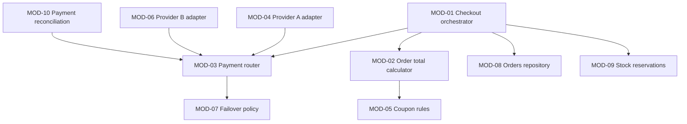
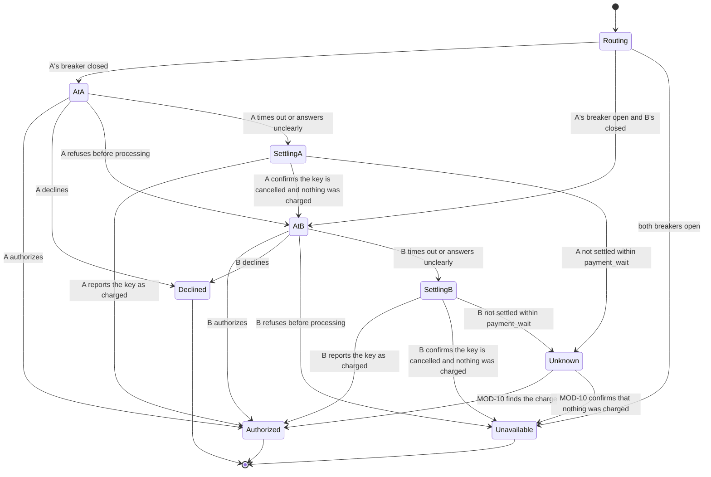

# Stage 4 report template and worked example

## Contents
- Component report template (`docs/design/4-detailed-design/<ELM-ID>.md`)
- The index
- Worked example: Store API (ELM-02)
- Example items

Write the report in the working language. Translate the headings. Keep the IDs, type names, operation names, table and column names as they are, and write the basis marks and statuses with the glossary's terms for the working language.

## Component report template

```markdown
# Detailed design: <ELM-ID> <component name>

Status: draft | answers applied · Updated: <date> · Stage 4 of 4

## Summary
<Two or three sentences: the modules, the hardest behaviour, the decisions and parameters that need agreement.>

## Inputs
| Source | What it gave |
|---|---|

## Modules
<The module dependency diagram in Mermaid, the dependency rule CI checks, then:>
| MOD | Name | Responsibility | Visibility | Depends on | FRs | IFCs | As-is | Basis |
|---|---|---|---|---|---|---|---|---|

## Allocation
| FR or IFC | Criterion or operation | MOD |
|---|---|---|

## Types
<The structured types the signatures use, each with its fields and their types.>

## Module details
### <MOD-xx name>
#### Interface
| Operation | Preconditions | Postconditions | Errors |
|---|---|---|---|
<Under the table: the invariants of the module's state, or "no state".>
#### Behaviour
<State diagram, decision tables, algorithm steps, as they apply.>
#### Concurrency and errors
#### Verification
| Checks | How |
|---|---|

## Data
<The entity-relationship diagram of the data entities the component owns, then one section per table:>
### <table>
| Column | Type | Null | Constraint | Note |
|---|---|---|---|---|
| Index | Columns | For query |
|---|---|---|
### Readers from other components
<Tables another component reads directly: who, with which rights, under which decision.>
### Migrations
<Existing schemas only.>

## Caches
| Cache | Holds | Key | Lifetime | Invalidated by |
|---|---|---|---|---|

## Screens
<Only when the component serves people.>

## Design parameters
| Parameter | Value | Basis | Budget or timeout it fits |
|---|---|---|---|

## Decisions
| DEC | Question | Chosen | Rejected |
|---|---|---|---|

## Findings
| FND | From | Decision | What changed |
|---|---|---|---|

## Issues for the quality chain
| # | Issue | Chain items | Suggested change | Quality-chain stage |
|---|---|---|---|---|

## Needs agreement
| Item | What to agree | Approver candidates |
|---|---|---|

## Questions and answers
| # | Question | Drafted answer | Answer | What changed |
|---|---|---|---|---|

## Open gaps
## Next
<Run `design-review` on this component in a fresh context; re-run this stage for the component to resolve its findings; then design the next component in the index.>
```

## The index

Keep `docs/design/4-detailed-design.md` as `artifacts.md` shows: one row per component element, with its status, report, modules and open findings. Update it at the end of every run.

## Worked example: Store API (ELM-02)

Modules:



The provider adapters depend on the payment router's provider interface, never the other way round, so a third provider adds one module (DRV-10). CI rule: nothing outside MOD-04 and MOD-06 imports a provider's client library.

Payment attempt in MOD-03. A timeout leaves the outcome unknown, so the router settles it with the same provider (look up the order's key, and cancel it if it went through) before it tries another one. Otherwise a late success at A plus a charge at B would charge the buyer twice (DRV-05, FND-01):



`Unavailable` means that every provider tried confirmed that nothing was charged; only then does IFC-01 answer PAYMENT_UNAVAILABLE. While an attempt is `Unknown`, IFC-01 answers PAYMENT_PENDING and the order waits as PaymentUnknown.

Table `payment_attempts` (excerpt). One row per attempt at one provider; a second provider gets a new row. Rows are never deleted, and an attempt's state only moves forward along MOD-03's diagram.

| Column | Type | Null | Constraint | Note |
|---|---|---|---|---|
| attempt_id | uuid | no | primary key | |
| order_id | uuid | no | foreign key to orders | |
| idempotency_key | text | no | unique together with provider | The order's key from IFC-01, sent to each provider tried |
| provider | text | no | check in (A, B) | |
| state | text | no | check in the states of MOD-03 | |
| amount_minor | bigint | no | check > 0 | Money in minor units (shared conventions) |
| created_at | timestamptz | no | | |

| Index | Columns | For query |
|---|---|---|
| attempts_key | provider, idempotency_key (unique) | Find the attempt a provider already holds for a repeated checkout |
| attempts_unknown | state, created_at, where state is Unknown | MOD-10's list of attempts to settle |
| attempts_order | order_id | Every attempt of one order, for reconciliation and support |

Design parameters (excerpt):

| Parameter | Value | Basis | Budget or timeout it fits |
|---|---|---|---|
| provider_timeout | 2.0 s | Above the providers' stated 99.9th percentile of 1.0 s, so that healthy charges almost never time out | Normal path: the charge is budgeted at 1.0 s; the timeout only bounds failures |
| payment_wait | 3.0 s | The providers' stated lookup and cancel take up to 0.5 s at their 99th percentile; leaves room to retry the lookup | Worst case of the payment path: 2.0 + 3.0 + 2.0 + 3.0 + 0.3 = 10.3 s, under IFC-01's 15 s timeout |

## Example items

`docs/design/mod/MOD-03.yaml`:

```yaml
id: MOD-03
title: Payment router
status: draft
version: 1
basis: inferred
basis_note: Follows DEC-02, DEC-05 and FND-01; provider_timeout and payment_wait are provisional
needs_agreement: true
approver_candidates: [Tech lead]
component: ELM-02
name: Payment router
responsibility: Sends each order's payment to one provider at a time and returns one settled outcome per order key
visibility: internal
interface:
  - operation: "pay(request: PaymentRequest) -> PaymentOutcome"
    pre: The order is pending and its total is fixed
    post: At most one provider holds a charge for the order; the outcome says which, or that it is not settled yet
    errors: ["PaymentUnavailable: every provider tried confirmed that nothing was charged", "PaymentUnknown: an outcome could not be settled within payment_wait; the order waits as PaymentUnknown"]
invariants: ["A provider is tried only after every provider tried before it has settled with no charge"]
depends_on: [MOD-07]
functions: [FR-01]
realizes: []                             # internal; MOD-04 and MOD-06 realize the providers' interfaces
drivers: [DRV-02, DRV-05, DRV-10]
decisions: [DEC-02, DEC-05]
behaviour: "Report section: Payment router"
verification:
  - {checks: Every row of the failover policy table (MOD-07), how: Unit tests with fake providers}
  - {checks: No double charge when A times out and completes its charge later, how: An integration test with a provider stub that answers after its timeout}
parameters:
  - {name: provider_timeout, value: 2.0 s, basis: "Provisional; above the providers' stated 99.9th percentile of 1.0 s, so that healthy charges almost never time out"}
  - {name: payment_wait, value: 3.0 s, basis: "Provisional; the providers' stated lookup and cancel take up to 0.5 s at their 99th percentile"}
as_is: new
changelog:
  - {version: 1, date: 2026-11-05, change: Created, reason: Stage 4 draft for ELM-02}
```
