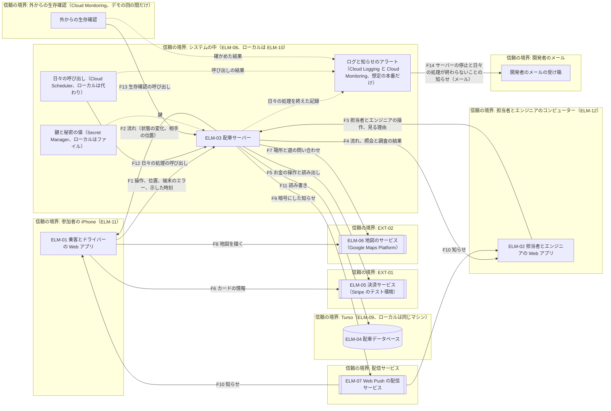
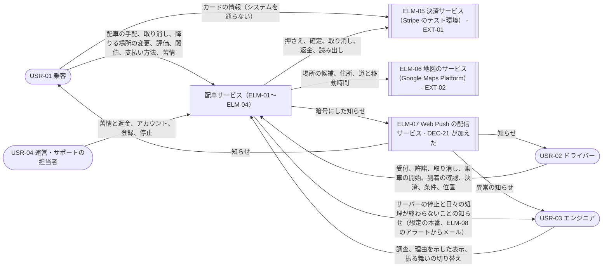
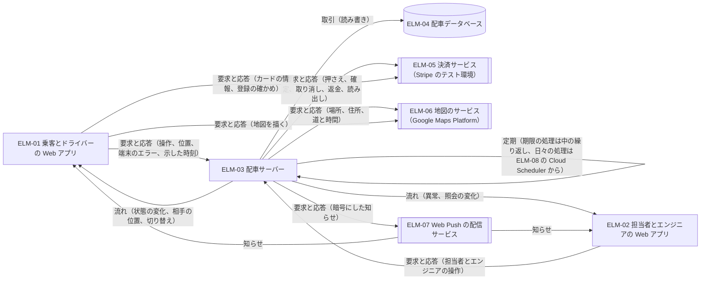
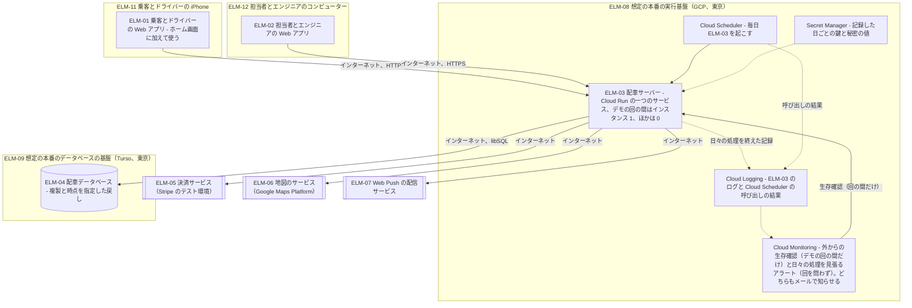
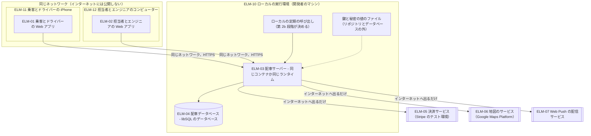
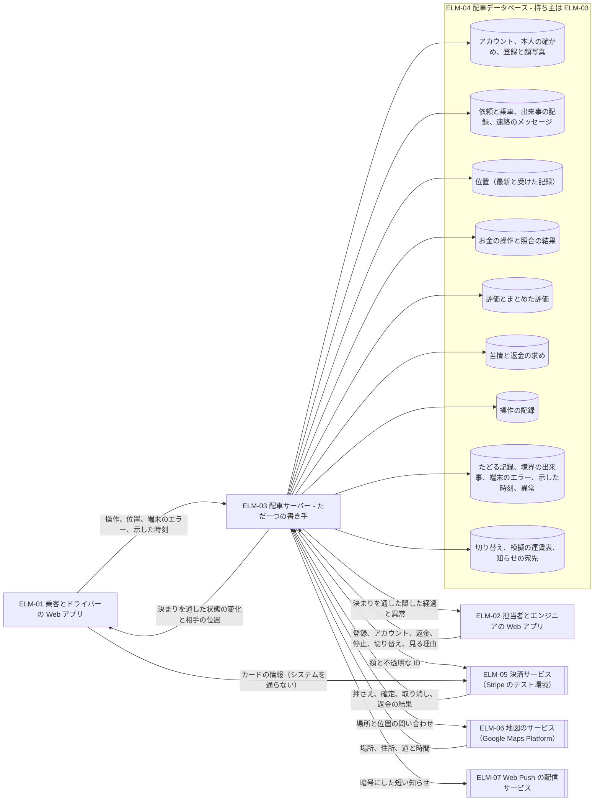

# アーキテクチャ: 配車サービス

状態: 回答反映済み · 更新: 2026-11-13 · 入力の基準: a2d3734 · 第 2 段階（全 4 段階）

## 概要
全体の構造は、一つの配車サーバー（ELM-03、Node.js をコンテナで動かす）、乗客とドライバーの Web アプリ（ELM-01、iOS 18.4 以降の iPhone でホーム画面に加えて使う）、担当者とエンジニアの Web アプリ（ELM-02、コンピューターの主なブラウザ）、一つのデータベース（ELM-04）で、想定の本番は東京の Cloud Run の一つのサービスと Turso、実際に作って動かすのは開発者のマシンだけ（DEC-01〜DEC-05）。主な設計を動かす要求が決めたのは、状態の変化を出来事の記録から開いたままの流れで届けること（DEC-06）、画面に出ている間に測った現在地を送り古い位置を分からないものとすること（DEC-07）、依頼をサーバーだけが条件つきで書き端末の操作を冪等にすること（DEC-08）、押さえをいつも確定額と乗客の今の支払い方法にそろえ、お金の操作を試みごとに記録してその試みだけを覆うキーで送り、拒否された試みは新しい試みでやり直し、結果が分からない試みは同じキーで確かめること（DEC-09〜DEC-11）、権限と隠す決まりをサーバーの一か所に置くこと（DEC-15）、異常をサーバーが見つけて知らせ、想定の本番ではデモの回の間のサーバーの停止と、回を問わず日々の処理が動かなかったか終えなかったことを、ELM-03 を通らずにプラットフォームからメールで知らせること（DEC-20）。迎車のために走っているドライバーに連絡のメッセージを読み書きさせないこと（決めたこと 4、QCR-04）、確定額が CON-08 の料金を下回らないこと（決めたこと 5、QCR-05）、ホーム画面に加えた Web アプリの振る舞いを仮定のまま進めて実機で確かめること（決めたこと 6、DAS-03）は、答えで決まった。主な設計を動かす要求のうち、DRV-14、DRV-04、DRV-03 は実機で確かめるまでその振る舞いに頼り、DRV-07 は Stripe の機能が円で使えること（DAS-06）に頼る。

## 入力
| 出どころ | 得たもの |
|---|---|
| docs/design/1-architecture-drivers.md、drv/、das/、hnd/、qcr/ | DRV-01〜DRV-35（主なものは 12。DRV-03、DRV-04、DRV-11、DRV-14、DRV-26 は環境と前提に TC-18 を持つ）、DAS-01、HND-01 と HND-02（どちらも第 3 段階宛て）、QCR-01（未回答）、QCR-02（回答済み）、QCR-03（この段階が出し、回答済み） |
| docs/design/design-context.yaml | TC-01〜TC-18、PC-01〜PC-03、TEAM-01、STK-01〜STK-04。将来の変更はなく、今の構造もない（すべて新規）。TC-18 は、この段階が決めたこと 2 の答えから加えた |
| 利用者の答え | 決めたこと 1〜6（この報告の「決めたこと」） |
| docs/design/reviews/2-architecture.md、fnd/ | この段階のレビュー（全体のレビューと、その後の差分のレビュー）と、この段階に宛てた指摘 FND-01〜FND-09（中 3、軽微 6）と、レビューが評価し直した DAS-02、DAS-03 |
| docs/quality/context.yaml | USR-01〜USR-04、CUJ-01〜CUJ-18 とその手順、CON-01〜CON-08、EXT-01、EXT-02、OPF-01〜OPF-03 |
| docs/quality/qiu/ | 利用状況。乗客とドライバーはスマートフォン（CON-05）、担当者とエンジニアは端末を問わない（QIU-21〜QIU-33） |
| docs/quality/fr/ | 有効な FR 53 とその受け入れ基準（割り当てと通し確認のもと） |
| docs/quality/qr/、nfr/、sli/、ebp/ | 設計を動かす要求の詳しい中身と、設計に確かめを求める点（QR-01、QR-06、QR-19、QR-24、QR-28、QIU-17）、SLI の見る位置と数え方の規則 |
| docs/quality/qas/ | 品質チェーンの未確認の仮定。この段階の項目が直接依存するものはない |
| 公開の情報: [Safari 18.4 のリリースノート](https://developer.apple.com/documentation/safari-release-notes/safari-18_4-release-notes)、[WebKit の不具合 254545](https://bugs.webkit.org/show_bug.cgi?id=254545)、[WebKit のブログ「Web Push for Web Apps on iOS and iPadOS」](https://webkit.org/blog/13878/web-push-for-web-apps-on-ios-and-ipados/) | ホーム画面に加えた Web アプリで、画面を消さない仕組み（Screen Wake Lock）が Safari 18.4 から動き、Web Push が iOS 16.4 から届く（DEC-02、DEC-21） |
| 公開の情報: [Stripe の incremental authorization の文書](https://docs.stripe.com/payments/incremental-authorization) | 押さえた額を上げる仕組みは IC+ の料金の使い手向けで、日本の使い手の円の取引は対象外（DEC-09） |
| 公開の情報: [Cloud Monitoring の metric-absence の文書](https://docs.cloud.google.com/monitoring/alerts/metric-absence)、[PromQL のアラートの文書](https://docs.cloud.google.com/monitoring/alerts/using-promql)、[Cloud Scheduler の問題の調べ方](https://docs.cloud.google.com/scheduler/docs/troubleshooting) | Cloud Scheduler は呼び出しの試みごとに始まりと終わり（結果）をログに残す。Cloud Monitoring は、指標が来ないことを見る条件を 23.5 時間まで置け、PromQL の条件では利用者が定めた指標の最近 25 時間を見られる。日々の処理を見張るアラートは、サービスを呼ばずにこれらを読む（DEC-20） |

既存のコードはなく、読んだコードもない。何も配備しない（TC-09）ため、本番の振る舞い、量、設定はどれも想定のもの。

## 全体の構造
構造と端末を決めたのは DEC-01〜DEC-05。どれも、交渉できない制約（TC-01〜TC-18、DRV-14〜DRV-22）を破る案を外してから、主な設計を動かす要求の順位で比べた。

DEC-01 一つの配車サーバー、二つの Web アプリ、一つのデータベースに分ける:

| 要求（順位） | 一つのサーバーと二つの Web アプリ | 機能ごとのサービス | 操作ごとの関数と問い合わせ |
|---|---|---|---|
| DRV-14（1） | 満たす | 満たす | 満たす |
| DRV-01（2） | 満たす | 一部（サービスの間の失敗が増える） | 一部（起動の待ち） |
| DRV-07（4） | 満たす（一つの取引） | 一部（置き場所が分かれる） | 満たす |
| DRV-03（5） | 満たす | 一部（サービスの間の出来事） | 一部（問い合わせの間隔） |
| DRV-15（6） | 満たす | 一部（ローカルで複数のサービス） | 一部（時刻の処理に別の仕組み） |
| DRV-16（7） | 満たす | 満たさない（1 人で複数のサービス） | 一部 |
| DRV-02（10） | 満たす | 一部 | 満たす |
| DRV-12（12） | 一部（中の依存の規則で守る） | 満たす | 一部 |

DRV-16 で二つ目が外れ、DRV-01 と DRV-03 で三つ目が劣る。DRV-12 は一つ目が一部にとどまり、第 2b 段階の依存の規則と CI の検査で補う（DEC-01 の引き換え）。

DEC-02 乗客とドライバーの端末（TC-13 が Web アプリと iOS の Safari を決め、形と版が残る）:

| 要求（順位） | iOS 18.4 以降、ホーム画面に加える | iOS 16.4 以降、18.4 より前は自動ロックを切る | ホーム画面に加えず Safari のタブ |
|---|---|---|---|
| DRV-14（1） | 満たす | 満たす | 満たす |
| DRV-04（3） | 満たす（アプリが画面を保つ） | 一部（参加者の設定に頼る） | 一部（タブを切り替えると止まる） |
| DRV-03（5） | 満たす | 満たす | 満たさない（Web Push が届かない） |
| DRV-22（17） | 満たす | 満たす | 満たす |
| 外れる iPhone | iOS 18.4 にできないもの | iOS 16.4 にできないもの | なし |

対応する版は参加者の iPhone で決まり、外れる iPhone は利用時の品質要求を外すため、質問 1 で尋ね、iOS 18.4 以降に決まった（決めたこと 1）。

DEC-03 担当者とエンジニアの端末:

| 要求（順位） | コンピューターの主なブラウザ | コンピューターとスマートフォン | iOS の Safari だけ |
|---|---|---|---|
| DRV-16（7） | 満たす | 一部（二つの画面の大きさ） | 満たす |
| DRV-28（8） | 満たす | 満たす | 満たす |
| DRV-24（11） | 満たす | 満たす | 一部（小さな画面で調べる） |

DEC-04 コンポーネントのランタイム（二つの Web アプリはブラウザで動き、比べたのは配車サーバー）:

| 要求（順位） | Node.js | Bun | Deno |
|---|---|---|---|
| DRV-15（6） | 満たす | 満たす | 満たす |
| DRV-16（7） | 満たす | 一部（部品と試験の道具を確かめる） | 一部（部品と試験の道具を確かめる） |
| DRV-17（16） | 満たす | 一部 | 一部 |

DEC-05 想定の本番とローカルの置き方:

| 要求（順位） | 一つのサービス、CPU を常に、回の間はインスタンス 1 | 要求の間だけ CPU、時刻は Cloud Tasks | 回の間はインスタンス 2 つ |
|---|---|---|---|
| DRV-01（2） | 満たす（判断できる限り。落ちたときに処理中の操作は失敗） | 一部（最初の操作が起動を待つ） | 満たす |
| DRV-15（6） | 満たす | 一部（Cloud Tasks のローカルの代わり） | 満たす |
| DRV-16（7） | 満たす | 一部（別のサービス） | 一部（インスタンスの費用が倍） |
| DRV-23（13） | 満たす | 満たす | 満たす |

一つ目と三つ目は DRV-01 で並び、DRV-16 で一つ目にした。インスタンスの数は費用のかかる大きさで、DAS-02 で暫定に採った（「設計上の値」）。DEC-06 と DEC-18 は二つ以上のインスタンスでも動くので、三つ目に移るのは設定の変更で済む。デモの回を閉じて 0 にした後に期限が来た処理は次の日々の呼び出しまで遅れ、外からの生存確認は回の間だけ動かす（FND-05、DAS-02）。回の外に動くのは日々の処理だけで、それが動かなかったか終えなかったことは、インスタンスを起こさないプラットフォームのアラートが回を問わず知らせる（DEC-20、FND-09）。

## 設計の決定
<!-- generated: decisions -->
| DEC | 名前 | 対象 | 根拠 |
|---|---|---|---|
| DEC-01 | 一つの配車サーバー、二つの Web アプリ、一つのデータベースに分ける | DRV-16、DRV-15、DRV-01、DRV-07、DRV-03、DRV-02、DRV-12 | 推定 |
| DEC-02 | 乗客とドライバーは iOS 18.4 以降の iPhone で、ホーム画面に加えた Web アプリとして使う | DRV-14、DRV-04、DRV-03、DRV-22 | 推定 |
| DEC-03 | 担当者とエンジニアはコンピューターの主なブラウザで画面を使う | DRV-24、DRV-30、DRV-28 | 仮定 |
| DEC-04 | 配車サーバーは Node.js をコンテナで動かし、二つの Web アプリは利用者のブラウザで動く | DRV-17、DRV-15、DRV-16 | 推定 |
| DEC-05 | 想定の本番は東京の一つの Cloud Run のサービスと Turso に置き、実際に動かすのは開発者のマシンだけ | DRV-01、DRV-15、DRV-16、DRV-23 | 仮定 |
| DEC-06 | 状態の変化は出来事の記録から開いたままの流れで届け、つなぎ直したら続きから届ける | DRV-03、DRV-02、DRV-26、DRV-01 | 推定 |
| DEC-07 | 端末は画面に出ている間、測った現在地を決まった間隔で送り、サーバーは古い現在地を分からないものとして扱う | DRV-04、DRV-14、DRV-03、DRV-11、DRV-05、DRV-27 | 推定 |
| DEC-08 | 依頼の状態はサーバーだけが条件つきの書き込みで変え、端末の操作は一つずつ冪等にする | DRV-02、DRV-31、DRV-03、DRV-01 | 推定 |
| DEC-09 | 押さえは後で確定する決済の取引で行い、確定額か支払い方法が変わったら押さえ直し、決済は押さえの全額の確定、料金は一部の確定で請求する | DRV-07、DRV-18、DRV-32 | 仮定 |
| DEC-10 | お金の操作は試みごとに記録してからその試みだけを覆うキーで送り、答えがなければ結果が分からない状態として持って同じキーで確かめ、拒否された試みのやり直しは新しいキーで送る | DRV-07、DRV-32、DRV-01 | 推定 |
| DEC-11 | EXT-01 の結果はこのシステムから読みに行き、EXT-01 からの知らせは受けず、日々の照合で食い違いを見つける | DRV-07、DRV-15、DRV-27、DRV-32 | 推定 |
| DEC-12 | カードの情報は EXT-01 が用意する入力部品から直接 EXT-01 に渡し、サーバーは登録の結果を EXT-01 から読む | DRV-18、DRV-31、DRV-29 | 推定 |
| DEC-13 | 地図のサービスの場所、住所、道と時間はサーバーの一つのつなぎ口から使い、端末は地図を描くためだけに使う | DRV-10、DRV-06、DRV-05、DRV-31、DRV-33、DRV-24、DRV-20、DRV-01 | 推定 |
| DEC-14 | 担当者が渡す設定の符号で本人がパスワードを決め、サーバーのセッションで使わせる | DRV-28、DRV-19、DRV-14、DRV-16、DRV-15 | 推定 |
| DEC-15 | 使える機能、見せる範囲、個人の情報を隠す決まりはサーバーの一か所で決め、外へ出るどの道もそこを通る | DRV-29、DRV-34、DRV-31、DRV-21、DRV-28、DRV-30、DRV-24 | 推定 |
| DEC-16 | 保存する個人の情報はサーバーが記録した日ごとの鍵で暗号にし、鍵はデータベースの外に置き、保存期間を過ぎた日の鍵は写しとともに捨てる | DRV-29、DRV-21、DRV-34 | 推定 |
| DEC-17 | システムのデータは一つのデータベースに置いて配車サーバーだけが書き、保存期間を過ぎた個人の情報は日々の処理で変え、戻すための写しの中のものは鍵を捨てて読めなくする | DRV-02、DRV-07、DRV-21、DRV-27、DRV-30、DRV-29、DRV-13、DRV-01 | 推定 |
| DEC-18 | 時刻で進む処理は期限をデータベースに書いてサーバーが繰り返し拾い、日々の処理はプラットフォームの定期の呼び出しで起こす | DRV-23、DRV-21、DRV-01 | 仮定 |
| DEC-19 | 一件の依頼の経過と、後から書き換えられない操作の記録を、依頼に結び付けてサーバーがデータベースに残す | DRV-24、DRV-30、DRV-27、DRV-34 | 推定 |
| DEC-20 | サーバーが異常を見つけて記録し、担当者とエンジニアの Web アプリに Web Push で知らせ、想定の本番ではサーバーの停止と日々の処理が終わらないことをプラットフォームから見張る | DRV-24、DRV-25、DRV-01 | 仮定 |
| DEC-21 | 乗客とドライバーへの知らせは、画面に出ていれば流れで、出ていなければ Web Push で届け、中身に個人の情報を入れない | DRV-03、DRV-14、DRV-29、DRV-34 | 推定 |
| DEC-22 | 走っているかは端末が測った速さと位置からサーバーが決め、分からなければ受け付けない | DRV-11、DRV-31、DRV-33 | 推定 |
| DEC-23 | 境界の SLI はサーバーの入口で、利用者の側の SLI は相手の端末の知らせで、データの SLI は保存した記録で出来事を見る | DRV-25、DRV-26、DRV-27 | 推定 |
| DEC-24 | 依頼を届ける相手の規則は、届けるとき、示すとき、許諾を受けるときのどれでも、その時点の値でサーバーが当てる | DRV-08、DRV-35、DRV-20、DRV-31 | 推定 |
| DEC-25 | 確認コードは依頼ごとにサーバーが作ってその依頼の乗客にだけ示し、サーバーが試せる回数を限って照らす | DRV-19、DRV-31 | 推定 |
| DEC-26 | 変えた振る舞いはデータベースの切り替えで止め、保存するデータの形は前の版が読める足し方で変え、戻すときは前の版を配備し直す | DRV-13、DRV-12 | 推定 |
| DEC-27 | 乗客とドライバーの連絡は、配車が確定してから乗車が始まるまで、サーバーを通るアプリの中のメッセージで行い、車が走っている間はドライバーに送らせず中身も示さない | FR-11、DRV-29、DRV-34 | 推定 |
<!-- /generated -->

主な設計を動かす要求を扱うほかの決定の比べ方:

DEC-06 状態の変化の届け方:

| 要求（順位） | 出来事の記録から SSE | WebSocket | 端末からの問い合わせ |
|---|---|---|---|
| DRV-01（2） | 満たす | 満たす | 満たす |
| DRV-03（5） | 満たす | 満たす | 一部（数秒ごとの問い合わせが要る） |
| DRV-16（7） | 満たす | 一部（つなぎ直しと続きを作る） | 満たす |
| DRV-02（10） | 満たす（続きから届ける） | 満たす | 満たす（今の状態を読む） |
| DRV-26（14） | 満たす | 満たす | 一部 |

DEC-07 現在地の集め方:

| 要求（順位） | アプリが画面を保ち間隔ごとに送る | 間隔ごとに送り、画面は参加者の設定 | ネイティブのアプリ |
|---|---|---|---|
| DRV-14（1） | 満たす | 満たす | 外した（TC-13 を破る） |
| DRV-04（3） | 満たす（画面に出ている間） | 一部（設定の変え忘れで止まる） | — |
| DRV-03（5） | 満たす（到着を新しい位置で決める） | 一部 | — |

DEC-08 依頼の状態を一つに保つ仕組み:

| 要求（順位） | サーバーだけが条件つきで書き、操作は冪等 | メモリの状態をときどき写す | 端末どうしで合わせる |
|---|---|---|---|
| DRV-01（2） | 満たす | 一部（落ちると写す前を失う） | 一部 |
| DRV-03（5） | 満たす | 満たす | 一部 |
| DRV-02（10） | 満たす | 満たさない（QR-17） | 満たさない |
| DRV-31（原則） | 満たす | 満たす | 満たさない |

DEC-09 お金の操作の EXT-01 での行い方:

| 要求（順位） | 後で確定する取引、額か支払い方法が変われば押さえ直す | 押さえた額を上げる仕組み | 押さえない | 押さえは依頼のときの支払い方法のまま、変われば決済で直接請求 |
|---|---|---|---|---|
| DRV-07（4） | 満たす | 一部（額を下げられない） | 満たさない（FR-54） | 一部（押さえていない支払い方法から請求し、使えないことが降車のときに分かる。押さえた額と解いた額がそろわない） |
| DRV-18（19） | 満たす（DAS-06） | 満たさない（日本の円の取引で使えない） | 満たす | 満たす |
| DRV-32（原則） | 満たす | 満たす | 満たす | 満たす |

四つ目は、FND-01 が挙げた場面のための案。押さえの後の支払い方法の変更（FR-46）と、EXT-01 が受け付けなかった決済のやり直し（FR-29）は、一つ目では支払い方法を変えたときの押さえ直しで、四つ目では決済のときの直接の請求で行う。一つ目は、押さえられない支払い方法を変えたときに見つけ、押さえで決済が済むこと（FR-54）を保つ。確定額が CON-08 の料金を下回らず、料金を押さえから請求できることは決めたこと 5 による（QCR-05）。

DEC-10 お金の操作の冪等性と結果が分からない状態:

| 要求（順位） | 試みごとに記録して一つのキー、同じキーで確かめる | 新しいキーで送り直す | ID で探してから送り直す |
|---|---|---|---|
| DRV-01（2） | 一部（分からない操作は悪いイベント） | 一部 | 一部 |
| DRV-07（4） | 満たす | 満たさない（二重に動く） | 一部（探す仕組みの遅れ） |
| DRV-32（原則） | 満たす | 満たさない | 一部 |

DRV-01 はどの案でも一部で、EXT-01 が答えない間の悪いイベントはなくせない。DRV-07 と DRV-32 で一つ目にした。EXT-01 がはっきり拒否した試みは、どの案でも新しいキーの新しい試みでやり直す（FR-29、FR-39）。一つ目は、一つの決済、料金、返金について済んだか結果が分からない試みを一つまでに限り、やり直しても一度だけ動くことを守る（FND-01）。

DEC-11 EXT-01 の結果の知り方:

| 要求（順位） | 読みに行き、日々の照合 | 知らせを受け、照合もする | 知らせだけ |
|---|---|---|---|
| DRV-07（4） | 満たす | 満たす | 一部（届かない知らせを見落とす） |
| DRV-15（6） | 満たす | 一部（ローカルの転送の道具） | 一部 |
| DRV-16（7） | 満たす | 一部（外からの入口とその確かめ） | 一部 |
| DRV-27（24） | 満たす | 満たす | 一部 |

DEC-12 カードの情報の入れ方:

| 要求（順位） | アプリの中の EXT-01 の入力部品 | EXT-01 の画面に移す | このシステムの画面 |
|---|---|---|---|
| DRV-14（1） | 満たす | 一部（アプリを離れて戻る） | 外した（TC-11 を破る） |
| DRV-29（9） | 満たす | 満たす | — |
| DRV-18（19） | 満たす | 満たす | — |

DEC-13 地図のサービスのつなぎ方:

| 要求（順位） | サーバーのつなぎ口、端末は地図を描くだけ | 端末が直接求める | 候補だけ端末が求める |
|---|---|---|---|
| DRV-01（2） | 満たす | 満たす | 満たす |
| DRV-24（11） | 満たす | 一部（やり取りがサーバーに残らない） | 一部 |
| DRV-10（29） | 満たす | 一部 | 一部（失敗を二か所で扱う） |
| DRV-31（原則） | 満たす | 満たさない（料金のもとを端末が決める） | 満たす |
| DRV-33（原則） | 満たす | 一部 | 一部 |

DEC-14 本人の確かめ方（決めたこと 3）:

| 要求（順位） | 設定の符号でパスワード | 設定の符号でパスキー | 外部の認証のサービス |
|---|---|---|---|
| DRV-14（1） | 満たす | 一部（参加者の端末の設定に頼る） | 一部（メールのリンクがアプリの外で開く） |
| DRV-15（6） | 満たす | 満たす | 一部（ローカルの代わり） |
| DRV-16（7） | 満たす | 一部 | 一部（外部のサービスが増える） |
| DRV-28（8） | 満たす | 満たす | 満たす |
| DRV-19（26） | 満たす | 満たす | 一部 |

DEC-15 権限、見せる範囲、隠す決まり:

| 要求（順位） | サーバーの一か所 | 画面と操作ごと | データベースの見せ方 |
|---|---|---|---|
| DRV-28（8） | 満たす | 一部 | 一部 |
| DRV-29（9） | 満たす | 一部（確かめ漏れ） | 満たさない（理由を示したときだけを表せない） |
| DRV-24（11） | 満たす（仮の名でたどる） | 満たす | 一部 |
| DRV-34（原則） | 満たす | 満たさない | 一部 |

DEC-16 保存する個人の情報:

| 要求（順位） | 記録した日ごとの鍵で項目ごとに暗号にし、過ぎた日の鍵を捨てる | 一つの鍵で項目ごとに暗号にする | 置き場所の暗号 | 暗号にしない |
|---|---|---|---|---|
| DRV-16（7） | 一部（日ごとの鍵を作って捨てる） | 満たす（作る手間は小さい） | 満たす | 満たす |
| DRV-29（9） | 満たす | 満たす | 一部（取り出した写しは読める） | 満たさない |
| DRV-24（11） | 一部（調べるのは画面からだけ） | 一部（調べるのは画面からだけ） | 満たす | 満たす |
| DRV-21（18、交渉できない） | 満たす（戻すための写しの中の過ぎた個人の情報も読めない） | 満たさない（写しの中の過ぎた個人の情報が鍵で読める） | 満たさない | 満たさない |

DRV-21 は交渉できないため、二つ目から四つ目は外れる（FND-07）。一つ目の鍵の日は個人の情報を記録した日で、保存期間は記録した日から数える（QR-59）ため、戻すための写しの中のものも、日々の処理（DEC-18）が記録を変えるのと同じ日に読めなくなる。

DEC-17 データの置き場所:

| 要求（順位） | 一つのデータベース | データベースとほかの二つの置き場所 | 機能ごとのデータベース |
|---|---|---|---|
| DRV-01（2） | 満たす | 満たす | 満たす |
| DRV-07（4） | 満たす（一つの取引） | 満たす | 一部（取引が分かれる） |
| DRV-15（6） | 満たす | 一部（ローカルの代わりが増える） | 満たす |
| DRV-16（7） | 満たす | 一部 | 一部 |
| DRV-29（9） | 満たす | 一部（隠し方を二か所で守る） | 満たす |
| DRV-02（10） | 満たす | 満たす | 一部 |

DEC-18 時刻で進む処理:

| 要求（順位） | 期限を書いて拾い、日々は Cloud Scheduler | Cloud Tasks | 1 分ごとの呼び出し |
|---|---|---|---|
| DRV-01（2） | 満たす | 満たす | 満たす |
| DRV-15（6） | 満たす | 一部（ローカルの代わり） | 満たす |
| DRV-16（7） | 満たす | 一部（別のサービス） | 満たす |
| DRV-23（13） | 満たす | 満たす | 一部（最大 1 分遅れる） |

DEC-19 一件の依頼の経過と操作の記録:

| 要求（順位） | データベースのたどる記録と操作の記録 | プラットフォームのログ | 分散トレース |
|---|---|---|---|
| DRV-15（6） | 満たす | 満たさない（ローカルにない） | 一部（ローカルの代わり） |
| DRV-16（7） | 満たす | 満たす | 一部 |
| DRV-24（11） | 満たす | 一部（依頼から探す画面が別に要る） | 満たす |
| DRV-30（21） | 満たす（書き換えれば分かる） | 一部 | 一部 |

DEC-20 異常の見つけ方と知らせ方:

| 要求（順位） | サーバーが見つけて Web Push。本番は回の間の生存確認と、回を問わず日々の処理の見張り | 同じで、生存確認を回の外も動かし、日々の処理は見張らない | 同じで、回の外は見張らない | プラットフォームの監視だけ | 外部のエラーを集めるサービス |
|---|---|---|---|---|---|
| DRV-01（2） | 満たす | 満たす | 満たす | 満たす | 満たす |
| DRV-15（6） | 満たす | 満たす | 満たす | 満たさない（ローカルにない） | 一部 |
| DRV-16（7） | 満たす（アラートの料金が加わり、インスタンスの時間は増えない） | 一部（回の外も確かめるたびにインスタンスを起こす） | 満たす | 満たす | 一部 |
| DRV-29（9） | 満たす | 満たす | 満たす | 満たす | 一部（記録を外へ出す） |
| DRV-24（11） | 満たす | 一部（回の外に日々の処理が動いて終えたかは分からない） | 一部（回の外に日々の処理が動かなくても知らせない） | 一部（NFR-38 をローカルで確かめられない） | 満たす |
| DRV-23（13） | 満たす（日々の処理が止まれば知らせる） | 一部 | 一部（日々の処理が止まっても気づかない） | 満たす | 満たす |
| DRV-21（18、交渉できない） | 満たす（変換と鍵を捨てることが止まれば知らせる） | 一部 | 一部（変換と鍵を捨てることが止まっても気づかない） | 満たす | 満たす |

四つ目は DRV-15 を満たさず、五つ目は DRV-16 と DRV-29 で劣る。二つ目と三つ目は一つ目と同じ見つけ方で、回の外の見張りだけが違う（FND-09）。回の外に動くのは日々の処理（DEC-18）だけで、二つ目は DRV-16 で、三つ目は DRV-24、DRV-23、DRV-21 で一つ目に劣る。一つ目の見張りは、Cloud Scheduler の呼び出しの結果と、ELM-03 が日々の処理を終えたときにログに書く記録を読むだけで ELM-03 を呼ばず、回の外にインスタンスを起こさない。日々の呼び出しの間隔（1 日）は、Cloud Monitoring の指標が来ないことを見る条件の長さ（23.5 時間まで）を超えるため、終えた記録が届かないことは 1 日より長く見られる条件（PromQL の条件など）で見る（どの条件で置くかは実装、待つ時間の値は HND-10）。

DEC-21 乗客とドライバーへの知らせ:

| 要求（順位） | 流れと Web Push | 流れだけ | SMS かメール |
|---|---|---|---|
| DRV-14（1） | 満たす | 満たす | 満たす |
| DRV-03（5） | 満たす | 一部（画面に出ていない相手に届かない） | 満たす |
| DRV-16（7） | 満たす | 満たす | 一部（外部のサービスと費用） |
| DRV-29（9） | 満たす（中身に個人の情報を入れない） | 満たす | 一部（連絡先を渡す） |

DEC-26 変えた振る舞いの切り替えと前の版への戻し:

| 要求（順位） | データベースの切り替え、足すだけの変更、前の版の配備 | 設定の値と起動し直し | 外部の切り替えのサービス |
|---|---|---|---|
| DRV-15（6） | 満たす | 満たす | 一部（ローカルの代わり） |
| DRV-16（7） | 満たす | 満たす | 一部（費用） |
| DRV-12（12） | 満たす | 一部 | 満たす |
| DRV-13（30） | 満たす | 満たさない（動かしたまま止められない） | 満たす |

DEC-27 乗客とドライバーの連絡:

| 要求（順位） | アプリの中のメッセージ、走っている間はドライバーに送らせず中身も示さない | アプリの中のメッセージ、走っている間も読み書きできる | 電話番号を示す | 番号を隠す電話のサービス |
|---|---|---|---|---|
| DRV-16（7） | 満たす | 満たす | 満たす | 一部（費用） |
| DRV-29（9） | 満たす | 満たす | 満たさない（連絡先が残る） | 満たす |
| FR-11 | 一部（走っている間のドライバーからは、止まるまで返事が来ない。QCR-04） | 満たす | 一部（乗車の後も連絡できる） | 満たす |
| 運転中の操作の安全（QIU-17 の危険、FR-22 の扱い） | 満たす（走っている間は読み書きさせない） | 満たさない（走りながら読み書きする） | 一部（走りながら電話を取る） | 一部（走りながら電話を取る） |

運転中の操作の安全は設計を動かす要求になく（QIU-17、FR-22、QR-28 が扱うのは依頼を選ぶ操作と許諾だけ）、その行は FND-02 による。安全を先にして一つ目を下書きしたが、一つ目は FR-11 を一部にとどめ、二つ目は安全のリスクを受け入れる。どちらを選ぶかは事業の判断で、安全の害は重大さが高のため質問 4 で尋ね、一つ目に決まった（決めたこと 4）。

DEC-22〜DEC-25 は線の下の要求（DRV-11、DRV-19、DRV-25〜DRV-27、DRV-08、DRV-35）と全体の原則を、すでにある決定では満たせない所だけ補う。

## 設計の観点
| 観点 | 決めた決定、後の段階に残すもの、標準のやり方で足りる理由 |
|---|---|
| 並行性 | DEC-08（依頼を書くのは ELM-03 だけ、今の状態を条件にした書き込み、端末の操作の冪等キー）、DEC-10（お金の操作の試みの記録とキー。一つの決済、料金、返金に、済んだか結果が分からない試みは一つまで）、DEC-18（期限の処理は取ったことを書いてから一度だけ）、DEC-24（まとめた評価を評価と同じ取引で書く）。許諾と取り消しが重なったときの状態の移り方は、第 4 段階が ELM-03 の実行で確定の深さで決める（同時に動く処理と状態を共有するモジュールは第 4 段階の確定の種類なので、申し送りはいらない） |
| 制御とイベント処理 | 操作は要求と応答、変化は出来事の記録からの流れ（DEC-06）、時刻は期限の処理と日々の処理（DEC-18。デモの回を閉じた後に期限が来た処理は次の日々の呼び出しが拾う、DAS-02）、画面に出ていない相手には Web Push（DEC-21）。二度届いた操作は冪等キーで一度にし（DEC-08）、二度届いた出来事は番号で端末が捨て、遅れて届いた操作は今の状態を条件に退ける。出来事とメッセージの形は第 3 段階が次の実行で決める |
| データの永続化 | DEC-17（一つのデータベース、書くのは ELM-03 だけ、保持の範囲、保存期間を過ぎた個人の情報の扱い）、DEC-16（記録した日ごとの鍵の暗号。保存期間を過ぎた日の鍵を写しとともに捨て、戻すための写しの中のものも読めなくする）、DEC-26（データの形は前の版が読める足し方で変える）。守りと戻しは Turso の複製と時点を指定した戻しで、写しを持つ期間は保存期間の扱いを左右しない（DEC-17）。戻しの訓練（NFR-16）は第 2b 段階が置き、日ごとの鍵の作り方と捨て方は第 2b 段階が決める。データの実体、保持期間の値、扱いの区分は第 3 段階、データの形を変える道具は第 2b 段階が、それぞれ次の実行で決める |
| 分散 | DEC-01、DEC-05（東京の一つのサーバーと一つのデータベース、端末はインターネットから。ローカルは開発者のマシンと同じネットワーク）。つながりが遅いか切れたときは DEC-06（続きから届ける）と DEC-08（同じキーで送り直す、時間切れの順）。量は小さく（OPF-02、OPF-03）伸ばす要はなく、DEC-06 と DEC-18 は二つ以上のインスタンスでも動く。待ちと間隔の値は第 3 段階（HND-03、HND-04） |
| エラー処理と障害許容 | DEC-10（結果が分からない試みを持って確かめ、EXT-01 が拒否した試みは新しい試みでやり直す）、DEC-09（押さえの後に支払い方法が変わったときと決済が拒否されたときは押さえ直す）、DEC-13（EXT-02 の失敗は場所の検索と見積もりだけを止める）、DEC-20（異常を見つけて知らせる。想定の本番では、デモの回の間のサーバーの停止を外からの生存確認が、回を問わず日々の処理が動かなかったか終えなかったことをプラットフォームのアラートが、ELM-03 を通らずにメールで知らせる）、DEC-01（どの部分の停止が流れを止めるか）。コードの中でエラーをどう渡して記録するかは第 2b 段階が次の実行で、時間切れとやり直しの値は第 3 段階（HND-05）と第 4 段階（HND-07）が、異常とみなす条件と日々の処理を終えた記録を待つ時間は第 4 段階（HND-10）が決める |
| 統合と相互運用 | DEC-09〜DEC-12（EXT-01）、DEC-13（EXT-02）、DEC-21（Web Push、ELM-07）。どの外部のシステムも ELM-03 の中のそれぞれのつなぎ口の後ろに置き、第 2b 段階の偽物の差し替え口にもなる。操作の形、エラーの決まり、外部の API の版の扱いは第 3 段階が次の実行で決める |
| 保証・セキュリティ・安全 | DEC-14（本人の確かめ、決めたこと 3）、DEC-15（権限、見せる範囲、隠す決まり）、DEC-16（保存の暗号）、DEC-19（書き換えれば分かる操作の記録）、DEC-25（確認コード）、DEC-12（カードの情報）と「脅威のモデル」。人の安全は DEC-22（走っている間の依頼を選ぶ操作と許諾）と DEC-27（走っている間のドライバーの連絡のメッセージ、決めたこと 4）。値は第 4 段階（HND-09、HND-12、HND-13）、秘密の値の読み方は第 2b 段階 |
| 可変性 | DEC-02、DEC-03（端末とブラウザ）、DEC-26（振る舞いの切り替え）。ほかは標準のやり方で足りる。市場は一つ（円、CON-08）、言葉は日本語だけ、テナントはなく、試験用のアカウントはデータの区別（FR-42） |

## 脅威のモデル

守る資産は、セキュリティの要求（DRV-28〜DRV-30）と原則（DRV-31、DRV-34）が挙げるもの。アカウントとセッション、個人の情報（名前、連絡先、顔写真、位置、乗る場所と降りる場所、連絡のメッセージ）、お金の額と結果、確認コードと設定の符号、担当者とエンジニアの特別な操作と操作の記録、鍵と秘密の値（EXT-01 と EXT-02 の鍵、データベースへの接続、暗号の鍵、Web Push の送り手の鍵）。

| 流れ | 越える境界 | なりすまし | 改ざん | 否認 | 漏れ | 妨害 | 権限の取得 |
|---|---|---|---|---|---|---|---|
| F1 | 参加者の iPhone からインターネット | 他人のアカウントで操作する: DEC-14、DEC-15 | 額、評価、状態を端末で書き換える: DEC-08、DEC-15（決めるのはサーバー、DRV-31）。偽の位置で到着や不在を装う: 位置は端末から受けるしかなく（DRV-31）、不在と到着を誰がいつどこで行ったかを DEC-19 に残す | 料金を確かめた依頼、承認、取り消しを否定する: DEC-19 | 通信を読まれる: HTTPS（標準のやり方） | 同じ操作を繰り返し送る: DEC-08（同じキーは一度だけ）。大量に送る: 入口で回数を限る（標準のやり方）、DEC-05 の最大のインスタンス数が費用を限る | 担当者とエンジニアの操作を呼ぶ: DEC-15。他の依頼の確認コードを当てる: DEC-25 |
| F2 | インターネットから参加者の iPhone | 偽のサーバー: HTTPS とホーム画面に加えたアプリの出どころ（標準のやり方） | 通信の中で書き換える: HTTPS（標準のやり方） | 当たらない（サーバーからの通知で、操作した人がいない） | 他の参加者の位置や乗車が届く: DEC-15（流れの出来事も決まりを通る） | 流れを切られる: DEC-06（続きから届ける） | 当たらない（受けるだけの流れ） |
| F3 | 担当者とエンジニアのコンピューターからインターネット | 担当者のアカウントを他人が使って返金する: DEC-14 | 操作の記録を書き換える: DEC-19（足すだけ、前の記録のハッシュ） | 返金、登録、停止、個人の情報を見たことを否定する: DEC-19 | 通信を読まれる: HTTPS（標準のやり方） | 大量に送る: 入口で回数を限る（標準のやり方） | 担当者がエンジニアの操作を、エンジニアが担当者の操作を呼ぶ: DEC-15 |
| F4 | インターネットから担当者とエンジニアのコンピューター | 偽のサーバー: HTTPS（標準のやり方） | 通信の中で書き換える: HTTPS（標準のやり方） | 当たらない（サーバーからの応答と通知） | 調査の画面と異常の知らせに個人の情報が出る: DEC-15（隠して示し、理由を示したときだけ）、DEC-16 | 流れを切られる: DEC-06 | 当たらない（受けるだけ） |
| F5 | システムから EXT-01 | EXT-01 の鍵を盗んで他人が操作する: DEC-05（鍵は Secret Manager）、権限を絞った鍵（標準のやり方、読み方は第 2b 段階） | 送り直しで二重に動く: DEC-10。偽の結果: DEC-11（このシステムの呼び出しの答えだけを受け、外から呼ばれる入口がない） | EXT-01 の処理と記録が食い違う: DEC-11（日々の照合） | 乗客の個人の情報が EXT-01 に渡る: DEC-09、DEC-12（不透明な ID だけ） | EXT-01 が答えない: DEC-10（結果が分からない状態として持つ） | 当たらない（このシステムの鍵でできる操作だけ） |
| F6 | 参加者の iPhone から EXT-01 | 当たらない（EXT-01 が自身の入力部品で受ける） | 登録できたと端末が偽る: DEC-12（サーバーが EXT-01 から読み直す） | 当たらない（登録の結果は EXT-01 にある） | カードの情報がこのシステムに届く: DEC-12（TC-11、EXT-01 の入力部品） | EXT-01 が答えない: DEC-12（分かるまで使える支払い方法にしない、FR-46） | 当たらない |
| F7 | システムから EXT-02 | EXT-02 の鍵を盗まれる: DEC-05（鍵は Secret Manager） | 偽の道や時間を返される: 当たらない（このシステムの呼び出しの答えだけを受ける、DEC-13） | 当たらない（料金は確定額として記録する、DEC-13） | 乗客の場所が EXT-02 に渡る: 受け入れる（TC-12 のサービスを使うことに含まれ、名前と連絡先は渡さない、DEC-13） | EXT-02 が答えない: DEC-13（見積もりだけを止め、確定した依頼と乗車は続く） | 当たらない |
| F8 | 参加者の iPhone から EXT-02 | ブラウザ用の鍵を他で使われる: 鍵を出どころで絞る（標準のやり方） | 当たらない（地図を描くだけで、どの判断にも使わない） | 当たらない | 表示の範囲が EXT-02 に渡る: 受け入れる（TC-12、DEC-13） | 地図を描けない: 地図なしでも状態と位置の文字は示す（標準のやり方） | 当たらない |
| F9、F10 | システムから配信サービスを経て端末 | 他人が偽の知らせを送る: Web Push の送り手の鍵（DEC-21、標準の仕組み） | 通信の中で書き換える: 暗号にして送る（DEC-21） | 当たらない | 配信サービスが知らせを読む: DEC-21（暗号にし、中身に個人の情報を入れない） | 知らせが届かない: アプリを開けば流れと今の状態で示す（DEC-06） | 当たらない |
| F11 | システムから Turso | データベースへの接続の鍵を盗まれる: DEC-05（鍵は Secret Manager） | 記録を書き換える: DEC-19（操作の記録は書き換えれば分かる）。書くのは ELM-03 だけ（DEC-17） | 当たらない（操作した人は F1 と F3 の記録に残る） | データベースの写しや取り出した結果から漏れる: DEC-16（保存期間を過ぎた日の鍵は捨て、戻すための写しの中のものも読めない） | データベースが止まる: DEC-01、DEC-17（すべて止まり、Turso の複製で戻る） | 当たらない（ELM-03 のほかに書く要素がない） |
| F12 | プラットフォームからシステム | 外から日々の処理を起こす: 呼び出しを想定の本番の定期の呼び出しの身元だけに許す（標準のやり方）。起こされても処理は一度だけ（DEC-18） | 当たらない（中身のない呼び出し） | 当たらない | 当たらない | 当たらない | 当たらない |
| F13 | インターネットからシステム（想定の本番の、デモの回の間だけ） | 誰でも生存確認の入口を呼べる: 入口は生きていることだけを返し、何も変えない（DEC-20） | 当たらない（中身のない呼び出し） | 当たらない | 状態や個人の情報が漏れる: 返すのは生きていることだけ（DEC-20） | 大量に呼ばれる: 入口で回数を限る（標準のやり方）。回の外は確かめを止め、インスタンスを起こさない（DEC-20） | 当たらない（何もしない入口） |
| F14 | システムのプラットフォームから開発者のメール（想定の本番） | 偽の知らせのメールを送られる: 知らせは何が起きたかを示すだけで、開発者はプラットフォームの画面で確かめてから動く（標準のやり方） | 通信の中で書き換える: 当たらない（知らせの中身で何も動かさず、プラットフォームの画面で確かめる） | 当たらない（知らせを出すのはプラットフォームで、操作した人がいない） | 知らせに個人の情報が出る: 日々の処理を終えた記録と知らせには、日付と結果のほか個人の情報を入れない（DEC-20、DEC-15） | 知らせが届かないか遅れる: アラートはプラットフォームの事象として残り、開発者はプラットフォームの画面でも見られる（標準の仕組み） | 当たらない（受けるだけの知らせ） |

ローカルでは、ELM-10 をインターネットに公開せず（DEC-05）、同じネットワークの端末だけが ELM-03 に届く。想定の本番の、ELM-03 が日々の処理を終えた記録をログに書き、アラートがそれと Cloud Scheduler の呼び出しの結果を読むやり取りは、システムの中の信頼の境界のうちにあり、境界を越えるのは開発者へのメール（F14）だけ（DEC-20）。どの脅威も、入力が重さを決めていない点ではなく、品質要求（QR-10、QR-12、QR-13、QR-18、QR-34〜QR-36、QR-44、QR-57、QR-58、QR-60）と制約が挙げるものか、それへの備えとして決定が防ぐもので、セキュリティのリスク分析はほかの脅威を挙げていない（設計の第 1 段階の決めたこと 5）。

## 要素
<!-- generated: elements -->
| ELM | 名前 | 種類 | チーム | 今の構造との差分 |
|---|---|---|---|---|
| ELM-01 | 乗客とドライバーの Web アプリ | コンポーネント | TEAM-01 | 新設 |
| ELM-02 | 担当者とエンジニアの Web アプリ | コンポーネント | TEAM-01 | 新設 |
| ELM-03 | 配車サーバー | コンポーネント | TEAM-01 | 新設 |
| ELM-04 | 配車データベース | データの置き場所 | TEAM-01 | 新設 |
| ELM-05 | 決済サービス（Stripe のテスト環境） | 外部のシステム | — | 新設 |
| ELM-06 | 地図のサービス（Google Maps Platform） | 外部のシステム | — | 新設 |
| ELM-07 | Web Push の配信サービス | 外部のシステム | — | 新設 |
| ELM-08 | 想定の本番の実行基盤（GCP、東京） | 実行環境 | TEAM-01 | 新設 |
| ELM-09 | 想定の本番のデータベースの基盤（Turso、東京） | 実行環境 | TEAM-01 | 新設 |
| ELM-10 | ローカルの実行環境（開発者のマシン） | 実行環境 | TEAM-01 | 新設 |
| ELM-11 | 乗客とドライバーの iPhone | 実行環境 | — | 新設 |
| ELM-12 | 担当者とエンジニアのコンピューター | 実行環境 | — | 新設 |
<!-- /generated -->

ELM-05 は EXT-01、ELM-06 は EXT-02 の役を担い、それぞれ premises に挙げる。ELM-07 は DEC-21 が加えた外部のシステム。ELM-08 と ELM-09 は想定の本番の置き場所で、実際には配備しない。実際に動くのは ELM-10 で、そこでは ELM-03 と ELM-04 の代わりを動かす（「配置」）。コンポーネントはどれも TEAM-01 が持ち、二つのチームにまたがる要素はない。

## ビュー
### 外部との関係

乗客とドライバーの Web アプリは、地図を描くためにも ELM-06 を使う（「実行時の構成」）。エンジニアへのメールは、想定の本番の実行基盤（ELM-08）のアラートが、ELM-03 を通らずに送る（DEC-20）。データを作る人（USR-01〜USR-04）の入れるものと、EXT-01、EXT-02 が作るものは「情報」にある。

### 実行時の構成

| つなぎ | 形 | 誰が誰を待つか |
|---|---|---|
| ELM-01、ELM-02 → ELM-03 | HTTPS の要求と応答。状態を変える操作は冪等キーつき（DEC-08） | 端末は答えを待ち、答えがなければ同じキーで送り直す |
| ELM-03 → ELM-01、ELM-02 | 開いたままの HTTPS の流れ（Server-Sent Events、DEC-06） | 待たない。端末は切れたら続きからつなぎ直す |
| ELM-03 → ELM-04 | libSQL の取引（DEC-17） | サーバーが取引の終わりを待つ |
| ELM-03 → ELM-05 | HTTPS の要求と応答、お金の操作は冪等キーつき（DEC-10）。EXT-01 から呼ばれる入口はない（DEC-11） | サーバーが期限のうちだけ待ち、答えがなければ結果が分からない状態として持つ |
| ELM-01 → ELM-05 | EXT-01 の入力部品から EXT-01 へ（DEC-12） | 端末が待ち、サーバーは結果を EXT-01 から読み直す |
| ELM-03 → ELM-06、ELM-01 → ELM-06 | HTTPS の要求と応答（DEC-13） | サーバーが期限のうちだけ待つ。端末の地図は待たない |
| ELM-03 → ELM-07 → ELM-01、ELM-02 | Web Push（DEC-21、DEC-20） | 待たない |

ELM-01 が流れから受けた変化を示した時刻は、要求と応答で ELM-03 に返る（DEC-23）。システムの境界は ELM-03 の入口で、SLI-01〜SLI-06 の見る位置になる。

### 配置
想定の本番（何も配備しない。TC-07、TC-08、TC-09）:

実際に動かす所（TC-09）:

| 見るもの | 想定の本番 | ローカル |
|---|---|---|
| 一緒に止まるもの | ELM-03 のインスタンスが止まれば、乗客、ドライバー、担当者、エンジニアのすべての機能が止まり、Cloud Run が新しいインスタンスを起こす（DAS-02）。ELM-04 が止まればすべて止まる | 開発者のマシンが止まればすべて止まる |
| 別に伸びるもの | ない。伸ばす要がない（OPF-02、OPF-03）。インスタンスを増やしても DEC-06 と DEC-18 は動く | ない |
| データのある所 | ELM-09（東京）。個人の情報は記録した日ごとの鍵で暗号にしたもの（DEC-16）。カードの情報は ELM-05 だけ | 開発者のマシンのデータベースのファイル |
| 一つずつ配備できるもの | ELM-03 と、それが配る ELM-01、ELM-02 の静的なファイルを一緒に配備する。デモの回を開くときだけ（TC-15） | 開発者が動かし直す |
| 止まったことを知らせるもの | デモの回の間のサーバーの停止は外からの生存確認が、回を問わず日々の処理が動かなかったか終えなかったことは Cloud Monitoring のアラートが、ELM-03 を通らずにメールで知らせる（DEC-20） | 開発者が自分のマシンで見る |

デモの回の外は ELM-03 のインスタンスが 0 で、日々の呼び出しが起こしたときだけ動き、そのとき回を閉じた後に期限が来た処理も拾う（DEC-18、DAS-02）。外からの生存確認は回の間だけ動き、回の外にインスタンスを起こさない（DEC-20）。日々の処理を見張るアラートは、Cloud Scheduler の呼び出しの結果と、ELM-03 が日々の処理を終えたときにログに書く記録を読むだけで ELM-03 を呼ばず、回を開く手順と閉じる手順によらずいつも動く（DEC-20、FND-09）。参加者の iPhone の代わりに、同じマシンの iOS のシミュレーターで ELM-01 を動かしてもよい。ローカルの HTTPS の証明書、定期の呼び出しの代わり、試験のデータは第 2b 段階が環境として決める。

### 情報

どのデータも書くのは ELM-03 だけで、端末と外部のシステムは ELM-03 に渡すか、ELM-03 から受ける（DEC-17）。カードの情報は ELM-01 から ELM-05 にだけ流れる（DEC-12）。模擬の運賃表はエンジニアが開発の作業として入れる。どの流れも「実行時の構成」のつなぎに沿う（EXT-01 と EXT-02 からの流れは、ELM-03 の要求への応答）。データの実体とその属性、保持期間、扱いの区分は第 3 段階が決める。

## 通し確認
### CUJ
CUJ-01 配車手配（USR-01）:

| 手順 | FR | 要素 | やり取り | 欠け |
|---|---|---|---|---|
| 乗る場所・降りる場所を決める | FR-01、FR-02 | ELM-01、ELM-03、ELM-06 | ELM-01 が端末の現在地を ELM-03 に送り、ELM-03 → ELM-06 で住所にして乗る場所として示す。ELM-01 → ELM-03 場所の候補を求め、ELM-03 → ELM-06 場所の検索。ELM-01 → ELM-06 地図を描く。ELM-06 が答えなければ、探せないことを返し、決めた場所は残す（DEC-13） | なし |
| 移動時間と料金を確認する | FR-03 | ELM-01、ELM-03、ELM-04、ELM-06 | ELM-01 → ELM-03 見積もり。ELM-03 → ELM-06 道と移動時間。ELM-03 が ELM-04 の模擬の運賃表で料金を、ドライバーが見つかるまでと迎車の時間を足して到着予定時刻を求める（DEC-13） | なし |
| 配車を手配する | FR-04、FR-05、FR-06、FR-07、FR-17、FR-18、FR-19、FR-46、FR-54 | ELM-01、ELM-03、ELM-04、ELM-05、ELM-07 | 支払い方法は前もって ELM-01 → ELM-05 の入力部品で登録し、ELM-03 が ELM-05 から読み直す（DEC-12）。ELM-01 → ELM-03 依頼（冪等キー、DEC-08）。ELM-03 → ELM-05 確定額の押さえ（DEC-09、DEC-10）。押さえられたら ELM-03 → ELM-04 依頼と出来事を一つの取引で書き、規則に合うドライバーに届ける（DEC-24）。ドライバーの ELM-01 には流れと ELM-07 で届く。許諾で乗客の ELM-01 に確定の知らせ（DEC-06、DEC-21）。T_wait_prompt と T_no_accept は ELM-03 の期限の処理（DEC-18）。取り消しは、許諾の前は押さえの取り消し、後は CON-08 の料金の確定（DEC-09）。依頼の途中で乗客が支払い方法を変えると、ELM-03 → ELM-05 新しい支払い方法で押さえ直し、押さえられてから前の押さえを取り消す。EXT-01 が受け付けないか結果が分からない間は支払い方法を変えない（DEC-09、DEC-10、FR-46） | なし |

CUJ-02 乗車（乗客）:

| 手順 | FR | 要素 | やり取り | 欠け |
|---|---|---|---|---|
| 手配した車かどうかを確認する | FR-08、FR-09、FR-10、FR-11、FR-12 | ELM-01、ELM-03、ELM-06、ELM-07 | ドライバーの ELM-01 → ELM-03 位置（DEC-07）。ELM-03 → ELM-06 着く見込み（DEC-13）。ELM-03 → 乗客の ELM-01 流れで位置と見込み。乗る場所から D_pickup_position_gap のうちの位置を受けると、ELM-03 が到着を流れと ELM-07 で知らせる（DEC-07、DEC-21）。車とドライバーの手がかりと確認コードを示す（DEC-25）。連絡は ELM-03 を通るメッセージで、車が走っている間はドライバーからは送れず、届いた中身は止まってから示し、乗客にはそのことを示す（DEC-27） | なし（走っている間の連絡の扱いは決めたこと 4） |

CUJ-03 降車（乗客）:

| 手順 | FR | 要素 | やり取り | 欠け |
|---|---|---|---|---|
| 正しい場所に到着したかを確認する | FR-13、FR-31、FR-47 | ELM-01、ELM-03、ELM-05、ELM-06 | 乗車中の車の位置と降りる場所を流れで示す。降りる場所を変えると ELM-03 → ELM-06 道と時間、ELM-03 が料金を求め、承認で ELM-03 → ELM-05 新しい額の押さえ、前の押さえの取り消し（DEC-09）。押さえ直せなければ降りる場所を変えない。ドライバーの到着の確認を流れで知らせる | なし |

CUJ-04 ドライバーの評価:

| 手順 | FR | 要素 | やり取り | 欠け |
|---|---|---|---|---|
| ドライバーを評価する | FR-15 | ELM-01、ELM-03、ELM-04 | ELM-01 → ELM-03 評価（冪等キー）。ELM-03 が評価とまとめた評価を一つの取引で書く（DEC-24） | なし |

CUJ-05 マッチするドライバーの閾値の設定:

| 手順 | FR | 要素 | やり取り | 欠け |
|---|---|---|---|---|
| 評価が一定以上のドライバーのみマッチするように閾値を設定する | FR-16、FR-05 | ELM-01、ELM-03 | ELM-01 → ELM-03 閾値。ELM-03 がその後の依頼で規則に当てる（DEC-24） | なし |

CUJ-06 配車受付（USR-02）:

| 手順 | FR | 要素 | やり取り | 欠け |
|---|---|---|---|---|
| 配車依頼を選ぶ | FR-17、FR-18、FR-19、FR-22、FR-44 | ELM-01、ELM-03、ELM-07 | 受付を始めると、ドライバーの ELM-01 が位置を送る（DEC-07）。届いた依頼は流れと ELM-07 で一覧に加わる。選ぶ操作で ELM-03 が規則と走っているかを当てる（DEC-24、DEC-22） | なし。ドライバーは受付をしている間もアプリを画面に出したままにする（決めたこと 2、TC-18） |
| 依頼内容を確認する | FR-20、FR-22 | ELM-01、ELM-03、ELM-06 | ELM-03 が金額、場所、乗車場所までの距離（DEC-24）、移動時間の見込み（ELM-06）を返す。もう受けられない依頼は流れで示す | なし |
| 依頼を許諾する | FR-21、FR-22、FR-23 | ELM-01、ELM-03、ELM-04、ELM-07 | ELM-01 → ELM-03 許諾（冪等キー）。ELM-03 が規則を当て直し、今の状態を条件に書き、先に書けた一つだけが通る（DEC-08）。乗客に流れと ELM-07 で知らせる。ドライバーの取り消しでは同じ依頼を届け直す | なし |

CUJ-07 乗車（ドライバー）:

| 手順 | FR | 要素 | やり取り | 欠け |
|---|---|---|---|---|
| 依頼主かどうかを確認する | FR-11、FR-12、FR-24、FR-25、FR-26 | ELM-01、ELM-03、ELM-05 | 乗客の ELM-01 → ELM-03 位置。ELM-03 → ドライバーの ELM-01 流れで乗車場所、乗客の現在地、名前（DEC-15 の範囲）。乗客の不在は、迎車が着いた時刻から T_noshow_wait を過ぎたかを ELM-03 が操作のときに比べ（DEC-18）、ELM-03 → ELM-05 不在の料金の確定（DEC-09）。連絡は ELM-03 を通るメッセージで、迎車のために走っている間（DEC-22 の判断）はドライバーからは送れず、届いた中身は止まってから示す（DEC-27） | なし（走っている間の連絡の扱いは決めたこと 4、QCR-04） |
| 運転を始める | FR-12、FR-24、FR-27 | ELM-01、ELM-03、ELM-04 | ドライバーの ELM-01 → ELM-03 確認コード。ELM-03 が照らし（DEC-25）、合えば乗車を始めて両方の ELM-01 に流れで示す | なし |

CUJ-08 降車（ドライバー）:

| 手順 | FR | 要素 | やり取り | 欠け |
|---|---|---|---|---|
| 到着を確認する | FR-28 | ELM-01、ELM-03、ELM-04 | ELM-01 → ELM-03 到着の確認（冪等キー）。ELM-03 が場所と時刻を書き、操作の記録に残す（DEC-19） | なし |
| 決済を行う | FR-29、FR-30、FR-31、FR-54 | ELM-01、ELM-03、ELM-05、ELM-07 | ELM-01 → ELM-03 決済（冪等キー）。ELM-03 → ELM-05 押さえの全額の確定（その試みだけを覆うキー、DEC-10）。T_payment_response のうちに結果か分からないことを返し、分からなければ同じキーで確かめ続けて、分かったら流れと ELM-07 で示す。EXT-01 が受け付けなかったときは、済んでいないことと理由を示し、乗客が支払い方法を変えると ELM-03 → ELM-05 その支払い方法で押さえ直し（FR-46）、ドライバーのやり直しは新しいキーでその押さえを確定する（DEC-09、DEC-10）。済んだ決済をやり直すと最初の結果を返す（FR-30） | なし |

CUJ-09 配車依頼を受ける条件の設定:

| 手順 | FR | 要素 | やり取り | 欠け |
|---|---|---|---|---|
| 配車依頼を受ける条件を設定する（金額・現在地から乗車場所までの距離） | FR-32、FR-19 | ELM-01、ELM-03 | ELM-01 → ELM-03 条件。ELM-03 がその後に届ける依頼に当てる（DEC-24） | なし。距離が道のりか直線かは QCR-01 を待ち、直線で下書きした |

CUJ-10 障害の原因の特定（USR-03）:

| 手順 | FR | 要素 | やり取り | 欠け |
|---|---|---|---|---|
| 異常・エラーの通知受取 | FR-33 | ELM-03、ELM-07、ELM-02、ELM-08 | ELM-03 が異常を見つけて記録し、ELM-07 で ELM-02 に知らせる（DEC-20）。想定の本番では、ELM-03 そのものが知らせられないときのために、ELM-08 が ELM-03 を通らずにメールで知らせる。デモの回の間のサーバーの停止は外からの生存確認が、回を問わず日々の処理（DEC-18）が動かなかったか終えなかったことは、Cloud Scheduler の呼び出しの結果と ELM-03 が日々の処理を終えたときにログに書く記録を読むアラートが知らせる（DEC-20） | なし。回の外は日々の処理だけが動き、それが起きられないか知らせる前に止まっても、アラートが知らせる |
| ログやデータの調査 | FR-34、FR-35、FR-52 | ELM-02、ELM-03、ELM-04 | ELM-02 → ELM-03 依頼のたどり。ELM-03 がたどる記録を隠した形で返し、理由を示したときだけその依頼の分を示して操作の記録に残す（DEC-19、DEC-15） | なし |
| 障害の原因を特定 | FR-34 | ELM-02 | エンジニアが、たどった経過から異常の起きた要素を見つける | なし |

CUJ-11 新しい機能の追加:

| 手順 | FR | 要素 | やり取り | 欠け |
|---|---|---|---|---|
| 新しい機能を追加 | FR-36 | ELM-01、ELM-02、ELM-03 | 新しい機能は ELM-03 の一つの部分と切り替えに入れ、ELM-02 から止められ、ELM-01 は止めた機能を示さない（DEC-26）。部分の分け方、依存の規則、自動の試験は第 2b 段階 | なし |

CUJ-12 既存の機能の修正:

| 手順 | FR | 要素 | やり取り | 欠け |
|---|---|---|---|---|
| 既存の機能を修正 | FR-36 | ELM-02、ELM-03 | 直した振る舞いを切り替えで止めて元に戻せる（DEC-26） | なし |

CUJ-13 利用技術のバージョンアップへの対応:

| 手順 | FR | 要素 | やり取り | 欠け |
|---|---|---|---|---|
| 利用技術のバージョンアップに対応 | — | ELM-03、ELM-04 | データの形は足すだけで変え、前の版に戻せる（DEC-26）。ランタイムの版は DEC-04 | なし |

CUJ-14 苦情への対応（手順は決まっていない）:

| 手順 | FR | 要素 | やり取り | 欠け |
|---|---|---|---|---|
| （手順なし） | FR-37、FR-38、FR-50 | ELM-01、ELM-02、ELM-03 | 乗客の ELM-01 → ELM-03 苦情（自分の乗車だけ、DEC-15）。ELM-02 → ELM-03 乗車の照会と対応の記録（DEC-19） | なし |

CUJ-15 返金への対応:

| 手順 | FR | 要素 | やり取り | 欠け |
|---|---|---|---|---|
| （手順なし） | FR-37、FR-38、FR-39、FR-40、FR-50 | ELM-01、ELM-02、ELM-03、ELM-05、ELM-07 | ELM-02 → ELM-03 返金（冪等キー）。ELM-03 が支払われた額までかを確かめ、返金の試みの記録を書いて ELM-05 に送る（DEC-10）。結果を ELM-02 に示し、済んだら乗客に ELM-07 で知らせる。EXT-01 が受け付けなかった返金は済まなかったものとし、担当者のやり直しは新しいキーの新しい試みで、答えのなかった返金のやり直しは同じキーで確かめる。合計は済んだか結果が分からない返金で数えて支払われた額までに限る（DEC-10、FR-40） | なし |

CUJ-16 参加者のアカウントの作成:

| 手順 | FR | 要素 | やり取り | 欠け |
|---|---|---|---|---|
| （手順なし） | FR-41、FR-42、FR-48、FR-50 | ELM-01、ELM-02、ELM-03 | ELM-02 → ELM-03 アカウントの作成。ELM-03 が設定の符号を作り、担当者が本人に渡し、本人が ELM-01 でパスワードを決める（DEC-14） | なし |

CUJ-17 審査を通ったドライバーと車両の登録:

| 手順 | FR | 要素 | やり取り | 欠け |
|---|---|---|---|---|
| （手順なし） | FR-43、FR-50 | ELM-02、ELM-03、ELM-04 | ELM-02 → ELM-03 登録（顔写真を含む）。ELM-03 が個人の情報を暗号にして書き（DEC-16）、審査の結果は入れさせない（TC-17） | なし |

CUJ-18 ドライバーの停止:

| 手順 | FR | 要素 | やり取り | 欠け |
|---|---|---|---|---|
| （手順なし） | FR-44、FR-50 | ELM-01、ELM-02、ELM-03、ELM-07 | ELM-02 → ELM-03 停止。ELM-03 がその時から規則に当て（DEC-24）、ドライバーの一覧から除く出来事を流し、ELM-07 で知らせる | なし |

どの CUJ にもかかる FR-45（経過の記録）、FR-48、FR-49、FR-51、FR-53 は ELM-03 が受け持つ（DEC-19、DEC-14、DEC-15、DEC-16、DEC-17、DEC-23）。FR-51 の変換と保存期間を過ぎた日の鍵を捨てることは日々の処理が行い（DEC-16〜DEC-18）、それが動かなかったか終えなかったことは、想定の本番では ELM-08 のアラートが回を問わず知らせる（DEC-20）。

### 主な設計を動かす要求
| DRV | 刺激が入る所 | 応答を形づくる決定 | 測定量を満たせるか | 残るリスク |
|---|---|---|---|---|
| DRV-14 | ELM-11 の上の ELM-01 | DEC-02、DEC-07、DEC-21、DEC-06 | はい。Web アプリで iOS の Safari だけ（TC-13）、iOS 18.4 以降の iPhone でホーム画面に加えて使う（決めたこと 1） | ホーム画面に加えた Web アプリの振る舞い（DAS-03。仮定のまま進め、実機での振る舞いは開発の中と NFR-15 の受け入れの試験で確かめる、決めたこと 6）。参加者がホーム画面に加え、知らせと位置を許し、画面に出したままにすること（範囲外の案内）。位置と変化は画面に出ている間だけ届き、乗客は迎車を待つ間から、ドライバーは受付をしている間から、乗車中まで画面に出したままにする（DEC-07、DEC-21 の引き換え、TC-13、TC-18） |
| DRV-01 | ELM-01、ELM-02 から ELM-03 の入口（システムの境界） | DEC-01、DEC-05、DEC-08、DEC-10、DEC-13、DEC-17、DEC-18、DEC-20 | 判断できる限り、はい。流れを止める部分（QR-01 の確かめ、DEC-01）は、すべてについて ELM-03、ELM-04（と ELM-08、ELM-09）、押さえと決済と料金について ELM-05、場所の検索と見積もりについて ELM-06。確定した依頼と乗車は ELM-06 なしで続き、ELM-07 の停止は画面に出ていない相手への知らせだけを遅らせる | インスタンスは一つで、落ちたときに処理中の操作は失敗する（DAS-02、DRV-16 との引き換え）。EXT-01 と EXT-02 の失敗と無応答は悪いイベントに数えられ（DEC-10、DEC-13 の引き換え）、悪いイベント 1 件で予算を使い切る（EBP-01）。お金の道の時間切れは第 3 段階（HND-05） |
| DRV-04 | ドライバーと乗客の ELM-01 が送る位置 | DEC-07、DEC-02、DEC-06、DEC-13 | 画面に出ている間は、送る間隔と通信の時間の和が T_vehicle_location_lag のうちなら、はい（値は第 3 段階、HND-03、HND-08）。依頼を届けるかを決めるときのドライバーの現在地（FR-19）も、ドライバーが受付をしている間もアプリを画面に出したままにする（決めたこと 2、TC-18）ため、同じ送り方で得る | 画面に出ていない間の位置は分からない（DRV-14 との競合、DAS-03） |
| DRV-07 | ELM-01、ELM-02 の操作から ELM-03、ELM-05 | DEC-09、DEC-10、DEC-11、DEC-12、DEC-08、DEC-17 | 判断できる限り、はい。押さえはいつも確定額と乗客の今の支払い方法にそろい、EXT-01 が受け付けなかった決済と返金は新しい試みでやり直し、済んだか結果が分からない試みは一つまでで、一度だけ動く（DEC-09、DEC-10）。確定額は CON-08 の料金を下回らず、料金は押さえから請求できる（決めたこと 5） | 使う機能が使い手の国と円で使えること（DAS-06）。T_payment_response のうちに示せるかは EXT-01 のテスト環境の速さによる（HND-01、HND-05）。EXT-01 の側だけの変化は次の照合まで分からない（HND-06） |
| DRV-03 | 操作した ELM-01 から ELM-03、ELM-04 の取引、流れから相手の ELM-01 | DEC-06、DEC-08、DEC-07、DEC-21、DEC-23 | つながっている相手には、道筋の時間が T_dispatch_propagation のうちなら、はい（遅延の予算は第 3 段階、HND-04）。迎車の到着は位置の間隔にもよる（HND-03）。受付をしているドライバーの一覧（FR-18）も、ドライバーがアプリを画面に出したままにする（TC-18）ため流れで受ける | つながっていない相手には失わずに後で示す（DRV-02 を先にする、DEC-08 の引き換え）。画面に出ていない相手には Web Push だけ（DRV-14 との競合、DAS-03、決めたこと 6） |
| DRV-15 | ELM-10 と、想定の ELM-08、ELM-09 | DEC-04、DEC-05、DEC-11、DEC-17、DEC-18、DEC-19、DEC-20 | はい。同じコンテナとランタイムをローカルで動かし、データベースは libSQL、EXT-01 の結果は読みに行き知らせを受けない。日々の呼び出しのローカルの代わりは第 2b 段階 | SLO、監視、監査は設計するだけで行わない（設計の第 1 段階の決めたこと 1）。ローカルには、サーバーの停止と日々の処理が動かなかったことを知らせる外からの見張りがなく、開発者が自分のマシンで見る（DEC-20 の二つの見張りは想定の本番だけの補い） |
| DRV-16 | 全体 | DEC-01、DEC-04、DEC-05、DEC-11、DEC-14、DEC-17、DEC-19、DEC-20 | はい。配備の単位は一つで、外部のサービスは制約が決めたものと Web Push だけ | 作るものの量は 1 人に多い（「費用と体制」）。開発者の経験は DAS-01。費用を先にして待たせておく二つ目のインスタンスを持たない（DEC-05、DRV-01 との引き換え、DAS-02）。外からの生存確認は回の間だけ動き、回の外にインスタンスを起こさない。日々の処理を見張るアラートもインスタンスを起こさず、その料金（P_monitoring_month）だけが加わる（DEC-20、DRV-24 との引き換え） |
| DRV-28 | ELM-01、ELM-02 の使い始め | DEC-14、DEC-15 | はい。確かめ方は決めたこと 3 | 失敗を止める回数とセッションの長さは第 4 段階（HND-12） |
| DRV-29 | ELM-03 から外へ出るすべての道と、保存したデータ | DEC-15、DEC-16、DEC-17、DEC-19、DEC-21、DEC-12、DEC-27 | 判断できる限り、はい | 鍵の扱い（記録した日ごとの鍵の読み方、作り方、捨て方は第 2b 段階）。どの項目を暗号にするかは第 3 段階の扱いの区分。DRV-24 との引き換え（仮の名でたどり、理由を示して見る、DEC-15） |
| DRV-02 | 端末の操作（冪等キー）から ELM-03、ELM-04 | DEC-08、DEC-06、DEC-17 | はい | 重なった操作の状態の移り方は第 4 段階が ELM-03 の実行で確定の深さで決める。途切れた操作を確かめ直す間は相手に示すのが遅れる（DRV-03 との競合で、失わないことを先にする） |
| DRV-24 | ELM-03 が見つけた異常から ELM-02。ELM-03 が知らせられないときは、想定の本番の ELM-08 からメール。たどる記録は ELM-01、ELM-03、ELM-05、ELM-06 の出来事 | DEC-19、DEC-20、DEC-15、DEC-23、DEC-18 | 判断できる限り、はい。デモの回の後の N_trace_retention_days の間は日々の処理だけが動き、NFR-39 の確かめはそこで行い（DEC-18）、日々の処理が動かなかったか終えなかったことは ELM-08 のアラートが回を問わず知らせる（DEC-20）。知らせるまでが T_alert_delay のうちかは値による（第 4 段階、HND-10） | サーバーそのものが止まると、ELM-03 とは別の道で、デモの回の間は外からの生存確認が、回の外は日々の処理を見張るアラートが知らせる。回の外に起きられなくなったことは次の日々の呼び出しまで分からず、日々の処理が動かなかったことを知るのは、終えた記録を待つ時間だけ遅れる（値は第 4 段階、HND-10）。DRV-16 との引き換え（アラートの料金、DEC-20）。DRV-29 との引き換え（DEC-15、DEC-16） |
| DRV-12 | 一つの機能の変更 | DEC-01、DEC-09、DEC-13、DEC-21、DEC-26 | 第 2b 段階が部分の分け方、依存の規則、CI の検査、自動の試験を決めれば、はい（NFR-40 のゲートの出どころも第 2b 段階） | 一つのサーバーの中の部分の境は、依存の規則と検査が守り続けなければ崩れる（DEC-01 の引き換え） |

線の下の要求は、上の決定と DEC-22〜DEC-25 で満たすか、後の段階がこの段階の決定の中で決めるもので満たす。DRV-23 は DEC-18（日々の処理が動かなかったか終えなかったことは、想定の本番では DEC-20 のアラートが知らせる）、DRV-26 は DEC-23 と DEC-06、DRV-11 は DEC-22 と DEC-07（ドライバーは受付をしている間もアプリを画面に出したままにする（TC-18）ため、選ぶ操作と許諾のときには DEC-07 が送った新しい位置と速さで決める。値は HND-09）、DRV-17 は DEC-04（細かな技術は第 2b 段階）、DRV-22 は DEC-02 と画面の作り（第 2b 段階が NFR-49、NFR-50 を置く）、DRV-21 は DEC-15〜DEC-18（保存期間を過ぎた記録を変えて鍵を捨てる日々の処理が止まれば、想定の本番では DEC-20 のアラートが知らせる）、DRV-18 は DEC-09〜DEC-13、DRV-25 と DRV-27 は DEC-23、DRV-30 は DEC-19、DRV-05 は DEC-13 と DEC-07、DRV-08 は DEC-24、DRV-20 は DEC-13 と DEC-24、DRV-19 は DEC-14 と DEC-25、DRV-06 は DEC-13、DRV-09 は画面の作り（第 2b 段階が NFR-33 を置く）、DRV-10 は DEC-13、DRV-13 は DEC-26 が受け持つ。全体の原則は、DRV-31 を DEC-08、DEC-12、DEC-13、DEC-15、DEC-22、DEC-24、DEC-25 が、DRV-32 を DEC-09〜DEC-11 が、DRV-34 を DEC-15、DEC-16、DEC-19、DEC-21、DEC-27 が、DRV-35 を DEC-24 が守る。DRV-33 は、外部のシステムをそれぞれのつなぎ口の後ろに置くこと（DEC-09〜DEC-13、DEC-21）と、位置と速さを端末からデータとして受けること（DEC-07、DEC-22）で差し替え口を与え、時計、端末とのつながり、外部のシステムの偽物とその差し替え口は第 2b 段階が決める。

## 設計上の値
<!-- generated: parameters -->
| 値 | DEC | 決めた所 |
|---|---|---|
| デモの回の間の Cloud Run の最小と最大のインスタンス数 | DEC-05 | DAS-02（暫定の決定） |
| デモの回の外の Cloud Run の最小のインスタンス数 | DEC-05 | DAS-02（暫定の決定） |
<!-- /generated -->

この段階が値を決めるのは、費用のかかる大きさの Cloud Run のインスタンスの数（DEC-05）だけで、DAS-02 で暫定に採った。ほかの応答を左右する点の値は、時間のしきい値の SLO とお金の道にあるものを第 3 段階に、そのほかを第 4 段階の ELM-03 の実行に送った（「申し送り」）。

## 技術的負債と先送り
| 項目 | 技術的負債か、確定の種類の先送りか | 決めた所 |
|---|---|---|

技術的負債も、この段階の確定の種類や高と評価した点の先送りもない。待たせておく二つ目のインスタンスを持たないこと（DEC-05）と、デモの回を閉じた後に期限が来た処理を次の日々の呼び出しまで遅らせること（DEC-18）は、リスクを受け入れる暫定の決定で、DAS-02 にある。

## 費用と体制
実行の費用は、入力に値段がないため、数だけを OPF-01、OPF-02 と DEC-05 の値からスクリプトで求め（作業用で、リポジトリには置かない）、値段は未定の値にした。

| 数 | 値 | もと |
|---|---|---|
| デモの回の数 | 1〜4 | OPF-01（デモ 1〜2 回 × 1〜2 日、1 日に 1 回） |
| デモの回の時間の合計 | 3〜12 時間 | OPF-01（1 回 3 時間） |
| Cloud Run のインスタンスの時間 | 3〜12 時間 | 回の間はインスタンス 1、外は 0（DEC-05）。外からの生存確認は回の間だけ動き、日々の処理を見張るアラートは ELM-03 を呼ばないため、どちらも回の外にインスタンスを起こさない（DEC-20） |
| 乗車の数 | 2〜6 | OPF-02 |

- 想定の本番の費用: 3〜12 × P_run_instance_hour + 月の数 × P_db_month + 呼び出しの数 × P_maps_call + 月の数 × P_scheduler_month + 月の数 × P_monitoring_month。P_monitoring_month は、生存確認と日々の処理を見張るアラートの Cloud Monitoring の料金（DEC-20）。量が小さく、どの項も小さい見込みだが、値段は入力にない。日々の呼び出しが 1 日に 1 回インスタンスを起こす時間は、日々の処理の間だけと短く、入力に値がないため数に入れていない。Secret Manager に置く記録した日ごとの鍵（DEC-16）は、個人の情報を記録した日（デモの日の OPF-01 から 1〜4 日と、アカウントの作成と登録を行う日）の分だけできる。
- 実際の費用: 何も配備しない（TC-09）ため、クラウドの費用は生じない。実際に払いうるのは、ローカルの開発と試験で Google Maps Platform を呼ぶ分（N_maps_calls_dev × P_maps_call）だけで、Stripe のテスト環境では実際のお金は動かない（CON-03）。個人で払える程度（PC-01）に収まる見込み。
- 作る量: 三つのコンポーネントに FR 53 を割り当て、EXT-01、EXT-02、Web Push の三つのつなぎ口、お金の操作の試みの記録と押さえ直し、記録した日ごとの鍵による個人の情報の暗号、たどる記録と操作の記録、異常と SLO のアラート、期限と日々の処理、日々の処理を見張るアラート（想定の本番の設定だけ）を作る。1 人には多いが、納期がない（PC-02）ため、時間をかければ収まる。
- 技能: TypeScript、React、Hono は使いこなす見込み（DAS-01）。Stripe の後で確定する押さえと冪等キー、Google Maps Platform、iOS の Web Push と画面を保つ仕組み、項目ごとの暗号は経験を見込まず（DAS-01）、学ぶ時間が要る。
- 判断: 予算と体制に収まり、譲る主な設計を動かす要求はない。品質チェーンに目標や優先度を動かすよう求めるものもない。

## 指摘
<!-- generated: findings -->
| FND | 名前 | 重さ | 出した段 | 宛先 | 状態 | 変えた項目 |
|---|---|---|---|---|---|---|
| FND-01 | 押さえの後に支払い方法が変わる決済と、拒否された決済と返金のやり直しを、DEC-09 と DEC-10 が扱えない | 中 | design-review | architecture-drivers-to-architecture | 受け入れ | DEC-09、DEC-10、DEC-11、ELM-05、HND-06 |
| FND-02 | 迎車中に運転するドライバーが連絡のメッセージを読み書きする安全のリスクを、誰も決めていない | 中 | design-review | architecture-drivers-to-architecture | 受け入れ | DEC-27、HND-09 |
| FND-03 | DEC-06 が DAS-03 に頼りながら前提に挙げていない | 軽微 | design-review | architecture-drivers-to-architecture | 受け入れ | DEC-06 |
| FND-04 | HND-11 が、結果が分からないお金の操作を確かめる時期を左右する値を第 4 段階に送り、HND-05 と結び付けていない | 軽微 | design-review | architecture-drivers-to-architecture | 受け入れ | DEC-18、HND-11 |
| FND-05 | デモの回の外にインスタンスを置かないこと（DEC-05）に、期限の処理（DEC-18）と外からの生存確認（DEC-20）が合っていない | 軽微 | design-review | architecture-drivers-to-architecture | 受け入れ | DEC-05、DEC-18、DEC-20、ELM-08 |
| FND-06 | キャンセル料と不在の料金を押さえから取るには確定額が CON-08 の額以上でなければならないが、DEC-09 はそれを想定に挙げていない | 軽微 | design-review | architecture-drivers-to-architecture | 受け入れ | DEC-09 |
| FND-07 | 戻すために残す写しに保存期間を過ぎた個人の情報を残さないやり方を、DEC-17 が決めていない | 軽微 | design-review | architecture-drivers-to-architecture | 受け入れ | DEC-16、DEC-17、DEC-18 |
| FND-08 | DEC-17 の名前と理由が、FR-51 の 3 年とその扱いを自身の言葉で書いている | 軽微 | design-review | architecture-drivers-to-architecture | 受け入れ | DEC-17、DEC-18 |
| FND-09 | 想定の本番のデモの回の外では、日々の処理が動かなかったことを誰にも知らせない | 中 | design-review | architecture-drivers-to-architecture | 受け入れ | DEC-20、ELM-08、HND-10 |
<!-- /generated -->

この段階に宛てた指摘は、この段階の全体のレビューが出した FND-01〜FND-08（中 2、軽微 6）と、その後の差分のレビューが出した FND-09（中）で、どれも受け入れている。受け入れて変えた項目は各指摘の resolution にある。FND-02、FND-06、FND-03 に合わせた項目が頼る事業の判断、品質チェーンの前提、影響の広さが高の仮定は、それぞれ決めたこと 4、決めたこと 5、決めたこと 6 で決まった。FND-09 は、回の外の日々の処理を見張る仕組みを DEC-20 に置いて閉じた。リスクを受け入れる事業の判断にはせず、加わるのは小さな料金（P_monitoring_month、何も配備しないため実際には生じない）だけなので、尋ねていない。この段階が出した指摘はない。

## 申し送り
<!-- generated: handoffs -->
| HND | 名前 | 書いた段 | 宛先 | コンポーネント | 状態 | 決めた項目 |
|---|---|---|---|---|---|---|
| HND-03 | 端末が現在地を送る間隔と、現在地を分からないとみなす古さ | architecture-drivers-to-architecture | architecture-to-high-level-design | — | 未決定 | — |
| HND-04 | 変化を届ける流れの生存の確かめ、つなぎ直しの待ち、出来事の記録を読む間隔 | architecture-drivers-to-architecture | architecture-to-high-level-design | — | 未決定 | — |
| HND-05 | お金の道の時間切れ、やり直し、待ちの値 | architecture-drivers-to-architecture | architecture-to-high-level-design | — | 未決定 | — |
| HND-06 | EXT-01 との照合を行う時刻と読む期間 | architecture-drivers-to-architecture | architecture-to-high-level-design | — | 未決定 | — |
| HND-07 | EXT-02 への呼び出しの時間切れとやり直し | architecture-drivers-to-architecture | high-level-design-to-detailed-design | ELM-03 | 未決定 | — |
| HND-08 | 迎車中と乗車中の着く見込みを求め直す間隔 | architecture-drivers-to-architecture | architecture-to-high-level-design | — | 未決定 | — |
| HND-09 | 走っているかの判断の値と、端末の速さの確からしさの確かめ | architecture-drivers-to-architecture | high-level-design-to-detailed-design | ELM-03 | 未決定 | — |
| HND-10 | 異常とみなす条件、監視と SLO のアラートを確かめる間隔、日々の処理を終えた記録を待つ時間 | architecture-drivers-to-architecture | high-level-design-to-detailed-design | ELM-03 | 未決定 | — |
| HND-11 | 期限の来た処理を拾う間隔 | architecture-drivers-to-architecture | architecture-to-high-level-design | — | 未決定 | — |
| HND-12 | 本人の確かめの失敗を止めるまでの回数、セッションの長さ、設定の符号の有効期間 | architecture-drivers-to-architecture | high-level-design-to-detailed-design | ELM-03 | 未決定 | — |
| HND-13 | 確認コードの長さと、合わない試みを止めるまでの回数 | architecture-drivers-to-architecture | high-level-design-to-detailed-design | ELM-03 | 未決定 | — |
<!-- /generated -->

この段階が書いた申し送りは HND-03〜HND-13 で、どれもこの段階の決定の応答を左右する点の値を、それを決める段階に送る。値が時間のしきい値の SLO（NFR-07、NFR-19）とお金の道にあるもの（HND-03〜HND-06、HND-08、HND-11）は第 3 段階に、そのほか（HND-07、HND-09、HND-10、HND-12、HND-13）は第 4 段階の ELM-03 の実行に送った。HND-11 は、期限を拾う繰り返しが結果が分からないお金の操作の確かめも拾うため、第 3 段階に宛てる（FND-04）。HND-09 は、走っているかの判断を使う DEC-27 の値も受け持つ（FND-02）。HND-10 は、想定の本番のアラートが日々の処理を終えた記録を待つ時間も受け持ち、日々の処理がかかる時間を決める第 4 段階の ELM-03 の実行に送る（FND-09）。HND-06 の取引が二つ以上ある依頼は、確定額か支払い方法が変わった依頼と、決済を EXT-01 が受け付けなかった依頼（FND-01）。この段階に宛てた申し送りはない（HND-01 と HND-02 は設計の第 1 段階が第 3 段階に送ったもの）。

品質チェーンの項目が設計に確かめを求め、設計の第 1 段階が設計を動かす要求に入れて第 2 段階に渡した点は、次のとおり確かめた。QR-01（どの部分の停止が流れを止めるか）は DEC-01 と DRV-01 の通し確認で、QR-19（ドライバーの端末からの位置がどれだけ早く届くか）は DEC-07 と HND-03 で、QIU-17（走っているかをどこで確かめるか）は DEC-22 で決めた。QR-28（ドライバーの端末から得られる速さの確からしさ）はこの段階では実機で確かめられず、HND-09 で第 4 段階に送った。QR-06（どこで時間がかかるか）は DEC-06 で道筋を決め、第 3 段階が NFR-07 の遅延の予算で確かめる（HND-04）。押さえた額を上げる操作が EXT-01 でどうできるか（DRV-07 の実現の確かめ）は DEC-09 で確かめた。

## 決めたこと
| # | 質問 | 回答 | 項目 |
|---|---|---|---|
| 1 | 乗客とドライバーの Web アプリ（TC-13）を、iOS 18.4 以降の iPhone でホーム画面に加えて使うものとしてよいか。参加者の iPhone の iOS の版は何か。 | iOS 18.4 以降の iPhone で、ホーム画面に加えた Web アプリとして使う（下書きどおり。試行の模擬回答） | DEC-02、ELM-01、ELM-11、DAS-03 |
| 2 | 設計の第 1 段階の質問 2 の答え（乗客とドライバーは迎車を待つ間、迎車中、乗車中にアプリを画面に出したままにする）は、ドライバーが受付をしている間（CUJ-06、CUJ-09）も含むか。 | 含む。ドライバーは受付をしている間もアプリを画面に出したままにし、QCR-03 のとおり品質チェーンに記録する（下書きどおり。試行の模擬回答） | DEC-07、ELM-01、QCR-03、TC-18 |
| 3 | 本人の確かめは、担当者が渡す設定の符号（TC-16）で本人がパスワードを決め、以後はアカウントの ID とパスワードとサーバーのセッションで使わせる、でよいか。セキュリティのリスク分析の「ログインの方式」の分類は、特定の方式（多要素の確かめ、パスキーなど）を求めているか。 | 設定の符号でパスワードを決める（下書きどおり。試行の模擬回答） | DEC-14、ELM-03 |
| 4 | 迎車中のドライバーは乗る場所に向かって運転している。連絡のメッセージ（DEC-27、FR-11）は、車が走っている間（DEC-22 と同じサーバーの判断で、FR-22 の V_moving_lock）は、ドライバーからは送れず、届いた中身も止まってから示す、としてよいか。 | 走っている間はドライバーからは送れず、中身は止まってから示し、乗客にはそのことを示す（下書きどおり。試行の模擬回答） | DEC-27、HND-09、QCR-04 |
| 5 | 許諾の後の乗客の取り消しと乗客の不在では、依頼のときに押さえた確定額から CON-08 の料金（500 円）を請求する（FR-54、DEC-09）が、押さえた額より多くは請求できない。確定額が 500 円を下回る依頼は起こらない（模擬の運賃表の最も安い料金は 500 円以上）としてよいか。 | 起こらない。模擬の運賃表の最も安い料金は 500 円以上で、料金は押さえから請求する（下書きどおり。試行の模擬回答） | DEC-09、QCR-05 |
| 6 | 設計は、iOS 18.4 以降の iPhone でホーム画面に加えた Web アプリが、画面に出ていて画面を消さずに保っている間は位置を測り続けてサーバーとの流れ（Server-Sent Events）を開いたまま保ち、ほかのアプリを開いているか画面を消している間は位置もページの処理も止まって Web Push の知らせだけが届く、と仮定している（DAS-03）。この仮定で進めてよいか。 | 仮定のまま進め、実機での振る舞いは開発の中と NFR-15 の受け入れの試験で確かめる（下書きどおり。試行の模擬回答） | DAS-03、DEC-02、DEC-06、DEC-07、DEC-21、ELM-01 |

回答は、報告の「未回答の質問」の回答の列に書かれたまま写した。どれも下書きどおりで、試行の模擬回答として書かれている。質問 2 の回答は QCR-03 に、質問 4 の回答は QCR-04 に、質問 5 の回答は QCR-05 に写し、どの要求も回答済みになった。質問 2 の答えのうち利用者から得た事実（ドライバーは受付をしている間もアプリを画面に出したままにする）は、設計の与件に TC-18 として加えた。設計の第 1 段階は TC-18 を DRV-03、DRV-04、DRV-11、DRV-14、DRV-26 の環境と前提に取り込んでおり、この段階では、参加者がアプリを画面に出したままにすることに頼る DEC-02、DEC-06、DEC-07、DEC-21、ELM-01 が、QCR-02 とともに TC-18 と QCR-03 を前提にする。質問 3 の回答から、セキュリティのリスク分析の「ログインの方式」はパスワードのほかの方式を求めないものとして扱う。質問 4 の回答で、DEC-27 は走っている間のドライバーに連絡のメッセージを読み書きさせない。質問 5 の答えにある事実（模擬の運賃表の最も安い料金は 500 円以上）は品質チェーンの模擬の運賃表（QR-61）のことで、DEC-09 は回答済みの QCR-05 を前提に残し、品質チェーンが記録するまで答えに従う。質問 6 の回答は DAS-03 に写し、DAS-03 は確認済みになった。DAS-03 が述べる振る舞いは、開発の中と NFR-15 の受け入れの試験（第 2b 段階が置く）で実機で確かめる。どの回答も前提を覆さず、新しく尋ねる点は生じていない。

## 未確認の仮定
<!-- generated: assumptions -->
| ID | 名前 | 種類 | 影響の広さ | 重大さ | 依存する項目 |
|---|---|---|---|---|---|
| DAS-05 | エンジニアは異常の知らせを Web アプリへの Web Push とその一覧で受け、想定の本番のプラットフォームからの知らせはメールで受ける | 判断 | 低 | 低 | DEC-20 |
| DAS-02 | デモの回の間は Cloud Run のインスタンスを一つ、回の外は 0 にし、落ちたときの失敗と回を閉じた後の期限の遅れを受け入れる | 暫定の決定 | 中 | 低 | DEC-05、DEC-18、DEC-20、ELM-08、FND-05、FND-09 |
| DAS-04 | 担当者とエンジニアは主なブラウザの入ったコンピューターを使う | 判断 | 中 | 低 | DEC-03、ELM-02、ELM-12 |
| DAS-06 | EXT-01 のテスト環境で、後で確定する押さえ、一部の確定、取り消し、返金を円で使える | 判断 | 中 | 中 | DEC-09、ELM-05 |
<!-- /generated -->

どれもこの段階が書いた仮定。DAS-03 は決めたこと 6 で確認済みのため、表にない。DAS-02 は、デモの回を閉じた後に期限が来た処理を次の日々の呼び出しまで遅らせることも受け入れ（FND-05）、DEC-18 と DEC-20 も依存する。回の外に日々の処理が動かなかったことは DEC-20 のアラートが知らせるため、DAS-02 の評価は中、低のまま（FND-09）。DAS-05 は、開発者が回の外もプラットフォームからのメールを受けることを加え、評価は低、低のまま。ほかの仮定に答えは要らない。訂正があれば、回答と同じように次の実行で反映する。この段階の項目が直接依存する品質チェーンの仮定（QAS）はない。設計を動かす要求を通して依存する QAS と DAS-01 は、設計の第 1 段階の報告にある。

## 未定の値
| 名前 | 意味 | 使う所 |
|---|---|---|
| T_dispatch_propagation | 操作や迎車の到着から、相手の画面、一覧、知らせに示されるまでの時間（QR-06） | DEC-06、HND-04、DRV-03 の通し確認 |
| T_vehicle_location_lag | 示す位置と依頼を届けるときの位置が、実際の位置から遅れる時間の許容（QR-19） | DEC-07、HND-03、HND-08、DRV-04 の通し確認 |
| T_payment_response | 決済を行ってから結果か分からないことが示されるまでの時間（QR-24） | DEC-10、HND-05、CUJ-08 の通し確認 |
| D_pickup_position_gap | 迎車が乗る場所に着いたとみなす、乗る場所からの距離（QR-06） | CUJ-02 の通し確認 |
| T_wait_prompt | 許諾のない依頼を乗客に知らせるまでの、依頼してからの時間（FR-04） | HND-11、CUJ-01 の通し確認 |
| T_no_accept | 許諾のない依頼をシステムが終えるまでの、依頼してからの時間（FR-04） | HND-11、CUJ-01 の通し確認 |
| T_noshow_wait | 迎車が着いてから乗客の不在として終えられるまでの時間（FR-26） | CUJ-07 の通し確認 |
| V_moving_lock | 車が走っているとみなす速さ（FR-22） | HND-09 |
| T_alert_delay | 異常が起きてからエンジニアに知らせるまでの時間（QR-33） | HND-10、DRV-24 の通し確認 |
| T_quote_response | 手配の操作から候補、到着予定時刻と料金、受け付けを示すまでの時間（QR-07） | HND-07 |
| N_trace_retention_days | 依頼の経過をたどる記録を取り出せる日数（QR-37） | DEC-19 |
| P_run_instance_hour | Cloud Run のインスタンス 1 つを 1 時間動かす費用（この段階の新しい未定の値） | 費用と体制 |
| P_db_month | Turso の 1 か月の費用（この段階の新しい未定の値） | 費用と体制 |
| P_maps_call | Google Maps Platform を 1 回呼ぶ費用（この段階の新しい未定の値） | 費用と体制 |
| P_scheduler_month | Cloud Scheduler の 1 か月の費用（この段階の新しい未定の値） | 費用と体制 |
| P_monitoring_month | Cloud Monitoring の生存確認と日々の処理を見張るアラートの 1 か月の費用（この段階の新しい未定の値） | DEC-20、費用と体制、DRV-16 の通し確認 |
| N_maps_calls_dev | ローカルの開発と試験で Google Maps Platform を呼ぶ回数（この段階の新しい未定の値） | 費用と体制 |

値段の未定の値は、何も配備しない（TC-09）ため実際の費用にならず、品質チェーンへの要求にもならない。

## 未解決の点
この段階が閉じられず、後の段階も取り上げない点はない。品質チェーンの未解決の点（FRP-14、模す運賃の定めの中身）は、この段階の決定を変えない。

## 範囲外
- 参加者への案内: アプリをホーム画面に加え、知らせと位置を許し、iOS を 18.4 以降に上げ、乗客は迎車を待つ間から乗車中まで、ドライバーは受付をしている間から乗車中まで（TC-13、TC-18）アプリを画面に出したままにし、端末を充電しておくこと。ソフトウェアは、画面を消さずに保ち、ホーム画面に加えていないときに案内を示すことで支える。
- デモの回を開くときと閉じるときに、想定の本番のインスタンスの数を変え、外からの生存確認を入れて止めること。回を閉じる前に参加者が依頼を終えること: 運用の決まり（手順の自動化は第 2b 段階が決める）。
- 開発者のマシンに残るデータとその写しの扱い: 運用の決まり。ソフトウェアは個人の情報を記録した日ごとの鍵で暗号にして持ち、保存期間を過ぎた日の鍵を写しとともに捨てる（DEC-16）。
- 知らせを受けて対応する体制と、模す運賃の定めを読んで運賃表と照らし合わせること: 設計の第 1 段階の範囲外のとおり。

## 次
この段階の前のレビュー（a2d3734）の後に、中の指摘 FND-09 を受け入れて項目（DEC-20、ELM-08、HND-10、DAS-05、DAS-02 の評価の注）を変えたため、別の文脈で `design-review` をこの段階に実行する（前のレビューからの差分のレビュー）。レビューがこの段階に重大か中の指摘を出したら、この段階を再実行する（軽微な指摘のためには走らせない）。そのあと `architecture-to-technical-policy` を、続いて `architecture-to-high-level-design` を実行する。品質チェーンへの要求は `docs/design/quality-chain-requests.md` が挙げる（QCR-01 は未回答、QCR-02〜QCR-05 は回答済み）。それを品質チェーンに渡すかどうかと、その時期は利用者が決める。回答済みの QCR-04 と QCR-05 に頼るのはこの段階の DEC-27 と DEC-09 で、品質チェーンが反映するまで答えに従う。
