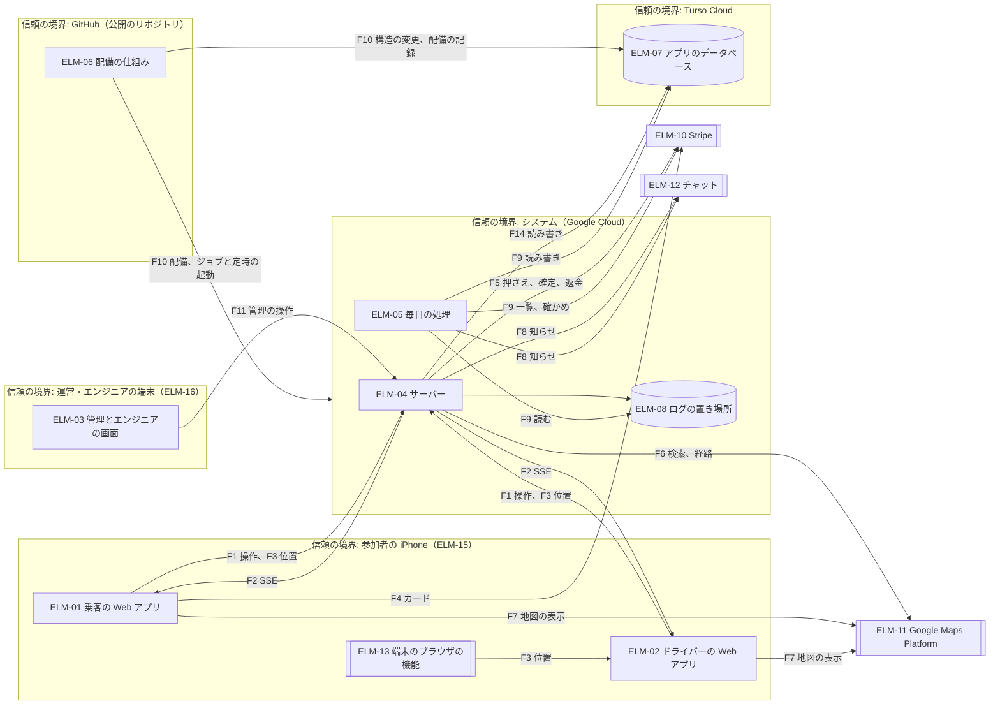
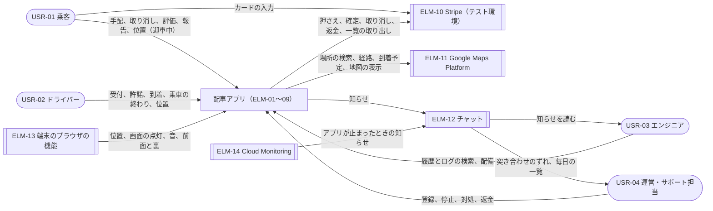
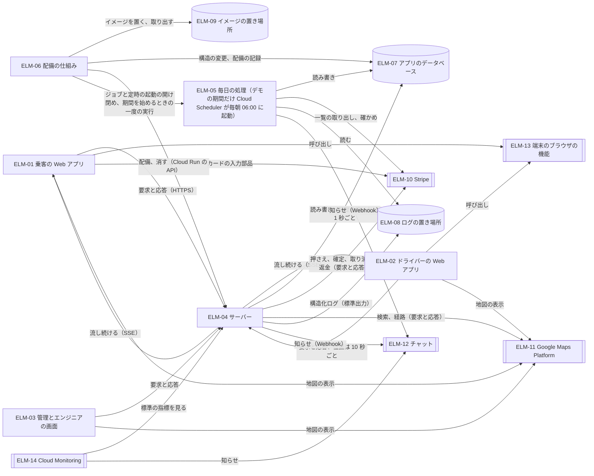
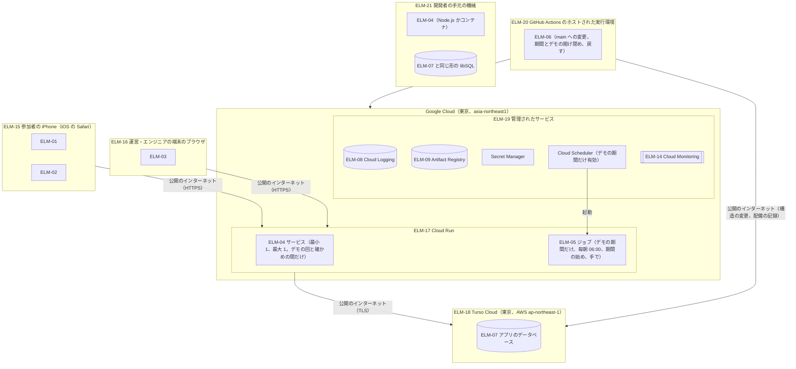
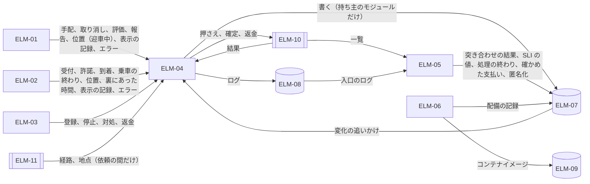
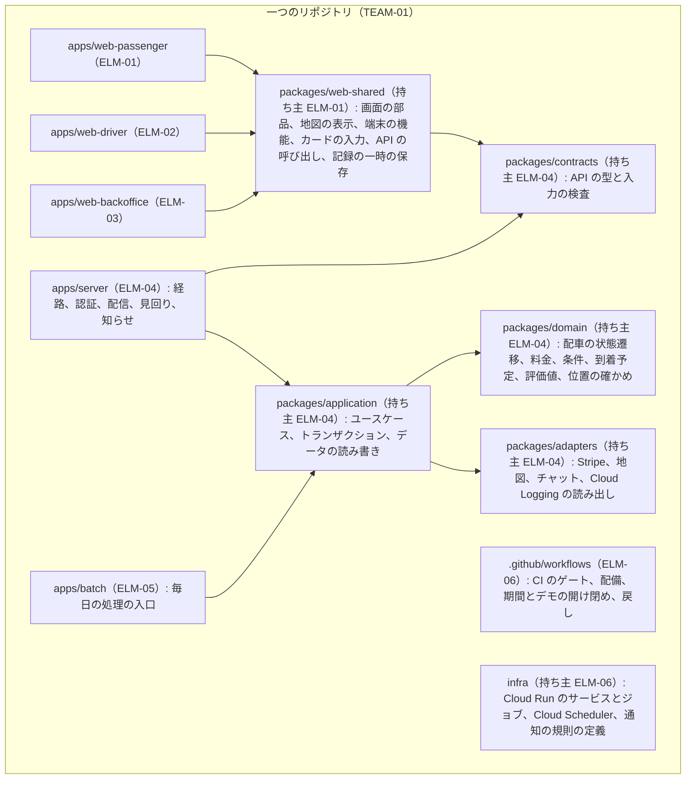

# アーキテクチャ: 配車アプリ（ride-hailing-app-demo）

状態: 回答反映済み · 更新: 2026-11-03 · 第 2 段階（全 4 段階）

## 要約

全体の構造は、Hono のサーバー一つ（ELM-04）に API、状態の変化の配信、時刻の見回り、知らせをまとめ、乗客・ドライバー・管理とエンジニアの三つの React の Web アプリ（ELM-01〜03）を同じ入口から配る形にした。毎日の処理（ELM-05）は同じコードの別の入口として Cloud Run のジョブにし、デモの期間だけ Cloud Scheduler が毎朝起動する。配備は GitHub Actions の手順（ELM-06）だけで行う（DEC-01）。状態はすべて Turso（ELM-07）に置き、Cloud Run のインスタンスは使い捨てにする（DEC-02、DEC-08）。

主な設計を動かす要求が強いた決定は次の五つ。

1. Cloud Run はインスタンスの上限を一時的に超えることがあり、インスタンスを入れ替えもする（Cloud Run の文書）。そのため画面への配信は、各インスタンスが状態の履歴の表を 1 秒ごとに追いかけ、SSE で送る（DEC-03）。
2. サーバーはデモの回にしか動かない。そのため毎日の処理はサーバーと別の Cloud Run のジョブにし、デモの期間だけ毎朝動かす。動かなかった日の分は次の実行で続ける（DEC-05。質問 1 の回答で決まった）。
3. お金は、手動で確定する押さえ一つにつき確定を一回だけにする。結果が分からない操作は、Stripe の状態を取り出して確かめてからやり直す（DEC-10、DEC-12）。
4. Stripe の押さえの増額は使わない。日本のアカウントの円の取引では Mastercard に使えず、標準の料金では申し込みが要るため。料金が上がる降車場所の変更は押さえ直す（DEC-11）。
5. 位置は状態の履歴とログから切り離し、権限のある役割だけが読める表に置く（DEC-15）。

規模はデモが 1〜2 回で終わり、参加者は 2 人、1 回の乗車は 2〜3 回、1 回のデモは 1〜2 日（質問 7）。この規模では走る費用は小さく、費用の心配は公開した入口の乱用だけになる。一方、28 日の SLO とその速い条件のアラートは、全期間で数件しか数えず、何も見分けない（この段の課題 4。第 1 段階の課題 2 を強める）。

危険が残る要求は三つ。DRV-29 は、位置の偽りを見分けて一覧にするところまでで、ドライバーを装う人は機能がないため防げない。DRV-13 は、無料の枠の復元が 24 時間までに限られる（質問 6 で受け入れた）。DRV-26 は、一人で作る量が多い（第 1 段階の課題 2）。要合意の項目には、費用の上限の値、エンジニアの検索の画面を二つに分けた技術的負債、SLO の速い条件のアラートの先送り、デモの期間の外で保存期間の処理が止まることがある。第 1 段階へは指摘を 3 件出した（FND-01〜03）。決定は 32 件、要素は 21 件。

## 入力

| 出どころ | 得たもの |
|---|---|
| `docs/design/1-architecture-drivers.md`、`drv/` | 設計を動かす要求 32 件（廃止の DRV-19 を除く）。主なもの 16 件と順位、競合、品質チェーンへの課題 1〜5 |
| `docs/design/design-context.yaml` | 技術制約 TC-01〜14、費用・納期・体制の制約 PC-01〜04、チームの構成 TEAM-01、利害関係者 STK-01。今の構造はない（すべて新設） |
| `docs/quality/context.yaml` | 利用者、CUJ とその手順、制約、運用の事実（一系統・少人数、デモ 1 回 3 時間） |
| `docs/quality/fr/` | FR 54 件（廃止の FR-35 を除く）と受け入れ基準。コンポーネントへの割り当ての対象 |
| `docs/quality/qr/`、`nfr/`、`sli/` | 設計を動かす要求の裏付け。とくに SLI-01〜05 の測定点、NFR-24（3 秒）と NFR-25（10 秒）、QR-39 の「伏せるか、権限のある人だけが読める形」 |
| この段への指摘 | 未解決の指摘はない（`docs/design/fnd/` がない） |
| Cloud Run の文書（Context7、2026-11-02） | 要求のタイムアウトは最大 60 分。WebSocket と流し続ける応答も要求として扱われ、つなぎ直しは別のインスタンスに行きうる。インスタンスの上限は、入れ替えや急な増加のとき一時的に超えうる（週に数回。猶予は最大 15 分か要求のタイムアウト）。インスタンス単位の課金では要求の外でも CPU が割り当てられ、最小のインスタンスを置くにはこの課金が要る。止める前に SIGTERM から 10 秒の猶予がある。コンテナのログは `logging.googleapis.com/trace` の欄で入口の要求のログに結び付く |
| Turso の文書（Context7、2026-11-02） | 時点を指定した復元は、無料の枠で直近 24 時間、Developer の契約で 10 日。復元は新しいデータベースとして作る |
| Stripe の文書（Context7 と docs.stripe.com、2026-11-02） | 押さえ（`capture_method=manual`）と、押さえより少ない額の確定（残りは解放）。未確定の押さえは既定で 7 日で取り消される。冪等キーは少なくとも 24 時間保たれ、その後は消えうる。押さえの増額は、Mastercard では日本のアカウントの円の取引が対象外で、IC+ の料金でない利用者はサポートへの申し込みが要る |
| GitHub | リポジトリ（Taro000/ride-hailing-app-demo）は公開（`gh repo view`）。定時実行は混む時間に遅れうること、動きのない公開のリポジトリでは 60 日で止まることは、GitHub の公式ではない複数の情報源による |
| リポジトリ | 製品のコードと基盤の定義はない |
| 質問 1〜8 の回答（2026-11-03） | 毎日の処理は Cloud Scheduler と Cloud Run のジョブにし、デモの期間だけ有効にする。ログは Cloud Logging と Logs Explorer。料金が上がる降車場所の変更は押さえ直す。管理とエンジニアの役割はパスキーも求める。アプリが止まったときの知らせの規則を一つ置く。Turso は無料の枠と書き出し。規模はデモ 1〜2 回で終わり、参加者 2 人（乗客とドライバー）、1 回の乗車 2〜3 回、1 回のデモ 1〜2 日。通知先のチャットは未定のまま。質問 9〜12（前提 15 件）は回答なし |

## 全体の構造

一つのサーバー（ELM-04、Node.js の上の Hono）が、三つの Web アプリ（ELM-01〜03）の静的なファイル、API、SSE の配信を同じ入口から出す。サーバーは Cloud Run の一つのサービスで、デモの回と確かめの間だけ置く（DEC-02、DEC-06）。状態は Turso の一つのデータベース（ELM-07）にだけ置き、インスタンスには持たない。毎日の処理（ELM-05）は、同じリポジトリのドメインの規則とデータの読み書きをそのまま使う別の入口で、同じイメージを Cloud Run のジョブとして動かす。デモの期間だけ Cloud Scheduler が毎朝起動する（DEC-05）。配備は GitHub Actions の手順（ELM-06）だけで行う（DEC-27）。

DEC-01 の案の比べ（主な設計を動かす要求を順位の順に。DRV-20・07・24・22・25・21・17 はどの案でも同じに満たせるので省く）:

| 要求（順位） | 一つのサーバーと、別の入口の毎日の処理 | 機能ごとの複数のサービス | 関数の実行と外部のリアルタイムのサービス |
|---|---|---|---|
| DRV-18 デモの回は Cloud Run と Turso、手元で同じ形（1） | 満たす: コンテナ一つを手元でもそのまま動かせる | 一部: 手元で 4 つ以上をそろえて動かす | 一部: 外部のリアルタイムのサービスは手元で同じ形にならない |
| DRV-26 一人・個人の費用（2） | 満たす: 配備、ログ、監視の対象が一つ | 満たさない: 一人で 4 つ以上を作って動かす | 一部: 学ぶ外部サービスが一つ増え、無料の枠の外は費用になる |
| DRV-04 お金を一度だけ（3） | 満たす: 依頼の状態とお金の記録を一つのトランザクションで書ける | 一部: 配車と決済がサービスをまたぎ、整合を取り直す | 一部: 関数ごとに一度だけの扱いをそろえる |
| DRV-03・02 現在地と配信（4・5） | 満たす（DEC-03、DEC-14） | 満たす | 満たす（そのサービスの得意な分野） |
| DRV-27 測定点の記録（9） | 満たす: ログの流れが一つ | 一部: サービスごとのログをつなぐ | 一部: 外部のサービスの中の出来事が見えにくい |
| DRV-29 守る（10） | 満たす: 守る入口が一つ | 一部: 入口が増える | 一部: ブラウザが外部のデータに直接書く規則では QR-21・38 をそろえにくい |
| DRV-05 配車の規則（11） | 満たす: 状態を変える場所が一つ | 一部: 割り当てと停止が別のサービス | 一部: 規則が関数ごとに散らばる |
| DRV-01 受け付け続ける（12） | 一部: 一つのサービスが一つの障害の単位。止まったインスタンスは Cloud Run が入れ替える | 一部: 一つが止まると流れが止まる | 満たす |

上位二つ（DRV-18、DRV-26）で決まる。DRV-01 は第 3 の案が勝つが、順位が下で、一系統・少人数のデモでは一つのサービスの障害の単位を受け入れる（引き換え）。

## 設計の決定

| DEC | 問い | 選んだ案 | 対象 | 退けた案 | 根拠 |
|---|---|---|---|---|---|
| DEC-01 | システムをどう分け、どこで動かすか | 一つのサーバー（API、配信、時刻の見回り、知らせ）、役割ごとの三つの Web アプリ、同じコードの別の入口の毎日の処理、配備の手順 | DRV-18、26、04、27、29、05、17 | 機能ごとの複数のサービス（一人で動かせない）。関数の実行と外部のリアルタイムのサービス（手元で同じ形にならず、外部サービスが増える） | 推定 |
| DEC-02 | Cloud Run のインスタンスの入れ替えと増減があっても同じに動くにはどうするか | インスタンスに状態を持たず、状態はすべて Turso に置く。デモの間はインスタンス単位の課金で、最小 1、最大 1（参加者 2 人） | DRV-18、01、16、02、03 | インスタンスを一つに固定してメモリに状態を持つ（上限超えと版の切り替えで壊れる）。共有のキャッシュと配信の仕組みを足す（費用と運用） | 推定 |
| DEC-03 | 状態の変化を相手の画面に T_deliver（5 秒）以内にどう届けるか | 画面ごとの SSE の流れ。各インスタンスが状態の履歴の表を 1 秒ごとに追いかけ、相手が見てよい変化を送る。つなぎ直しでは最後の通し番号から送り直し、前面に戻ると最新の状態を取り直す | DRV-02、18、12、27 | WebSocket（双方向は要らず、つなぎ直しを自作する）。数秒ごとの問い合わせ（遅れ、電池、要求の数）。Web Push（ホーム画面に入れたときだけで、裏の制約は受け入れ済み） | 推定 |
| DEC-04 | 時刻で決まる規則をどこで判定するか | 期限は依頼に時刻で持ち、操作と読み出しのときと、5 秒ごとの見回りで判定する。時刻で起きる変化も条件付きの書き込みで、二度起きても一度だけ効く | DRV-05、04、18、33、15 | 期限ごとの Cloud Tasks（呼び出し先がデモの回にしかない）。画面の時計（信用できない） | 推定 |
| DEC-05 | 毎日の処理を、サーバーがデモの回にしか動かないなかで、いつどこで動かすか | 同じイメージを Cloud Run のジョブとして動かし、デモの期間だけ Cloud Scheduler が毎朝 06:00 に起動する。期間を始める手順の中と手でも動かせる。日ごとの終わりの記録を持ち、終わっていない日をすべて続ける | DRV-33、04、21、27、18、26 | GitHub Actions の定時実行（本番の資格情報を公開のリポジトリに置き、遅れや停止がある）。サーバーが動くときだけ（押さえの期限と朝の締めに間に合わない）。手元の機械（動いていないことがある） | 推定（選んだ案は確認済み） |
| DEC-06 | デモの回の外で、公開した入口と費用をどう扱うか | デモの回と確かめの間の始めにサービスを作り、終わりに消す。期間を終える手順とデモの期間の毎日の処理が、消し忘れたサービスを知らせる | DRV-18、26、29 | サービスを残して公開をやめる（TC-07 の文言と違う）。公開したまま 0 まで縮める（TC-07 に反し、大量の要求が費用になる） | 推定 |
| DEC-07 | サーバーとデータベースをどの地域に置くか | Cloud Run も Turso も東京 | DRV-02、01、21、11 | 米国の地域（参加者とデータベースへの往復が延びる） | 推定 |
| DEC-08 | データをどこに置き、どの単位で書くか | Turso のデータベース一つ。表ごとに書くモジュールは一つ。状態と履歴、お金の記録とその履歴、管理の操作とその記録は、それぞれ一つのトランザクションで書く。履歴などは追記だけ | DRV-31、04、05、13、27、18 | 個人情報を別のデータベースに分ける（状態と履歴を一度に書けない） | 推定 |
| DEC-09 | 配車依頼の状態を、どの経路でも規則どおりに一か所で変えるにはどうするか | 配車のモジュールだけが変える。許される変化は一つの状態遷移表で定め、変化はすべて条件付きの書き込みにし、割り当ての条件は同じトランザクションで確かめ直す。一意の制約を守りの二段目にする | DRV-05、31、04、01、23 | 機能ごとに書いて一意の制約で守る（QR-45 に反する）。依頼ごとにメモリで一つずつ処理する（インスタンスが二つで壊れる） | 推定 |
| DEC-10 | 押さえ、請求、キャンセル料、不在の料金、返金を Stripe でどう行うか | 手配のときに確定した料金の額を押さえ（手動で確定する PaymentIntent）、乗車の終わりに確定する。キャンセル料と不在の料金は押さえから 500 円だけを確定して残りを解放し、無料の取り消しは押さえを取り消す。カードは Stripe の入力部品で登録する。Webhook は使わない | DRV-04、30、22、11、26 | 押さえずに終わりに請求する（FR-05 を満たさない）。支払いごとにホストされた画面（FR-29 を満たさない） | 推定 |
| DEC-11 | 降車場所の変更で料金が上がるとき、押さえた額をどう増やすか | 押さえ直す。新しい料金の額で押さえ、できたら古い押さえを取り消す。できなければ降車場所を変えない | DRV-04、26、30 | 押さえの増額（円の取引で使えないことがあり、申し込みも要る）。上がる変更を断る（FR-12 が実質使えない）。多めに押さえる（NFR-08 に反する） | 推定（選んだ案は確認済み） |
| DEC-12 | お金の操作を、二度届いても、応答がなくても、一度だけにするにはどうするか | 三重にする。ブラウザの操作キーと最初の結果の記録、Stripe への決まったキー、応答がないときは状態を取り出して確かめてから同じキーで送り直す | DRV-30、04、11 | Stripe の冪等キーだけ（24 時間を過ぎると消えうる）。一意の制約だけ（二度目にエラーを返す） | 推定 |
| DEC-13 | 自分の記録を Stripe の記録とどう突き合わせるか | 毎日の処理が Stripe の一覧の API で前日分を取り出し、依頼ごとに比べて結果を追記する。結果が分からない操作もここで確かめる | DRV-04、27、33 | Webhook で写しを持ち続ける（サーバーが常に動かず、入口が増える）。Stripe の有料の報告 | 推定 |
| DEC-14 | 現在地をどう受け取り、新しさをどう保つか | ブラウザが 10 秒ごとに HTTP で送り、サーバーは最後の位置を上書きし、受けた記録を追記し、配信に載せる。裏に回った時刻を送り、30 秒より古いドライバーは受付中に数えない | DRV-03、12、21、27、20 | WebSocket で送る（別の接続が要る）。動いたときだけ送る（止まったドライバーが古く見える） | 推定 |
| DEC-15 | 状態の履歴に要る位置を、個人情報を守りながらどう持つか | 位置は位置の記録の表に分け、履歴は参照だけを持つ。位置を読めるのは運営・サポート担当とエンジニアの役割、配車のモジュールと毎日の処理だけ。ログには座標を書かない | DRV-21、32、27、29 | 履歴の行に入れて API で限る（DRV-32 に反する）。丸めて入れる（NFR-14 の 50 m と SLI-05 を満たさない） | 推定 |
| DEC-16 | 測定点の出来事とログをどこに残し、だれが数えるか | 入口の要求のログは Cloud Run が書く Cloud Logging のもの。アプリのログは構造化ログで Cloud Logging へ。業務の出来事の記録は Turso。SLI と毎日の監視は毎日の処理が数える | DRV-27、28、21、32、26、18 | すべてをアプリが Turso に書く（アプリの前の入口で測れない）。外部の監視のサービス（PC-04 に合わない） | 推定（選んだ案は確認済み） |
| DEC-17 | 異常をどうエンジニアに知らせるか | サーバーが種類ごとに 1 分まとめてチャットに送り、送った記録を残す。毎日の処理は毎日の結果を送る。アプリが止まったときのために、Cloud Run の標準の指標に Cloud Monitoring の規則を一つ置く。SLO の速い条件のアラート（NFR-01〜03 のページ）は第 1 段階の課題 2 の答えまで先送りする | DRV-28、01、27 | すべてを Cloud Monitoring の規則にする（トレース ID の例を添えにくい）。サーバーの中だけ（止まると知らせられない） | 推定（規則を置くことは確認済み） |
| DEC-18 | 一つの操作の記録を、ブラウザから外部の呼び出しまでどうつなぐか | ブラウザが操作ごとにトレース ID を作って見出しで送り、入口のログ、サーバーのログ、外部の呼び出しのログ、エラーの応答、状態の履歴、ブラウザのエラーの記録に同じ ID を残す | DRV-28、27 | OpenTelemetry と Cloud Trace（設定と費用。CUJ-10 は今期重視しない） | 推定 |
| DEC-19 | エンジニアがログと状態の履歴を探す画面をどう用意するか | 状態の履歴は管理とエンジニアの画面で探し、各変化のトレース ID から Logs Explorer を開く。ログは Logs Explorer で探す | DRV-28、25、26 | 履歴とログを一つの時刻順に並べる画面を作る（手間）。ログを Turso にも写す（二重に持つ） | 確認済み |
| DEC-20 | 本人だけがログインでき、役割の画面を役割のアカウントだけに使わせるにはどうするか | サーバーの中の認証のライブラリで、パスワード、クッキーのセッション、回数の制限と一時の停止を行う。管理とエンジニアの役割はパスキーも求める。役割は経路のまとまりごとに一か所で確かめる | DRV-29、25、21、26 | 外部の認証のサービス（外部サービスが増える）。全員パスキー（全員の登録とやり直しの流れ） | 推定（パスキーの範囲は確認済み） |
| DEC-21 | 公開した入口への攻撃と地図の鍵の乱用で、費用が予算を超えないようにするにはどうするか | 上限を重ねる。デモの外はサービスがない、最大のインスタンス、地図の API ごとの 1 日の割り当て、鍵の制限、アカウントと IP ごとの回数の制限、ログインの一時の停止、予算の知らせ | DRV-29、26、01 | 外部の負荷分散と Cloud Armor（月の費用）。アプリの回数の制限だけ（上限にならない） | 推定 |
| DEC-22 | Google Maps Platform をどう呼び、費用と待ち時間と失敗をどう抑えるか | 検索と経路と到着予定はサーバーの地図のモジュール一つから呼ぶ。経路は決まった場面で一度ずつ求め、到着予定は 1 分ごとにだけ取り直す。一覧と条件は直線の距離で判定する。Google の内容は依頼の間だけ持つ | DRV-11、26、06、08、14、28 | ブラウザから直接呼ぶ（鍵の乱用、トレースが残らない）。位置が届くたびに求め直す（費用が 6 倍） | 推定 |
| DEC-23 | 三つの画面をどう作り、端末の機能とカードの入力をどう閉じ込めるか | 一つの React のコードから役割ごとの三つの SPA を作り、同じ入口から配る。端末の機能、地図の表示、カードの入力は、それぞれ一つのモジュールだけが使う。記録は端末に一時に保存して送る。読み込めるスクリプトを限る | DRV-20、07、14、22、12、27、32、09 | サーバーで組み立てる画面（地図と配信の画面で結局 React が要る）。全役割で一つの SPA（読み込む量が増える） | 推定 |
| DEC-24 | 地図が中心の画面で WCAG 2.2 AA をどう満たすか | アクセシビリティに配慮した部品のライブラリで作り、地図の操作にはすべてドラッグしない代わりを用意する。axe の自動の確かめを画面のテストに入れる | DRV-24、08、15 | 部品を自作して ARIA を手で付ける（漏れやすい） | 推定 |
| DEC-25 | 主要な流れと外部の失敗を、実時間と本物のサービスを待たずにどう確かめるか | 外部サービス、時計、ID の生成を差し替える口を置き、CI では失敗や無応答を起こせる偽物を使う。位置の列を流す道具を作る。Stripe はテスト環境でも少数のテストを動かす | DRV-15、14、11、04 | いつも本物で確かめる（障害を起こせない）。通信の記録と再生（壊れやすい） | 推定 |
| DEC-26 | コードをどう分け、どの依存を許すか | 一つのリポジトリをドメインの規則、ユースケース、外部サービスの包み、API の約束、サーバー、毎日の処理、三つの Web アプリ、共通の画面の部品に分け、依存の規則を CI で確かめる | DRV-14、31、26、17、15、10、23 | フォルダーだけで分ける（崩れやすい）。リポジトリを分ける（一人で版を合わせる手間） | 推定 |
| DEC-27 | 変更をどう出し、どう戻し、データベースの構造をどう変えるか | GitHub Actions の手順だけで配備する。ゲートを通ったイメージを一つ作り、デモを開くときに構造の変更（足すだけ）を当てて配備し、記録を残す。戻しは前のイメージの配備。構造の変更は二つの版に分ける。GCP へは鍵を置かない連携で入る | DRV-16、15、18、17 | Cloud Build（CI が二か所に分かれる）。手元からの配備（NFR-36 に反しやすい） | 推定 |
| DEC-28 | 障害やまちがった書き込みのあと、記録を障害の直前までどう戻すか | Turso の時点を指定した復元（無料の枠で 24 時間）と、デモの回の終わりごとの書き出し | DRV-13、04、26 | 有料の契約で 10 日（月の費用）。別の場所へ写し続ける（作る手間） | 確認済み |
| DEC-29 | ドライバーが位置を偽って到着を知らせることに、どう備えるか | サーバーで位置の列を確かめ、疑わしい到着に印を付け、NFR-45 の毎日の一覧で示す | DRV-29、04、20 | 端末の確かめ（Safari の Web アプリでは使えない）。何もしない（DRV-29 を満たさない） | 推定 |
| DEC-30 | 手配したドライバーを装う人に、どう備えるか | 設計では備えず残る危険とし、機能を足すかを品質チェーンに返す（先送り） | DRV-29 | 設計で乗客の確かめを作る（品質チェーンにない機能を足すことになる） | 推定 |
| DEC-31 | 管理の画面の操作を担当一人ひとりにたどれるよう、どう残すか | 操作と同じトランザクションで、担当、時刻、対象、理由を追記だけの表に書く | DRV-29、25、21 | ログに残す（落ちうるうえ 30 日で消える）。Turso の監査ログ（意味がなく保持が短い） | 推定 |
| DEC-32 | 何の上で動かし、手元とデモの回で同じ形をどう保つか | Node.js の上の Hono。一つのコンテナイメージを手元と Cloud Run で動かす。設定は環境変数、秘密は Secret Manager（GitHub の秘密は CI の分だけ） | DRV-17、18、15 | Bun（ライブラリとの相性の確かめが要る）。Deno（道具が TC-04・05 と重なる） | 推定 |

主な設計を動かす要求に関わる決定ごとの案の比べと要点（DEC-01 は「全体の構造」）。「満たす / 一部 / 満たさない」は、その案がその要求の応答を生むかどうか。

### DEC-02 インスタンスに状態を持たない

| 要求（順位） | 状態を持たない（Turso） | 一つに固定してメモリに持つ | 共有のキャッシュと配信を足す |
|---|---|---|---|
| DRV-18（1） | 満たす: 入れ替えと上限超えでも同じに動く | 満たさない: 上限を超えて二つ並ぶ間に、メモリの状態が分かれる（Cloud Run の文書） | 満たす |
| DRV-26（2） | 満たす | 満たす | 満たさない: 常に動くサービスの費用と運用が増える |
| DRV-03・02（4・5） | 満たす（DEC-03、DEC-14） | 一部: 版の切り替えの間に配信が漏れる | 満たす |
| DRV-01（12） | 満たす: 止まったインスタンスを入れ替えても続く | 一部 | 満たす |

- 得るもの: 版の切り替えと戻し（DRV-16）、インスタンスの入れ替えで進行中の依頼が失われない。
- 失うもの: 状態の読み書きのたびにデータベースへの往復が要る（東京どうし。DEC-07）。デモの間は 1 インスタンス分の時間を払う（デモの回 1 回で 10,800 インスタンス秒。上限を一時的に超えた分を除く。「費用と体制」）。
- 最大を 1 にした理由: 参加者は 2 人（質問 7）で、一つのインスタンスで足りる。上限を一時的に超えて二つ並んでも、状態を持たないので害はない。
- 応答を左右する点: 最大のインスタンスの数（費用の上限と、上限を超えた一時のインスタンス）、最小 1（デモの最初の要求の立ち上がり）。

### DEC-03 状態の変化を画面に届ける方式

| 要求（順位） | SSE と履歴の追いかけ | WebSocket と履歴の追いかけ | 数秒ごとの問い合わせ |
|---|---|---|---|
| DRV-18（1） | 満たす: インスタンスの数と入れ替えに左右されない | 満たす | 満たす |
| DRV-26（2） | 満たす: つなぎ直しと送り直しはブラウザの仕組み | 一部: つなぎ直しと送り直しを自作する | 満たす |
| DRV-02（5） | 満たす: 追いかけ 1 秒で、残り 3.95 秒を回線と表示に使える（計算） | 満たす | 一部: 2 秒ほどの間隔でないと 5 秒の 95% に届かない |
| DRV-27（9） | 満たす: 配信のもとが状態の履歴そのもの | 満たす | 満たす |
| DRV-12（28、主でない） | 一部: 生存確認の通信（25 秒ごと） | 一部: 同じ | 満たさない: 2 秒ごとの通信 |

- 得るもの: 届かなかった変化はつなぎ直しで埋まる。配信のもとが状態の履歴と同じなので、履歴に残った変化は必ず配られる（DRV-31）。開発者は送り続ける仕組みを作った経験がある（PC-03）。
- 失うもの: インスタンスごとに 1 秒に 1 回の読み出し（デモ 1 回で 10,800 回）。流れは 30 分ごとにつなぎ直す（Cloud Run の要求のタイムアウトは最大 60 分）。
- 応答を左右する点: 追いかけの間隔 P_tail、生存確認の間隔、iOS の Safari で前面に戻ったときのつなぎ直し。
- 引き換え: DRV-12（生存確認の通信。位置の送信より少ない）、DRV-26（読み出しが Turso の使用量に入る）。
- 先送り: 裏に回った乗客への Web Push は、TC-09 を見直すときに考える。

### DEC-04 時刻で決まる規則

| 要求（順位） | 期限を時刻で持ち、操作と見回りで判定 | 期限ごとの Cloud Tasks | 画面の時計 |
|---|---|---|---|
| DRV-18（1） | 満たす: サーバーが止まっても次の判定で正しい | 満たさない: 呼び出し先がデモの回にしかない | 満たす |
| DRV-04（3） | 満たす: キャンセル料の判定をサーバーで行う | 満たす | 満たさない: ブラウザは信用できない（DRV-29） |
| DRV-05（11） | 満たす: 条件付きの書き込みで一度だけ効く | 満たす | 満たさない |

- 得るもの: 見回りと操作が同時に同じ変化を起こしても一度だけになる。時計を差し替えれば実時間を待たずに確かめられる（DRV-15、DEC-25）。
- 失うもの: 見回りのためにインスタンス単位の課金が要る（DEC-02）。

### DEC-05 毎日の処理の動かし方

| 要求（順位） | Cloud Scheduler と Cloud Run のジョブ（デモの期間だけ） | GitHub Actions の定時実行 | サーバーが動くときだけ |
|---|---|---|---|
| DRV-18（1、交渉できない） | 満たす（質問 1 で、デモの期間だけ有効にすると確認。TC-07 の文の直しは FND-02） | 満たす: サーバーは常時動かさない | 満たす |
| DRV-26（2） | 一部: 定時の起動を一つ持つ（費用は未定の値 C_scheduler） | 満たす | 満たす |
| DRV-04（3） | 満たす: 翌朝に突き合わせ、押さえの期限（7 日）より前に確かめる | 満たす | 満たさない: 次のデモまで動かず、押さえが期限で消えうる |
| DRV-27（9） | 満たす: 翌朝に履歴の確かめと SLI の集計 | 満たす | 一部: 遅れる |
| DRV-29（10） | 満たす: 秘密は Secret Manager、ログは Cloud Logging で公開されない | 一部: 本番の資格情報を公開のリポジトリの GitHub に置き、実行のログが誰でも読める | 満たす |
| DRV-21（13） | 一部: 期間の外は保存期間の処理も止まる | 満たす | 一部: 遅れる |

利用者は第 1 の案を、デモの期間だけ有効にする形で選んだ（質問 1）。デモの期間は、最初のデモの回の日から、最後のデモの回の翌朝の処理が終わるまでとする（解釈。質問 1 の答えから推定）。

- しくみ: サーバーと同じイメージを、毎日の処理のコマンドで Cloud Run のジョブとして動かす。Cloud Scheduler が毎朝 06:00（日本時間）に起動する。期間を始める手順（ELM-06）がジョブと定時の起動を作って有効にし、一度動かして終わっていない日を片付ける。期間を終える手順が定時の起動を止め、サービスが消えていることを確かめる。手でも動かせる。どの処理も日ごとの終わりの記録を持ち、終わっていない日をすべて続ける（DRV-33）。
- 得るもの: デモの翌朝に突き合わせ（FR-55）と知らせ（NFR-07）が終わり、NFR-06 の締め（8:30）に 2 時間 30 分の余裕がある（計算）。GCP の中で完結し、秘密は Secret Manager、ログは Cloud Logging に置ける。Cloud Scheduler は時刻どおりに起動し、失敗したらやり直す。
- 失うもの: 期間の始めと終わりに、ジョブと定時の起動を有効にして止める手順が要る。期間の外では毎日の処理が動かない。デモは 1〜2 回で終わる（質問 7）ので、終えた後は保存期間の処理（FR-53）が動かず、個人情報が T_pii_retention を過ぎて残りうる。そのため、最後の期間を終えるときに、個人情報をすべて消す処理を動かせるようにする（推定。DRV-21）。
- 応答を左右する点: 期間を終える時刻（最後のデモの回の翌朝の処理が終わってから）。起動の時刻と NFR-06 の 8:30 の間。
- 引き換え: DRV-21（期間の外は保存期間の処理が止まる。終えるときの消去で補う）、DRV-26（定時の起動という管理されたサービスが一つ増える）。
- データの持ち主の例外: 毎日の処理は、サーバーと同じモジュールのコードで、サーバーが持つ表（支払いの状態、状態の履歴の匿名化）を書く。書くコードは一つで、動かす入口が二つになる（「情報」のビュー）。

### DEC-06 デモの外のサービスの扱い

| 要求（順位） | 回ごとに作って消す | 残して公開をやめる | 公開したまま 0 まで縮める |
|---|---|---|---|
| DRV-18（1、交渉できない） | 満たす: TC-07 の「デモの回と確かめの間だけ配備する」の文言どおり | 一部: 配備は残る | 満たさない |
| DRV-26（2） | 満たす: デモの外の費用はない | 満たす | 一部: 大量の要求が費用になる |
| DRV-29（10） | 満たす: デモの外は入口がない | 満たす | 満たさない |

- 失うもの: 回ごとに作って消す手順を動かす。Cloud Run の版の履歴は回をまたいで残らないので、回をまたぐ戻しはイメージを配備し直す（DEC-27）。消し忘れると最小 1 のインスタンスが動き続ける。デモの期間の毎日の処理と、期間を終える手順が、サービスが残っていないかを見て知らせる。GCP の予算の知らせも置く（DEC-21）。
- 前提: Cloud Run のサービスの URL は、サービスの名前、プロジェクト、地域から決まり、作り直しても同じになる（地図の鍵の参照元の制限がそのまま使える）。

### DEC-07 置く地域

| 要求（順位） | 東京 | 米国の地域 |
|---|---|---|
| DRV-02（5） | 満たす: 往復が短い | 一部: 参加者との往復が太平洋を越える |
| DRV-01（12） | 満たす | 満たす |
| DRV-21（13） | 満たす: 個人情報を国内に置く（法令の中身の確かめは未解決の点） | 一部 |

- 前提: Turso に東京の地域（AWS の ap-northeast-1）がある。

### DEC-08 データの置き場所と書く単位

| 要求（順位） | Turso 一つ、一つのトランザクション | 個人情報を別のデータベースに分ける |
|---|---|---|
| DRV-18（1） | 満たす: 手元でも libSQL で同じ形 | 満たす |
| DRV-04（3） | 満たす: お金の記録と履歴を一度に書く | 一部: データベースをまたぐ |
| DRV-27（9） | 満たす: 状態を変えたら必ず履歴が残る | 満たさない: 状態と履歴を一度に書けない |
| DRV-05（11） | 満たす | 一部 |
| DRV-21（13） | 一部: 個人情報の範囲は DEC-15 と権限で狭める | 満たす |

- 失うもの: Turso の障害でシステム全体が止まる（Turso の約束は入力にない）。

### DEC-09 配車の状態を一か所で変える

| 要求（順位） | 配車のモジュールと条件付きの書き込み | 機能ごとに書いて一意の制約で守る | 依頼ごとにメモリで一つずつ |
|---|---|---|---|
| DRV-18（1） | 満たす | 満たす | 満たさない: インスタンスが二つで壊れる |
| DRV-04（3） | 満たす: 取り消しと許諾のぶつかりでお金の扱いを誤らない | 一部 | 一部 |
| DRV-05（11） | 満たす: 同時の許諾も一人だけ | 一部: 規則が散らばる | 満たす |
| DRV-31（原則） | 満たす | 満たさない（QR-45、NFR-11） | 満たす |

- 応答を左右する点: 割り当ての条件（しきい値、受ける条件、停止、迎車中・乗車中でないこと）を、書き込みと同じトランザクションの中で確かめ直すこと。

### DEC-10 Stripe でのお金の流れ

| 要求（順位） | 手動で確定する押さえ | 押さえずに終わりに請求 | 支払いごとのホストされた画面 |
|---|---|---|---|
| DRV-26（2） | 満たす: Stripe の標準の流れ。Webhook の入口を作らない | 満たす | 満たす |
| DRV-04（3） | 満たす: 一つの押さえは一回しか確定できない（Stripe が保証）ので、同じ押さえへの二重の請求が仕組みとして起きない | 満たさない: FR-05 の押さえがない | 満たさない: FR-29 は乗客の操作なし |
| DRV-22（16） | 満たす: カードは入力部品で登録（SetupIntent） | 満たす | 満たす |

- 応答を左右する点: 押さえの期限（既定で 7 日）。確定はその前に終える（デモの最中に確定し、残りは毎日の処理が確かめる）。
- 前提: Stripe のアカウントは日本で、請求は円。テスト環境のカードで押さえと確定ができる。

### DEC-11 料金が上がる降車場所の変更

| 要求（順位） | 押さえ直す | 押さえの増額 | 上がる変更を断る | 多めに押さえる |
|---|---|---|---|---|
| DRV-26（2） | 一部: 押さえが複数ある乗車の突き合わせが要る | 一部: 申し込みと、使えないカードの扱いが別に要る | 満たす | 満たす |
| DRV-04（3） | 満たす: 押さえの額はいつも確定した料金と同じ | 一部: 円の取引の Mastercard で使えない | 満たす | 満たさない: NFR-08（押さえは確定した料金と同じ）に反する |
| （FR-12、CUJ-03） | 満たす | 一部 | 満たさない: 遠くへの変更がいつも断られる | 満たす |

- 料金が下がるときは、新しい額で押さえ直し、できなければ古い押さえのまま下がった額だけを確定する（残りは解放）。
- 応答を左右する点: 登録した支払い手段での押さえ直しに本人の確かめ（3D セキュア）が求められると失敗し、降車場所は変わらない（FR-12 AC4）。テスト環境の普通のカードでは求められない。
- 先送り: 押さえの増額は、Stripe がこのアカウントで使えるようにしたときに考え直す。
- この案は質問 3 で確認済み。

### DEC-12 お金の操作を一度だけにする

| 要求（順位） | 三重（操作キー、決まったキー、確かめてから送り直す） | Stripe の冪等キーだけ | 一意の制約だけ |
|---|---|---|---|
| DRV-04（3） | 満たす | 一部: キーは 24 時間を過ぎると消えうる。翌週の確かめで二重に返金しうる | 一部: 依頼の二重は防げるが返金の二重は防げない |
| DRV-11（14、主でない） | 満たす: 応答がないときは確かめ中にする | 一部 | 満たさない |
| DRV-30（原則） | 満たす | 一部 | 一部 |

- しくみ: (a) 手配の確定と返金は、ブラウザが操作ごとにキーを作り、送り直しでも同じキーを使う。サーバーはキーと最初の結果を、効果と同じトランザクションで記録し、二度目には最初の結果を返す。(b) Stripe への呼び出しには、依頼とお金の操作の種類（押さえは何番目か）から決まるキーを付ける。(c) 応答がないときは失敗と扱わず「確かめ中」にする。まず Stripe の状態（押さえの状態、返金の一覧）を取り出し、まだ起きていないときだけ同じキーで送り直す。
- 設計上の値: Stripe の呼び出しは 1 回 2.5 秒で切る。降車のときの確定は 2 回までやり直す（0.5 秒、1 秒の待ち）。最悪 9.0 秒で NFR-25 の 10 秒に収まる（計算）。

### DEC-13 Stripe の記録との突き合わせ

| 要求（順位） | 毎日の処理が一覧を取り出す | Webhook で写しを持つ | Stripe の有料の報告 |
|---|---|---|---|
| DRV-18（1） | 満たす: サーバーが止まっていても動く | 一部: 止まっている間の出来事は取り直しが要る | 満たす |
| DRV-26（2） | 満たす | 一部: 署名を確かめる入口を作る | 満たさない: 有料 |
| DRV-04（3） | 満たす | 満たす | 満たす |
| DRV-29（10） | 満たす: 受ける入口が増えない | 一部 | 満たす |

- 前提: 押さえ、確定、返金に依頼の ID をメタデータとして付け、一覧から依頼ごとに集められる。

### DEC-14 現在地の受け取り

| 要求（順位） | 10 秒ごとに HTTP で送る | WebSocket で送る | 動いたときだけ送る |
|---|---|---|---|
| DRV-18（1） | 満たす | 一部: DEC-03 と別の接続が要る | 満たす |
| DRV-03（4） | 満たす: 続けて 2 回届かなくても新しいと数えられる（計算） | 満たす | 満たさない: 止まったドライバーが古く見える |
| DRV-21（13） | 満たす: 乗客は迎車中で許可したときだけ送り、乗車が始まるか依頼が終わるとやめる（FR-24） | 満たす | 満たす |
| DRV-12（28、主でない） | 一部: 10 秒ごとの通信 | 一部 | 満たす |

- 失うもの: 参加者 1 人あたり 1 時間に 720 行を書く（計算）。
- 裏に回った時刻は、裏に回るときに送り、届かなくても前面に戻ったときに送り直す（ブラウザに保持する）。乗客の分も記録し、SLI-03 の見えない点を減らす。

### DEC-15 位置を状態の履歴とログから切り離す

| 要求（順位） | 位置の記録の表に分け、参照だけを持つ | 履歴の行に入れて API で限る | 丸めて入れる |
|---|---|---|---|
| DRV-27（9） | 満たす: どの変化にも位置がある（SLI-05） | 満たす | 満たさない: NFR-14 の 50 m を見分けられない |
| DRV-29（10） | 満たす: 位置は役割で限る | 一部 | 一部 |
| DRV-21（13） | 満たす: QR-39 の「権限のある人だけが読める形」。保存期間の処理は位置の記録を消すだけ | 一部 | 満たす |
| DRV-32（原則） | 満たす: 履歴とログに座標がない（NFR-40） | 満たさない | 一部 |

- DRV-32 の文は QR-39 より狭く（伏せることだけを書いている）、DRV-27 と食い違う。第 1 段階への指摘 FND-01 にした。

### DEC-16 記録と測定の置き場所

| 要求（順位） | Cloud Logging と Turso | すべてアプリが Turso に書く | 外部の監視のサービス |
|---|---|---|---|
| DRV-18（1） | 一部: 手元にはアプリの前の入口のログがない（SLI は本番だけで測るので足りる） | 満たす | 一部 |
| DRV-26（2） | 満たす: ログの保存と検索を作らない | 一部: 検索を作る | 一部: 外部サービスが増える |
| DRV-27（9） | 満たす: SLI-01 を Cloud Run が書く入口のログで測れる | 満たさない: アプリに届かなかった要求が見えない | 満たす |
| DRV-21（13） | 満たす: 既定の保持（30 日）は T_pii_retention を超えない | 満たす | 一部: 個人情報が外部に出る |

- PC-04 の「構造化ログを保存し、集計のスクリプトで数え、チャットに知らせる」のうち、保存は Cloud Logging が担い、数えるのと知らせるのは自前で行う（DEC-05、DEC-17）。この読み方は質問 2 で確認済み。
- SLI-01 のテスト用アカウントの除外は、入口のログとアプリのログをトレース ID で結んで行う。
- 前提: Cloud Logging の既定の保持は 30 日で、T_log_retention（28 日、仮）を超える。

### DEC-17 エンジニアへの知らせ

| 要求（順位） | サーバーと毎日の処理が送り、止まったときは Cloud Monitoring | すべて Cloud Monitoring | サーバーの中だけ |
|---|---|---|---|
| DRV-26（2） | 一部: 規則を一つ持つ（費用は未定の値） | 一部: 規則の数だけ費用 | 満たす |
| DRV-27（9） | 満たす | 満たす | 満たす |
| DRV-01（12） | 満たす: アプリが止まっても知らせが届く | 満たす | 満たさない: 止まると知らせられない |

- 設計上の値: まとめる間隔は 1 分（NFR-33 の 5 分に収まる）。
- Cloud Monitoring の規則を一つ置くことは質問 5 で確認済み。
- 先送り: SLO の速い条件のアラート（NFR-01〜03 のページ。長い窓 1 時間・短い窓 5 分など）は作らない。参加者 2 人、乗車は 1 回 2〜3 回（質問 7）では、窓に入る出来事が NFR-01 の N_alert_min（10 件）に届かないか、届いても何も見分けない。測るための記録と毎日の集計（DEC-16、DEC-05）は作るので、あとから足しても記録の形は変わらない。第 1 段階の課題 2 に品質チェーンが答えたときに見直す（推定。要合意）。

### DEC-18 トレース ID の引き継ぎ

| 要求（順位） | 自前の見出しと構造化ログ | OpenTelemetry と Cloud Trace |
|---|---|---|
| DRV-26（2） | 満たす | 一部: 設定と費用 |
| DRV-27（9） | 満たす | 満たす |

- 応答を左右する点: Cloud Run の入口の要求のログに同じトレース ID が残る見出しの形を選ぶこと（第 3 段階の共通の約束事）。
- 先送り: OpenTelemetry は CUJ-10 を重視に上げるときに考える。

### DEC-19 エンジニアの検索の画面

| 要求（順位） | 履歴は管理の画面、ログは Logs Explorer | 一つの時刻順に並べる画面を作る | ログを Turso にも写す |
|---|---|---|---|
| DRV-26（2） | 満たす | 一部: 画面とログの取り出しを作る | 一部: 二重に持つ |
| DRV-25（17） | 満たす: Logs Explorer は GCP の権限を持つ人だけ | 満たす | 満たす |

- 技術的負債: FR-40 AC1 の「履歴とログを時刻順に一つに示す」は二つの画面に分かれる（「技術的負債と先送りした決定」）。この案は質問 2 で確認済み。

### DEC-20 ログインと役割

| 要求（順位） | サーバーの中のライブラリ、管理の役割はパスキーも | 外部の認証のサービス | 全員パスキー |
|---|---|---|---|
| DRV-18（1） | 満たす: 手元でも同じ | 一部: 手元は模擬の環境 | 満たす |
| DRV-26（2） | 満たす | 一部: 外部サービスが一つ増える | 一部: 全員の登録とやり直しの流れ |
| DRV-29（10） | 一部: 乗客とドライバーは漏れたパスワードに回数の制限で備える | 一部 | 満たす |
| DRV-25（17） | 満たす | 満たす | 満たす |

- 応答を左右する点: ログインの失敗の上限と一時の停止の長さ。クッキーは HttpOnly、Secure、SameSite にし、状態を変える要求では送り元（Origin）も確かめる。
- ライブラリの候補は Better Auth（第 4 段階で決める）。
- パスキーを管理とエンジニアの役割だけに求めることは質問 4 で確認済み。

### DEC-21 乱用と費用の上限

| 要求（順位） | 上限を重ねる | 外部の負荷分散と Cloud Armor | アプリの回数の制限だけ |
|---|---|---|---|
| DRV-26（2） | 満たす: 最悪の費用が上限の和で決まる | 満たさない: 月の費用 | 一部 |
| DRV-29（10） | 満たす | 満たす | 一部: 多くの IP からの要求と鍵の乱用に上限がない |
| DRV-01（12） | 一部: 上限に達すると地図が使えなくなる（DRV-11 の扱い） | 満たす | 満たす |

- 上限: デモの外はサービスがない（DEC-06）。Cloud Run は最大 1（DEC-02）。Google Maps Platform は API ごとの 1 日の割り当て Q_maps_day = 1,000 回（仮。デモの回 1 回の経路と到着予定の呼び出しは最大 189 回で、5.3 倍の余裕。計算）。サーバーの鍵は外に出さず使う API だけに限り、ブラウザの地図の鍵は参照元と Maps JavaScript API だけに限る。アカウントと IP ごとの回数の制限。ログインの一時の停止。GCP の予算の知らせ（知らせるだけで止めない）。

### DEC-22 地図サービスの呼び出し方

| 要求（順位） | サーバーの地図のモジュールで、決まった場面だけ呼ぶ | ブラウザから直接呼ぶ | 位置が届くたびに求め直す |
|---|---|---|---|
| DRV-26（2） | 満たす: 呼び出しの数が乗車ごとにほぼ決まる | 一部: 鍵の乱用に上限がない | 満たさない: 1 乗車あたり 1 分に 6 回 |
| DRV-29（10） | 満たす: サーバーの鍵を出さない | 一部 | 満たす |
| DRV-27（9） | 満たす: 外部の呼び出しのログにトレース ID が残る（FR-37 AC2） | 満たさない | 満たす |

- 経路を求める場面: 見積もりごとに一度、許諾のときに一度、運転の開始のときに一度、降車場所の変更のときに一度。迎車中と乗車中の到着予定は 60 秒ごとにだけ取り直し、その間は持っている経路で進める。一覧、受ける条件、近くのドライバーの数は直線の距離で判定する。場所の検索はセッションのトークンでまとめる。
- 設計上の値: 呼び出しは 2 秒で切り、要求の中ではやり直さない（NFR-24 の 3 秒に 0.9 秒の余裕。計算）。
- 前提: Google Maps Platform の規約の、内容をためておくことの制限は、経路と地点の内容を依頼の間だけ持てば守れる（確かめる。未解決の点）。

### DEC-23 Web アプリの作り

| 要求（順位） | 役割ごとの SPA と、閉じ込めるモジュール | サーバーで組み立てる画面 | 全役割で一つの SPA |
|---|---|---|---|
| DRV-20（6） | 満たす | 満たす | 満たす |
| DRV-07（7） | 満たす: 端末の機能が一か所にまとまり、Safari の癖をそこで扱う | 一部: 状態を持つ画面の作りが二通りになる | 満たす |
| DRV-27（9） | 満たす: 表示の記録とエラーを端末に一時に保存して送る | 一部 | 満たす |
| DRV-22（16） | 満たす: カードの入力は入力部品を包む一つのモジュールだけ。読み込めるスクリプトは自分の入口、Stripe、Google Maps だけ | 満たす | 一部: 乗客の画面に管理のコードが届く |

- 同じ入口から配るので、クッキーで認証でき、CORS が要らない。エラーの記録には入力欄の値を入れない（DRV-32）。

### DEC-24 アクセシビリティの作り

| 要求（順位） | 配慮した部品のライブラリとドラッグの代わり | 部品の自作 |
|---|---|---|
| DRV-26（2） | 満たす: 人の確かめ（NFR-23）が軽くなる | 一部: 漏れを人が見つける |
| DRV-24（8） | 満たす | 一部 |

- 地図の操作の代わり: 場所の検索で選ぶ、ピンをボタンで少しずつ動かす、現在地を使う。ライブラリの候補は React Aria（第 4 段階で決める）。

### DEC-25 テストの差し替え口

| 要求（順位） | 差し替える口と偽物、テスト環境で少数 | いつも本物 | 通信の記録と再生 |
|---|---|---|---|
| DRV-26（2） | 満たす: 速く安定する | 一部: 遅く不安定、地図の費用 | 一部: 記録が古くなると壊れる |
| DRV-04（3） | 満たす: 無応答と二度の送信を起こせる。テスト環境でも確かめる | 一部: 障害を起こせない | 一部 |

- CI で Stripe のテスト環境を使う分は、デモの回が使うサンドボックスとは別のサンドボックスにし、その鍵だけを GitHub の秘密に置く（デモのデータと混ざらず、公開のリポジトリの CI から本番の記録に触れない）。

### DEC-26 コードの分け方と依存の規則

| 要求（順位） | 一つのリポジトリ、パッケージと依存の規則 | フォルダーだけ | リポジトリを分ける |
|---|---|---|---|
| DRV-26（2） | 満たす | 満たす | 一部: 版を合わせる手間 |
| DRV-17（15） | 満たす | 満たす | 満たす |
| DRV-31（原則） | 満たす: 状態を書くのは配車のモジュールだけ、を CI で確かめる（NFR-11） | 一部 | 満たす |

### DEC-27 配備と戻し

| 要求（順位） | GitHub Actions の手順だけ | Cloud Build | 手元から配備 |
|---|---|---|---|
| DRV-18（1） | 満たす: 回ごとに作って消す手順と、期間を始めて終える手順も同じ所に置ける（DEC-05、DEC-06） | 満たす | 満たす |
| DRV-26（2） | 満たす: TC-14 の CI を使う | 一部: CI が二か所に分かれる | 満たす |
| DRV-17（15） | 満たす | 満たす | 満たす |

- 手順: main への変更ごとにゲートを通ったイメージを作って ELM-09 に置く。「期間を始める」は毎日の処理のジョブと定時の起動を作って有効にし、ジョブを一度動かす。「デモを開く」は構造の変更（足すだけ）を当て、サービスを作って配備し、配備の記録（FR-41）を残す。「デモを閉じる」はサービスを消す。「戻す」は前に配備したイメージをもう一度配備する（FR-42）。「期間を終える」は定時の起動を止め、サービスが残っていないかを確かめる。最後の期間では、個人情報をすべて消す処理も動かせる（DEC-05）。
- 構造の変更は「足す → 使う → 古いものを外す」を二つの版に分け、一つ前の版の自動テストを新しい構造で動かす（NFR-35）。GCP へは鍵を置かない連携（Workload Identity Federation）で入り、使えるのは main の枝の手順だけにする。Cloud Run のサービスとジョブ、定時の起動、通知の規則の定義はリポジトリに置き、手順だけが変える。

### DEC-28 バックアップと復元

| 要求（順位） | 無料の枠の復元とデモの終わりの書き出し | 有料の契約（10 日） | 別の場所へ写し続ける |
|---|---|---|---|
| DRV-26（2） | 満たす | 一部: 月の費用（未定の値） | 一部: 作る手間 |
| DRV-04（3） | 一部: 24 時間を過ぎて気づくと直前まで戻せない | 満たす | 満たす |

- 障害の多くはデモの最中か翌朝の毎日の処理（06:00）で見つかり、24 時間の内に入る見込み。書き出しは開発者の手元に暗号化して置く（公開のリポジトリの成果物には置かない）。この案は質問 6 で確認済み。

### DEC-29 位置の偽りを見分ける

| 要求（順位） | サーバーで位置の列を確かめ、印を付けて一覧に | 端末の確かめ | 何もしない |
|---|---|---|---|
| DRV-20（6、交渉できない） | 満たす | 満たさない: Safari の Web アプリでは使えない | 満たす |
| DRV-04（3） | 一部: 一貫した偽りの道筋は見分けられない | 満たす | 満たさない |
| DRV-29（10） | 一部: 見分けて後から見つけるまで | 満たす | 満たさない |

- 確かめる点: あり得ない速さの飛び、誤差の不自然な値、到着の位置とそれまでの道筋の食い違い。疑わしい到着に印を付け、NFR-45 の毎日の一覧で運営・サポート担当に示す。料金は FR-25・27 の規則のまま（疑わしいだけでは止めない）。疑わしい到着の料金を止めるかは品質チェーンへの課題 2。

### DEC-30 ドライバーを装う人

| 要求（順位） | 受け入れて品質チェーンに返す | 設計で乗客の確かめを作る |
|---|---|---|
| DRV-29（10） | 満たさない（残る危険） | 一部 |

- 一つの案しか取れない理由: 機能は品質チェーンが決める（`conventions.md`）。今ある手がかりは FR-09 の名前、顔写真、車種、色、ナンバー。第 1 段階の課題 5 の答えを待つ（先送り）。

### DEC-31 管理の操作の記録

| 要求（順位） | 操作と同じトランザクションの追記だけの表 | ログに残す | Turso の監査ログ |
|---|---|---|---|
| DRV-29（10） | 満たす（QR-22、NFR-18） | 一部: 落ちうる | 満たさない: 誰が何をしたかの意味がない |
| DRV-25（17） | 満たす | 満たす | 一部 |
| DRV-21（13） | 満たす: 保存期間で担当を匿名化できる | 一部: 30 日で消える | 一部 |

### DEC-32 実行の形と道具

| 要求（順位） | Node.js の上の Hono、一つのコンテナイメージ | Bun | Deno |
|---|---|---|---|
| DRV-18（1） | 満たす | 満たす | 満たす |
| DRV-26（2） | 満たす: Stripe、libSQL、Hono の Node.js 向けの部品がそのまま使える | 一部: 相性の確かめ | 一部: 道具が重なる |
| DRV-17（15） | 満たす | 満たす | 一部: TC-04・05 と別の道具が混ざる |

- 足す道具（TC-13）: React の組み立ては Vite、画面の自動テストは Playwright、アクセシビリティの確かめは axe、依存の確かめは dependency-cruiser（候補）、データベースの構造の変更の道具（第 4 段階で決める）。

## 設計の観点

| 観点 | 決めた決定、または標準のやり方で足りる理由 |
|---|---|
| 並行性 | 同時の許諾、取り消しとのぶつかり、評価や停止の変化は、条件付きの書き込みと一意の制約で一人だけに割り当てる（DEC-09）。二度の送信は操作キーで一つにする（DEC-12）。時刻で起きる変化も条件付きなので、二つのインスタンスの見回りが重なっても一度だけ効く（DEC-04）。インスタンスに状態を持たない（DEC-02）。一度に書く単位は DEC-08 |
| 制御とイベント処理 | 画面の操作は要求で動き、変化は状態の履歴の追いかけで配る（DEC-03）。期限は時刻で持ち、操作と見回りで判定する（DEC-04）。毎日の処理はデモの期間だけ定時で動き、動かなかった日を次の実行で続ける（DEC-05）。遅れて届く・二度届く出来事は、通し番号と操作キーで一度だけ扱う（DEC-03、DEC-12）。取り消し済みの依頼への到着のような、予期しない出来事は状態遷移表で拒む（DEC-09） |
| データの永続化 | Turso 一つ、一つのトランザクション、履歴などは追記だけ（DEC-08）。位置は別の表（DEC-15）。復元（DEC-28）。構造の変更は二つの版に分ける（DEC-27）。保存期間は毎日の処理（FR-53、DEC-05）と Cloud Logging の既定の保持（DEC-16）で守り、最後の期間を終えるときは個人情報をすべて消す（DEC-05）。Google の経路と地点の内容は依頼の間だけ持つ（DEC-22） |
| 分散 | 東京に置く（DEC-07）。インスタンスの増減と入れ替えには状態を持たないことで備える（DEC-02）。携帯の回線の切れには、つなぎ直しと最新の状態の取り直しで備える（DEC-03）。位置は 10 秒ごとに送る（DEC-14）。遅い回線と外部の呼び出しにはタイムアウトを置く（DEC-12、DEC-22） |
| エラー処理と障害許容 | 結果が分からないお金の操作は確かめてからやり直す（DEC-12）。地図の失敗は決まった扱いに移る（DEC-22）。知らせる（DEC-17）。止まった分を続ける（DEC-04、DEC-05）。黙って失敗してはならないのは請求と返金で、未払いか確かめ中として必ず残し、毎日の突き合わせで拾う（DEC-13） |
| 統合と相互運用 | Stripe は押さえと確定と一覧の取り出しで、Webhook は使わない（DEC-10、DEC-13）。地図はサーバーの一つのモジュールから呼ぶ（DEC-22）。外部のライブラリは包みの外から使わない（DEC-26）。ブラウザとサーバーの API の約束は型を共有する（DEC-26。仕様は第 3 段階で OpenAPI にする） |
| 保証・セキュリティ・安全 | DEC-20、21、15、29、30、31、23（読み込めるスクリプトとカードの入力）と「脅威のモデル」。安全: 走行中の操作の制限（FR-21）は、ドライバーの Web アプリとサーバーの規則で行い、構造は決めない。人に害が及びうるのは、ドライバーを装う人（DEC-30、残る危険） |
| 可変性 | 標準のやり方で足りる。市場は一つ（日本、円）、ブラウザは一つ（iOS の Safari）、テナントはない。環境（手元、デモの回）の違いは設定で吸収する（DEC-32）。機能のしきい値（D_pickup_accuracy、T_match_wait など）は一つの設定のモジュールに置く |

## 脅威のモデル

守るもの（DRV-29、DRV-21、DRV-22 から）: アカウントとセッション、請求額と受取額、他人の依頼と乗車、位置情報と乗車の記録（個人情報）、管理の操作、料金の根拠になる到着と位置の記録、乗客が手配した車を見分けること、公開した入口とその費用、秘密（Stripe の鍵、地図の鍵、Turso のトークン、チャットの Webhook の URL）。

六つの脅威を、なりすまし（ほかの人のふりをする）、書き換え（通信中か保存中のデータを変える）、否認（した操作を後で否定する）、漏えい（見てはいけない人に見える）、妨害（わざと止めるか遅くする）、権限の奪取（持つべきでない権限を得る）と呼ぶ。「—」は当てはまらないもので、理由を添える。

| 流れ | 越える境界 | なりすまし | 書き換え | 否認 | 漏えい | 妨害 | 権限の奪取 |
|---|---|---|---|---|---|---|---|
| F1 乗客・ドライバーの操作（ELM-01・02 → ELM-04） | 端末 → 公開のインターネット → システム | 漏れたパスワード、総当たり: DEC-20（重い計算で保存、回数の制限、一時の停止）、DEC-21。セッションの盗用と他サイトからの要求: HttpOnly・Secure・SameSite のクッキーと送り元の確かめ（DEC-20） | 額や他人の ID の書き換え: 額はサーバーが決める（DEC-10、12）。自分の依頼かは配車のモジュールで確かめる（DEC-09、20）。通信は HTTPS | 取り消しや到着を後で否定: 状態の履歴に操作した人、時刻、トレース ID（DEC-08、18） | 他人の依頼や位置を求める: 資源ごとの権限（DEC-20）。乗客の位置は迎車中の担当のドライバーにだけ（DEC-14、15）。URL に位置や連絡先を入れない（DEC-16） | 大量の要求と費用: DEC-21（回数の制限、最大のインスタンス、デモの外はサービスがない） | 乗客のアカウントで管理の操作: 役割を経路のまとまりごとに確かめる（DEC-20）。管理の画面は別のアプリ（DEC-23） |
| F2 状態の変化の配信（ELM-04 → ELM-01・02、SSE） | システム → 公開のインターネット → 端末 | 他人の流れにつなぐ: 流れもセッションで確かめる（DEC-20） | 通信の書き換え: HTTPS | —（受け手の操作ではない。示した時刻は FR-54 で残る） | ほかの人の変化が流れる: 受け手が見てよい変化だけを送る（DEC-03） | 接続を大量に開く: 一人あたりの接続の数を限る（DEC-21）、同時の要求の数（DEC-02） | —（流れは読むだけ） |
| F3 位置（ELM-13 → ELM-02・01 → ELM-04） | 端末 → システム | 他人の位置として送る: 送り手はセッションで決め、本文の ID を使わない（DEC-20） | 位置を偽る: DEC-29（見分けて印を付け、一覧に出す。一貫した偽りは残る危険） | 到着を知らせていないと言う: 到着の位置と時刻を履歴に（DEC-08、15） | 乗客の位置がほかのドライバーに: DEC-14、15 | 送る回数を増やす: 回数の制限（DEC-21） | —（位置を送っても権限は変わらない） |
| F4 カードの入力（ELM-01 → ELM-10） | 端末 → 外部 | 偽の入力欄でカードを盗む: 読み込めるスクリプトを限る（DEC-23）。入力欄は Stripe の枠の中 | —（Stripe の部品の中で送られる） | —（登録は Stripe の記録に残る） | カード番号がサーバーやログに: 入力部品だけで入れ、エラーの記録に入力欄の値を入れない（DEC-10、23） | カードの登録を繰り返してカードを試す: 回数の制限（DEC-21） | —（カードの登録は権限を変えない） |
| F5 お金の操作（ELM-04・05 → ELM-10） | システム → 外部 | 秘密の鍵が漏れて第三者が呼ぶ: 使える操作を絞った制限付きの鍵を Secret Manager に置く（DEC-32）。CI の鍵は別のサンドボックス（DEC-25） | 通信は HTTPS。応答はメタデータと額で確かめる（DEC-13） | Stripe の要求の ID をログに残す（DEC-18） | カード情報を持たない（DEC-10） | Stripe の回数の上限: やり直しの回数を限る（DEC-12） | 鍵で使える操作を限る |
| F6 地図の呼び出し（ELM-04 → ELM-11） | システム → 外部 | サーバーの鍵の乱用: 鍵を出さず、使う API だけに限る（DEC-21、22） | 通信は HTTPS | —（地図の呼び出しは記録の根拠にしない） | 経路を求める地点が Google に渡る: 求めるのに要る地点だけ（地図のサービスに渡すことは TC-11 の前提） | 1 日の割り当てに達する: DRV-11 の扱いに移る（DEC-22） | —（鍵は API ごとに限る） |
| F7 地図の表示（ELM-01・02・03 → ELM-11） | 端末 → 外部 | 公開される鍵をほかのサイトで使う: 参照元と API の制限、1 日の割り当て（DEC-21） | —（表示だけ） | —（表示だけ） | 表示する位置が Google に渡る: TC-11 の前提 | 割り当てに達すると地図が出ない: DRV-11 の扱い | — |
| F8 知らせ（ELM-04・05 → ELM-12） | システム → 外部 | Webhook の URL が漏れて偽の知らせ: 秘密として持つ（DEC-32） | 通信は HTTPS | 送った記録を残す（DEC-17） | 知らせに個人情報: 種類、件数、トレース ID、依頼 ID だけ（DRV-32） | 知らせが多すぎる: 1 分ごとにまとめる（DEC-17） | —（送るだけ） |
| F9 毎日の処理（ELM-05 → ELM-07、10、08） | Google Cloud → Turso Cloud・外部 | 秘密が盗まれて第三者が呼ぶ: 秘密は Secret Manager に置き、ジョブのサービスアカウントだけが読む。Cloud Logging はサービスアカウントの権限で読む（DEC-05、32） | ジョブの定義を書き換えて悪い処理を動かす: 定義を変えるのは配備の手順だけ（F10、DEC-27） | 処理の終わりの記録（DEC-05）と Cloud Logging の記録 | ログに個人情報: 座標と連絡先を書かない（DEC-15、16）。ログは公開されない | 定時の起動が止まる: 追いつき（DEC-05、DRV-33）と Cloud Scheduler のやり直し | ジョブのサービスアカウントで余計なものに触れる: 要る権限だけを与え、Turso はデータベースを限ったトークン（DEC-05） |
| F10 配備、ジョブと定時の起動の開け閉め（ELM-06 → ELM-17、19、09、07） | GitHub → システム | 他人が配備する: 鍵を置かない連携を main の枝の手順だけに限る（DEC-27） | 悪いイメージの配備: ゲートを通ったイメージだけ（DEC-27）、依存の脆弱性の調べ（NFR-17） | 配備の記録（FR-41） | 秘密が実行のログに出る: 秘密は Secret Manager に置き、手順の中で出さない（DEC-32） | —（デモの外は止まっていてよい） | 連携の権限を配備に要るものだけにする（DEC-27） |
| F11 管理の操作（ELM-03 → ELM-04） | 端末 → 公開のインターネット → システム | 管理のアカウントの乗っ取り: パスキーも求める（DEC-20） | 返金の額の書き換え: 返金できる残りの額をサーバーで確かめる（FR-50、DEC-12） | 管理の操作の記録（DEC-31） | 役割を越えて位置や記録を見る: 役割ごとの権限（DEC-20、15） | F1 と同じ（DEC-21） | 運営・サポート担当がエンジニアの画面を使う: 役割を分けて確かめる（DEC-20） |
| F12 ログの検索（エンジニア → ELM-08） | 端末 → システム | GCP のアカウントの乗っ取り: Google のアカウントの 2 段階の確かめ（標準のやり方） | —（Cloud Logging のログは書き換えられない） | —（読むだけ） | ログに個人情報: 座標と連絡先を書かない（DEC-15、16） | —（読むだけ） | GCP の権限は開発者本人だけ（DEC-19） |
| F14 データベースの読み書き（ELM-04 → ELM-07） | Google Cloud → 公開のインターネット → Turso Cloud | トークンの漏えい: Secret Manager、データベースを限ったトークン（DEC-32） | 通信は TLS | —（操作した人はアプリの履歴に残す） | 保存時の暗号化は Turso に任せる（前提） | Turso の障害: 残る危険（DRV-01、DEC-08） | トークンの権限を限る |
| F13 迎車の場所での出会い（ドライバー → 乗客。システムの外） | 現実の場所 | ドライバーを装う人: DEC-30（残る危険。第 1 段階の課題 5） | — | — | — | — | — |

入力が「重要かどうか」を語らない脅威は見つからなかった。質問 8（第 1 段階）で、インターネットからの攻撃、位置の偽り、ドライバーを装う人を扱うと決まっている。

## 要素

| ELM | 種類 | 名前 | 責務 | FR | 要求 | チーム | 差分 | 根拠 |
|---|---|---|---|---|---|---|---|---|
| ELM-01 | コンポーネント | 乗客の Web アプリ | 手配、手配の状況、迎車と乗車の地図、降車場所の変更、評価、しきい値、報告、履歴、支払い手段の画面。位置の取得と送信（迎車中で許可したとき）、音、前面と裏の扱い、カードの入力部品、SSE の受信と最新の状態の取り直し、表示の記録とエラーの記録の一時の保存と送信 | FR-01〜14、24、26、28、29、31、37、38、43、44、51、54 | DRV-02、03、07、08、09、14、20、21、22、24、27、28、32 | TEAM-01 | 新設 | 推定 |
| ELM-02 | コンポーネント | ドライバーの Web アプリ | 受付、依頼の一覧と内容、許諾、迎車と乗車、到着、確認コード、不在、乗車の終わり、受取額、受ける条件の画面。位置の 10 秒ごとの送信、画面の点灯、音、裏に回った時刻の記録と送信 | FR-01、07、12、16〜29、31〜34、37、38、52、54 | DRV-02、03、05、07、12、14、20、24、27、28、32 | TEAM-01 | 新設 | 推定 |
| ELM-03 | コンポーネント | 管理とエンジニアの画面 | 登録、停止と再開、苦情と対処、請求の記録、返金の画面。状態の履歴の検索と、Logs Explorer へのつなぎ | FR-01、37、40、45〜50 | DRV-21、25、28、29 | TEAM-01 | 新設 | 推定 |
| ELM-04 | コンポーネント | サーバー | API（認証と役割、配車の状態遷移、料金と到着予定、お金の操作、位置、評価、設定、苦情、管理）、SSE の配信（状態の履歴の追いかけ）、時刻の見回り、知らせ、Web アプリの静的なファイルの配布、構造化ログ | FR-01〜34、36〜40、43〜51、54 | DRV-01〜06、08、10、11、13〜18、20〜23、25〜33 | TEAM-01 | 新設 | 推定 |
| ELM-05 | コンポーネント | 毎日の処理 | Cloud Run のジョブとして、デモの期間だけ毎朝 06:00 に動く。Stripe との突き合わせ、結果が分からない操作の確かめ、保存期間の処理、履歴の確かめと SLI の集計、毎日の監視と知らせ、消し忘れたサービスの知らせ、終わっていない日の追いつき、最後の期間を終えるときの個人情報の消去 | FR-29、30、36、37、53、55 | DRV-04、18、21、26、27、32、33 | TEAM-01 | 新設 | 推定（動かし方は確認済み） |
| ELM-06 | コンポーネント | 配備の仕組み | ゲートを通ったイメージを作る。デモの期間を始めるときにジョブと定時の起動を有効にし、終えるときに止める。デモを開くときに構造の変更を当ててサービスを配備し、閉じるときに消す。戻しは前のイメージの配備。配備の記録を残す | FR-41、42 | DRV-15、16、17、18、26 | TEAM-01 | 新設 | 推定 |
| ELM-07 | データの置き場所 | アプリのデータベース（Turso） | すべての状態と業務の記録（「情報」のビュー） | — | DRV-04、05、13、18、21、27、31 | TEAM-01 | 新設 | 推定 |
| ELM-08 | データの置き場所 | ログの置き場所（Cloud Logging） | 入口の要求のログ（Cloud Run が書く）とアプリの構造化ログ。保持は既定の 30 日 | — | DRV-21、27、28、32 | TEAM-01 | 新設 | 推定 |
| ELM-09 | データの置き場所 | イメージの置き場所（Artifact Registry） | ゲートを通ったコンテナイメージ。戻しと回ごとの配備に使う | — | DRV-16、18 | TEAM-01 | 新設 | 推定 |
| ELM-10 | 外部システム | Stripe（テスト環境） | カードの入力部品、顧客と支払い手段、押さえと確定と取り消し、返金、一覧の取り出し。約束（SLA、上限）は入力にない | — | DRV-04、11、22、30 | — | 新設 | 推定 |
| ELM-11 | 外部システム | Google Maps Platform | 地図の表示（Maps JavaScript API）、場所の検索、経路と所要時間（渋滞を含む）。使った分の料金と無料の枠。約束は入力にない | — | DRV-06、08、11、26 | — | 新設 | 推定 |
| ELM-12 | 外部システム | チャット（通知先） | Webhook で知らせを受け、エンジニアと運営・サポート担当に示す。種類は未定 | — | DRV-28 | — | 新設 | 推定 |
| ELM-13 | 外部システム | 端末のブラウザの機能（iOS の Safari） | 位置情報、画面の点灯、音、前面と裏の知らせ。安全な文脈でだけ使え、裏に回ると止まる（TC-09、12） | — | DRV-03、07、12、14、20 | — | 新設 | 推定 |
| ELM-14 | 外部システム | Cloud Monitoring | Cloud Run の標準の指標を見て、アプリが止まったときにチャットへ知らせる規則を一つ持つ | — | DRV-01、28 | — | 新設 | 推定 |
| ELM-15 | 実行環境 | 参加者の iPhone（iOS の Safari） | ELM-01、ELM-02 が動く | — | DRV-07、12、20 | — | 新設 | 推定 |
| ELM-16 | 実行環境 | 運営・エンジニアの端末のブラウザ | ELM-03 が動く（PC のブラウザを想定） | — | DRV-25 | — | 新設 | 推定 |
| ELM-17 | 実行環境 | Cloud Run（東京） | ELM-04（サービス。デモの回と確かめの間だけ）と ELM-05（ジョブ。デモの期間だけ）が動く。HTTPS の入口と入口の要求のログを持つ | — | DRV-01、18、20、26、29、33 | — | 新設 | 推定 |
| ELM-18 | 実行環境 | Turso Cloud（東京） | ELM-07 が動く | — | DRV-13、18 | — | 新設 | 推定 |
| ELM-19 | 実行環境 | Google Cloud の管理されたサービス（東京） | ELM-08、ELM-09、ELM-14、Secret Manager、Cloud Scheduler（デモの期間だけ有効） | — | DRV-16、27、28、33 | — | 新設 | 推定 |
| ELM-20 | 実行環境 | GitHub Actions のホストされた実行環境 | ELM-06 が動く（CI のゲート、配備、期間とデモの開け閉め） | — | DRV-15、16、26 | — | 新設 | 推定 |
| ELM-21 | 実行環境 | 開発者の手元の機械 | ふだんの開発で ELM-04（Node.js かコンテナ）と、ELM-07 と同じ形の libSQL、テストが動く | — | DRV-18 | — | 新設 | 推定 |

チームは TEAM-01（開発者本人）一つなので、二つのチームが一緒に変えるコンポーネントはない。チームの境目の危険はない。

## ビュー

### 外部との関係

境界の中はシステムの 9 要素（コンポーネント 6、データの置き場所 3）。外は利用者 4 種類（USR-05〜07 は考慮しない）と外部システム 5 つ。境界を越えるのは、利用者の操作と位置、Stripe へのお金の操作とカードの入力、地図の呼び出しと表示、知らせの五種類。

### 実行時の構成

入口の要求のログは、ELM-04 の前にある Cloud Run（ELM-17）の入口が ELM-08 に書く（SLI-01 の測定点）。ELM-03 の Logs Explorer へのつなぎは、エンジニアのブラウザが Google Cloud のコンソールを開くだけで、ELM-03 から ELM-08 への呼び出しはない。

| 待つもの | 待たれるもの | 待つ上限 |
|---|---|---|
| 画面の要求 | ELM-04 | 地図の呼び出しは 2 秒、Stripe は 1 回 2.5 秒（DEC-12、22） |
| 降車のときの確定 | ELM-10 | 3 回で最悪 9.0 秒。乗客は待たない（FR-29） |
| 配信 | 状態の履歴の追いかけ | 最大 1 秒 |
| ELM-05 | ELM-07、10、08 | 処理ごとの上限は第 3 段階 |

### 配置

| 実行環境 | 動くもの | 数 | いつ | 一緒に止まるもの |
|---|---|---|---|---|
| ELM-15 | ELM-01、02 | 参加者の数 | 参加者が開いている間 | 一台の端末の中だけ |
| ELM-16 | ELM-03 | 1〜数台 | 必要なとき | 同上 |
| ELM-17 | ELM-04（サービス）、ELM-05（ジョブ） | サービスは最小 1、最大 1（上限は一時的に超えうる）。ジョブは実行ごとに一つ | サービスはデモの回と確かめの間だけ（DEC-06）。ジョブはデモの期間だけ（DEC-05） | Cloud Run の東京の地域 |
| ELM-18 | ELM-07 | 一つのデータベース | いつも（データはデモの間も残す。TC-06） | Turso の東京の地域。止まるとシステム全体が止まる |
| ELM-19 | ELM-08、09、14、Secret Manager、Cloud Scheduler | 管理されたサービス | いつも（Cloud Scheduler はデモの期間だけ有効） | Google Cloud |
| ELM-20 | ELM-06 | 実行ごとに一つ | main への変更、期間とデモの開け閉め、戻し | GitHub Actions |
| ELM-21 | ELM-04 と libSQL（開発用） | 1 | 開発の間 | — |

データが物として置かれるのは Turso の東京（ELM-18）と Google Cloud の東京（ELM-19）。デモの回の書き出しは開発者の手元（ELM-21）に暗号化して置く（DEC-28）。

### 情報

| データ | 持ち主（書くもの） | 置き場所 | どこから来るか | 保持 |
|---|---|---|---|---|
| アカウント、役割、セッション | ELM-04 の認証のモジュール | ELM-07 | ELM-01・02・03、運営・サポート担当の登録（FR-48） | 個人情報は T_pii_retention |
| ドライバーと車両 | ELM-04 の管理のモジュール | ELM-07 | ELM-03 | 同上 |
| 配車依頼と乗車の状態 | ELM-04 の配車のモジュールだけ（DRV-31） | ELM-07 | ELM-01・02 の操作、時刻の見回り | 依頼の記録として残し、個人に結び付く部分は T_pii_retention で匿名化 |
| 状態の履歴（追記だけ。通し番号付き） | 同上。状態と同じトランザクション。匿名化は ELM-05 が同じモジュールで行う | ELM-07 | 同上 | 変化の種類と時刻は残す。操作した人は T_pii_retention まで（FR-53） |
| 位置の記録（履歴が参照する位置） | 同上 | ELM-07 | ELM-02・01 の位置 | T_pii_retention まで（DEC-15） |
| 最後の位置、位置の受信の記録 | ELM-04 の位置のモジュール | ELM-07 | ELM-01・02 | 最後の位置は上書き、受信の記録は T_log_retention |
| 押さえ、確定、返金の記録と支払いの状態 | ELM-04 の支払いのモジュール。デモの後の確かめは ELM-05 が同じモジュールで行う | ELM-07 | ELM-10 の結果 | お金の記録は消さず、個人に結び付く部分は T_pii_retention で匿名化（第 3 段階で詳しく） |
| 操作キーと最初の結果 | ELM-04（DEC-12） | ELM-07 | ELM-01・03 | 第 3 段階で決める |
| カード情報 | ELM-10 だけ。システムは Stripe の ID だけを持つ | ELM-10 | ELM-01 の入力部品 | — |
| 評価と評価値、しきい値、受ける条件 | ELM-04 の評価と設定のモジュール | ELM-07 | ELM-01・02 | T_pii_retention |
| 表示の記録、裏にあった時間、ブラウザのエラー | ELM-04 の測るモジュール | ELM-07（エラーは ELM-08 にも） | ELM-01・02（端末に一時に保存して送る） | T_log_retention |
| 苦情、対処、管理の操作の記録 | ELM-04 の苦情と管理のモジュール | ELM-07 | ELM-01・03 | T_pii_retention |
| 突き合わせの結果、SLI の日ごとの値、処理の終わりの記録 | ELM-05 | ELM-07 | ELM-10 の一覧、ELM-07、ELM-08 | 個人情報を持たない |
| 知らせの記録 | ELM-04・05 の知らせるモジュール（同じコード） | ELM-07 | — | T_log_retention |
| 配備の記録 | ELM-06 | ELM-07 | GitHub のコミット | 残す |
| コンテナイメージ | ELM-06 | ELM-09 | GitHub のコミット | 戻しに要る分を残し、古いものを消す（数は第 3 段階） |
| 入口の要求のログ | Cloud Run（ELM-17） | ELM-08 | — | 30 日（既定） |
| アプリのログ | ELM-04、ELM-05 | ELM-08 | — | 30 日（既定） |
| Google の経路と地点の内容 | ELM-11 | 依頼の間だけ ELM-07 | ELM-11 | 依頼が終わると消す（DEC-22） |

毎日の処理（ELM-05）がサーバー（ELM-04）の持つ表（支払いの状態、状態の履歴の匿名化）を書くのは、同じモジュールのコードを別の入口から動かすため。書くコードは一つで、持ち主の規則（一つのものが書く）はモジュールの単位で守る（DEC-05）。

### コードの分け方

依存の規則（CI で確かめる。DEC-26）:

- `domain` は何にも依存しない（入出力を持たない）。
- 配車依頼の状態を書くのは `application` の配車のモジュールだけ（NFR-11）。
- Stripe、地図、チャットのライブラリを使うのは `adapters` の各包みだけ。位置情報と画面の点灯のブラウザの機能を使うのは `web-shared` の端末のモジュールだけ。Stripe の入力部品を使うのは `web-shared` のカードの入力のモジュールだけ（NFR-42）。
- Web アプリはサーバーのコードを読み込まない。`contracts` だけを共有する。

共有のパッケージには持ち主のコンポーネントを一つ決め（変更の責任の置き場所）、ほかのコンポーネントは読み込むだけにする。チームは一つなので、変更の合意の手間は生じない。

変更のシナリオで変える所の例: Stripe の版を上げる → `adapters` の Stripe の包みだけ（DRV-14）。料金の規則（R_fare）を変える → `domain` の料金だけ（DRV-23）。評価値の計算を変える → `domain` の評価値だけ（DRV-10）。

## 通し確認

### CUJ

**CUJ-01 配車手配（USR-01）**

| 手順 | FR | 要素 | やり取り | 欠け |
|---|---|---|---|---|
| 乗る場所・降りる場所を決める | FR-01、02 | ELM-01、13、04、11 | ELM-01 → ELM-13 で現在地と誤差を得る。ELM-01 → ELM-04 で場所を探し、ELM-04 → ELM-11 に問い合わせる（セッションのトークン）。ELM-01 が地図とピンを示し、ドラッグの代わりも用意する（DEC-24） | なし |
| 移動時間と料金を確認する | FR-03、51 | ELM-01、04、11、07 | ELM-01 → ELM-04 で見積もり、ELM-04 → ELM-11 で経路（2 秒で切る）。料金（R_fare）と到着予定の三つの要素は ELM-04 のドメインの規則で求める。近くのドライバーの数は ELM-07 の最後の位置から直線の距離で数える。見積もりは ELM-07 に置き、手配はその ID で行う | なし。「ドライバーが見つかるまで」の見込みのもとがないのは精度の話で（DRV-06）、構造の欠けではない |
| 配車を手配する | FR-04〜08 | ELM-01、04、10、07、02、13 | 支払い手段は事前に ELM-01 の入力部品 → ELM-10 で登録する。ELM-01 → ELM-04 で手配を確定（操作キー）→ ELM-10 で押さえ → ELM-07 に依頼と履歴を一つのトランザクションで書く → 追いかけて ELM-02 の一覧に SSE で知らせる。許諾は ELM-02 → ELM-04 → SSE で ELM-01 に届き、音は ELM-13 で鳴らす。T_match_wait は見回りで判定する（DEC-04）。取り消しは ELM-04 → ELM-10 で解放するか 500 円だけ確定する | 押さえの結果が分からないときの扱いが FR-05 にない（この段の課題 1）。第 3 段階のエラーの決まりで「確かめ中」を置く |

**CUJ-02 乗車（乗客）**

| 手順 | FR | 要素 | やり取り | 欠け |
|---|---|---|---|---|
| 手配した車かどうかを確認する | FR-06、09、10、24 | ELM-01、04、07、11、13 | 許諾の変化を SSE で受け、車とドライバーの情報を ELM-04 から取る。ドライバーの位置は ELM-02 → ELM-04 → SSE で ELM-01 に届く。迎車の到着予定は許諾のときに ELM-11 で求め、60 秒ごとに取り直す。乗客は許可したときだけ位置を送る。迎車の到着（FR-25）を SSE と音で知る | 乗客がドライバーを確かめる手段は FR-09 の表示だけ（DEC-30、第 1 段階の課題 5） |

**迎車（CUJ にない流れ。CUJ-02 と CUJ-07 の間。第 1 段階の未解決の点）**

| 手順 | FR | 要素 | やり取り | 欠け |
|---|---|---|---|---|
| 乗車場所に向かう | FR-10、23、24 | ELM-02、04、11、13 | ELM-02 が、許諾のときに ELM-04 が ELM-11 から求めた経路を示す。位置を 10 秒ごとに送る | なし |
| 乗車場所に着いたと知らせる | FR-25 | ELM-02、04、07 | ELM-02 → ELM-04 で到着を知らせる。D_arrival と誤差を確かめ、到着、位置、印を一つのトランザクションで書く。疑わしい位置には印を付ける（DEC-29）。SSE で ELM-01 に届く | なし |

**CUJ-03 降車（乗客）**

| 手順 | FR | 要素 | やり取り | 欠け |
|---|---|---|---|---|
| 正しい場所に到着したかを確認する | FR-11、12、28、29、31 | ELM-01、04、10、11、07 | 乗車中の位置を SSE で受ける。降車場所を変えるときは、ELM-01 → ELM-04 で見積もり（ELM-11）→ 乗客の承認 → ELM-10 で押さえ直し（DEC-11）→ 変化を SSE で ELM-02 に届ける。乗車の終わりと確定の結果（完了、確かめ中、未払い）を SSE で受ける | なし |

**CUJ-04 ドライバーの評価**

| 手順 | FR | 要素 | やり取り | 欠け |
|---|---|---|---|---|
| ドライバーを評価する | FR-13、15 | ELM-01、04、07 | ELM-01 → ELM-04 で評価を送る（二度目は拒む）。評価と評価値を一つのトランザクションで書く | なし |

**CUJ-05 評価のしきい値の設定**

| 手順 | FR | 要素 | やり取り | 欠け |
|---|---|---|---|---|
| しきい値を設定する | FR-14、15、16、51 | ELM-01、04、07 | ELM-01 → ELM-04 で設定し、次の手配から使う。依頼を示す相手の判定は ELM-04 の条件の規則で、一覧と許諾の両方で同じ規則を使う（DEC-09） | なし |

**CUJ-06 配車受付（USR-02）**

| 手順 | FR | 要素 | やり取り | 欠け |
|---|---|---|---|---|
| 配車依頼を選ぶ | FR-17、18、21、34、52 | ELM-02、04、07、13 | 受付を始めると位置の送信と画面の点灯（ELM-13）が始まる。一覧は ELM-04 が条件で絞って返し、変化は SSE で知らせて取り直させる。走行中の操作は ELM-04 が位置の列から求めた速さで拒む | なし |
| 依頼内容を確認する | FR-19 | ELM-02、04 | 依頼の経路は見積もりのときに求めた経路（依頼の間だけ持つ） | なし |
| 依頼を許諾する | FR-20、22 | ELM-02、04、07 | ELM-02 → ELM-04 で許諾し、条件付きの書き込み（DEC-09）で一人だけに割り当てる。割り当てたドライバーと乗客に SSE で知らせ、ほかのドライバーの一覧から消す。間に合わなかったドライバーには「ほかのドライバーが許諾した」と返す | なし |

**CUJ-07 乗車（ドライバー）**

| 手順 | FR | 要素 | やり取り | 欠け |
|---|---|---|---|---|
| 依頼主かどうかを確認する | FR-24、25、26、27 | ELM-02、04、07、10 | 乗客の位置（許可したとき）を SSE で受ける。確認コードは ELM-04 で照らし合わせる。不在は T_noshow_wait を ELM-04 が判定し、ELM-10 で 500 円を確定する（位置を確かめられなかった到着なら全額を解放） | なし |
| 運転を始める | FR-26、23 | ELM-02、04、11、07 | 運転の開始の時刻と位置を履歴に書く。降車場所までの経路を ELM-11 で求める | なし |

**CUJ-08 降車（ドライバー）**

| 手順 | FR | 要素 | やり取り | 欠け |
|---|---|---|---|---|
| 到着を確認する | FR-28 | ELM-02、04、07 | 乗車の終わりの時刻と位置を履歴に書く。最後に指定した降車場所から D_dropoff を超えるときは、ドライバーに確かめてから終える | なし |
| 決済を行う | FR-29〜32 | ELM-04、10、07、05、01、02 | ELM-04 → ELM-10 で確定する（3 回まで、最悪 9.0 秒）。結果を履歴に書き、SSE で両方の画面に届ける。応答がなければ確かめ中にして、見回り（DEC-04）とデモの後の ELM-05 が確かめる。失敗は未払いにする（FR-31） | なし |

**CUJ-09 受ける条件の設定**

| 手順 | FR | 要素 | やり取り | 欠け |
|---|---|---|---|---|
| 条件を設定する | FR-33、34 | ELM-02、04、07 | ELM-02 → ELM-04 で設定する。一覧は条件と直線の距離で絞る。ドライバーが動いて一覧が変わるときは、位置の送信の応答で知らせる | なし |

**CUJ-10 障害の原因の特定（USR-03）**

| 手順 | FR | 要素 | やり取り | 欠け |
|---|---|---|---|---|
| 異常・エラーの通知を受け取る | FR-36 | ELM-04、05、12、14 | サーバーが 1 分ごとにまとめて ELM-12 に送る。アプリが止まると ELM-14 が ELM-12 に送る。毎日の結果は ELM-05 から | なし |
| ログやデータを調査する | FR-37〜40 | ELM-03、04、07、08 | ELM-03 で依頼 ID の状態の履歴を見て、各変化のトレース ID から Logs Explorer（ELM-08）を開く。ブラウザ、入口、サーバー、外部の呼び出しのログが同じ ID でつながる | 履歴とログが二つの画面に分かれる（DEC-19、技術的負債） |
| 障害の原因を特定する | FR-40 | 同上 | 同上 | 同上 |

**CUJ-11〜13 新しい機能の追加、既存の機能の修正、利用技術の版上げ（USR-03。手順は入力にない）**

変更のシナリオとして通した。コミット → ELM-06 がゲート（NFR-08・10・11・13・16・22・27・30・31・32・35・37・39・40・42）を通したイメージを ELM-09 に置く → 期間を始める手順が毎日の処理のジョブを一度動かして終わっていない日を片付け、デモを開く手順が構造の変更（足すだけ）、配備、配備の記録（FR-41）を行う → おかしければ前のイメージを配備する（FR-42）。版上げでは、包み（`adapters`）か端末のモジュールだけが変わる（DRV-14）。欠け: 本番に出すまでの時間（QIU-28〜30）は次のデモの回まで待つので、測り方は第 1 段階の課題 1 のまま。

**CUJ-14 苦情への対応（USR-04。手順は入力にない。FR から組み立てた）**

| 手順 | FR | 要素 | やり取り | 欠け |
|---|---|---|---|---|
| 苦情を受ける | FR-43 | ELM-01、04、07 | 乗客の報告を、その乗車とドライバーに結び付けて書く | なし |
| 乗車とドライバーを特定する | FR-45 | ELM-03、04、07 | 苦情の一覧と詳細（状態の履歴、位置の記録、料金と請求、ドライバーと車、評価値、過去の苦情）。位置は役割で限って読む（DEC-15） | FR-45 の「経路」は、Google の経路を長く持てない見込みなので、履歴の位置と、T_log_retention の間は受信の記録で示す（この段の課題 3） |
| 対処を決めて記録する | FR-46、47 | ELM-03、04、07、02 | 対処と停止を、管理の操作の記録とともに一つのトランザクションで書く（DEC-31）。停止は一覧と許諾の判定にすぐ効き、SSE でドライバーの画面を変える | なし |

**CUJ-16 返金への対応（USR-04。手順は入力にない。FR から組み立てた）**

| 手順 | FR | 要素 | やり取り | 欠け |
|---|---|---|---|---|
| 請求を確かめる | FR-49 | ELM-03、04、07 | 依頼の料金、変更、確定、返金、突き合わせのずれ（ELM-05 の結果）を示す | なし |
| 返金する | FR-50 | ELM-03、04、10、07 | ELM-03 → ELM-04（操作キー）→ 返金できる残りの額を確かめる → ELM-10 で返金（決まったキー）→ 返金と管理の操作の記録を書く。応答がなければ確かめてから送り直す（DEC-12） | なし |

### 主な設計を動かす要求

| DRV | 刺激が入る所 | 応答を形づくる決定 | 測定量を満たすか | 残る危険 |
|---|---|---|---|---|
| DRV-18 | 配備と実行の場所（制約） | DEC-01、02、06、27、32、05 | 満たす: コンテナ一つを手元と Cloud Run で動かし、デモの外はサービスがない。Turso のデータは残る | 消し忘れると最小 1 のインスタンスが動き続ける（期間の毎日の処理と、期間を終える手順が知らせる）。Cloud Run は上限を一時的に超えうるが、状態を持たないので害はない。毎日の処理のジョブをデモの期間だけ有効にすることは TC-07 の文と食い違う（質問 1 で確認済み。FND-02） |
| DRV-26 | 作る量と費用（制約） | DEC-01、05、06、16、19、21、22、24、25、26、32 | 一部: 走る費用は、規模（質問 7）から使う量が小さく、上限の仕組みでも縛れる。値段（未定の値）が分からないので円では言えない。作る量は多い | 一人で作る量（第 1 段階の課題 2、この段の課題 4）。決済は初めて |
| DRV-04 | ELM-04 のお金の操作（手配、取り消し、不在、乗車の終わり、返金）と ELM-05 の突き合わせ | DEC-08、10、11、12、13、05、09 | 見込みは満たす: 一つの押さえは一回しか確定できず、応答のない操作は確かめてから送り直す。降車のときの確定は最悪 9.0 秒で NFR-25 の 10 秒に収まる（計算）。突き合わせは翌朝（NFR-04、06、07） | 決済の組み込みは初めて。押さえ直しが本人の確かめで失敗する場合。期間を早く終えると、確かめ中の確定が押さえの期限（7 日）で消えうる（期間は最後のデモの回の翌朝の処理が終わるまで続ける） |
| DRV-03 | ELM-02・01 の位置の送信 | DEC-14、03、02、23 | 満たす（前面のとき）: 10 秒ごとに送り、続けて 2 回届かなくても 30 秒の内（計算） | iOS の Safari が位置の更新を間引く場合。携帯の回線の切れ。裏の時間は数えない（受け入れた制約） |
| DRV-02 | ELM-04 が状態の変化を書いたとき | DEC-03、09、08、02 | 見込みは満たす: 追いかけ 1 秒で、残り 3.95 秒を回線と表示に使える（計算） | iOS の Safari で前面に戻ったときのつなぎ直しの遅れ。表示の記録を送る前にタブが閉じられると遅く数えられる（SLI-02 の見えない点） |
| DRV-20 | 画面の実行の場所（制約） | DEC-23、06、07、14 | 満たす: Web アプリだけ。Cloud Run の HTTPS で安全な文脈になる | Safari の癖（音の再生の条件、画面の点灯） |
| DRV-07 | iPhone の Safari での操作 | DEC-23、03、14 | 見込みは満たす（NFR-20 の実機の確かめで判定する） | 画面の点灯と音の扱いが iOS の版で変わる |
| DRV-24 | 乗客とドライバーの画面 | DEC-24、23 | 見込みは満たす: 自動の確かめ（NFR-22）とドラッグの代わり | 人の確かめ（NFR-23）が一人の手間になる |
| DRV-27 | 測定点（入口、状態の変化、表示、位置の受信、突き合わせ、処理の終わり） | DEC-16、08、15、05、18、23 | 見込みは満たす: 状態と履歴を一つのトランザクションで書くので、履歴は欠けない（NFR-05）。表示の記録は端末に保存して送る | 入口のログとアプリのログをトレース ID で結ぶ集計の正しさ。Cloud Logging の取り込みの欠け（0.1% 未満と仮定） |
| DRV-29 | 公開した入口、位置、迎車の場所 | DEC-20、21、15、29、30、31、23、12 | 一部: QR の脅威とインターネットからの攻撃には備える。位置の偽りは見分けて一覧にするまで。ドライバーを装う人には備えない | DEC-29、DEC-30 の残る危険。費用の上限の値が未定 |
| DRV-05 | ELM-04 の許諾、取り消し、停止、条件の変化 | DEC-09、04、03 | 満たす: 条件付きの書き込みで一人だけに割り当て、条件は同じトランザクションで確かめ直す | 条件の組み合わせの漏れ（NFR-10 の境目のテストで見る） |
| DRV-01 | Cloud Run の入口（SLI-01） | DEC-02、01、07、08、17 | 見込みは満たす（アプリが原因のものについて）: 最小 1 で立ち上がりを待たせず、インスタンスの入れ替えでも続く | Turso と Stripe の障害はそのまま失敗になる（約束は入力にない）。件数が少なく、1 件の失敗でエラーバジェットを大きく使う |
| DRV-21 | 位置と個人情報の保存と表示 | DEC-15、05、16、14、20 | 満たす: 位置は役割で限り、期限で消し、ログに書かない | 法令の中身は確かめていない。Google の規約の確かめ。デモの期間の外では保存期間の処理が動かない（最後の期間を終えるときに個人情報を消す。DEC-05） |
| DRV-17 | 技術の選択（制約） | DEC-32、26、24、25 | 満たす | なし |
| DRV-22 | カードの入力 | DEC-10、23、16 | 満たす: 入力部品と、読み込めるスクリプトの制限 | スクリプトの差し込み（読み込めるスクリプトの制限で抑える） |
| DRV-25 | 管理とエンジニアの画面 | DEC-20、19、23 | 満たす: 役割を一か所で確かめ、Logs Explorer は GCP の権限で限る | なし |

主でない要求と原則:

| DRV | 満たす決定 | 判定 |
|---|---|---|
| DRV-11 | DEC-22、12、25、17 | 満たす（タイムアウトと決まった扱い。NFR-24・27・28） |
| DRV-08 | DEC-22、24、25 | 満たす |
| DRV-23 | DEC-26（料金と受付の資格をドメインの一か所に置く）、DEC-09 | 満たす |
| DRV-06 | DEC-22、26 | 一部: 精度は見込み方と取り直しの間隔に左右される（NFR-12 の見直しで直す） |
| DRV-09 | DEC-23（画面の作り）、DEC-25（NFR-15 の操作の数を画面のテストで数える） | 満たす |
| DRV-10 | DEC-26（評価値の計算をドメインの一か所に置く） | 満たす |
| DRV-15 | DEC-25、27 | 満たす |
| DRV-16 | DEC-27、02、03 | 満たす |
| DRV-14 | DEC-26、22、23、10 | 満たす |
| DRV-13 | DEC-28 | 一部: 24 時間を過ぎて気づくと直前まで戻せない |
| DRV-28 | DEC-16、17、18、19 | 一部: 履歴とログが二つの画面（技術的負債） |
| DRV-12 | DEC-14、03、23 | 見込みは満たす（NFR-26 の実機の確かめで判定する） |
| DRV-30〜33（原則） | DEC-10・12（DRV-30）、DEC-08・09（DRV-31）、DEC-15・16・23（DRV-32）、DEC-04・05（DRV-33） | 守る |

## 設計上の値

| 値 | 仮の値 | もと | 決定 |
|---|---|---|---|
| 状態の履歴の追いかけの間隔 P_tail | 1 秒 | T_deliver 5 秒（NFR-02）から、回線と表示に 3.95 秒を残す（計算） | DEC-03 |
| SSE の生存確認の間隔 | 25 秒 | 提案。つないだままにしつつ、位置の送信（10 秒）より通信を増やさない | DEC-03 |
| SSE の一本の流れの最長 | 30 分 | Cloud Run の要求のタイムアウトの最大 60 分（文書）の半分 | DEC-03 |
| Cloud Run の要求のタイムアウト | 3,600 秒 | 文書の最大。30 分の流れを途中で切らない | DEC-03 |
| つなぎ直しの待ち | 1 秒 | T_deliver の 5 秒の内に収める | DEC-03 |
| 時刻の見回りの間隔 P_sweep | 5 秒 | 期限は分の単位（FR-07、08、27）で、5 秒のずれは小さい | DEC-04 |
| 最小・最大のインスタンス | 1・1 | 最小 1 はデモの最中の立ち上がりを避ける。最大 1 は参加者 2 人（質問 7）に足り、費用の上限を下げる | DEC-02 |
| 同時の要求の数 | 80 | Cloud Run の既定。参加者 2 人（質問 7）の SSE 2 本と短い要求に足りる | DEC-02 |
| CPU とメモリ | 1 vCPU、512 MiB | 仮。最初のデモの前の負荷の確かめで見直す | DEC-02 |
| 位置を送る間隔 L_send | 10 秒 | NFR-03 の上限 10 秒。T_loc_fresh 30 秒の内に続けて 2 回届かなくてよい（計算） | DEC-14 |
| 受付中に数えない古さ | 30 秒（T_loc_fresh） | NFR-03 | DEC-14 |
| 到着予定の取り直し T_eta_refresh | 60 秒 | 到着予定は分の単位で示すので、表示が古くなるのは 1 分まで。1 乗車あたり 1 分に 1 回の呼び出しで費用を抑える | DEC-22 |
| 地図の呼び出しのタイムアウト | 2 秒。要求の中ではやり直さない | NFR-24 の 3 秒に 0.9 秒の余裕（計算） | DEC-22 |
| Stripe の呼び出しのタイムアウト | 1 回 2.5 秒 | 手配の確定は 1 回で最悪 2.6 秒（NFR-24 の 3 秒の内。計算） | DEC-12 |
| 降車のときの確定のやり直し | 2 回（0.5 秒と 1 秒の待ち） | 最悪 9.0 秒で NFR-25 の 10 秒の内（計算） | DEC-12 |
| 毎日の処理の起動 | デモの期間だけ毎日 06:00（日本時間。Cloud Scheduler の時刻の地域を Asia/Tokyo にする） | 前日が終わってから。NFR-06 の 8:30 まで 2 時間 30 分（計算） | DEC-05 |
| 知らせをまとめる間隔 | 1 分 | NFR-33 の 5 分の内 | DEC-17 |
| ログインの失敗の上限 | 同じアカウントで 5 回続けて失敗すると 15 分止める | 提案。数回打ち間違えても止まらない | DEC-20 |
| 地図の API ごとの 1 日の割り当て Q_maps_day | 1,000 回 | デモの回 1 回の経路と到着予定の呼び出しは最大 189 回（到着予定の取り直し 180 回 + 経路 9 回。計算）で、5.3 倍の余裕。見積もりと場所の検索は少数 | DEC-21 |
| Cloud Logging の保持 | 30 日 | Cloud Logging の既定（確かめる）。T_log_retention（28 日）以上、T_pii_retention（3 年）以下 | DEC-16 |
| 位置の受信の記録の保持 | T_log_retention（28 日、仮） | 品質チェーンの値をそのまま使う | DEC-14 |
| 復元できる期間 | 24 時間 | Turso の無料の枠（文書） | DEC-28 |
| データベースの書き出し | デモの回の終わりごとに一度 | 24 時間を過ぎて気づいた障害に備える | DEC-28 |

導いた数はスクリプトで計算した（作業用の `derive2.py`）。追いかけの残り 5 − 1 − 0.05 = 3.95 秒。位置の許容 ⌊30 ÷ 10⌋ − 1 = 2 回。見積もりの最悪 2 + 0.1 = 2.1 秒。手配の確定の最悪 2.5 + 0.1 = 2.6 秒。降車の確定の最悪 3 × 2.5 + 0.5 + 1.0 = 9.0 秒。毎日の処理の余裕 8:30 − 6:00 = 2 時間 30 分。デモの回 1 回のインスタンス秒 3 × 3,600 × 1 = 10,800。デモの回の数は、デモ 1〜2 回 × 1〜2 日で 1〜4 回（1 日に 3 時間の回が一つと仮定）なので、全体で 10,800〜43,200 インスタンス秒。位置の書き込み 2 人 ×（3,600 ÷ 10）× 2 行 × 3 時間 = 4,320 行（デモの回 1 回）、全体で 4,320〜17,280 行。到着予定の取り直しは多くても 3 × 60 = 180 回、経路は 3 乗車 × 3 回 = 9 回で、デモの回 1 回あたり 189 回。追いかけの読み出しは 10,800 回（デモの回 1 回）。毎日の処理のジョブの実行は、期間（デモの日と翌朝）ごとに 2〜3 回で、全体で 2〜6 回。サーバーの処理 0.05 秒とデータベースの 0.1 秒は仮の見込み。

## 技術的負債と先送りした決定

| DEC | 負債か先送りか | 理由 | 返す・見直すとき |
|---|---|---|---|
| DEC-19 | 負債: FR-40 AC1 の「履歴とログを時刻順に一つに示す」を二つの画面に分ける | CUJ-10 は今期重視しない（QR-23・24・34 は最低限守る線）。一人の手間を主な要求に回す | CUJ-10 を重視に上げるとき、または二つの画面の行き来で原因の特定が遅れたとき |
| DEC-17 | 負債: アプリが止まったときの知らせは、SLI-01 の六つの操作やテスト用アカウントを分けない粗い条件 | 規則を一つで済ませる | 第 1 段階の課題 2 でアラートの形が決まったとき |
| DEC-17 | 先送り: SLO の速い条件のアラート（NFR-01〜03 のページ）を作らない | 参加者 2 人、乗車 2〜3 回（質問 7）では、窓の中の出来事が N_alert_min（10 件）に届かないか、届いても何も見分けない。記録と毎日の集計は作るので、あとから足しても記録の形は変わらない | 品質チェーンが第 1 段階の課題 2（この段の課題 4）に答えたとき |
| DEC-05 | 受け入れる危険: デモの期間の外では保存期間の処理（FR-53）が動かない | デモの期間だけジョブを有効にする（質問 1）。デモは 1〜2 回で終わる（質問 7） | 最後の期間を終えるとき（個人情報をすべて消す処理を動かす） |
| DEC-28 | 受け入れる危険: 24 時間を過ぎて気づいた障害は直前まで戻せない | 無料の枠を優先する（PC-01） | 24 時間を過ぎて気づく障害が起きたとき、または有料の契約に移るとき |
| DEC-29 | 受け入れる危険: 一貫した偽りの道筋は見分けられない | Safari の Web アプリでは端末を確かめられない（DRV-20） | ネイティブアプリを考えるとき |
| DEC-30 | 先送り: ドライバーを装う人への備え | 機能は品質チェーンが決める | 品質チェーンが第 1 段階の課題 5 に答えたとき |
| DEC-11 | 先送り（退けた案）: 押さえの増額 | 円の取引の Mastercard で使えず、申し込みが要る | Stripe がこのアカウントで使えるようにしたとき |
| DEC-03 | 先送り（退けた案）: 裏の乗客への Web Push | TC-09 で裏の制約を受け入れている | TC-09 を見直すとき |
| DEC-18 | 先送り（退けた案）: OpenTelemetry | CUJ-10 は今期重視しない | CUJ-10 を重視に上げるとき |

今の構造がない（すべて新設）ので、移り変わりの順の決定はない。

## 費用と体制

### 走る費用

規模は質問 7 の回答による（デモは 1〜2 回で終わり、参加者 2 人、1 回の乗車 2〜3 回、1 回のデモ 1〜2 日）。値段と無料の枠は入力にないので、未定の値で置く。

| 費用のもと | 使う量（全体。計算） | 値段と無料の枠 | 上限の仕組み |
|---|---|---|---|
| Cloud Run のサービス（インスタンス単位の課金） | 10,800〜43,200 インスタンス秒（1 vCPU、512 MiB）。確かめの間の分が加わる | P_run_vcpu_s、P_run_gib_s、F_run（未定の値） | 最大 1 × 開いている時間。デモの外はサービスがない |
| Cloud Run のジョブと Cloud Scheduler | ジョブの実行 2〜6 回（数分ずつ）。定時の起動はデモの期間だけ一つ | C_scheduler と F_run（未定の値） | 期間を終えると止める |
| Turso | 位置の書き込み 4,320〜17,280 行、追いかけの読み出しはデモの回 1 回で 10,800 回、そのほかの読み書き | F_turso（未定の値） | — |
| Google Maps Platform | 経路と到着予定の呼び出しはデモの回 1 回で最大 189 回。見積もりと場所の検索は少数。地図の表示は画面を開くごとに 1 回 | P_maps_sku、F_maps_sku（未定の値） | API ごとの 1 日の割り当て Q_maps_day = 1,000 回 |
| Cloud Logging | 少量 | F_logging（未定の値） | 既定の保持 30 日 |
| Artifact Registry、Secret Manager | イメージ数個、秘密 5 つほど | C_registry、C_secret（未定の値） | 古いイメージを消す |
| Cloud Monitoring の規則 | 一つ | C_monitoring_alert（未定の値） | — |
| GitHub Actions | CI と配備の手順 | 公開のリポジトリ（推定: 標準の実行環境は費用がかからない。確かめる） | — |
| Stripe のテスト環境、チャット | — | 費用なし（推定） | — |

判定: 円の額は、値段と無料の枠（未定の値）が分かるまで計算できない。ただし使う量はどれも小さく、乱用がなければ費用の心配は小さい（推定）。乱用されたときの最悪の費用は上限の和で決まる（Cloud Run は最大 1 インスタンス × 開いている時間、地図は 1 日 1,000 回 × API の数 × 開いている日数）。この上限が C_budget_month（未定の値）の内に収まるかは要合意。

### 作る手間と技能

- 作るもの: 三つの画面（FR は 25・25・9 件）、サーバー（49 件）、毎日の処理、配備の手順、CI のゲート 21 件、人が行う監査 8 件。
- 新しく要る技能: Stripe の押さえと確定、冪等キー、確かめてからのやり直し（決済の組み込みは初めて）。Cloud Run の上の SSE。Turso と libSQL。GitHub Actions と鍵を置かない連携。Cloud Logging の検索と集計。Playwright と axe。iOS の Safari の位置、音、画面の点灯の癖。
- 作る順の勧め（決定ではない）:
  1. 歩く骨組み: ログイン、手配（押さえなし）、許諾、SSE の配信、状態遷移表と履歴、デモを開いて閉じる手順。DRV-18・02・05・31 の危険を先に潰す。
  2. 決済: 押さえ、確定、取り消し、確かめ中、押さえ直し、突き合わせを Stripe のテスト環境で作る。初めての分野で、作った後に戻しにくい（DRV-04）。
  3. 位置と地図: 位置の送信、迎車と乗車の地図、到着、経路の呼び出しの上限。
  4. 毎日の処理と知らせ、SLI の集計。
  5. 管理の画面、苦情と返金。
  6. アクセシビリティの人の確かめと、実機の確かめ（NFR-20、26）。

### 体制

一人（TEAM-01）がすべてを持つ。チームの境目の危険はないが、量が最大の危険。第 1 段階の課題 2（NFR の量を減らす）は、この設計でも変わらない。規模の回答（質問 7）で、この課題はさらに重くなった。使われるのは全体で乗車 2〜6 回ほど（デモ 1〜2 回 × 2〜3 回）なのに、28 日の SLO 5 件、ゲート 21 件、監査 8 件を一人で作って回す（この段の課題 4）。

### 判定

走る費用は小さく、上限の仕組みで縛れる（値は要合意）。期限がない（PC-02）ので作れないものはない。縛りは一人の手間だけで、量を減らすかどうか（第 1 段階の課題 2、この段の課題 4）が完成の見込みを決める。

## 指摘

| FND | 出どころ | 判断 | 変わったこと |
|---|---|---|---|
| —（受けた指摘） | — | この段への未解決の指摘はなかった | — |
| FND-01（出した指摘） | この段 → `requirements-to-architecture-drivers` | 未解決（重さ: 中） | DRV-32 は「状態の履歴に伏せていない位置を残さない」とし、出どころの QR-39 の「権限のある人だけが読める形」を落としている。一方 DRV-27（SLI-05）はどの変化にも位置を求め、二つが食い違う。DRV-32 を「ログとエラーの記録には残さない。状態の履歴の位置は、履歴とは別に、権限のある役割だけが読める形で持つ」に直すことを提案する。この段は DEC-15 でその読み方を採った |
| FND-02（出した指摘） | この段 → `requirements-to-architecture-drivers` | 未解決（重さ: 中） | TC-07・TC-08 と DRV-18 は「Cloud Run はデモの回と確かめの間だけ配備し、サーバーはデモと開発のときだけ動かす」とする。この段の質問 1 の回答で、毎日の処理の Cloud Run のジョブと Cloud Scheduler を、デモの期間（最初のデモの回の日から、最後の回の翌朝の処理が終わるまで）だけ有効にすると決まり、文と食い違う。TC-07 にこれを足し、DRV-18 と DRV-33 の文を合わせることを提案する |
| FND-03（出した指摘） | この段 → `requirements-to-architecture-drivers` | 未解決（重さ: 軽微） | この段の質問 7 で規模が分かった（デモは 1〜2 回で終わり、参加者 2 人、1 回の乗車 2〜3 回、1 回のデモ 1〜2 日）。設計の前提（`design-context.yaml`）にこの事実がなく、DRV-01〜03・27 の環境は「少人数」としか言わない。前提に加え、DRV-26 の実現の判定と第 1 段階の課題 2 の重さを見直すことを提案する |

## 品質チェーンへの課題

| # | 課題 | 品質チェーンの項目 | 直し方の案 | 品質チェーンの段階 |
|---|---|---|---|---|
| 1 | 押さえの結果が分からない（Stripe が応答しない）ときの扱いが FR-05 にない。QR-07 は決まった扱いへ移ることを求める | FR-05、QR-07 | FR-05 に「押さえの結果が分からないときは、依頼を作るのを保留して確かめ中と示し、確かめた結果で依頼を作るか理由を示す」を足す | 第 2 段階 |
| 2 | 疑わしい位置での到着（DEC-29 が印を付ける）に、キャンセル料と不在の料金をかけるか。今の FR は、位置を確かめられなかった到着だけを無料にする | FR-25、27、07、QR-49、NFR-45 | 疑わしい到着も無料にするか、一覧を見た運営・サポート担当が返金するかを決める | 第 2 段階、第 3 段階 |
| 3 | FR-45 の「経路」が何を指すかが決まっていない。Google の経路は長く持てない見込み（規約は確かめる）。設計は、履歴の位置（到着、運転の開始、終わり）と、T_log_retention の間は位置の受信の記録で示す | FR-45、QR-34 | 「経路」を記録した位置で示すと書く。苦情の調べに 28 日を超えて走行の跡が要るなら、保持の値を決め直す | 第 2 段階 |
| 4 | 規模（質問 7）では、28 日の SLO は何も見分けない。使われるのは全体で乗車 2〜6 回ほどで、SLI-04・05 は 1 件の不一致や欠けで目標を割り、NFR-01〜03 の速い条件のアラートは N_alert_min（10 件）に届かないか、届いても意味がない。第 1 段階の課題 2 を強める事実 | NFR-01〜06、EBP-01、SLI-01〜05 | SLO は測って報告するだけにし、アラートは 1 件ごとの知らせ（NFR-07、09 と同じ形）にまとめる。28 日の窓をデモの期間ごとの報告に替える | 第 4 段階 |
| — | 第 1 段階の課題 1 の一部は設計で解ける。DEC-05 で毎日の処理はデモの期間だけ毎朝動くので、期間の中では FR-53・55 の「毎日」と NFR-06 の締めは直さずに済む見込み。期間の外は動かないが、データも変わらない。残るのは、デモの外のアラートと、本番に出すまでの時間（QIU-28〜30）の測り方 | FR-53、55、NFR-06、QIU-28〜30 | 課題 1 の直し方の案を、残る部分だけに絞る。FR-53 には、最後のデモの後に個人情報をすべて消すことを足すかを決める | 第 1 段階、第 2 段階、第 4 段階 |

第 1 段階の課題 2〜5 は残る（課題 2 は作る量、課題 3 は Android、課題 4 は古い記述、課題 5 はドライバーを装う人）。

## 要合意

| 項目 | 合意すること | 承認者の候補 |
|---|---|---|
| DEC-01 | 全体の構造 | プロダクトオーナー、開発の責任者 |
| DEC-02 | 最小 1・最大 1、インスタンス単位の課金、同時の要求 80、1 vCPU・512 MiB | 開発の責任者 |
| DEC-03 | 追いかけ 1 秒、生存確認 25 秒、流れの最長 30 分 | 開発の責任者 |
| DEC-04 | 見回り 5 秒 | 開発の責任者 |
| DEC-05 | 起動 06:00。デモの期間の始めと終わりの決め方（最後の回の翌朝の処理まで）。期間の外で保存期間の処理が止まる危険と、最後の期間を終えるときに個人情報を消すこと | プロダクトオーナー、開発の責任者 |
| DEC-06 | 回ごとにサービスを作って消す手順 | 開発の責任者 |
| DEC-12 | Stripe のタイムアウトとやり直しの回数 | 開発の責任者 |
| DEC-14 | 位置を送る間隔 10 秒 | 開発の責任者 |
| DEC-17 | Cloud Monitoring の規則（費用 C_monitoring_alert）と粗い条件の負債。SLO の速い条件のアラートの先送り | プロダクトオーナー |
| DEC-19 | FR-40 の負債（質問 2 で選んだ案に含む） | プロダクトオーナー |
| DEC-20 | ログインの失敗の上限（パスキーの範囲は質問 4 で確認済み） | 開発の責任者 |
| DEC-21 | 費用の上限の重ね方と Q_maps_day = 1,000 回 | プロダクトオーナー |
| DEC-22 | 到着予定の取り直し 60 秒（費用と精度の引き換え）、地図のタイムアウト 2 秒 | プロダクトオーナー、開発の責任者 |
| DEC-28 | 24 時間を過ぎた障害は直前まで戻せない危険（質問 6 で選んだ案に含む） | プロダクトオーナー |
| DEC-29 | 一貫した位置の偽りを見分けられない危険 | プロダクトオーナー |
| DEC-30 | ドライバーを装う人への備えの先送り | プロダクトオーナー |
| 費用の未定の値 | P_run_vcpu_s、P_run_gib_s、F_run、C_scheduler、F_turso、P_maps_sku、F_maps_sku、F_logging、C_registry、C_secret、C_monitoring_alert と、C_budget_month（第 1 段階から） | プロダクトオーナー |

承認者の候補はどちらも開発者本人（STK-01）。質問で選んだ案も、合意の記録があるまで状態は下書きのまま。

## 質問と回答

| # | 質問 | 下書きの答え | 回答 | 変わったこと |
|---|---|---|---|---|
| 1 | 毎日の処理をどこで動かすか | GitHub Actions の定時実行（毎朝 05:37）。資格情報を GitHub の秘密に置き、ログには件数と状態だけを出す | Cloud Scheduler と Cloud Run のジョブにし、デモの期間だけ有効にする | DEC-05 を作り直した（起動は 06:00）。秘密は Secret Manager、ログは Cloud Logging に置けるようになり、公開のログの決まりは要らなくなった。ELM-05・06・17・19・20、配置のビュー、脅威のモデル（F9、F10）、費用を直した。デモの期間を「最初のデモの回の日から、最後の回の翌朝の処理が終わるまで」と読んだ（推定）。TC-07 との食い違いを FND-02 にした |
| 2 | ログの置き場所とエンジニアの検索の画面 | Cloud Logging と Logs Explorer | 下書きどおり | DEC-16、DEC-19 を確認済みにした（PC-04 の読み方も） |
| 3 | 料金が上がる降車場所の変更 | 押さえ直す | 下書きどおり | DEC-11 を確認済みにした |
| 4 | ログインの強さ | 管理とエンジニアだけパスキーも | 下書きどおり | DEC-20 のパスキーの範囲を確認済みにした |
| 5 | アプリが止まったときの知らせ | Cloud Monitoring の規則を一つ置く | 下書きどおり | DEC-17 の規則を確認済みにした |
| 6 | Turso の契約 | 無料の枠とデモの回の終わりの書き出し | 下書きどおり | DEC-28 を確認済みにした |
| 7 | 費用を計算するための規模 | 未定のまま | デモは 1〜2 回で終わり。参加者は 2 人（乗客とドライバー）。1 回の乗車は 2〜3 回。1 回のデモは 1〜2 日 | 費用を使う量で見積もった。最大のインスタンスを 1、同時の要求を 80 に、地図の 1 日の割り当てを 1,000 回にした（推定）。SLO の速い条件のアラートを先送りし（推定）、最後の期間を終えるときに個人情報を消す処理を足した（推定）。この段の課題 4、FND-03 |
| 8 | 通知先のチャット | 未定のまま（Webhook の一つのモジュールに閉じ込める） | 下書きどおり | なし |
| 9 | 前提 1: Stripe は日本・円、東京に置く、デモの外は消す、管理は PC で使う | 一行ずつの前提 | 回答なし（推定のまま） | なし |
| 10 | 前提 2: SSE で配信、位置を分ける、位置の受信の記録は 28 日、疑わしい到着は一覧だけ | 一行ずつの前提 | 回答なし（推定のまま） | なし |
| 11 | 前提 3: 認証は自前のライブラリ、Node.js で動かす、到着予定は 1 分ごと、Google の内容は依頼の間だけ | 一行ずつの前提 | 回答なし（推定のまま） | なし |
| 12 | 前提 4: 最大 1 インスタンス、速い条件のアラートは先送り、終えるときに個人情報を消す | 一行ずつの前提（質問 7 の回答から変えたところ） | 回答なし（推定のまま） | なし |

## 未解決の点

- 費用の未定の値（「要合意」の表）。
- Google Maps Platform の規約の、内容をためておくことの制限（DEC-22 の前提）を確かめる。
- 前提の確かめ: Cloud Logging の既定の保持が 30 日であること、Cloud Run の URL が作り直しで同じになること、Turso に東京の地域があること、GitHub Actions が公開のリポジトリで費用がかからないこと。
- 質問 9〜12 の前提 15 件は回答がなく、推定のまま（質問と回答の表）。違っていれば、この段を再実行して直す。
- デモの期間の読み方（最初のデモの回の日から、最後の回の翌朝の処理が終わるまで）は、質問 1 の回答からの推定。
- 参加者 2 人の実機: 乗客とドライバーが同時に動くので、iPhone が 2 台要る（NFR-20 の確かめも同じ）。
- 押さえの結果が分からないときの扱い（この段の課題 1）は、第 3 段階のエラーの決まりで先に置く。
- 「ドライバーが見つかるまで」の見込み方（DRV-06）は第 4 段階で決める。
- 機能のしきい値（D_pickup_accuracy、T_match_wait、N_rating_levels、D_nearby_drivers、T_noshow_wait、N_min_ratings、T_cancel_grace、D_dropoff、V_moving）は値がない（第 1 段階から持ち越し）。
- 法令、方針、リスク分析の中身を誰も確かめていない（持ち越し）。
- 通知先のチャットの種類が決まっていない。
- iOS の Safari の画面の点灯と音の扱いは、実機で確かめる（NFR-20）。
- 参加者の動き方（車か徒歩か）が決まっていない（持ち越し）。到着予定の取り直しの間隔（DEC-22）と位置を送る間隔（DEC-14）に効く。

## 範囲外

- デモの開け閉め、復元、秘密の入れ替えの運用の手順書。設計は、開け閉めと戻しを配備の仕組み（ELM-06）の手順として用意するところまで。
- 参加者の同意とデモの運営（第 1 段階から持ち越し）。
- 法令の中身の確かめ（第 1 段階から持ち越し）。

## 次へ

この段を `design-review` で別の文脈からレビューする。その指摘をこの段の再実行で片付けてから、`architecture-to-high-level-design` を動かす。FND-01〜03 のために `requirements-to-architecture-drivers` を再実行する（TC-07・DRV-18・DRV-32 の文と、規模の事実）。品質チェーンへの課題は、この段の課題 1〜3 が品質チェーンの第 2・3 段階、課題 4 が第 4 段階で、第 1 段階の課題 1〜5 も残る。課題 4（第 1 段階の課題 2）に先に答えると、作る量が最も減る。
