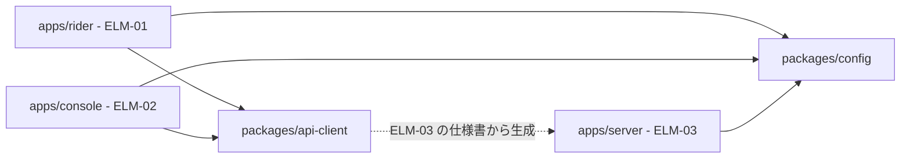
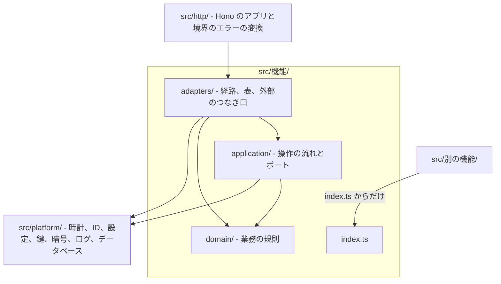
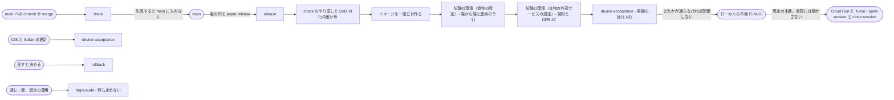

# 技術方針: 配車サービス

状態: 回答反映済み · 更新: 2026-11-13 · 入力の基準: 0545cba · 第 2b 段階（全 4 段階）

## 概要
配車サーバー（ELM-03）は Node.js 26 の上の TypeScript と Hono 4 で作り、ビルドせずに型を外して動かし、ELM-04 を Drizzle ORM で読み書きする。二つの Web アプリ（ELM-01、ELM-02）は React 19 を Vite で単一ページのアプリにし、React Router、TanStack Query、React Aria Components を使い、ELM-03 を、その仕様書から生成した型で呼ぶ。三つのコンポーネントは今のリポジトリ一つに置き、中を業務の機能ごとに分け、境を Oxlint の規則で守る。パイプラインは TC-09 のとおり開発者のマシンだけで動き、変更のたびの検査は git のフックが、リリースの前の確かめは版の印から起こすリリースの手順が、コンテナで立てる試験の環境で行う（DEC-32）。品質チェーンのゲート 19 はすべて出どころを、監査 4 はすべて置き場所を POL-03 で決め、品質チェーンへの要求はない。尋ねる点はなく、主な仮定は、開発者が主なライブラリを使いこなすか学べること（DAS-07）、開発者のマシンとテストに使う iPhone（DAS-08）、人が行う確かめと監査を開発者が行うこと（DAS-09）。

## 入力
| 出どころ | 得たもの |
|---|---|
| docs/design/1-architecture-drivers.md、drv/ | DRV-01〜DRV-35（主なものは 12）。この段階の方針を形づくるのは、変更の DRV-12、DRV-13、原則の DRV-31、DRV-33、DRV-34、DRV-35、制約の DRV-15、DRV-16、DRV-17、DRV-18、DRV-22 |
| docs/design/2-architecture.md、elm/、dec/ | 要素 ELM-01〜ELM-12（コンポーネントは ELM-01、ELM-02、ELM-03）、DEC-01〜DEC-27、四つのビュー。第 2 段階がこの段階に任せた点（コードの分け方と CI の検査、ローカルの定期の呼び出しと HTTPS の証明書、試験のデータ、NFR-15 と NFR-16 の置き場所、記録した日ごとの鍵の読み方、作り方、捨て方、データの形を変える道具、配備と戻しの手順とその自動化、デモの回を開くときと閉じるときの手順の自動化、コードの中のエラーと秘密の値の扱い） |
| docs/design/design-context.yaml | TC-01〜TC-18、PC-01〜PC-03、TEAM-01、STK-01〜STK-04。今の構造はなく、すべて新規 |
| docs/design/das/、hnd/、fnd/、qcr/、reviews/2-architecture.md | 未確認の DAS-01、DAS-02、DAS-04〜DAS-06 と、確認済みの DAS-03。この段階に宛てた申し送りと指摘はない（HND-01〜HND-13 は第 3 段階と第 4 段階、FND-10 は第 2 段階に宛てたもの）。品質チェーンへの要求 QCR-01（未回答）と QCR-02〜QCR-05（回答済み）は、この段階の項目を変えない |
| docs/quality/nfr/ | ゲート 19（NFR-09、NFR-11、NFR-13、NFR-15、NFR-21、NFR-22、NFR-25、NFR-27、NFR-31、NFR-32、NFR-33、NFR-36、NFR-37、NFR-38、NFR-40、NFR-41、NFR-42、NFR-47、NFR-49）と監査 4（NFR-16、NFR-28、NFR-48、NFR-50） |
| docs/quality/qr/ | 保守性と移植性の品質要求 QR-14、QR-33、QR-38、QR-39、QR-40、QR-50〜QR-56、QR-67、QR-69 |
| docs/quality/fr/ | 時刻、ID、外部のシステムに頼る受け入れ基準（FR-04、FR-12、FR-22、FR-23、FR-26、FR-29、FR-30、FR-39、FR-40、FR-46、FR-47、FR-51、FR-52、FR-53、FR-54 ほか）。偽物と差し替え口が届くべきもの |
| docs/quality/context.yaml | CON-03〜CON-06、EXT-01、EXT-02、OPF-01〜OPF-03 |
| docs/quality/qas/ | QAS-28（NFR-16 の頻度）。ほかのゲートのしきい値の QAS（QAS-35、QAS-37、QAS-39）は、出どころの決め方を変えない |
| 公開の情報: [Node.js のリリースの予定](https://nodejs.org/en/blog/announcements/evolving-the-nodejs-release-schedule)、[endoflife.date の Node.js](https://endoflife.date/nodejs)、[Node.js の TypeScript の文書](https://nodejs.org/api/typescript.html) | Node.js 26 が 2026 年 10 月に Active LTS になった。型を外して .ts を動かす仕組みは 24.12 と 25.2 から安定 |
| 公開の情報: [TypeScript 7.0 の発表](https://devblogs.microsoft.com/typescript/announcing-typescript-7-0/) | 7.0 は Go の tsc で、プログラムから使う API を持たず、それに頼る道具は 6.0 を使う |
| 公開の情報: [Oxlint の規則の一覧](https://oxc.rs/docs/guide/usage/linter/rules.html)、[Oxlint の設定](https://oxc.rs/docs/guide/usage/linter/config.html)、[Oxfmt のベータ](https://oxc.rs/blog/2026-02-24-oxfmt-beta) | Oxlint は no-restricted-imports（patterns、regex）、no-restricted-globals、no-restricted-properties、import/no-cycle、import/no-relative-parent-imports、react/jsx-no-literals、jsx-a11y の規則と、ファイルの場所ごとの overrides を持つ（import/no-restricted-paths と no-restricted-syntax はない）。Oxfmt はベータで、--check で違いを示す |
| 公開の情報: [Vitest 4 の発表](https://voidzero.dev/posts/announcing-vitest-4)、[React Router v8](https://remix.run/blog/react-router-v8) | Vitest 4 で Browser Mode が安定し、Playwright の提供者で WebKit を動かせる。React Router 8 は 2026 年 6 月に出て、データの組み立て方を持ち、React 19 を求める |
| 公開の情報: [Turso のローカルの開発](https://docs.turso.tech/local-development)、[Turso と Drizzle](https://docs.turso.tech/sdk/ts/orm/drizzle)、[@hono/zod-openapi の README](https://github.com/honojs/middleware/blob/main/packages/zod-openapi/README.md) | ローカルでは libSQL のデータベースのファイルか libSQL のサーバーを使い、Drizzle は @libsql/client でつなぐ。@hono/zod-openapi は経路の定義から OpenAPI 3.1 の文書を生成する |

既存のコードはなく、読んだコードもない。確かめていないのは、Drizzle ORM の 1 系が正式に出たか、TanStack Query、React Aria Components、pnpm、pino、openapi-typescript、openapi-fetch、oasdiff、secretlint、mkcert の今の版と、ホーム画面に加えた ELM-01 の実機での振る舞い（DAS-03）。

## すでに決まっていたこと
| 出どころ | 決めていること | 従う方針 |
|---|---|---|
| TC-01、TC-02、TC-03 | 言語は TypeScript、画面は React、サーバーは Hono | POL-01 |
| TC-04、TC-05 | 静的な検査は Oxlint、整形は Oxfmt | POL-02、POL-04 |
| TC-06 | テストは Vitest | POL-03 |
| TC-07、TC-08 | 本番は Turso と Cloud Run として設計する（想定） | POL-01、POL-04 |
| TC-09 | 作る、試す、動かすことはローカルだけで完結させ、何も配備しない | POL-01、POL-03、POL-04（DEC-32） |
| TC-10、TC-11、TC-12 | 決済は Stripe のテスト環境、カードの情報は入力部品で通さない、地図は Google Maps Platform | POL-03、POL-04、POL-05 |
| TC-13 | 乗客とドライバーは iOS の Safari の Web アプリ | POL-01、POL-03 |
| TC-15 | 新しい版はデモの回を開くときに配備する | POL-04 |
| PC-03、TEAM-01 | 開発者 1 人が作り、動かし、保守する | POL-02、POL-03、POL-06 |
| DEC-01 | 一つの配車サーバー（中を機能ごとの部分に分ける）、二つの Web アプリ、一つのデータベース | POL-02（DEC-31。中の分け方は FND-11） |
| DEC-02、DEC-03、DEC-04 | ELM-01 は iOS 18.4 以降の Safari、ELM-02 はコンピューターの主なブラウザ、ELM-03 は Node.js の Active LTS をコンテナで | POL-01 |
| DEC-05、DEC-18 | 想定の本番とローカルの置き方。ローカルの定期の呼び出しと HTTPS の証明書はこの段階に任せた | POL-01、POL-03、POL-04 |
| DEC-08、DEC-10 | 依頼の状態の条件つきの書き込みと冪等キー、お金の操作の試みごとのキーと結果が分からない状態 | POL-03 の偽物 |
| DEC-09〜DEC-13、DEC-21 | 外部のシステムは ELM-03 のそれぞれのつなぎ口の後ろに置く | POL-02、POL-03、POL-05 |
| DEC-15、DEC-24 | 隠す決まりと届ける相手の規則は一か所 | POL-02、POL-04 |
| DEC-16、DEC-17 | 記録した日ごとの鍵（読み方、作り方、捨て方はこの段階に任せた）、ELM-04 を書くのは ELM-03 だけ | POL-02、POL-04（DEC-29） |
| DEC-19、DEC-20 | たどる記録と標準出力のログ、異常の知らせと想定の本番の見張り | POL-03、POL-04、POL-05 |
| DEC-26 | 切り替え、足すだけのデータの形、前の版の配備し直し（配備と戻しの手順とデータの形を変える道具はこの段階に任せた） | POL-04（同じ選び方。FND-11） |
| DAS-03（確認済み） | ホーム画面に加えた Web アプリの振る舞いは、開発の中と NFR-15 の受け入れで実機で確かめる | POL-03 |
| 設計の第 1 段階の決めたこと 1 | 監査は想定の本番の要求として設計し、実際には行わない | POL-03 |

既存のコードはなく、従うコードの約束事もない。この段階に宛てた申し送りもない。

## 技術方針
<!-- generated: policies -->
| POL | 名前 | 範囲 | 対象 | 決定 | 根拠 |
|---|---|---|---|---|---|
| POL-01 | コンポーネントの種類ごとの技術の組み合わせと、どのコンポーネントも使う道具 | 技術の選定 | DRV-17、DRV-15、DRV-16、DRV-22 | DEC-02、DEC-03、DEC-04、DEC-05、DEC-17、DEC-28、DEC-29、DEC-30、DEC-33 | 仮定 |
| POL-02 | 一つのリポジトリをコンポーネントごとに分け、その中を業務の機能ごとに分け、境を Oxlint で守る | リポジトリとディレクトリ | DRV-12、DRV-33、DRV-35、DRV-34、DRV-31、DRV-16 | DEC-01、DEC-05、DEC-15、DEC-17、DEC-24、DEC-31、DEC-33 | 推定 |
| POL-03 | テストの層、偽物、環境と、品質チェーンのゲートの出どころと監査の置き場所 | テスト戦略とゲート | DRV-33、DRV-12、DRV-13、DRV-02、DRV-07、DRV-14、DRV-22、DRV-24、QR-14 | DEC-02、DEC-06、DEC-08、DEC-09、DEC-10、DEC-11、DEC-13、DEC-15、DEC-18、DEC-20、DEC-21、DEC-22、DEC-24、DEC-25、DEC-26、DEC-32 | 仮定 |
| POL-04 | パイプライン、配備と戻し、静的な検査と、コードの中の約束事 | CI/CD とコードの約束事 | DRV-13、DRV-12、DRV-15、DRV-16、DRV-24、DRV-29、DRV-34、DRV-18 | DEC-05、DEC-15、DEC-16、DEC-18、DEC-19、DEC-20、DEC-21、DEC-26、DEC-30、DEC-32 | 仮定 |
| POL-05 | インタフェースの種類ごとの仕様書の作り方 | 仕様書の作り方 | DRV-12、DRV-13、DRV-16、DRV-18 | DEC-06、DEC-11、DEC-12、DEC-13、DEC-20、DEC-21、DEC-29、DEC-33 | 推定 |
| POL-06 | コーディングエージェントが設計を見つける道と、実装からの指摘の戻り方 | 実装からの戻り | — | DEC-32 | 推定 |
<!-- /generated -->

POL-01、POL-03、POL-04 は、開発者についての仮定（DAS-07、DAS-08、DAS-09）か品質チェーンの未確認の仮定（QAS-28）を前提に持つため、根拠は仮定。POL-06 は設計を動かす要求には仕えず、設計の連鎖の実装からの指摘の決まりに仕える。

## 設計の決定
<!-- generated: decisions -->
| DEC | 名前 | 対象 | 根拠 |
|---|---|---|---|
| DEC-28 | 二つの Web アプリは Vite で単一ページのアプリとして作り、React Router、TanStack Query、React Aria Components を使う | DRV-16、DRV-22、DRV-15、DRV-12 | 仮定 |
| DEC-29 | ELM-04 の読み書きは Drizzle ORM で行い、データの形の変更は drizzle-kit が生成する SQL のマイグレーションで行う | DRV-16、DRV-15、DRV-13、DRV-02、DRV-07 | 仮定 |
| DEC-30 | 本人の確かめは認証のライブラリを使わず、Hono の仕組みと node:crypto で作る | DRV-28、DRV-16、DRV-15、DRV-19 | 推定 |
| DEC-31 | コードは一つのリポジトリでコンポーネントごとに分け、その中を業務の機能ごとに、機能の中を規則、流れ、つなぎ口に分け、境を Oxlint で守る | DRV-12、DRV-33、DRV-35、DRV-34、DRV-16 | 推定 |
| DEC-32 | パイプラインは開発者のマシンだけで動かし、変更のたびの検査は git のフックが、リリースの前の確かめは版の印から起こすリリースの手順が行う | DRV-15、DRV-16、DRV-12、DRV-13 | 仮定 |
| DEC-33 | ELM-03 の HTTP の仕様書は Zod の経路の定義から生成し、二つの Web アプリはそれから生成した型で ELM-03 を呼ぶ | DRV-12、DRV-13、DRV-16 | 仮定 |
<!-- /generated -->

どの決定も尋ねていない。言語、画面、サーバーの技術は TC-01〜TC-03 が決めており、選んだ主なライブラリはどれも自身の入口、表、エラーの形を持ち込まない（認証のライブラリは DEC-30 で使わず、@hono/zod-openapi の既定のエラーの形は POL-04 で替える）。どれも費用がかからず、影響の広さと重大さは高に届かない。

DEC-28 二つの Web アプリの組み立て方（どの案も React 19 の上で、二つ目と三つ目も部品は React Aria Components とする）:

| 要求（順位） | Vite、React Router、TanStack Query、React Aria Components | React Router のフレームワークの組み立て方 | Next.js の静的な書き出し | React と Vite だけ |
|---|---|---|---|---|
| DRV-15（6） | 満たす | 満たす | 満たす | 満たす |
| DRV-16（7） | 満たす | 一部（使わないサーバーの機能の決まり） | 一部（Hono の ELM-03 と役割が重なる） | 一部（画面の行き来と部品を自分で作る） |
| DRV-12（12） | 満たす | 満たす | 満たす | 満たす |
| DRV-22（17、交渉できない） | 満たす | 満たす | 満たす | 一部（候補の一覧つきの入力を自分で作る） |

DEC-29 ELM-04 の読み書きとデータの形の変更:

| 要求（順位） | Drizzle ORM と drizzle-kit | Kysely | @libsql/client と自作の適用器 |
|---|---|---|---|
| DRV-07（4） | 満たす | 満たす | 満たす |
| DRV-15（6） | 満たす（一つのつなぎ方） | 満たす（方言の部品を足す） | 満たす |
| DRV-16（7） | 満たす | 一部（表の型を別に揃える） | 一部（型の対応と適用器を自作） |
| DRV-02（10） | 満たす | 満たす | 満たす |
| DRV-13（30） | 満たす（SQL のマイグレーション） | 満たす | 一部（適用と記録を自作） |

DEC-30 本人の確かめを作る部品:

| 要求（順位） | 認証のライブラリなし（Hono と node:crypto） | 認証のライブラリ |
|---|---|---|
| DRV-15（6） | 満たす | 満たす |
| DRV-16（7） | 満たす（要る分だけ作る） | 一部（使わない機能と拡張） |
| DRV-28（8） | 満たす（NFR-27 のテストで守る） | 満たす |
| DRV-19（26） | 満たす | 一部（設定の符号の流れを拡張で作る） |

二つ目を退けた決め手は、ライブラリ自身の入口、表、エラーの形が、第 3 段階の決めるインタフェースとデータの実体を縛ること。

DEC-31 コードの分け方:

| 要求（順位） | 業務の機能ごと、規則と流れとつなぎ口、Oxlint | 技術の層ごと | 機能ごとのパッケージ |
|---|---|---|---|
| DRV-16（7） | 満たす | 満たす | 一部（パッケージごとの設定と組み立て） |
| DRV-12（12） | 満たす（検査で境を守る） | 満たさない（境を検査できない） | 満たす |
| DRV-33（原則） | 満たす（ポートに偽物） | 一部 | 満たす |
| DRV-34、DRV-35（原則） | 満たす（一つの機能のディレクトリ） | 一部（層に散る） | 満たす |

DEC-32 パイプラインを動かす所:

| 要求（順位） | 開発者のマシンのフックとリリースの手順 | 開発者のマシンの CI のサーバー | 外部の CI のサービス |
|---|---|---|---|
| DRV-15（6、交渉できない） | 満たす | 満たす | 外した（TC-09 を破る） |
| DRV-16（7） | 満たす | 一部（CI のサーバーを保つ） | — |
| DRV-12（12） | 満たす（フックと、リリースの手順のやり直し） | 満たす | — |
| DRV-13（30） | 満たす（試験の環境で予行） | 満たす | — |

DEC-33 HTTP の仕様書と Web アプリの型:

| 要求（順位） | 生成した OpenAPI と生成した型 | Hono の RPC | 手で書く OpenAPI |
|---|---|---|---|
| DRV-16（7） | 満たす | 満たす | 一部（写しを手で保つ） |
| DRV-12（12） | 満たす（コンポーネントの間で import しない） | 一部（Web アプリがサーバーのコードの型を import する） | 満たす |
| DRV-13（30） | 満たす（前のリリースの文書と比べる） | 一部（比べる文書がない） | 満たす |

## リポジトリとディレクトリ
ride-hailing-app-demo（今のリポジトリ）一つに、三つのコンポーネントを置く。コンポーネントはどれも TEAM-01 が持つため、木にはチームを書かない。ELM-03 の機能のディレクトリの名前は、第 2 段階の決定から取った例で、第 4 段階の ELM-03 のモジュールが決まったらそれに沿う。

```
ride-hailing-app-demo/
├── apps/
│   ├── server/              ELM-03 配車サーバー
│   │   ├── src/
│   │   │   ├── 機能/        業務の機能ごと（下の例）。domain/、application/、adapters/、index.ts
│   │   │   ├── platform/    時計、ID と乱数、設定、秘密の値と鍵、暗号、ログ、データベースのつなぎ
│   │   │   └── http/        Hono のアプリの組み立て、境界のエラーの変換、仕様書の生成
│   │   ├── migrations/      drizzle-kit が生成した SQL（コミットする）
│   │   ├── generated/       openapi.json（コミットする）
│   │   └── test/            結合と契約の層
│   ├── rider/               ELM-01 乗客とドライバーの Web アプリ
│   │   └── src/             画面の機能ごとのディレクトリと platform/（呼び出しと流れ、位置、画面を消さない仕組み、Web Push、文言と書式）
│   └── console/             ELM-02 担当者とエンジニアの Web アプリ
│       └── src/             画面の機能ごとのディレクトリと platform/
├── packages/
│   ├── api-client/          ELM-03 の仕様書から生成した型と呼び出し（ELM-01、ELM-02 が使う）
│   └── config/              TypeScript、Oxlint、Oxfmt の共有の設定
├── tests/                   端から端と運用の予行の層
├── infra/
│   ├── local/               試験の環境とローカルの本番の Compose、ローカルの定期の呼び出し
│   └── gcp/                 想定の本番の定義（どこにも当てない、TC-09）
├── scripts/                 パイプラインの手順と git のフック
├── docs/                    design/、quality/、releases/（リリースの記録）、records/（運賃表の照合の記録）
├── CLAUDE.md                コーディングエージェントへの指示書（POL-06）
└── .claude/skills/          設計のスキル
```

ELM-03 の機能のディレクトリの例: rides（依頼と乗車、確認コード、DEC-08、DEC-25）、dispatch（届ける相手の規則と評価のまとめ方、DEC-24）、payments（お金の操作と照合、DEC-09〜DEC-11）、places（場所、見積もり、料金、DEC-13）、locations（現在地と走っているかの判断、DEC-07、DEC-22）、accounts（アカウントと本人の確かめ、DEC-14、DEC-30）、access（使える機能、見せる範囲、隠す決まり、DEC-15）、operations（苦情、返金、登録、停止）、messages（連絡、DEC-27）、notifications（流れと Web Push、DEC-06、DEC-21）、tracing（たどる記録、操作の記録、異常、SLI の出来事、DEC-19、DEC-20、DEC-23）、jobs（期限の処理と日々の処理、DEC-18）、switches（振る舞いの切り替え、DEC-26）。

コンポーネントの間で許す依存:



一つの機能の中と、機能の間で許す依存（ELM-03）:



apps/ のコンポーネントは互いに import せず、ELM-01 と ELM-02 は ELM-03 を packages/api-client からだけ呼ぶ。コンポーネントの中では、機能は別の機能を index.ts からだけ使い、domain/ はフレームワーク、データベース、外部の部品、adapters/、application/、src/platform/ を使わず、application/ は adapters/ を使わない。外部のシステムの部品は、それぞれの機能の adapters/ だけが使い、時刻、乱数、ID のもとと node:crypto とブラウザの位置などは src/platform/ だけが使う。どれも Oxlint の規則で、検査の手順が守る（POL-02）。表を書くのはその表を持つ機能の adapters/ だけで、表の定義を index.ts から出さないことは import の規則が守り、SQL の文でほかの機能の表を書くことだけは開発者のレビューが見る。変更のシナリオ DRV-12 の一つの機能の変更は、ELM-03 の一つの機能のディレクトリと、それを示す ELM-01 か ELM-02 の画面の機能のディレクトリに触れ、ELM-03 の HTTP の操作が変われば仕様書と api-client を生成し直す。触れるチームは TEAM-01 だけ。

## パイプライン


どの手順も開発者のマシンで動く（DEC-32）。フックは pnpm install が入れ、main への merge は早送りしないため、main に入るどの変更でも check が動く。check はフックを飛ばすと止まらないが、release がフックの設定と DoD の行を確かめ、check を初めからやり直すため、通らない変更は配備されない。手順の中身は POL-04 にある。

## ゲートの出どころ
<!-- generated: gate-bindings -->
| NFR | 名前 | 確かめる所 | 出どころの方針 | 代わりの要求 |
|---|---|---|---|---|
| NFR-09 | 到着予定時刻と料金の決まりを地図のサービスを使わずに試すゲート | CI | POL-03 | — |
| NFR-11 | 通信の途切れと操作の重なりを再現する試験のゲート | リリース前の確認 | POL-03 | — |
| NFR-13 | 同じ名前の場所の取り違えを防ぐ受け入れの試験 | リリース前の確認 | POL-03 | — |
| NFR-15 | スマートフォンとブラウザの更新に合わせた試験のゲート | リリース前の確認 | POL-03 | — |
| NFR-21 | 乗車を始める判断と走っている間の判断を試すゲート | CI | POL-03 | — |
| NFR-22 | 登録の訂正を乗客に示す手がかりに反映する受け入れの試験 | リリース前の確認 | POL-03 | — |
| NFR-25 | 料金と返金の決まりを決済サービスを使わずに試すゲート | CI | POL-03 | — |
| NFR-27 | 本人の確かめと見られる範囲を試すゲート | CI | POL-03 | — |
| NFR-31 | ドライバーに示す場所と乗客が決めた場所の一致の受け入れの試験 | リリース前の確認 | POL-03 | — |
| NFR-32 | 操作を誰がいつ行ったかを残す完成の定義 | 完成の定義 | POL-03 | — |
| NFR-33 | 少ない操作で評価を送れることの受け入れの試験 | リリース前の確認 | POL-03 | — |
| NFR-36 | 依頼を届ける相手を決める規則を試すゲート | CI | POL-03 | — |
| NFR-37 | 状態の変化、端末のエラー、苦情を記録する完成の定義 | 完成の定義 | POL-03 | — |
| NFR-38 | 異常の知らせとたどりを確かめるリリース前の確認 | リリース前の確認 | POL-03 | — |
| NFR-40 | 変えなかった機能を公開の前に確かめる自動の試験のゲート | CI | POL-03 | — |
| NFR-41 | 自動の配備と前の版への戻しを確かめるリリース前の確認 | リリース前の確認 | POL-03 | — |
| NFR-42 | データを移す予行のリリース前の確認 | リリース前の確認 | POL-03 | — |
| NFR-47 | カードの情報がシステムを通らないことを確かめるリリース前の確認 | リリース前の確認 | POL-03 | — |
| NFR-49 | 画面のアクセシビリティの自動の検査 | CI | POL-03 | — |
<!-- /generated -->

品質チェーンのゲート 19 はすべて POL-03 が出どころを決め、代わりの要求はない。CI のゲート 7（NFR-09、NFR-21、NFR-25、NFR-27、NFR-36、NFR-40、NFR-49）は検査の手順（check）で、リリース前の確認のゲート 10（NFR-11、NFR-13、NFR-15、NFR-22、NFR-31、NFR-33、NFR-38、NFR-41、NFR-42、NFR-47）はリリースの手順（release）で、完成の定義のゲート 2（NFR-32、NFR-37）は main に入れる commit の DoD の行と、それを読む検査の手順で確かめる。CI は TC-09 のとおり開発者のマシンの git のフックで動く。開発者 1 人の体制で DoD の行に印を付ける二人目はいないため、検査の手順がその行を読み、当てはまる変更に印がなければ main に入れない。人が行うゲートの確かめは NFR-15 の実機の受け入れだけで、開発者が行う（DAS-09）。品質チェーンのほかの非機能要件は、SLO（第 3 段階が SLI を結び付ける）と監視。

## 監査の置き場所
<!-- generated: audit-bindings -->
| NFR | 名前 | 置き場所の方針 | 代わりの要求 |
|---|---|---|---|
| NFR-16 | 止まってから再開する回復の訓練 | POL-03 | — |
| NFR-28 | 脆弱性の修正期限と侵入試験 | POL-03 | — |
| NFR-48 | 模擬の運賃表と模す運賃の定めの照合 | POL-03 | — |
| NFR-50 | 画面のアクセシビリティの人による確かめ | POL-03 | — |
<!-- /generated -->

監査 4 はすべて POL-03 が置き場所を決め、代わりの要求はない。設計の第 1 段階の決めたこと 1 のとおり、何も配備しない間は実際には行わず、ゲートと同じ支えの道具（運用の予行の層、依存の脆弱性の調べ、axe-core）だけが実際に動く。誰が行うかは入力になく、DAS-09 で開発者とした。NFR-28 の記録は脆弱性と個人の情報を含みうるため、リポジトリの外に置く。NFR-48 は、模す運賃の定めの中身と照らす役割を品質チェーンがまだ決めておらず（品質チェーンの未解決の点）、置き場所はあっても照らすものがない。

## インタフェースの種類
| インタフェースの種類 | 現れる所 | 仕様書の決め方 |
|---|---|---|
| ELM-01、ELM-02 から ELM-03 への HTTPS の要求と応答 | 実行時の構成の ELM-01、ELM-02 → ELM-03 | POL-05 の一つ目（コードから生成する） |
| ELM-03 から ELM-01、ELM-02 への流れ（Server-Sent Events） | 実行時の構成の ELM-03 → ELM-01、ELM-02 | POL-05 の一つ目（コードから生成する） |
| 日々の呼び出し（想定の本番の Cloud Scheduler、ローカルの定期の呼び出し）と外からの生存確認から ELM-03 へ | 実行時の構成の定期の呼び出し、配置のビュー、脅威のモデルの F12 と F13 | POL-05 の一つ目（コードから生成する） |
| ELM-03 から ELM-04 への取引 | 実行時の構成の ELM-03 → ELM-04 | POL-05 の二つ目（コードから生成する） |
| ELM-03 から ELM-05 の API と、ELM-01 の中の ELM-05 の入力部品 | 外部との関係と実行時の構成の ELM-03 → ELM-05、ELM-01 → ELM-05 | POL-05 の三つ目（相手の文書） |
| ELM-03 から ELM-06 の API と、ELM-01 が地図を描くもの | 外部との関係と実行時の構成の ELM-03 → ELM-06、ELM-01 → ELM-06 | POL-05 の四つ目（相手の文書） |
| ELM-03 から ELM-07 を経て ELM-01、ELM-02 への Web Push | 外部との関係と実行時の構成の ELM-03 → ELM-07 → ELM-01、ELM-02 | POL-05 の五つ目（相手の文書） |
| ELM-03 から想定の本番のログへの、日々の処理を終えた記録 | 配置のビューと脅威のモデル（DEC-20） | POL-05 の六つ目（作らない） |
| 乗客、ドライバー、担当者、エンジニアの画面 | 外部との関係の USR-01〜USR-04 | POL-05 の七つ目（作らない） |

ほかの者がこのシステムの決めた決まりに合わせて作るインタフェースは今はなく、POL-05 の八つ目（手で書く）はどれにも当たらない。想定の本番のアラートから開発者へのメール（F14）はプラットフォームが送るもので、このシステムのコードのインタフェースではない。

## 指摘
<!-- generated: findings -->
| FND | 名前 | 重さ | 出した段 | 宛先 | 状態 | 変えた項目 |
|---|---|---|---|---|---|---|
| FND-11 | DEC-01 と DEC-26 が、第 2b 段階が確定の深さで決めるコードの分け方とリリースの戻し方を決めている | 軽微 | architecture-to-technical-policy | architecture-drivers-to-architecture | 未解決 | DEC-31、POL-04 |
<!-- /generated -->

この段階に宛てた指摘はない。この段階は第 2 段階に軽微の FND-11 を出した。DEC-01 と DEC-26 が、この段階の確定の種類（コンポーネントの中のコードの分け方、リリースの戻し方とマイグレーションの足し方）を決めており、この段階は同じ選び方をした（DEC-31、POL-02、POL-04）。後の段階とコードは、この実行から技術方針に従う。軽微のため、第 2 段階を走らせる理由にはならない。第 2 段階に宛てた FND-10 は、この段階の項目に触れない。

## 申し送り
<!-- generated: handoffs -->
| HND | 名前 | 書いた段 | 宛先 | コンポーネント | 状態 | 決めた項目 |
|---|---|---|---|---|---|---|
| HND-14 | EXT-01 を呼ぶクライアントの部品と、そのやり直しと時間切れの設定 | architecture-to-technical-policy | high-level-design-to-detailed-design | ELM-03 | 未決定 | — |
<!-- /generated -->

この段階に宛てた申し送りはない。この段階が書いたのは HND-14 で、EXT-01 を呼ぶクライアントの部品と、その自動のやり直しと時間切れの設定を、お金を動かすモジュールを確定の深さで設計する第 4 段階の ELM-03 の実行に送った。主なライブラリのほかの部品（Web Push、EXT-02 を呼ぶ部品、Stripe.js と地図を描く部品の包み方など）、ライブラリと道具の版、道具の設定、パイプラインのファイル、テストとテストデータは、実装が方針の中で決めるため、申し送りを書いていない。記録した日ごとの鍵をいつ作りいつ捨てるか（POL-04）と、各機能のポートの中身は、第 4 段階が ELM-03 のモジュールとして設計する。

## 決めたこと
| # | 質問 | 回答 | 項目 |
|---|---|---|---|

この段階は質問をしていない。尋ねる基準（影響の広さか重大さが高、入力の食い違い、入力が名指して中身を与えない決まり、影響が高の品質チェーンへの要求）に当たる点がなかった。言語、画面、サーバーの技術は TC-01〜TC-03 が決め、選んだ主なライブラリは自身の入口、表、エラーの形を持ち込まず、リポジトリは一つのチームのもので、費用のかかる道具も環境もなく、品質チェーンへの要求もない。

## 未確認の仮定
<!-- generated: assumptions -->
| ID | 名前 | 種類 | 影響の広さ | 重大さ | 依存する項目 |
|---|---|---|---|---|---|
| DAS-09 | 人が行うゲートの確かめと監査は開発者が行う | 判断 | 低 | 低 | POL-03 |
| QAS-28 | 回復の訓練の頻度 | 暫定の決定 | 低 | 低 | POL-03 |
| DAS-07 | 開発者は技術方針の主なライブラリを使いこなすか、学ぶ時間を取れる | 判断 | 中 | 低 | DEC-28、DEC-29、DEC-33、POL-01 |
| DAS-08 | 開発者のマシンは macOS でコンテナを動かせ、iOS 18.4 以降の iPhone を一台テストに使える | 判断 | 中 | 低 | DEC-32、POL-01、POL-03、POL-04 |
<!-- /generated -->

QAS-28 の影響の広さと重大さは、この段階が評価し直した値（POL-03 の NFR-16 の置き場所だけが依存し、頻度が変わっても置く手順を替えるだけ）。DAS-01（第 1 段階）は主なライブラリの選び方が直接は依存せず、それを受ける DAS-07 をこの段階が書いた。第 2 段階の DAS-02、DAS-04、DAS-05、DAS-06 には、この段階の項目は直接は依存せず、それを前提に持つ決定（DEC-03、DEC-05、DEC-09、DEC-20）に従うだけ。どの仮定にも答えは要らない。訂正があれば、回答と同じように次の実行で反映する。

## 未定の値
新しい未定の値はない。ゲートの出どころは、ゲートのしきい値（T_alert_delay、T_rollback、N_rating_operations、V_moving_lock など）を NFR に残し、方針に写していない。

## 未解決の点
- NFR-48 の照合は、模す運賃の定めの中身と照らす役割が品質チェーンで決まっていない（品質チェーンの未解決の点）。POL-03 は置き場所を決めたが、定めがなければ照らせない。
- ホーム画面に加えた ELM-01 の実機での振る舞い（DAS-03）は、コードができてから開発の中と NFR-15 の実機の受け入れで確かめる。この段階は確かめていない。

## 範囲外
- 開発者のマシンの用意（コンテナの実行環境、Node.js、Python 3、mkcert の認証局）と、テストに使う iPhone に mkcert の認証局を入れて信頼すること: 開発者の作業。参加者の iPhone に入れることは、第 2 段階の範囲外の参加者への案内に加わる。
- iOS と Safari の更新が出たことに気づくこと: 開発者の運用。POL-04 の device-acceptance は、気づいた後に行う手順を決める。
- 監査の結果を受けて直すことを決め、閉じる手順と、誰が認めるか: 運用の決まり。POL-03 は置き場所と支える道具だけを決める。

## 次
別の文脈で `design-review` をこの段階に実行する（第 2b 段階のレビューはまだない）。レビューがこの段階に重大か中の指摘を出したら、この段階を再実行する（軽微な指摘のためには走らせない）。そのあと `architecture-to-high-level-design` を実行する。第 3 段階は、各インタフェースの仕様書の作り方を POL-05 から、インタフェースが見せる約束事をコードがどう作るかを POL-04 から取り、第 4 段階は POL-01〜POL-04 と HND-14 に従う。この実行が第 2 段階に出した FND-11 は軽微で、第 2 段階を走らせる理由にはならない（第 2 段階は、ほかの理由で次に走るときに扱う）。品質チェーンへの要求は出しておらず、答えたものも反映を見つけたものもない。`docs/design/quality-chain-requests.md` は、QCR-01（未回答）と QCR-02〜QCR-05（回答済み）を挙げる。
