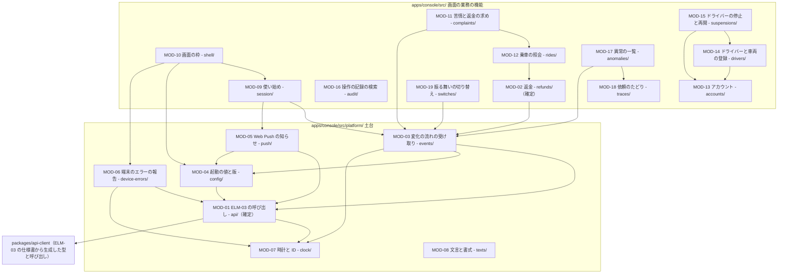
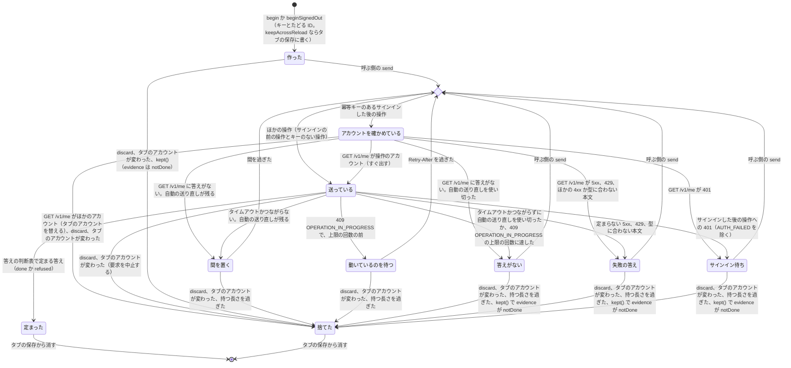
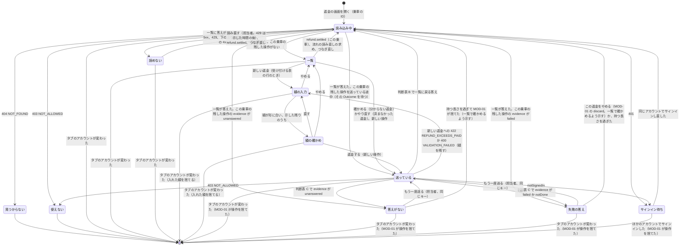

# 担当者とエンジニアの Web アプリの詳細設計: 配車サービス

状態: 回答反映済み · 更新: 2026-11-13 · 入力の基準: 9ffea05 · 第 4 段階（全 4 段階） · コンポーネント: ELM-02

## 概要
ELM-02 を 19 のモジュールに分けた。確定の深さは二つで、ELM-03 の状態を変えるどの呼び出しも送り、答えを失った操作を、始めたアカウントのセッションのまま同じ冪等キーで一つの結果に定める MOD-01 と、担当者が認めた返金を送り、答えのない返金と結果が分からない返金を同じ返金のまま確かめる MOD-02。ほかの 17（土台 6 と画面の業務の機能 11）は枠の深さ。最も難しいのは、答えを失ったとき、最初の要求の答えを待つ間に画面を離れて戻ったとき、タブを読み直したとき、セッションが切れたとき、ほかのタブでアカウントが替わったときにも担当者の一回の「返金する」を二度行わず、済んだかどうか分からない返金を済まなかったと示さないこと（QR-45 の失敗のシナリオ）。そのため MOD-01 は、答えを待っている変える要求がある操作を evidence によらず答えを受けていない要求があるものとして扱い、kept() で捨てずに返す。MOD-02 は、この乗車の返金を作るこのタブの操作がどれも送っている途中でないときに読み始めた一覧でだけ新しい返金を受け付ける。同じキーの操作が二度効かないことは ELM-03 が守る（キーをそれを最初に受けたアカウントと操作に結び付け、ほかのアカウントで受けたキーを 422 IDEMPOTENCY_KEY_REUSED で退ける、DEC-42）が、ELM-03 がまだ受けていないキーの要求がほかのアカウントのセッションで出ると、その操作はそのアカウントの操作として行われ記録される。そのため MOD-01 は、冪等キーのある操作のどの要求の前にもセッションのアカウントを確かめ、422 IDEMPOTENCY_KEY_REUSED は定まった答えにして一覧を読み直させ、タブのアカウントを確かめる。この段階の ELM-02 に宛てた指摘はどれも受け入れてある。尋ねた点はない。この段階が ELM-02 で出した軽微な指摘のうち、FND-42（端末の保存を使う所の決まり）は第 2b 段階で、FND-60（ELM-03 がまだ受けていないキーの要求がほかのアカウントの操作として行われ、DEC-42 がそれを閉じないまま要求ごとの確かめを要しないとすること）は第 3 段階で未解決。未確認の仮定で最も高いのは、この段階の DAS-16 と DAS-17（ELM-03 の答えの期限）と、IFC-11 と IFC-21 を通る第 3 段階の DAS-11、DAS-15 で、どれも中、低。

## 入力
| 出どころ | 得たもの |
|---|---|
| docs/design/elm/、2-architecture.md、dec/ | ELM-02 の責務、functions（FR-33〜FR-44、FR-48〜FR-50、FR-52）、drivers（DRV-12、DRV-17、DRV-19、DRV-20、DRV-24、DRV-28〜DRV-30）、decisions（DEC-01、DEC-03、DEC-04、DEC-14、DEC-15、DEC-19、DEC-20、DEC-26）と、お金の操作の DEC-08、DEC-10。DEC-03 の対応するブラウザ（コンピューターの Chrome、Edge、Firefox、Safari の今の版と一つ前の版）。脅威のモデルの F3、F4、F10 |
| docs/design/ifc/、3-high-level-design.md | ELM-02 が提供する画面の IFC-24、IFC-25 と、利用する IFC-01、IFC-10〜IFC-14、IFC-21 の操作、誤りとその符号、冪等性、timing。共通の約束事 DEC-35〜DEC-44 と、DEC-45、DEC-46。CUJ-10〜CUJ-18 と DRV-28 の流れと画面、返金（DAT-12）の状態、タイムアウトの表。お金の操作にかかわるのは、DEC-35（外部を呼ぶ操作が試みの結果として返す 503 はキーの答えで、同じキーで送り直さずに今の状態を読み直す）、DEC-45、IFC-13、DAT-12 と報告の返金の状態遷移図と CUJ-15 の流れと画面（ELM-03 は試みを呼ぶ前の取引で返金を書き、EXT-01 が実行の前に退けた返金は済まなかった（refund_failed）とし、503 PAYMENT_SERVICE_UNAVAILABLE と refundId で答え、担当者のやり直しが返金できる残りの額を確かめ直して新しい試みを作る）、DEC-42（ELM-03 はキーをそれを最初に受けたアカウントと操作に結び付け、ほかのアカウントか操作で受けたキーを行わずに 422 IDEMPOTENCY_KEY_REUSED で答え、利用側はそれを受け付けなかった答えとして今の状態を読み直す。受けたインスタンスが答えの期限までに答えること、X-Idempotent-Replayed）、DEC-40（同じ origin のどのタブも一つのセッションのクッキーを使う）。IFC-01 の GET /v1/me は本人のアカウントの ID を返す。IFC-10 と IFC-21 では、ELM-02 のサービスワーカーは示した時刻をためず、示した記録を送らない。DEC-45、IFC-03、IFC-17、IFC-22、IFC-23、DAT-07、DAT-09 の、取引の ID が分かっている確定と取り消しを処理されなかったとすること、後で効きうる確定のある押さえ、迎車の到着を位置で決める前の乗車の開始は、乗客とドライバーの決済と乗車のことで、ELM-02 のモジュールは変わらない（乗車の照会と依頼のたどりは ELM-03 が答えた時刻と段階を示すだけで、迎車の到着の前に始めた乗車にはその時刻も段階もない。返金の答え方と IFC-13 は変わっていない） |
| docs/design/pol/、2b-technical-policy.md | POL-01 の Web アプリの技術の組み合わせ（React 19、Vite、React Router 8、TanStack Query、React Aria Components、openapi-fetch と packages/api-client、CSS Modules）、POL-02 の apps/console/src/ の分け方と依存の規則、POL-03 のテストの層（単体は Vitest の Browser Mode の Chromium、端から端は Playwright の Chromium）と偽物と環境、POL-04 のエラー、設定、文言、サービスワーカーの決まりとデータの形の変え方、POL-05（画面は文書を作らない）、POL-06 |
| docs/design/hnd/ | この段階が ELM-02 で取り上げる未決定の申し送りはない（ELM-02 に宛てた HND-18 は決定済み）。MOD-01 のタイムアウトが前提にする ELM-03 の答えの期限は、第 4 段階の ELM-03 の実行が HND-19 で決めた（MOD-20 の 5 秒、DAS-17）。実装宛ての未決定の申し送りは HND-07、HND-16、HND-20〜HND-22 で、どれも ELM-03 のもの |
| docs/design/fnd/、reviews/4-detailed-design-ELM-02.md | この段階の ELM-02 に宛てた未解決の指摘はない（このコンポーネントのレビューの FND-43、FND-44、FND-46〜FND-48、FND-52〜FND-54 は受け入れ済みで、最後のレビュー（fce51d7 からの差分のレビュー）は指摘を出していない）。この段階が ELM-02 で出した FND-41、FND-50、FND-51 は第 3 段階が受け入れ（FND-50 は DEC-42 と DAT-26、FND-51 は IFC-01）、FND-42 は第 2b 段階で未解決。未解決の FND-10、FND-11、FND-34、FND-35（第 2 段階）、FND-19〜FND-21（第 2b 段階）、FND-59（第 3 段階。ドライバーの決済のやり直しへの答え）は、ELM-02 のモジュールを変えない |
| docs/design/4-detailed-design/ELM-03.md、mod/MOD-20 | ELM-03 が IFC-01、IFC-10、IFC-12、IFC-14 の操作に答える期限 5 秒（MOD-20 の parameters、DAS-17）と、それが ELM-02 の MOD-01 のタイムアウト 15 秒に通信の余裕 5 秒を足しても収まること |
| docs/design/das/、qcr/、quality-chain-requests.md | 未確認の DAS-01、DAS-04〜DAS-28、確認済みの DAS-02、DAS-03（DAS-13 は、MOD-01 の持つ長さがその 24 時間に頼るので影響の広さが中。DAS-05 は第 4 段階の ELM-03 の MOD-67 も依存するので、第 3 段階のレビューが影響の広さを中に評価し直した）。品質チェーンへの要求は QCR-01、QCR-06、QCR-07、QCR-09、QCR-10 が未回答、QCR-02〜QCR-05、QCR-08 が回答済みで、どれも ELM-02 の項目を変えない。要求書に手で書かれた答えはない。docs/quality/ に反映された要求はない |
| docs/quality/fr/、qr/、nfr/ | FR-33〜FR-44、FR-48〜FR-50、FR-52 の受け入れ基準。QR-45（返金は認めた額を一度だけ）、QR-34、QR-57、QR-58（個人の情報）、QR-43（担当者の機能が使える）、QR-64（WCAG 2.2 の AA は乗客とドライバーの画面だけ）。NFR-22、NFR-38、NFR-40 のゲート |
| docs/quality/context.yaml | USR-03、USR-04、CUJ-10〜CUJ-18（CUJ-14〜CUJ-18 の手順は決まっていない）、OPF-01〜OPF-03 |

既存のコードはなく、読んだコードもない。どのモジュールも新設。何も配備しない（TC-09）ため、ELM-03 の答えの時間、担当者とエンジニアのコンピューターのつながり、ブラウザの振る舞い（タブの間の知らせ、タブの間で共有するクッキー、戻るキャッシュ）はどれも測っておらず、MOD-01 の値は暫定（DAS-16）。

## モジュール


MOD-10 は、画面の業務の機能のどのモジュールの道筋も組み立てる（MOD-10 からそれらへの矢印は略した）。MOD-02、MOD-09〜MOD-19 はどれも MOD-08 を使い、MOD-10 のほかは MOD-01 も使う（矢印は略した）。どのモジュールも POL-02 の apps/console/src/ の分け方に従い、画面の業務の機能はそれぞれのディレクトリに、ブラウザの仕組みと ELM-03 の呼び出しを包むものは src/platform/ の下に置く。業務の規則は置かず、額、返金できる残りの額、使えるかどうか、隠し方は ELM-03 が送ったものを示す（POL-02、DEC-15、DRV-31）。

図の境は、POL-02 の依存の規則が検査の手順で守る。画面の業務の機能は、外への呼び出し（fetch）、流れ（EventSource）、知らせの許しと Web Push の登録、時刻と ID のもとを使えない（src/platform/ だけに許す規則）ため、ELM-03 への呼び出しはどれも MOD-01 を通り、返金の送り直しと送る前のアカウントの確かめを迂回できない。業務の機能の間の矢印（MOD-11 → MOD-12、MOD-12 → MOD-02、MOD-14 → MOD-13、MOD-15 → MOD-13 と MOD-14、MOD-17 → MOD-18、MOD-10 → どの機能も）は、それぞれの index.ts からだけ使う規則と、ディレクトリを上がる相対の import を使わない規則が守り、循環は import/no-cycle が見つける。ELM-03 は packages/api-client の生成した型からだけ呼ぶ。src/platform/ の中のモジュールの間は規則が分けないが、MOD-03 の流れ（IFC-11 の GET /v1/events）と、MOD-04、MOD-05、MOD-06 が送る操作（IFC-01 の GET /v1/client-config、IFC-10）は、どれも送り直しても害がなく、MOD-01 を迂回しても二重に効かない。MOD-03 が MOD-01 から受けるのはタブのアカウントの知らせだけ。端末の保存を MOD-01 だけが使うことはどの規則も守らず、FND-42 で第 2b 段階に出した。タブの間の知らせ（BroadcastChannel）とタブが前に出たことの出来事も POL-02 の規則が挙げる大域の名前になく、ほかのモジュールが使えるが、お金の操作はどれも MOD-01 が送る前に確かめるので二重にならず、指摘にしていない。この段階が加えた依存の規則はない。

<!-- generated: modules -->
| MOD | 名前 | 深さ | 公開範囲 | FR | 実現する操作 | 今の構造との差分 | 根拠 |
|---|---|---|---|---|---|---|---|
| MOD-01 | ELM-03 の呼び出し | 確定 | 内部 | FR-40、FR-48、FR-50 | — | 新設 | 仮定 |
| MOD-02 | 返金 | 確定 | 公開 | FR-39、FR-40、FR-50 | IFC-24 返金、IFC-13 GET /v1/console/rides/{rideId}/refunds、IFC-13 POST /v1/console/rides/{rideId}/refunds、IFC-13 POST /v1/console/refunds/{refundId}/retry、IFC-11 refund.settled | 新設 | 推定 |
| MOD-03 | 変化の流れの受け取り | 枠 | 内部 | FR-33 | IFC-11 stream.resync | 新設 | 推定 |
| MOD-04 | 起動の値と版 | 枠 | 内部 | — | IFC-01 GET /v1/client-config | 新設 | 推定 |
| MOD-05 | Web Push の知らせ | 枠 | 内部 | FR-33 | IFC-10 PUT /v1/push-subscriptions/current、IFC-10 DELETE /v1/push-subscriptions/current、IFC-21 push の出来事 | 新設 | 推定 |
| MOD-06 | 端末のエラーの報告 | 枠 | 内部 | — | IFC-10 POST /v1/device-reports | 新設 | 推定 |
| MOD-07 | 時計と ID | 枠 | 内部 | — | — | 新設 | 推定 |
| MOD-08 | 文言と書式 | 枠 | 内部 | — | — | 新設 | 推定 |
| MOD-09 | 使い始め | 枠 | 公開 | FR-36、FR-48、FR-49 | IFC-24 使い始め、IFC-25 使い始め、IFC-01 POST /v1/account-setups、IFC-01 POST /v1/sessions、IFC-01 DELETE /v1/sessions/current、IFC-01 GET /v1/me、IFC-11 switch.changed | 新設 | 推定 |
| MOD-10 | 画面の枠 | 枠 | 内部 | FR-36、FR-48、FR-49 | — | 新設 | 推定 |
| MOD-11 | 苦情と返金の求め | 枠 | 公開 | FR-37、FR-50 | IFC-24 苦情と返金の求め、IFC-12 GET /v1/console/complaints、IFC-12 POST /v1/console/complaints/{complaintId}/resolution、IFC-11 complaint.received | 新設 | 推定 |
| MOD-12 | 乗車の照会 | 枠 | 公開 | FR-38 | IFC-24 乗車の照会、IFC-12 POST /v1/console/rides/search、IFC-12 GET /v1/console/rides/{rideId} | 新設 | 推定 |
| MOD-13 | アカウント | 枠 | 公開 | FR-41、FR-42、FR-50 | IFC-24 アカウント、IFC-12 POST /v1/console/accounts/search、IFC-12 GET /v1/console/accounts/{accountId}、IFC-12 POST /v1/console/accounts、IFC-12 PATCH /v1/console/accounts/{accountId}、IFC-12 PUT /v1/console/accounts/{accountId}/test-flag、IFC-12 POST /v1/console/accounts/{accountId}/setup-codes | 新設 | 推定 |
| MOD-14 | ドライバーと車両の登録 | 枠 | 公開 | FR-43、FR-50 | IFC-24 ドライバーと車両の登録、IFC-12 POST /v1/console/drivers、IFC-12 GET /v1/console/drivers/{accountId}、IFC-12 PATCH /v1/console/drivers/{accountId} | 新設 | 推定 |
| MOD-15 | ドライバーの停止と再開 | 枠 | 公開 | FR-44、FR-50 | IFC-24 ドライバーの停止と再開、IFC-12 POST /v1/console/drivers/{accountId}/suspension、IFC-12 DELETE /v1/console/drivers/{accountId}/suspension | 新設 | 推定 |
| MOD-16 | 操作の記録の検索 | 枠 | 公開 | FR-50 | IFC-24 操作の記録、IFC-12 POST /v1/console/audit-records/search | 新設 | 推定 |
| MOD-17 | 異常の一覧 | 枠 | 公開 | FR-33、FR-34、FR-52 | IFC-25 異常の一覧と知らせ、IFC-14 GET /v1/console/anomalies、IFC-11 anomaly.detected | 新設 | 推定 |
| MOD-18 | 依頼のたどり | 枠 | 公開 | FR-34、FR-35、FR-49、FR-52 | IFC-25 依頼の経過のたどり、IFC-14 POST /v1/console/traces/search、IFC-14 GET /v1/console/rides/{rideId}/trace、IFC-14 POST /v1/console/rides/{rideId}/disclosures | 新設 | 推定 |
| MOD-19 | 振る舞いの切り替え | 枠 | 公開 | FR-36 | IFC-25 振る舞いの切り替え、IFC-14 GET /v1/console/switches、IFC-14 PUT /v1/console/switches/{switchName} | 新設 | 推定 |
<!-- /generated -->

確定の深さは MOD-01 と MOD-02 だけ。MOD-01 は、状態を変える呼び出しの答えを失ったときに同じキーで送り直して結果を一つに定め（結果が分からない状態を確かめる）、ELM-02 から ELM-03 の状態を変えるどの呼び出しもここが送る。同じ origin のどのタブも一つのセッションのクッキーを使い、ほかのタブのサインインと使い終えることがそれを替えるので、一つの操作のどの要求も始めたアカウントのセッションで出すことを、送る直前の確かめとタブの間の知らせで保つ（同時に動く仕事と状態を分ける）。MOD-02 は担当者が認めた返金を求め（お金を動かす）、答えのない返金と REFUND_PENDING の返金を同じ返金のまま確かめる。ほかのモジュールは、お金を動かさず、結果が分からない状態を確かめず（送り直しは MOD-01 が行う）、同時に動く仕事の間で同じ記録を調整せず（どの記録も ELM-03 が条件つきで書き、タブの間のアカウントは MOD-01 が調整する）、いくつもの条件の規則も持たない（使えるか、隠すか、受け付けるかは ELM-03 が決める）。枠の深さとして評価すると、MOD-09 のサインインの ID、パスワード、設定の符号、MOD-13 の設定の符号（そのアカウントのパスワードを決められる）、MOD-18 の理由を示して見た情報、MOD-06 の ELM-03 に送る報告の中身が個人の情報と秘密にかかわるが、どれも、何を持たないかと何に入れないかを契約が持ち（答えの画面を離れたら持たない、URL、履歴の状態、端末の保存、報告に入れない、報告は決めた項目だけ。サインインの前の操作の入力は MOD-01 が定まるか捨てられるまでメモリにだけ持つ）、中身を誤っても見えるのはすでにその人に示した情報で、ELM-03 も記録を DEC-15 で伏せるため、重大さは中にとどまる。どれも五つ以上の項目を変えさせない。

ELM-02 が利用する IFC の操作のうち、IFC-11 の乗客とドライバーだけに届く出来事（ride.accepted などの依頼の出来事、position.updated、offer.added と offer.removed、driver.suspended と driver.resumed、message.received、payment_method.settled）は DEC-15 の決まりで ELM-02 に届かず、ELM-02 のどのモジュールも受け持たない。IFC-21 の POST {宛先の URL} は ELM-03 の呼び出しで、ELM-02 は push の出来事だけを受け持つ。MOD-01 は冪等キーのある操作の要求を出す前、タブが前に出たとき、422 IDEMPOTENCY_KEY_REUSED を受けたときに GET /v1/me を読むが、それは送りとタブのアカウントの確かめで、IFC-01 の GET /v1/me を受け持つのは MOD-09。

## 割り当て
| FR、IFC か SLI | 基準、操作か項目 | MOD |
|---|---|---|
| FR-33 | 1 | MOD-17（一覧）、MOD-03（流れの anomaly.detected）、MOD-05（Web Push の知らせ） |
| FR-33 | 2 | MOD-17（続く異常の件数と最初と最後の時刻） |
| FR-34 | 1 | MOD-18（探して、行ったことと結果を時刻の順に） |
| FR-34 | 2 | MOD-17（選んだ異常から開く）、MOD-18 |
| FR-34 | 3 | MOD-18（どの部分で起きたか） |
| FR-34 | 4 | MOD-18（NOT_FOUND と空の items） |
| FR-35 | 1 | MOD-18（隠したまま示す） |
| FR-35 | 2 | MOD-18（仮の名） |
| FR-35 | 3 | MOD-18（理由を入れて disclosures を送り、その依頼の画面にだけ示す。記録は ELM-03） |
| FR-35 | 4 | MOD-18（理由が空なら送らない、VALIDATION_FAILED） |
| FR-36 | 1 | MOD-19（止める操作を送る。変える前の振る舞いに戻すのは ELM-03） |
| FR-36 | 2 | MOD-19（有効にする） |
| FR-36 | 3 | MOD-19（止める）、MOD-09（switch.changed で me を読み直す）、MOD-10（止めた機能の画面を出さない） |
| FR-37 | 1 | MOD-11（complaint.received と一覧） |
| FR-37 | 2 | MOD-11（対応を終え、受けたものと終えたものを分ける） |
| FR-37 | 3 | MOD-11（ELM-02 の操作はない。受け付けないのは ELM-03 で、受け付けなかった求めは一覧に現れない） |
| FR-38 | 1 | MOD-12 |
| FR-38 | 2 | MOD-12 |
| FR-38 | 3 | MOD-12（料金を請求した依頼と、その額と種類） |
| FR-38 | 4 | MOD-12（空の items） |
| FR-39 | 1 | MOD-02（返金を送り、済んだと示す。乗客への知らせは ELM-03） |
| FR-39 | 2 | MOD-02（拒否された返金と決済サービスが処理しなかった返金を済まなかったと、分からない返金を分からないと示し、確かめる、やり直す） |
| FR-39 | 3 | MOD-02（料金を請求した依頼も同じ画面） |
| FR-39 | 4 | MOD-02（NOTHING_TO_REFUND） |
| FR-39 | 5 | MOD-02（返金ごとの担当者、額、結果を示す。記録は ELM-03） |
| FR-40 | 1 | MOD-02（REFUND_EXCEEDS_PAID と返金できる残りの額。やり直しでも） |
| FR-40 | 2 | MOD-02（済んだ返金に操作を出さず、retry の最初の結果を示す） |
| FR-40 | 3 | MOD-02（答えのない返金を同じ返金のまま確かめる）、MOD-01（同じキーの送り直しを、始めたアカウントのセッションでだけ行う） |
| FR-40 | 4 | MOD-02（新しい返金は別の操作） |
| FR-41 | 1 | MOD-13（確かめてから作る） |
| FR-41 | 2 | MOD-13（details の項目ごと） |
| FR-41 | 3 | MOD-13（ACCOUNT_ALREADY_EXISTS） |
| FR-41 | 4 | MOD-13（探して選び、訂正を送る。記録は ELM-03） |
| FR-42 | 1 | MOD-13（試験用として作り、示す） |
| FR-42 | 2 | MOD-13（試験用として作る。記録に写すのは ELM-03） |
| FR-42 | 3 | MOD-13（区別を変える。記録は ELM-03） |
| FR-43 | 1 | MOD-14（確かめてから登録） |
| FR-43 | 2 | MOD-14（審査の日付と手がかりの入れ物を持たない） |
| FR-43 | 3 | MOD-14（欠けた項目と PLATE_ALREADY_REGISTERED） |
| FR-43 | 4 | MOD-14（探して選び、訂正を送る。乗客に示す手がかりにするのは ELM-03） |
| FR-43 | 5 | MOD-14（登録を送る。登録が済むまで依頼を届けないのは ELM-03） |
| FR-44 | 1 | MOD-15（停止を送る。一覧から除き、ドライバーに知らせるのは ELM-03） |
| FR-44 | 2 | MOD-15（停止を送る。許諾を受け付けないのは ELM-03 と ELM-01） |
| FR-44 | 3 | MOD-15（停止を送る。受付を始めさせないのは ELM-03 と ELM-01） |
| FR-44 | 4 | MOD-15（停止を送る。進んでいる依頼を続けるのは ELM-03） |
| FR-44 | 5 | MOD-15（activeRides） |
| FR-44 | 6 | MOD-15（DRIVER_ALREADY_SUSPENDED） |
| FR-44 | 7 | MOD-15（再開） |
| FR-48 | 1 | MOD-09（サインイン、パスワードを決める）、MOD-01（サインインの前の操作として、アカウントなしで送る） |
| FR-48 | 2 | MOD-09（AUTH_FAILED、ACCOUNT_LOCKED、ACCOUNT_RETIRED を示す）、MOD-01（AUTH_FAILED を定まった答えで返し、セッションが切れた扱いにしない） |
| FR-48 | 3 | MOD-01（401 と、送る前の確かめでサインインしていないと分かったことを知らせる）、MOD-09（使い始めに移り、操作を新しく行わせる）、MOD-10（サインインしていなければ画面を出さない） |
| FR-48 | 4 | MOD-09（使い終える）、MOD-01（このタブとほかのタブの、そのアカウントの操作を捨てる）、MOD-10（ほかのタブで使い終えても使い始めに移る） |
| FR-49 | 1 | MOD-10（許されない機能の画面を出さず、ほかの道筋では使えないことを示す）、MOD-09（使える機能と止めた機能を me で読む） |
| FR-49 | 2 | MOD-10（乗客とドライバーのアカウントにはどの画面も出さない。他人の依頼を示さないのは ELM-03） |
| FR-49 | 3 | MOD-10（確定額と評価を変える画面を持たない。受け付けないのは ELM-03） |
| FR-49 | 4 | MOD-18（disclosures の答えだけを示す） |
| FR-50 | 1 | MOD-11、MOD-02、MOD-13、MOD-14、MOD-15（操作を送る。担当者とともに記録するのは ELM-03）、MOD-01（操作を始めたアカウントのセッションでだけ送る） |
| FR-50 | 2 | MOD-16 |
| FR-50 | 3 | MOD-16（済まなかった操作も示す）、MOD-02（拒否された返金と決済サービスが処理しなかった返金も、済まなかったこととともに一覧に示す） |
| FR-52 | 1 | MOD-18（端末のエラーをたどりに示す。記録するのは ELM-01 と ELM-03） |
| FR-52 | 2 | MOD-18（行ったことの時刻の順に合わせて示す） |
| FR-52 | 3 | MOD-17（依頼に関わらない端末のエラーは、ELM-03 が異常とした分を異常の一覧に示す。記録するのは ELM-01 と ELM-03） |
| FR-52 | 4 | MOD-18（後で届いたエラーもたどりに示す。送るのは ELM-01） |
| FR-52 | 5 | MOD-18（隠して示す） |
| SLI | — | ELM-02 が出す出来事と項目はない。IFC-01 の SLI-01、SLI-04 は乗客とドライバーのサインイン、IFC-10 の SLI-14 は乗客とドライバーに示した変化、IFC-11 の SLI-01〜SLI-03 は乗客への知らせを数え、担当者とエンジニアのものは数えない |

## 型
要求、応答、流れの出来事の項目のスキーマは、ELM-03 の実装が生成し（HND-16）、ELM-02 は packages/api-client の生成した型を使う。ここに挙げるのは、MOD の契約が使う型だけ。

| 型 | 項目と型 |
|---|---|
| Money | amount（円の整数）、currency（JPY）。DEC-38 |
| Instant | RFC 3339 の UTC の文字列（ミリ秒まで）。DEC-37 |
| DeviceTimeMs | 端末の時計のエポックミリ秒の整数。DEC-37 |
| Uuid | UUID v4 の文字列。冪等キー、たどる ID、報告の ID（DEC-36） |
| AccountId、RideId、RefundId、ComplaintId | ELM-03 が作る、種類の接頭辞と ULID の不透明な ID（DEC-36）。利用側は解かない |
| AccountKind | passenger か driver |
| ReadOperationName、ChangeOperationName、SignedOutOperationName | packages/api-client が生成した操作の名前（operationId、DEC-44）。DEC-42 が冪等キーを求めない読むだけの操作、状態を変える操作、ELM-03 が本人の確かめなしで受けるサインインの前の操作（IFC-01 の POST /v1/sessions と POST /v1/account-setups）に分ける。状態を変える操作のうち外部を呼ぶ操作（ELM-02 では IFC-13 の返金を作る操作とやり直し、DEC-42）は MOD-01 が一か所で持つ |
| Input | 操作の経路の値と本文（生成した型） |
| ApiError | status（整数）、code（UPPER_SNAKE_CASE の符号）、details（field と code の組の並び、ないこともある）、retryAfterSeconds（ないこともある）、requestId、traceId。DEC-35 の本文から作る |
| ReadResult | ok（本文）、error（ApiError）、noAnswer のどれか |
| Evidence | 答えを待つのを終えた変える要求（答えを受けたか、タイムアウトかつながらずに待つのをやめたか、タブを読み直したときに送っている途中だった要求）から分かる、操作が ELM-03 で効いたかもしれないかの別。notDone（終えたどの要求も効いていない。まだ一つも終えていないか、401 NOT_SIGNED_IN と 429 だけを受けた）、failed（答えを受けずに終えた要求はなく、定まらない 5xx か型に合わない本文を受けた要求がある）、unanswered（結果の答えを受けずに終えた要求がある。タイムアウト、つながらない、409 OPERATION_IN_PROGRESS、タブを読み直したときに送っている途中だった）のどれか。この順に上がるだけ。答えを待っている変える要求は、終えるまで evidence に入らず、MOD-01 の状態の送っている（タブの保存では inFlight）が示す。その間の操作は、evidence によらず答えを受けていない要求があるものとして扱う |
| Operation | id（タブの中の識別）、name（ChangeOperationName か SignedOutOperationName）、input、idempotencyKey（Uuid か none）、traceId（Uuid）、accountId（AccountId か none。サインインの前の操作は none）、keepAcrossReload（真偽）、firstSentAt（DeviceTimeMs か none）、state（MOD-01 の状態遷移図の状態）、evidence（Evidence） |
| Outcome | done（status と本文）、refused（ApiError）、failed（ApiError）、notSignedIn（evidence）、unanswered、dropped（理由は discarded か accountChanged）のどれか |
| KeptOperations | operations（Operation の並び）、unreadable（タブの保存で読めずに消した項目の数） |
| EventType、StreamEvent | IFC-11 の出来事の種類の名前と、その出来事（id、event、data の v、type、eventId、rideId、occurredAt と種類ごとの中身。生成した型） |
| StreamStatus | connected、reconnecting、notSignedIn、tooManyStreams のどれか |
| ClientConfig | Web Push の公開の鍵、ブラウザの側の偽物を使うか、buildId（IFC-01 の GET /v1/client-config のうち ELM-02 が使うもの） |
| PushPayload、PushPermission | IFC-21 の知らせの中身（v、type、eventId、rideId、title）。知らせの許しは granted、denied、unavailable のどれか |
| Me | 本人のアカウントの ID（AccountId）、種類、名前、使える機能の並び、試験用か、止めた機能の並び（IFC-01 の GET /v1/me） |
| ScreenName、Route、Location | MOD-10 の道筋の登録の画面の名前（lower_snake_case、DEC-44）、その登録、ブラウザの今の位置 |
| CaughtFailure、ReportContext | 画面の境が受けた失敗（MOD-06 はその種類だけを読み、文とスタックを読まない）と、報告に添える screen（ScreenName）、rideId（RideId か none）、traceId（Uuid か none） |
| DriverState | 停止しているか、停止した時刻（Instant か none）、迎車中か乗車中の依頼の並び（IFC-12 の GET /v1/console/drivers/{accountId}） |
| TraceCriteria、Disclosure | 依頼を探す条件（期間、異常、依頼の ID）と、理由を示して見たその依頼の隠した情報（IFC-14） |
| TextKey、TextValues | MOD-08 の文言のファイルの鍵と、文に入れる値 |

MOD-06 が送る報告は IFC-10 の端末で起きたエラーで、reportId、occurredAt、screen、rideId、エラーの種類、traceId だけを持ち、送るたびに sentAt と lastRoundTripMs を添える（DEC-37）。エラーの種類の値の一覧は ELM-03 の仕様書が持ち（HND-16）、MOD-06 はそのうちの値だけを使って、文を入れない。MOD-01 から dropped（accountChanged）を受けた画面のモジュールは何も示さない。MOD-10 が新しいアカウントの画面に移す（MOD-09）。

## モジュールの詳細
### MOD-01 ELM-03 の呼び出し
#### 振る舞い
状態を変える一回の操作の状態。読むだけの操作（read）は状態を持たず、一つの要求を送って ok、error、noAnswer のどれかを返し、送り直さない（読み直すのは呼ぶ側と TanStack Query）。操作には、begin で始めるサインインした後の操作（タブのアカウントを写す）と、beginSignedOut で始めるサインインの前の操作（アカウントを持たない）がある。



送り方を選ぶ所で、冪等キーのあるサインインした後の操作は、どの要求の前にもアカウントを確かめる。キーのない操作（使い終える操作、知らせの宛先、端末の報告）とサインインの前の操作は確かめずに送る。キーのない操作は送り直しても害がなく（DEC-42）、サインインの前の操作は、送り直してもセッションが一つ増えるか、一度だけ使える設定の符号の二度目が SETUP_CODE_INVALID になるだけで（IFC-01）、二度は効かない。「タブのアカウントが変わった」は、操作がその新しいアカウントのものでなくなったときで、サインインの前の操作はアカウントが変わればどれも当たる。持つ長さ（23 時間）と kept() は keepAcrossReload の操作だけに当たり、ほかの操作はページが開いている間だけメモリにある。

答えの判断表（変える要求の答え。答えの本文を先に生成した型で確かめ、合わなければ最後の行を、合えば状態の組と符号で上の行を当てる。どの答えにも一行が当たる）:

| 答え | read | send | evidence | 次の要求の X-Resend |
|---|---|---|---|---|
| 2xx（202 の PENDING を含む） | ok（本文） | done。定まった | — | — |
| 401 AUTH_FAILED | error | refused。定まった | — | — |
| 401 NOT_SIGNED_IN と知らない符号の 401 | error と onNotSignedIn | サインインした後の操作は notSignedIn と onNotSignedIn。サインイン待ち。サインインの前の操作は refused。定まった | 変えない | after_answer |
| 409 OPERATION_IN_PROGRESS、上限の回数の前 | error（読むだけの操作には返らない） | Retry-After を待って送り直す。動いているのを待つ | unanswered に上げる | in_progress |
| 409 OPERATION_IN_PROGRESS、上限の回数に達した | error | unanswered。答えがない | unanswered に上げる | in_progress |
| 429 TOO_MANY_REQUESTS | error（retryAfterSeconds を持つ） | failed。失敗の答え | 変えない | after_answer |
| 503 で、外部を呼ぶ操作（IFC-13 の返金を作る操作とやり直し） | 当たらない（読むだけの操作でない） | refused。定まった（キーの答えで、同じキーで送り直さない、DEC-35、DEC-45） | — | — |
| 上のほかの 5xx | error | failed。失敗の答え | failed に上げる | after_answer |
| 422 IDEMPOTENCY_KEY_REUSED | 当たらない（読むだけの操作はキーを持たない） | refused。定まった（ELM-03 がそのキーをほかのアカウントか操作で受けていて、この要求を行わなかった。操作の結果は示さない。同じキーで送り直さず、呼ぶ側が今の状態を読み直す、DEC-42）。タブのアカウントを確かめる | — | — |
| 上のほかの 4xx（400、402、403、404、409、ほかの符号の 422、423 と知らない符号） | error | refused。定まった | — | — |
| タイムアウトかつながらない。自動の送り直しが残る | noAnswer | 要求を中止し、間を置いて送り直す。間を置く | unanswered に上げる | no_answer |
| タイムアウトかつながらない。自動の送り直しを使い切った | noAnswer | 要求を中止し、unanswered。答えがない | unanswered に上げる | no_answer |
| 答えの本文が生成した型に合わない | UnexpectedAnswer を投げる | UnexpectedAnswer を投げ、失敗の答えとして持つ | failed に上げる | after_answer |

確かめの判断表（冪等キーのあるサインインした後の操作の、どの要求の前にも読む GET /v1/me の答え。確かめは新しいたどる ID の読むだけの要求で、変える要求を出さないときは evidence も次の X-Resend も変えない。答えの本文を先に生成した型で確かめ、合わなければ最後の行を、合えば状態の組とアカウントの ID で上の行を当てる）:

| GET /v1/me の答え | 変える要求 | 次の状態 | 返すもの |
|---|---|---|---|
| 2xx で、操作のアカウント | すぐ出す（答えを受けてから出すまでに待ちを入れない） | 送っている | 送りの答えによる |
| 2xx で、ほかのアカウント | 出さない。タブのアカウントをそれに替え、そのアカウントのものでない操作とサインインの前の操作を捨て、onAccount で知らせる（ほかのタブには知らせない） | 捨てた | dropped（accountChanged） |
| 401（どの符号でも） | 出さない。onNotSignedIn に知らせる | サインイン待ち | notSignedIn |
| タイムアウトかつながらない。自動の送り直しが残る | 出さない。確かめを中止して間を置く | 間を置く | （待たせる） |
| タイムアウトかつながらない。自動の送り直しを使い切った | 出さない | 答えがない | unanswered |
| 5xx、429、ほかの 4xx | 出さない | 失敗の答え | failed（確かめの ApiError） |
| 答えの本文が生成した型に合わない | 出さない。UnexpectedAnswer を投げる | 失敗の答え | （投げる） |

evidence は、答えを待つのを終えた変える要求だけから決まる。変える要求を出す前に「送っている途中」をタブの保存に書き（keepAcrossReload の操作）、その要求が終わると（答えを受けるか、タイムアウトかつながらずに待つのをやめると）上の表のとおりに上げる。下がることはない。答えを待っている要求は、終わるまで evidence に入らず、状態の送っているが示す。その間の操作には答えを受けていない要求があるので、evidence が notDone（最初の要求の答えを待つ間）でも効いたかもしれないものとして扱う。kept() は、送っている途中の操作（アカウントを確かめている、送っている、間を置く、動いているのを待つ）を evidence によらず捨てずにその状態のまま返し、要求を中止しない。送っている途中の操作は答えか自動の送り直しの終わりまで送り続けるので、画面を離れて戻った呼ぶ側は send でその Outcome を待つ。kept() が捨てるのは、送っている途中でない操作のうち、evidence が notDone のもの（終えたどの要求も効いておらず、答えを待つ要求もない）と、最初に送ってから持つ長さを過ぎたものだけ（状態ごとの表の kept() の列）。次の要求の X-Resend は、最後に出した変える要求の答えで決まり（答えがなければ no_answer、409 OPERATION_IN_PROGRESS なら in_progress、ほかの答えなら after_answer、DEC-43）、まだ一つも出していなければ付けない。タブを読み直すと送っている途中の操作はなくなり、MOD-01 はタブの保存の項目を読んで、送っている途中と書かれた操作（inFlight が真）は答えを受けずに終えた要求があるとして evidence を unanswered、次の X-Resend を no_answer にし、evidence が unanswered なら答えがない、failed なら失敗の答えとして戻す。evidence が notDone の操作は、どの要求も効いておらず答えを待つ要求もないので捨てる。メモリの kept() とタブを読み直したときは、答えを受けていない要求がある操作を捨てない点でそろう。タブのアカウントが分かると（useAccount）、そのアカウントのものでない項目を捨てる。

タブのアカウントは、MOD-09 の useAccount、同じ origin の ELM-02 のほかのタブの知らせ（BroadcastChannel）、送る前の確かめ、タブが前に出たときの確かめ（visibilitychange で見えるようになったときと、pageshow で戻るキャッシュから戻ったときに GET /v1/me を読む）、変える要求が 422 IDEMPOTENCY_KEY_REUSED を受けたときの確かめ（タブが前に出たときと同じに GET /v1/me を読む）で変わる。MOD-01 は一つのキーをほかの操作と中身に使わないので、422 IDEMPOTENCY_KEY_REUSED は、ELM-03 がそのキーを受けたときか今の要求のときのセッションのアカウントが操作のものと違ったことを示す。変わると、そのアカウントのものでない操作とサインインの前の操作をメモリとタブの保存から捨て、onAccount で知らせる。ほかのタブに知らせるのは useAccount で変えたときだけで、知らせを受けて変えたときと確かめで変えたときは知らせ返さない（知らせが行き来しない）。タブが前に出たときと 422 IDEMPOTENCY_KEY_REUSED を受けたときの確かめが 401 なら onNotSignedIn に知らせ、答えがないか失敗の答えなら何もしない。

どの状態でどの出来事を受けても、することが決まっている（持つ長さと kept() は keepAcrossReload の操作だけに当たる）:

| 状態 | 呼ぶ側の send | 確かめの答え | 変える要求の答えかタイムアウト | 待ちの終わり | discard | タブのアカウントが変わる | 持つ長さを過ぎる | 中止した要求の遅れた答え | kept() |
|---|---|---|---|---|---|---|---|---|---|
| 作った | 送り方を選ぶ | 来ない | 来ない | 来ない | 捨てた | 捨てた | 来ない（まだ送っていない） | 来ない | 捨てた（evidence は notDone） |
| アカウントを確かめている | 新しい要求を出さず、同じ Outcome を待たせる | 確かめの判断表のとおり | 来ない | 来ない | 確かめを中止して捨てた | 確かめを中止して捨てた | 確かめの答えを受けてから見る | 捨てる | そのまま返す（evidence によらない） |
| 送っている | 新しい要求を出さず、同じ Outcome を待たせる | 来ない | 答えの判断表のとおり | 来ない | 要求を中止して捨てた | 要求を中止して捨てた | 答えを受けてから見る | 捨てる | そのまま返し、要求を中止しない（evidence によらない） |
| 間を置く、動いているのを待つ | 同じ Outcome を待たせる | 来ない | 来ない | 送り方を選ぶ | 捨てた | 捨てた | 捨てた | 捨てる | そのまま返す（evidence によらない） |
| 答えがない、失敗の答え、サインイン待ち | 送り方を選ぶ | 来ない | 来ない | 来ない | 捨てた | 捨てた | 捨てた | 捨てる | evidence が notDone か持つ長さを過ぎていれば捨てた。ほかはそのまま返す |
| 定まった、捨てた | 呼ばない（pre） | 捨てる | 捨てる | 来ない | 何もしない | 何もしない | 何もしない | 捨てる | 返さない |

discard を呼べるのは pre のとおりで、冪等キーのあるサインインした後の操作は、答えを待っている要求がある間（送っている）と evidence が unanswered の間は呼ぶ側が捨てない。表の discard の列のうちその組は、サインインの前の操作とキーのない操作に当たる。

#### 並行性とエラー
同じタブでは、画面の操作、自動の送り直しの時計、ほかの画面の読み込み、流れ（MOD-03）、タブの間の知らせ、タブが前に出たときの確かめが並んで動くが、JavaScript は一つの流れで動くので、操作の状態とタブのアカウントを書き換えるのはいつも一つ。二度押しは、begin と beginSignedOut が同じ内容の定まっていない操作を返し、send が送っている途中の操作に新しい要求を出さないことで一つになる。タイムアウトした要求は中止してから送り直し、中止した要求の答えは捨てるので、一つの操作に答えが二つ届いても状態は一つに定まる。答えを待っている変える要求を中止するのは、タイムアウト、タブのアカウントが変わったとき、捨ててよい操作の discard だけで、呼ぶ側の画面がなくなっても kept() が呼ばれても中止しない。そのため、画面を開き直した呼ぶ側は、前の画面が出した要求の答えを kept() と send で同じ操作として受ける。タブの保存は begin と変える要求を出す前に書き、定まるか捨てたらすぐ消す（書き換えは同期で、途中で止まらない）。

タブをまたいで並ぶのは、同じ origin のどのタブも一つのセッションのクッキーを使い（DEC-40）、ELM-01 と ELM-02 のどのタブのサインインと使い終えることもそれを替えること。ELM-03 は冪等キーをそれを最初に受けたアカウントと操作に結び付け、ほかのアカウントで受けたキーを行わずに 422 IDEMPOTENCY_KEY_REUSED で答える（DEC-42）ので、一つの操作の要求の間にセッションのアカウントが替わっても、その操作が二度効くことはない。それでも、ELM-03 がまだキーを受けていない要求（最初の要求と、それまでの要求がどれも ELM-03 に届いていない操作の送り直し）がほかのアカウントのセッションで出ると、ELM-03 はそのアカウントにキーを結び付け、その操作をそのアカウントの操作として一度行い、操作の記録もそのアカウントが行ったとして残る（FR-50 の 1、DRV-30）。端末はどの要求が ELM-03 に届いたかを知らないので、冪等キーのあるサインインした後の操作は、どの要求も、出す直前に GET /v1/me がその操作のアカウントと答えたときだけ出し、答えを受けたらすぐ出す。確かめの答えを受けてから要求を出すまでの間（ミリ秒の幅）に、ほかのタブのサインインの答えがクッキーを替えたときは、ELM-03 がキーをすでに受けていれば 422 IDEMPOTENCY_KEY_REUSED で行わず（MOD-01 は定まった答えにして同じキーで送り直さず、呼ぶ側が今の状態を読み直し、MOD-01 はタブのアカウントを確かめる）、まだ受けていなければ、その操作はほかのアカウントの操作として一度行われる。後者は端末では閉じられず、DEC-42 がそれを閉じないまま要求ごとの確かめを要しないとすることとともに、FND-60 で第 3 段階に出した。422 IDEMPOTENCY_KEY_REUSED の後の確かめが答えるまでは、タブは前のアカウントの画面のまま読むことがあるが、ELM-03 はセッションのアカウントに許すものだけを答え、冪等キーのある操作はどれも送る前の確かめを通る。タブの間の知らせとタブが前に出たときの確かめは、前のアカウントの画面と読んだものを早く消し、前のアカウントの操作を残さないためのもので、操作をほかのアカウントで行わせないのは送る前の確かめ、二度効かせないのは ELM-03 のキーの記録。タブの間の知らせは届かないことがある（戻るキャッシュに入ったページ、ELM-01 のタブのサインイン）が、そのときも送る前の確かめが送りを止める。タブを複製するとタブの保存が写り、二つのタブが同じ操作を同じキーで送りうるが、どちらも確かめてから送り、ELM-03 が同じアカウントの同じ操作のキーを一度だけ行う（DEC-42。重なれば 409 OPERATION_IN_PROGRESS か最初の答え）。

扱う誤り: タイムアウト、つながらないこと、409 OPERATION_IN_PROGRESS（待って送り直す）、サインインした後の操作への 401（聞き手に知らせ、操作を持つ）、確かめの答え（確かめの判断表）。DEC-35 の誤りの本文は ApiError に変えて返し、知らない符号と項目は状態の組で扱う（DEC-41）。外部を呼ぶ操作が返す 503 はキーの答えなので、定まった答え（refused）にして同じキーで送り直さない（DEC-35、DEC-45）。ELM-03 がキーをほかのアカウントか操作で受けていた 422 IDEMPOTENCY_KEY_REUSED も、キーの答えではないが同じキーではもう行われないので、定まった答えにして送り直さず、タブのアカウントを確かめる（DEC-42）。401 AUTH_FAILED とサインインの前の操作への 401 も定まった答えで、セッションが切れた扱いにしない。返して呼ぶ側に任せるもの: done、refused、failed、notSignedIn、unanswered、dropped。投げるもの: 答えの本文が生成した型に合わない UnexpectedAnswer（原因をつけて、POL-04）で、画面の境（MOD-10）が受けて MOD-06 に渡す。捕えた失敗を黙って捨てず、要求と答えの本文をログにも端末の保存にも書かない（タブの保存は決めた項目だけで、サインインの前の操作の入力は書かない）。

### MOD-02 返金
#### 振る舞い
一つの乗車か料金を請求した依頼の、返金の画面の状態。



開いたときの残した操作（一覧が答えたときの MOD-01 の kept()。返金を作る操作は経路の rideId で、確かめとやり直しは経路の refundId が一覧の返金にあるかで、この乗車のものと見分ける。送っている途中の操作は、最初の要求の答えを待つもの（evidence は notDone）を含めて kept() が返す。送っている途中でなく、どの要求も効いていない操作（evidence が notDone）は kept() が捨てている）:

| この乗車の残した操作 | 移る状態 |
|---|---|
| ない | 一覧 |
| MOD-01 の状態が、アカウントを確かめている、送っている、間を置く、動いているのを待つ（evidence によらない） | 送っている（send でその Outcome を待つ） |
| ほかの状態で、evidence が unanswered | 答えがない |
| ほかの状態で、evidence が failed | 失敗の答え |

画面を開いたときにも kept() を読み、送っている途中として返った操作（どの乗車のものでも）の Outcome を send で待つ（新しい要求は出ない）。読み込み中にそのどれかの Outcome が来れば（定まったか、送っている途中でなくなった）、一覧はその操作が ELM-03 に返金を書く前に読まれたかもしれないので、その一覧の答えでは上の表で移らず、読み終えたらもう一度読む（出来事の表）。読み込み中は操作を受け付けず、MOD-01 が自ら送り直すのは送っている途中の操作だけなので、この乗車の返金を作るこのタブの操作が読み込み中に新しく送っている途中になることはない。そのため、上の表で一覧に移るときの一覧は、その操作がどれも送っている途中でないときに読み始めたもので、それまでに定まった返金を含む（ELM-03 は答える前に返金を書く）。

kept() の unreadable が 1 以上なら、一覧の上に、前に残した返金の操作を読めなかったことと、この乗車の返金を一覧で確かめてから返金することを示す（受け付ける操作は変えない。一覧が ELM-03 の返金をすべて示す）。

答えがないと失敗の答えの状態では、一覧も示し（出来事で裏で読み直す）、新しい返金を受け付けない。答えがない状態（evidence が unanswered）の操作はやめられず、同じキーで送るか、持つ長さ（MOD-01 の 23 時間）を過ぎるまで残る。失敗の答えの状態（evidence が failed か notDone）の操作は、どの要求にも ELM-03 が答えたか、どの要求も効いていない後なので、受けた返金があれば一覧に出る（ELM-03 は試みを呼ぶ前の取引で返金を書く、DEC-42）ため、担当者は一覧を見てやめられる。お金が動きうる状態（送っている、答えがない、失敗の答え、サインイン待ち）は、タブのアカウントが変わったときのほかは終わりにしない。アカウントが変わると、その操作は同じキーで続けられず（ELM-03 はキーをそれを最初に受けたアカウントに結び付け、ほかのアカウントの要求を行わない、DEC-42）、ほかのアカウントの操作として行わせもしない（FR-50 の 1）ため MOD-01 が捨て、画面は終わる。その返金は ELM-03 が返金（DAT-12）の状態で定め、どのアカウントの担当者も一覧で見られる。画面を離れても操作は MOD-01 に残り、同じ乗車の返金の画面を開くと読み込み中から続く（最初の要求の答えを待つ間に離れても、kept() が送っている途中として返し、新しい返金を受け付けない）。IFC-01 は NOT_SIGNED_IN の後に、使い始めた操作を確かめ直した後に新しく行わせるとする。答えのない返金は ELM-03 で済んでいるかもしれないため、担当者が新しく行う操作は同じキーの「もう一度送る」にし、新しいキーの返金にしない（QR-45）。それができるのは同じアカウントだけで、ほかのアカウントがサインインすると MOD-01 が操作を捨て、そのアカウントは一覧で返金を確かめる。

判断表 A。一覧の返金の状態（第 3 段階の報告の返金（DAT-12）の状態。答えの値の名前は生成した型による）ごとに示すことと受け付ける操作:

| 返金の状態 | 示すこと | 受け付ける操作 |
|---|---|---|
| refunding | 送っていること（認めた担当者、額、時刻） | 確かめる（POST /v1/console/refunds/{refundId}/retry。同じ試みを確かめる） |
| refund_unknown | 済んだかどうか分からないこと | 確かめる（同じ操作） |
| refund_failed | 済んでいないことと、理由（はっきり拒否の理由か、決済サービスが処理しなかったこと） | やり直す（同じ操作。ELM-03 が返金できる残りの額を確かめ直して新しい試みを作る） |
| refunded | 済んだことと額 | なし |
| 知らない値（DEC-41） | 状態が分からないこと | なし（読み直す） |

新しい返金を受け付けるか（一覧の状態でだけ問う）:

| この乗車の残した返金の操作（kept() が返すもの） | 一覧の返金できる残りの額 | 新しい返金 |
|---|---|---|
| ある | どれでも | 受け付けない。残した操作を先に定めるよう示す |
| ない | 0 円 | 受け付けない。返金できる残りがないことを示す |
| ない | 1 円以上 | 受け付ける |

判断表 B。MOD-01 が定まった答え（done か refused）を返したときに移る状態と示すこと（列は操作）:

| 答え | 新しい返金（POST …/refunds） | 確かめる、やり直す（POST …/retry） | 示すこと |
|---|---|---|---|
| done 201 か 200（済んだ） | 読み込み中 | 読み込み中 | 済んだことと額（FR-39 の 1、FR-40 の 2） |
| done 202 REFUND_PENDING | 読み込み中 | 読み込み中 | 済んだかどうか分からないこと。分かれば refund.settled で示す（FR-39 の 2、FR-40 の 3） |
| done ほかの 2xx（知らない本文） | 読み込み中 | 読み込み中 | 一覧の状態だけを示す（DEC-41） |
| refused 402 REFUND_DECLINED | 読み込み中 | 読み込み中 | 済んでいないことと理由（FR-39 の 2） |
| refused 503 PAYMENT_SERVICE_UNAVAILABLE | 読み込み中 | 読み込み中 | 済んでいないことと、決済サービスが処理しなかったこと。一覧の済まなかった返金からやり直せる（FR-39 の 2、IFC-13） |
| refused ほかの符号の 503 | 読み込み中 | 読み込み中 | 受け付けなかったこと（状態の組の文、DEC-35）。一覧で確かめる |
| refused 409 NOTHING_TO_REFUND | 読み込み中 | 読み込み中 | 返金できないこと（FR-39 の 4） |
| refused 422 REFUND_EXCEEDS_PAID | 額の入力（額を残し、答えの残りの額を示す） | 読み込み中 | 返金しなかったことと返金できる残りの額（FR-40 の 1） |
| refused 400 VALIDATION_FAILED | 額の入力（額の文） | 読み込み中 | 額の誤り。やり直しでは、送れなかったこと |
| refused 404 NOT_FOUND | 読み込み中 | 読み込み中 | 乗車か返金が見つからないこと |
| refused 403 NOT_ALLOWED | 使えない | 使えない | この機能を使えないこと（FR-49 の 1） |
| refused 422 IDEMPOTENCY_KEY_REUSED | 読み込み中 | 読み込み中 | この要求を受け付けなかったことと、前の要求の結果は一覧の返金の状態で確かめること（DEC-42。済まなかったとは示さない） |
| refused ほかの 4xx（上の行にない符号。知らない符号を含む） | 読み込み中 | 読み込み中 | 受け付けなかったこと（状態の組の文、DEC-35、DEC-41） |

判断表 C。MOD-01 が定めずに返した答えと、そのときの操作の evidence で移る状態と示すこと（どちらの操作でも同じ）:

| 答え | 操作の evidence | 移る状態 | 示すこと |
|---|---|---|---|
| failed（変える要求への定まらない答えか、送る前の確かめの失敗の答え。中身によらない）か unanswered | unanswered | 答えがない | 答えを受けていない要求があり、済んだかどうか分からないこと（429 なら待つ時間）。同じ返金としてもう一度送れること（やめられない） |
| failed か unanswered | failed | 失敗の答え | 済んだかどうか分からないこと（429 なら待つ時間）。同じ返金としてもう一度送るか、一覧で確かめてやめられること |
| failed か unanswered | notDone | 失敗の答え | 送れなかったこと（429 なら待つ時間、答えがなければつながらないこと）。もう一度送るか、やめられること |
| notSignedIn | どれでも | サインイン待ち | 本人を確かめ直すよう求めること |
| dropped（accountChanged） | — | 終わる | 何も示さない（MOD-10 が新しいアカウントの画面に移す） |
| dropped（discarded） | — | 来ない（MOD-02 が捨てるのは送っていない操作だけ） | — |

409 OPERATION_IN_PROGRESS は MOD-01 が待って送り直すため、どちらの表にも来ない（上限に達すれば unanswered）。済まなかったと示すのは REFUND_DECLINED、PAYMENT_SERVICE_UNAVAILABLE と一覧の refund_failed だけで、答えがない、失敗の答え、REFUND_PENDING、422 IDEMPOTENCY_KEY_REUSED を済まなかったとは示さない。返金の要求への 503 は MOD-01 が定まった答え（refused）にして判断表 B に返すので、同じキーで送り直さない（DEC-35）。送る前の確かめ（GET /v1/me）が 503、429 かほかの 4xx で答えたときは、変える要求を出しておらず、MOD-01 は確かめの ApiError を failed として返して evidence を変えないので、判断表 C の行は前の要求までの evidence で決まる。

どの状態でどの出来事を受けても、することが決まっている:

| 出来事 | 読み込み中 | 一覧 | 読めない | 額の入力、額の確かめ | 送っている | 答えがない、失敗の答え | サインイン待ち |
|---|---|---|---|---|---|---|---|
| refund.settled（この乗車）、流れの読み直しの求め、つなぎ直し | 読み終えたらもう一度読む | 読み込み中 | 読み込み中 | 裏で読み直し、示す残りの額を変える（入れた額は残す） | 答えの後に読み直す | 裏で読み直す（状態は変えない） | 捨てる（サインインの後に読む） |
| refund.settled（ほかの乗車） | 捨てる | 捨てる | 捨てる | 捨てる | 捨てる | 捨てる | 捨てる |
| 開いたときに kept() が送っている途中として返した操作の Outcome | 読み終えたらもう一度読む（その一覧の 2xx では残した操作の表で移らない） | 捨てる（待つのは読み込み中だけ） | 捨てる | 捨てる | 送っているこの乗車の操作なら判断表 B か C、ほかの操作のものは捨てる | 捨てる | 捨てる |
| 一覧の読みの答え | 状態遷移図のとおり | 最後に始めた読み直しの答えだけを見る。2xx は一覧と残りの額を変え、401、403、404 は読み込み中と同じに移り、ほかは前の一覧のまま読めなかったことを示す | 来ない（読み直しは読み込み中から） | 一覧と同じ（2xx では入れた額を残して残りの額を変える） | 捨てる（答えの後に読み直す） | 一覧と同じ（状態を移すのは 401、403、404 だけ） | 捨てる |
| 新しい返金、返金する、確かめる、やり直す | 受け付けない | 状態遷移のとおり | 受け付けない | 額の確かめの返金するだけ | 受け付けない（二度押し） | 受け付けない（もう一度送ると、失敗の答えのやめるだけ） | 受け付けない |
| 画面を離れる | 読むのをやめ、操作の Outcome を待たない（操作は MOD-01 で送られ続ける） | 終わる | 終わる | 入れた額を捨てる | 操作は MOD-01 に残り、答えまで送られる（戻ると kept() が送っている途中として返す） | 操作は MOD-01 とタブの保存に残る | 操作は MOD-01 に残る |
| タブを読み直す | 読み込み中から | 読み込み中から | 読み込み中から | 読み込み中から（入れた額は残さない） | 読み込み中から（変える要求を出していれば、MOD-01 が答えがない操作として返す） | 読み込み中から（残した操作として） | 読み込み中から |
| タブのアカウントが変わる（このタブのサインインと使い終えること、ほかのタブ、確かめ） | 終わる | 終わる | 終わる | 終わる（入れた額を捨てる） | 終わる（MOD-01 が操作を捨てた） | 終わる（MOD-01 が操作を捨てた） | 終わる（MOD-01 が操作を捨てた） |

#### 並行性とエラー
同時に動くのは、担当者の操作、MOD-01 の送りと自動の送り直しと送る前の確かめ（画面を離れた後も続く）、流れの refund.settled、一覧の読み直し、ほかのタブとほかの担当者の返金、ほかのタブのサインインと使い終えること、ELM-03 の期限の処理による試みの確かめ。一覧は最後に始めた読み直しの答えだけを示し、前に始めた読み直しの答えが後から届いても示さない。送っている間に届いた出来事は、答えの後の一度の読み直しにまとめる。画面を開き直すと、前の画面が始めた操作が送っている途中なら、kept() がそれを返して（最初の要求の答えを待つ操作を含む）画面はその答えを待ち、読み込み中にその Outcome が来れば一覧を読み直す。そのため、このタブの要求が ELM-03 に届いて返金を書く前に読んだ一覧で新しい返金を受け付けることはない（不変条件。ほかのタブとほかの担当者の返金は下のとおり調整しない）。二度押しは、送っている間は操作を受け付けず、MOD-01 の begin も同じ内容の定まっていない操作を返すことで一つになる。このモジュールはタブと担当者をまたいで返金を調整しない。同じ返金の確かめとやり直しが重なっても、ELM-03 が一つの返金に済んだか分からない試みを一つまでにする（DEC-45、IFC-13）。別々に認めた返金は別の返金になり（FR-40 の 4）、合計は ELM-03 が支払われた額までに限る（REFUND_EXCEEDS_PAID）。ほかのタブとほかの担当者の返金も、送っている途中のものを含めて一覧に出るので、担当者は新しい返金の前にそれを見る。タブを複製すると残した操作が写り、二つのタブが同じキーで送りうるが、どちらも MOD-01 が確かめてから送り、ELM-03 が同じキーを一度だけ行う（DEC-42）。ほかのタブのサインインで送りが止まり、操作が捨てられると（dropped の accountChanged）画面は終わり、どちらのアカウントの担当者も一覧で返金を確かめられる。MOD-01 の確かめの後にほかのタブのサインインがクッキーを替え、ELM-03 がすでに受けたキーの要求に 422 IDEMPOTENCY_KEY_REUSED で答えたときは、判断表 B のとおり一覧を読み直し、前の要求で書かれた返金は一覧が示す。MOD-01 の確かめでタブのアカウントが替われば、画面はほかの状態と同じに終わる。

扱う誤りは判断表 B と C のとおりで、どの答えにも示すことと次の状態がある。一覧の読みの答えは状態遷移図と出来事の表のとおり。予期しない答え（MOD-01 の UnexpectedAnswer）と画面の中の失敗は捕えずに投げ、画面の境（MOD-10）が MOD-06 に渡す。

## データ
ELM-02 はデータの実体を持たない（どの DAT も持ち主は ELM-03、DEC-17）。ほかのコンポーネントが直接読む表もない。確定の深さのモジュールが頼る不変条件は、ELM-03 の答え（冪等キー、返金の状態と残りの額）と、ブラウザの中の構造（「キャッシュ」）が保ち、ELM-02 が設計する表はない。

## キャッシュ
| キャッシュ | MOD | 持つもの | 鍵 | 長さの値 | 消すとき | ないとき |
|---|---|---|---|---|---|---|
| 返金の一覧 | MOD-02 | GET /v1/console/rides/{rideId}/refunds の答え（返金と返金できる残りの額） | 乗車の ID | なし（いつも古いとみなす） | 画面を開くとき、MOD-02 の操作の答えの後、refund.settled（その乗車）、流れの読み直しの求めとつなぎ直し、タブのアカウントが変わったとき（MOD-10。ほかのタブのサインインと使い終えることを含む） | 読み込み中を示し、前の値で操作を受け付けない |

MOD-01 のメモリの構造は、定まっていない操作の表で、鍵は操作の ID と、同じ内容を見つけるための操作の名前、経路の値、本文のハッシュの組。上限は 50（parameters）で、定まるか捨てると消える。上限にあると begin と beginSignedOut は TooManyOperations を返す。サインインの前の操作の入力（サインインの ID、パスワード、設定の符号）はこの表にだけあり、定まるか、捨てられるか、タブのアカウントが変わると消える。

MOD-01 のタブの保存（sessionStorage の一つの項目）は、keepAcrossReload の操作（今は MOD-02 の返金の操作だけ）を一つずつ次の項目で持つ:

| 項目 | 中身 |
|---|---|
| v | 形の版（整数）。項目を足したら上げる |
| accountId | 操作を始めたアカウントの ID |
| operation | 操作の名前（operationId） |
| path | 経路の値（乗車か返金の ID） |
| body | 本文（額） |
| idempotencyKey | 冪等キー |
| traceId | たどる ID |
| firstSentAt | 最初に変える要求を出した時刻（端末の時計） |
| evidence | notDone、failed、unanswered（上がるだけ） |
| lastRequest | 最後に出した変える要求の答えの別（none、no_answer、in_progress、after_answer。次の X-Resend のもと） |
| inFlight | 変える要求を出す前に真と書き、答えかタイムアウトで偽にする |

上限は 20、長さは最初に送ってから 23 時間（parameters）で、定まるか捨てるとすぐ消し、タブのアカウントが変わるとそのアカウントのものでない項目を消す。タブを閉じると消え、ほかのタブからは読めない（タブを複製したときだけ写る）。個人の情報、サインインの ID、パスワード、設定の符号、見る理由を持たない。項目は一つ前のビルドがそのまま読める足し方だけで変え（POL-04 のデータの形の変え方と同じ）、項目の名前を変えず、消さない。DEC-41 で ELM-03 の版が変わると画面を読み直すので、新しいビルドは前のビルドが書いた項目を読み、前の版に戻したビルドは新しいビルドが書いた項目のうち知っている項目を読んで、知らない項目を読み飛ばす。必要な項目が欠けるか形が違う項目は消し、kept() がその数を返す（MOD-02 が一覧で確かめるよう示す）。ほかのモジュールは端末の保存を使わない（FND-42）。

MOD-01 のタブの間の知らせは、同じ origin の ELM-02 のタブだけが開く一つの名前の BroadcastChannel で、送るのは形の版とタブのアカウントの ID（none を含む）だけ。読めない知らせは捨てる。ためず、届かなかった知らせを送り直さない（送る前の確かめとタブが前に出たときの確かめが補う）。

## 画面
MOD-02 の返金の画面。状態は MOD-02 の状態遷移図にある。額の入れ方と示す文:

| 入れた額 | 示す文 | 送るか |
|---|---|---|
| 空 | 返金する額を入れてください | 送らない |
| 整数でないか、1 より小さい | 1 円以上の整数で入れてください | 送らない |
| 示した返金できる残りの額より大きい | 返金できる残りは {残りの額} です | 送らない |
| 1 円以上の整数で、示した残りのうち | （額の確かめに進む） | 額の確かめの後に送る |

ELM-03 の VALIDATION_FAILED の details（field は amount）は、REQUIRED を一行目の文で、INVALID_FORMAT と OUT_OF_RANGE を二行目の文で示す。REFUND_EXCEEDS_PAID は答えの refundableAmount で三行目の文を示す。示す残りの額は ELM-03 の答えの値で、画面で求めない。額の確かめは「{額} を返金します。返金できる残りは {残りの額} です」と、返金する、直す、やめるを示す。読めなかった残した操作の知らせは、一覧の上に「前に残した返金の操作を読めませんでした。この乗車の返金を一覧で確かめてから返金してください」と示す。文はどれも MOD-08 の文言のファイルから引き、額は MOD-08 の書式で示す。

担当者とエンジニアの画面にかかわるアクセシビリティの品質要求はない（QR-64、NFR-49、NFR-50 は乗客とドライバーの画面のもの）。この画面は React Aria Components の、名札のある数の入力とフォーカスを保つダイアログとキーボードで押せるボタンで組み、POL-04 の Oxlint の jsx-a11y の規則を通す。

## 確かめ方
ELM-02 のチェックが使う層は、単体の層（検査の手順で。Vitest の Browser Mode の Chromium）、端から端の層（リリースの手順で。試験の環境の偽物の設定に、Playwright の Chromium から）、運用の予行の層（NFR-38 の場面）。結合と契約の層は ELM-03 を、実機の受け入れの層は ELM-01 を確かめ、ELM-02 のモジュールは確かめない。

単体の層では、画面のモジュールは MOD-01 と MOD-03 の偽物（POL-03 の「Web アプリでは呼び出しと流れの部品の偽物」）、時計と ID の偽物（MOD-07）、知らせの許しと Web Push の登録の偽物を使う。MOD-01 と MOD-03 そのものの単体の層は、その外の fetch と流れの源を、テストが渡す偽物に替える（単体の層の、モジュールの外のすべてを替える決まり）。MOD-01 のタブの間の知らせは、テストが同じページに作る BroadcastChannel をほかのタブとし、タブが前に出たことは visibilitychange と pageshow の出来事をテストが起こす（どちらもブラウザの仕組みで、偽物は要らない）。端から端の層は、EXT-01、EXT-02、Web Push の配信サービスの偽物と、MOD-04 が起動の値で選ぶブラウザの側の偽物（DEC-34）を使い、ブラウザを切ってつなぎ直すこと、要求を ELM-03 に通してから答えを落とすこと、要求を ELM-03 に通さずに止めておいて後で通すこと、一つのブラウザの文脈に二つのページ（クッキーとタブの間の知らせを共有し、タブの保存は分かれる）を開くことは Playwright が行う。EXT-01 の偽物は、POL-03 のとおり設計が扱うどの結果も起こせる（実行の前に退けること（処理されなかった）を含む）。テストデータは、単体の層ではテストの中の作り手が、端から端の層では種の台本の作り物の参加者と試験用のアカウント（二人の担当者を含む）が作る（POL-03）。

いくつものモジュールが一緒に通る場面:

| 場面 | 確かめること | 層 | MOD |
|---|---|---|---|
| 答えを失った返金 | Playwright が POST …/refunds を ELM-03 に通してから答えを落とし、MOD-01 が確かめてから同じキーで送り直して、その乗車の返金が一つで済んだと示す。答えを落とした後にタブを読み直し、「もう一度送る」で同じことを確かめる（FR-40 の 3、QR-45） | 端から端 | MOD-01、MOD-02 |
| 画面を離れて戻る返金 | Playwright が最初の POST …/refunds を ELM-03 に通さずに止めておき、担当者が返金の画面を離れて同じ乗車の返金の画面に戻る。画面は送っていることを示して新しい返金を受け付けない。止めた要求を ELM-03 に通すと、画面は済んだと示し、その乗車の返金は一つ（FR-40 の 3、QR-45） | 端から端 | MOD-01、MOD-02 |
| 結果が分からない返金 | EXT-01 の偽物が返金に待ち（IFC-17 の 8.5 秒）より長く答えず、画面が分からないと示し、偽物が後で済んでいたと見せると refund.settled で済んだと示す。確かめるで二つ目の返金が起きない（FR-39 の 2、FR-40 の 3） | 端から端 | MOD-02、MOD-03 |
| 決済サービスが処理しなかった返金 | EXT-01 の偽物が返金を実行の前に退け（IFC-17）、画面が済んでいないことと決済サービスが処理しなかったことを示して同じキーで送り直さず、一覧の済まなかった返金のやり直し（新しいキー）で新しい試みが済む。その乗車の返金は一つで、操作の記録に済まなかったことも残る（FR-39 の 2、FR-50 の 3、DEC-45） | 端から端 | MOD-01、MOD-02 |
| 拒否とやり直し、残りを超える返金、決済が済んでいない乗車、二つ目に認めた返金 | FR-39 の 2、4、FR-40 の 1、4 | 端から端 | MOD-02 |
| セッションが切れた返金 | 答えのない返金の後にセッションを消し、同じアカウントでサインインし直すと同じ返金として送れ、一つで済む。ほかのアカウントでは残った操作が出ない | 端から端 | MOD-01、MOD-02、MOD-09 |
| 二つのタブでアカウントを替える | 一つのブラウザの文脈の二つのページで、ページ 1 の担当者 A の返金の答えを落としてから、ページ 2 で A が使い終えて担当者 B がサインインする。ページ 1 は B の始めの画面に移り、A の返金の操作も A が理由を示して見た情報も示さず、A の操作を送らない。その乗車の返金は一つのまま、B の名で記録されない。タブの間の知らせが届かなくても送る前の確かめが送りを止めることと、確かめの後に 422 IDEMPOTENCY_KEY_REUSED を受けたときに送り直さず、一覧を読み直してタブのアカウントを確かめることは、MOD-01 と MOD-02 の単体の層で確かめる（FR-40 の 3、FR-48 の 4、DRV-30） | 端から端 | MOD-01、MOD-02、MOD-09、MOD-10、MOD-18 |
| サインイン | 合わないパスワードで AUTH_FAILED を示してサインインの画面のまま入れ直させ、正しいパスワードでサインインし、設定の符号でパスワードを決める。MOD-01 を偽物にせずに通す（FR-48 の 1、2） | 端から端 | MOD-01、MOD-09 |
| 異常から依頼をたどる | 偽物で異常を起こし、流れの anomaly.detected で一覧に出て、依頼のたどりと理由を入れて見るまで（CUJ-10。NFR-38 の場面を ELM-02 の画面から） | 端から端、運用の予行 | MOD-03、MOD-05、MOD-17、MOD-18 |
| つながりの切れ | Playwright がブラウザを切ってつなぎ直し、流れが続きから届き、どの画面も今の状態を読み直す | 端から端 | MOD-03、MOD-10 |
| 担当者の操作から乗客とドライバーの画面へ | 登録の訂正が乗客の画面の手がかりになり（NFR-22）、停止したドライバーに依頼が届かず（CUJ-18）、切り替えを止めると機能が消える（CUJ-11） | 端から端 | MOD-14、MOD-15、MOD-19 |
| 個人の情報と符号を残さない | 探す、作る、見る、サインインする流れの後に、URL、履歴の状態、端末の保存、端末のエラーの報告、タブの間の知らせに、探す条件、設定の符号、パスワード、見た情報が残らない | 単体、端から端 | MOD-01、MOD-06、MOD-09、MOD-10、MOD-12、MOD-13、MOD-18 |

どの層も確かめないことが三つある。本物の Web Push の配信サービスを通って担当者とエンジニアのブラウザに知らせが届くことは、POL-03 が ELM-02 に実機の受け入れの層を置かず、NFR-38 も Web Push の偽物に届くまでを測るため、確かめない。デモの回の間はエンジニアが ELM-02 を開いており（DAS-05）、知らせは流れ（MOD-03）でも届く。ELM-02 の単体と端から端の層は Chromium だけで動き、DEC-03 のほかのブラウザ（Edge、Firefox、Safari）では動かさない（POL-03）。確かめの答えから要求を出すまでの間にほかのタブのサインインがクッキーを替える重なりは、どの層も起こさない（そのときの 422 IDEMPOTENCY_KEY_REUSED の扱いは単体の層が fetch の偽物と MOD-01 の偽物で確かめ、ELM-03 がキーを最初に受けたアカウントに結び付けることを確かめるのは ELM-03 のチェック）。どれもこの段階のチェックに要る層ではなく、指摘にしていない（FND-60 は層ではなく DEC-42 のことで出した）。MOD-01 の値は時間のしきい値の SLO の道になく、負荷の層を求めるゲートもない。

## 設計上の値
<!-- generated: parameters -->
| 値 | MOD | 決めた所 | 収まる予算かタイムアウト |
|---|---|---|---|
| ELM-03 の操作を待つタイムアウト（IFC-01、IFC-10、IFC-12、IFC-14。送る前の確かめの GET /v1/me を含む） | MOD-01 | DAS-16（HND-18） | ELM-03 の答えの期限 5 秒（HND-19、MOD-20、DAS-17。GET /v1/me を含む）と通信の余裕 5 秒（DEC-46）の和 10 秒より長い。返金の 15 秒（IFC-13）は期限 8.8 秒と 5 秒の和 13.8 秒より長い |
| 答えがないときの自動の送り直し | MOD-01 | DAS-16 | 一つの操作を自動で待つ最悪は、送る前の確かめがすぐ答えれば 4 回の 15 秒と 1、2、4 秒の和の 67 秒と確かめの往復 4 回、確かめもタイムアウトの直前に答えれば 4 回の 30 秒と 7 秒の 127 秒。時間のしきい値の SLO の道になく、担当者は送っていることを見て待つ |
| 409 OPERATION_IN_PROGRESS の後の送り直しの上限 | MOD-01 | DAS-16 | 返金の答えの期限 8.8 秒（IFC-13）を Retry-After 1 秒（DEC-42）で割った 8.8 回より多い。待つのは最悪 20 秒と、確かめと送りの往復の時間 |
| 答えのない操作をタブの保存に持つ長さ | MOD-01 | DAS-16 | ELM-03 が冪等キーを持つ 24 時間（DEC-42）より 1 時間短い |
| 定まっていない操作の数の上限 | MOD-01 | DAS-16 | 時間にかかわらない（大きさの限り） |
<!-- /generated -->

どの値も MOD-01 のもので、HND-18 を決めた（DAS-16 による暫定の決定）。返金の呼び出しのタイムアウト 15 秒は IFC-13 の timing のもので、流れの生存の確かめ（15 秒）、つなぎ直しの判断（35 秒）、つなぎ直しの待ち（1 秒から 30 秒）は IFC-11 の timing のもの。どちらも第 3 段階の値で、MOD-01 と MOD-03 は IFC の ID で引き、ここでは決めない。送る前の確かめの GET /v1/me は IFC-01 の操作なので、MOD-01 のタイムアウト 15 秒で待ち、新しい値を持たない。どの要求の前にも確かめるので、一つの操作を自動で待つ最悪は、確かめがすぐ答えれば 67 秒（と確かめの往復 4 回）、確かめもタイムアウトの直前に答えれば 127 秒。ELM-02 のどの呼び出しも時間のしきい値の SLO の道になく、利用者は送っていることを見て待つ。ELM-03 がこれらの操作（GET /v1/me を含む）に答える期限は、第 4 段階の ELM-03 の実行が HND-19 で決めた 5 秒（MOD-20 の parameters、DAS-17）で、通信の余裕 5 秒（DEC-46）を足しても MOD-01 の 15 秒に収まる。MOD-01 はその期限に頼るので DAS-17 を前提に挙げ、MOD-20 も MOD-01 の 15 秒に頼るので DAS-16 を前提に挙げる。422 IDEMPOTENCY_KEY_REUSED の後の確かめは操作が定まった後に読むので、操作を自動で待つ最悪を延ばさない。

計算はスクリプトで確かめた（スクリプトは作業用で、リポジトリには置かない。出力は次のとおり）:

```
ELM-03 deadline for IFC-01/10/12/14 (HND-19, MOD-20): 5.0 + 5.0 = 10.0 < 15.0: True
refund path (IFC-13): 8.8 + 5.0 = 13.8 < 15.0: True
worst automatic wait, the account check answering at once: 4 sends x 15.0 + 1 + 2 + 4 = 67.0 s (plus 4 check round trips)
worst automatic wait, every check answering just before its timeout: 4 x (15.0 + 15.0) + 7.0 = 127.0 s
worst automatic wait, every check timing out (no change request sent): 4 x 15.0 + 7.0 = 67.0 s
409 re-sends needed to pass the refund deadline: 8.8 / 1.0 = 8.8  <  cap 20: True
in-progress waiting at most: 20 x 1.0 = 20.0 s (plus a check and a send round trip each)
kept operation dropped before ELM-03 forgets its key: 23 h < 24 h: True (margin 1 h)
```

## 設計の決定
<!-- generated: decisions -->
| DEC | 名前 | 対象 | 根拠 |
|---|---|---|---|
<!-- /generated -->

この段階が ELM-02 で書いた決定はない。技術方針（POL-01）が ELM-02 の技術の組み合わせを決めており、このコンポーネントに選ばせたライブラリもない（第 2b 段階が第 4 段階に送ったライブラリの選び方は HND-14 で、ELM-03 のもの）。タブの間の知らせ（BroadcastChannel）とタブが前に出たことの出来事はブラウザの仕組みで、ライブラリではない。

## 指摘
<!-- generated: findings -->
| FND | 名前 | 重さ | 出した段 | 宛先 | 状態 | 変えた項目 |
|---|---|---|---|---|---|---|
| FND-41 | IFC-21 の push の出来事が ELM-02 のサービスワーカーにも示した時刻をためて送らせるが、それを使う機能も受ける記録もない | 軽微 | high-level-design-to-detailed-design | architecture-to-high-level-design | 受け入れ | IFC-10、IFC-21、MOD-05 |
| FND-42 | Web アプリが端末の保存（localStorage、sessionStorage、IndexedDB、Cache Storage）に何を書いてよいかの決まりがなく、それを使う所を限る依存の規則もない | 軽微 | high-level-design-to-detailed-design | architecture-to-technical-policy | 未解決 | — |
| FND-43 | MOD-01 は、MOD-09 がサインインの前に送るサインインとパスワードを決める操作を始められず、合わないパスワードの 401 AUTH_FAILED をセッションが切れた 401 と同じに扱う | 中 | design-review | high-level-design-to-detailed-design | 受け入れ | MOD-01、MOD-09 |
| FND-44 | ほかのタブでほかのアカウントがサインインすると、このタブに残った答えのない返金が、そのアカウントでキーの範囲の外として送られ、二度返金されうる | 中 | design-review | high-level-design-to-detailed-design | 受け入れ | FND-52、MOD-01、MOD-02、MOD-03、MOD-09、MOD-10 |
| FND-46 | MOD-01 のタブの保存の項目が、kept() が返す答えの種類を不変条件で除き、答えのない送りの後に 401 を受けた操作の種類と、版が変わった後の読み方を決めていない | 軽微 | design-review | high-level-design-to-detailed-design | 受け入れ | FND-52、MOD-01、MOD-02 |
| FND-47 | MOD-02 の読み込み中に、一覧の読みが 429 か知らない符号の 4xx で答えたときの移り先がない | 軽微 | design-review | high-level-design-to-detailed-design | 受け入れ | MOD-02 |
| FND-48 | 報告の割り当てと MOD-01、MOD-09 の functions が、FR-49 で食い違う | 軽微 | design-review | high-level-design-to-detailed-design | 受け入れ | MOD-09 |
| FND-50 | 冪等キーの範囲はアカウントを含むが、セッションのクッキーは同じ origin のどのタブと二つの Web アプリにも共通で、端末は一つの操作のどの要求も同じアカウントで送ることを確かめられても保てない | 軽微 | high-level-design-to-detailed-design | architecture-to-high-level-design | 受け入れ | DAT-26、DEC-42、FND-60、MOD-01、MOD-02、MOD-26 |
| FND-51 | IFC-01 の GET /v1/me が返すものに、本人のアカウントの ID がない | 軽微 | high-level-design-to-detailed-design | architecture-to-high-level-design | 受け入れ | IFC-01、MOD-01、MOD-37 |
| FND-52 | MOD-01 の kept() が、最初の変える要求の答えを待っている返金の操作を evidence が notDone のため捨て、画面を開き直すと新しい返金を受け付ける | 中 | design-review | high-level-design-to-detailed-design | 受け入れ | MOD-01、MOD-02 |
| FND-53 | MOD-02 の判断表 C に、evidence が unanswered の操作で送る前の確かめが 503 か 4xx で答えた failed の行がない | 軽微 | design-review | high-level-design-to-detailed-design | 受け入れ | MOD-01、MOD-02 |
| FND-54 | 報告の割り当ての FR-50 の 1 が MOD-01 を挙げるが、MOD-01 の functions に FR-50 がない | 軽微 | design-review | high-level-design-to-detailed-design | 受け入れ | MOD-01 |
| FND-60 | DEC-42 はアカウントが替わった後の送り直しをほかのアカウントの操作として行わないとするが、ELM-03 がまだキーを受けていない要求はそのアカウントの操作として行われる | 軽微 | high-level-design-to-detailed-design | architecture-to-high-level-design | 未解決 | MOD-01 |
<!-- /generated -->

この段階の ELM-02 に宛てた指摘は、このコンポーネントのレビューの FND-43、FND-44、FND-52（中）と FND-46〜FND-48、FND-53、FND-54（軽微）で、どれも受け入れた（何をどう変えたかは各指摘の resolution）。FND-52 は、最初の変える要求の答えを待つ返金の操作を kept() が evidence が notDone のため捨て、開き直した画面が新しい返金を受け付けるというもの。evidence を答えを待つのを終えた要求だけから決まるとして型の定義とそろえ、答えを待っている要求がある操作は evidence によらず答えを受けていない要求があるものとして kept() が捨てずにその状態で返し、MOD-02 はそれを待つ。案の「unanswered として返す」は、kept() を呼んだかどうかで evidence が上がり、その要求が 429 などで答えても担当者がやめられない操作として残るので選ばなかった。加えて、開いたときに送っている途中だった操作の Outcome が一覧の答えより前に来ると、一覧が ELM-03 に届く前の返金を欠いたかもしれないので、MOD-02 はその一覧で新しい返金を受け付けずに読み直す（この乗車の返金を作るこのタブの操作がどれも送っている途中でないときに読み始めた一覧でだけ受け付ける）。FND-53 は、判断表 C の evidence が unanswered の行を failed の中身によらない行にし、契約の誤りの 503 を返金の要求への定まった答えに限った。FND-54 は、MOD-01 の functions に FR-50 を加えた（操作の記録の担当者を、操作を始めた担当者のセッションでだけ送ることで保つ）。FND-43 は、サインインの前の操作を MOD-01 の beginSignedOut で始め、AUTH_FAILED とサインインの前の操作への 401 を定まった答えにした。FND-44 は、冪等キーのある操作の要求を出す直前に MOD-01 がセッションのアカウントを確かめ、タブの間でアカウントの変化を知らせ、タブが前に出たときにも確かめ、MOD-09、MOD-10、MOD-03、MOD-02 がそれに合わせて切り替えるようにした。レビューの案のうち、ELM-03 の側で確かめる道は、IFC と共通の約束事の変更が要るので選ばず、端末で閉じられない残りの重なりを FND-50 にした。FND-46 は、タブの保存の項目に形の版、evidence、最後の要求の答えの別、送っている途中かを加えて不変条件にし、読めない項目を数えて示すようにした。FND-47 は、MOD-02 の読み込み中の一覧の読みの 429 とほかの 4xx を読めないに移した。FND-48 は、報告の割り当ての FR-49 の 1 を MOD-10 と MOD-09 にした。

この段階が ELM-02 で出した指摘のうち、FND-41、FND-50、FND-51 は第 3 段階が受け入れた。FND-41 は IFC-10 と IFC-21 で、MOD-05 は示した時刻をためない。FND-50 は DEC-42 と DAT-26 で、ELM-03 はキーをそれを最初に受けたアカウントと操作に結び付け、ほかのアカウントか操作で受けたキーを行わずに 422 IDEMPOTENCY_KEY_REUSED で答える。MOD-01 はそれを定まった答えにして同じキーで送り直さず、タブのアカウントを確かめ、MOD-02 は一覧を読み直す。FND-50 の resolution は、そのため Web アプリは要求ごとにアカウントを確かめる要求を要しないとし、それを第 4 段階の ELM-02 に任せた。MOD-01 は確かめを続ける。ELM-03 がまだキーを受けていない要求がほかのアカウントのセッションで出ると、その操作はそのアカウントの操作として行われ記録される（FR-50 の 1、DRV-30）ため。FND-51 は IFC-01 で、GET /v1/me が本人のアカウントの ID を返す。

未解決なのは軽微の二つで、FND-42 は第 2b 段階宛て（端末の保存を使う所の決まり）、FND-60 は第 3 段階宛て。FND-60 は、DEC-42 がアカウントが替わった後の送り直しをほかのアカウントの操作として行わないとし、FND-50 の resolution が要求ごとの確かめを要しないとするのに、キーを結び付けるのは ELM-03 が最初に受けたときなので、ELM-03 がまだキーを受けていない要求（最初の要求、届かなかった要求の後の送り直し、端末がつながらない間に持って後で送る操作）はほかのアカウントの操作として行われること。ELM-02 では MOD-01 の確かめの後にも、確かめの答えから要求までのミリ秒の幅が残る。要求に操作を始めたアカウントの ID を添えて ELM-03 が照らす道を案にした。どちらも軽微で、それだけでは第 2b 段階も第 3 段階も走らせない。

## 申し送り
<!-- generated: handoffs -->
| HND | 名前 | 書いた段 | 宛先 | コンポーネント | 状態 | 決めた項目 |
|---|---|---|---|---|---|---|
| HND-18 | ELM-02 の呼び出しのうち、時間のしきい値の SLO とお金の道にないもののタイムアウト | architecture-to-high-level-design | high-level-design-to-detailed-design | ELM-02 | 決定済み | MOD-01 |
<!-- /generated -->

この段階の ELM-02 に宛てた申し送りは HND-18 だけで、ELM-02 の呼び出しを送る MOD-01 が確定の深さなので、その値を MOD-01 の parameters で決めてある（決定済み）。HND-18 のうち、端末のエラーの報告をためる長さ（IFC-10）と画面の細部の時間（IFC-24、IFC-25）は、枠の深さのモジュール（MOD-06 と画面のモジュール）の中にあり、実装がそれぞれの MOD の中で決める。この実行は申し送りを書いても決めても先へ送ってもいない（422 IDEMPOTENCY_KEY_REUSED の扱いとその後のタブのアカウントの確かめは、確定の深さの MOD-01 と MOD-02 の中で決め、開けたままの点を生まない）。MOD-01 のタイムアウトが頼る ELM-03 の答えの期限は、ELM-03 に宛てた HND-19 で第 4 段階の ELM-03 の実行が決めた（MOD-20 の 5 秒）。

## 決めたこと
| # | 質問 | 回答 | 項目 |
|---|---|---|---|

この段階は ELM-02 について質問をしていない。尋ねる基準（影響の広さか重大さが高、入力の食い違い、入力が名指して中身を与えない法令や決まり、影響が高の品質チェーンへの要求）に当たる点がなかった。モジュールの分け方と深さ、返金の画面の状態と判断表、答えのない操作を同じキーで送り直すことは、modules.md と behaviour-and-data.md の決まりと、DEC-08、DEC-42、DEC-43、DEC-45、IFC-13、FR-40、QR-45 から決まり、推定のまま。答えを待っている変える要求がある操作を kept() が捨てずに返し、開き直した画面がそれを待って、送っている途中の操作がないときに読み始めた一覧でだけ新しい返金を受け付けること（FND-52）は、効いたかもしれない操作を新しいキーでし直さないこと（DRV-32、QR-45、DEC-42）と、ELM-03 が答える前に返金を書くこと（DEC-42、CUJ-15 の流れ）から一つに決まり、推定のまま。判断表 C の行（FND-53）は MOD-01 の確かめの判断表から、MOD-01 の functions の FR-50（FND-54）は FR-50 の 1 と DRV-30 から決まった。冪等キーのある操作の要求を出す直前のアカウントの確かめとタブの間の知らせ（FND-44）は、DEC-40 のクッキーと、ELM-03 がキーをそれを最初に受けた要求のセッションのアカウントに結び付ける DEC-42 から、操作をほかのアカウントの操作として行わせない（FR-50 の 1、DRV-30）端末でできる手立てとして一つに決まった。DEC-42 が一度だけ効くことを守っても、まだキーを受けていない要求がどのアカウントの操作になるかは守らないので、確かめを続けることも推定のまま。422 IDEMPOTENCY_KEY_REUSED を定まった答えにして今の状態を読み直すことは DEC-42 から、その後にタブのアカウントを確かめることは、MOD-01 が一つのキーをほかの操作と中身に使わないためにその答えがアカウントの違いを示すことから決まり、推定のまま。端末で閉じられない残りは第 3 段階の DEC-42 のことなので指摘（FND-60）にし、この段階が受け入れるリスクにはしていない。サインインの前の操作の扱い（FND-43）は IFC-01 と DEC-42 から、evidence の分け方（FND-46）は DEC-35 と DEC-42 の答えの意味から、タブの保存の項目の変え方は POL-04 のデータの形の変え方から、一覧の読みの答え（FND-47）は DEC-35 と DEC-41 から、外部を呼ぶ操作の 503 の扱いは DEC-35、DEC-45、IFC-13 から一つに決まり、推定のまま。担当者とエンジニアも設定の符号でパスワードを決めることは DEC-14 にある。MOD-01 の値は、モジュールの中で運用で直す暫定の値で、重大さは低、影響の広さは中（MOD-01 と、それに合わせて決めた ELM-03 の答えの期限の MOD-20）なので DAS-16 のまま。値が頼る ELM-03 の答えの期限 5 秒も暫定の値（DAS-17）。ELM-03 がまだ受けていないキーの要求がほかのアカウントの操作として行われ、DEC-42 がそれを閉じないまま要求ごとの確かめを要しないとすることは、前の段階の項目のことなので指摘（FND-60）にした。

## 未確認の仮定
<!-- generated: assumptions -->
| ID | 名前 | 種類 | 影響の広さ | 重大さ | 依存する項目 |
|---|---|---|---|---|---|
| QAS-25 | 依頼の状態の変化を届ける速さのしきい値と最初の目標値 | 暫定の決定 | 低 | 低 | DEC-46、DRV-03、IFC-11 |
| QAS-54 | 状態の変化を相手の画面に示した時刻の記録（FRP-11）を今期作る | 暫定の決定 | 低 | 低 | DAT-20、DEC-46、DRV-03、DRV-26、IFC-10、IFC-11、IFC-21 |
| DAS-11 | 端末、通信、自身の処理の時間と、流れ、位置、着く見込みの間隔を暫定に採る | 暫定の決定 | 中 | 低 | DEC-46、IFC-05、IFC-11、IFC-19 |
| DAS-15 | 流れで送った変化を Web Push でも知らせるまでの待ちと、Web Push を送る呼び出しと配信の時間を暫定に採る | 暫定の決定 | 中 | 低 | DEC-46、IFC-11、IFC-21 |
| DAS-16 | ELM-02 の呼び出しのタイムアウトと、答えのない操作の送り直し、持つ長さと数を暫定に採る | 暫定の決定 | 中 | 低 | MOD-01、MOD-20 |
| DAS-17 | ELM-03 が答える期限、入口の回数の限り、外からの生存確認の値を暫定に採る | 暫定の決定 | 中 | 低 | MOD-01、MOD-20 |
<!-- /generated -->

この段階が書いた仮定のうち ELM-02 の項目が依存するのは、DAS-16 と DAS-17（どちらも暫定の決定、中、低）。DAS-16 は MOD-01 の値で、MOD-20 もその 15 秒に頼る。値を変えても同じ冪等キーで送り直す決まりと操作の定まり方は変わらず、運用の中で直せるので、評価し直して中、低のまま。DAS-17 は第 4 段階の ELM-03 の実行が書いた ELM-03 の答えの期限で、MOD-01 の 15 秒がその 5 秒に頼るため MOD-01 も前提に挙げる。依存するのは MOD-20 と MOD-01 の二つで、期限を変えても、MOD-01 のタイムアウトが期限と通信の余裕の和より長い限り振る舞いは変わらず、運用の中で直せるので、評価し直して中、低のまま。MOD-01 の持つ長さ 23 時間がその 24 時間に頼る第 3 段階の DAS-13（DEC-42 の前提で、表にない）は中、低で、MOD-01 が 23 時間で捨てるため ELM-02 の返金は 24 時間を過ぎて送られない。キーを最初に受けたアカウントと操作に結び付けても、この評価は変わらない。DAS-11 と DAS-15 は第 3 段階のもので、MOD-03 が IFC-11 の流れの値を、MOD-05 が IFC-21 の中身を使うため、ELM-02 にも届く。値が変わっても ELM-02 は IFC の値に従うだけなので、評価し直して中、低のまま。QAS-54 は IFC-10、IFC-11、IFC-21 の前提で、ELM-02 は示した時刻の報告を送らない（IFC-10、IFC-21）ため、このコンポーネントの評価は低、低。QAS-25 は IFC-11 の前提（T_dispatch_propagation）で、ELM-02 は IFC-11 の流れの値に従うだけなので、このコンポーネントの評価は低、低。ELM-02 の要素と DEC-03 が依存する DAS-04（主なブラウザの入ったコンピューター）も評価し直し、中、低のまま（DAS-04 のブラウザはどれもタブの間の知らせを持つ）。DEC-20 が依存する DAS-05（エンジニアは異常の知らせを Web Push と一覧で受ける）は、第 4 段階の ELM-03 の MOD-67 も依存するので第 3 段階のレビューが中、低に評価し直したとおりで、ELM-02 の MOD-05 と MOD-17 はそれに従うだけなので、このコンポーネントにとっても中、低。どの仮定にも答えは要らない。訂正があれば、回答と同じように次の実行で反映する。

## 未定の値
新しい未定の値はない。ELM-02 のモジュールは未定の値を使わない（返金の額と残りの額は ELM-03 が答えた値を示すだけ）。

## 未解決の点
この段階が閉じられず、後の段階も取り上げない点はない。確かめの答えから要求を出すまでの幅で、ELM-03 がまだ受けていないキーの要求がほかのアカウントの操作として行われうることは、第 3 段階が FND-60 で取り上げる。

## 範囲外
- 担当者とエンジニアのアカウントを最初に作ることと、そのパスワードを忘れたときに設定の符号を出し直すこと: 開発者の作業（実装の種の台本、第 3 段階の範囲外のとおり）。ELM-02 は、渡された符号でパスワードを決める画面（MOD-09）を持つ。
- 返金を認めるかどうかの判断と、苦情に対応する手順: 担当者の業務の手順（FR-39 の basis_note。CUJ-14、CUJ-15 の手順は決まっていない）。ソフトウェアは認めた返金を一度だけ行うことまでを受け持つ。
- 二人の担当者が同じコンピューターのブラウザを替わって使うときに、使い終えてから替わること: 担当者の業務の手順。ソフトウェアは、替わったときに前のアカウントの操作と画面を残さず、前のアカウントの操作をほかのアカウントで送らないことまでを受け持つ（MOD-01、MOD-10）。

## 次
この実行は、第 3 段階が受け入れた軽微な FND-50、FND-51 と、前の段階と ELM-03 の実行の変更（DEC-42、IFC-01、HND-19）に従っただけで、重大か中の指摘でこのコンポーネントの項目を変えていないので、このコンポーネントのレビューは要らない（次のレビューがこの変更も見る）。この実行が出した FND-60（第 3 段階宛て）は軽微で、それだけではどの段階も走らせない。この段階が出した未解決の軽微な FND-42（第 2b 段階宛て）と FND-60 は、それぞれの段階がほかの理由で走るときに取り上げる。次は、詳細設計の索引で未着手の ELM-01 に `high-level-design-to-detailed-design` を実行する。ELM-01 の実行は、ELM-01 の操作も DEC-40 のクッキーと DEC-42 の下にあり、ELM-03 がまだ受けていないキーの要求はそのときのセッションのアカウントの操作として行われること（FND-60。端末がつながらない間に持って後で送る操作を含む）を読んで、要求ごとにアカウントを確かめるかを決める。ELM-03 は質問 1（QCR-09）の答えを待っており、答えが書かれたらこの段階を ELM-03 で実行する。この実行は申し送りを書いても決めても先へ送ってもいない。品質チェーンへの要求は `docs/design/quality-chain-requests.md` が挙げる（QCR-01、QCR-06、QCR-07、QCR-09、QCR-10 が未回答、QCR-02〜QCR-05、QCR-08 が回答済み）。この実行は要求を出しても答えてもおらず、反映を見つけたものもない。
