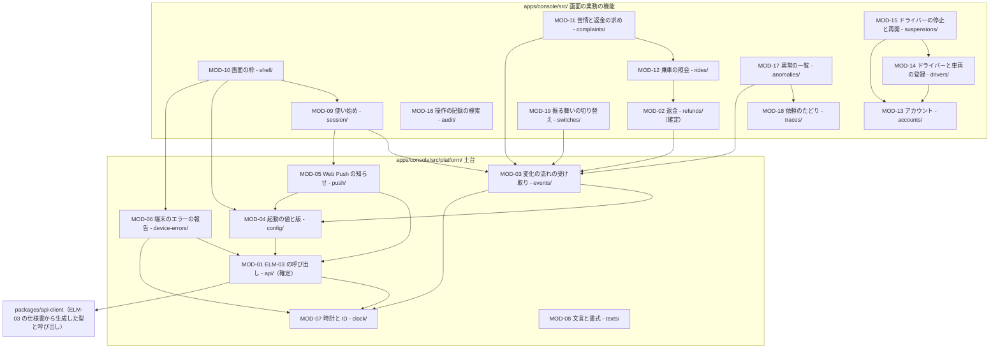
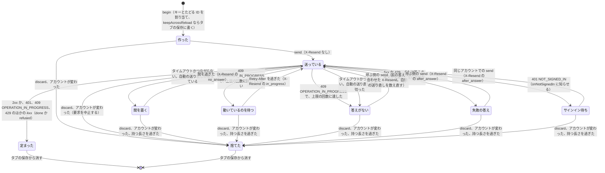
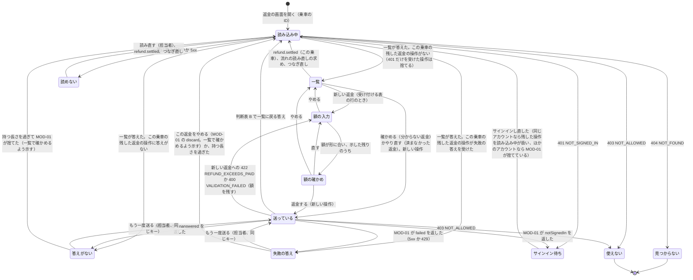

# 担当者とエンジニアの Web アプリの詳細設計: 配車サービス

状態: 回答反映済み · 更新: 2026-11-13 · 入力の基準: b6feab9 · 第 4 段階（全 4 段階） · コンポーネント: ELM-02

## 概要
ELM-02 を 19 のモジュールに分けた。確定の深さは二つで、ELM-03 の状態を変えるどの呼び出しも送り、答えを失った操作を同じ冪等キーで一つの結果に定める MOD-01 と、担当者が認めた返金を送り、答えのない返金と結果が分からない返金を同じ返金のまま確かめる MOD-02。ほかの 17（土台 6 と画面の業務の機能 11）は枠の深さ。最も難しいのは、答えを失ったとき、タブを読み直したとき、セッションが切れたときにも担当者の一回の「返金する」を二度行わず、済んだかどうか分からない返金を済まなかったと示さないこと（QR-45 の失敗のシナリオ）。尋ねた点はない。HND-18 を MOD-01 の値（タイムアウト 15 秒ほか、DAS-16）で決め、ELM-03 がそれらの操作に答える期限（HND-19）を 10 秒より短くすることを第 4 段階の ELM-03 の実行に求める。軽微な指摘を二つ出した（FND-41 は第 3 段階に IFC-21 の示した時刻、FND-42 は第 2b 段階に端末の保存の決まり）。未確認の仮定で最も高いのは、この段階の DAS-16 と、IFC-11 と IFC-21 を通る第 3 段階の DAS-11、DAS-15 で、どれも中、低。

## 入力
| 出どころ | 得たもの |
|---|---|
| docs/design/elm/、2-architecture.md、dec/ | ELM-02 の責務、functions（FR-33〜FR-44、FR-48〜FR-50、FR-52）、drivers（DRV-12、DRV-17、DRV-19、DRV-20、DRV-24、DRV-28〜DRV-30）、decisions（DEC-01、DEC-03、DEC-04、DEC-14、DEC-15、DEC-19、DEC-20、DEC-26）と、お金の操作の DEC-08、DEC-10。脅威のモデルの F3、F4、F10 |
| docs/design/ifc/、3-high-level-design.md | ELM-02 が提供する画面の IFC-24、IFC-25 と、利用する IFC-01、IFC-10〜IFC-14、IFC-21 の操作、誤りとその符号、冪等性、timing。共通の約束事 DEC-35〜DEC-44 と、DEC-45、DEC-46。CUJ-10〜CUJ-18 の流れと画面、返金（DAT-12）の状態、タイムアウトの表 |
| docs/design/pol/、2b-technical-policy.md | POL-01 の Web アプリの技術の組み合わせ（React 19、Vite、React Router 8、TanStack Query、React Aria Components、openapi-fetch と packages/api-client、CSS Modules）、POL-02 の apps/console/src/ の分け方と依存の規則、POL-03 のテストの層（単体は Vitest の Browser Mode の Chromium、端から端は Playwright の Chromium）と偽物と環境、POL-04 のエラー、設定、文言、サービスワーカーの決まり、POL-05（画面は文書を作らない）、POL-06 |
| docs/design/hnd/ | この段階が ELM-02 で取り上げる申し送りは HND-18。実装宛ての未決定の申し送りは HND-16（ELM-03 のスキーマ） |
| docs/design/fnd/ | この段階に宛てた指摘はない。未解決の FND-19〜FND-21、FND-34〜FND-40 はほかの段階宛てで、ELM-02 のモジュールを変えない（FND-37 は返金の答えの期限に余裕がないことで、遅れたインスタンスの間に送り直しが 202 REFUND_PENDING を受けうるが、MOD-02 の判断表がその答えを扱う） |
| docs/design/das/、qcr/、quality-chain-requests.md | 未確認の DAS-01、DAS-02、DAS-04〜DAS-15。品質チェーンへの要求は QCR-01、QCR-06、QCR-07 が未回答、QCR-02〜QCR-05、QCR-08 が回答済みで、どれも ELM-02 の項目を変えない。要求書に手で書かれた答えはない |
| docs/quality/fr/、qr/、nfr/ | FR-33〜FR-44、FR-48〜FR-50、FR-52 の受け入れ基準。QR-45（返金は認めた額を一度だけ）、QR-34、QR-57、QR-58（個人の情報）、QR-43（担当者の機能が使える）、QR-64（WCAG 2.2 の AA は乗客とドライバーの画面だけ）。NFR-22、NFR-38、NFR-40 のゲート |
| docs/quality/context.yaml | USR-03、USR-04、CUJ-10〜CUJ-18（CUJ-14〜CUJ-18 の手順は決まっていない）、OPF-01〜OPF-03 |

既存のコードはなく、読んだコードもない。どのモジュールも新設。何も配備しない（TC-09）ため、ELM-03 の答えの時間、担当者とエンジニアのコンピューターのつながり、ブラウザの振る舞いはどれも測っておらず、MOD-01 の値は暫定（DAS-16）。

## モジュール


MOD-10 は、画面の業務の機能のどのモジュールの道筋も組み立てる（MOD-10 からそれらへの矢印は略した）。MOD-02、MOD-09、MOD-11〜MOD-19 はどれも MOD-01 と MOD-08 を使う（矢印は略した）。どのモジュールも POL-02 の apps/console/src/ の分け方に従い、画面の業務の機能はそれぞれのディレクトリに、ブラウザの仕組みと ELM-03 の呼び出しを包むものは src/platform/ の下に置く。業務の規則は置かず、額、返金できる残りの額、使えるかどうか、隠し方は ELM-03 が送ったものを示す（POL-02、DEC-15、DRV-31）。

図の境は、POL-02 の依存の規則が検査の手順で守る。画面の業務の機能は、外への呼び出し（fetch）、流れ（EventSource）、知らせの許しと Web Push の登録、時刻と ID のもとを使えない（src/platform/ だけに許す規則）ため、ELM-03 への呼び出しはどれも MOD-01 を通り、返金の送り直しを迂回できない。業務の機能の間の矢印（MOD-11 → MOD-12、MOD-12 → MOD-02、MOD-14 → MOD-13、MOD-15 → MOD-13 と MOD-14、MOD-17 → MOD-18、MOD-10 → どの機能も）は、それぞれの index.ts からだけ使う規則と、ディレクトリを上がる相対の import を使わない規則が守り、循環は import/no-cycle が見つける。ELM-03 は packages/api-client の生成した型からだけ呼ぶ。src/platform/ の中のモジュールの間は規則が分けないが、MOD-03、MOD-04、MOD-05、MOD-06 が送る操作はどれも送り直しても害のないもの（IFC-01 の GET /v1/client-config、IFC-10）で、MOD-01 を迂回しても二重に効かない。端末の保存を MOD-01 だけが使うことはどの規則も守らず、FND-42 で第 2b 段階に出した。この段階が加えた依存の規則はない。

<!-- generated: modules -->
| MOD | 名前 | 深さ | 公開範囲 | FR | 実現する操作 | 今の構造との差分 | 根拠 |
|---|---|---|---|---|---|---|---|
| MOD-01 | ELM-03 の呼び出し | 確定 | 内部 | FR-40、FR-48 | — | 新設 | 仮定 |
| MOD-02 | 返金 | 確定 | 公開 | FR-39、FR-40、FR-50 | IFC-24 返金、IFC-13 GET /v1/console/rides/{rideId}/refunds、IFC-13 POST /v1/console/rides/{rideId}/refunds、IFC-13 POST /v1/console/refunds/{refundId}/retry、IFC-11 refund.settled | 新設 | 推定 |
| MOD-03 | 変化の流れの受け取り | 枠 | 内部 | FR-33 | IFC-11 stream.resync | 新設 | 推定 |
| MOD-04 | 起動の値と版 | 枠 | 内部 | — | IFC-01 GET /v1/client-config | 新設 | 推定 |
| MOD-05 | Web Push の知らせ | 枠 | 内部 | FR-33 | IFC-10 PUT /v1/push-subscriptions/current、IFC-10 DELETE /v1/push-subscriptions/current、IFC-21 push の出来事 | 新設 | 推定 |
| MOD-06 | 端末のエラーの報告 | 枠 | 内部 | — | IFC-10 POST /v1/device-reports | 新設 | 推定 |
| MOD-07 | 時計と ID | 枠 | 内部 | — | — | 新設 | 推定 |
| MOD-08 | 文言と書式 | 枠 | 内部 | — | — | 新設 | 推定 |
| MOD-09 | 使い始め | 枠 | 公開 | FR-36、FR-48、FR-49 | IFC-24 使い始め、IFC-25 使い始め、IFC-01 POST /v1/account-setups、IFC-01 POST /v1/sessions、IFC-01 DELETE /v1/sessions/current、IFC-01 GET /v1/me、IFC-11 switch.changed | 新設 | 推定 |
| MOD-10 | 画面の枠 | 枠 | 内部 | FR-36、FR-48、FR-49 | — | 新設 | 推定 |
| MOD-11 | 苦情と返金の求め | 枠 | 公開 | FR-37、FR-50 | IFC-24 苦情と返金の求め、IFC-12 GET /v1/console/complaints、IFC-12 POST /v1/console/complaints/{complaintId}/resolution、IFC-11 complaint.received | 新設 | 推定 |
| MOD-12 | 乗車の照会 | 枠 | 公開 | FR-38 | IFC-24 乗車の照会、IFC-12 POST /v1/console/rides/search、IFC-12 GET /v1/console/rides/{rideId} | 新設 | 推定 |
| MOD-13 | アカウント | 枠 | 公開 | FR-41、FR-42、FR-50 | IFC-24 アカウント、IFC-12 POST /v1/console/accounts/search、IFC-12 GET /v1/console/accounts/{accountId}、IFC-12 POST /v1/console/accounts、IFC-12 PATCH /v1/console/accounts/{accountId}、IFC-12 PUT /v1/console/accounts/{accountId}/test-flag、IFC-12 POST /v1/console/accounts/{accountId}/setup-codes | 新設 | 推定 |
| MOD-14 | ドライバーと車両の登録 | 枠 | 公開 | FR-43、FR-50 | IFC-24 ドライバーと車両の登録、IFC-12 POST /v1/console/drivers、IFC-12 GET /v1/console/drivers/{accountId}、IFC-12 PATCH /v1/console/drivers/{accountId} | 新設 | 推定 |
| MOD-15 | ドライバーの停止と再開 | 枠 | 公開 | FR-44、FR-50 | IFC-24 ドライバーの停止と再開、IFC-12 POST /v1/console/drivers/{accountId}/suspension、IFC-12 DELETE /v1/console/drivers/{accountId}/suspension | 新設 | 推定 |
| MOD-16 | 操作の記録の検索 | 枠 | 公開 | FR-50 | IFC-24 操作の記録、IFC-12 POST /v1/console/audit-records/search | 新設 | 推定 |
| MOD-17 | 異常の一覧 | 枠 | 公開 | FR-33、FR-34、FR-52 | IFC-25 異常の一覧と知らせ、IFC-14 GET /v1/console/anomalies、IFC-11 anomaly.detected | 新設 | 推定 |
| MOD-18 | 依頼のたどり | 枠 | 公開 | FR-34、FR-35、FR-49、FR-52 | IFC-25 依頼の経過のたどり、IFC-14 POST /v1/console/traces/search、IFC-14 GET /v1/console/rides/{rideId}/trace、IFC-14 POST /v1/console/rides/{rideId}/disclosures | 新設 | 推定 |
| MOD-19 | 振る舞いの切り替え | 枠 | 公開 | FR-36 | IFC-25 振る舞いの切り替え、IFC-14 GET /v1/console/switches、IFC-14 PUT /v1/console/switches/{switchName} | 新設 | 推定 |
<!-- /generated -->

確定の深さは MOD-01 と MOD-02 だけ。MOD-01 は、状態を変える呼び出しの答えを失ったときに同じキーで送り直して結果を一つに定め、ELM-02 から ELM-03 の状態を変えるどの呼び出しもここが送る（結果が分からない状態を確かめる）。MOD-02 は担当者が認めた返金を求め（お金を動かす）、答えのない返金と REFUND_PENDING の返金を同じ返金のまま確かめる。ほかのモジュールは、お金を動かさず、結果が分からない状態を確かめず（送り直しは MOD-01 が行う）、同時に動く仕事の間で同じ記録を調整せず（どの記録も ELM-03 が条件つきで書く）、いくつもの条件の規則も持たない（使えるか、隠すか、受け付けるかは ELM-03 が決める）。枠の深さとして評価すると、MOD-13 の設定の符号（そのアカウントのパスワードを決められる）、MOD-18 の理由を示して見た情報、MOD-06 の ELM-03 に送る報告の中身が個人の情報と秘密にかかわるが、どれも、何を持たないかと何に入れないかを契約が持ち（答えの画面を離れたら持たない、URL、履歴の状態、端末の保存、報告に入れない、報告は決めた項目だけ）、中身を誤っても見えるのはすでにその人に示した情報で、ELM-03 も記録を DEC-15 で伏せるため、重大さは中にとどまる。どれも五つ以上の項目を変えさせない。

ELM-02 が利用する IFC の操作のうち、IFC-11 の乗客とドライバーだけに届く出来事（ride.accepted などの依頼の出来事、position.updated、offer.added と offer.removed、driver.suspended と driver.resumed、message.received、payment_method.settled）は DEC-15 の決まりで ELM-02 に届かず、ELM-02 のどのモジュールも受け持たない。IFC-21 の POST {宛先の URL} は ELM-03 の呼び出しで、ELM-02 は push の出来事だけを受け持つ。

## 割り当て
| FR、IFC か SLI | 基準、操作か項目 | MOD |
|---|---|---|
| FR-33 | 1 | MOD-17（一覧）、MOD-03（流れの anomaly.detected）、MOD-05（Web Push の知らせ） |
| FR-33 | 2 | MOD-17（続く異常の件数と最初と最後の時刻） |
| FR-34 | 1 | MOD-18（探して、行ったことと結果を時刻の順に） |
| FR-34 | 2 | MOD-17（選んだ異常から開く）、MOD-18 |
| FR-34 | 3 | MOD-18（どの部分で起きたか） |
| FR-34 | 4 | MOD-18（NOT_FOUND と空の items） |
| FR-35 | 1 | MOD-18（隠したまま示す） |
| FR-35 | 2 | MOD-18（仮の名） |
| FR-35 | 3 | MOD-18（理由を入れて disclosures を送り、その依頼の画面にだけ示す。記録は ELM-03） |
| FR-35 | 4 | MOD-18（理由が空なら送らない、VALIDATION_FAILED） |
| FR-36 | 1 | MOD-19（止める操作を送る。変える前の振る舞いに戻すのは ELM-03） |
| FR-36 | 2 | MOD-19（有効にする） |
| FR-36 | 3 | MOD-19（止める）、MOD-09（switch.changed で me を読み直す）、MOD-10（止めた機能の画面を出さない） |
| FR-37 | 1 | MOD-11（complaint.received と一覧） |
| FR-37 | 2 | MOD-11（対応を終え、受けたものと終えたものを分ける） |
| FR-37 | 3 | MOD-11（ELM-02 の操作はない。受け付けないのは ELM-03 で、受け付けなかった求めは一覧に現れない） |
| FR-38 | 1 | MOD-12 |
| FR-38 | 2 | MOD-12 |
| FR-38 | 3 | MOD-12（料金を請求した依頼と、その額と種類） |
| FR-38 | 4 | MOD-12（空の items） |
| FR-39 | 1 | MOD-02（返金を送り、済んだと示す。乗客への知らせは ELM-03） |
| FR-39 | 2 | MOD-02（済まなかった、分からない、確かめる、やり直す） |
| FR-39 | 3 | MOD-02（料金を請求した依頼も同じ画面） |
| FR-39 | 4 | MOD-02（NOTHING_TO_REFUND） |
| FR-39 | 5 | MOD-02（返金ごとの担当者、額、結果を示す。記録は ELM-03） |
| FR-40 | 1 | MOD-02（REFUND_EXCEEDS_PAID と返金できる残りの額） |
| FR-40 | 2 | MOD-02（済んだ返金に操作を出さず、retry の最初の結果を示す） |
| FR-40 | 3 | MOD-02（答えのない返金を同じ返金のまま確かめる）、MOD-01（同じキーの送り直し） |
| FR-40 | 4 | MOD-02（新しい返金は別の操作） |
| FR-41 | 1 | MOD-13（確かめてから作る） |
| FR-41 | 2 | MOD-13（details の項目ごと） |
| FR-41 | 3 | MOD-13（ACCOUNT_ALREADY_EXISTS） |
| FR-41 | 4 | MOD-13（探して選び、訂正を送る。記録は ELM-03） |
| FR-42 | 1 | MOD-13（試験用として作り、示す） |
| FR-42 | 2 | MOD-13（試験用として作る。記録に写すのは ELM-03） |
| FR-42 | 3 | MOD-13（区別を変える。記録は ELM-03） |
| FR-43 | 1 | MOD-14（確かめてから登録） |
| FR-43 | 2 | MOD-14（審査の日付と手がかりの入れ物を持たない） |
| FR-43 | 3 | MOD-14（欠けた項目と PLATE_ALREADY_REGISTERED） |
| FR-43 | 4 | MOD-14（探して選び、訂正を送る。乗客に示す手がかりにするのは ELM-03） |
| FR-43 | 5 | MOD-14（登録を送る。登録が済むまで依頼を届けないのは ELM-03） |
| FR-44 | 1 | MOD-15（停止を送る。一覧から除き、ドライバーに知らせるのは ELM-03） |
| FR-44 | 2 | MOD-15（停止を送る。許諾を受け付けないのは ELM-03 と ELM-01） |
| FR-44 | 3 | MOD-15（停止を送る。受付を始めさせないのは ELM-03 と ELM-01） |
| FR-44 | 4 | MOD-15（停止を送る。進んでいる依頼を続けるのは ELM-03） |
| FR-44 | 5 | MOD-15（activeRides） |
| FR-44 | 6 | MOD-15（DRIVER_ALREADY_SUSPENDED） |
| FR-44 | 7 | MOD-15（再開） |
| FR-48 | 1 | MOD-09（サインイン、パスワードを決める） |
| FR-48 | 2 | MOD-09（AUTH_FAILED、ACCOUNT_LOCKED、ACCOUNT_RETIRED） |
| FR-48 | 3 | MOD-01（401 を知らせる）、MOD-09（使い始めに移り、操作を新しく行わせる）、MOD-10（サインインしていなければ画面を出さない） |
| FR-48 | 4 | MOD-09（使い終える） |
| FR-49 | 1 | MOD-10（許されない機能の画面を出さない）、MOD-01（403 NOT_ALLOWED を refused で返す） |
| FR-49 | 2 | MOD-10（乗客とドライバーのアカウントにはどの画面も出さない。他人の依頼を示さないのは ELM-03） |
| FR-49 | 3 | MOD-10（確定額と評価を変える画面を持たない。受け付けないのは ELM-03） |
| FR-49 | 4 | MOD-18（disclosures の答えだけを示す） |
| FR-50 | 1 | MOD-11、MOD-02、MOD-13、MOD-14、MOD-15（操作を送る。担当者とともに記録するのは ELM-03） |
| FR-50 | 2 | MOD-16 |
| FR-50 | 3 | MOD-16（済まなかった操作も示す）、MOD-02（済まなかった返金も一覧に示す） |
| FR-52 | 1 | MOD-18（端末のエラーをたどりに示す。記録するのは ELM-01 と ELM-03） |
| FR-52 | 2 | MOD-18（行ったことの時刻の順に合わせて示す） |
| FR-52 | 3 | MOD-17（依頼に関わらない端末のエラーは、ELM-03 が異常とした分を異常の一覧に示す。記録するのは ELM-01 と ELM-03） |
| FR-52 | 4 | MOD-18（後で届いたエラーもたどりに示す。送るのは ELM-01） |
| FR-52 | 5 | MOD-18（隠して示す） |
| SLI | — | ELM-02 が出す出来事と項目はない。IFC-01 の SLI-01、SLI-04 は乗客とドライバーのサインイン、IFC-10 の SLI-14 は乗客とドライバーに示した変化、IFC-11 の SLI-01〜SLI-03 は乗客への知らせを数え、担当者とエンジニアのものは数えない |

## 型
要求、応答、流れの出来事の項目のスキーマは、ELM-03 の実装が生成し（HND-16）、ELM-02 は packages/api-client の生成した型を使う。ここに挙げるのは、MOD の契約が使う型だけ。

| 型 | 項目と型 |
|---|---|
| Money | amount（円の整数）、currency（JPY）。DEC-38 |
| Instant | RFC 3339 の UTC の文字列（ミリ秒まで）。DEC-37 |
| DeviceTimeMs | 端末の時計のエポックミリ秒の整数。DEC-37 |
| Uuid | UUID v4 の文字列。冪等キー、たどる ID、報告の ID（DEC-36） |
| AccountId、RideId、RefundId、ComplaintId | ELM-03 が作る、種類の接頭辞と ULID の不透明な ID（DEC-36）。利用側は解かない |
| AccountKind | passenger か driver |
| ReadOperationName、ChangeOperationName | packages/api-client が生成した操作の名前（operationId、DEC-44）。DEC-42 が冪等キーを求めない読むだけの操作と、状態を変える操作に分ける |
| Input | 操作の経路の値と本文（生成した型） |
| ApiError | status（整数）、code（UPPER_SNAKE_CASE の符号）、details（field と code の組の並び、ないこともある）、retryAfterSeconds（ないこともある）、requestId、traceId。DEC-35 の本文から作る |
| ReadResult | ok（本文）、error（ApiError）、noAnswer のどれか |
| Operation | id（タブの中の識別）、name（ChangeOperationName）、input、idempotencyKey（Uuid か none）、traceId（Uuid）、accountId、keepAcrossReload（真偽）、firstSentAt（DeviceTimeMs）、state（MOD-01 の状態遷移図の状態）、lastAnswer（なし、答えがない、失敗の答え、401） |
| Outcome | done（status と本文）、refused（ApiError）、failed（ApiError）、notSignedIn（previous は none、unanswered、failed のどれか）、unanswered のどれか |
| EventType、StreamEvent | IFC-11 の出来事の種類の名前と、その出来事（id、event、data の v、type、eventId、rideId、occurredAt と種類ごとの中身。生成した型） |
| StreamStatus | connected、reconnecting、notSignedIn、tooManyStreams のどれか |
| ClientConfig | Web Push の公開の鍵、ブラウザの側の偽物を使うか、buildId（IFC-01 の GET /v1/client-config のうち ELM-02 が使うもの） |
| PushPayload、PushPermission | IFC-21 の知らせの中身（v、type、eventId、rideId、title）。知らせの許しは granted、denied、unavailable のどれか |
| Me | 本人のアカウントの種類、名前、使える機能の並び、試験用か、止めた機能の並び（IFC-01 の GET /v1/me） |
| ScreenName、Route、Location | MOD-10 の道筋の登録の画面の名前（lower_snake_case、DEC-44）、その登録、ブラウザの今の位置 |
| CaughtFailure、ReportContext | 画面の境が受けた失敗（MOD-06 はその種類だけを読み、文とスタックを読まない）と、報告に添える screen（ScreenName）、rideId（RideId か none）、traceId（Uuid か none） |
| DriverState | 停止しているか、停止した時刻（Instant か none）、迎車中か乗車中の依頼の並び（IFC-12 の GET /v1/console/drivers/{accountId}） |
| TraceCriteria、Disclosure | 依頼を探す条件（期間、異常、依頼の ID）と、理由を示して見たその依頼の隠した情報（IFC-14） |
| TextKey、TextValues | MOD-08 の文言のファイルの鍵と、文に入れる値 |

MOD-06 が送る報告は IFC-10 の端末で起きたエラーで、reportId、occurredAt、screen、rideId、エラーの種類、traceId だけを持ち、送るたびに sentAt と lastRoundTripMs を添える（DEC-37）。エラーの種類の値の一覧は ELM-03 の仕様書が持ち（HND-16）、MOD-06 はそのうちの値だけを使って、文を入れない。

## モジュールの詳細
### MOD-01 ELM-03 の呼び出し
#### 振る舞い
状態を変える一回の操作の状態。読むだけの操作（read）は状態を持たず、一つの要求を送って ok、error、noAnswer のどれかを返し、送り直さない（読み直すのは呼ぶ側と TanStack Query）。



持つ長さ（23 時間）は keepAcrossReload の操作だけに当たり、ほかの操作はページが開いている間だけメモリにある。タブを読み直すと、keepAcrossReload の操作は最後に受けた答えのとおりに戻り、送っている、間を置く、動いているのを待つ途中だった操作は答えがないとして戻る（答えを受けていないため）。送り直しの X-Resend は前の要求の答えで決まり、答えがなければ no_answer、409 OPERATION_IN_PROGRESS なら in_progress、ほかの答えなら after_answer（DEC-43）。

答えの判断表（どの答えにも一行が当たる）:

| 答え | read | send | 次の送りの X-Resend |
|---|---|---|---|
| 2xx（202 の PENDING を含む） | ok（本文） | done。定まった | — |
| 401 NOT_SIGNED_IN | error と onNotSignedIn | notSignedIn（前の送りの答えを添える）と onNotSignedIn。サインイン待ち | after_answer |
| 409 OPERATION_IN_PROGRESS、上限の回数の前 | error（読むだけの操作には返らない） | Retry-After を待って送り直す。動いているのを待つ | in_progress |
| 409 OPERATION_IN_PROGRESS、上限の回数に達した | error | unanswered。答えがない | in_progress |
| 429 TOO_MANY_REQUESTS | error（retryAfterSeconds を持つ） | failed。失敗の答え | after_answer |
| 上のほかの 4xx（400、402、403、404、409、422、423 と知らない符号） | error | refused。定まった | — |
| 5xx | error | failed。失敗の答え | after_answer |
| タイムアウトかつながらない。自動の送り直しが残る | noAnswer | 間を置いて送り直す。間を置く | no_answer |
| タイムアウトかつながらない。自動の送り直しを使い切った | noAnswer | unanswered。答えがない | no_answer |
| 答えの本文が生成した型に合わない | UnexpectedAnswer を投げる | UnexpectedAnswer を投げ、失敗の答えとして持つ | after_answer |

どの状態でどの出来事を受けても、することが決まっている:

| 状態 | 呼ぶ側の send | タイムアウトか答え | 待ちの終わり | discard かアカウントが変わる | 持つ長さを過ぎる | 中止した要求の遅れた答え |
|---|---|---|---|---|---|---|
| 作った | 送っている | 来ない | 来ない | 捨てた | 捨てた | 来ない |
| 送っている | 新しい要求を出さず、同じ Outcome を待たせる | 判断表のとおり | 来ない | 要求を中止して捨てた | 答えを受けてから見る | 捨てる |
| 間を置く、動いているのを待つ | 同じ Outcome を待たせる | 来ない | 送っている | 捨てた | 捨てた | 捨てる |
| 答えがない | 送っている | 来ない | 来ない | 捨てた | 捨てた | 捨てる |
| 失敗の答え | 送っている | 来ない | 来ない | 捨てた | 捨てた | 捨てる |
| サインイン待ち | 同じアカウントなら送っている。アカウントがなければ NotSignedIn | 来ない | 来ない | 捨てた | 捨てた | 捨てる |
| 定まった、捨てた | 呼ばない（pre） | 捨てる | 来ない | 何もしない | 何もしない | 捨てる |

#### 並行性とエラー
同じタブでは、画面の操作、自動の送り直しの時計、ほかの画面の読み込み、流れ（MOD-03）が並んで動くが、JavaScript は一つの流れで動くので、操作の状態を書き換えるのはいつも一つ。二度押しは、begin が同じ操作の名前、経路の値、本文の、定まっていない操作を返し、send が送っている操作に新しい要求を出さないことで一つになる。タイムアウトした要求は中止してから送り直し、中止した要求の答えは捨てるので、一つの操作に答えが二つ届いても状態は一つに定まる。タブの保存は送る前に書き、定まるか捨てたらすぐ消す（書き換えは同期で、途中で止まらない）。タブを複製するとタブの保存が写り、二つのタブが同じ操作を同じキーで送りうるが、ELM-03 が同じキーを一度だけ行う（DEC-42。重なれば 409 OPERATION_IN_PROGRESS か最初の答え）。アカウントが変わると前のアカウントの操作をすべて捨て、その要求の答えも捨てる。

扱う誤り: タイムアウト、つながらないこと、409 OPERATION_IN_PROGRESS（待って送り直す）、401（聞き手に知らせ、操作を持つ）。DEC-35 の誤りの本文は ApiError に変えて返し、知らない符号と項目は状態の組で扱う（DEC-41）。返して呼ぶ側に任せるもの: done、refused、failed、notSignedIn、unanswered。投げるもの: 答えの本文が生成した型に合わない UnexpectedAnswer（原因をつけて、POL-04）で、画面の境（MOD-10）が受けて MOD-06 に渡す。捕えた失敗を黙って捨てず、要求と答えの本文をログにも端末の保存にも書かない（タブの保存は決めた項目だけ）。

### MOD-02 返金
#### 振る舞い
一つの乗車か料金を請求した依頼の、返金の画面の状態。



答えがないと失敗の答えの状態では、一覧も示し（出来事で裏で読み直す）、新しい返金を受け付けない。答えのない操作はやめられず、同じキーで送るか、持つ長さ（MOD-01 の 23 時間）を過ぎるまで残る。失敗の答え（5xx か 429）の操作は、ELM-03 が答えた後なので送っている途中ではなく、受けた返金があれば一覧に出る（ELM-03 は試みを呼ぶ前の取引で返金を書く、DEC-42）ため、担当者は一覧を見てやめられる。お金が動きうる状態（送っている、答えがない、失敗の答え、サインイン待ち）は終わりにしない。画面を離れても操作は MOD-01 に残り、同じ乗車の返金の画面を開くと読み込み中から続く。IFC-01 は NOT_SIGNED_IN の後に、使い始めた操作を確かめ直した後に新しく行わせるとする。答えのない返金は ELM-03 で済んでいるかもしれないため、担当者が新しく行う操作は同じキーの「もう一度送る」にし、新しいキーの返金にしない（QR-45）。冪等キーの範囲はアカウントを含む（DEC-42）ので、それができるのは同じアカウントだけで、ほかのアカウントがサインインすると MOD-01 が操作を捨て、そのアカウントは一覧で返金を確かめる。401 だけを受けた操作は何もしていないため捨て、担当者が新しく返金する。

判断表 A。一覧の返金の状態（第 3 段階の報告の返金（DAT-12）の状態。答えの値の名前は生成した型による）ごとに示すことと受け付ける操作:

| 返金の状態 | 示すこと | 受け付ける操作 |
|---|---|---|
| refunding | 送っていること（認めた担当者、額、時刻） | 確かめる（POST /v1/console/refunds/{refundId}/retry。同じ試みを確かめる） |
| refund_unknown | 済んだかどうか分からないこと | 確かめる（同じ操作） |
| refund_failed | 済んでいないことと理由 | やり直す（同じ操作。ELM-03 が新しい試みを作る） |
| refunded | 済んだことと額 | なし |
| 知らない値（DEC-41） | 状態が分からないこと | なし（読み直す） |

新しい返金を受け付けるか（一覧の状態でだけ問う）:

| この乗車の残した返金の操作（答えがない、失敗の答え） | 一覧の返金できる残りの額 | 新しい返金 |
|---|---|---|
| ある | どれでも | 受け付けない。残した操作を先に定めるよう示す |
| ない | 0 円 | 受け付けない。返金できる残りがないことを示す |
| ない | 1 円以上 | 受け付ける |

判断表 B。MOD-01 が返した答え（列は操作）ごとに移る状態と示すこと:

| 答え | 新しい返金（POST …/refunds） | 確かめる、やり直す（POST …/retry） | 示すこと |
|---|---|---|---|
| done 201 か 200（済んだ） | 読み込み中 | 読み込み中 | 済んだことと額（FR-39 の 1、FR-40 の 2） |
| done 202 REFUND_PENDING | 読み込み中 | 読み込み中 | 済んだかどうか分からないこと。分かれば refund.settled で示す（FR-39 の 2、FR-40 の 3） |
| done ほかの 2xx（知らない本文） | 読み込み中 | 読み込み中 | 一覧の状態だけを示す（DEC-41） |
| refused 402 REFUND_DECLINED | 読み込み中 | 読み込み中 | 済んでいないことと理由（FR-39 の 2） |
| refused 409 NOTHING_TO_REFUND | 読み込み中 | 読み込み中 | 返金できないこと（FR-39 の 4） |
| refused 422 REFUND_EXCEEDS_PAID | 額の入力（額を残し、答えの残りの額を示す） | 読み込み中 | 返金しなかったことと返金できる残りの額（FR-40 の 1） |
| refused 400 VALIDATION_FAILED | 額の入力（額の文） | 読み込み中 | 額の誤り。やり直しでは、送れなかったこと |
| refused 404 NOT_FOUND | 読み込み中 | 読み込み中 | 乗車か返金が見つからないこと |
| refused 403 NOT_ALLOWED | 使えない | 使えない | この機能を使えないこと（FR-49 の 1） |
| refused ほかの 4xx（422 IDEMPOTENCY_KEY_REUSED と知らない符号） | 読み込み中 | 読み込み中 | 受け付けなかったこと（状態の組の文、DEC-35、DEC-41） |
| failed（5xx か 429） | 失敗の答え | 失敗の答え | 済んだかどうか分からないこと。同じ返金としてもう一度送れること |
| unanswered | 答えがない | 答えがない | 答えを受けていないこと。同じ返金としてもう一度送れること |
| notSignedIn | サインイン待ち | サインイン待ち | 本人を確かめ直すよう求めること |

409 OPERATION_IN_PROGRESS は MOD-01 が待って送り直すため、この表に来ない（上限に達すれば unanswered）。済まなかったと示すのは REFUND_DECLINED と一覧の refund_failed だけで、答えがない、失敗の答え、REFUND_PENDING を済まなかったとは示さない。

どの状態でどの出来事を受けても、することが決まっている:

| 出来事 | 読み込み中 | 一覧 | 読めない | 額の入力、額の確かめ | 送っている | 答えがない、失敗の答え | サインイン待ち |
|---|---|---|---|---|---|---|---|
| refund.settled（この乗車）、流れの読み直しの求め、つなぎ直し | 読み終えたらもう一度読む | 読み込み中 | 読み込み中 | 裏で読み直し、示す残りの額を変える（入れた額は残す） | 答えの後に読み直す | 裏で読み直す（状態は変えない） | 捨てる（サインインの後に読む） |
| refund.settled（ほかの乗車） | 捨てる | 捨てる | 捨てる | 捨てる | 捨てる | 捨てる | 捨てる |
| 新しい返金、返金する、確かめる、やり直す | 受け付けない | 状態遷移のとおり | 受け付けない | 額の確かめの返金するだけ | 受け付けない（二度押し） | 受け付けない（もう一度送ると、失敗の答えのやめるだけ） | 受け付けない |
| 画面を離れる | 読むのをやめる | 終わる | 終わる | 入れた額を捨てる | 操作は MOD-01 に残り、答えまで送られる | 操作は MOD-01 とタブの保存に残る | 操作は MOD-01 に残る |
| タブを読み直す | 読み込み中から | 読み込み中から | 読み込み中から | 読み込み中から（入れた額は残さない） | 読み込み中から（MOD-01 が答えのない操作として返す） | 読み込み中から（残した操作として） | 読み込み中から |

#### 並行性とエラー
同時に動くのは、担当者の操作、MOD-01 の送りと自動の送り直し、流れの refund.settled、一覧の読み直し、ほかのタブとほかの担当者の返金、ELM-03 の期限の処理による試みの確かめ。一覧は最後に始めた読み直しの答えだけを示し、前に始めた読み直しの答えが後から届いても示さない。送っている間に届いた出来事は、答えの後の一度の読み直しにまとめる。二度押しは、送っている間は操作を受け付けず、MOD-01 の begin も同じ内容の定まっていない操作を返すことで一つになる。このモジュールはタブと担当者をまたいで返金を調整しない。同じ返金の確かめとやり直しが重なっても、ELM-03 が一つの返金に済んだか分からない試みを一つまでにする（DEC-45、IFC-13）。別々に認めた返金は別の返金になり（FR-40 の 4）、合計は ELM-03 が支払われた額までに限る（REFUND_EXCEEDS_PAID）。ほかのタブとほかの担当者の返金も、送っている途中のものを含めて一覧に出るので、担当者は新しい返金の前にそれを見る。タブを複製すると残した操作が写り、二つのタブが同じキーで送りうるが、ELM-03 が同じキーを一度だけ行う（DEC-42）。

扱う誤りは判断表 B のとおりで、どの答えにも示すことと次の状態がある。予期しない答え（MOD-01 の UnexpectedAnswer）と画面の中の失敗は捕えずに投げ、画面の境（MOD-10）が MOD-06 に渡す。

## データ
ELM-02 はデータの実体を持たない（どの DAT も持ち主は ELM-03、DEC-17）。ほかのコンポーネントが直接読む表もない。確定の深さのモジュールが頼る不変条件は、ELM-03 の答え（冪等キー、返金の状態と残りの額）と、ブラウザの中の構造（「キャッシュ」）が保ち、ELM-02 が設計する表はない。

## キャッシュ
| キャッシュ | MOD | 持つもの | 鍵 | 長さの値 | 消すとき | ないとき |
|---|---|---|---|---|---|---|
| 返金の一覧 | MOD-02 | GET /v1/console/rides/{rideId}/refunds の答え（返金と返金できる残りの額） | 乗車の ID | なし（いつも古いとみなす） | 画面を開くとき、MOD-02 の操作の答えの後、refund.settled（その乗車）、流れの読み直しの求めとつなぎ直し、アカウントが変わったとき（MOD-10） | 読み込み中を示し、前の値で操作を受け付けない |

MOD-01 のメモリの構造は、定まっていない操作の表で、鍵は操作の ID と、同じ内容を見つけるための操作の名前、経路の値、本文のハッシュの組。上限は 50（parameters）で、定まるか捨てると消える。上限にあると begin は TooManyOperations を返す。

MOD-01 のタブの保存（sessionStorage の一つの項目）は、keepAcrossReload の操作（今は MOD-02 の返金の操作だけ）を、アカウントの ID、操作の名前、経路の値（乗車か返金の ID）、本文（額）、冪等キー、たどる ID、最初に送った時刻、最後に受けた答えの種類で持つ。上限は 20、長さは最初に送ってから 23 時間（parameters）で、定まるか捨てるとすぐ消し、アカウントが変わるとすべて消す。タブを閉じると消え、ほかのタブからは読めない（タブを複製したときだけ写る）。個人の情報、設定の符号、パスワード、見る理由を持たない。ほかのモジュールは端末の保存を使わない（FND-42）。

## 画面
MOD-02 の返金の画面。状態は MOD-02 の状態遷移図にある。額の入れ方と示す文:

| 入れた額 | 示す文 | 送るか |
|---|---|---|
| 空 | 返金する額を入れてください | 送らない |
| 整数でないか、1 より小さい | 1 円以上の整数で入れてください | 送らない |
| 示した返金できる残りの額より大きい | 返金できる残りは {残りの額} です | 送らない |
| 1 円以上の整数で、示した残りのうち | （額の確かめに進む） | 額の確かめの後に送る |

ELM-03 の VALIDATION_FAILED の details（field は amount）は、REQUIRED を一行目の文で、INVALID_FORMAT と OUT_OF_RANGE を二行目の文で示す。REFUND_EXCEEDS_PAID は答えの refundableAmount で三行目の文を示す。示す残りの額は ELM-03 の答えの値で、画面で求めない。額の確かめは「{額} を返金します。返金できる残りは {残りの額} です」と、返金する、直す、やめるを示す。文はどれも MOD-08 の文言のファイルから引き、額は MOD-08 の書式で示す。

担当者とエンジニアの画面にかかわるアクセシビリティの品質要求はない（QR-64、NFR-49、NFR-50 は乗客とドライバーの画面のもの）。この画面は React Aria Components の、名札のある数の入力とフォーカスを保つダイアログとキーボードで押せるボタンで組み、POL-04 の Oxlint の jsx-a11y の規則を通す。

## 確かめ方
ELM-02 のチェックが使う層は、単体の層（検査の手順で。Vitest の Browser Mode の Chromium）、端から端の層（リリースの手順で。試験の環境の偽物の設定に、Playwright の Chromium から）、運用の予行の層（NFR-38 の場面）。結合と契約の層は ELM-03 を、実機の受け入れの層は ELM-01 を確かめ、ELM-02 のモジュールは確かめない。

単体の層では、画面のモジュールは MOD-01 と MOD-03 の偽物（POL-03 の「Web アプリでは呼び出しと流れの部品の偽物」）、時計と ID の偽物（MOD-07）、知らせの許しと Web Push の登録の偽物を使う。MOD-01 と MOD-03 そのものの単体の層は、その外の fetch と流れの源を、テストが渡す偽物に替える（単体の層の、モジュールの外のすべてを替える決まり）。端から端の層は、EXT-01、EXT-02、Web Push の配信サービスの偽物と、MOD-04 が起動の値で選ぶブラウザの側の偽物（DEC-34）を使い、ブラウザを切ってつなぎ直すことと、要求を ELM-03 に通してから答えを落とすことは Playwright が行う。テストデータは、単体の層ではテストの中の作り手が、端から端の層では種の台本の作り物の参加者と試験用のアカウントが作る（POL-03）。

いくつものモジュールが一緒に通る場面:

| 場面 | 確かめること | 層 | MOD |
|---|---|---|---|
| 答えを失った返金 | Playwright が POST …/refunds を ELM-03 に通してから答えを落とし、MOD-01 が同じキーで送り直して、その乗車の返金が一つで済んだと示す。答えを落とした後にタブを読み直し、「もう一度送る」で同じことを確かめる（FR-40 の 3、QR-45） | 端から端 | MOD-01、MOD-02 |
| 結果が分からない返金 | EXT-01 の偽物が返金に待ち（IFC-17 の 8.5 秒）より長く答えず、画面が分からないと示し、偽物が後で済んでいたと見せると refund.settled で済んだと示す。確かめるで二つ目の返金が起きない（FR-39 の 2、FR-40 の 3） | 端から端 | MOD-02、MOD-03 |
| 拒否とやり直し、残りを超える返金、決済が済んでいない乗車、二つ目に認めた返金 | FR-39 の 2、4、FR-40 の 1、4 | 端から端 | MOD-02 |
| セッションが切れた返金 | 答えのない返金の後にセッションを消し、同じアカウントでサインインし直すと同じ返金として送れ、一つで済む。ほかのアカウントでは残った操作が出ない | 端から端 | MOD-01、MOD-02、MOD-09 |
| 異常から依頼をたどる | 偽物で異常を起こし、流れの anomaly.detected で一覧に出て、依頼のたどりと理由を入れて見るまで（CUJ-10。NFR-38 の場面を ELM-02 の画面から） | 端から端、運用の予行 | MOD-03、MOD-05、MOD-17、MOD-18 |
| つながりの切れ | Playwright がブラウザを切ってつなぎ直し、流れが続きから届き、どの画面も今の状態を読み直す | 端から端 | MOD-03、MOD-10 |
| 担当者の操作から乗客とドライバーの画面へ | 登録の訂正が乗客の画面の手がかりになり（NFR-22）、停止したドライバーに依頼が届かず（CUJ-18）、切り替えを止めると機能が消える（CUJ-11） | 端から端 | MOD-14、MOD-15、MOD-19 |
| 個人の情報と符号を残さない | 探す、作る、見る流れの後に、URL、履歴の状態、端末の保存、端末のエラーの報告に、探す条件、設定の符号、見た情報が残らない | 単体、端から端 | MOD-10、MOD-12、MOD-13、MOD-18、MOD-06 |

どの層も確かめないことが二つある。本物の Web Push の配信サービスを通って担当者とエンジニアのブラウザに知らせが届くことは、POL-03 が ELM-02 に実機の受け入れの層を置かず、NFR-38 も Web Push の偽物に届くまでを測るため、確かめない。デモの回の間はエンジニアが ELM-02 を開いており（DAS-05）、知らせは流れ（MOD-03）でも届く。ELM-02 の単体と端から端の層は Chromium だけで動き、DEC-03 のほかのブラウザ（Edge、Firefox、Safari）では動かさない（POL-03）。どちらもこの段階のチェックに要る層ではなく、指摘にしていない。MOD-01 の値は時間のしきい値の SLO の道になく、負荷の層を求めるゲートもない。

## 設計上の値
<!-- generated: parameters -->
| 値 | MOD | 決めた所 | 収まる予算かタイムアウト |
|---|---|---|---|
| ELM-03 の操作を待つタイムアウト（IFC-01、IFC-10、IFC-12、IFC-14） | MOD-01 | DAS-16（HND-18） | ELM-03 の答えの期限（HND-19。未定）と通信の余裕 5 秒（DEC-46）の和より長いには、期限が 10 秒より短いこと。返金の 15 秒（IFC-13）は期限 8.8 秒と 5 秒の和 13.8 秒より長い |
| 答えがないときの自動の送り直し | MOD-01 | DAS-16 | 一つの操作を自動で待つ最悪は 4 回の 15 秒と 1、2、4 秒の和の 67 秒。時間のしきい値の SLO の道になく、担当者は送っていることを見て待つ |
| 409 OPERATION_IN_PROGRESS の後の送り直しの上限 | MOD-01 | DAS-16 | 返金の答えの期限 8.8 秒（IFC-13）を Retry-After 1 秒（DEC-42）で割った 8.8 回より多い。待つのは最悪 20 秒と往復の時間 |
| 答えのない操作をタブの保存に持つ長さ | MOD-01 | DAS-16 | ELM-03 が冪等キーを持つ 24 時間（DEC-42）より 1 時間短い |
| 定まっていない操作の数の上限 | MOD-01 | DAS-16 | 時間にかかわらない（大きさの限り） |
<!-- /generated -->

どの値も MOD-01 のもので、HND-18 を決めた（DAS-16 による暫定の決定）。返金の呼び出しのタイムアウト 15 秒は IFC-13 の timing のもので、流れの生存の確かめ（15 秒）、つなぎ直しの判断（35 秒）、つなぎ直しの待ち（1 秒から 30 秒）は IFC-11 の timing のもの。どちらも第 3 段階の値で、MOD-01 と MOD-03 は IFC の ID で引き、ここでは決めない。ELM-02 のどの呼び出しも時間のしきい値の SLO の道になく、利用者は送っていることを見て待つ。ELM-03 の答えの期限（HND-19）は第 4 段階の ELM-03 の実行が決め、MOD-01 の 15 秒に収まるよう 10 秒より短くする（各 IFC の timing の枠と DEC-46 の通信の余裕 5 秒）か、この段階の ELM-02 に指摘を出す。

計算はスクリプトで確かめた（スクリプトは作業用で、リポジトリには置かない。出力は次のとおり）:

```
ELM-03 deadline bound for IFC-01/10/12/14: deadline + 5.0 < 15.0  ->  deadline < 10.0 s
refund path (IFC-13): 8.8 + 5.0 = 13.8 < 15.0: True
worst automatic wait with no answer: 4 sends x 15.0 + 1 + 2 + 4 = 67.0 s
409 re-sends needed to pass the refund deadline: 8.8 / 1.0 = 8.8  <  cap 20: True
in-progress waiting at most: 20 x 1.0 = 20.0 s (plus each round trip)
kept operation dropped before ELM-03 forgets its key: 23 h < 24 h: True (margin 1 h)
```

## 設計の決定
<!-- generated: decisions -->
| DEC | 名前 | 対象 | 根拠 |
|---|---|---|---|
<!-- /generated -->

この段階が ELM-02 で書いた決定はない。技術方針（POL-01）が ELM-02 の技術の組み合わせを決めており、このコンポーネントに選ばせたライブラリもない（第 2b 段階が第 4 段階に送ったライブラリの選び方は HND-14 で、ELM-03 のもの）。

## 指摘
<!-- generated: findings -->
| FND | 名前 | 重さ | 出した段 | 宛先 | 状態 | 変えた項目 |
|---|---|---|---|---|---|---|
| FND-41 | IFC-21 の push の出来事が ELM-02 のサービスワーカーにも示した時刻をためて送らせるが、それを使う機能も受ける記録もない | 軽微 | high-level-design-to-detailed-design | architecture-to-high-level-design | 未解決 | MOD-05 |
| FND-42 | Web アプリが端末の保存（localStorage、sessionStorage、IndexedDB、Cache Storage）に何を書いてよいかの決まりがなく、それを使う所を限る依存の規則もない | 軽微 | high-level-design-to-detailed-design | architecture-to-technical-policy | 未解決 | — |
<!-- /generated -->

この段階に宛てた ELM-02 の指摘はない。この実行が出した指摘は軽微の二つ。FND-41 は第 3 段階宛てで、IFC-21 の push の出来事が ELM-02 のサービスワーカーにも示した時刻をためて送らせるが、それを使う機能も受ける記録もないこと。MOD-05 は知らせを示すことと押したときの扱いだけを行う。FND-42 は第 2b 段階宛てで、Web アプリが端末の保存に何を書いてよいかの決まりと、それを使う所を限る依存の規則がないこと。MOD-01 だけが返金の操作をタブの保存に持ち、ほかのモジュールはそれぞれの契約で持たないとしたが、検査が守らない。どちらも軽微で、それだけでは第 2b 段階も第 3 段階も走らせない。

## 申し送り
<!-- generated: handoffs -->
| HND | 名前 | 書いた段 | 宛先 | コンポーネント | 状態 | 決めた項目 |
|---|---|---|---|---|---|---|
| HND-18 | ELM-02 の呼び出しのうち、時間のしきい値の SLO とお金の道にないもののタイムアウト | architecture-to-high-level-design | high-level-design-to-detailed-design | ELM-02 | 決定済み | MOD-01 |
<!-- /generated -->

この段階の ELM-02 に宛てた申し送りは HND-18 だけで、ELM-02 の呼び出しを送る MOD-01 が確定の深さなので、その値を MOD-01 の parameters で決めた。HND-18 のうち、端末のエラーの報告をためる長さ（IFC-10）と画面の細部の時間（IFC-24、IFC-25）は、枠の深さのモジュール（MOD-06 と画面のモジュール）の中にあり、実装がそれぞれの MOD の中で決める。この段階が ELM-02 で書いた申し送りはない（確定の深さのモジュールに開けたままの点がなく、枠の深さのモジュールの中はその MOD が枠）。

## 決めたこと
| # | 質問 | 回答 | 項目 |
|---|---|---|---|

この段階は ELM-02 について質問をしていない。尋ねる基準（影響の広さか重大さが高、入力の食い違い、入力が名指して中身を与えない法令や決まり、影響が高の品質チェーンへの要求）に当たる点がなかった。モジュールの分け方と深さ、返金の画面の状態と判断表、答えのない操作を同じキーで送り直すことは、modules.md と behaviour-and-data.md の決まりと、DEC-08、DEC-42、DEC-43、DEC-45、IFC-13、FR-40、QR-45 から決まり、推定のまま。担当者とエンジニアも設定の符号でパスワードを決めることは DEC-14 にある。MOD-01 の値は、モジュールの中で運用で直す暫定の値で、重大さは低、影響の広さは中（MOD-01 と、それに合わせて決める ELM-03 の答えの期限）なので DAS-16 にした。IFC-21 の示した時刻と端末の保存の決まりは、前の段階の項目の問題なので指摘（FND-41、FND-42）にした。

## 未確認の仮定
<!-- generated: assumptions -->
| ID | 名前 | 種類 | 影響の広さ | 重大さ | 依存する項目 |
|---|---|---|---|---|---|
| QAS-54 | 状態の変化を相手の画面に示した時刻の記録（FRP-11）を今期作る | 暫定の決定 | 低 | 低 | DAT-20、DRV-03、DRV-26、IFC-10 |
| DAS-11 | 端末、通信、自身の処理の時間と、流れ、位置、着く見込みの間隔を暫定に採る | 暫定の決定 | 中 | 低 | DEC-46、IFC-05、IFC-11、IFC-19 |
| DAS-15 | 流れで送った変化を Web Push でも知らせるまでの待ちと、Web Push を送る呼び出しと配信の時間を暫定に採る | 暫定の決定 | 中 | 低 | DEC-46、IFC-11、IFC-21 |
| DAS-16 | ELM-02 の呼び出しのタイムアウトと、答えのない操作の送り直し、持つ長さと数を暫定に採る | 暫定の決定 | 中 | 低 | MOD-01 |
<!-- /generated -->

この段階が書いた仮定は DAS-16（暫定の決定、中、低）。DAS-11 と DAS-15 は第 3 段階のもので、MOD-03 が IFC-11 の流れの値を、MOD-05 が IFC-21 の中身を使うため、ELM-02 にも届く。値が変わっても ELM-02 は IFC の値に従うだけなので、評価し直して中、低のまま。QAS-54 は IFC-10 の前提で、ELM-02 は示した時刻の報告を送らないため、このコンポーネントの評価は低、低。ELM-02 の要素と DEC-03、DEC-20 が依存する DAS-04（主なブラウザの入ったコンピューター）と DAS-05（エンジニアは異常の知らせを Web Push と一覧で受ける）も評価し直し、中、低と低、低のまま。どの仮定にも答えは要らない。訂正があれば、回答と同じように次の実行で反映する。

## 未定の値
新しい未定の値はない。ELM-02 のモジュールは未定の値を使わない（返金の額と残りの額は ELM-03 が答えた値を示すだけ）。

## 未解決の点
この段階が閉じられず、後の段階も取り上げない点はない。MOD-01 のタイムアウトが前提にする ELM-03 の答えの期限は、第 4 段階の ELM-03 の実行が HND-19 で決める。

## 範囲外
- 担当者とエンジニアのアカウントを最初に作ることと、そのパスワードを忘れたときに設定の符号を出し直すこと: 開発者の作業（実装の種の台本、第 3 段階の範囲外のとおり）。ELM-02 は、渡された符号でパスワードを決める画面（MOD-09）を持つ。
- 返金を認めるかどうかの判断と、苦情に対応する手順: 担当者の業務の手順（FR-39 の basis_note。CUJ-14、CUJ-15 の手順は決まっていない）。ソフトウェアは認めた返金を一度だけ行うことまでを受け持つ。

## 次
この報告書は回答反映済みで、ELM-02 はまだレビューしていないため、別の文脈で `design-review` をこのコンポーネント（ELM-02）に実行する。この実行が出した指摘は軽微の FND-41（第 3 段階宛て）と FND-42（第 2b 段階宛て）だけで、どの段階を走らせる理由にもならず、それぞれの段階がほかの理由で走るときに取り上げる。レビューがこの段階の ELM-02 に重大か中の指摘を出したら、この段階を ELM-02 で再実行する（軽微な指摘のためには走らせない）。そのあと、詳細設計の索引で未着手の ELM-01 と ELM-03 に `high-level-design-to-detailed-design` を実行する。ELM-03 の実行は、HND-19 で ELM-03 が IFC-01、IFC-10、IFC-12、IFC-14 の操作に答える期限を 10 秒より短くする（MOD-01 のタイムアウト 15 秒と DEC-46 の通信の余裕 5 秒）か、この段階の ELM-02 に指摘を出す。品質チェーンへの要求は `docs/design/quality-chain-requests.md` が挙げる（QCR-01、QCR-06、QCR-07 が未回答、QCR-02〜QCR-05、QCR-08 が回答済み）。この実行は要求を出しても答えてもおらず、反映を見つけたものもない。
