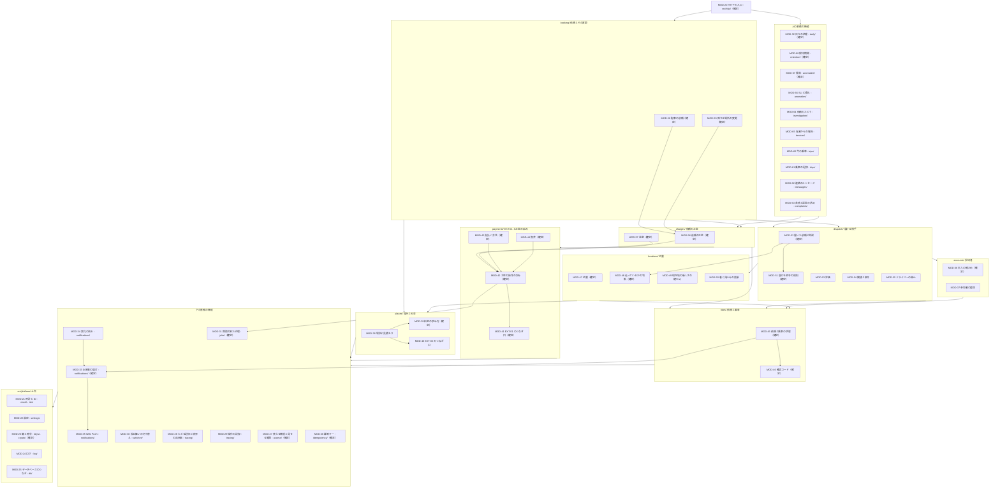
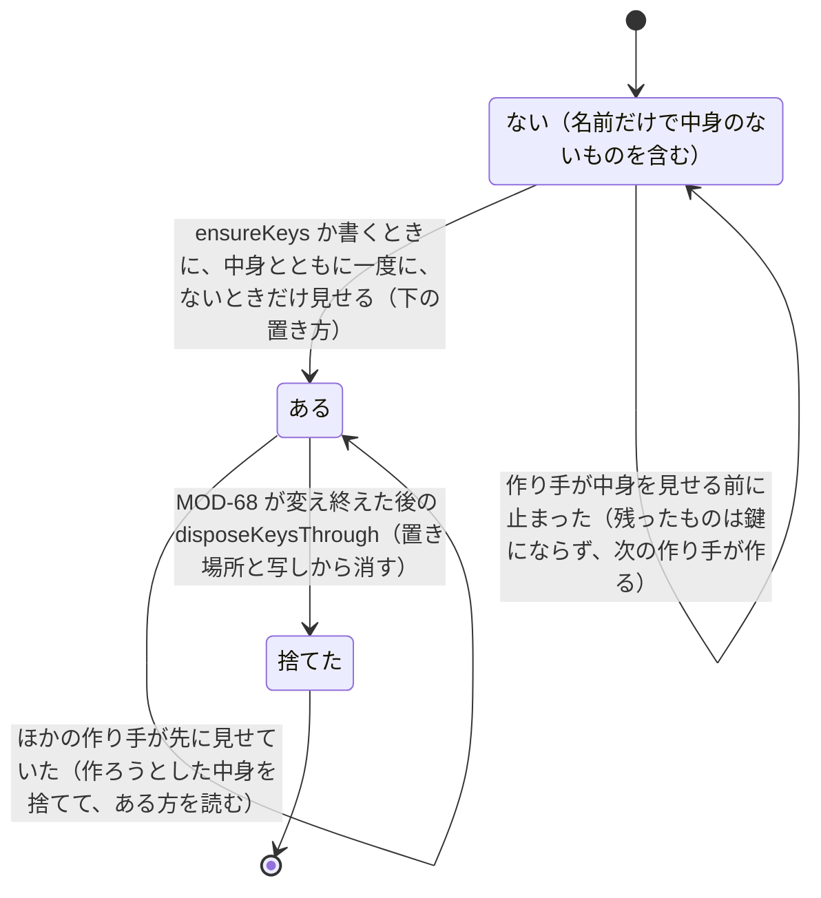
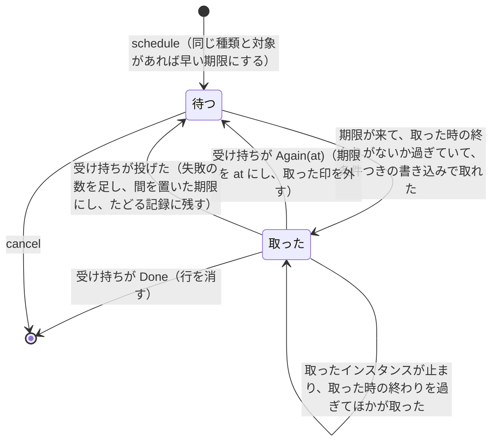
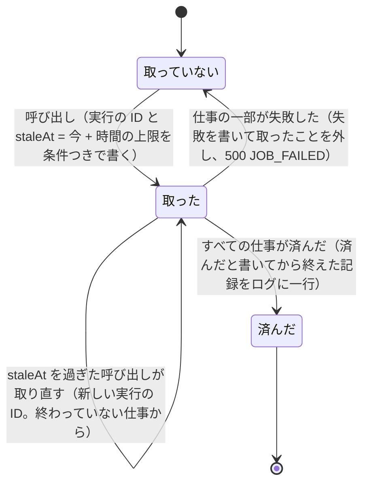
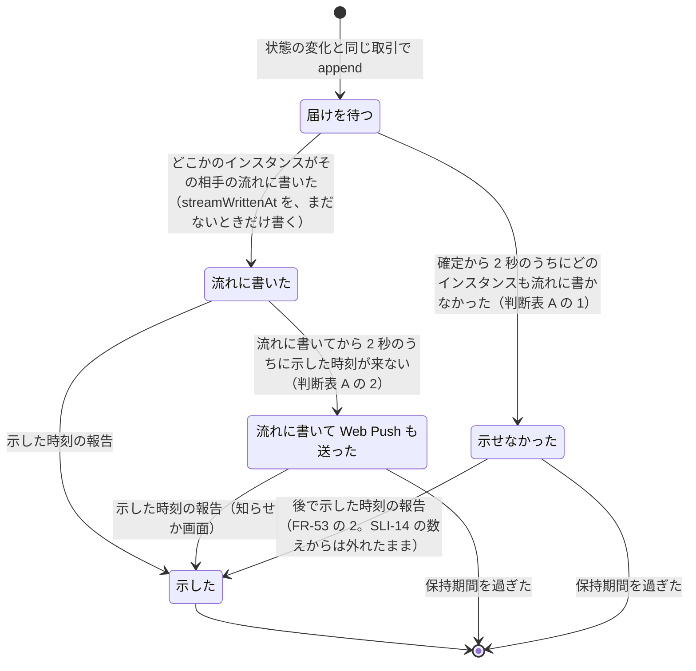
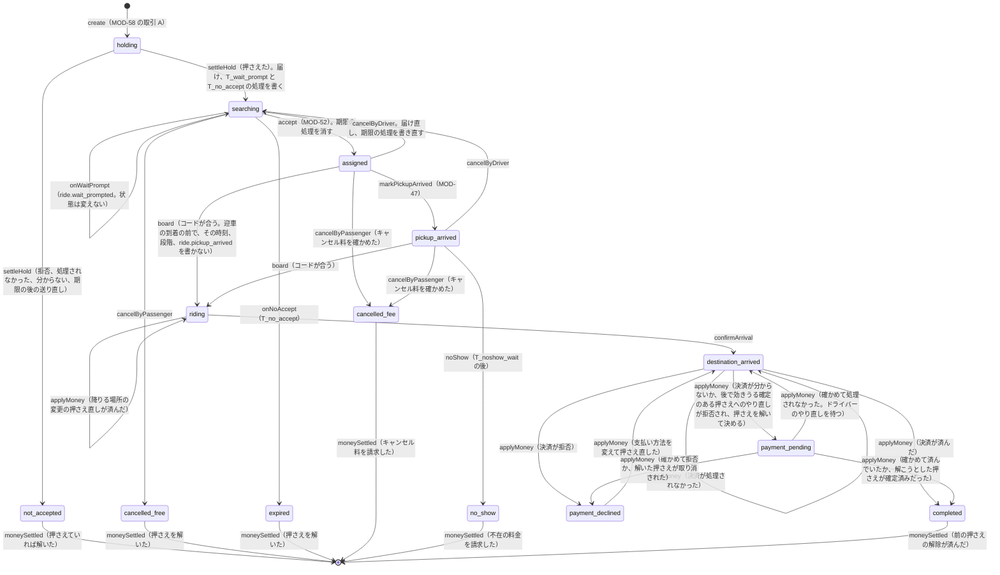
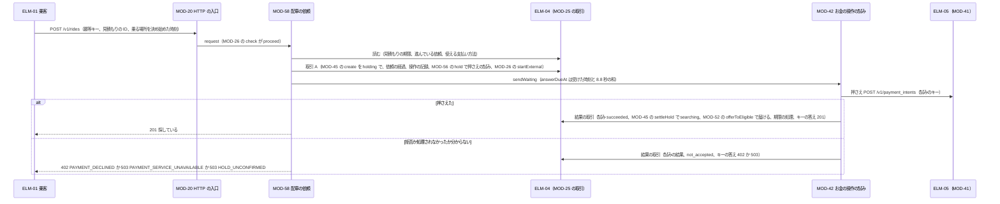

# 配車サーバーの詳細設計: 配車サービス

状態: 回答反映済み · 更新: 2026-11-14 · 入力の基準: ddc4894 · 第 4 段階（全 4 段階） · コンポーネント: ELM-03

## 概要
ELM-03 を 49 のモジュールに分けた。確定の深さは 25 で、お金を動かすもの（MOD-39 料金、MOD-41 EXT-01 のつなぎ口、MOD-42 お金の操作の試み、MOD-43 支払い方法、MOD-56 依頼のお金、MOD-57 返金、MOD-58 配車の依頼、MOD-59 降りる場所の変更）、結果が分からない状態を確かめるもの、同時に動く仕事と状態を分けるもの（MOD-26 冪等キー、MOD-31 期限の来た処理、MOD-32 日々の処理、MOD-33 出来事の届け、MOD-45 依頼と乗車の状態、MOD-47 位置、MOD-52 届いた依頼と許諾）、いくつもの条件の規則を当てるもの（MOD-27 見せる範囲、MOD-36 本人の確かめ、MOD-44 照合、MOD-46 確認コード、MOD-48 走っているかの判断、MOD-51 届ける相手の規則、MOD-67 異常）、戻せない変更を行うもの（MOD-23 鍵と暗号、MOD-68 保持期間）と、ほかのコンポーネントのタイムアウトが頼る答えの期限を守る MOD-20 HTTP の入口。ほかの 24 は枠の深さ。最も難しいのは、ELM-04 の書き込みの取引が一つずつ確定すること（Turso と libSQL）を土台に、重なった許諾と取り消しと停止、同じキーの送り直し、答える前に止まったインスタンス、結果が分からない EXT-01 の試みと、取引が変わらないまま処理されなかったとした確定が後で効きうること（DEC-45）、同じ依頼に重なった押さえ直しのどれでも、依頼の状態とお金を一度だけ、確定額と支払い方法どおりに動かすこと。

申し送り HND-09、HND-10、HND-12、HND-13、HND-14、HND-19 を決め、HND-07（EXT-02 の呼び出しの値）を実装に送り、実装宛ての HND-20〜HND-22 を書いた。HND-14 の部品の選び方は DEC-47（Stripe の API を fetch で直接呼ぶ）。模す運賃の定めの中身（QR-62）は質問 1 で尋ね、初乗りと距離の加算だけで求めるという答え（下書きどおり）を MOD-39 に当て、品質チェーンへの要求 QCR-09 に記録した。この段階が出した FND-55〜FND-57 と、ほかが出した FND-50、FND-51、FND-58 を第 3 段階が受け入れて変えた DEC-42、DEC-45、IFC-01、IFC-03、IFC-17、DAT-07、DAT-09、DAT-11、DAT-26 に、MOD-26（キーを最初に受けたアカウントと経路に結び付ける）、MOD-37、MOD-42 と MOD-56（取引が変わらないまま処理されなかったとする確定と、後で効きうる確定のある押さえ）、MOD-45〜MOD-47（迎車の到着の前の乗車の開始）、MOD-66、MOD-67 が従う。第 4 段階の ELM-03 のレビューの FND-61〜FND-73（中 5、軽微 8）と FND-75、FND-76（中 1、軽微 1）はどれも受け入れた。依頼の押さえ直しを依頼ごとに一つずつにして、押さえと確定額と支払い方法を一緒に替え（FND-61）、その押さえ直しの印と依頼の今の押さえを rides の持ち主の MOD-45 の操作で読み書きし（FND-76）、受けたインスタンスの遅れた結果の取引が同じキーの送り直しの check と期限の後の答えの間に確定しても、期限の後の答えはその取引が替えた依頼の押さえ、受け付けた依頼、当てた変更を覆さない（FND-75。MOD-26 の持ち主の決まり、MOD-56、MOD-58、MOD-59）。送り直しの処理されなかったでは試みを終えず（FND-62）、日ごとの鍵を中身とともに一度に作り（FND-63）、日々の呼び出しの印を入口で確かめ（FND-64）、照合の判断表をどの組にも行が当たる形にし（FND-65）、終わった依頼の精算を開いた試みがなくなってから決める（FND-66）。同じ依頼か登録へのほかのキーの操作が動いている間にも 409 OPERATION_IN_PROGRESS で答えることを DEC-42 が書いていない点は、軽微な FND-74 で第 3 段階に出した。ほかに尋ねた点はない。未確認の仮定で最も高いのは、この段階の DAS-22（セッションと止める回数）、DAS-26 と DAS-27（走っているかの判断）で、どれも低、中。

## 入力
| 出どころ | 得たもの |
|---|---|
| docs/design/elm/、2-architecture.md、dec/ | ELM-03 の責務、functions（FR-01〜FR-13、FR-15〜FR-54）、drivers（32）、decisions（DEC-01、DEC-04〜DEC-27）。お金の決まり（DEC-09、DEC-10、DEC-11）、流れと出来事（DEC-06、DEC-21）、状態を条件にした書き込みと冪等性（DEC-08）、期限の処理（DEC-18）、見せる範囲（DEC-15）、日ごとの鍵（DEC-16、DEC-17）、異常（DEC-20）、届ける相手の規則（DEC-24）、確認コード（DEC-25）、走っているかの判断（DEC-22、DEC-27） |
| docs/design/2b-technical-policy.md、pol/ | POL-01 の HTTP のサーバーの技術の組み合わせ（Node.js 26、TypeScript 6 の型を外すだけの書き方、Hono 4、Zod と @hono/zod-openapi、Drizzle ORM と @libsql/client、drizzle-kit、pino、node:crypto）、POL-02 の apps/server/src/ の分け方（業務の機能、src/platform/、src/http/、domain/、application/、adapters/）と依存の規則、POL-03 のテストの層と偽物と環境とゲートの出どころ、POL-04 のエラー、ログ、設定、秘密の値、日ごとの鍵、切り替え、マイグレーションの決まり、POL-05（ELM-03 の HTTP と流れの仕様書はコードから生成）。DEC-28〜DEC-34 |
| docs/design/ifc/、dat/、3-high-level-design.md | ELM-03 が提供する IFC-01〜IFC-16 と利用する IFC-17、IFC-19、IFC-21 の操作、誤りとその符号、冪等性、timing、sli_bindings。データの実体 DAT-01〜DAT-27（持ち主はどれも ELM-03）。共通の約束事 DEC-35〜DEC-44、DEC-45、DEC-46。報告の端から端の流れ（後で効きうる確定のある押さえの流れを含む）、遅延の予算とタイムアウト、要素をまたぐ状態（DAT-07、DAT-11、DAT-26、DAT-12、DAT-05、DAT-08）、受け入れ基準のたどり。FND-50、FND-51、FND-55〜FND-58 を受けて変わった DEC-42（キーを最初に受けたアカウントと操作に結び付ける）、DEC-45 と IFC-17 と DAT-11（取引の ID が分かっている確定と取り消しで取引が変わっていない試みを処理されなかったとし、その確定は押さえを確定済みか取り消し済みと読むまで後で効きうる）、IFC-01（GET /v1/me のアカウントの ID）、IFC-03 と IFC-22、IFC-23（迎車の到着の前の乗車の開始、PAYMENT_PENDING_CONFIRMATION、確かめで処理されなかった決済）、DAT-07、DAT-09（迎車の到着の段階のない依頼）、DAT-26 |
| docs/design/hnd/ | この段階の ELM-03 に宛てた申し送り HND-07、HND-09、HND-10、HND-12、HND-13、HND-14、HND-19（どれも決めたか実装に送った。未決定のものはない）。実装宛ての未決定の HND-16（ELM-03 のスキーマ）と、この段階が書いた HND-20〜HND-22 |
| docs/design/fnd/ | この段階の ELM-03 に宛てた FND-61〜FND-73（第 4 段階の ELM-03 の全体のレビュー。中 5、軽微 8）と FND-75、FND-76（差分のレビュー。中 1、軽微 1）を、どれも受け入れた（「指摘」）。この段階が出した FND-55〜FND-57 と、FND-49〜FND-51、FND-58 は第 3 段階が受け入れた。第 3 段階に宛てた未解決の FND-59（第 3 段階のレビュー。後で効きうる確定が効いた後の、202 と答えた決済のキーの送り直しへの答え）と FND-60（第 4 段階の ELM-02。ELM-03 がまだキーを受けていない要求のアカウント）は軽微で、決まれば MOD-56 と MOD-26 がそれに従う。第 2 段階の FND-10、FND-11、FND-34、FND-35、第 2b 段階の FND-19〜FND-21、FND-42 は、ELM-03 のモジュールを変えない |
| docs/design/das/、qcr/、quality-chain-requests.md | 未確認の DAS-01、DAS-04〜DAS-28、確認済みの DAS-02（第 3 段階のレビューの質問 2）と DAS-03。品質チェーンへの要求は QCR-01、QCR-06、QCR-07、QCR-10 が未回答、QCR-02〜QCR-05、QCR-08 と、質問 1 の答えを記録した QCR-09 が回答済み。第 3 段階が出した QCR-10（迎車の到着の前に乗車が始まった依頼の数え方、影響は低）は、どの数え方でも同じ記録から数えられ、ELM-03 のモジュールを変えない。要求書に手で書かれた答えはない。前の実行の後に docs/quality/ は変わっておらず、反映された要求はない |
| docs/design/4-detailed-design/ELM-02.md、mod/MOD-01〜MOD-19、reviews/4-detailed-design-ELM-02.md | ELM-02 の MOD-01 のタイムアウト 15 秒と、それが前提にする ELM-03 の答えの期限（DAS-16。MOD-20 の 5 秒と通信の余裕の和より長い）。MOD-01 が要求を出す直前にアカウントを確かめ、422 IDEMPOTENCY_KEY_REUSED を受け付けなかった答えとして読み直すこと（DEC-42）。ELM-02 が送る返金の送り直しと 503 の扱い |
| docs/design/reviews/4-detailed-design-ELM-03.md | 第 4 段階の ELM-03 の差分のレビュー（ddc4894、eddbe53 から）。指摘 2 件（FND-75、FND-76）と、行ったことの結果（C1〜C10、E1〜E8）、押さえ直しの印の期限と受けたインスタンスの待ちの計算し直し（結果の取引が予算を超えれば期限の後になること） |
| docs/design/reviews/3-high-level-design.md | 第 3 段階のレビュー（ae25bd3、9ffea05）。質問 2 で DAS-02 を確認済みにし、DAS-05 と DAS-23 の影響の広さを中にし、MOD-26 と MOD-01 がキーの範囲を前の形で書くことを古い段として挙げた（B8） |
| docs/quality/fr/、qr/、nfr/、sli/、ebp/ | FR-01〜FR-13、FR-15〜FR-54 の受け入れ基準。お金（QR-04、QR-17、QR-24、QR-29、QR-30、QR-45、QR-50）、状態（QR-02、QR-03、QR-51）、届ける相手（QR-16、QR-32、QR-49、QR-54、QR-63、QR-66）、走っているかと確認コード（QR-18、QR-28、QR-55）、個人の情報（QR-34〜QR-36、QR-56〜QR-59）、記録と異常（QR-12、QR-15、QR-33、QR-37、QR-41、QR-44、QR-47、QR-53）、料金（QR-61、QR-62、QR-67）。SLO、ゲート、監査、監視の NFR-01〜NFR-50 と SLI-01〜SLI-14、EBP-01 |
| docs/quality/context.yaml | CON-01〜CON-08（キャンセル料と不在の料金は 500 円）、EXT-01、EXT-02、OPF-01〜OPF-03、USR-01〜USR-04 |

既存のコードはなく、読んだコードもない。どのモジュールも新設。何も配備しない（TC-09）ため、ELM-03 の自身の処理と ELM-04 の取引の時間、EXT-01 と EXT-02 と Web Push の配信の答えの時間、参加者の iPhone の Safari の位置と速さの確からしさは、どれも測っていない。

## モジュール


矢印は、まとまりの間と主なモジュールの間の依存だけを描いた（モジュールごとの依存は各 MOD の depends_on）。MOD-20 は経路を組み立てる所で、どの機能の index.ts も使う（組み立てへの矢印は略した）。どのモジュールも POL-02 のとおり apps/server/src/ の下に置き、業務の機能のディレクトリ（idempotency、access、tracing、switches、jobs、notifications、accounts、places、payments、rides、locations、dispatch、charges、booking、trips、messages、complaints、investigation、devices、anomalies、retention、daily）の中を domain/、application/、adapters/ に分け、外へ見せるものを index.ts からだけ出す。判断表だけのモジュール（MOD-39、MOD-48、MOD-51）は、それぞれの機能の domain/ に置き、フレームワークにも外部にも src/platform/ にもよらない（POL-02 の domain/ の規則）。機能のディレクトリの名前は、第 2b 段階の報告の例（rides、dispatch、payments、places、locations、accounts、access、notifications、tracing、jobs、switches）を使い、例の operations を accounts（登録）、dispatch（停止）、charges（返金）、complaints（苦情）に分け、お金の試み（payments）と依頼のお金（charges）と依頼の受け付け（booking）を分けた。例の jobs は下の期限の来た処理（MOD-31）にだけ使い、上の日々の処理（MOD-32）は daily に置く（同じディレクトリにすると、jobs の index.ts が上と下のモジュールを両方出し、payments ほかの機能との間に import の循環ができる）。

まとまりの間の依存は上から下へ一方にだけ向く。下の機能が上の機能を呼ぶ所は、上の機能が実装する口を下の機能が application/ で定め、起動のときに MOD-20 の組み立てが渡す（依存を逆にする）。その口は次のとおりで、どれも import の循環を作らない: MOD-45 の届け直しと一覧から除くことの口（MOD-52 が実装）、MOD-42 の持ち主の口（MOD-43、MOD-56、MOD-57、MOD-59 が実装）、MOD-31 の処理の受け持ち（MOD-33、MOD-42、MOD-43、MOD-45、MOD-49、MOD-50、MOD-56、MOD-67 が登録）、MOD-26 の期限の後の答え方と秘密の作り直し（MOD-36、MOD-43、MOD-56、MOD-57、MOD-58、MOD-59 が登録）、MOD-30 の switch.changed を書く口（MOD-33 が実装）、MOD-33 のこのインスタンスの流れ（MOD-34 が実装）、MOD-47 の位置の聞き手（MOD-50 が登録）、MOD-49 の対象の人の口（MOD-52 が実装）、MOD-24 の書かなかった値の聞き手（MOD-67 が登録）、MOD-34 のセッションの確かめ（MOD-36 が実装）。日々の処理（MOD-32）は上にあり、期限の来た処理（MOD-31）、照合（MOD-44）、保持期間（MOD-68）、確かめ（MOD-67）を決まった順に直に呼ぶ。保持期間（MOD-68）は、表を持つ機能のモジュールの消す操作と変える操作を直に呼ぶ（POL-02 の、表を読み書きするのはその表を持つ機能の adapters/ だけの規則のとおり）。

図の境は POL-02 の依存の規則が検査の手順で守り、この段階が加えた規則はない。機能の間は index.ts からだけ（no-restricted-imports）、循環は import/no-cycle、domain/ はフレームワーク、データベース、外部、src/platform/ を使わず、application/ は adapters/ とデータベースの部品を使わない。EXT-01 を呼ぶ fetch は payments の adapters/（MOD-41）だけ、EXT-02 は places の adapters/（MOD-40）だけ、Web Push は notifications の adapters/（MOD-35）だけが使い、時刻と乱数と ID のもとは MOD-21 だけ、node:crypto は MOD-23 だけが使う。依頼の状態を書くポート（DEC-08、MOD-45）とお金の操作の試みの記録（DEC-10、MOD-42）は、それぞれの機能の adapters/ だけが書き、ほかの機能はそれぞれのモジュールの操作を通す（依頼の今の押さえと押さえ直しの印も rides の列なので、charges/ の MOD-56 と booking/ の MOD-58、MOD-59 は MOD-45 の moneyFacts、claimRehold、clearRehold、applyMoney を通して読み書きする）。一つの書き込みの取引で、いくつもの機能の表を書く（たとえば依頼の状態と出来事と試みとキー）ときは、MOD-25 の取引（型 Tx）を application/ のポートで受けて、それぞれの機能の操作に渡す。

<!-- generated: modules -->
| MOD | 名前 | 深さ | 公開範囲 | FR | 実現する操作 | 今の構造との差分 | 根拠 |
|---|---|---|---|---|---|---|---|
| MOD-20 | HTTP の入口 | 確定 | 公開 | FR-48、FR-49 | IFC-01 GET /v1/client-config、IFC-16 GET /healthz | 新設 | 仮定 |
| MOD-21 | 時計と ID | 枠 | 内部 | — | — | 新設 | 推定 |
| MOD-22 | 設定 | 枠 | 内部 | — | — | 新設 | 推定 |
| MOD-23 | 鍵と暗号 | 確定 | 内部 | FR-35、FR-51 | — | 新設 | 仮定 |
| MOD-24 | ログ | 枠 | 内部 | — | — | 新設 | 推定 |
| MOD-25 | データベースのつなぎ | 枠 | 内部 | — | — | 新設 | 推定 |
| MOD-26 | 冪等キー | 確定 | 内部 | FR-30、FR-40 | — | 新設 | 推定 |
| MOD-27 | 使える機能と見せる範囲 | 確定 | 内部 | FR-24、FR-25、FR-35、FR-49、FR-52 | — | 新設 | 推定 |
| MOD-28 | たどる記録と境界の出来事 | 枠 | 内部 | FR-34、FR-42、FR-52 | — | 新設 | 推定 |
| MOD-29 | 操作の記録 | 枠 | 公開 | FR-35、FR-39、FR-41、FR-42、FR-43、FR-50 | IFC-12 POST /v1/console/audit-records/search | 新設 | 推定 |
| MOD-30 | 振る舞いの切り替え | 枠 | 公開 | FR-36 | IFC-14 GET /v1/console/switches、IFC-14 PUT /v1/console/switches/{switchName}、IFC-11 switch.changed | 新設 | 推定 |
| MOD-31 | 期限の来た処理 | 確定 | 内部 | FR-04 | — | 新設 | 仮定 |
| MOD-32 | 日々の処理 | 確定 | 公開 | FR-51 | IFC-15 POST /internal/jobs/daily、IFC-15 日々の処理を終えた記録 | 新設 | 仮定 |
| MOD-33 | 出来事の届け | 確定 | 内部 | FR-18、FR-33、FR-45、FR-53 | — | 新設 | 仮定 |
| MOD-34 | 変化の流れ | 枠 | 公開 | — | IFC-11 stream.resync | 新設 | 推定 |
| MOD-35 | Web Push | 枠 | 公開 | FR-33 | IFC-10 PUT /v1/push-subscriptions/current、IFC-10 DELETE /v1/push-subscriptions/current、IFC-21 POST {宛先の URL} | 新設 | 推定 |
| MOD-36 | 本人の確かめとセッション | 確定 | 公開 | FR-42、FR-48、FR-51 | IFC-01 POST /v1/account-setups、IFC-01 POST /v1/sessions、IFC-01 DELETE /v1/sessions/current | 新設 | 仮定 |
| MOD-37 | 参加者の登録 | 枠 | 公開 | FR-09、FR-36、FR-41、FR-42、FR-43、FR-50、FR-51 | IFC-01 GET /v1/me、IFC-12 POST /v1/console/accounts/search、IFC-12 GET /v1/console/accounts/{accountId}、IFC-12 POST /v1/console/accounts、IFC-12 PATCH /v1/console/accounts/{accountId}、IFC-12 PUT /v1/console/accounts/{accountId}/test-flag、IFC-12 POST /v1/console/accounts/{accountId}/setup-codes、IFC-12 POST /v1/console/drivers、IFC-12 GET /v1/console/drivers/{accountId}、IFC-12 PATCH /v1/console/drivers/{accountId} | 新設 | 推定 |
| MOD-38 | 場所と見積もり | 枠 | 公開 | FR-01、FR-02、FR-03、FR-47 | IFC-02 POST /v1/places/search、IFC-02 GET /v1/places/{placeId}、IFC-02 POST /v1/places/reverse-geocoding、IFC-02 POST /v1/quotes | 新設 | 推定 |
| MOD-39 | 料金の求め方 | 確定 | 内部 | FR-03 | — | 新設 | 推定 |
| MOD-40 | EXT-02 のつなぎ口 | 枠 | 内部 | FR-01、FR-03 | IFC-19 POST https://places.googleapis.com/v1/places:autocomplete、IFC-19 GET https://places.googleapis.com/v1/places/{placeId}、IFC-19 GET https://maps.googleapis.com/maps/api/geocode/json、IFC-19 POST https://routes.googleapis.com/directions/v2:computeRoutes | 新設 | 推定 |
| MOD-41 | EXT-01 のつなぎ口 | 確定 | 内部 | FR-46 | IFC-17 POST /v1/customers、IFC-17 POST /v1/setup_intents、IFC-17 GET /v1/setup_intents/{id}、IFC-17 POST /v1/payment_intents、IFC-17 POST /v1/payment_intents/{id}/capture、IFC-17 POST /v1/payment_intents/{id}/cancel、IFC-17 GET /v1/payment_intents/{id}、IFC-17 GET /v1/payment_intents、IFC-17 POST /v1/refunds、IFC-17 GET /v1/refunds/{id}、IFC-17 GET /v1/refunds | 新設 | 推定 |
| MOD-42 | お金の操作の試み | 確定 | 内部 | FR-29、FR-30、FR-39、FR-40、FR-42、FR-46、FR-54 | — | 新設 | 推定 |
| MOD-43 | 支払い方法 | 確定 | 公開 | FR-04、FR-29、FR-46 | IFC-07 GET /v1/payment-methods、IFC-07 POST /v1/payment-method-setups、IFC-07 POST /v1/payment-method-setups/{setupId}/completion、IFC-11 payment_method.settled | 新設 | 仮定 |
| MOD-44 | 照合 | 確定 | 内部 | — | — | 新設 | 仮定 |
| MOD-45 | 依頼と乗車の状態 | 確定 | 公開 | FR-04、FR-05、FR-06、FR-07、FR-09、FR-10、FR-12、FR-13、FR-21、FR-23、FR-24、FR-26、FR-27、FR-28、FR-42、FR-44、FR-45、FR-49 | IFC-03 POST /v1/rides/{rideId}/cancellation、IFC-03 POST /v1/rides/{rideId}/driver-cancellation、IFC-03 POST /v1/rides/{rideId}/no-show、IFC-03 POST /v1/rides/{rideId}/boarding、IFC-03 POST /v1/rides/{rideId}/arrival、IFC-11 ride.accepted、IFC-11 ride.pickup_arrived、IFC-11 ride.wait_prompted、IFC-11 ride.expired、IFC-11 ride.cancelled、IFC-11 ride.driver_cancelled、IFC-11 ride.no_show、IFC-11 ride.started、IFC-11 ride.destination_arrived | 新設 | 推定 |
| MOD-46 | 確認コード | 確定 | 内部 | FR-12、FR-27 | — | 新設 | 仮定 |
| MOD-47 | 位置 | 確定 | 公開 | FR-08、FR-10、FR-13、FR-19、FR-24、FR-49 | IFC-05 POST /v1/positions、IFC-11 position.updated | 新設 | 仮定 |
| MOD-48 | 走っているかの判断 | 確定 | 内部 | FR-22 | — | 新設 | 仮定 |
| MOD-49 | 現在地の新しさの確かめ | 枠 | 内部 | — | — | 新設 | 推定 |
| MOD-50 | 着く見込みの更新 | 枠 | 内部 | FR-06、FR-08、FR-13 | IFC-11 ride.eta_updated | 新設 | 推定 |
| MOD-51 | 依頼を届ける相手の規則 | 確定 | 内部 | FR-05、FR-15、FR-16、FR-19、FR-32、FR-43、FR-44 | — | 新設 | 推定 |
| MOD-52 | 届いた依頼と許諾 | 確定 | 公開 | FR-04、FR-05、FR-06、FR-07、FR-17、FR-18、FR-19、FR-20、FR-21、FR-22、FR-23、FR-43、FR-44、FR-45 | IFC-04 PUT /v1/drivers/me/availability、IFC-04 GET /v1/offers、IFC-04 GET /v1/offers/{rideId}、IFC-04 POST /v1/offers/{rideId}/acceptance、IFC-11 offer.added、IFC-11 offer.removed | 新設 | 推定 |
| MOD-53 | 評価 | 枠 | 公開 | FR-15、FR-42、FR-45、FR-49 | IFC-09 POST /v1/rides/{rideId}/rating | 新設 | 推定 |
| MOD-54 | 乗客の閾値とドライバーの条件 | 枠 | 公開 | FR-16、FR-32 | IFC-08 GET /v1/passengers/me/rating-threshold、IFC-08 PUT /v1/passengers/me/rating-threshold、IFC-08 DELETE /v1/passengers/me/rating-threshold、IFC-08 GET /v1/drivers/me/conditions、IFC-08 PUT /v1/drivers/me/conditions、IFC-08 DELETE /v1/drivers/me/conditions | 新設 | 推定 |
| MOD-55 | ドライバーの停止 | 枠 | 公開 | FR-44、FR-50 | IFC-12 POST /v1/console/drivers/{accountId}/suspension、IFC-12 DELETE /v1/console/drivers/{accountId}/suspension、IFC-11 driver.suspended、IFC-11 driver.resumed | 新設 | 推定 |
| MOD-56 | 依頼のお金 | 確定 | 公開 | FR-07、FR-26、FR-29、FR-30、FR-31、FR-45、FR-46、FR-54 | IFC-03 POST /v1/rides/{rideId}/payment、IFC-03 PUT /v1/rides/{rideId}/payment-method、IFC-11 ride.charge_settled、IFC-11 ride.payment_method_changed | 新設 | 推定 |
| MOD-57 | 返金 | 確定 | 公開 | FR-39、FR-40、FR-50 | IFC-13 GET /v1/console/rides/{rideId}/refunds、IFC-13 POST /v1/console/rides/{rideId}/refunds、IFC-13 POST /v1/console/refunds/{refundId}/retry、IFC-11 refund.settled | 新設 | 推定 |
| MOD-58 | 配車の依頼 | 確定 | 公開 | FR-03、FR-04、FR-45、FR-54 | IFC-03 POST /v1/rides | 新設 | 推定 |
| MOD-59 | 降りる場所の変更 | 確定 | 公開 | FR-24、FR-45、FR-47、FR-54 | IFC-03 POST /v1/rides/{rideId}/destination-changes、IFC-03 POST /v1/rides/{rideId}/destination-changes/{changeId}/approval、IFC-11 ride.destination_changed | 新設 | 仮定 |
| MOD-60 | 今の乗車 | 枠 | 公開 | FR-06、FR-08、FR-09、FR-10、FR-12、FR-13、FR-24、FR-25、FR-43、FR-49 | IFC-03 GET /v1/rides/current | 新設 | 推定 |
| MOD-61 | 乗車の記録 | 枠 | 公開 | FR-31、FR-38、FR-51 | IFC-09 GET /v1/past-rides、IFC-09 GET /v1/past-rides/{rideId}、IFC-12 POST /v1/console/rides/search、IFC-12 GET /v1/console/rides/{rideId} | 新設 | 推定 |
| MOD-62 | 連絡のメッセージ | 枠 | 公開 | FR-11 | IFC-06 GET /v1/rides/{rideId}/messages、IFC-06 POST /v1/rides/{rideId}/messages、IFC-11 message.received | 新設 | 推定 |
| MOD-63 | 苦情と返金の求め | 枠 | 公開 | FR-37、FR-42、FR-50 | IFC-09 POST /v1/rides/{rideId}/complaints、IFC-12 GET /v1/console/complaints、IFC-12 POST /v1/console/complaints/{complaintId}/resolution、IFC-11 complaint.received | 新設 | 推定 |
| MOD-64 | 依頼のたどり | 枠 | 公開 | FR-34、FR-35、FR-49、FR-51、FR-52 | IFC-14 POST /v1/console/traces/search、IFC-14 GET /v1/console/rides/{rideId}/trace、IFC-14 POST /v1/console/rides/{rideId}/disclosures | 新設 | 推定 |
| MOD-65 | 端末からの報告 | 枠 | 公開 | FR-45、FR-52、FR-53 | IFC-10 POST /v1/device-reports | 新設 | 推定 |
| MOD-66 | SLI の数え | 枠 | 内部 | — | — | 新設 | 推定 |
| MOD-67 | 異常の見つけ方と知らせ | 確定 | 公開 | FR-33、FR-34、FR-52 | IFC-14 GET /v1/console/anomalies、IFC-11 anomaly.detected | 新設 | 仮定 |
| MOD-68 | 保持期間と個人を特定できない形への変換 | 確定 | 内部 | FR-51 | — | 新設 | 仮定 |
<!-- /generated -->

確定の深さの 25 のうち、お金を動かすか結果が分からない状態を確かめるのは MOD-39、MOD-41〜MOD-44、MOD-56〜MOD-59 で、外部の状態を変える呼び出し（EXT-01 と Web Push）はどれも確定の深さのモジュール（MOD-42、MOD-43、MOD-33）が動かし、タイムアウトの後の結果を定める。同時に動く仕事と状態を分けるのは、キーの記録（MOD-26）、期限の来た処理と日々の処理を取ること（MOD-31、MOD-32）、届けの記録（MOD-33）、依頼の状態（MOD-45）、最新の位置（MOD-47）、許諾の取引（MOD-52）で、どれも、どの値を同じ書き込みの取引の中で読んで条件にし、どの一意の決まりで二つ目を退けるかをモジュールが持つ。いくつもの条件の規則は MOD-27、MOD-36、MOD-44、MOD-46、MOD-48、MOD-51、MOD-67。枠の深さとして評価して高になるのは、MOD-20（答えの期限に ELM-01 と ELM-02 のタイムアウトが頼り、境界の出来事に六つの SLI が頼る）、MOD-23（個人の情報が読めなくなるか読めるまま残り、戻せない）、MOD-68（戻せない変更）で、確定の深さにした。

枠の深さの 24 は、どれもお金を動かさず、結果が分からない状態を確かめず、同時に動く仕事の間で同じ記録のどれが効くかを決めず（それを決めるのは、そのモジュールが呼ぶ確定の深さのモジュールか、書き込みの取引の一つずつの確定と、DAT が述べる一意の決まり）、いくつもの条件の規則も持たない。枠の深さとして評価して、MOD-37（個人の情報の作成と訂正）、MOD-61 と MOD-64（個人の情報を見せる）は個人の情報にかかわるが、何を誰に見せ、どう隠すかは MOD-27 が決めて契約の要約がそれを通すと書き、誤っても戻せない害にならず、重大さは中にとどまる。MOD-53 はまとめた評価を同じ書き込みの取引の中ですべての評価から求め直す（DAT-14）だけで、重なった評価は取引の一つずつの確定が分ける。MOD-34 と MOD-35 は届けの決まりを持たず、決まりは MOD-33 が持つ。どれも五つ以上の項目を変えさせない。

ELM-03 が利用する IFC の操作のうち、IFC-21 の push の出来事は ELM-01 と ELM-02 のサービスワーカーのもので、ELM-03 のどのモジュールも受け持たない。IFC-17 と IFC-19 は、EXT-01 と EXT-02 のどの操作も一つのつなぎ口（MOD-41、MOD-40）が受け持つ。IFC-11 の出来事は、その出来事がいつ起き何を運ぶかを決めるモジュールが受け持ち（ride.* は MOD-45、MOD-50、MOD-56、MOD-59、offer.* は MOD-52 など）、届けることは MOD-33 と MOD-34 が行う。

## 割り当て
| FR、IFC か SLI | 基準、操作か項目 | MOD |
|---|---|---|
| FR-01 | 1 | MOD-38（所在地で区別した候補、位置と住所）、MOD-40 |
| FR-01 | 2 | MOD-38（見積もりは乗る場所と降りる場所の両方で求める。両方が決まるまで進ませないのは ELM-01） |
| FR-01 | 3 | MOD-38（空の candidates） |
| FR-01 | 4 | MOD-38（SAME_PICKUP_AND_DROPOFF） |
| FR-01 | 5 | MOD-38（MAP_SERVICE_UNAVAILABLE）、MOD-40（失敗と無応答を failure にする） |
| FR-02 | 1 | MOD-38（現在地から住所と位置） |
| FR-02 | 2 | MOD-38（見積もりは送られた乗る場所で求める。選び直すのは ELM-01） |
| FR-02 | 3 | MOD-38（PLACE_NOT_FOUND_AT_LOCATION。現在地を得られないのは ELM-01） |
| FR-03 | 1 | MOD-38（ドライバーが見つかるまでと迎車の時間を含めた到着予定時刻）、MOD-39（料金） |
| FR-03 | 2 | MOD-38（見積もりの料金を確定額として持つ）、MOD-58（依頼は見積もりの料金を確定額にする） |
| FR-03 | 3 | MOD-38（新しい場所で見積もり直す） |
| FR-03 | 4 | MOD-38（ROUTE_NOT_FOUND） |
| FR-03 | 5 | MOD-38、MOD-40（MAP_SERVICE_UNAVAILABLE） |
| FR-04 | 1 | MOD-58（押さえてから受け付ける）、MOD-52（届ける相手に届ける） |
| FR-04 | 2 | MOD-45（T_wait_prompt の ride.wait_prompted、待ち続けるか選ばなければ続ける）、MOD-31（期限の処理） |
| FR-04 | 3 | MOD-45（T_no_accept で expired と ride.expired）、MOD-31 |
| FR-04 | 4 | MOD-58（RIDE_ALREADY_ACTIVE）、MOD-45（乗客ごとに一つの一意の決まり） |
| FR-04 | 5 | MOD-58（PAYMENT_METHOD_REQUIRED）、MOD-43（使える支払い方法） |
| FR-05 | 1 | MOD-51（閾値の規則）、MOD-52（届けるとき、示すとき、許諾のときに当てる） |
| FR-05 | 2 | MOD-51（閾値がなければ評価で除かない） |
| FR-05 | 3 | MOD-51（評価がないか件数が N_rating_count_min に満たない） |
| FR-05 | 4 | MOD-45（ride.expired に閾値のためかを持たせる）、MOD-52（評価のために除いたことを依頼の経過に残す） |
| FR-06 | 1 | MOD-45（ride.accepted と名前と手がかり）、MOD-52（割り当て）、MOD-50（着く見込み） |
| FR-06 | 2 | MOD-60（GET /v1/rides/current） |
| FR-07 | 1 | MOD-45（許諾の前の取り消し）、MOD-52（offer.removed）、MOD-56（押さえを解く） |
| FR-07 | 2 | MOD-45（CANCELLATION_FEE_CONFIRMATION_REQUIRED と fee） |
| FR-07 | 3 | MOD-45（ride.cancelled）、MOD-56（キャンセル料を一部の確定で請求） |
| FR-07 | 4 | MOD-45（RIDE_ALREADY_STARTED） |
| FR-08 | 1 | MOD-47（position.updated）、MOD-50（ride.eta_updated） |
| FR-08 | 2 | MOD-47（古い位置を分からないものにする）、MOD-60（最後に分かった位置と時刻） |
| FR-09 | 1 | MOD-45（ride.accepted の手がかり）、MOD-37（登録） |
| FR-09 | 2 | MOD-60 |
| FR-09 | 3 | MOD-37（手がかりはいつも今の登録から読む）、MOD-60 |
| FR-10 | 1 | MOD-47（迎車の到着の判断表 B）、MOD-45（ride.pickup_arrived） |
| FR-10 | 2 | MOD-60 |
| FR-11 | 1 | MOD-62 |
| FR-11 | 2 | MOD-62（MESSAGING_CLOSED） |
| FR-12 | 1 | MOD-46（依頼ごとのコード）、MOD-60（乗客にだけ示す） |
| FR-12 | 2 | MOD-46（照らす）、MOD-45（乗車を始める。迎車の到着の前でも） |
| FR-12 | 3 | MOD-46（CONFIRMATION_CODE_MISMATCH）、MOD-45（始めない） |
| FR-12 | 4 | MOD-46（一致と合わない試みを依頼の経過に） |
| FR-13 | 1 | MOD-47、MOD-50、MOD-60 |
| FR-13 | 2 | MOD-45（ride.destination_arrived と確認した場所） |
| FR-13 | 3 | MOD-47、MOD-60 |
| FR-15 | 1 | MOD-53（評価とまとめた評価を一つの取引で） |
| FR-15 | 2 | MOD-53（振る舞いと車の状態の項目） |
| FR-15 | 3 | MOD-53、MOD-51（すべての評価の平均） |
| FR-15 | 4 | MOD-53（RATING_NOT_ALLOWED） |
| FR-15 | 5 | MOD-53（ALREADY_RATED） |
| FR-16 | 1 | MOD-54（置く）、MOD-51（その後の依頼に使う） |
| FR-16 | 2 | MOD-54（解く） |
| FR-16 | 3 | MOD-54（OUT_OF_RANGE） |
| FR-17 | 1 | MOD-52（受付を始める） |
| FR-17 | 2 | MOD-52（やめても許諾した依頼は続く） |
| FR-17 | 3 | MOD-52（DRIVER_SUSPENDED） |
| FR-18 | 1 | MOD-52（offer.added。迎車中か乗車中のドライバーにも）、MOD-33（流れか Web Push で届ける） |
| FR-18 | 2 | MOD-52（offer.removed） |
| FR-18 | 3 | MOD-52（OFFER_NO_LONGER_AVAILABLE） |
| FR-19 | 1 | MOD-51（最低の金額） |
| FR-19 | 2 | MOD-51（直線の距離、QCR-01） |
| FR-19 | 3 | MOD-51（条件がなければ除かない） |
| FR-19 | 4 | MOD-51（距離の条件のある依頼を除く）、MOD-52（positionUnknown）、MOD-47（新しくない位置） |
| FR-20 | 1 | MOD-52（依頼の内容。移動時間は見積もりの道の時間） |
| FR-20 | 2 | MOD-52（示した金額は確定額で、依頼の経過に残す） |
| FR-20 | 3 | MOD-52（OFFER_NO_LONGER_AVAILABLE） |
| FR-21 | 1 | MOD-52、MOD-45（割り当て） |
| FR-21 | 2 | MOD-52（一つの書き込みの取引の当て直し）、MOD-45（searching を条件にした書き込み） |
| FR-21 | 3 | MOD-52（cancelled） |
| FR-22 | 1 | MOD-52（走っているドライバーにも届ける） |
| FR-22 | 2 | MOD-48（判断表 A）、MOD-52（DRIVER_MOVING） |
| FR-22 | 3 | MOD-48、MOD-52 |
| FR-22 | 4 | MOD-52（許諾したときの速さを依頼の経過に） |
| FR-23 | 1 | MOD-45（ドライバーの取り消しと ride.driver_cancelled）、MOD-52（同じ内容のまま届け直す） |
| FR-23 | 2 | MOD-45（届け直してからの T_wait_prompt） |
| FR-23 | 3 | MOD-45（届け直してからの T_no_accept） |
| FR-23 | 4 | MOD-45（RIDE_ALREADY_STARTED） |
| FR-24 | 1 | MOD-60（乗車場所と乗客の現在地）、MOD-47（乗客の位置をドライバーに position.updated で） |
| FR-24 | 2 | MOD-47、MOD-60（最後に分かった現在地） |
| FR-24 | 3 | MOD-60（降りる場所）、MOD-47（乗車中は乗客の位置を受けない） |
| FR-24 | 4 | MOD-59（ride.destination_changed） |
| FR-24 | 5 | MOD-60、MOD-27（取り消した後は示さない）、MOD-45（取り消しの知らせ） |
| FR-25 | 1 | MOD-60、MOD-27（乗車が始まるまで依頼主の名前） |
| FR-25 | 2 | MOD-60、MOD-27 |
| FR-26 | 1 | MOD-45（no_show と ride.no_show）、MOD-56（不在の料金） |
| FR-26 | 2 | MOD-45（NO_SHOW_TOO_EARLY と残りの秒） |
| FR-26 | 3 | MOD-45（PICKUP_NOT_ARRIVED） |
| FR-27 | 1 | MOD-45（riding と ride.started。迎車の到着を位置で決める前でも、DAT-07） |
| FR-27 | 2 | MOD-45、MOD-46（コードが合わなければ、ほかのどの操作でも始めない） |
| FR-27 | 3 | MOD-45（RIDE_ALREADY_ENDED） |
| FR-28 | 1 | MOD-45（到着を確認した場所と時刻） |
| FR-28 | 2 | MOD-45（RIDE_NOT_STARTED） |
| FR-29 | 1 | MOD-56（決済）、MOD-42 |
| FR-29 | 2 | MOD-56（確定額の押さえの全額） |
| FR-29 | 3 | MOD-56（乗客の操作なし） |
| FR-29 | 4 | MOD-56（拒否、支払い方法の変更と押さえ直し、ride.payment_method_changed、やり直し。後で効きうる確定のある押さえへのやり直しの拒否は押さえを解いてから示す）、MOD-43 |
| FR-29 | 5 | MOD-56（PAYMENT_PENDING と ride.charge_settled。確かめで処理されなかったと分かれば到着した状態に戻してやり直させる）、MOD-42（確かめ続ける） |
| FR-30 | 1 | MOD-56（済んだ決済は新しいキーでも最初の結果）、MOD-26（同じキー） |
| FR-30 | 2 | MOD-56（分からない決済のやり直しは試みをその場で確かめ、処理されなかったと分かれば同じ押さえに新しい試み。後で効きうる確定のある間はほかの押さえに移さない）、MOD-42（checkNow） |
| FR-30 | 3 | MOD-56（乗車ごとの試み） |
| FR-31 | 1 | MOD-56（ride.charge_settled と支払った額）、MOD-61 |
| FR-31 | 2 | MOD-61 |
| FR-31 | 3 | MOD-61 |
| FR-31 | 4 | MOD-61 |
| FR-32 | 1 | MOD-54、MOD-51 |
| FR-32 | 2 | MOD-54 |
| FR-32 | 3 | MOD-54 |
| FR-33 | 1 | MOD-67（anomaly.detected と一覧）、MOD-33、MOD-35（Web Push） |
| FR-33 | 2 | MOD-67（続く異常をまとめて知らせ直す） |
| FR-34 | 1 | MOD-64、MOD-28 |
| FR-34 | 2 | MOD-64、MOD-67（異常が持つ依頼の ID） |
| FR-34 | 3 | MOD-64、MOD-28（部分と failureOrigin） |
| FR-34 | 4 | MOD-64（NOT_FOUND） |
| FR-35 | 1 | MOD-27（engineerView）、MOD-64 |
| FR-35 | 2 | MOD-27、MOD-23（鍵を使った仮の名） |
| FR-35 | 3 | MOD-64（disclosures）、MOD-29（見た記録） |
| FR-35 | 4 | MOD-64（理由がなければ VALIDATION_FAILED） |
| FR-36 | 1 | MOD-30（止める。進んでいる依頼は各機能の application/ の入口が切り替えを読んで変える前の振る舞いで続ける） |
| FR-36 | 2 | MOD-30 |
| FR-36 | 3 | MOD-30（switch.changed）、MOD-37（me の止めた機能） |
| FR-37 | 1 | MOD-63（complaint.received と一覧） |
| FR-37 | 2 | MOD-63（対応を終え、分けて示す） |
| FR-37 | 3 | MOD-63（NOT_FOUND） |
| FR-38 | 1 | MOD-61 |
| FR-38 | 2 | MOD-61 |
| FR-38 | 3 | MOD-61 |
| FR-38 | 4 | MOD-61（空の items） |
| FR-39 | 1 | MOD-57（返金と refund.settled） |
| FR-39 | 2 | MOD-57（拒否、処理されなかった、分からない、やり直し）、MOD-42 |
| FR-39 | 3 | MOD-57（料金を請求した依頼も） |
| FR-39 | 4 | MOD-57（NOTHING_TO_REFUND） |
| FR-39 | 5 | MOD-57、MOD-29（返金ごとの記録） |
| FR-40 | 1 | MOD-57（REFUND_EXCEEDS_PAID と残りの額。やり直しでも） |
| FR-40 | 2 | MOD-57（済んだ返金は最初の結果）、MOD-26 |
| FR-40 | 3 | MOD-57（分からない返金は同じ試みを確かめる）、MOD-42 |
| FR-40 | 4 | MOD-57（二つ目の返金は別の返金） |
| FR-41 | 1 | MOD-37 |
| FR-41 | 2 | MOD-37（項目ごとの VALIDATION_FAILED） |
| FR-41 | 3 | MOD-37（ACCOUNT_ALREADY_EXISTS） |
| FR-41 | 4 | MOD-37（探して訂正）、MOD-29（記録） |
| FR-42 | 1 | MOD-37 |
| FR-42 | 2 | MOD-36（利用者に試験用かを持たせる）、MOD-45、MOD-53、MOD-42、MOD-63、MOD-28（記録にその時点の値を写す） |
| FR-42 | 3 | MOD-37、MOD-29 |
| FR-43 | 1 | MOD-37 |
| FR-43 | 2 | MOD-37（UNKNOWN_FIELD） |
| FR-43 | 3 | MOD-37（欠けた項目と PLATE_ALREADY_REGISTERED） |
| FR-43 | 4 | MOD-37（訂正）、MOD-29、MOD-60（訂正した手がかり） |
| FR-43 | 5 | MOD-51（登録のないドライバーに届けない）、MOD-52（DRIVER_NOT_REGISTERED） |
| FR-44 | 1 | MOD-55（停止、driver.suspended）、MOD-52（offer.removed）、MOD-51 |
| FR-44 | 2 | MOD-52（DRIVER_SUSPENDED。許諾の取引で停止を読む） |
| FR-44 | 3 | MOD-52（DRIVER_SUSPENDED） |
| FR-44 | 4 | MOD-55（進んでいる依頼を外さない）、MOD-45 |
| FR-44 | 5 | MOD-55（activeRides） |
| FR-44 | 6 | MOD-55（DRIVER_ALREADY_SUSPENDED） |
| FR-44 | 7 | MOD-55（再開と driver.resumed） |
| FR-45 | 1 | MOD-58（乗る場所を決め始めた、依頼した）、MOD-45（迎車の到着、乗車の開始、到着の確認）、MOD-59（降りる場所の変更と承認した料金）、MOD-56（決済とその額）、MOD-33（依頼の経過の記録） |
| FR-45 | 2 | MOD-52（届けた先とそのときの条件と停止） |
| FR-45 | 3 | MOD-52（選んだことと許諾とそのときの評価と閾値） |
| FR-45 | 4 | MOD-65（評価を始めた）、MOD-53（評価を記録した） |
| FR-45 | 5 | MOD-45（取り消し、不在、許諾のない終わりと終えた人） |
| FR-46 | 1 | MOD-43 |
| FR-46 | 2 | MOD-43（カードの情報を受けない）、MOD-41（metadata に入れない） |
| FR-46 | 3 | MOD-43（確かめの失敗のある登録の取引だけを PAYMENT_METHOD_DECLINED）、MOD-42（読み直しの分け方） |
| FR-46 | 4 | MOD-43（PAYMENT_METHOD_PENDING と payment_method.settled）、MOD-42 |
| FR-46 | 5 | MOD-43（使える支払い方法を置き換える）、MOD-56（依頼の支払い方法の変更と押さえ直し。決済の結果がまだ定まらない間は PAYMENT_PENDING_CONFIRMATION、ほかの押さえ直しが動いている間は OPERATION_IN_PROGRESS。押さえと支払い方法を一緒に替える） |
| FR-47 | 1 | MOD-59、MOD-38（estimate） |
| FR-47 | 2 | MOD-59（承認、押さえ直し、ride.destination_changed） |
| FR-47 | 3 | MOD-59（承認しないと変えない） |
| FR-47 | 4 | MOD-59（ROUTE_NOT_FOUND） |
| FR-47 | 5 | MOD-59（MAP_SERVICE_UNAVAILABLE） |
| FR-47 | 6 | MOD-59（RIDE_ALREADY_ARRIVED） |
| FR-48 | 1 | MOD-36（サインインとセッション）、MOD-20（セッションから利用者を決める） |
| FR-48 | 2 | MOD-36（AUTH_FAILED、ACCOUNT_LOCKED） |
| FR-48 | 3 | MOD-20（NOT_SIGNED_IN）、MOD-36 |
| FR-48 | 4 | MOD-36（使い終える） |
| FR-49 | 1 | MOD-27（判断表 A）、MOD-20（NOT_ALLOWED） |
| FR-49 | 2 | MOD-27（判断表 B、存在を明かさず 404）、MOD-60、MOD-47 |
| FR-49 | 3 | MOD-45（確定額は見積もりと承認からだけ）、MOD-53（評価は評価の操作からだけ） |
| FR-49 | 4 | MOD-27、MOD-64（disclosures だけ） |
| FR-50 | 1 | MOD-29（操作の記録）、MOD-37、MOD-55、MOD-57、MOD-63（同じ取引で書く） |
| FR-50 | 2 | MOD-29（探す） |
| FR-50 | 3 | MOD-29、MOD-57（済まなかった返金も結果とともに） |
| FR-51 | 1 | MOD-68（決まった順に変え、鍵を捨てる）、MOD-32（日々の処理）、MOD-23（鍵を捨てる） |
| FR-51 | 2 | MOD-64（RECORD_ANONYMIZED）、MOD-61、MOD-37（状態と時刻だけ） |
| FR-51 | 3 | MOD-68（記録した日を Asia/Tokyo で数え、3 年を過ぎていないものを変えない） |
| FR-51 | 4 | MOD-36（ACCOUNT_RETIRED）、MOD-37（訂正の ACCOUNT_RETIRED） |
| FR-52 | 1 | MOD-65、MOD-28 |
| FR-52 | 2 | MOD-64（時刻の順に合わせる） |
| FR-52 | 3 | MOD-65、MOD-28（どの利用者のどの画面か）、MOD-67（異常の一覧にも） |
| FR-52 | 4 | MOD-65（後で届いた報告も同じ ID で一度だけ） |
| FR-52 | 5 | MOD-27、MOD-64 |
| FR-53 | 1 | MOD-33（出来事と相手の組の最初の示した時刻）、MOD-65 |
| FR-53 | 2 | MOD-33（示せなかった記録と後で示した時刻） |
| FR-54 | 1 | MOD-58、MOD-56（押さえてから受け付ける） |
| FR-54 | 2 | MOD-58（PAYMENT_DECLINED） |
| FR-54 | 3 | MOD-58（HOLD_UNCONFIRMED）、MOD-56（後で済んでいたら解く）、MOD-42 |
| FR-54 | 4 | MOD-59、MOD-56（押さえ直し。依頼ごとに一つずつで、押さえと確定額を一緒に替える） |
| FR-54 | 5 | MOD-56（全額の確定） |
| FR-54 | 6 | MOD-56（キャンセル料の一部の確定） |
| FR-54 | 7 | MOD-56（不在の料金の一部の確定） |
| FR-54 | 8 | MOD-56（押さえを全部解く） |
| FR-54 | 9 | MOD-56、MOD-42（料金の操作の鍵に済んだか分からない試みは一つ） |
| FR-54 | 10 | MOD-42、MOD-56（押さえた額、請求した額と種類、解いた額） |
| SLI-01〜SLI-06（IFC-01〜IFC-04、IFC-06） | traceId、resend、idempotencyKey、route、actorKind、ridePhase、testAccount、environment、receivedAt、respondedAt、httpStatus、errorCode、outcome、failureOrigin | MOD-20（項目を決める）、MOD-28（境界の出来事を書く）、MOD-45（ridePhase）、MOD-36（actorKind と testAccount） |
| SLI-01〜SLI-03（IFC-11） | eventId、rideId、recipientAccount、recipientTestAccount、environment、createdAt、deliveredVia、deliveryOutcome、failureOrigin | MOD-33 |
| SLI-14（IFC-10） | eventId、changeKind、rideId、traceId、recipientAccount、recipientTestAccount、requestTestAccount、environment、changeReceivedAt、displayedAt、displayedWhere、notDisplayed、deliveredVia | MOD-33（届けの記録）、MOD-28（changeReceivedAt のもと）、MOD-65（示した時刻の報告） |
| SLI-08（DAT-07） | rideId、destinationArrivedAt、lastApprovedEta、endReason、testAccount、environment | MOD-45、MOD-59（承認した到着予定の時刻） |
| SLI-09（DAT-07） | rideId、pickup、boardingVehiclePosition、boardedAt、testAccount、environment | MOD-45（乗車の開始の要求が持つ位置） |
| SLI-10（DAT-21） | checkId、checkedAt、accountId、role、positionMeasuredAt、ageSeconds、positionMissing、writtenLate、testAccount、environment | MOD-49 |
| SLI-11（DAT-11） | rideId、confirmedFare、approvedFare、heldAmount、fareShownToPassenger、amountShownToDriver、capturedAmount、chargeKind、releasedAmount、amountShownAsPaid、countedOn、testAccount、environment | MOD-42（額）、MOD-56（種類、数える日、示した支払った額）、MOD-52（ドライバーに示した金額）、MOD-38（乗客に示した料金）、MOD-59（承認した料金） |
| SLI-12（DAT-13） | processingId、kind、processingDate、recordedAmount、recordedResult、ext01Amount、ext01Result、ext01FinalAt、comparedAt、testAccount、environment | MOD-44 |
| SLI-13（DAT-14） | ratingId、receivedAt、aggregateUpdatedAt、testAccount、environment | MOD-53 |
| SLI-01〜SLI-14 の数え | 有効なイベントと GOOD のイベント（SLO のアラート） | MOD-66 |

## 型
要求、応答、流れの出来事の項目のスキーマは実装が生成する（HND-16）。ここに挙げるのは、MOD の契約が使う型だけ。

| 型 | 項目と型 |
|---|---|
| Money | amount（円の整数）、currency（JPY）。DEC-38 |
| Instant | UTC の時刻（ミリ秒まで）。DEC-37 |
| LocalDate | Asia/Tokyo の日付。記録した日、jobDate、SLI の日。DEC-37 |
| DeviceTime | 端末の時計のエポックミリ秒の時刻と、sentAt と lastRoundTripMs。MOD-21 が DEC-37 の式で Instant に直す |
| AccountId、RideId、QuoteId、ChangeId、PaymentMethodSetupId、RefundId、ComplaintId、MessageId、AnomalyId、EventId、AttemptId | 種類の接頭辞と ULID（acc_、ride_、quo_、chg_、pms_、ref_、cmp_、msg_、ano_、evt_、att_）。DEC-36 |
| RequestId、TraceId、IdempotencyKey、ReportId | 要求の ID は ULID、ほかは端末が作る UUID v4。DEC-36、DEC-43 |
| LoginId、SetupCode、ConfirmationCode | サインインの ID（Crockford の Base32 の 8 文字、DEC-36）、設定の符号（同じく 12 文字、MOD-36）、確認コード（4 桁の数字、MOD-46） |
| Actor | accountId（AccountId か none）、kind（passenger、driver、operator、engineer、system、anonymous。DEC-43 の actorKind）、testAccount、sessionId（あるとき） |
| RouteName | 経路の名前（OpenAPI の operationId、DEC-44） |
| Tx | MOD-25 の一つの書き込みの取引。中身を見せない。application/ のポートで受け、同じ取引で書く機能の操作に渡す |
| Sealed、Digest | 暗号の文と鍵の日と鍵の版と項目の名前（MOD-23）。SHA-256 のハッシュ |
| DevicePosition、CorrectedPosition | 緯度と経度（WGS84 の度）、確からしさ（m）、速さ（m/s か none）、測った時刻（DeviceTime）。直したものは加えて、直した測った時刻、受けた時刻 |
| Place、RouteMeasure | 位置と住所（暗号にして持つ）と EXT-02 の場所の ID（あるとき）。道の長さ（m）と時間（秒）の 0 以上の整数 |
| FareTable | 版、effectiveFrom、決まり（MOD-39 の判断表 A の項目） |
| RideState | holding、searching、assigned、pickup_arrived、riding、destination_arrived、payment_pending、payment_declined、completed、not_accepted、cancelled_free、expired、cancelled_fee、no_show（DAT-07） |
| RideFacts、OfferFacts | 依頼の ID、状態、乗客、割り当てたドライバー、乗る場所、降りる場所、確定額、段階の時刻、試験用か。OfferFacts は加えて、乗客の閾値（その時点の値）、見積もりの道の時間、届けたドライバー |
| DriverFacts | 受付をしているか、登録が済んでいるか、停止しているか、迎車中か乗車中の依頼があるか、評価の和と件数、最低の金額と最大の距離（m）、最新の位置とその新しさ |
| RatingAggregate | 評価の和と件数（平均は和を件数で割ったもの） |
| MovingState | moving、stopped、unknown |
| AttemptKind | hold、rehold_destination、rehold_method、capture_payment、capture_fee、release、refund、setup_intent、setup_result |
| AttemptState | unknown、succeeded、refused、not_processed（DAT-11） |
| Attempt | attemptId、kind、ref（依頼、押さえの試み、返金、登録）、replacesHold（押さえ直しの試みが替える依頼の押さえの試み。作るときの依頼の今の押さえ）、operationKey（MOD-42 の一意の決まりの鍵）、purpose（解除の目的: ended 終わった依頼、replaced 押さえ直しで替わった、found_late 後で済んでいたと分かった、decide 後で効きうる確定のある押さえの拒否を決める。MOD-56）、amount、idempotencyKey、ext01ObjectId、state、refusalReason（登録の読み直しは declined か not_confirmed）、notProcessedReason（before_execution、unchanged）、observedState（ObservedTransaction）、firstSentAt、lastAnswer（none、no_answer、in_progress、rate_limited、server_error、processing、unrecognized、state_mismatch）、firstCheckAt、nextCheckAt、settledAt、heldAmount、capturedAmount、releasedAmount、testAccount |
| Ext01Answer | done（求めた状態か、読み出しでは今の状態、取引か返金か登録の ID、額。登録の取引の読み出しは確かめの失敗（last_setup_error）があるかも）、refused（reason と、分かれば取引の今の状態）、unknown（なぜ: no_answer、in_progress、rate_limited、server_error、processing、unrecognized、read_rejected。分かれば取引の ID）、notProcessed（なぜ）。MOD-41 |
| AttemptResult、AttemptOutcome、ObservedTransaction | 試みの終わり（succeeded、refused、not_processed と中身。not_processed の理由と、確定と解除では読んだ取引）か unknown。sendWaiting、check、checkNow が返すのは settled(結果) か stillUnknown。確定と解除の試みで読んだ取引の状態（requires_capture、succeeded、canceled、processing）と確定した額（MOD-42） |
| HoldChange、ReholdInProgress | 押さえ直しが済んだときに依頼に当てるもの: 新しい確定額、降りる場所、承認した到着予定の時刻（降りる場所の変更）か、新しい支払い方法（支払い方法の変更）。ReholdInProgress は、依頼の押さえ直しの印が答えの期限のうちのほかの押さえ直しを示すこと（MOD-45 の claimRehold、MOD-56） |
| RideMoneyFacts | 依頼の状態（RideState）、今の押さえ（押さえの試みの AttemptId）、押さえ直しの印（AttemptId と答えの期限の Instant。ないときは none）、確定額（Money）、支払い方法、moneySettled。MOD-45 の moneyFacts が書き込みの取引の中で読む |
| MoneyChange | MOD-45 の判断表 C の変化の一つ（決済の結果、押さえ直しの結果、精算が済んだ）と、押さえ直しの結果ならその試み、替える押さえ、HoldChange |
| KeyRequest、KeyCheck、StoredAnswer | キーと、送ったアカウント（ないときは none）と経路。proceed、replay、replayPending、reused、inProgress、overdue（MOD-26）。状態の組と、秘密の項目を除いた本文と、試みの ID と、202 で答えたお金の操作か |
| WorkKind | ride_wait_prompt、ride_no_accept、ride_money、attempt_check、delivery_check、eta_initial、position_check、anomaly_scan、slo_evaluation、registration_expiry（MOD-31 の処理の種類） |
| NewEvent、Recipient | 出来事の種類（IFC-11 の出来事か、相手のない依頼の経過の段階）、依頼の ID、操作した人、中身、changeReceivedAt のもと。相手のアカウントの ID と役割（乗客、割り当てたドライバー、届けたドライバー、担当者、エンジニア） |

## モジュールの詳細
### MOD-20 HTTP の入口
#### 振る舞い
要求を受けてから答えるまでの順（判断表 A）。上から当て、当たった行で答えを決めて下を行わない。

| 順 | 当てること | 当たったとき |
|---|---|---|
| 1 | 経路がない | 404 NOT_FOUND |
| 2 | 本人の確かめなしで受ける経路で、送り元の 1 分の回数が限り（parameters）を超えた | 429 TOO_MANY_REQUESTS と Retry-After |
| 3 | 位置の報告、端末からの報告、生存確認でなければ、境界の出来事を受けた時刻で書く（MOD-28。この要求の取引と分けてすぐ確定） | — |
| 4 | 日々の処理の経路（IFC-15）で、呼び出しの印を確かめる（想定の本番は Authorization の Cloud Scheduler の OIDC の印で、決めたサービスアカウントと ELM-03 の宛先のもの、ローカルは秘密の値の置き場所の共有の秘密。DEC-40、POL-04）。合えば利用者を system にし、セッションを読まない | 印がないか合わない（セッションのクッキーだけのものを含む）: 401 NOT_SIGNED_IN。秘密の置き場所が答えない: 503 SERVICE_UNAVAILABLE |
| 5 | ほかの経路で、セッションのクッキーから利用者を決める（MOD-36 の resolve。なければ anonymous） | 秘密の置き場所が答えない: 503 SERVICE_UNAVAILABLE |
| 6 | 本人の確かめの要る経路で anonymous | 401 NOT_SIGNED_IN |
| 7 | 状態を変える要求の Origin が ELM-03 の origin でない（DEC-40。セッションのクッキーを使わない日々の処理の経路には当てない） | 403 NOT_ALLOWED |
| 8 | MOD-27 の canUse が notAllowed | 403 NOT_ALLOWED |
| 9 | 要求の形が Zod の定義に合わない（冪等キーの要る経路のキーの欠けを含む） | 400 VALIDATION_FAILED と details |
| 10 | 冪等キーの要る経路で、MOD-26 の check が proceed のほか | replay は最初の答えと X-Idempotent-Replayed、replayPending は持ち主の今の結果、reused は 422 IDEMPOTENCY_KEY_REUSED、inProgress は 409 OPERATION_IN_PROGRESS と Retry-After 1 秒、overdue は MOD-26 の answerOverdue の答え |
| 11 | 経路の操作を、その経路の答えの期限まで行わせる | 判断表 B |
| 12 | 答えを返す前に、境界の出来事に答えた時刻と結果を足し、ログを一行書く | — |

操作の答えを約束事の形に変える（判断表 B）。outcome と failureOrigin は DEC-43 の値で、境界の出来事とログに写す。

| 操作の答え | 状態の組と符号 | outcome | failureOrigin |
|---|---|---|---|
| 済んだ | 経路の決まりの 200 か 201 | ok | none |
| 業務の決まりで受け付けない（各 IFC の 409 と 422 の符号、NOT_FOUND） | 409、422、404 | refused | none |
| 本人の確かめの答え（AUTH_FAILED、ACCOUNT_LOCKED、ACCOUNT_RETIRED、SETUP_CODE_INVALID） | 401、423、409、422 | refused | none |
| 形の誤り、IDEMPOTENCY_KEY_REUSED、NOT_SIGNED_IN、NOT_ALLOWED、TOO_MANY_REQUESTS、PAYLOAD_TOO_LARGE | 400、422、401、403、429、413 | client_error | none |
| 409 OPERATION_IN_PROGRESS（動いているキーか、同じ依頼の押さえ直しか同じ登録の completion をほかのキーの操作が答えの期限のうちに行っている。MOD-56、MOD-59、MOD-43。どれも Retry-After 1 秒） | 409 | pending | none |
| EXT-01 のはっきりした拒否（PAYMENT_DECLINED、REFUND_DECLINED、PAYMENT_METHOD_DECLINED） | 402 | refused | none |
| お金の操作の結果が分からない（PAYMENT_PENDING、REFUND_PENDING、PAYMENT_METHOD_PENDING） | 202 | pending | EXT-01 |
| 押さえか押さえ直しが分からない（HOLD_UNCONFIRMED、REHOLD_UNCONFIRMED） | 503 | unconfirmed | EXT-01 |
| EXT-01 が処理しなかった（PAYMENT_SERVICE_UNAVAILABLE） | 503 | dependency_failed | EXT-01 |
| EXT-02 が失敗したか答えない（MAP_SERVICE_UNAVAILABLE） | 503 | dependency_failed | EXT-02 |
| ELM-04 が答えないか、外部を呼ばない操作が答えの期限を過ぎた（SERVICE_UNAVAILABLE） | 503 | dependency_failed | ELM-04 |
| 秘密の置き場所が答えない（SERVICE_UNAVAILABLE） | 503 | dependency_failed | system |
| 操作が投げた扱えない失敗（INTERNAL_ERROR） | 500 | system_error | system |

経路の答えの期限は、各 IFC の timing が持つ値（決済、押さえ、返金、登録の 8.8 秒と 8.7 秒、取り消し、許諾、評価の 2 秒、位置の 2 秒）と、それ以外の parameters の値（外部を呼ばない操作 5 秒、EXT-02 を呼ぶ操作 8 秒、生存確認 1 秒）。流れ（IFC-11）と日々の処理（IFC-15）は長く続く操作で、期限を持たない（流れは開いたらすぐ答え、日々の処理は MOD-32 の時間の上限で止まる。想定の本番では、Cloud Run のサービスの要求の時間の上限（MOD-32 の parameters の 30 分）がどちらも切り、流れは端末がつなぎ直す）。外部を呼ばない操作の期限を過ぎたら、操作に止めることを知らせ（AbortSignal）、取引が確定していなければ取り消させて 503 SERVICE_UNAVAILABLE で答える。確定の答えを待っていた（CommitOutcomeUnknown）ときも 503 で答え、同じキーの送り直しが MOD-26 で最初の答えを受ける。外部を呼ぶ操作はここで切らず、MOD-42 が IFC-17 の待ちを answerDueAt から 0.1 秒を引いた時刻で切って期限のうちに答える。

#### 並行性とエラー
要求はそれぞれ別に動き、MOD-20 が持つ状態は入口の回数（インスタンスごとのメモリ。分けない。数える送り元の上限は parameters）だけ。境界の出来事の受けた行は、操作の取引と分けて先に確定するので、答える前に止まった要求も結果のない行で残る（DAT-19）。テストのときだけ入れる差し込み（書き終えた後の応答を落とす、POL-03）は、MOD-22 の試験だけのものの登録から選び、ローカルの本番と想定の本番では起動しない。操作の型のある結果と投げた失敗はここで一度だけ約束事の形に変え、どの失敗もたどる ID とともにログに書き（POL-04）、捨てない。生存確認は MOD-28 も MOD-24 も呼ばない。

### MOD-23 鍵と暗号
#### 振る舞い
記録した日ごとの鍵は、ない、ある（中身がある）、捨てた、のどれか。鍵は中身とともに一度に、ないときだけ現れるように作り、名前だけで中身のない鍵（想定の本番の Secret Manager の版のない秘密、ローカルのまだ結んでいない一時のファイル）はないものとして扱う。そのため、作り手が名前を作った後に中身を見せる前に止まっても、ほかの作り手がその日の鍵を作れる。項目を書くのはいつも今日の日付の鍵（MOD-21 の today）で、捨てるのは 3 年前の日より前の鍵だけなので、書くときに捨てた日の鍵に当たることはない。



中身を一度に、ないときだけ見せる置き方: ローカルは、32 バイトの乱数（MOD-21）をその日の鍵と同じディレクトリの一時のファイルに書き終えて閉じてから、その日の名前へのハードリンクを作る。名前がすでにあればハードリンクは失敗して置き換えず、作り手はその日の名前から読み直す。どちらの場合も一時のファイルは消す。想定の本番の Secret Manager は、その日の秘密がなければ作り（すでにあれば作らない）、乱数を版として足してから、その日の秘密の最初の版（使える版のうち番号の最も小さいもの）を読み直して使う。二つの作り手が版を足しても、どちらも最初の版を使い、後の版は使わない（捨てるときにすべての版とともに消える、POL-04）。一時のファイルの名前と、止まった作り手が残した一時のファイルの片付け方は HND-21 で実装が決める。

鍵を得る判断表 A（encrypt と decrypt が使う）:

| メモリ | 置き場所 | 作るときの答え | すること |
|---|---|---|---|
| ある（持つ長さのうち） | — | — | それを使う |
| ない | ある（中身がある） | — | 読んでメモリに持ち、使う |
| ない | ない（書くとき。名前だけで中身のないものを含む） | 見せられた | 32 バイトの乱数を中身にして上の置き方で作り、置き場所からその日の鍵（ローカルはその日の名前、Secret Manager は最初の版）を読み直して使う |
| ない | ない（書くとき） | すでに中身があった | 置き場所から読み直して使う。作ろうとした乱数は捨てる |
| ない | ない（読むとき）で、その日が捨てた日以前 | — | disposed を返す |
| ない | ない（読むとき）で、その日が捨てた日より後 | — | 値を示さず SealedCorrupted として、たどる記録に failureOrigin system で残す |
| — | 答えない | — | KeyStoreUnavailable |

捨てた日の境（どの日まで捨てたか）は、置き場所の一つの印に書く。項目の暗号は AES-256-GCM で、12 バイトの乱数の nonce と、項目の名前と鍵の日を追加の認証データにし、Sealed にどの日の鍵の何の版かを持つ。目的ごとの鍵（確認コード、設定の符号、仮の名）は日ごとの鍵と分けた版のある秘密で、版を変えるときは新しい版で作り、古い版を、それで作った値が要らなくなるまで残す（確認コードは依頼が鍵の版を持つ、MOD-46）。

#### 並行性とエラー
同じ日の鍵を二つのインスタンスが同時に作るとき、ローカルはハードリンクの一つだけが名前を得て、もう一つは失敗して読み直す。想定の本番はどちらも版を足しうるが、どちらも最初の版を読み直して使う。作った鍵は置き換えないので、項目を書いた後に鍵が変わることはない。作り手が名前を作った後（Secret Manager の版のない秘密）か中身を書いた後（ローカルの結んでいない一時のファイル）に止まっても、それはその日の鍵にならず、次の作り手がないものとして作る。捨てるのは日々の処理の一つの実行だけが行い（MOD-32 が日を取る）、捨てたインスタンスはメモリからもすぐ消し、ほかのインスタンスのメモリの写しは持つ長さ（parameters）のうちに消える。秘密の置き場所が答えないときは KeyStoreUnavailable で、呼ぶ側はその取引を止める（MOD-20 は 503）。認証が合わない値は示さない。

### MOD-26 冪等キー
#### 振る舞い
キーの記録の状態は第 3 段階の報告の「要素をまたぐ状態」の DAT-26 のとおり。外部を呼ばない操作のキーは in_progress を持たず、その操作の結果の取引で answered として生まれる。

check の判断表 A（上から当てる。キーの記録はキーごとに一つで、それを最初に受けたアカウントと経路を持つ、DEC-42）:

| キーの記録 | 記録のアカウントと経路 | 状態 | 本文のハッシュ | 時刻 | 答え |
|---|---|---|---|---|---|
| ない | — | — | — | — | proceed |
| ある | どれも | どれも | — | 最初に受けてから 24 時間を過ぎた | proceed（その操作の取引の中で古い記録を消して書く） |
| ある | 要求と違う（ほかのアカウントか経路） | どれも | — | 24 時間のうち | reused（422 IDEMPOTENCY_KEY_REUSED。何も行わない） |
| ある | 要求と同じ | どれも | 違う | 24 時間のうち | reused（422 IDEMPOTENCY_KEY_REUSED） |
| ある | 要求と同じ | answered（202 で答えたお金の操作でない） | 同じ | 24 時間のうち | replay（最初の答え。秘密の項目は持ち主の rebuild で作り直す） |
| ある | 要求と同じ | answered（202 で答えたお金の操作） | 同じ | 24 時間のうち | replayPending（MOD-42 の expedite を呼び、持ち主の overdueAnswer で、キーが結び付く試みの今の結果を答える。記録の答えは変えない） |
| ある | 要求と同じ | in_progress | 同じ | answerDueAt より前 | inProgress（409 OPERATION_IN_PROGRESS、Retry-After 1 秒） |
| ある | 要求と同じ | in_progress | 同じ | answerDueAt 以後 | overdue（answerOverdue が持ち主の overdueAnswer で答えを決め、まだ in_progress なら書く） |

送ったアカウントはセッションのアカウント（MOD-36）。キーの要る経路のうちサインインせずに送るもの（設定の符号での設定、IFC-01 の POST /v1/account-setups）は、アカウントのない要求として記録し、アカウントのない要求どうしだけを同じアカウントと見る。

秘密を答える経路と作り直し方: POST /v1/console/accounts と POST …/setup-codes は、答えの設定の符号を書かず、記録には出した回の番号を書き、送り直しには MOD-36 の setupCodeOf で作り直す。POST /v1/payment-method-setups は client secret を書かず、送り直しには MOD-43 が EXT-01 の登録の取引を読み直して client secret を答える。POST …/disclosures は見た情報を書かず、送り直しには MOD-64 が同じ依頼の分を MOD-27 で決め直して答える（見た記録は増やさない）。

#### 並行性とエラー
外部を呼ばない操作は、操作の結果と recordAnswer を一つの書き込みの取引で書く。同じキーの二つの要求が重なると、先に確定した取引だけがキーの主キーで書け、後の取引は KeyTaken で止まり、取引の中で行った変更はどれも書かれない。後の要求は check からやり直して先の答えを受ける（ほかのアカウントか経路の要求なら reused を受け、何も行わない）。外部を呼ぶ操作は、取引 A の startExternal のキーの主キーで二つ目の取引 A を退け（二つ目は check で inProgress を受ける）、finishExternal と answerOverdue は「状態が in_progress のときだけ答えを書く」条件つきの書き込みで、先に書いた答えを残す。期限の後に答えを書くのは、受けたインスタンスが止まったか遅れたときで、遅れたインスタンスの結果の取引は alreadyAnswered を受けてその答えで答える（第 3 段階の報告の DEC-42 の計算）。check は読むだけなので、check が overdue を読んだ後、answerOverdue が答えるまでの間に、遅れたインスタンスの結果の取引が確定することがある。そのときキーにはその取引の答えが書かれていて answerOverdue はそれを返すが、持ち主の期限の後の答え方は呼ばれる。そのため registerRoute の決まりで、持ち主の期限の後の答え方は、書くものがあれば試みと自身の記録を一つの書き込みの取引で読んでから、読んだ状態を条件に書き、その取引が書いたもの（MOD-56 の依頼の今の押さえ、MOD-58 の受け付けた依頼、MOD-59 の当てた変更）を覆さない（FND-75）。持ち主を answerOverdue の一つの取引の中で呼ぶ形にしないのは、登録を始める操作の期限の後の答え（MOD-43）が EXT-01 に同じキーで送り直すためで、EXT-01 への呼び出しは取引の外で行う（DEC-10、DAT-11）。

### MOD-27 使える機能と見せる範囲
#### 振る舞い
判断表 A（使える機能）。「はい」は使える、「—」は 403 NOT_ALLOWED（本人の確かめの要る経路を anonymous が呼べば 401 NOT_SIGNED_IN）。システムは、MOD-20 が日々の処理の経路で呼び出しの印を確かめた利用者（DEC-43 の actorKind の system）で、ほかの経路には現れない。

| 経路のまとまり | 本人の確かめ | 乗客 | ドライバー | 担当者 | エンジニア | システム |
|---|---|---|---|---|---|---|
| IFC-01 の client-config、account-setups、sessions | 要らない | はい | はい | はい | はい | — |
| IFC-01 の me、sessions/current の DELETE | 要る | はい | はい | はい | はい | — |
| IFC-02、IFC-03 の依頼と乗客の取り消しと降りる場所の変更と支払い方法の変更、IFC-07、IFC-08 の閾値、IFC-09 | 要る | はい | — | — | — | — |
| IFC-03 のドライバーの取り消し、不在、乗車の開始、到着の確認、決済、IFC-04、IFC-08 の条件 | 要る | — | はい | — | — | — |
| IFC-03 の今の状態、IFC-05、IFC-06 | 要る | はい | はい | — | — | — |
| IFC-10、IFC-11 | 要る | はい | はい | はい | はい | — |
| IFC-12、IFC-13 | 要る | — | — | はい | — | — |
| IFC-14 | 要る | — | — | — | はい | — |
| IFC-15 | Cloud Scheduler の印かローカルの共有の秘密（MOD-20 の判断表 A の 4 が確かめ、合わなければ 401 NOT_SIGNED_IN） | — | — | — | — | はい |
| IFC-16 | 要らない | はい | はい | はい | はい | — |

判断表 B（依頼の何を見せるか）。依頼の当事者でない乗客とドライバーには、どの段階でも存在を明かさない（404 NOT_FOUND、FR-49 の 2）。

| 見る人 | 依頼の段階 | 見せるもの |
|---|---|---|
| その依頼の乗客 | holding | 見せない（まだ受け付けていない。依頼の答えだけが運ぶ） |
| その依頼の乗客 | searching | 乗る場所、降りる場所、確定額、到着予定時刻、探していること |
| その依頼の乗客 | assigned、pickup_arrived | 加えて、ドライバーの名前と車の手がかり（今の登録）、迎車の位置と着く見込み、迎車の到着、確認コードと乗る前の案内 |
| その依頼の乗客 | riding | 降りる場所、車の位置、着く見込み（確認コードと手がかりは示さない） |
| その依頼の乗客 | 到着の確認より後と、終わった依頼 | 乗った区間、確定額、支払った額、請求した額とその種類、返金、決済の状態（乗車の履歴。位置は示さない） |
| 届いている（searching で規則に合う）ドライバー | searching | 金額、乗る場所、降りる場所、直線の距離、移動時間の見込み（乗客の名前と位置は示さない） |
| 割り当てたドライバー | assigned、pickup_arrived | 乗る場所、降りる場所、乗客の名前、乗客の現在地 |
| 割り当てたドライバー | riding | 降りる場所（乗客の現在地と名前は示さない） |
| 割り当てたドライバー | 到着の確認より後 | 決済の状態と額 |
| 割り当てたドライバー | 取り消された、不在で終えた | 終わったことと理由だけ（場所と名前を示さない） |
| 担当者 | どれも | 苦情と返金の対応に要る乗車の記録（名前、連絡先、場所を読み解いて示す。位置の記録は示さない） |
| エンジニア | どれも | 隠した形（engineerView）。理由を示したときだけその依頼の隠した項目（disclosable） |

判断表 C（外へ出る通り道ごとの隠し方）:

| 通り道 | 名前と連絡先 | 乗る場所、降りる場所、位置 | メッセージと苦情の中身 | 額と ID | 確認コード、設定の符号、秘密 |
|---|---|---|---|---|---|
| 応答 | 判断表 B の相手にだけ | 判断表 B の相手にだけ | 当事者と担当者にだけ | 判断表 B の相手にだけ | 確認コードはその依頼の乗客にだけ。設定の符号は作った担当者の答えにだけ |
| 流れの出来事 | 判断表 B の相手にだけ | 判断表 B の相手にだけ | 当事者にだけ（走っているドライバーには届いたことだけ） | 相手にだけ | 入れない |
| Web Push | 入れない | 入れない | 入れない | 入れない（ID だけ） | 入れない |
| ログ | 入れない | 入れない | 入れない | ID と額だけ | 入れない |
| たどる記録と端末のエラー | 仮の名 | 伏せる | 入れない | ID と額 | 入れない |
| 写し（戻すための写し） | 暗号のまま | 暗号のまま | 暗号のまま | そのまま | ハッシュだけ |

#### 並行性とエラー
状態を持たない（決まりの登録は起動のときに作って変えない）。読み解きと仮の名は MOD-23 に頼り、秘密の置き場所が答えなければ、外へ出す前に落として答えを 503 にする（隠さずに出すことはない）。決まりのない種類は落とし、たどる記録に残す（NFR-27 のテストが見つける）。

### MOD-31 期限の来た処理
#### 振る舞い
一つの処理の行（種類、対象、期限、取った印、取った時の終わり、続けた失敗の数）の状態:



runDue の判断表 A（行ごと）:

| 期限 | 取った時の終わり | すること |
|---|---|---|
| まだ来ない | — | 取らない |
| 来た | ない | 取った印と、今と取る長さの和を条件つきで書き、書けたら受け持ちに行わせる |
| 来た | 今より後（ほかが取っている） | 取らない |
| 来た | 今より前（取ったインスタンスが止まったか遅れた） | 取り直す |
| 受け持ちの答えが Done | — | 行を消す（取った印が自分のときだけ） |
| 受け持ちの答えが Again(at) | — | 期限を at にし、印を外す |
| 受け持ちが投げた | — | 失敗の数を足し、期限を 30 秒から倍にして 10 分まで延ばし、印を外す |

起動のときに、繰り返す処理（position_check を次の分の始まり、anomaly_scan を 30 秒後、slo_evaluation を 1 分後）を、なければ書く。受け持ちはその処理の対象の今の状態を条件に書くので、二度行われても効くのは一度（たとえば T_no_accept は依頼が searching で、探し始めた時刻が処理を書いた時刻と同じときだけ expired にする、MOD-45）。

#### 並行性とエラー
取ることは「期限が来て、取った時の終わりがないか過ぎた」を条件にした一つの書き込みで、書き込みの取引が一つずつ確定する（MOD-25）ので、同じ行を二つのインスタンスが同時に取れない。取ったインスタンスが受け持ちの途中で止まると、取った時の終わりの後にほかのインスタンスが取り直す（少なくとも一度行う）。受け持ちが外部を呼ぶ処理（attempt_check、ride_money、delivery_check）は、呼び出しをまたぐ取引を作らず、結果を書くときに今の状態を条件にする。止まる合図で新しく取るのをやめ、取っている受け持ちを終えてから止まる。

### MOD-32 日々の処理
#### 振る舞い
一つの jobDate の実行の記録（DAT-27）の状態:



runDaily の判断表 A:

| その日の記録 | staleAt | 答え |
|---|---|---|
| 済んだ | — | 200 alreadyCompleted |
| ない、か取っていない | — | 取って行う |
| 取った（ほかの実行） | 今より後 | 409 JOB_IN_PROGRESS |
| 取った（ほかの実行） | 今より前 | 取り直して、終わっていない仕事から行う |

仕事の順（判断表 B。IFC-15 の順）。済んだ仕事は取り直した実行でも行わない。どの仕事も繰り返しても同じ結果になる。

| 順 | 仕事 | 行うモジュール |
|---|---|---|
| 1 | 期限を過ぎた処理（許諾のない依頼の終わり、結果が分からない試みの確かめ、残った押さえの解除と料金） | MOD-31 の drain（拾い続ける終わりまで。取ってから 15 分、parameters） |
| 2 | 照合 | MOD-44 の reconcile |
| 3 | 記録の変換と鍵を捨てること（と先の鍵を作ること） | MOD-68 の anonymizeAndDispose |
| 4 | 保持期間を過ぎた記録を消すこと | MOD-68 の purgeExpired と、DAT-27 の自身の古い記録 |
| 5 | 確かめ（NFR-14 の欠けの見直し、NFR-39、NFR-43、NFR-46、操作の記録の鎖） | MOD-67 の dailyChecks |
| 6 | 終えた記録 | 済んだと書いた後に daily_job_completed（jobDate、steps、startedAt、finishedAt。個人の情報、依頼の ID、額を持たない） |

#### 並行性とエラー
日々の呼び出しは MOD-20 が呼び出しの印を確かめた system の利用者からだけ届く（MOD-20 の判断表 A の 4）。取ることと取り直すことは今の値を条件にした一つの書き込みで、仕事ごとの結果と終わりは「その実行の ID がまだ取っているとき」を条件に書くので、取り直された実行は書けずに止まり、二つの実行が同じ日の仕事を書き続けることはない。仕事が投げた失敗はその仕事の結果に失敗と書いて取ったことを外し、異常（MOD-67 が たどる記録から）にし、500 JOB_FAILED を返す。外部を呼ぶ仕事（照合、試みの確かめ）は、どの呼び出しもまたぐ取引を作らない。

### MOD-33 出来事の届け
#### 振る舞い
出来事と相手の組ごとの届けの記録（DAT-20）の状態:



判断表 A（届けの決め方）:

| 確かめ | streamWrittenAt | 示した時刻 | 宛先（MOD-35） | すること | notDisplayed | deliveredVia |
|---|---|---|---|---|---|---|
| 1（確定から 2 秒） | ある | — | — | 何もしない（確かめ 2 に任せる） | 偽 | stream |
| 1 | ない | — | ある | Web Push を送る（判断表 B） | 真 | push |
| 1 | ない | — | ない | 送らない（送れなかった） | 真 | none |
| 2（流れに書いてから 2 秒） | ある | ある | — | 何もしない | 偽 | stream |
| 2 | ある | ない | ある | Web Push を送る（判断表 B） | 偽 | stream_and_push |
| 2 | ある | ない | ない | 何もしない | 偽 | stream |

判断表 B（Web Push の送りと結果。宛先が二つ以上ならどれにも送り、どれかが受け付ければ受け付けた）:

| 配信サービスの答え | すること | deliveryOutcome | failureOrigin |
|---|---|---|---|
| 201 受け付けた | 届けたと記録する | accepted | none |
| 404、410 宛先なし | MOD-35 が宛先を消す。ほかの宛先がなければ送れなかった | gone | ELM-07 |
| 429 | Retry-After の後に一度だけ送り直し、その答えで決める | 送り直しの答え | ELM-07（受け付けなければ） |
| 5xx、タイムアウト、つながらない | 1 秒置いて同じ中身で一度だけ送り直し、その答えで決める（IFC-21） | 送り直しの答え | ELM-07（受け付けなければ） |
| 400、403、413 | 送り直さない | sender_error | system |

知らせの中身は v、type、eventId、rideId、題（文言のファイル、POL-04）だけで、TTL は parameters、Urgency は依頼と一覧の出来事を high、ほかを normal にする。SLI-01〜SLI-03 の知らせの GOOD は、流れに書けたか Web Push が受け付けたもの（IFC-11 の sli_bindings）。

#### 並行性とエラー
append は状態の変化と同じ書き込みの取引で書き、sequence はその取引の確定の順に増える（書き込みの取引は一つずつ確定する、MOD-25）。そのため、流れが sequence の続きを読んでも、後から前の番号の出来事が現れて読み漏らすことはない（ELM-04 を書き込みの取引が並んで確定するものに替えるときは、この決まりを見直す）。streamWrittenAt、示した時刻、notDisplayed、Web Push を送った印は、どれも「まだないとき」を条件にした書き込みなので、いくつものインスタンスの流れと端末の報告と確かめが重なっても、最初のものだけが残り、Web Push を送るのは印を書けた一つだけ。確かめ 2 の 2 秒は、流れに書いたインスタンスの中のタイマーで行い（DEC-46 の拾う間隔 5 秒では IFC-11 の 2 秒を守れない）、そのインスタンスが止まったときのために MOD-31 に控え（delivery_check）を書く。控えが行う遅れた知らせは悪いイベントになりうるが、第 3 段階の報告の失敗したときの流れのとおりインスタンスの停止として数える。ELM-07 への呼び出しは取引の後に行い、取引をまたがない。

### MOD-36 本人の確かめとセッション
#### 振る舞い
signIn の判断表 A（上から当てる。照らし合わせの時間は答えによらず一定にする）:

| アカウント | 止める時刻 | パスワード | 続けた失敗の数（この失敗を含む） | 答え | 書くこと |
|---|---|---|---|---|---|
| サインインの ID がない | — | —（ダミーの照らし合わせ） | — | 401 AUTH_FAILED | なし |
| 使えなくなった | — | — | — | 409 ACCOUNT_RETIRED | なし |
| 使える | 今より後 | どれも | — | 423 ACCOUNT_LOCKED（残りの秒） | なし |
| 使える | ないか過ぎた | パスワードをまだ決めていない | — | 401 AUTH_FAILED | なし |
| 使える | ないか過ぎた | 合う | — | 200 とクッキー | セッション（ハッシュと期限）、失敗の数を 0 |
| 使える | ないか過ぎた | 合わない | 5 より少ない | 401 AUTH_FAILED | 失敗の数 |
| 使える | ないか過ぎた | 合わない | 5 | 423 ACCOUNT_LOCKED（15 分） | 失敗の数を 0、止める時刻を今と 15 分の和 |

setPassword の判断表 B:

| アカウント | 符号 | パスワードの長さ | 答え | 書くこと |
|---|---|---|---|---|
| 使えなくなった | — | — | 409 ACCOUNT_RETIRED | なし |
| ないか、今の回の符号と合わないか、使ったか、期限を過ぎた | — | — | 422 SETUP_CODE_INVALID | なし |
| 使える | 合う | 12 文字より短いか 128 文字より長い | 400 VALIDATION_FAILED（TOO_SHORT か TOO_LONG） | なし |
| 使える | 合う | 12〜128 文字 | 200 | パスワードのハッシュ、符号を使った、そのアカウントのすべてのセッションを消す、キーの答え（一つの取引） |

セッションは、作った、使っている（最後に使った時刻を 1 時間に一度まで延ばす）、消えた（使い終えた、止めた、出し直した、使えなくなった、最後に使ってから 14 日か作ってから 30 日を過ぎた）のどれか。resolve は消えたセッションに notSignedIn を返す。設定の符号は、アカウントの ID と出した回の番号から目的の鍵（MOD-23 の keyedCode、setup_code）で作るので、送り直しの答え（MOD-26）に同じ符号を作り直せ、書くのはハッシュと回の番号と期限と使ったかだけ。

#### 並行性とエラー
同じアカウントへの重なったサインインは、それぞれが失敗の数と止める時刻を一つの書き込みの取引の中で読んで書くので、数え漏れない。止めた後に合うパスワードでサインインしても、止める時刻を同じ取引で読むので通らない。符号でパスワードを決めることと出し直すことも一つの取引で、回の番号を条件にするので、出し直した前の符号は使えない。秘密の置き場所が答えなければ KeyStoreUnavailable で 503。

### MOD-39 料金の求め方
#### 振る舞い
判断表 A（決まりの形は決めたこと 1。模す運賃の定めは初乗りと距離の加算だけで求める）。運賃表の版の決まりは、初乗りの距離 D0（m）、初乗りの料金 F0（円）、加算の距離の単位 d（m）、加算の料金 f（円）だけで、道の時間は使わない。

| 道の長さ（m） | 料金 |
|---|---|
| 0 以上 D0 以下 | F0 |
| D0 より長い | F0 + ⌈(道の長さ − D0) ÷ d⌉ × f |

端数を扱うのは、始まった加算の単位を一つと数える切り上げの一度だけで、額はどれも円の整数のまま（DEC-38）。版の決まりは、D0 ≥ 0、d > 0、f ≥ 0、F0 ≥ 500（模擬の運賃表の最も安い料金は CON-08 の 500 円以上、QCR-05 の答え）の整数で、合わない版は FareTableInvalid として使わない。時間距離併用、迎車料金、割増は持たないので、料金は道の長さと運賃表の版だけから決まり、見積もり（DAT-06）に料金のもと（依頼の時刻、道の区間ごとの速さ）を加える要はない。

#### 並行性とエラー
状態を持たない。同じ入力に同じ額を返し、見積もりはその額と版を作ったときに書き、後で求め直さない（DEC-38）。運賃表の版を入れるのは開発の作業（DAT-24、HND-22）で、利用者の操作と並ばない。

### MOD-41 EXT-01 のつなぎ口
#### 振る舞い
答えの分け方の判断表 A（DEC-45 の四つ。上から当てる）:

| 呼び出し | 答え | 中身 | 分け方 |
|---|---|---|---|
| 状態を変える | 2xx | 求めた状態（押さえは requires_capture、確定は succeeded、取り消しは canceled、返金は succeeded、登録の取引を作るのは作れた、顧客は作れた） | done |
| 状態を変える（押さえと押さえ直し） | 2xx | requires_payment_method（確かめた後のカードの拒否） | refused（reason は拒否の理由） |
| 状態を変える（押さえと押さえ直し） | 2xx | requires_action（追加の本人確認） | refused（authentication_required。持ち主はその取引を解く） |
| 状態を変える | 2xx | processing か、返金の pending | unknown（processing） |
| 状態を変える（返金） | 2xx | failed か canceled | refused |
| 状態を変える | 402 | card_error | refused（decline_code を reason に） |
| 状態を変える | 400 | invalid_request_error で、取引の状態が操作に合わない符号（payment_intent_unexpected_state、charge_already_captured、charge_already_refunded、amount_too_large ほか、実行の後の誤り） | refused（state_mismatch と、答えが持つ取引の今の状態） |
| 状態を変える | 400 | invalid_request_error で、実行の前の形の誤りの符号（parameter_missing、parameter_invalid_*、parameter_unknown、名指した支払い方法や顧客がない resource_missing） | notProcessed |
| 状態を変える | 400 | idempotency_error（同じキーで中身が違う。このシステムの誤り） | unknown（unrecognized。最初の要求が効いたかは分からない） |
| 状態を変える | 400 | ほかの符号か、符号がない | unknown（unrecognized、見分けられない） |
| 状態を変える | 401、403 | — | notProcessed |
| 状態を変える | 404 | 確定か取り消しの相手の取引がない | notProcessed |
| 状態を変える | 409 | 同じキーの要求が動いている（idempotency_key_in_use）か錠 | unknown（in_progress） |
| 状態を変える | 429 | — | unknown（rate_limited） |
| 状態を変える | 500、502、503、504 | — | unknown（server_error。同じキーは同じ答えを返すため読み出しで確かめる） |
| 状態を変える | なし | タイムアウトかつながらない | unknown（no_answer） |
| 読む | 2xx | — | done（取引か返金か登録の今の状態と額。登録の取引は確かめの失敗（last_setup_error）があるかも添える） |
| 読む | 401、403、400、404 | — | unknown（read_rejected。最初の呼び出しが効いたかは分からない、DEC-45） |
| 読む | なし、429、5xx | — | unknown（no_answer か server_error） |

同じキーの送り直しへの答え（Idempotent-Replayed）は、最初の答えとして同じ表で分ける。確定と取り消しの refused（state_mismatch）と、取引の ID が分かっている確定と取り消しの 500 や processing の後に、取引を読んで済んだか拒否か処理されなかったかを決めるのは MOD-42（DEC-45）で、ここは答えを分けるだけ。どの呼び出しも Stripe-Version を付け（版は HND-20）、metadata に attemptId と traceId と不透明な ID だけを入れる。

#### 並行性とエラー
状態を持たず、一回の call は一つの HTTP の要求で、自動のやり直しをしない（DEC-47）。呼ぶ側の期限で AbortSignal を切り、切れたら unknown（no_answer）。秘密の鍵の読み出しの失敗は notProcessed（何も送っていない）として返し、たどる記録に failureOrigin system で残す。カードの情報を受けず、答えの中の支払い方法の詳しい項目を返さない。

### MOD-42 お金の操作の試み
#### 振る舞い
試みの状態は第 3 段階の報告の「要素をまたぐ状態」の DAT-11 のとおり（unknown から succeeded、refused、not_processed のどれかへ一度だけ）。操作の鍵（operationKey）と一意の決まり: 決済は「payment:依頼」、料金は「fee:依頼」、返金は「refund:返金」、押さえの解除は「release:押さえの試み」、登録の確かめは「setup:登録」で、それぞれ unknown か succeeded の試みは一つまで。押さえと押さえ直しは依頼と変更の状態（holding、reholding）で一つに限る。

最初の確かめの時刻（firstCheckAt、IFC-17）: 利用者が待つ試みは待ちを終えた時刻の 30 秒後、利用者が待たない試み（capture_fee、release）は最初の呼び出しを終えた時刻の 30 秒後。作るときは、受けたインスタンスが待ちを終える前に止まったときのために、作った時刻と 8.5 秒と 30 秒の和を書いておき、待ちか最初の呼び出しを終えたときに書き直す。取引の ID が分かっている確定と解除（capture_payment、capture_fee、release）の試みを、読んだ取引が変わっていない（requires_capture のまま）ことで not_processed にするのは、firstCheckAt から後の確かめだけ（DEC-45。その前は、同じキーの送り直しが早めた確かめと checkNow でも unknown のまま）。not_processed の試みは理由（before_execution: 状態を変える呼び出しを EXT-01 が実行の前に退けた、unchanged: 取引が変わっていない）を持ち、確定と解除の試みは読んだ取引の状態と額（observedState）を持つ。持ち主（MOD-56）は、それで押さえに後で効きうる確定があるかを決める。

初めての呼び出し: notProcessed（実行の前の誤りか、秘密の鍵を読めず送らなかった）で試みを not_processed（before_execution）に終えるのは、状態を変える試みの初めての呼び出しへの答えだけ（DEC-45、IFC-17）。同じキーの送り直しと確かめの読み出しの notProcessed と read_rejected は、それより前の呼び出しが効いたかは分からないので、試みを unknown のまま確かめ続け、異常にする。初めての呼び出しかどうかを止まったインスタンスの後でも見分けるため、firstSentAt を初めての呼び出しの前に書いて確定する。利用者が待つ試み（sendWaiting）は作る取引で書き（確定の後にすぐ送る）、利用者が待たない試み（sendLater）は期限の来た処理が初めて送る前に、空のときだけ書く。firstSentAt があれば、送られたかどうか分からない試みも送ったものとして扱う（前の答えは none）。

sendWaiting の判断表 B（end は min(最初に送った時刻 + 8.5 秒, answerDueAt − 0.1 秒)。0.5 秒置いて一度だけ送り直すか読み、そのタイムアウトは end までの残り。一回目は試みの初めての呼び出しで、読み直しの試み（setup_result）の一回目の done は判断表 C の読み直しの行で分ける）:

| 一回目の答え（MOD-41） | 0.5 秒置いてすること | 二回目の答え | 結果 |
|---|---|---|---|
| done | — | — | その結果 |
| notProcessed（状態を変える試み） | — | — | not_processed（before_execution） |
| notProcessed（読み直しの試み） | — | — | stillUnknown（読み出しが処理されなかった、IFC-07） |
| refused（確定の state_mismatch のほか） | — | — | refused |
| refused（確定の state_mismatch） | 取引を読む | 求めた結果（確定した額がある） | succeeded（異常） |
| refused（確定の state_mismatch） | 同じ | 操作をもうできない状態（canceled） | refused（異常） |
| refused（確定の state_mismatch） | 同じ | 変わっていない、processing、読めない（read_rejected を含む） | stillUnknown |
| unknown（no_answer、in_progress、rate_limited） | 同じキーと同じ中身で送り直す（読み直しの試みは読み直す） | done か refused | 一回目の答えと同じ行で分ける（確定の state_mismatch の読み出しは end までに間に合うときだけで、間に合わなければ stillUnknown） |
| unknown（no_answer、in_progress、rate_limited） | 同じ | notProcessed か read_rejected | stillUnknown（一回目が効いたかは分からない。異常、DEC-45） |
| unknown（no_answer、in_progress、rate_limited） | 同じ | unknown | stillUnknown |
| unknown（server_error、processing、unrecognized） | 取引の ID が分かれば読む。作る呼び出しで分からなければ、一覧から attemptId で探す | 読みで求めた状態 | succeeded |
| unknown（server_error、processing、unrecognized） | 同じ | 読みで拒否の状態（確定には canceled） | refused（確定は異常） |
| unknown（server_error、processing、unrecognized） | 同じ | 見つからない、変わっていない、processing、読めない（read_rejected を含む） | stillUnknown（作られていない、処理されなかったと決めるのは firstCheckAt から後の check。read_rejected は異常） |
| end までに一回目の答えがない | — | — | stillUnknown |

stillUnknown のとき、持ち主の applyResult が unknown の答え（押さえと押さえ直しは受け付けなかったか変えなかった、決済と返金と登録は 202）を書き、試みは unknown のまま、待ちを終えた時刻の 30 秒後（nextCheckAt と firstCheckAt）に確かめる。利用者が待つ試みのうち確定は capture_payment だけで、ほかは作る呼び出しか登録の読み直し。

check の判断表 C（確かめの時刻は、待ちの後（利用者が待たない試みは最初の呼び出しの後）30 秒、1、2、4、8 分、以後 10 分ごと。IFC-17）。checkNow はこの表の確かめを一回、until までに行う。どの組にも一行だけが当たる:

| 試みの種類 | 送ったか | 前の答え（lastAnswer） | 最初に送ってから | 確かめ方 | 確かめの答え | 結果 |
|---|---|---|---|---|---|---|
| 状態を変える（読み直しのほか） | 送っていない（firstSentAt なし。利用者が待たない試み） | — | — | firstSentAt を空のときだけ書いて確定してから、初めて送る | 判断表 A | 判断表 B の一回目の答えと同じ行で分け（notProcessed は not_processed の before_execution）、分からなければ unknown のまま（firstCheckAt をこの呼び出しの 30 秒後にする） |
| 作る（hold、rehold_*、refund、setup_intent） | 送った | none、no_answer、in_progress、rate_limited | 23 時間のうち | 同じキーで送り直す | done か refused | その分け方 |
| 作る | 送った | 同じ | 23 時間のうち | 同じ | unknown | unknown のまま（前の答えを書き直す） |
| 作る | 送った | server_error、processing、unrecognized か、23 時間を過ぎた | — | 一覧から attemptId で探す | 見つかった | 取引の状態で（求めた状態は succeeded、拒否は refused、processing は unknown のまま） |
| 作る | 送った | 同じ | — | 同じ | 見つからない | refused（作られていない、IFC-17） |
| 作る | 送った | 同じ | — | 同じ | 読めない（答えがない、429、5xx） | unknown のまま |
| 確定と解除（capture_*、release） | 送った | none、no_answer、in_progress、rate_limited | 23 時間のうち | 同じキーで送り直す | done か、state_mismatch のほかの refused | その分け方 |
| 確定と解除 | 送った | 同じ | 23 時間のうち | 同じ | refused の state_mismatch | 続けて取引を読み、下の取引を読む行で分ける |
| 確定と解除 | 送った | 同じ | 23 時間のうち | 同じ | unknown | unknown のまま（前の答えを書き直す） |
| 確定と解除 | 送った | server_error、processing、unrecognized、state_mismatch か、23 時間を過ぎた | — | 取引を読む | 求めた結果（確定は確定した額、解除は canceled） | succeeded（前の答えが state_mismatch なら異常） |
| 確定と解除 | 送った | 同じ | — | 同じ | 操作をもうできない状態（確定に canceled、解除に確定済み） | refused（異常） |
| 確定と解除 | 送った | 同じ | — | 同じ | processing か、読めない（答えがない、429、5xx） | unknown のまま |
| 確定と解除 | 送った | 同じ | — | 同じ | 変わっていない（requires_capture）で、今が firstCheckAt より前 | unknown のまま（次の確かめは firstCheckAt） |
| 確定と解除 | 送った | 同じ | — | 同じ | 変わっていない（requires_capture）で、今が firstCheckAt から後 | not_processed（unchanged。異常） |
| 読み直し（setup_result） | — | — | — | 登録の取引を読む | succeeded | succeeded |
| 読み直し | — | — | — | 同じ | requires_payment_method で、確かめの失敗（last_setup_error）がある | refused（declined。拒否の理由、IFC-17 の確かめた後の requires_payment_method） |
| 読み直し | — | — | — | 同じ | requires_payment_method で確かめの失敗がないか、requires_confirmation、requires_action（端末がまだ確かめていない） | refused（not_confirmed。登録は started のまま、MOD-43） |
| 読み直し | — | — | — | 同じ | processing、読めない（答えがない、429、5xx） | unknown のまま |
| どれも | 送った（読み直しは読んだ） | — | — | 同じキーの送り直しか読み出し | 送り直しの notProcessed（実行の前の誤りか、秘密の鍵を読めず送らなかった）か、読み出しの read_rejected（401、403、400、404） | unknown のまま確かめ続け、異常（それより前の呼び出しが効いたかは分からない、DEC-45） |

結果が not_processed で利用者が待たない試み（capture_fee、release）は、同じ取引で持ち主の nextAttempt が返す新しい試み（新しいキー。同じ押さえへの操作）を作り、同じ間隔で送る（DEC-45）。決済の not_processed には新しい試みを作らない（ドライバーのやり直しを待つ）。結果を持ち主の applyResult に渡すときは、not_processed の理由と observedState を添える。後で効きうる確定のある押さえへの確定のはっきりした拒否で押さえを解くことと、その解除が確定済みに退けられたときにその処理の新しい試みを読んだ額で済んだとすること（createFromRead）は、持ち主の MOD-56 が判断表で決める（DEC-45）。異常は、試みの ID、操作、答えの分け方を持つたどる記録として書き、MOD-67 が判断表 A の payment_not_processed と payment_state_mismatch で異常にする。

#### 並行性とエラー
試みを作ることは持ち主の取引の中で行い、操作の鍵の一意の決まり（unknown か succeeded の試みに限る部分の一意）で、二つ目の開いた試みを退ける。試みの状態の書き込みは「unknown のときだけ」を条件にし、取引が変わっていないことで not_processed にする書き込みは加えて「firstCheckAt が今以前」を条件にし、firstSentAt は空のときだけ書くので（初めての呼び出しは一つだけ）、確かめと checkNow と期限の後の答えと遅れた結果の取引が重なっても、一度だけ、決まりのとおりに移る。EXT-01 への呼び出しは取引の外で行い（DAT-11）、結果の取引で試みと持ち主の状態を一緒に書く。確かめは MOD-31 が一つずつ取るので、同じ試みを二つのインスタンスが同時に確かめることはふつうなく、checkNow と重なっても EXT-01 の同じキーと読み出しは害がない。受けたインスタンスが試みを書いた後に止まっても、試みは unknown のまま nextCheckAt に確かめられ、押さえの試みの持ち主（MOD-56）が依頼を受け付けなかったとする（DEC-45）。試みは消さない（表の決まりで DELETE を断る）。

### MOD-43 支払い方法
#### 振る舞い
登録の状態は第 3 段階の報告の「要素をまたぐ状態」の DAT-05 のとおり。started の後に、確かめている（completion の試みが動いている）を通る。

startSetup の判断表 A:

| 顧客 | 登録の取引を作る試み（setup_intent） | 答え | 書くこと |
|---|---|---|---|
| ない | — | — | 乗客ごとのキーを DAT-05 に先に書き、そのキーで顧客を作る（同じキーの送り直しで二つにならない）。作れなければ 503 PAYMENT_SERVICE_UNAVAILABLE |
| ある | done | 201 と登録の ID と client secret | started と登録の取引の ID（client secret は書かない） |
| ある | notProcessed | 503 PAYMENT_SERVICE_UNAVAILABLE | 登録を abandoned に |
| ある | 待ちのうちに分からない | 503 PAYMENT_SERVICE_UNAVAILABLE | 登録を abandoned に（作れていても使わない。お金は動かない） |
| 期限の後の同じキーの送り直し | — | 同じキーで EXT-01 に送り直し、同じ登録の取引の client secret | — |

complete の判断表 B（上から当てる。読み直し（setup_result）の結果は MOD-42 の判断表 C の読み直しの行で分けたもの）:

| 登録の状態 | 読み直し（setup_result） | 答え | 書くこと |
|---|---|---|---|
| started で、ほかのキーの completion の読み直しの試みが開いていて（確かめている）、その待ちのうち（最初に送ってから 8.5 秒、IFC-17） | — | 409 OPERATION_IN_PROGRESS と Retry-After 1 秒 | なし（取引 A を止め、キーを書かない。同じキーの送り直しが初めから行い、そのときの状態の行で答えを受ける） |
| started で、ほかのキーの completion の読み直しの試みが開いていて、その待ちを過ぎた（受けたインスタンスが止まった） | — | 確かめを早め、202 PAYMENT_METHOD_PENDING | registration_unknown（分かったら payment_method.settled） |
| started | succeeded | 200 使える | usable、前の使える支払い方法を replaced（一つの取引） |
| started | refused（declined: 確かめの失敗（last_setup_error）のある requires_payment_method） | 402 PAYMENT_METHOD_DECLINED と reason | declined |
| started | refused（not_confirmed: 確かめの失敗のない requires_payment_method、requires_confirmation、requires_action。端末がまだ確かめていない） | 409 PAYMENT_METHOD_NOT_CONFIRMED | started のまま（読み直しの試みは終わり、端末が確かめた後の completion が新しい試みを作る） |
| started | processing、読めない、読み出しが処理されなかった、待ちのうちに分からない | 202 PAYMENT_METHOD_PENDING | registration_unknown、確かめ続け、分かったら payment_method.settled |
| registration_unknown（確かめで分かった結果） | succeeded | —（流れで示す） | usable、前の使える支払い方法を replaced、payment_method.settled（使える） |
| registration_unknown（確かめで分かった結果） | refused（declined か not_confirmed） | —（流れで示す） | declined（not_confirmed は、端末の確かめが EXT-01 に届かず確かめた登録の取引がないとして、理由を not_confirmed にする。第 3 段階の DAT-05 の「確かめて拒否か、取引がなかった」）、payment_method.settled（登録できなかったと理由） |
| usable | — | 200（最初の結果） | なし |
| declined | — | 402 | なし |
| registration_unknown | — | 確かめを早め、今の結果か 202 | なし |
| abandoned、replaced | — | 404 NOT_FOUND | なし |

started のまま 24 時間（parameters）を過ぎた登録は、MOD-31 の registration_expiry が abandoned にする。

#### 並行性とエラー
使える支払い方法は乗客ごとに一つ（usable の行の一意の決まり）で、置き換えは一つの取引。同じキーの completion の重なりは冪等キー（MOD-26）で、ほかのキーの completion の重なりは試みの操作の鍵（setup:登録）の一意の決まりで二つ目の試みを作れずに一つになり、二つ目は判断表 B の確かめている行で答える。registration_unknown の支払い方法は usableMethod が返さないので、押さえに使われない（FR-46 の 4）。client secret とカードの情報はどこにも書かず、ログとたどる記録にも出さない。

### MOD-44 照合
#### 振る舞い
処理（一つの押さえ、押さえの解除、請求、返金。処理されなかった後の新しい試みの鎖は一つの処理で、最後の試みを比べる）を、処理を行った日（その処理の最初の試みを作った日、Asia/Tokyo）ごとに比べる。日 D の実行は、D の 2 日前（値を決める日）と 1 日前（仮の値で、次の実行が上書きする）に行った処理を比べる。

EXT-01 の側は、D の 2 日前の 00:00 から D の 00:00 までに作られた取引と返金の一覧（IFC-15）を読み、試みの metadata の attemptId と取引の ID で結ぶ。一覧の期間より前に作られた取引に向かう処理（前の日に作った押さえへの確定と解除。日をまたいだ乗車の決済、次の日の押さえ直しの後の前の押さえの解除、後で済んでいたと分かった押さえの解除）は、試みが持つ取引の ID で読む（MOD-41、IFC-17 の GET）。一覧と読んだ取引のうち、結び付く試みのない作成、確定、取り消しは EXT-01 にだけある処理。EXT-01 の側の結果は、処理の種類ごとに次のとおり読む。

| 処理 | 済んだ | 済まなかった | 最終でない | なし |
|---|---|---|---|---|
| 押さえ（hold、rehold_*） | その試みの取引が押さえた（requires_capture か、その後の確定か取り消し） | 拒否（確かめた後の requires_payment_method、requires_action） | processing | その試みの取引がない |
| 押さえの解除 | 取引が canceled | 取引が確定済み（解けない） | processing | 取引が requires_capture のまま |
| 請求（決済、キャンセル料、不在の料金） | 確定した額がある | 取引が canceled（確定できない） | processing | 取引が requires_capture のまま |
| 返金 | succeeded | failed か canceled | pending | 返金がない |

処理ごとの判断表 A（どの組にも一行が当たる。システムの記録は最後の試みの状態で、refused と not_processed はどちらも SLI-12 の結果の値では済まなかった。照合の結果の食い違いは、たどる記録に残し MOD-67 が異常にする、NFR-24。SLI-12 の列は DAT-13 の sli_bindings の数え方をこの組に当てたもので、MOD-66 が数える）:

| システムの記録（最後の試み） | EXT-01 の側 | 値を決める実行か | 照合の結果 | SLI-12 |
|---|---|---|---|---|
| succeeded | 済んだで、額が同じ | — | 一致 | GOOD |
| succeeded | 済んだで、額が違う | — | 食い違い | GOOD でない |
| succeeded | 済まなかったか、なし | — | 食い違い | GOOD でない |
| refused、not_processed | 済まなかった | — | 一致 | GOOD |
| refused、not_processed | なし | — | 一致（どちらにも何も起きていない） | GOOD でない（システムの記録だけにある処理、DAT-13） |
| refused、not_processed | 済んだ | — | 食い違い（拒否か処理されなかったとした要求が EXT-01 で効いていた。取引が変わらないまま not_processed にした決済の確定が後で効いたときも、依頼は到着したままドライバーのやり直しを待ち、やり直しの新しい試みが取引の状態に退けられて読んで済んだになる、DEC-45） | GOOD でない |
| succeeded、refused、not_processed | 最終でない | まだ（値を決める日より後の処理） | 決めない | — |
| succeeded、refused、not_processed | 最終でない | 値を決める | 食い違い | GOOD でない |
| unknown | 済んだか済まなかった | — | 食い違い（EXT-01 が結果を返しているのに分からない） | GOOD でない |
| unknown | 最終でないか、なし | まだ | 決めない | — |
| unknown | 最終でないか、なし | 値を決める | 食い違い（値を決める実行まで分からない） | GOOD でない |
| なし（結び付く試みがない） | 済んだ、済まなかったか、最終でない | — | 食い違い（EXT-01 にだけある処理） | GOOD でない |

返金は同じ比べで照合の結果だけを決め、SLI-12 に数えない（NFR-24 の食い違いだけを見る）。処理を行った日 d の値は d の 2 日後の実行で決め（IFC-15）、それまでの実行の結果は上書きされる。照合はお金の試みも依頼も動かさない。新しい試みを作るのは、ドライバーのやり直しと、押さえの解除で後で効いたと分かったときだけ（DEC-45）なので、後で効いた要求を照合が見つけても、記録を直すのはその後のやり直しか解除で、照合は食い違いとして知らせるまで。

#### 並行性とエラー
日々の処理の一つの実行だけが行い（MOD-32）、処理ごとの結果を一意の処理の ID で上書きするので、取り直した実行が二度書いても同じになる。一覧か取引の ID での読み出しができなければ仕事を失敗にし、次の呼び出しが初めから読み直す。EXT-01 への呼び出しはどれも取引をまたがない。

### MOD-45 依頼と乗車の状態
#### 振る舞い
依頼の状態は第 3 段階の報告の「要素をまたぐ状態」の DAT-07 のとおりで、ここでは各移り変わりの起こし手と、モジュールの中の処理（期限と届け直しとお金の後の処理）を加えて描く。



終わりの状態に移す取引は、MOD-31 に ride_money の処理を書き、MOD-56 がそれを受け持って（判断表 E）、要る解除と料金の試みが済むか拒否で終わり、開いた試みがなくなるまで moneySettled を偽にしておく。

操作ごとの判断表 A（呼んだ人がその依頼の乗客か割り当てたドライバーでなければ、どの操作も 404 NOT_FOUND）:

| 操作 | 今の状態 | 条件 | 答え | 次の状態 |
|---|---|---|---|---|
| 乗客の取り消し | holding | — | 404 NOT_FOUND（まだ受け付けていない依頼は見せない） | — |
| 乗客の取り消し | searching | — | 200 無料 | cancelled_free |
| 乗客の取り消し | assigned、pickup_arrived | キャンセル料を確かめていない | 409 CANCELLATION_FEE_CONFIRMATION_REQUIRED と fee（500 円、CON-08） | 変えない |
| 乗客の取り消し | assigned、pickup_arrived | キャンセル料を確かめた | 200 キャンセル料 | cancelled_fee |
| 乗客の取り消し | riding、destination_arrived、payment_pending、payment_declined | — | 409 RIDE_ALREADY_STARTED | 変えない |
| 乗客の取り消し | 終わり（completed、not_accepted、cancelled_*、expired、no_show） | — | 409 RIDE_ALREADY_ENDED と理由 | 変えない |
| ドライバーの取り消し | assigned、pickup_arrived | 割り当てたドライバー | 200 | searching（届け直す） |
| ドライバーの取り消し | riding 以後 | — | 409 RIDE_ALREADY_STARTED | 変えない |
| ドライバーの取り消し | 終わり | — | 409 RIDE_ALREADY_ENDED | 変えない |
| 不在 | assigned | — | 409 PICKUP_NOT_ARRIVED | 変えない |
| 不在 | pickup_arrived | 迎車が着いてから T_noshow_wait が過ぎていない | 409 NO_SHOW_TOO_EARLY と残りの秒 | 変えない |
| 不在 | pickup_arrived | 過ぎた | 200 | no_show |
| 不在 | riding 以後 | — | 409 RIDE_ALREADY_STARTED | 変えない |
| 不在 | 終わり | — | 409 RIDE_ALREADY_ENDED | 変えない |
| 乗車の開始 | assigned | MOD-46 が matched | 200 | riding（迎車の到着の時刻、段階、ride.pickup_arrived を書かない、DAT-07） |
| 乗車の開始 | pickup_arrived | MOD-46 が matched | 200 | riding |
| 乗車の開始 | assigned、pickup_arrived | mismatched | 422 CONFIRMATION_CODE_MISMATCH | 変えない（合わない試みを書く） |
| 乗車の開始 | assigned、pickup_arrived | locked | 429 CONFIRMATION_CODE_LOCKED と retryAfterSeconds | 変えない |
| 乗車の開始 | riding 以後 | — | 409 RIDE_ALREADY_STARTED | 変えない |
| 乗車の開始 | 終わり | — | 409 RIDE_ALREADY_ENDED | 変えない |
| 到着の確認 | assigned、pickup_arrived | — | 409 RIDE_NOT_STARTED | 変えない |
| 到着の確認 | riding | — | 200 | destination_arrived |
| 到着の確認 | destination_arrived、payment_pending、payment_declined、completed | — | 409 RIDE_ALREADY_ARRIVED | 変えない |
| 到着の確認 | ほかの終わり | — | 409 RIDE_ALREADY_ENDED | 変えない |

期限の処理の判断表 B:

| 処理 | 今の状態 | 探し始めた時刻と処理を書いた時刻 | すること |
|---|---|---|---|
| ride_wait_prompt | searching | 同じ | ride.wait_prompted を乗客に（状態は変えない） |
| ride_no_accept | searching | 同じ | expired、終えた人はシステム、届け先から評価のために除いたことがあれば閾値のため、ride.expired を乗客に、offer.removed（ended）、ride_money |
| どちらも | searching でないか、届け直しで探し始めた時刻が変わった | — | 何もしない（Done） |

お金の変化の判断表 C（MOD-56 と MOD-59 から）:

| 変化 | 今の状態 | 次の状態とすること |
|---|---|---|
| 押さえた | holding | searching、届ける相手を MOD-52 の口で決め、期限の処理を書く |
| 押さえなかった（拒否、処理されなかった、分からない） | holding | not_accepted（押さえが後で済んでいたと分かれば MOD-56 が解く） |
| 押さえた（遅れて分かった） | holding でない | 変えない（MOD-56 が解く試みを作る） |
| 決済が済んだ（解こうとした押さえが確定済みだったときを含む） | destination_arrived、payment_pending | completed |
| 決済が分からない | destination_arrived | payment_pending |
| 決済のやり直しが拒否され、後で効きうる確定のある押さえを解いて決める（MOD-56） | destination_arrived | payment_pending |
| 決済が拒否（解いた押さえが取り消されたときを含む） | destination_arrived、payment_pending | payment_declined |
| 決済が処理されなかった | destination_arrived | 変えない（ドライバーのやり直しを待つ） |
| 決済が確かめで処理されなかった（取引が変わっていない） | payment_pending | destination_arrived（ドライバーのやり直しを待つ） |
| 支払い方法の押さえ直しが済み、MOD-56 の settleRehold が替えると決めた | payment_declined | destination_arrived、依頼の支払い方法と押さえを替える、ride.payment_method_changed（MOD-56） |
| 支払い方法の押さえ直しが済み、settleRehold が替えると決めた | searching〜destination_arrived | 状態は変えず、依頼の支払い方法と押さえを替える |
| 降りる場所の変更の押さえ直しが済み、settleRehold が替えると決めた | riding | 降りる場所、確定額、承認した到着予定の時刻、押さえを替える |
| 押さえ直しの印を取る（claimRehold） | 印が空か、印の答えの期限が今以前 | 状態は変えず、印をこの試みとその答えの期限にして claimed |
| 押さえ直しの印を取る（claimRehold） | 印がほかの試みで、その答えの期限が今より後 | 何も変えず ReholdInProgress（呼ぶ側は取引 A を止める） |
| 押さえ直しの印を空にする（clearRehold） | 印がこの試み | 状態は変えず、印を空にして cleared |
| 押さえ直しの印を空にする（clearRehold） | 印が空かほかの試み | 何も変えず notHeld |
| 精算が済んだ | 終わりの状態 | moneySettled を真 |

押さえ直しの結果の書き込みは、今の状態に加えて、依頼の押さえ直しの印がその試みで、依頼の今の押さえがその試みの替える押さえであることを条件にし、押さえと、確定額か支払い方法を一緒に替えて印を空にする。合わなければ何も変えずに StateChanged を返す（替えるかは MOD-56 が同じ取引で moneyFacts を読んで決めるので、ふつうは合う）。押さえと、確定額か支払い方法は、いつもこの一つの書き込みで一緒に替わる。押さえ直しの印（rides の rehold_attempt_id と rehold_due_at）と今の押さえ（hold_attempt_id）は rides の列なので、それを読み書きするのはこのモジュールの moneyFacts、claimRehold、clearRehold、applyMoney だけで、MOD-56 と MOD-59 はこれらを通す（POL-02 の表の規則、DEC-08 のポート。FND-76）。印を取る行と空にする行は依頼の状態を変えないので、終わりの状態の依頼にも当たる（押さえ直しの取引 A が終わりの状態の依頼に押さえ直しを作ることはない。MOD-56 の判断表 B と MOD-59 の判断表 A がその前に答える）。

#### 並行性とエラー
どの移り変わりも、今の状態（と、割り当てたドライバー、探し始めた時刻のうち要るもの）を条件にした一つの書き込みで、出来事と届けの記録（MOD-33）、冪等キーの答え（MOD-26）、操作の記録（MOD-29）と同じ書き込みの取引で書く。書き込みの取引は一つずつ確定する（MOD-25）ので、重なった許諾と取り消しのどちらが先でも、後の方は条件に合わずに今の状態を読み直して判断表 A の答えを返す（許諾が先なら乗客の取り消しは CANCELLATION_FEE_CONFIRMATION_REQUIRED、取り消しが先なら許諾は OFFER_NO_LONGER_AVAILABLE の cancelled）。迎車中の乗車の開始と迎車の到着（MOD-47）が重なっても、どちらも assigned を条件に書くので先に書けた一つだけが効き、乗車の開始が先なら迎車の到着は何も変えず（迎車の到着の段階も知らせもない）、迎車の到着が先なら乗車の開始は条件の pickup_arrived を読み直して始める。乗客ごととドライバーごとの一意の決まり（「データ」）が、二つ目の進んでいる依頼を退ける。テストの差し込み（POL-03 の重なり）は、この条件つきの書き込みの直前のポートに入る。届け直しと一覧から除くことは MOD-52 が実装する口を同じ取引で呼び、お金は MOD-31 の ride_money で取引の後に動かす。

### MOD-46 確認コード
#### 振る舞い
verify の判断表 A（依頼が assigned か pickup_arrived のときだけ MOD-45 が呼ぶ。迎車の到着の前でも照らす、FR-27 の 1）:

| 止めた時刻の終わり | 入れたコード | 続けて合わない数（この試みを含む） | 答え | 書くこと |
|---|---|---|---|---|
| 今より後 | どれも | — | locked（残りの秒） | なし |
| ないか過ぎた | その依頼のコードと合う | — | matched | 数を 0、一致を依頼の経過に |
| ないか過ぎた | 合わない（ほかの依頼のコードを含む） | 5 より少ない | mismatched（残りの回数） | 数、合わない試みを依頼の経過に |
| ないか過ぎた | 合わない | 5 | locked（60 秒） | 数を 0、止めた時刻の終わりを今と 60 秒の和、合わない試みを依頼の経過に |

コードは、依頼の ID と依頼が持つ鍵の版から目的の鍵（MOD-23 の keyedCode、confirmation_code）の HMAC を作り、その初めの 4 バイトを符号のない整数として 10000 で割った余りを 4 桁にしたもの。照らすときは同じように作って時間の一定な比べ方で比べ、依頼にはそのハッシュを書く（DAT-07 のハッシュだけを持つ決まりのまま、乗客は画面を開くたびに同じコードを見られる、IFC-03）。

#### 並行性とエラー
続けて合わない数と止めた時刻の終わりは、乗車の開始の書き込みの取引の中で読んで書くので、重なった試みも数え漏れない。秘密の置き場所が答えなければ KeyStoreUnavailable で、乗車の開始は 503。

### MOD-47 位置
#### 振る舞い
送る場面の判断表 A:

| 送り手 | 状態 | 答え |
|---|---|---|
| ドライバー | 受付をしているか、割り当てた依頼が assigned、pickup_arrived、riding | 受ける |
| ドライバー | どれでもない | 409 POSITION_NOT_NEEDED |
| 乗客 | 自分の依頼が assigned か pickup_arrived | 受ける |
| 乗客 | ほか（searching、riding を含む） | 409 POSITION_NOT_NEEDED |

迎車の到着の判断表 B（受けた位置が最新になったとき）:

| 送り手 | 依頼の状態 | 直した測った時刻の古さ | 確からしさ | 乗る場所までの大圏の距離 | すること |
|---|---|---|---|---|---|
| 割り当てたドライバー | assigned | T_vehicle_location_lag のうち | 30 m 以下 | D_pickup_position_gap 以下 | 迎車の到着（MOD-45 の markPickupArrived。changeReceivedAt は位置を受けた時刻） |
| 割り当てたドライバー | assigned | どれかが外れる | — | — | 何もしない |
| 割り当てたドライバー | pickup_arrived、riding（迎車の到着の前に確認コードで乗車が始まった依頼を含む） | — | — | — | 何もしない（迎車の到着は assigned の依頼だけ、DAT-07） |
| ほかの送り手（乗客、割り当てていないドライバー） | — | — | — | — | 何もしない |

最新の位置は、直した測った時刻が今の最新より新しいときだけ置き換え、受けた位置は端末と測った時刻ごとに一度だけ記録に足す（DAT-10）。position.updated は、判断表 B（MOD-27）で見てよい相手（乗客には割り当てたドライバーの位置、割り当てたドライバーには assigned と pickup_arrived の乗客の位置）の流れにだけ、記録に残さずに渡す。

#### 並行性とエラー
同じ人の二つの送りが重なっても、最新の位置の書き込みは「直した測った時刻が今のものより新しい」を条件にするので、新しい方が残る。迎車の到着は位置の書き込みと同じ取引で MOD-45 の条件つきの書き込みを呼ぶので、二つの位置が重なっても一度だけ移る。位置を受ける答えの期限は 2 秒（IFC-05）で、着く見込みの求め直し（MOD-50）は取引の後に聞き手として行い、答えを待たせない。

### MOD-48 走っているかの判断
#### 振る舞い
判断表 A（V は V_moving_lock、時速 5 km = 秒速約 1.39 m。位置は直した測った時刻の新しい順）:

| 10 秒のうちの位置 | その位置の速さ | 速さのない位置だけのとき（最近 30 秒） | 答え |
|---|---|---|---|
| ない | — | — | unknown |
| ある | どれかが V 以上 | — | moving |
| ある | 速さのある位置があり、どれも V より小さい | — | stopped |
| ある | どの位置にも速さがない | 20 秒以上離れた二つの位置で、(動いた距離 + 二つの確からしさの和) ÷ 時間 が V より小さい | stopped |
| ある | どの位置にも速さがない | それ以外 | unknown |

使う所の答え: 依頼を選ぶ操作と許諾（MOD-52）と、ドライバーのメッセージの送りと読み（MOD-62）は、stopped のときだけ受け付け、moving と unknown は DRIVER_MOVING（読みは届いたことだけ）。

#### 並行性とエラー
状態を持たず、時刻と位置は引数で受ける（POL-02 の domain/）。誤りを返さない。

### MOD-51 依頼を届ける相手の規則
#### 振る舞い
eligible の判断表 A。条件は上から当て、当たった理由をすべて集める（一つでもあれば notEligible）。「—」はその条件を当てないこと。規則は DEC-24 と IFC-04 のものだけで、迎車中か乗車中の依頼があるドライバーも除かない（そのドライバーには届けて示し、許諾だけを MOD-52 の判断表 A の 3 が DRIVER_ALREADY_ASSIGNED で退ける）。

| 規則 | 当てる条件 | notEligible の理由 |
|---|---|---|
| 受付 | 受付をしていない | not_accepting |
| 登録 | 登録が済んでいない（FR-43 の 5） | not_registered |
| 停止 | 停止している（FR-44、QR-49） | suspended |
| 乗客の閾値 | 閾値があり、評価の件数が N_rating_count_min（2 件）より少ない | rating_count_below |
| 乗客の閾値 | 閾値があり、件数は足りて、評価の和 < 閾値 × 件数 | rating_below |
| 最低の金額 | 最低の金額があり、確定額 < 最低の金額 | fare_below |
| 最大の距離 | 最大の距離があり、最新の位置が新しくない（T_vehicle_location_lag を過ぎたかない） | position_unknown |
| 最大の距離 | 最大の距離があり、最新の位置から乗る場所までの大圏の距離 > 最大の距離 | distance_over |

規則の組み合わせの代表（NFR-36 のテストの行。どの行も、ほかの規則には当たらない値で）:

| 受付 | 登録 | 停止 | 閾値 | 評価の件数 | 評価の平均 | 最低の金額 | 最大の距離 | 位置 | 答え |
|---|---|---|---|---|---|---|---|---|---|
| はい | はい | いいえ | なし | どれも | どれも | なし | なし | どれも | eligible |
| はい | はい | いいえ | 4 | 2 | 4.0（ちょうど） | なし | なし | どれも | eligible |
| はい | はい | いいえ | 4 | 2 | 3.5 | なし | なし | どれも | rating_below |
| はい | はい | いいえ | 4 | 1 | 5.0 | なし | なし | どれも | rating_count_below |
| はい | はい | いいえ | 4 | 0 | — | なし | なし | どれも | rating_count_below |
| はい | はい | いいえ | なし | どれも | どれも | 確定額と同じ | なし | どれも | eligible |
| はい | はい | いいえ | なし | どれも | どれも | 確定額 + 1 円 | なし | どれも | fare_below |
| はい | はい | いいえ | なし | どれも | どれも | なし | 距離と同じ | 新しい | eligible |
| はい | はい | いいえ | なし | どれも | どれも | なし | 距離 − 1 m | 新しい | distance_over |
| はい | はい | いいえ | なし | どれも | どれも | なし | ある | 古いかない | position_unknown |
| はい | はい | はい | どれも | どれも | どれも | どれも | どれも | どれも | suspended |
| はい | いいえ | いいえ | どれも | どれも | どれも | どれも | どれも | どれも | not_registered |
| いいえ | はい | いいえ | どれも | どれも | どれも | どれも | どれも | どれも | not_accepting |

aggregate は、評価の和と件数を返す。閾値との比べは和と閾値と件数の積の整数の比べで、平均を丸めない（画面に示す平均の丸めは ELM-01 の表示だけ）。

#### 並行性とエラー
状態を持たず、値は呼ぶ側（MOD-52）が同じ取引の読みか同じ読みで渡す。誤りを返さない。

### MOD-52 届いた依頼と許諾
#### 振る舞い
依頼を選ぶ操作と許諾の判断表 A（上から当てる）:

| 順 | 当てること | 選ぶ操作の答え | 許諾の答え |
|---|---|---|---|
| 1 | 受付をしていない | 409 NOT_ACCEPTING_REQUESTS | 409 NOT_ACCEPTING_REQUESTS |
| 2 | 停止している | 403 DRIVER_SUSPENDED | 403 DRIVER_SUSPENDED |
| 3 | 迎車中か乗車中の依頼がある | 当てない（内容は見せる。5 の MOD-51 の規則にも進んでいる依頼の条件はない） | 409 DRIVER_ALREADY_ASSIGNED |
| 4 | 依頼が searching でない | 409 OFFER_NO_LONGER_AVAILABLE（ほかのドライバーに割り当てた taken、取り消した cancelled、ほかの終わり ended） | 同じ |
| 5 | MOD-51 が notEligible | 409 OFFER_NO_LONGER_AVAILABLE（not_eligible）と offer.removed | 同じ |
| 6 | MOD-48 が moving か unknown | 409 DRIVER_MOVING | 409 DRIVER_MOVING |
| 7 | ほか | 内容を返し、示した金額と選んだことを依頼の経過に | MOD-45 の accept、許諾の記録、ほかの届け先に offer.removed（taken） |

受付の切り替えの判断表 B:

| 求め | 停止 | 登録 | 答え |
|---|---|---|---|
| 始める | している | — | 403 DRIVER_SUSPENDED |
| 始める | していない | 済んでいない | 403 DRIVER_NOT_REGISTERED |
| 始める | していない | 済んだ | 200 受付をしている（その時点の searching の依頼は GET /v1/offers で届く） |
| やめる | — | — | 200 受付をしていない（許諾した依頼は続く） |

一覧の変化の判断表 C:

| 起きたこと | 届ける相手 | 出来事と理由 |
|---|---|---|
| 依頼が searching になった（押さえた） | 受付をしていて eligible のドライバー（走っていても、迎車中か乗車中でも届ける） | offer.added |
| 届け直した（ドライバーの取り消し） | 同じ。取り消したドライバーを除く | offer.added |
| 許諾した | 届けたほかのドライバー | offer.removed（taken） |
| 乗客が取り消した | 届けたドライバー | offer.removed（cancelled） |
| 許諾のないまま終わった | 届けたドライバー | offer.removed（ended） |
| ドライバーを停止した | そのドライバーに届いている searching の依頼 | offer.removed（suspended） |
| 選ぶ操作か許諾で規則に合わない | そのドライバー | offer.removed（not_eligible） |

届けるときは、届けたドライバーごとに、その時点の受付、停止、登録、評価と件数、乗客の閾値、条件、位置の新しさを依頼の経過に残し（FR-45 の 2、NFR-35 の信号）、評価のために除いたドライバーがいたことも残す（ride.expired の閾値のため、FR-05 の 4）。依頼の内容の移動時間は、その依頼の見積もり（押さえ直した降りる場所の変更があればそれ）の道の時間で、EXT-02 を呼ばない。

#### 並行性とエラー
許諾は一つの書き込みの取引で、受付、停止、登録、進んでいる依頼、評価、乗客の閾値、条件、最新の位置を読み、MOD-51 と MOD-48 で当て直し、MOD-45 の accept（searching を条件にした書き込み）と、ドライバーごとの迎車中か乗車中の依頼の一意の決まりで割り当てる。書き込みの取引は一つずつ確定するので、その取引の前に確定した停止（MOD-55）、乗客の取り消し、ほかのドライバーの許諾は必ず効き、後に確定するものは割り当てた後の状態を読む（停止なら activeRides に出る、FR-44 の 4、5）。二人の許諾は先に確定した一人だけが searching を条件に書け、もう一人は判断表 A の 4 を受ける。依頼を選ぶ操作は読みだけの判断で、示した金額の記録を書く。

### MOD-56 依頼のお金
#### 振る舞い
後で効きうる確定（DEC-45）: 押さえに、その処理（決済か料金）の確定の試みで not_processed（unchanged。取引が変わらないまま処理されなかったとした）ものがあり、その後のどの試みもその押さえを確定済みか取り消し済みと読んでいない（結果か observedState が確定か canceled でない）間、その押さえには後で効きうる確定がある。その間は、その処理をほかの押さえに移さず（押さえ直しの試みを作らず、依頼の押さえを替えない）、その押さえへのその処理の次の試みがはっきり拒否されても（取り消し済みと読んだときを除く）その処理を拒否で終えずに、押さえを解く試み（目的 decide）を作り、その結果で決める。決済の依頼が destination_arrived か payment_pending にある間に押さえを確定済みと読めば completed、取り消し済みと読めば payment_declined に移るので、この二つの状態では、今の押さえに not_processed（unchanged）の決済の試みがあれば、後で効きうる確定がある。

押さえ直しの印: 依頼の押さえを替える押さえ直し（降りる場所の変更の承認の rehold_destination、支払い方法の変更の rehold_method）は、答えの期限のうちは依頼ごとに一つずつ行う（IFC-17 の ordering。後の押さえ直しが前の結果を古い確定額か支払い方法の押さえで置き換えないため）。依頼は押さえ直しの印（動いている押さえ直しの試みと、その操作の答えの期限）を持つ。印と依頼の今の押さえは rides の列で、このモジュールは MOD-45 の moneyFacts で読み、claimRehold で取り、clearRehold と押さえ直しの結果の書き込み（applyMoney）で空にする（FND-76）。押さえ直しの取引 A は、印が答えの期限のうちのほかの押さえ直しを示せば何も書かずに 409 OPERATION_IN_PROGRESS と Retry-After 1 秒で答え（同じキーの送り直しが初めから行い、そのときの押さえと確定額と支払い方法から押さえ直す）、示さなければ押さえ直しの試みを依頼の今の押さえを替える押さえとして作り、印をこの試みと答えの期限にする。押さえ直しを受けたインスタンスの結果の取引は settleRehold を通し、試みが済んで、印がこの試みで、依頼の今の押さえがこの試みの替える押さえで、依頼の条件（降りる場所の変更は riding、支払い方法の変更は判断表 B）が合うときだけ、依頼の押さえと、確定額、降りる場所、承認した到着予定の時刻か支払い方法を一緒に替えて印を空にし、前の押さえの解除の試み（replaced）を作る。合わなければ依頼を変えず、新しい押さえの解除の試み（replaced）を作る。どの結果の取引も、期限の後の答えも、印がこの試みなら空にするので、期限の後の答えで変えなかったと答えた押さえ直しの遅れた結果の取引は、依頼を替えない。印は答えの期限を過ぎれば効かず、受けたインスタンスが止まっても次の押さえ直しを待たせ続けない。確かめで分かった押さえ直しの結果は依頼を変えず、済んでいれば新しい押さえを解く（DAT-11）。

期限の後の答えと遅れた結果の取引の順（FND-75）: MOD-26 の check は読むだけなので、同じキーの送り直しの check が overdue を読んだ後、answerOverdue がこのモジュールの overdueAnswer を呼ぶまでの間に、受けたインスタンスの遅れた結果の取引が確定することがある。その取引は、印がまだその試みで、今の押さえが替える押さえのままなので、依頼の押さえをその押さえ直しの押さえに替えて印を空にし、キーに 200 を書く。そのとき、overdueAnswer は一つの書き込みの取引で、依頼の今の押さえがその試みであること（印はもう空）を読み、200 と決め、settleRehold（apply なし）は印を空にすることも解除を作ることもしない。found_late の解除は、その取引で依頼の今の押さえでないと読んだ押さえにだけ作る（DEC-45 の「結果が書かれていなければ解く」、判断表 C）ので、依頼の今の押さえは解かれず、answerOverdue はキーに残る 200 を返す。逆に overdueAnswer が先なら、試みはまだ unknown なので 503 REHOLD_UNCONFIRMED と決めて印を空にし、遅れた結果の取引は印の食い違いで依頼を替えずに新しい押さえを解き、キーに残る 503 で答える。どちらの順でも、キーの答えと依頼の押さえは合う。

決済の判断表 A（上から当てる。呼んだ人が割り当てたドライバーでなければ 404 NOT_FOUND）:

| 依頼の状態 | 決済の試み（payment:依頼）と押さえ | 答え | すること |
|---|---|---|---|
| destination_arrived | ないか、どれも refused か not_processed | 試みを作って送り、下の結果の行で答える | 取引 A で試み（今の押さえの全額）とキー（in_progress） |
| destination_arrived | unknown（送っている途中） | 202 PAYMENT_PENDING | キーをその試みに結び付けて answered で書く |
| payment_pending | unknown | MOD-42 の checkNow で確かめ（until は答えの期限から結果の取引の分を引いた時刻）、分かれば下の結果の行で答える。not_processed なら依頼は destination_arrived に戻っているので、一行目の行で新しい試みを作る。分からなければ 202 PAYMENT_PENDING | 202 ならキーをその試みに結び付けて answered で書く |
| payment_pending | 最後が refused で、今の押さえを解いて決めている（decide の解除が開いている） | 解除の試みを checkNow で確かめ（送っていなければ送る）、下の判断表 C の行で書き、解ければ 402 PAYMENT_DECLINED と最後の拒否の理由、確定済みなら 200 と済んだ額、分からなければ 202 PAYMENT_PENDING | 202 ならキーを最後の決済の試みに結び付けて answered で書く |
| payment_declined | 最後が refused で、その後に押さえ直していない | 409 PAYMENT_METHOD_CHANGE_REQUIRED | なし |
| completed | succeeded | 200 最初の結果（新しいキーでも） | なし |
| assigned、pickup_arrived、riding | — | 409 RIDE_NOT_ARRIVED | なし |
| ほかの終わり | — | 409 RIDE_ALREADY_ENDED | なし |
| 試みの結果: succeeded | — | 200 済んだと額 | completed、ride.charge_settled（済んだと額）をドライバーと乗客に、依頼の経過の「決済が済んだ（額）」と乗客に示した支払った額 |
| 試みの結果: refused で、今の押さえに後で効きうる確定がないか、読んだ取引が canceled | — | 402 PAYMENT_DECLINED と reason | payment_declined、ride.charge_settled（拒否と理由）をドライバーと乗客に |
| 試みの結果: refused で、今の押さえに後で効きうる確定があり、取り消し済みと読んでいない | — | 202 PAYMENT_PENDING | payment_pending、今の押さえの decide の解除の試み（sendLater）、ride.charge_settled（分からない）を乗客に |
| 試みの結果: not_processed（before_execution） | — | 503 PAYMENT_SERVICE_UNAVAILABLE | 到着したまま、ride.charge_settled（済んでいない）をドライバーと乗客に |
| 試みの結果: 待ちのうちに分からない | — | 202 PAYMENT_PENDING | payment_pending |

待ちのうちの確かめは firstCheckAt より前なので、待ちのうちに not_processed（unchanged）にはならない（MOD-42）。

202 で答えた決済のキーの送り直しと、答えの期限を過ぎたキーへの答えの判断表 D（overdueAnswer。キーが結び付く決済の試みの今の結果で答える、DEC-42、DEC-45）:

| キーが結び付く試み | 依頼 | 答え |
|---|---|---|
| unknown | — | 202 PAYMENT_PENDING（送り直しなら確かめを早める） |
| succeeded | — | 200 済んだと額 |
| refused | payment_pending で、その拒否のために今の押さえを解いて決めている | 202 PAYMENT_PENDING |
| refused | ほか | 402 PAYMENT_DECLINED と reason（解除で後で効きうる確定が効いたと分かり、同じ押さえの新しい試みで済んだときも。第 3 段階の FND-59 を待つ） |
| not_processed | — | 503 PAYMENT_SERVICE_UNAVAILABLE |

依頼の支払い方法の変更の判断表 B（上から当てる）:

| 依頼の状態 | 決済の試みと押さえ | 使える支払い方法 | 押さえ直しの結果 | 答え | すること |
|---|---|---|---|---|---|
| holding | — | — | — | 404 NOT_FOUND（まだ受け付けていない依頼は見せない） | なし |
| payment_pending | — | — | — | 409 PAYMENT_PENDING_CONFIRMATION | なし |
| destination_arrived | 決済の試みが unknown（送っている途中）か、今の押さえに後で効きうる確定がある | — | — | 409 PAYMENT_PENDING_CONFIRMATION | なし |
| searching〜riding、destination_arrived（上の行のほか）、payment_declined | 押さえ直しの印が、答えの期限のうちのほかの押さえ直し（降りる場所の変更の承認か、ほかのキーの支払い方法の変更）を示す | — | — | 409 OPERATION_IN_PROGRESS と Retry-After 1 秒 | なし（取引 A を止め、キーを書かない。同じキーの送り直しが初めから行う） |
| 同じ | — | ない | — | 409 PAYMENT_METHOD_REQUIRED | なし |
| 同じ | — | 依頼のものと同じ | — | 200（変えることがない） | なし |
| 同じ | — | ある | 済んだが、結果の取引で読み直した依頼が終わっているか、依頼の決済の試みに unknown か succeeded がある（押さえ直しの間に依頼が終わったか決済が始まった） | 依頼が終わっていれば 409 RIDE_ALREADY_ENDED、ほかは 409 PAYMENT_PENDING_CONFIRMATION | 依頼を変えず、新しい押さえの解除の試み（目的 replaced）を作る |
| 同じ | — | ある | 済んだが、押さえ直しの印がこの試みでないか、依頼の今の押さえがこの試みの替える押さえでない（答えの期限を過ぎた遅れた結果の取引で、期限の後の答えかほかの押さえ直しが先に動いた） | 503 REHOLD_UNCONFIRMED（期限の後の答えがすでにあればその答え） | 依頼を変えず、新しい押さえの解除の試み（目的 replaced）を作る |
| 同じ | — | ある | 済んだ（上の行のほか） | 200 | 依頼の支払い方法と押さえを一緒に替え（settleRehold）、前の押さえの解除の試み（目的 replaced。その押さえを解いた試みがすでに済んでいれば作らない）、payment_declined なら destination_arrived と ride.payment_method_changed |
| 同じ | — | ある | 拒否 | 402 PAYMENT_DECLINED | 変えない |
| 同じ | — | ある | 処理されなかった | 503 PAYMENT_SERVICE_UNAVAILABLE | 変えない |
| 同じ | — | ある | 分からない | 503 REHOLD_UNCONFIRMED | 変えない（後で済んでいたら新しい押さえを解く） |
| completed とほかの終わり | — | — | — | 409 RIDE_ALREADY_ENDED | なし |

payment_declined の依頼の今の押さえには、後で効きうる確定がない（取り消し済みと読んだか、後で効きうる確定のないまま拒否されたときだけ payment_declined になる）ので、押さえ直してよい。拒否、処理されなかった、分からないの行も、どの結果の取引も押さえ直しの印を空にする（settleRehold）。

確かめで分かった試みの結果の判断表 C（試みの結果を書く取引で上から当てる。精算が済むかは決めず、判断表 E が決める）:

| 依頼 | 試み | 結果 | すること |
|---|---|---|---|
| payment_pending | 決済 | succeeded | completed、ride.charge_settled（済んだと額）をドライバーと乗客に、依頼の経過 |
| payment_pending | 決済 | refused で、今の押さえに後で効きうる確定がないか、読んだ取引が canceled | payment_declined、ride.charge_settled（拒否と理由）をドライバーと乗客に |
| payment_pending | 決済 | refused で、今の押さえに後で効きうる確定があり、取り消し済みと読んでいない | 今の押さえの decide の解除の試みを作る（payment_pending のまま） |
| payment_pending | 決済 | not_processed（unchanged） | destination_arrived、ride.charge_settled（済んでいない。やり直せる）をドライバーと乗客に（今の押さえに後で効きうる確定ができる） |
| payment_pending | decide の解除 | succeeded | 決済を最後の拒否の理由で拒否として終え、payment_declined、ride.charge_settled（拒否と理由）をドライバーと乗客に |
| payment_pending | decide の解除 | refused（読んだ取引が確定済み） | 同じ押さえに決済の新しい試みを読んだ確定した額で書き（MOD-42 の createFromRead）、completed、ride.charge_settled（済んだと額）をドライバーと乗客に、依頼の経過 |
| payment_pending | decide の解除 | not_processed | 同じ押さえに新しい解除の試み（nextAttempt）。payment_pending のまま |
| cancelled_fee、no_show | 料金 | succeeded | ride.charge_settled（料金の額と種類）を乗客に |
| cancelled_fee、no_show | 料金 | refused で、その押さえに後で効きうる料金の確定がないか、読んだ取引が canceled | 料金を請求できなかったとする（異常。照合が見る） |
| cancelled_fee、no_show | 料金 | refused で、その押さえに後で効きうる料金の確定があり、取り消し済みと読んでいない | その押さえの decide の解除の試みを作る |
| cancelled_fee、no_show | decide の解除 | succeeded | 料金を請求できなかったとする（異常） |
| cancelled_fee、no_show | decide の解除 | refused（読んだ取引が確定済み） | 同じ押さえに料金の新しい試みを読んだ確定した額で書き（createFromRead）、ride.charge_settled（料金の額と種類）を乗客に |
| cancelled_fee、no_show | decide の解除 | not_processed | 同じ押さえに新しい解除の試み（nextAttempt） |
| どれも | 料金か、decide のほかの解除 | not_processed | 同じ押さえに新しい試み（nextAttempt。MOD-42 が同じ取引で作る） |
| どれも | decide のほかの解除 | refused（読んだ取引が確定済み） | 異常（すでに確定していた）。その解除は終わる |
| どれも | 依頼の押さえにならなかった押さえ（受け付けなかった依頼の押さえか、この取引で読んだ依頼の今の押さえでない押さえ直しの押さえ。依頼の押さえを替えなかった押さえ直しと、答えの期限の後に結果が分かって替えなかった押さえ直し）の試み | succeeded | その押さえの解除の試み（目的 found_late。その押さえの解除の試みがすでにあれば作らない）を作る。依頼の今の押さえになった押さえ直しの押さえは、この行に当たらず解かない |
| どれも | ほか | ほか | 試みの結果を書くだけ |

終わった依頼の後の処理（ride_money。followUp）の判断表 E（終わりの状態の依頼ごと。1 と 2 は当たるものをすべて行ってから、3 と 4 を上から当てる。どれも今の試みの状態を同じ取引で読む）:

| 順 | 依頼 | 当てること | すること |
|---|---|---|---|
| 1 | cancelled_fee、no_show | 今の押さえが済んでいて、料金の試みがないか、どれも not_processed で開いた料金の試みがない | 料金の試み（その押さえの 500 円の一部の確定。残りは EXT-01 が解く）を作る（sendLater）。許諾の前に終わった依頼（cancelled_free、expired、not_accepted）には作らない |
| 2 | 終わりの状態のどれも | 済んだ押さえ（hold と rehold_* の succeeded の試み）のうち、決済か料金の試みが succeeded か refused で終わった押さえでも、料金の試みが開いている押さえでもなく、succeeded か refused の解除も開いた解除もないものがある | その押さえごとに解除の試みを作る（sendLater。目的は、依頼の今の押さえなら ended、押さえ直しで替わった押さえなら replaced、依頼の押さえにならなかった押さえなら found_late） |
| 3 | 終わりの状態のどれも | 押さえ（hold、rehold_*）、料金、解除の試みに unknown がある | Again（開いた試みの次の確かめの後） |
| 4 | 終わりの状態のどれも | ほか（開いた試みがなく、どの済んだ押さえも、確定したか、解除が succeeded か refused で終わった。cancelled_fee と no_show は料金が succeeded か refused で終わった） | 精算が済む（moneySettled を真） |

押さえていない依頼（押さえの試みがどれも refused か not_processed）は 1 と 2 に当たらず、開いた試みがなければ 4 で精算が済む。押さえの試みが分からないまま受け付けなかった依頼と、押さえ直しの試みが分からないまま終わった依頼は 3 で待ち、その試みが済んでいれば判断表 C が解く試みを作り、その解除が終わってから 4 に当たる。

一つの押さえの取引への操作（押さえ、確定、解除）は、その取引の前の試みが終わってから次を送り（IFC-17 の ordering）、押さえ直しは新しい押さえが済んでから前の押さえを解く（DEC-09）。前の押さえの解除と、今の押さえの決済は、別の取引への操作なので互いを待たない。依頼の押さえを替える押さえ直しは、加えて答えの期限のうちは依頼ごとに一つずつにし（押さえ直しの印）、期限を過ぎた押さえ直しの結果は、ほかの押さえ直しが先に動いていれば依頼を替えず、確かめで分かった結果は依頼を替えずに済んでいれば解くので、別の取引への押さえ直しどうしが重なっても、依頼の押さえは一つの押さえ直しの結果だけで、その時の押さえから替わる。今の押さえに後で効きうる確定がある間は押さえ直しを作らず（判断表 B）、押さえ直しを送っている間に始まった決済は今の押さえに向かい、押さえ直しが済んでも依頼の押さえを替えずに新しい押さえを解く（判断表 B）ので、前の押さえへの確定とほかの押さえの確定は重ならない（DEC-45）。

#### 並行性とエラー
決済の新しい試みは、操作の鍵 payment:依頼 の一意の決まり（unknown か succeeded の試みは一つ）と、依頼の状態を条件にした取引 A で、重なったやり直しを一つにする。新しいキーの決済でも、済んでいれば判断表 A のとおり最初の結果を答える（FR-30 の 1）。新しいキーの checkNow が期限の処理の確かめと重なっても、試みの状態の書き込みは unknown のときだけなので一度だけ移り、後の方は今の状態を読み直して判断表 A の行で答える。料金は fee:依頼 の一意の決まりで二度にならず、許諾の前に終わった依頼（cancelled_free、expired、not_accepted）には料金の試みを作らない。後で効きうる確定があるかは、押さえ直しの取引 A と結果の取引、決済と料金の結果の取引の中で、その押さえへの試みを読んで決めるので、書き込みの取引が一つずつ確定する（MOD-25）間に変わらない。押さえ直しの取引 A は依頼の押さえ直しの印を、結果の取引と期限の後の答えは印と依頼の今の押さえを、同じ取引で MOD-45 の moneyFacts で読んで比べてから書くので、二つの押さえ直しが重なっても、後の結果が前の結果を古い確定額か支払い方法の押さえで置き換えず、期限の後の答えが遅れた結果の取引の替えた押さえを解かない（FND-75）。結果は MOD-42 の結果の取引で依頼の状態と一緒に書く。後の処理は MOD-31 が一つずつ取り、どの判断も今の試みの状態を同じ取引で読み、精算は開いた試みがないと読んだ取引でだけ済ませる（判断表 E の 4）。

### MOD-57 返金
#### 振る舞い
返金の状態は第 3 段階の報告の「要素をまたぐ状態」の DAT-12 のとおり。支払われた額 P は、その乗車の済んだ決済の額か、その依頼の済んだ料金の額。返金できる残りは P から、今の試みが unknown か succeeded の返金（refunding、refund_unknown、refunded）の額の和を引いたもの。

返金を作る判断表 A:

| 支払われた額 | 額 | 残り | 答え | すること |
|---|---|---|---|---|
| 0（決済が済んでいない乗車か、料金を請求していない依頼） | — | — | 409 NOTHING_TO_REFUND | なし |
| P > 0 | 1 円以上の整数でない | — | 400 VALIDATION_FAILED | なし |
| P > 0 | 残りより大きい | — | 422 REFUND_EXCEEDS_PAID と残り | なし |
| P > 0 | 残り以下 | — | 試みの結果で答える | 取引 A で返金（refunding）、試み、キー、操作の記録 |
| 試みの結果: succeeded | — | — | 200 済んだと額 | refunded、refund.settled を乗客と担当者に、操作の記録の結果 |
| 試みの結果: refused | — | — | 402 REFUND_DECLINED と reason | refund_failed、操作の記録の結果（済まなかった） |
| 試みの結果: not_processed | — | — | 503 PAYMENT_SERVICE_UNAVAILABLE と refundId | refund_failed、操作の記録の結果（処理されなかった） |
| 試みの結果: 分からない | — | — | 202 REFUND_PENDING | refund_unknown（分かったら refund.settled） |

やり直しの判断表 B:

| 返金の状態 | 答え | すること |
|---|---|---|
| refunded | 200 最初の結果 | なし |
| refunding、refund_unknown | 確かめを早め、今の結果か 202 REFUND_PENDING | なし |
| refund_failed | 残りを確かめ直し、額が残り以下なら新しい試みの結果で答え、超えれば 422 REFUND_EXCEEDS_PAID | 取引 A で新しい試み（新しいキー）とキー、refunding に |

#### 並行性とエラー
返金を作る取引とやり直しの取引は、残りを同じ書き込みの取引の中で数えてから書くので、二人の担当者が同じ乗車に重ねて返金しても、合計は支払われた額を超えない（書き込みの取引は一つずつ確定する）。一つの返金の試みは操作の鍵 refund:返金 の一意の決まりで一つまで。処理されなかった試みは何も実行されていないので、やり直しの新しい試みで二重にならない。

### MOD-58 配車の依頼
#### 振る舞い


判断表 A（取引 A の前に上から当てる）:

| 順 | 当てること | 答え |
|---|---|---|
| 1 | 乗る場所を決め始めた時刻がないか、送った時刻より後 | 400 VALIDATION_FAILED |
| 2 | 見積もりがないか、その乗客のものでない | 404 NOT_FOUND |
| 3 | 見積もりの有効期限を過ぎた | 409 QUOTE_EXPIRED |
| 4 | 乗客に終わりでない依頼がある（取引 A の一意の決まりでも退ける） | 409 RIDE_ALREADY_ACTIVE と rideId |
| 5 | 使える支払い方法がない（MOD-43 の usableMethod） | 409 PAYMENT_METHOD_REQUIRED |
| 6 | ほか | 取引 A と押さえ。押さえの結果は MOD-45 の判断表 C |

期限の後の同じキーの送り直し（overdueAnswer）は、一つの書き込みの取引で依頼と押さえの試みを読んでから書く。依頼を受け付けていなければ（holding か not_accepted）、holding なら not_accepted にして、押さえの試みの今の状態で答える（refused は 402、not_processed は 503 PAYMENT_SERVICE_UNAVAILABLE、succeeded と unknown は 503 HOLD_UNCONFIRMED。succeeded なら、その押さえの解除の試みがなければ作る）。依頼がすでに searching から先なら（受けたインスタンスの遅れた結果の取引が、送り直しの check の後、answerOverdue の前に受け付けた）、何も書かずに 201 で答え、押さえを解かない。キーにはその取引の 201 が残り、MOD-26 はそれを返す（FND-75 を受けた MOD-26 の registerRoute の決まり）。

#### 並行性とエラー
同じキーの重なった依頼は MOD-26 の startExternal で一つになり、違うキーの重なった依頼は乗客ごとの終わりでない依頼の一意の決まりで二つ目が RIDE_ALREADY_ACTIVE になる。受けたインスタンスが取引 A の後に止まった依頼は、期限の後の送り直しか、押さえの試みの確かめ（MOD-42、nextCheckAt）が MOD-56 を通して not_accepted にする。押さえは取引の外で送り、結果の取引は holding を条件に書くので、送り直しの答えと遅れた結果が重なっても先に書いた一つが残る（MOD-26）。

### MOD-59 降りる場所の変更
#### 振る舞い
変更の状態は第 3 段階の報告の「要素をまたぐ状態」の DAT-08 のとおり。quoted のまま 5 分（parameters）を過ぎた変更は lapsed として扱い、承認に QUOTE_EXPIRED で答える。

承認の判断表 A（上から当てる。押さえ直しの結果の行は、取引 A で reholding にした変更の結果の取引で当てる）:

| 変更の状態 | 依頼の状態 | 有効期限 | 押さえ直しの結果 | 答え | 変更と依頼 |
|---|---|---|---|---|---|
| reholding（ほかのキーの承認が動いている） | — | — | — | 409 OPERATION_IN_PROGRESS と Retry-After 1 秒（送り直すとその結果を受ける） | 変えない |
| quoted | riding | 過ぎた | — | 409 QUOTE_EXPIRED | lapsed |
| quoted | destination_arrived 以後 | — | — | 409 RIDE_ALREADY_ARRIVED | lapsed |
| quoted | riding | うち | （取引 A で）依頼の押さえ直しの印が答えの期限のうちのほかの押さえ直し（支払い方法の変更か、ほかの変更の承認）を示すか、ほかの変更が reholding | 409 OPERATION_IN_PROGRESS と Retry-After 1 秒 | 変えない（取引 A を止め、キーを書かない。同じキーの送り直しが初めから行う） |
| quoted | riding | うち | 済んで、MOD-56 の settleRehold が替えた（依頼が riding のままで、印がこの試みで、今の押さえがこの試みの替える押さえ） | 200 | applied、降りる場所と確定額と承認した到着予定の時刻と押さえを一緒に替え、前の押さえの解除、ride.destination_changed、依頼の経過 |
| quoted | riding | うち | 済んだが、結果の取引で依頼が riding でない（到着の確認が先に確定した） | 409 RIDE_ALREADY_ARRIVED | not_applied、依頼を変えず、新しい押さえの解除の試み（replaced） |
| quoted | riding | うち | 済んだが、印がこの試みでないか今の押さえが替わっていた（答えの期限を過ぎた遅れた結果の取引で、ほかの押さえ直しが先に動いた） | 503 REHOLD_UNCONFIRMED | not_applied、依頼を変えず、新しい押さえの解除の試み（replaced） |
| quoted | riding | うち | 拒否 | 402 PAYMENT_DECLINED と reason | not_applied、依頼を変えない |
| quoted | riding | うち | 処理されなかった | 503 PAYMENT_SERVICE_UNAVAILABLE | not_applied |
| quoted | riding | うち | 分からない | 503 REHOLD_UNCONFIRMED | not_applied（後で済んでいたらその押さえを解く） |
| applied | — | — | — | 200（当てた結果） | 変えない |
| not_applied、lapsed | — | — | — | 409 QUOTE_EXPIRED | 変えない |

結果の取引と期限の後の答えは、どれも MOD-56 の settleRehold を通し、依頼の押さえ直しの印がこの試みなら空にする。期限の後の答えと確かめで分かった結果は、一つの書き込みの取引で変更と押さえ直しの試みを読んでから書き、変更が reholding なら not_applied にし、変更を当てない（済んでいて依頼の今の押さえでなければ新しい押さえを解く、DAT-11）。変更がすでに applied なら、受けたインスタンスの遅れた結果の取引が、同じキーの送り直しの check の後、answerOverdue の前に当てたもので、期限の後の答えは何も変えずに 200（当てた結果）で答え、依頼の今の押さえになったその押さえを解かない（MOD-56 の「期限の後の答えと遅れた結果の取引の順」。FND-75）。

#### 並行性とエラー
承認の取引 A は変更を quoted から reholding に条件つきで書き、依頼ごとに reholding の変更は一つ（一意の決まり）で、依頼の押さえ直しの印を（MOD-56 の rehold が MOD-45 の moneyFacts と claimRehold で）読んでから書くので、同じ依頼の二つの承認も、承認と支払い方法の変更も、答えの期限のうちに重なる押さえ直しは一つ。依頼の降りる場所と確定額と押さえは、押さえ直しが済んだ結果の取引でだけ、riding で、印がこの試みで、今の押さえがこの試みの替える押さえであることを条件に一緒に替える（到着の確認と重なれば、到着が先なら変えずに新しい押さえを解く）。見積もりは状態を変えないので冪等キーを付けず、送り直すと別の見積もりができる（IFC-03）。

### MOD-67 異常の見つけ方と知らせ
#### 振る舞い
判断表 A（異常とみなす条件。page は一覧と anomaly.detected（流れと Web Push）、ticket は一覧と流れだけ。相手はエンジニア。NFR-24 は担当者にも）:

| 出どころ | 当たる記録 | 異常の種類 | 見るとき | 知らせ |
|---|---|---|---|---|
| 境界の出来事 | outcome が system_error | operation_error | scan | page（担当者の操作は ticket、NFR-44） |
| 境界の出来事 | 受けてから答えの期限と余裕（parameters の 1 分）を過ぎても答えのない行 | no_response | scan | page（担当者の操作は ticket、NFR-44） |
| たどる記録 | failureOrigin が EXT-01、EXT-02、ELM-07 の失敗か無応答 | external_failure | scan | page |
| たどる記録 | EXT-01 が処理しなかった試み（実行の前に退けたものと、取引が変わらないまま not_processed にした確定と解除。DEC-45） | payment_not_processed | scan | page |
| たどる記録 | 確定か解除の試みが取引の状態に退けられたか、確かめの読み出しが操作をもうできない状態を示した（読んで済んだとしたときを含む。DEC-45） | payment_state_mismatch | scan | page |
| たどる記録 | failureOrigin が system（鍵、SealedCorrupted、Web Push の送り手の誤り、照合の食い違い、確かめの送り直しか読み出しが処理されなかった） | system_error | scan | page |
| 端末のエラー | どれも | device_error | scan | page |
| お金の試み | 最初に送ってから 10 分を過ぎて unknown | payment_unknown | scan | page |
| 日々の処理 | 仕事の失敗 | daily_job_failed | scan | page |
| ログ | MOD-24 が書かなかった値（NFR-45） | unmasked_log | 聞き手 | page |
| NFR-10 | 一つの依頼に二つの割り当てか、取り消しの後の許諾（依頼の経過） | ride_inconsistency | scan | page |
| NFR-14 | 終わった依頼の経過の欠け（段階、時刻、示した到着予定時刻、終えた人。迎車の到着の前に確認コードで乗車が始まった依頼の迎車の到着の段階は、起きていない段階で欠けとしない、DAT-09）と、依頼と結び付かないか状態のない苦情 | record_gap | scan と daily | page |
| NFR-17 | 場所の候補、見積もり、依頼の境界の出来事で答えまで 3 秒を超えた | slow_response | scan | page |
| NFR-18 | 試験用のアカウントの依頼、乗車、評価、決済、苦情で試験用の区別がない | test_flag_missing | scan | page |
| NFR-24 | 照合の食い違い、二つ目の済んだ決済か料金、許諾の前に終わった依頼への請求、一つの返金の二度目、支払われた額を超える返金の合計 | money_mismatch | scan と daily | page（エンジニアと担当者） |
| NFR-29 | 決済の境界の出来事で答えまで 10 秒を超えた | slow_payment | scan | page |
| NFR-30 | 到着を確認した位置と降りる場所の距離が D_place_position_gap（30 m）以上 | arrival_far | scan | ticket |
| NFR-35 | 届けた記録の、そのときの評価、件数、閾値、条件、停止、登録が規則に合わない（scan）。まとめた評価と求め直した値の食い違い（daily） | dispatch_mismatch | scan と daily | page |
| NFR-39 | 依頼の経過の記録が 28 日前まで、乗車の記録が 365 日前まで取り出せない | retention_short | daily | page |
| NFR-43 | 担当者の操作による変化に操作の記録がない | audit_missing | daily | page |
| NFR-46 | 3 年を過ぎた記録に操作した人か位置が残る | retention_leftover | daily | page |
| 操作の記録 | ハッシュの鎖が切れている | audit_chain_broken | daily | page |

判断表 B（まとめ方と知らせ直し。まとめの鍵は、種類、機能、経路か操作、符号か failureOrigin）:

| 同じ鍵の開いた異常 | 最後の時刻から | 最後に知らせてから | すること |
|---|---|---|---|
| ない | — | — | 新しい異常を書き、page なら知らせる |
| ある | 10 分のうち | 10 分のうち | 件数と最後の時刻を書き直す（知らせない） |
| ある | 10 分のうち | 10 分を過ぎた | 件数と最後の時刻を書き直し、続いていることと件数を知らせ直す |
| ある | 10 分を過ぎた | — | 前の異常を閉じ、新しい異常を書いて知らせる |

判断表 C（SLO のアラート。1 分ごと。燃え方は窓の悪いイベントの割合を (1 − 目標) で割ったもの）:

| SLO | 窓の組と燃え方（NFR の alerts） | 条件 | 知らせ |
|---|---|---|---|
| NFR-01〜NFR-08、NFR-12、NFR-19、NFR-23、NFR-26、NFR-34 | 長い窓と短い窓の両方の燃え方が NFR の値以上 | NFR の条件（長い窓の有効なイベントが 20 件以上など）に当たる | NFR の notify（page か ticket） |
| 同じ | ウィンドウに許される失敗が 1 件に満たない間 | 新しい悪いイベントがあった（EBP-01 の最後の規則） | ticket（悪いイベントごと） |

#### 並行性とエラー
scan は MOD-31 が一つずつ取るので、同じ記録を二つのインスタンスが同時に読まない。読んだ所の印と、その読みから作った異常は一つの取引で書くので、取引が失敗すれば印も進まず、次の scan が同じ所から読み直す（読み飛ばさず、二度数えない）。足した順は書き込みの取引の確定の順（MOD-25）なので、後から前の位置に記録が現れて読み漏らすことはない。知らせは MOD-33 の append で、異常を書く取引と同じ取引で書く。

### MOD-68 保持期間と個人を特定できない形への変換
#### 振る舞い
判断表 A（実体ごと。cutoff は jobDate の 3 年前の日で、記録した日（Asia/Tokyo）が cutoff 以前のものを変える。保持期間は日々の処理の時刻から数える）:

| 実体 | 持ち主 | 3 年を過ぎたら変えること | 保持期間を過ぎたら消すこと |
|---|---|---|---|
| DAT-01 アカウント、DAT-03 登録 | MOD-37 | 名前、連絡先、顔写真、ナンバーを消し、使えなくなった状態にする（記録した日は作った日。訂正した項目もこのとき消す） | 消さない |
| DAT-02 | MOD-36 | アカウントを変えるとき、パスワードのハッシュ、符号、セッションを消す（forget） | セッションは期限で消える |
| DAT-04 | MOD-54 | アカウントを変えるとき消す | — |
| DAT-05 | MOD-43 | アカウントを変えるとき消す | — |
| DAT-25 | MOD-35 | アカウントを変えるとき消す | — |
| DAT-06 見積もり | MOD-38 | 名指された見積もりの乗る場所と降りる場所を消す | 名指されずに有効期限を過ぎたもの |
| DAT-07 依頼と乗車 | MOD-45 | 乗客、ドライバー、終えた人、乗る場所と降りる場所、位置を消し、状態の変化の種類と時刻を残す | 消さない（N_ride_record_days の間は変えずに取り出せる） |
| DAT-08 降りる場所の変更 | MOD-59 | 新しい降りる場所を消す | 消さない |
| DAT-09 出来事、DAT-20 届けの記録 | MOD-33 | 依頼の経過の段階の操作した人と中身の個人の情報を消し、種類と時刻を残す | 依頼に結び付かない出来事は N_trace_retention_days、届けの記録は 28 日と N_trace_retention_days の長い方 |
| DAT-10 位置 | MOD-47 | — | 受けた位置の記録は N_trace_retention_days（最新の位置は依頼の終わりか受付をやめたときに消える） |
| DAT-12 返金 | MOD-57 | 認めた担当者を消す | 消さない |
| DAT-14 評価 | MOD-53 | 任意の文を消す | 消さない |
| DAT-15 メッセージ | MOD-62 | — | N_message_retention_days |
| DAT-16 苦情 | MOD-63 | 中身、寄せた人、対応した担当者を消す | 消さない |
| DAT-18、DAT-19 | MOD-28 | — | DAT-18 は N_trace_retention_days、DAT-19 は 28 日と N_trace_retention_days の長い方 |
| DAT-21 | MOD-49 | — | 28 日 |
| DAT-22 | MOD-67 | — | N_trace_retention_days |
| DAT-26 | MOD-26 | — | 最初に受けてから 24 時間 |
| DAT-27 | MOD-32 | — | N_trace_retention_days（MOD-32 が自身で消す） |
| DAT-11、DAT-13、DAT-17、DAT-23、DAT-24 | — | 変えない（DAT-11 と DAT-13 は個人の情報を持たない。DAT-17 は鍵を捨てて操作した人と内容を読めなくする） | 消さない |
| 記録した日ごとの鍵 | MOD-23 | 上のどの変換も済んだ後に cutoff までの鍵を写しとともに捨てる | — |

順は、上の表の変換をすべて済ませ、どれかが失敗したら鍵を捨てずに失敗を返し、すべて済んだときだけ鍵を捨て、最後に今日から先の鍵を作る。

#### 並行性とエラー
日々の処理の一つの実行だけが行う（MOD-32 が日を取る）。持ち主のモジュールは、記録した日を条件に、一つの取引で 200 行まで（parameters）変えるか消し、済むまで繰り返す。どの変換も繰り返しても同じ結果になる（変えた行は変えたまま）ので、途中で止まった実行を取り直しても、残りから行う。鍵を捨てるのは戻せないので、変換がすべて済んだと分かった後だけにする。

## データ
ここに書くのは、確定の深さのモジュールが頼る不変条件を保つ物理のデータだけで、表のほかの列と型、問い合わせのための索引、枠の深さのモジュールだけが書く表は、実装が DAT の中で決める。どの表も ELM-03 だけが書き、ほかのコンポーネントは ELM-04 を直接読まない（DEC-17）。

いくつもの不変条件が頼る土台: ELM-04 は Turso と libSQL（SQLite のエンジン、TC-07、POL-01）で、MOD-25 の書き込みの取引は始めに書き込みの錠を取る（BEGIN IMMEDIATE）。そのため書き込みの取引は一つずつ確定し、取引の中で読んで条件にした値は確定までほかに変えられず、INTEGER PRIMARY KEY AUTOINCREMENT の番号は確定の順に増える。下の「取引の中で読んで比べる」と「確定の順の番号」の不変条件はこれに頼る。ELM-04 を書き込みの取引が並んで確定するものに替えるときは、それらの不変条件を条件つきの書き込みか錠に置き換える。

### rides（DAT-07）
| 不変条件 | 保つもの | MOD |
|---|---|---|
| 乗客ごとに終わりでない依頼は一つまで | 乗客の ID の部分の一意の決まり（state が holding、searching、assigned、pickup_arrived、riding、destination_arrived、payment_pending、payment_declined の行） | MOD-45、MOD-58 |
| ドライバーごとに迎車中か乗車中の依頼は一つまで | ドライバーの ID の部分の一意の決まり（state が assigned、pickup_arrived、riding の行） | MOD-45、MOD-52 |
| 状態は状態遷移図の矢印でだけ移る | check（state が DAT-07 の状態のどれか）と、状態を書くどの書き込みも移る前の状態（と要るときは割り当てたドライバーと探し始めた時刻）を条件にし、変わっていれば何も変えない | MOD-45 |
| 確認コードはハッシュだけ | 列は code_hash、code_key_version、code_failures、code_locked_until で、コードそのものの列を作らない | MOD-46 |
| 精算が済むまで moneySettled は偽 | money_settled を真にするのは、開いた試みがないことを同じ取引で読んだ MOD-56 の後の処理だけ | MOD-56 |
| 今の押さえに後で効きうる確定がある間は、依頼の押さえを替えず、その処理を拒否で終えない（DEC-45） | 押さえ直しの取引 A と結果の取引、決済と料金の結果の取引の中で、今の押さえへの確定の試みの not_processed の理由と、その後に読んだ取引の状態を読んで比べてから書く（BEGIN IMMEDIATE で、確定までほかに変えられない） | MOD-56 |
| 依頼の押さえを押さえ直しで替えるのは、依頼が終わっておらず、依頼の決済の試みに unknown も succeeded もないときだけ | 押さえ直し（rehold_method）の結果の取引の中で、依頼と依頼の決済の試みを読んで比べてから替え、合わなければ新しい押さえを解く試みを作る | MOD-56 |
| 依頼の今の押さえの額と支払い方法は、依頼の確定額と支払い方法に合う | 依頼の今の押さえ（hold_attempt_id）、確定額、支払い方法を、依頼を作る取引 A で押さえの試みとともに書き、後は押さえ直しの結果の取引の一つの書き込み（MOD-45 の applyMoney）でだけ一緒に替える。その書き込みは、rehold_attempt_id がその試みで、hold_attempt_id がその試みの替える押さえ（money_attempts の replaces_hold）であることを条件にし、同じ書き込みで rehold_attempt_id を空にする（BEGIN IMMEDIATE で、確定までほかに変えられない）。押さえ直しの試みの額と支払い方法は、取引 A で読んだ依頼の確定額（降りる場所の変更は新しい確定額）と支払い方法（支払い方法の変更は新しい支払い方法）から作る | MOD-45、MOD-56、MOD-59、MOD-58 |
| 依頼ごとに、答えの期限のうちの押さえ直しは一つまで | 押さえ直しの取引 A の MOD-45 の claimRehold が、rehold_attempt_id が空か、rehold_due_at が今以前のときだけ、その試みとその操作の答えの期限（DAT-26 の answerDueAt）を書く（読んで比べてから書く）。空にするのは、rehold_attempt_id が自身のときだけの MOD-45 の clearRehold（押さえ直しの結果の取引と期限の後の答えから）と、押さえを替える書き込みだけ。rehold_attempt_id と rehold_due_at を読み書きするのは rides の持ち主の MOD-45 の操作だけ（POL-02） | MOD-45、MOD-56、MOD-59 |
| 受け付けた依頼（searching から先）の今の押さえを解く試みは、終わった依頼の後の処理（ended）と、後で効きうる確定を決めるとき（decide）にだけ作られる | 解除の試みを作るほかの取引（押さえ直しの結果の取引、押さえと押さえ直しの期限の後の答え、確かめで分かった結果）は、同じ取引で state と hold_attempt_id を読み（MOD-45 の moneyFacts）、解く押さえが受け付けた依頼の今の押さえでないときだけ作る。押さえの期限の後の答えは依頼が holding か not_accepted のときだけ解き、押さえ直しの解除（replaced、found_late）は、替える書き込みの後の前の押さえか、依頼の押さえにならなかった押さえだけを解く。BEGIN IMMEDIATE で確定までほかに変えられないので、受けたインスタンスの遅れた結果の取引と期限の後の答えのどちらが先に確定しても、受け付けた依頼の今の押さえは解かれない（FND-75） | MOD-56、MOD-58、MOD-59 |

### money_attempts（DAT-11）
| 不変条件 | 保つもの | MOD |
|---|---|---|
| 一つの操作に unknown か succeeded の試みは一つまで | operation_key の部分の一意の決まり（state が unknown か succeeded の行） | MOD-42 |
| EXT-01 へのキーは試みごとに一つで変わらない | idempotency_key の一意と、その列を書き換えない（下のトリガー） | MOD-42 |
| 状態は unknown から一度だけ移る | check（state が unknown、succeeded、refused、not_processed のどれか）と、状態を書くどの書き込みも state = 'unknown' を条件にする | MOD-42 |
| 試みは消えず、キーと額と種類は変わらない | DELETE と、kind、operation_key、amount、idempotency_key の UPDATE を断るトリガー | MOD-42 |
| 額は正の円の整数 | check amount > 0 | MOD-42 |
| 押さえ直しの試みが替える押さえは作ったときに決まり変わらない | replaces_hold を作る取引で書き、上の UPDATE を断るトリガーにこの列も加える | MOD-42、MOD-56 |
| 実行の前に退けたとして not_processed（before_execution）にするのは、状態を変える試みの初めての呼び出しへの答えだけ | first_sent_at を初めての呼び出しの前に書いて確定し（利用者が待つ試みは作る取引で、利用者が待たない試みは初めて送る前の first_sent_at が空のときだけの書き込みで）、その書き込みをした呼び出しの答えのときだけ before_execution の not_processed を書く。送り直しと読み出しの答えでは、試みを unknown のまま書き直す | MOD-42 |
| 取引が変わっていないことで not_processed にするのは firstCheckAt から後だけ | その書き込みは state = 'unknown' と first_check_at ≤ 今を条件にする | MOD-42 |
| not_processed の試みは理由を持つ | check（state が not_processed なら not_processed_reason が before_execution か unchanged） | MOD-42 |

### idempotency_keys（DAT-26）
| 不変条件 | 保つもの | MOD |
|---|---|---|
| キーごとに記録は一つで、最初に受けたアカウントと経路を持ち続ける | idempotency_key の主キーと、account_id と route の UPDATE を断るトリガー（ほかのアカウントか経路の要求は check が reused にする） | MOD-26 |
| 外部を呼ぶ操作の答えは一度だけ書かれる | 答えを書く書き込みは status = 'in_progress' を条件にする | MOD-26 |

### payment_methods と setups（DAT-05）
| 不変条件 | 保つもの | MOD |
|---|---|---|
| 乗客ごとに使える支払い方法は一つ | 乗客の ID の部分の一意の決まり（state が usable の行） | MOD-43 |
| 乗客ごとに EXT-01 の顧客は一つ | 乗客の行の customer_key を顧客を作る前に書き、そのキーで作る | MOD-43 |

### refunds（DAT-12）
| 不変条件 | 保つもの | MOD |
|---|---|---|
| 返金の合計は支払われた額を超えない | 返金とやり直しの書き込みの取引の中で、支払われた額と、今の試みが unknown か succeeded の返金の額の和を読んで比べてから書く | MOD-57 |
| 認めた返金と操作の記録は一緒にある | 一つの書き込みの取引 | MOD-57 |

### destination_changes（DAT-08）
| 不変条件 | 保つもの | MOD |
|---|---|---|
| 依頼ごとに reholding の変更は一つまで | 依頼の ID の部分の一意の決まり（state が reholding の行） | MOD-59 |
| 変更の状態は quoted から先へだけ移る | 状態を書く書き込みは移る前の状態を条件にする | MOD-59 |

### events と deliveries（DAT-09、DAT-20）
| 不変条件 | 保つもの | MOD |
|---|---|---|
| 出来事の番号は確定の順に増える | sequence は INTEGER PRIMARY KEY AUTOINCREMENT で、出来事は状態の変化の書き込みの取引の中でだけ書く | MOD-33 |
| 出来事と相手の組ごとに届けの記録は一つ | (event_id, recipient_account_id) の主キー | MOD-33 |
| 流れに書いた時刻、示した時刻、notDisplayed、Web Push を送った印は最初のものだけ | どの書き込みもその列が空のときだけ書く（notDisplayed は流れに書いた時刻も空のとき） | MOD-33 |

### positions（DAT-10）
| 不変条件 | 保つもの | MOD |
|---|---|---|
| 最新の位置は直した測った時刻の最も新しいもの | 最新の位置の行は account_id の主キーで、置き換えは measured_at が今の値より新しいときだけ | MOD-47 |
| 同じ端末の同じ測った時刻の位置は記録に一度だけ | 受けた位置の (account_id, measured_at_device) の一意 | MOD-47 |

### credentials と sessions（DAT-02）
| 不変条件 | 保つもの | MOD |
|---|---|---|
| セッションの ID と設定の符号はハッシュだけ | 列は session_id_hash、setup_code_hash、setup_code_issue、setup_code_expires_at、setup_code_used で、値そのものの列を作らない | MOD-36 |
| 失敗の数と止める時刻は重なっても数え漏れない | failed_attempts と locked_until を signIn の書き込みの取引の中で読んで書く | MOD-36 |
| 出し直した前の符号は使えない | 符号で決める書き込みは setup_code_issue が今の回であることを条件にする | MOD-36 |

### daily_job_runs（DAT-27）
| 不変条件 | 保つもの | MOD |
|---|---|---|
| 一つの jobDate に済んだ実行は一つ | job_date の主キー | MOD-32 |
| 取ることと取り直すことは一つずつ | 取る書き込みは「state が completed でなく、run_id がないか stale_at が今より前」を条件にする | MOD-32 |
| 仕事の結果は取っている実行だけが書く | steps、終わり、済んだの書き込みは run_id が自分であることを条件にする | MOD-32 |

### reconciliation_results（DAT-13）
| 不変条件 | 保つもの | MOD |
|---|---|---|
| 処理ごとに一行で上書きされる | processing_id の主キー（あれば書き換える） | MOD-44 |

### anomalies（DAT-22）
| 不変条件 | 保つもの | MOD |
|---|---|---|
| 同じまとめの鍵の開いた異常は一つ | group_key の部分の一意の決まり（開いた行） | MOD-67 |
| 記録を読み飛ばさず、二度数えない | 読んだ所の印（下の anomaly_cursors）と異常を一つの書き込みの取引で書く | MOD-67 |

### fare_tables（DAT-24）
| 不変条件 | 保つもの | MOD |
|---|---|---|
| 版は入れた後に変わらず消えない | 版の主キーと、UPDATE と DELETE を断るトリガー | MOD-39 |
| 最も安い料金は 500 円以上（QCR-05 の答え） | check（初乗りの料金 ≥ 500）。決まりの形（初乗りと距離の加算だけ）は決めたこと 1 の答えのとおり | MOD-39 |

### ELM-03 の中の仕組みの表（データの実体ではない）
第 3 段階は、一つの要素の中に持つ仕組み（記録の型、何を届けたかの持ち方）を第 4 段階に任せた。次の二つは個人の情報を持たず、済んだら消える。

| 表 | 不変条件 | 保つもの | MOD |
|---|---|---|---|
| due_work | (種類、対象) ごとに処理は一つ | (kind, ref) の一意 | MOD-31 |
| due_work | 取った処理は取った時の終わりまでほかが取れない | 取る書き込みは「due_at ≤ 今で、lease_until がないか今より前」を条件にし、lease_owner と lease_until を書く | MOD-31 |
| anomaly_cursors | 読んだ所は記録の種類ごとに一つで、前に戻らない | source の主キーと、書き込みは今の位置より後のときだけ | MOD-67 |

### 取引
| 取引 | 書くもの | 走らせるモジュール |
|---|---|---|
| 依頼の取引 A | 依頼（holding）、乗る場所を決め始めたことと依頼した段階、操作の記録、押さえの試み、確かめの処理、キー（in_progress） | MOD-58 |
| 押さえの結果の取引 | 試みの結果、依頼（searching か not_accepted）、届ける相手の出来事と届けの記録、期限の処理、キーの答え | MOD-42（持ち主の MOD-56 から MOD-45 と MOD-52） |
| 許諾の取引 | 当て直しの読み、依頼（assigned）、ride.accepted、offer.removed、許諾の段階、期限の処理を消す、キーの答え | MOD-52 |
| 取り消し、ドライバーの取り消し、不在、乗車の開始、到着の確認の取引 | 依頼、出来事と届けの記録、操作の記録、お金の後の処理か期限の処理、キーの答え | MOD-45 |
| 決済、支払い方法の変更、降りる場所の変更の取引 A と結果の取引 | 試み、キー、依頼か変更、押さえ直しの印（押さえ直しのとき。MOD-45 の claimRehold、clearRehold、applyMoney で）、出来事と届けの記録、解除の試み | MOD-56、MOD-59 |
| 押さえと押さえ直しの期限の後の答えの取引 | 依頼と押さえの試み（と変更）を読み、読んだ状態を条件に、受け付けなかったか当てなかったこと、押さえ直しの印を空にすること、依頼の押さえにならなかった押さえの解除の試み。キーの答えは MOD-26 が in_progress のときだけ書く | MOD-58、MOD-56、MOD-59（MOD-26 の answerOverdue から） |
| 返金の取引 A と結果の取引 | 返金、試み、キー、操作の記録、refund.settled | MOD-57 |
| お金の後の処理の取引 | 解除か料金の試み、moneySettled（判断表 E） | MOD-56 |
| 確かめで分かった試みの結果の取引 | 試みの結果、依頼の状態、ride.charge_settled、解除か料金の新しい試み（判断表 C） | MOD-42（持ち主の MOD-56、MOD-57、MOD-43、MOD-59） |
| 位置の取引 | 受けた位置、最新の位置、迎車の到着（依頼、出来事、届けの記録） | MOD-47 |
| 日々の処理の取る取引と仕事の結果の取引 | DAT-27 | MOD-32 |

### ほかのコンポーネントが読む表
ない（DEC-17。ELM-01 と ELM-02 は ELM-03 の HTTP と流れだけを使う）。

### マイグレーション
今の表の形はなく、どの表も新設（POL-01 の drizzle-kit のマイグレーションで作る）。

## キャッシュ
| キャッシュ | MOD | 持つもの | 鍵 | 長さの値 | 消すとき | ないとき |
|---|---|---|---|---|---|---|
| 鍵 | MOD-23 | 記録した日ごとの鍵と目的ごとの鍵 | 日か目的と版 | 10 分（parameters） | 捨てるとき（捨てたインスタンス） | 置き場所から読む（判断表 A） |

メモリの構造: MOD-33 の、流れに書いた組の 2 秒のタイマーは、このインスタンスの流れの組ごとに一つで、上限 1000（超えたら控えの処理 delivery_check に任せる。MOD-33 の parameters）。MOD-20 の入口の回数は、送り元と分ごとの数で、分が変われば消え、上限 10000 の送り元（超えたら古いものから消す。MOD-20 の parameters）。MOD-31 が一度に取る処理は 20 まで（MOD-31 の parameters）。

## 画面
ELM-03 は画面を持たない。画面は ELM-01 と ELM-02 のもの（IFC-22〜IFC-25）で、ELM-03 はそれらの静的なファイルを配るだけ（MOD-20）。

## 確かめ方
ELM-03 のチェックが使う層は、単体の層（検査の手順で、Node.js の上の Vitest）、結合の層（検査の手順で、HTTP の境界からマイグレーションを当てた libSQL のデータベースのファイルとともに。二つのインスタンスを同じファイルに向けるテストを含む）、契約の層（リリースの手順で、試験の環境の本物の外部サービスの設定から、試験用の Stripe のサンドボックスと Google Maps Platform に）、端から端の層（リリースの手順で、試験の環境に。偽物の設定と、NFR-47 だけ本物の外部サービスの設定）、運用の予行の層（NFR-16、NFR-38、NFR-41、NFR-42）、実機の受け入れの層（NFR-15 と DAS-27 の走っているかの判断）。偽物は POL-03 のもの（EXT-01、EXT-02、Web Push の配信サービス、時計、ID と乱数、端末とのつながり、許諾と取り消しの重なり、端末が測る位置と速さ、秘密の置き場所、日々の呼び出し）だけを使い、新しい偽物は要らない。EXT-01 の偽物は、POL-03 の「設計が扱うどの結果も起こせる」のとおり、判断表 A（MOD-41）のどの答え（500、processing、実行の前の 400、送り直しへの 401、状態の合わない 400、読み出しで取引が変わっていない、確かめる前と確かめの失敗の後の登録の取引の requires_payment_method）も起こせ、取引が変わっていないと読ませた後に確定済みと見せられ（後で効きうる確定、DEC-45）、前の日に作った押さえを一覧の期間の外に置けるものとする。

いくつものモジュールが一緒に通る場面:

| 場面 | 確かめること | 層 | MOD |
|---|---|---|---|
| 依頼から決済まで | 乗客が見積もって依頼し、押さえてから届き、ドライバーが選んで許諾し、迎車が着き（着く前の道も）、コードで乗車を始め、到着を確かめて決済し、乗客に支払った額が示される（CUJ-01〜CUJ-03、CUJ-06〜CUJ-08、FR-27 の 1） | 端から端 | MOD-38、MOD-58、MOD-52、MOD-45、MOD-47、MOD-46、MOD-56、MOD-33 |
| 依頼の状態の変化を相手に示すまで | 依頼、許諾、取り消し、迎車の到着が相手の一覧、画面、知らせに示され、示した時刻が記録される。画面から外れた相手に Web Push が届く（SLI-14、NFR-07） | 端から端 | MOD-33、MOD-34、MOD-35、MOD-45、MOD-47、MOD-52、MOD-65 |
| 押さえが分からない依頼 | EXT-01 の偽物が押さえに答えず HOLD_UNCONFIRMED、後で済んでいたと見せると解く試みができ、依頼は受け付けないまま（FR-54 の 3） | 結合 | MOD-58、MOD-42、MOD-56、MOD-45 |
| 許諾と取り消しの重なり | 差し込みで許諾と取り消し、二人の許諾、許諾と停止を重ね、どの順でも一つに定まる（NFR-11、NFR-10） | 結合 | MOD-45、MOD-52、MOD-55、MOD-26 |
| 答えを落とした操作 | 書き終えた後の応答を落とし、同じキーの送り直しが一度だけ効き、つなぎ直した画面が今の状態を示す（NFR-11、QR-02） | 結合、端から端 | MOD-20、MOD-26、MOD-45、MOD-34 |
| 止めて再開する | 依頼、乗車、決済の途中で ELM-03 を止めて起こし直し、押さえ中の依頼が受け付けなかったとされ、結果が分からない試みが確かめられ、日々の処理が取り直され、現在地の確かめの抜けた分が書かれる（NFR-16） | 運用の予行 | MOD-31、MOD-32、MOD-42、MOD-49、MOD-56、MOD-58 |
| 決済が分からない | 偽物が決済に答えず PAYMENT_PENDING、後で済んでいたと見せると ride.charge_settled、やり直しで二度請求しない。取引が変わっていないと見せ続けると処理されなかったとして到着した状態に戻り、その押さえでは支払い方法を変えられず、やり直しの拒否は押さえを解いて決まり、前の確定を遅れて効かせても二度請求しない（FR-29 の 5、FR-30、DEC-45） | 結合 | MOD-56、MOD-42、MOD-26、MOD-45 |
| 料金と押さえの解除 | 許諾の前と後の取り消しの境目（届け直している間を含む）、不在の料金、処理されなかった解除と料金の新しい試み、押さえた額と解いた額、開いた試みがなくなってから精算が済む（NFR-25、SLI-11） | 単体、結合 | MOD-56、MOD-42、MOD-45 |
| 押さえ直しの重なり | 降りる場所の変更の承認と支払い方法の変更、二つの支払い方法の変更を差し込みで重ね、二つ目は 409 OPERATION_IN_PROGRESS の後の送り直しで押さえ直し、どの順でも依頼の押さえの額と支払い方法が確定額と支払い方法に合い、決済が確定額を請求する。答えの期限を過ぎて遅れた結果の取引は依頼を替えず、新しい押さえを解く（FR-46 の 5、FR-54 の 4、5、DRV-07） | 結合 | MOD-56、MOD-59、MOD-45、MOD-42 |
| 遅れた結果の取引と期限の後の答え | 押さえ、支払い方法の変更、降りる場所の変更の承認で、受けたインスタンスの結果の取引を依頼の状態を書くポートの差し込みで答えの期限の後まで止め、同じキーの送り直しの check が overdue を返した後、answerOverdue の前に確定させる。受け付けた依頼、替えた押さえ、当てた変更はそのまま残り、それを解く試みは作られず、送り直しはその取引の答え（201 か 200）を受け、後の決済が確定額を請求する。逆の順（期限の後の答えが先）では、受け付けなかったか変えなかったと答え、遅れた結果の取引は依頼を変えずに得た押さえを解き、受けたインスタンスも同じ答えを返す（DEC-42、DEC-45、FR-54 の 3〜5、FR-46 の 5、FR-47 の 2、FND-75） | 結合 | MOD-26、MOD-56、MOD-58、MOD-59、MOD-45、MOD-42 |
| 返金 | 返金、拒否、処理されなかった、分からない、やり直し、二人の重なった返金。一回目に答えがなく送り直しが処理されなかった返金は分からないまま確かめられ、やり直しで二度返金しない（CUJ-15、QR-45、DRV-32） | 結合、端から端 | MOD-57、MOD-42 |
| ドライバーの停止 | 停止した時から一覧、内容、許諾、受付が使えず、進んでいる乗車は続く（CUJ-18、QR-49） | 結合、端から端 | MOD-55、MOD-52、MOD-45 |
| 異常の知らせとたどり | 機能ごとと外部ごとに異常を起こし、5 分のうちに知らせが Web Push の偽物に届き、知らされた依頼をたどれる（NFR-38） | 運用の予行 | MOD-67、MOD-33、MOD-35、MOD-64、MOD-28 |
| 日々の処理と 3 年の変換 | 時計を 3 年進めて、共有の秘密を持つ日々の呼び出しを送り（印のない呼び出しは 401）、記録が変わり、鍵が捨てられ、照合の結果が出る。照合は前の日に作った押さえへの確定を取引の ID で読み、取引が変わらないまま処理されなかったとした確定が後で効いたものを食い違いにする（FR-51、SLI-12、NFR-24） | 結合 | MOD-20、MOD-32、MOD-68、MOD-23、MOD-44、MOD-31 |
| 本人の確かめと見られる範囲 | 経路の登録から利用者の種類と本人の確かめの有無の組を作り、端末から送る値を書き換えた要求でも許されないものが見えない（NFR-27） | 結合 | MOD-20、MOD-27、MOD-36 |
| 個人の情報を出さない | ログ、たどる記録、端末のエラー、知らせ、照合の記録に名前、連絡先、位置、中身が出ない（NFR-45、QR-58） | 単体、結合 | MOD-24、MOD-27、MOD-28、MOD-33 |
| 実機の受け入れ | iPhone の Safari で、位置、迎車の到着、Web Push、走っているかの判断（止まっているときと時速 10 km ほど） | 実機の受け入れ | MOD-47、MOD-48、MOD-35 |

どの層も確かめないことが二つある。NFR-07 と NFR-19 の予算の時間は、負荷の層がなく（POL-03）、第 3 段階の QCR-06 が品質チェーンにゲートを求めており、この段階が加える要求はない。想定の本番の Cloud Run と Turso の上でいくつものインスタンスが動くことは、結合の層の同じデータベースのファイルの二つのインスタンスと、端から端の層の libSQL のサーバーで代える（何も配備しない、TC-09）。どれもこの段階のチェックに要る層ではなく、指摘にしていない。

## 設計上の値
<!-- generated: parameters -->
| 値 | MOD | 決めた所 | 収まる予算かタイムアウト |
|---|---|---|---|
| ELM-03 が答える期限（時間のしきい値の SLO とお金の道にない、外部を呼ばない操作。IFC-01、IFC-03 の今の状態と乗車の開始と到着の確認、IFC-04 の受付の切り替えと一覧と依頼の選択、IFC-06、IFC-08、IFC-09 の過去の乗車と苦情、IFC-10、IFC-12、IFC-14） | MOD-20 | DAS-17（HND-19） | ELM-02 の MOD-01 のタイムアウト 15 秒は、期限 5 秒と通信の余裕 5 秒の和 10 秒より長い（DAS-16 の前提の 10 秒より短い）。自身の処理と取引の予算 0.3 秒（DEC-46）より十分に長い |
| ELM-03 が答える期限（EXT-02 を呼ぶ操作。IFC-02 の四つの操作と IFC-03 の降りる場所の変更の見積もり） | MOD-20 | DAS-17（HND-19、HND-07） | EXT-02 の呼び出しを 6 秒のうちに諦める枠（MOD-40）と自身の処理と見積もりの取引の 0.2 秒の和 6.2 秒より長い。ELM-01 のタイムアウトは 13 秒より長くする（HND-17） |
| ELM-03 が答える期限（生存確認 GET /healthz） | MOD-20 | DAS-17（HND-19） | 外からの生存確認のタイムアウト 10 秒より短い |
| 入口の回数の限り（本人の確かめなしで受ける操作） | MOD-20 | DAS-17 | 時間にかかわらない（DEC-35 の 429） |
| 入口の回数を数える送り元の上限（メモリの構造） | MOD-20 | DAS-17 | 時間にかからない（インスタンスのメモリの大きさを抑える） |
| 外からの生存確認の間隔、タイムアウト、知らせるまでの失敗（IFC-16。infra/gcp/ の Cloud Monitoring の設定） | MOD-20 | DAS-17（HND-19、HND-10） | 止まってから知らせるまで最悪 4 分で、T_alert_delay（5 分）のうち |
| 前もって作る鍵の日数 | MOD-23 | DAS-18 | 時間にかかわらない（日々の処理の中） |
| 読んだ鍵をメモリに持つ長さ | MOD-23 | DAS-18 | 時間のしきい値の SLO の道で秘密の置き場所を読まない間を作る。捨てた鍵はそのインスタンスでは持たない |
| 仮の名の長さ | MOD-23 | DAS-18 | 時間にかかわらない |
| 取った処理を取ったままにする長さ | MOD-31 | DAS-19 | 受け持ちの最悪（EXT-01 の一回の呼び出し 4 秒、Web Push の 11 秒、IFC-17、IFC-21）より長い |
| 一回に取る処理の数 | MOD-31 | DAS-19 | 拾う間隔 5 秒（DEC-46）のうちに終わる数 |
| 受け持ちが失敗した処理の次の期限 | MOD-31 | DAS-19 | 結果が分からない試みの確かめの間隔（IFC-17）は試みの nextCheckAt が決め、この間はそれを延ばさない受け持ちの失敗にだけ当たる |
| 日々の処理の時間の上限（取った時刻から staleAt まで、DAT-27） | MOD-32 | DAS-20（HND-19） | 日々の処理の最悪の時間（数分）より長く、呼び出しの期限 25 分より短い（IFC-15 の枠） |
| Cloud Scheduler とローカルの定期の呼び出しの期限 | MOD-32 | DAS-20（HND-19） | 時間の上限 20 分より長く、Cloud Scheduler の上限 30 分のうち |
| 呼び出し手の再試行 | MOD-32 | DAS-20（HND-19） | 止まった実行の staleAt（取った時刻の 20 分後）の後に、30、45、60 分の 3 回が届く（IFC-15 の枠） |
| 想定の本番のアラートが終えた記録を待つ時間（infra/gcp/ の Cloud Monitoring のアラート） | MOD-32 | DAS-20（HND-10） | 最悪の正常な終わり 50 分ほどより長い |
| 期限を過ぎた処理を拾い続ける終わり（判断表 B の 1） | MOD-32 | DAS-20 | 取ってから 15 分で、後の仕事に時間の上限 20 分のうちの 5 分を残す（IFC-15 の枠のうち） |
| 想定の本番の Cloud Run のサービスの要求の時間の上限（infra/gcp/ の Cloud Run のサービスの定義） | MOD-32 | DAS-20 | 時間の上限 20 分 < 呼び出しの期限 25 分 < 30 分（Cloud Run の上限 60 分のうち）。IFC-11 の流れを 30 分ごとに切るが、端末はつなぎ直して続きから受ける（IFC-11 の timing と delivery のうち） |
| Web Push の知らせの TTL | MOD-33 | DAS-21（HND-19） | T_dispatch_propagation の道の時間にかからない（送る呼び出しの値は IFC-21） |
| 流れのない相手と決めるまでの待ち（出来事の確定から） | MOD-33 | DAS-21 | ほかのインスタンスが出来事の記録を読む間隔 1 秒（IFC-11）より長い。この組は示せなかった組として NFR-07 の数えから外れる |
| 流れに書いた組の 2 秒のタイマーの上限（メモリの構造） | MOD-33 | DAS-21 | デモの量（同時に数組）では超えない。超えた組は控えの処理が確定から 7 秒のうちに送り、T_dispatch_propagation（5 秒）を超えて SLI-14 の悪いイベントになりうる |
| 続けて失敗して止めるまでの回数と止める時間 | MOD-36 | DAS-22（HND-12） | 時間のしきい値の SLO の道にない |
| セッションの長さ | MOD-36 | DAS-22（HND-12） | 時間のしきい値の SLO の道にない |
| 設定の符号の形と有効期間 | MOD-36 | DAS-22（HND-12） | 時間のしきい値の SLO の道にない |
| パスワードの長さ | MOD-36 | DAS-22 | 時間にかかわらない（IFC-01 の TOO_SHORT と TOO_LONG） |
| 確かめられないまま登録を見捨てるまでの時間 | MOD-43 | DAS-23 | 利用者が待つ道にない（期限の来た処理が行う） |
| EXT-01 の一覧の 1 ページの件数 | MOD-44 | DAS-20 | 1 ページのタイムアウト 10 秒（IFC-17）のうちに読める |
| コードの長さと文字 | MOD-46 | DAS-24（HND-13） | 時間にかかわらない |
| 照らし合わせを止めるまでの続けて合わない数と止める時間 | MOD-46 | DAS-24（HND-13） | 時間のしきい値の SLO の道にない |
| 迎車の到着に使う位置の確からしさの上限 | MOD-47 | DAS-25 | 迎車の到着の知らせは T_dispatch_propagation の区間の始まりを位置を受けた時刻にする（IFC-10）ので、区間の長さにかからない |
| 判断に使う位置の新しさ | MOD-48 | DAS-26（HND-09） | 位置を送る間隔 5 秒（IFC-05）の 2 回分 |
| 速さを見る窓 | MOD-48 | DAS-26（HND-09） | 同じ |
| 速さのない位置だけのときの窓 | MOD-48 | DAS-26（HND-09） | 位置を送る間隔 5 秒で 4 つから 6 つの位置を持てる |
| 見積もった変更の有効期間 | MOD-59 | DAS-23 | 時間のしきい値の SLO の道にない |
| たどる記録と境界の出来事を読む間隔 | MOD-67 | DAS-28（HND-10） | 起きてから知らせるまで最悪 46.2 秒で、T_alert_delay（5 分）のうち |
| SLO のアラートを当てる間隔 | MOD-67 | DAS-28（HND-10） | NFR のアラートの最も短い窓 5 分より短い |
| 続く異常をまとめる間と知らせ直す間 | MOD-67 | DAS-28（HND-10） | 最初の知らせは T_alert_delay のうち。続く間の知らせ直しはそれにかからない |
| 答えのない要求を異常にするまでの余裕（判断表 A の no_response） | MOD-67 | DAS-28（HND-10） | 受けてから知らせるまで最悪 115 秒で、T_alert_delay（5 分）のうち |
| 結果が分からないお金の試みを異常にするまで | MOD-67 | DAS-28（HND-10） | IFC-17 の 5 回目の確かめ（最初に送ってから 488.5 秒）の後で、T_alert_delay は異常にしてから数える |
| 一つの取引で変えるか消す行の数 | MOD-68 | DAS-20 | 一つの取引を短く保ち（DEC-46 の取引の予算）、日々の処理の時間の上限 20 分に収まる |
<!-- /generated -->

どの値も確定の深さのモジュールのもので、運用の中で直す暫定の決定（DAS-17〜DAS-26、DAS-28）。時間のしきい値の SLO とお金の道の上のタイムアウトと待ち（IFC-03、IFC-05、IFC-07、IFC-11、IFC-13、IFC-17、IFC-19 の着く見込みの 8.5 秒、IFC-21、DEC-46 の拾う間隔 5 秒と外部を呼ばない操作の期限 2 秒）は第 3 段階の値で、MOD-20、MOD-31、MOD-33、MOD-42、MOD-50 は IFC と DEC の ID で引き、ここでは決めない。EXT-02 の呼び出しのタイムアウトとやり直し（HND-07）は枠の深さの MOD-40 の中にあり実装に送ったが、MOD-20 の EXT-02 を呼ぶ操作の期限 8 秒に収まるよう、一つの操作の呼び出しを 6 秒のうちに諦める枠を MOD-40 に書いた。枠の深さのモジュールの中の値（流れの上限の数、メッセージの長さの上限、見積もりの有効期限など）は実装が決める。ELM-02 の MOD-01 のタイムアウト 15 秒は、外部を呼ばない操作の期限 5 秒と通信の余裕 5 秒の和より長く、DAS-16 の前提（10 秒より短い）を満たす。ELM-01 は HND-17 で、外部を呼ばない操作に 10 秒より長く、EXT-02 を呼ぶ操作に 13 秒より長いタイムアウトを決める。

計算はスクリプトで確かめた（スクリプトは作業用で、リポジトリには置かない。出力は次のとおり）:

```text
== answer deadlines (MOD-20, HND-19)
DB-only ops: deadline 5.0 s + allowance 5.0 = 10.0 s < ELM-02 timeout 15.0 s: True
DB-only ops: deadline 5.0 s < 10 s required by DAS-16: True
DB-only ops: own work + two transactions = 0.3 s, headroom 4.7 s
EXT-02 ops: EXT-02 give-up 6.0 + own 0.1 + quote txn 0.1 = 6.2 s <= deadline 8.0 s: True
ELM-01 timeout for EXT-02 ops must exceed 8.0 + 5.0 = 13.0 s (HND-17)
ELM-01 timeout for DB-only ops must exceed 5.0 + 5.0 = 10.0 s (HND-17)
healthz: deadline 1.0 s < uptime check timeout 10 s: True

== uptime check (IFC-16, HND-19, HND-10)
stop -> first failing check <= 1 min, failing for 2 min, notification <= 1 min: 4 min <= T_alert_delay 5 min: True

== anomalies (MOD-67, HND-10)
record -> scan <= 30 s, due-work pickup <= 5 s, transactions 0.2 s, Web Push worst 11 s: 46.2 s <= 300 s: True
no_response: longest answer deadline 8.8 s + grace 60 s + scan 30 s + pickup 5 s + transactions 0.2 s + Web Push 11 s = 115.0 s <= 300 s: True
unknown money attempt flagged at 10 min after first send; checks before: wait 8.5 s then 30 s, 1, 2, 4, 8 min -> 5 checks by 488.5 s

== daily job (MOD-32, HND-19, HND-10)
time limit 20 min < caller deadline 25 min < Cloud Scheduler max 30 min: True
caller deadline 25 min < Cloud Run request time limit 30 min <= Cloud Run max 60 min: True
due-work drain ends 15 min after taking the run, leaving 5 min of the 20-min limit for the other jobs
retry gaps [5, 10, 15, 15, 15] -> retries at [5, 15, 30, 45, 60] min after the first failure
a crashed run taken at t=0 is stale at 20 min; retries after it: [30, 45, 60] (at least one: True)
worst normal completion: crash just before the limit, retake at the 30-min retry, finish within the limit: 50 min < alert wait 90 min: True
IFC-11 streams are cut every 30 min by the same request limit; terminals reconnect from the last event (IFC-11)

== due work (MOD-31)
lease 60 s > EXT-01 call 4 s and Web Push worst 11 s: True
pickup interval 5 s (DEC-46) < first attempt check 30 s and position check 60 s: True

== delivery (MOD-33)
no-stream decision 2.0 s after commit > other instances' event log read 1.0 s (IFC-11): True
Web Push path budget (stage 3): 4.50 s <= 5 s; the 2 s wait runs on the instance that wrote the stream (an in-process timer, at most 1000 per instance), not on the 5 s due-work pickup
if the writing instance stops: backup due work fires within 2 + 5 = 7 s > 5 s -> a bad event, as stage 3 counts instance stops

== confirmation code (MOD-46) and sign-in (MOD-36)
4 digits: chance a wrong passenger's code matches = 1/10000
setup code: 12 Crockford Base32 chars = 60 bits
sign-in: 5 failures lock 15 min, with the 20/min rate limit per source: at most 20 guesses per hour per account
```

## 設計の決定
<!-- generated: decisions -->
| DEC | 名前 | 対象 | 根拠 |
|---|---|---|---|
| DEC-47 | EXT-01 は公式の部品を使わず、payments のつなぎ口から Node.js の fetch で Stripe の HTTPS の API を直接呼ぶ | DRV-07、DRV-32、IFC-17 | 推定 |
<!-- /generated -->

この段階が ELM-03 で書いた決定は DEC-47 だけで、技術方針が第 4 段階に選ばせた EXT-01 のクライアントの部品（HND-14）を、Stripe の公式の部品ではなく Node.js の fetch で HTTPS の API を直接呼ぶと決めた。IFC-17 が求める、やり直しを一か所で行い二回目の呼び出しを待ちの残りで切ることと、MOD-41 の判断表が生の答えを読むことを、部品の既定によらずに守れるため。ほかの部品（EXT-02 と Web Push を呼ぶ部品）は技術方針のとおり実装が選ぶ。

## 指摘
<!-- generated: findings -->
| FND | 名前 | 重さ | 出した段 | 宛先 | 状態 | 変えた項目 |
|---|---|---|---|---|---|---|
| FND-55 | 確定と解除の試みで、500 の後の読み出しが取引の変わっていないことを示すと、DEC-45 の分け方ではその試みを終えられず、決済、料金、押さえの解除が進まない | 中 | high-level-design-to-detailed-design | architecture-to-high-level-design | 受け入れ | DAT-07、DAT-11、DEC-45、IFC-03、IFC-17、IFC-22、IFC-23、MOD-42、MOD-45、MOD-56、MOD-67 |
| FND-56 | 迎車の到着を位置で決める前（assigned）に確認コードが合っても、DAT-07 の状態遷移と IFC-03 には乗車を始める道がない | 中 | high-level-design-to-detailed-design | architecture-to-high-level-design | 受け入れ | DAT-07、DAT-09、IFC-03、MOD-45、MOD-47、MOD-66、MOD-67 |
| FND-57 | IFC-03 の依頼の支払い方法の変更が、決済の結果が分からない依頼（payment_pending）への答えを持たない | 軽微 | high-level-design-to-detailed-design | architecture-to-high-level-design | 受け入れ | IFC-03、IFC-22、MOD-56 |
| FND-61 | 支払い方法の変更と降りる場所の変更の押さえ直しを同じ依頼に重ねて送れ、後に済んだ方が前の結果を古い確定額か古い支払い方法の押さえで置き換える | 中 | design-review | high-level-design-to-detailed-design | 受け入れ | MOD-45、MOD-56、MOD-59 |
| FND-62 | MOD-42 の判断表 B は、同じキーで送り直した二回目の答えが処理されなかったなら試みを処理されなかったで終え、一回目の要求が効いたかもしれない試みでお金が二度動きうる | 中 | design-review | high-level-design-to-detailed-design | 受け入れ | MOD-42 |
| FND-63 | MOD-23 の作りかけの鍵は、作り手が中身を書く前に止まると出口がなく、その日の鍵で暗号にする項目がどれも書けなくなる | 中 | design-review | high-level-design-to-detailed-design | 受け入れ | MOD-23 |
| FND-64 | MOD-20 の判断表 A には日々の呼び出しの印を確かめる行がなく、書かれたとおりでは日々の処理の呼び出しが 401 か 403 で退けられる | 中 | design-review | high-level-design-to-detailed-design | 受け入れ | MOD-20、MOD-27 |
| FND-65 | MOD-44 の照合の判断表 A に、処理されなかったとした試みの取引が EXT-01 にある組と、試みが済んだのに EXT-01 の一覧に取引がない組がない | 中 | design-review | high-level-design-to-detailed-design | 受け入れ | MOD-41、MOD-44 |
| FND-66 | MOD-56 の判断表 C に、解除の済んだ押さえの精算を済ませる行と押さえの試みが分からない依頼の行がなく、精算が済むとする行が開いた試みの残る依頼にも当たる | 軽微 | design-review | high-level-design-to-detailed-design | 受け入れ | MOD-56 |
| FND-67 | MOD-43 の判断表 B は、確かめる前の登録の取引の requires_payment_method を拒否として登録を終え、completion が動いている間の行を持たない | 軽微 | design-review | high-level-design-to-detailed-design | 受け入れ | MOD-41、MOD-42、MOD-43 |
| FND-68 | MOD-51 は迎車中か乗車中のドライバーを届ける相手から除く規則を持ち、DEC-24 と IFC-04 の規則と合わず、MOD-52 の判断表 A の 3 行目の選ぶ操作の答えに届かない | 軽微 | design-review | high-level-design-to-detailed-design | 受け入れ | MOD-51、MOD-52 |
| FND-69 | MOD-31 と MOD-32 を同じ jobs/ に置くと、jobs とお金、異常、保持期間ほかの機能の間に import の循環ができる | 軽微 | design-review | high-level-design-to-detailed-design | 受け入れ | MOD-32 |
| FND-70 | 日々の呼び出しの道で、想定の本番の Cloud Run の要求の時間の上限をどの項目も決めておらず、MOD-32 の呼び出しの期限と時間の上限がその前で切られうる | 軽微 | design-review | high-level-design-to-detailed-design | 受け入れ | MOD-32 |
| FND-71 | 確定のモジュールの値のうち四つが、parameters にも DAS にもない | 軽微 | design-review | high-level-design-to-detailed-design | 受け入れ | MOD-20、MOD-32、MOD-33、MOD-67 |
| FND-72 | MOD-39 は版の決まりの最も安い料金を QCR-05 の答えに頼るが、premises に QCR-05 がない | 軽微 | design-review | high-level-design-to-detailed-design | 受け入れ | MOD-39 |
| FND-73 | 報告の割り当てと MOD-27 の functions が、FR-24 で食い違う | 軽微 | design-review | high-level-design-to-detailed-design | 受け入れ | MOD-27 |
| FND-74 | DEC-42 は 409 OPERATION_IN_PROGRESS を同じキーの送り直しにだけ書くが、ELM-03 は同じ依頼か登録へのほかのキーの操作が動いている間にも返す | 軽微 | high-level-design-to-detailed-design | architecture-to-high-level-design | 未解決 | MOD-43、MOD-56、MOD-59 |
| FND-75 | 押さえ直しの期限の後の答えが、遅れた結果の取引で依頼の押さえになった押さえにも settleRehold で found_late の解除を作り、依頼の今の押さえを解く | 中 | design-review | high-level-design-to-detailed-design | 受け入れ | MOD-26、MOD-56、MOD-58、MOD-59 |
| FND-76 | 押さえ直しの印は依頼の表（rides）の列だが、それを書くか空にするか取引の中で読む操作が持ち主の MOD-45 の契約になく、MOD-56 が書くとしている | 軽微 | design-review | high-level-design-to-detailed-design | 受け入れ | MOD-45、MOD-56、MOD-58、MOD-59 |
<!-- /generated -->

この段階の ELM-03 に宛てた指摘は、第 4 段階の ELM-03 の全体のレビューの FND-61〜FND-73 と差分のレビューの FND-75、FND-76 で、どれも受け入れた（変えた項目は表のとおり。FND-63 の変更に合わせて HND-21 の何をと守る枠と DAS-18 の rating_note を、FND-71 に合わせて DAS-17、DAS-20、DAS-21、DAS-28 の statement を直した）。中の五つは、お金を一度だけ確定額と支払い方法どおりに動かす決まりと、ほかの機能が頼る土台の欠けで、どれもこの段階の確定のモジュールの中に当てた。FND-61 は、依頼の押さえ直しを押さえ直しの印で依頼ごとに一つずつにし、結果の取引が印と依頼の今の押さえを読んで比べてから押さえと確定額か支払い方法を一緒に替える（MOD-56 の「押さえ直しの印」、「データ」の rides）。FND-62 は、notProcessed で試みを終えるのを状態を変える試みの初めての呼び出しへの答えだけにし、初めての呼び出しの前に firstSentAt を確定する（MOD-42 の判断表 B と C、「データ」の money_attempts）。FND-63 は、日ごとの鍵を中身とともに一度に、ないときだけ見せる置き方で作り、名前だけの鍵をないものとして扱う（MOD-23）。FND-64 は、日々の呼び出しの印を MOD-20 の判断表 A の 4 で確かめて system の利用者にし、MOD-27 が IFC-15 を system にだけ許す。FND-65 は、照合の判断表 A をどの組にも一行が当たる形にし、一覧の期間より前の取引を取引の ID で読む（MOD-44）。軽微の八つは、MOD-56 の判断表 C と E（FND-66）、MOD-43 の判断表 B と MOD-42 の読み直しの行（FND-67）、MOD-51 と MOD-52（FND-68）、MOD-32 の daily/（FND-69）、MOD-32 の Cloud Run の要求の時間の上限（FND-70）、parameters と DAS（FND-71）、MOD-39 の premises（FND-72）、MOD-27 の functions（FND-73）に当てた。

差分のレビューの FND-75（中）と FND-76（軽微）も受け入れた。FND-75 は、受けたインスタンスの遅れた結果の取引が同じキーの送り直しの check と answerOverdue の間に確定すると、期限の後の答えの settleRehold（apply なし）がその取引の替えた依頼の今の押さえに found_late の解除を作っていたもので、found_late の解除をその取引で読んだ依頼の今の押さえでない押さえに限り（DEC-45 の「結果が書かれていなければ解く」と判断表 C）、MOD-56 と MOD-59 の期限の後の答えを一つの書き込みの取引で読んでから読んだ状態を条件に書くものにした（MOD-56 の「期限の後の答えと遅れた結果の取引の順」）。同じ順は押さえ（MOD-58）にもあるので、MOD-26 の registerRoute の事前条件に、持ち主の期限の後の答え方は遅れた結果の取引が書いたものを覆さないことを加え、MOD-58 の期限の後の答えも、依頼をすでに受け付けていれば何も書かずに 201 で答えて押さえを解かないと書いた。案のもう一つの、answerOverdue の一つの取引の中でキーを先に読んで持ち主を呼ぶ形は、登録を始める操作の期限の後の答え（MOD-43）が EXT-01 に同じキーで送り直し、呼び出しをまたぐ取引を作らない決まり（DEC-10、DAT-11）に反するため採らず、上の直し方でどちらの順でもキーの答えと依頼が合うことを「データ」の rides の行と「確かめ方」の場面に書いた。FND-76 は、押さえ直しの印を置いた rides の持ち主の MOD-45 の契約に、印を読み書きする操作がなかったもので、moneyFacts、claimRehold、clearRehold を MOD-45 に加え、押さえを替える applyMoney が同じ書き込みで印を空にし、MOD-56 と MOD-59 がそれを通すようにした（POL-02 の表の規則、DEC-08 のポート）。

表の FND-55〜FND-57 は、この段階が ELM-03 で出して第 3 段階が受け入れた指摘で、DEC-45、IFC-17、DAT-11（取引が変わっていない確定と取り消しを処理されなかったとする）、DAT-07、DAT-09、IFC-03（迎車の到着の前の乗車の開始）、IFC-03（PAYMENT_PENDING_CONFIRMATION）に当たっている。第 3 段階のレビューが出した FND-58 も受け入れられ、後で効きうる確定のある押さえの決まり（DEC-45）になった。MOD-26、MOD-37、MOD-42、MOD-45〜MOD-47、MOD-56、MOD-66、MOD-67 は、それらと FND-50、FND-51 を受けた変更に従う。

この段階が出して未解決の指摘は軽微な FND-74 で、同じ依頼の押さえ直しと同じ登録の completion をほかのキーの操作が動いている間に受けた操作にも 409 OPERATION_IN_PROGRESS で答えること（FND-61、FND-67 の直し方。MOD-59 は前から同じ答えを使う）を、DEC-42 と IFC-03、IFC-07 が書いていない点を第 3 段階に出した。利用側のすること（Retry-After を待って同じキーで送り直す）と DEC-43 の数え方はそのまま合うため、FND-74 が決まるまでも ELM-03 のモジュールはこのまま動き、第 3 段階が別の符号にすればそれに従う。第 3 段階に宛てた軽微な FND-59 と FND-60 も未解決で、決まるまでの扱いは「未解決の点」に書いた。

## 申し送り
<!-- generated: handoffs -->
| HND | 名前 | 書いた段 | 宛先 | コンポーネント | 状態 | 決めた項目 |
|---|---|---|---|---|---|---|
| HND-09 | 走っているかの判断の値と、端末の速さの確からしさの確かめ | architecture-drivers-to-architecture | high-level-design-to-detailed-design | ELM-03 | 決定済み | MOD-48 |
| HND-10 | 異常とみなす条件、監視と SLO のアラートを確かめる間隔、日々の処理を終えた記録を待つ時間 | architecture-drivers-to-architecture | high-level-design-to-detailed-design | ELM-03 | 決定済み | DAT-22、MOD-20、MOD-32、MOD-67 |
| HND-12 | 本人の確かめの失敗を止めるまでの回数、セッションの長さ、設定の符号の有効期間 | architecture-drivers-to-architecture | high-level-design-to-detailed-design | ELM-03 | 決定済み | DAT-02、DEC-40、MOD-36 |
| HND-13 | 確認コードの長さと、合わない試みを止めるまでの回数 | architecture-drivers-to-architecture | high-level-design-to-detailed-design | ELM-03 | 決定済み | MOD-46 |
| HND-14 | EXT-01 を呼ぶクライアントの部品と、そのやり直しと時間切れの設定 | architecture-to-technical-policy | high-level-design-to-detailed-design | ELM-03 | 決定済み | DEC-47、FND-14、MOD-41 |
| HND-19 | ELM-03 の値のうち、時間のしきい値の SLO とお金の道にないもの | architecture-to-high-level-design | high-level-design-to-detailed-design | ELM-03 | 決定済み | FND-26、FND-70、MOD-01、MOD-20、MOD-32、MOD-33 |
| HND-20 | EXT-01 の API の版と、要求と応答の型 | high-level-design-to-detailed-design | implementation | ELM-03 | 未決定 | MOD-41 |
| HND-21 | 鍵の置き場所の名前と、写しの置き方 | high-level-design-to-detailed-design | implementation | ELM-03 | 未決定 | FND-63、MOD-23 |
| HND-22 | 模擬の運賃表の決まりの形と入れ方 | high-level-design-to-detailed-design | implementation | ELM-03 | 未決定 | MOD-39 |
<!-- /generated -->

この段階の ELM-03 に宛てた申し送り 7 のうち、6 を決めた。HND-09（走っているかの判断の値）は MOD-48、HND-10（異常とみなす条件と間隔、終えた記録を待つ時間）は MOD-67、MOD-32、MOD-20、HND-12（本人の確かめの値）は MOD-36、HND-13（確認コードの値）は MOD-46、HND-14（EXT-01 のクライアントの部品）は DEC-47 と MOD-41、HND-19（答えの期限、TTL、日々の処理の値、生存確認の値）は MOD-20、MOD-32、MOD-33 が決めた。HND-09 の iPhone の Safari の速さの確かめは、実機で確かめていないため DAS-27 にし、実機の受け入れの層で確かめる。HND-07（EXT-02 の呼び出しのタイムアウトとやり直し）は、枠の深さの MOD-40 の中にあり、読むだけの呼び出しで評価が低いため実装に送り、枠を MOD-40 と MOD-20 に足した。この段階は、確定の深さのモジュールの中で開けたままにした点を実装に送る HND-20（EXT-01 の API の版と型、MOD-41）、HND-21（鍵の置き場所の名前と写しの置き方、MOD-23）、HND-22（模擬の運賃表の決まりの形と入れ方、MOD-39。決まりの形は決めたこと 1）を書いた。実装宛ての HND-16（ELM-03 のスキーマ）は未決定のまま。表の「決めた項目」は申し送りを basis_note で引く項目で、前の段階の項目とレビューの指摘（DAT-02、DAT-22、DEC-40、FND-14、FND-26、FND-63、FND-70）と、実装宛ての HND-20〜HND-22 に出る項目は、申し送りを決めたものではない。HND-21 は、FND-63 を受けて、鍵を作るときの一時のファイルの名前と、止まった作り手が残したものの片付け方を何をに、名前だけで中身のない鍵をないものとして扱うことを守る枠に加えた。HND-07 は実装に送ったので、この段階の表に出ない（索引の実装への申し送りに出る）。

## 決めたこと
| # | 質問 | 回答 | 項目 |
|---|---|---|---|
| 1 | 模す運賃の定め（QR-62）の中身は何か。MOD-39 は下書きで、運賃表の版ごとの初乗りの距離と額と、距離の加算の単位と額だけで料金を求め（加算は始まった単位ごとに一回数え、ほかの丸めはせず、額は円の整数のまま）、時間距離併用、迎車料金、割増を持たない。定めがほかの決まりを持つなら、判断表と、見積もりが持つ入力（依頼の時刻、道の区間ごとの速さ）が変わる | 初乗りと距離の加算だけで求める（下書きどおり。試行の模擬回答） | MOD-39、MOD-38、QCR-09 |

質問 1 の答えは下書きどおりなので、MOD-39 の判断表 A（初乗りと距離の加算だけで求め、加算は始まった単位ごとに数え、ほかの丸めをしない）は答えで確認したものになり、MOD-38 の見積もりの入力（道の長さと時間）も変わらない。答えは QCR-09 に記録してあり（回答済み）、品質チェーンが当てるまで MOD-39 と HND-22 は QCR-09 を前提に残す。QCR-09 を前提に挙げる第 3 段階の IFC-19 と DAT-06 は、第 3 段階が次に走るときにこの答えを引く（項目は加わらない）。

質問 1 のほかに、尋ねる基準（影響の広さか重大さが高、入力の食い違い、入力が名指して中身を与えない法令と決まり、影響が高の品質チェーンへの要求）に当たる点はない。第 3 段階が受け入れた指摘に従う変更（キーを最初に受けたアカウントと経路に結び付けること、取引が変わらないまま処理されなかったとする確定と後で効きうる確定のある押さえの扱い、迎車の到着の前の乗車の開始、PAYMENT_PENDING_CONFIRMATION）は、DEC-42、DEC-45、IFC-03、IFC-17、DAT-07、DAT-09、DAT-11、DAT-26 から一つに決まる。payment_pending の依頼への新しいキーの決済を、その場の確かめ（MOD-42 の checkNow）で答えることは IFC-03 の idempotency から、押さえ直しの結果の取引で依頼の決済の試みを読み直し、その間に決済が始まっていれば依頼の押さえを替えずに新しい押さえを解くことは、IFC-17 の ordering と DEC-45 の、前の押さえへの確定とほかの押さえの確定を重ねない決まりから決まり、どれも推定のまま。モジュールの分け方と深さ、状態遷移と判断表と並行性は、modules.md と behaviour-and-data.md の決まりと、DEC-08、DEC-10、DEC-15、DEC-18、DEC-24、DEC-42、DEC-45、各 IFC と DAT から決まり、推定のまま。確認コードと設定の符号を目的の鍵から作ること（DAT-07 と DAT-02 のハッシュだけを持つ決まりと、IFC-03 の乗客が開くたびにコードを示すこと、DEC-42 の送り直しに最初の答えを返すことをともに守る道）、流れのない相手を確定の後の待ちで決めること（流れの在りかの表を持たずに、いくつものインスタンスで IFC-11 を守る道）、許諾の当て直しと割り当てを一つの書き込みの取引で行うこと（QR-49 の「停止した時から」を守る道）は、入力から一つに決まり、推定のまま。値はどれも、一つか少しのモジュールの中にあり運用で直すもので、DAS-17〜DAS-26、DAS-28 にした（影響の広さは中か低、重大さは中か低）。DAS-22（セッションと止める回数）、DAS-26、DAS-27（走っているかの判断）は重大さが中で、どれも高でないため尋ねていない（DAS-27 は実機の受け入れで確かめる）。DEC-47 は一つのモジュールの中の部品の選び方で、変えても MOD-41 の中だけが変わるため尋ねていない。依存するほかの段階の仮定と品質チェーンの QAS は評価し直したが、高になったものはない（「未確認の仮定」）。

第 4 段階の ELM-03 のレビューの FND-61〜FND-73 を受けた変更も、尋ねる基準に当たらない。押さえ直しを依頼ごとに一つずつにし、結果の取引で押さえと確定額か支払い方法を一緒に替えること（DRV-07、DEC-09、IFC-17 の ordering）、送り直しと読み出しの処理されなかったで試みを終えないこと（DEC-45、IFC-17）、日々の呼び出しの印を入口で確かめること（IFC-15、DEC-40）、迎車中か乗車中のドライバーを規則で除かないこと（DEC-24、IFC-04）、照合の判断表の行（DEC-45、DAT-13、SLI-12）、登録の取引の確かめる前の requires_payment_method を拒否としないこと（IFC-17）は、入力から一つに決まり、推定のまま。日ごとの鍵を中身とともに一度に作る置き方（ローカルのハードリンク、想定の本番の Secret Manager の最初の版）と、終わった依頼の精算の判断表 E の形は、確定のモジュールの中の選び方で、どれも一つのモジュールの中にとどまり、影響の広さも重大さも高でない（推定）。ほかのキーの操作が動いている間の答えに DEC-42 の 409 OPERATION_IN_PROGRESS を使うことは、共通の約束事が利用側に求めること（Retry-After を待って同じキーで送り直す）と DEC-43 の数え方を変えず、MOD-59 がすでに使う答えなので、この段階の点として尋ねず、DEC-42 がこの場合を書くかを FND-74 で第 3 段階に任せた（推定）。加えた値（MOD-20 の送り元の上限、MOD-32 の拾い続ける終わりと Cloud Run の要求の時間の上限、MOD-33 のタイマーの上限、MOD-67 の答えのない要求の余裕）は、どれも一つのモジュールの中にあり運用で直すもので、既存の DAS-17、DAS-20、DAS-21、DAS-28 に加え、評価は変わらない。

差分のレビューの FND-75 と FND-76 を受けた変更も、尋ねる基準に当たらない。found_late の解除を依頼の今の押さえでない押さえに限ること（DEC-45 の、押さえ直しの結果が依頼に書かれていなければしなかったことにして済んだ押さえを解く決まりと、判断表 C の行）、期限の後の答えが遅れた結果の取引の書いたものを覆さないこと（DEC-42 の、先に書いた答えを残す決まり）、押さえ直しの印を表の持ち主の MOD-45 の操作で読み書きすること（POL-02 の表の規則と DEC-08 のポート）は、入力から一つに決まり、推定のまま。値と仮定は加えておらず、依存する仮定の評価も変わらない。

## 未確認の仮定
<!-- generated: assumptions -->
| ID | 名前 | 種類 | 影響の広さ | 重大さ | 依存する項目 |
|---|---|---|---|---|---|
| DAS-18 | 前もって作る鍵の日数、鍵をメモリに持つ長さ、仮の名の長さを暫定に採る | 暫定の決定 | 低 | 低 | MOD-23 |
| DAS-19 | 期限の来た処理を取る長さ、一度に取る数、失敗の後の間を暫定に採る | 暫定の決定 | 低 | 低 | MOD-31 |
| DAS-21 | Web Push の知らせの TTL、流れのない相手と決めるまでの待ち、2 秒のタイマーの上限を暫定に採る | 暫定の決定 | 低 | 低 | MOD-33 |
| DAS-24 | 確認コードの長さと、合わない試みで照らし合わせを止める回数と時間を暫定に採る | 暫定の決定 | 低 | 低 | MOD-46 |
| DAS-25 | 迎車の到着に使う位置の確からしさの上限を暫定に採る | 暫定の決定 | 低 | 低 | MOD-47 |
| DAS-28 | 異常を見つけて知らせる間隔とまとめ方の値を暫定に採る | 暫定の決定 | 低 | 低 | MOD-67 |
| QAS-25 | 依頼の状態の変化を届ける速さのしきい値と最初の目標値 | 暫定の決定 | 低 | 低 | DEC-46、DRV-03、IFC-11 |
| QAS-32 | 決済の記録と決済サービスの処理の一致の最初の目標値と突き合わせの時点 | 暫定の決定 | 低 | 低 | DAT-13、DRV-07、IFC-15 |
| QAS-33 | 決済の結果を示すまでの速さのしきい値 | 暫定の決定 | 低 | 低 | DEC-46、DRV-07、IFC-03 |
| DAS-05 | エンジニアは異常の知らせを Web アプリへの Web Push とその一覧で受け、想定の本番のプラットフォームからの知らせはメールで受ける | 判断 | 中 | 低 | DEC-20、MOD-67 |
| DAS-10 | EXT-01 への呼び出しのタイムアウト、同じキーでのやり直し、待ち、確かめの間隔を暫定に採る | 暫定の決定 | 中 | 低 | DEC-46、IFC-17 |
| DAS-11 | 端末、通信、自身の処理の時間と、流れ、位置、着く見込みの間隔を暫定に採る | 暫定の決定 | 中 | 低 | DEC-46、IFC-05、IFC-11、IFC-19 |
| DAS-12 | 日々の処理の時刻と照合で読む期間、期限の来た処理を拾う間隔を暫定に採る | 暫定の決定 | 中 | 低 | DAT-13、DEC-46、IFC-15 |
| DAS-15 | 流れで送った変化を Web Push でも知らせるまでの待ちと、Web Push を送る呼び出しと配信の時間を暫定に採る | 暫定の決定 | 中 | 低 | DEC-46、IFC-11、IFC-21 |
| DAS-16 | ELM-02 の呼び出しのタイムアウトと、答えのない操作の送り直し、持つ長さと数を暫定に採る | 暫定の決定 | 中 | 低 | MOD-01、MOD-20 |
| DAS-17 | ELM-03 が答える期限、入口の回数の限り、外からの生存確認の値を暫定に採る | 暫定の決定 | 中 | 低 | MOD-01、MOD-20 |
| DAS-20 | 日々の処理の時間の上限、期限を過ぎた処理を拾う終わり、呼び出しの期限と再試行、要求の時間の上限、終えた記録を待つ時間、一覧の 1 ページと一つの取引の行の数を暫定に採る | 暫定の決定 | 中 | 低 | MOD-32、MOD-44、MOD-68 |
| DAS-22 | サインインに続けて失敗したときに止める回数と時間、セッションの長さ、設定の符号の有効期間と形、パスワードの長さを暫定に採る | 暫定の決定 | 低 | 中 | MOD-36 |
| DAS-23 | 確かめられない支払い方法の登録を見捨てるまでの時間と、降りる場所の変更の見積もりの有効期間を暫定に採る | 暫定の決定 | 中 | 低 | MOD-43、MOD-59 |
| DAS-26 | 走っているかの判断に使う位置の新しさと窓を暫定に採る | 暫定の決定 | 低 | 中 | MOD-48 |
| DAS-27 | 参加者の iPhone の Safari が返す速さで、V_moving_lock の上と下を分けられる | 判断 | 低 | 中 | MOD-48 |
| QAS-54 | 状態の変化を相手の画面に示した時刻の記録（FRP-11）を今期作る | 暫定の決定 | 中 | 低 | DAT-20、DEC-46、DRV-03、DRV-26、IFC-10、IFC-11、IFC-21 |
| DAS-06 | EXT-01 のテスト環境で、後で確定する押さえ、一部の確定、取り消し、返金を円で使える | 判断 | 中 | 中 | DEC-09、ELM-05、IFC-17 |
<!-- /generated -->

この段階が書いた仮定は DAS-17〜DAS-28 で、DAS-27 のほかは暫定の決定。DAS-17 は入口の回数を数える送り元の上限を、DAS-20 は期限を過ぎた処理を拾い続ける終わりと想定の本番の Cloud Run の要求の時間の上限を、DAS-21 は流れのない相手と決めるまでの待ちと 2 秒のタイマーの上限を、DAS-28 は答えのない要求を異常にするまでの余裕を含む（FND-71）。依存する項目は変わらず、評価し直して表のとおり。DAS-20 の Cloud Run の要求の時間の上限は ELM-03 のどの要求にも当たるが、IFC-11 の流れは端末がつなぎ直して続きから受けるので、中、低のまま。DAS-18 は、名前だけで中身のない鍵をないものとして作る（FND-63）ので、前もって作る日数が足りなくても、作り手が途中で止まっても項目が書けなくなることはなく、低、低のまま。DAS-22（本人の確かめの値）、DAS-26（走っているかの判断の値）、DAS-27（iPhone の Safari の速さ）は、誤ると個人の情報か安全に届きうるので重大さを中にしたが、どれも一つのモジュール（と、それを使う二つ）だけが依存し、判断表が分からないときに受け付けない側に倒すか、テストが境目を確かめるため、高にしていない。依存する第 2 段階の DAS-02（インスタンスが一つで回の外は 0）は、MOD-49 と MOD-66 がデモの回の間をインスタンスの動いている間として読むため前提に挙げ、第 3 段階のレビューの質問 2 で確認済みになったので、MOD-49 と MOD-66 は仮定でなくなった（推定）。DAS-05（エンジニアは Web Push と一覧で知らせを受ける）は MOD-67 が前提に挙げ、第 3 段階のレビューが依存する項目の二つ（DEC-20、MOD-67）から影響の広さを中にした。中、低のまま。この段階の DAS-23（登録を見捨てる時間と降りる場所の変更の見積もりの有効期間）も、依存する MOD-43 と MOD-59 の二つから、第 3 段階のレビューが影響の広さを中にした。中、低のまま。第 3 段階の DAS-10、DAS-11、DAS-12、DAS-13、DAS-14、DAS-15 は IFC と DEC を通して ELM-03 の値の前提になり（MOD-42 は IFC-17 の値を、MOD-33 は IFC-11 と IFC-21 の値を使う）、この段階の評価も中、低のまま。DAS-10 の確かめの間隔は、取引の ID が分かっている確定と取り消しを処理されなかったとする最初の確かめの時刻（MOD-42 の firstCheckAt）にもなるが、早すぎても同じ押さえへの次の試みが取引の状態に退けられて読み直しが増え、支払い方法を変えられない場面が増えるだけで、後で効きうる確定の決まり（MOD-56）によりお金は二度動かないため、重大さは低のまま。第 4 段階の ELM-02 の DAS-16（MOD-01 のタイムアウト 15 秒）は、MOD-20 の外部を呼ばない操作の期限をそれに合わせて 10 秒より短くしたため MOD-20 の前提に挙げ、評価し直して中、低のまま（rating_note に HND-19 で決めた値を書いた）。品質チェーンの仮定の評価（表の影響の広さと重大さ）は、このコンポーネントが評価したもの。QAS-54（FR-53 を今期作る）は第 3 段階のレビューの質問 1 で成り立つと答えを受け（QCR-08）、覆れば MOD-33 の届けの記録と示した時刻、MOD-65 の示した時刻の報告、MOD-66 の SLI-14 の数えを直すので中、低（内側の記録だけで、利用者に害はない）。QAS-25（T_dispatch_propagation）と QAS-33（T_payment_response）は、値が変われば第 3 段階の IFC-11、IFC-17、IFC-03 の値が変わり、このコンポーネントはその値を ID で引くだけなので低、低。QAS-32（SLI-12 の突き合わせの時点）は、変われば MOD-44 の決める日（2 日後）を直すだけなので低、低。どの仮定にも答えは要らない。訂正があれば、回答と同じように次の実行で反映する。

## 未定の値
新しい未定の値はない。このコンポーネントのモジュールが使う未定の値と品質チェーンの値:

| 名前 | 意味 | 使う所 |
|---|---|---|
| T_wait_prompt、T_no_accept | 許諾のない依頼を知らせる時間と終える時間（FR-04、5 分と 30 分） | MOD-45、MOD-33（TTL） |
| T_noshow_wait | 迎車が着いてから不在として終えられるまで（FR-26、5 分） | MOD-45 |
| D_pickup_position_gap | 迎車が乗る場所に着いたとみなす距離（FR-10、50 m） | MOD-47 |
| T_vehicle_location_lag | 位置を分からないものとする古さ（QR-19、30 秒） | MOD-47、MOD-51、MOD-50 |
| V_moving_lock | 走っているとみなす速さ（FR-22、時速 5 km） | MOD-48 |
| N_rating_count_min | 閾値と比べる評価の件数の下限（FR-05、2 件） | MOD-51 |
| D_place_position_gap | 到着を確認した位置と降りる場所の差の許容（NFR-30、30 m） | MOD-67 |
| T_quote_response、T_payment_response | 手配の操作と決済の答えの速さ（NFR-17 の 3 秒、NFR-29 の 10 秒） | MOD-67 |
| T_alert_delay | 異常を知らせるまで（QR-33、5 分） | MOD-67、MOD-20 |
| N_ride_record_days、N_trace_retention_days | 乗車の記録と依頼の経過の記録を取り出せる日数（NFR-39 の 365 日と 28 日） | MOD-68 |
| N_message_retention_days | 連絡のメッセージを持つ日数（第 3 段階の未定の値） | MOD-62、MOD-68 |

## 未解決の点
- 押さえの解除で後で効きうる確定が効いたと分かり、同じ押さえの新しい試みで決済が済んだとき、それより前に 202 PAYMENT_PENDING と答えた決済のキーの送り直しへの答えは、第 3 段階が FND-59 で決めるまで、DEC-45 のとおりキーが結び付く試みの今の結果（402 PAYMENT_DECLINED）で答える（MOD-56 の判断表 D）。お金は一度だけ動き、流れの ride.charge_settled と今の状態は済んだことを示す。
- ELM-03 がまだキーを受けていない要求が、同じブラウザのほかのアカウントのセッションで送られたときにどのアカウントの操作として行うかは、第 3 段階が FND-60 で決める。それまで MOD-20 と MOD-26 は DEC-42 のとおり、キーを最初に受けたアカウントと経路に結び付け、ほかのアカウントか経路で受けたキーを行わない。
- 同じ依頼の押さえ直しと同じ登録の completion を、ほかのキーの操作が動いている間に受けたときの 409 OPERATION_IN_PROGRESS（MOD-56、MOD-59、MOD-43）を DEC-42、IFC-03、IFC-07 に書くかは、第 3 段階が FND-74 で決める。それまで、利用側のすることが同じ DEC-42 の答えのまま使う。
- 想定の本番の Secret Manager の鍵の置き方（版を足して最初の版を使う）と、日々の呼び出しの Cloud Scheduler の OIDC の印の確かめと、Cloud Run の要求の時間の上限は、何も配備しない（TC-09）ためどの層も確かめない。ローカルの鍵の置き方と共有の秘密の確かめは結合の層が確かめる。

## 範囲外
- 模擬の運賃表の数を模す運賃の定めと照らし合わせること（NFR-48）: 人が行う照合で、POL-03 が置き場所を決めている。
- 異常の知らせを受けて対応すること、結果が分からないお金の試みを人が EXT-01 の管理の画面で確かめること: 運用の決まり。ソフトウェアは異常として知らせ、試みを確かめ続けることまでを受け持つ。
- 参加者に、ドライバーが車を止めてから依頼を選ぶよう案内すること: 第 2 段階の範囲外の参加者への案内に加わる。ソフトウェアは走っている間の操作を受け付けないことまでを受け持つ（MOD-48）。

## 次
答えを待つ質問はない。この実行は中の指摘 FND-75 を受け入れて ELM-03 の項目（MOD-26、MOD-56、MOD-58、MOD-59。軽微な FND-76 で MOD-45 も）を変えたので、別の文脈で `design-review` を第 4 段階の ELM-03 にもう一度実行する（ddc4894 からの差分のレビュー）。レビューがこの段階の ELM-03 に重大か中の指摘を出したら、この段階を ELM-03 でもう一度実行する（軽微な指摘のためには走らせない）。この報告が前の段階に宛てた重大か中の指摘はなく、第 3 段階に宛てた FND-74 は軽微なので、第 3 段階を走らせる理由にはならない（FND-59、FND-60 とともに、第 3 段階がほかの理由で走るときに取り上げる）。この実行は前の段階の項目を変えず、後の段階もないので、ほかに走らせる段階はない。詳細設計の索引で未着手の ELM-01 には、この段階をいつでも実行できる（ELM-01 の実行は、HND-17 で、ELM-03 の答えの期限（外部を呼ばない操作 5 秒、EXT-02 を呼ぶ操作 8 秒）に通信の余裕を足したものより長いタイムアウトを決め、IFC-03 と IFC-07 の 409 OPERATION_IN_PROGRESS を、ほかのキーの操作が動いているときにも DEC-42 のとおり待って同じキーで送り直す）。品質チェーンへの要求は `docs/design/quality-chain-requests.md` が挙げる（QCR-01、QCR-06、QCR-07、QCR-10 が未回答、QCR-02〜QCR-05、QCR-08、QCR-09 が回答済み）。この実行は品質チェーンへの要求を出しても答えてもおらず、反映されたものもない。回答済みの QCR-05 は DEC-09 と MOD-39 が、QCR-09 は MOD-39 と HND-22 が前提に挙げ、品質チェーンが当てたら従う。それを品質チェーンに渡すかどうかと、その時期は利用者が決める。
