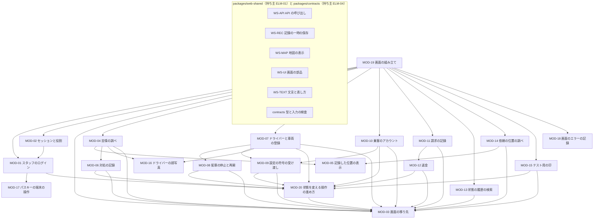
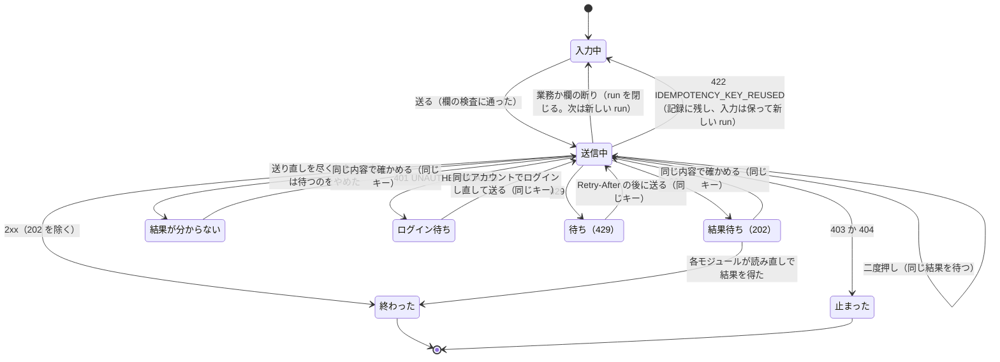
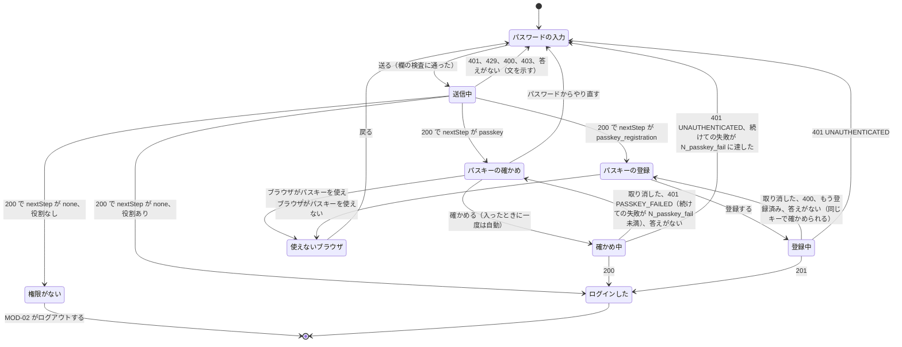
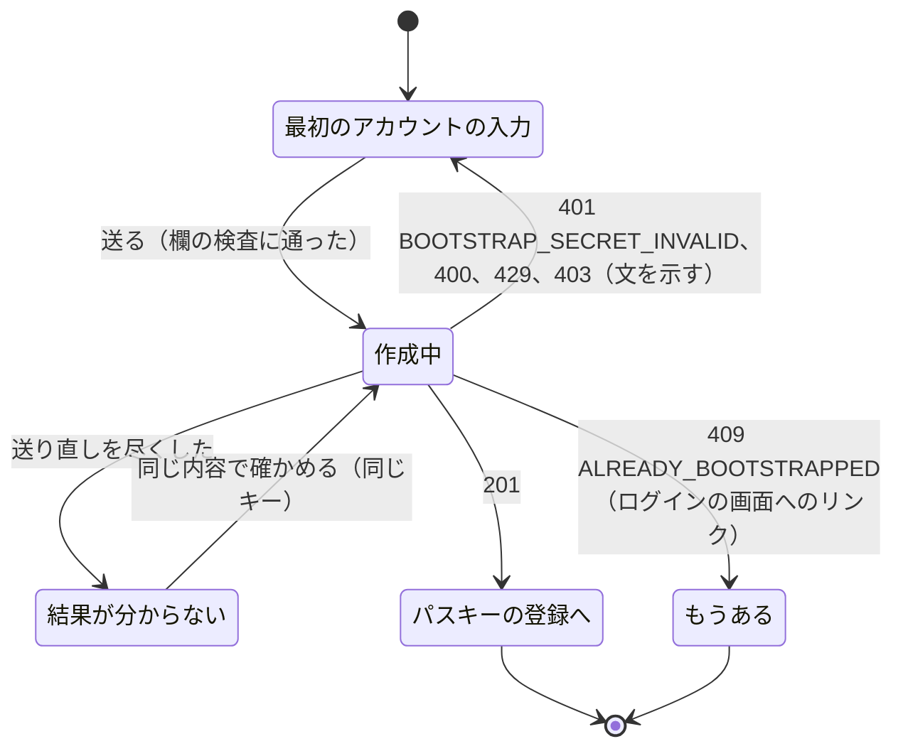
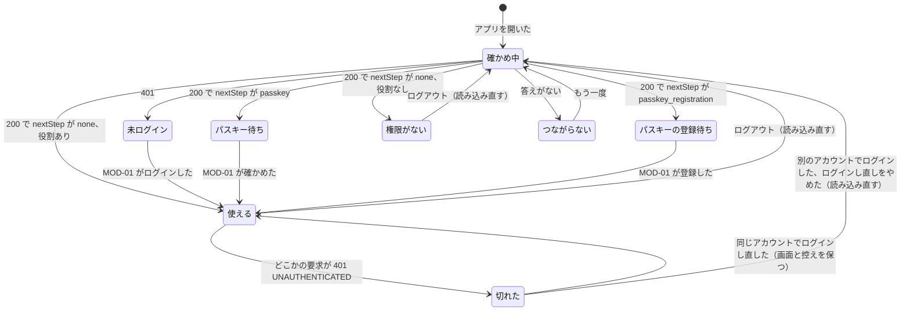
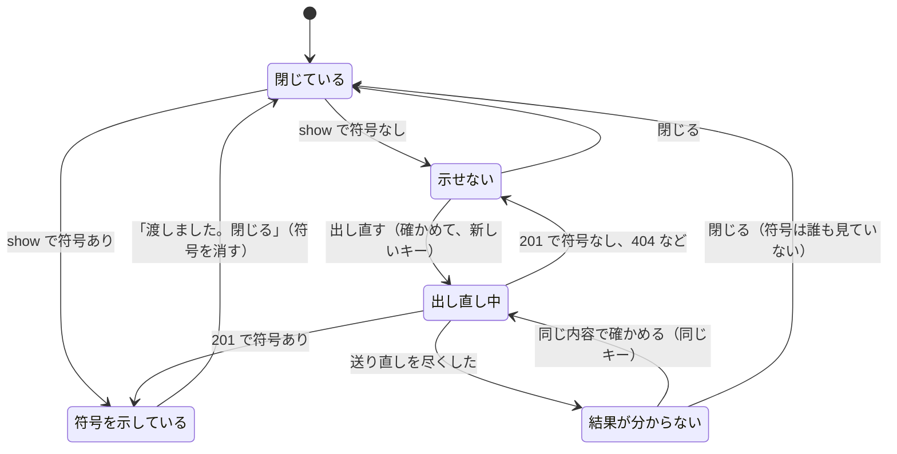
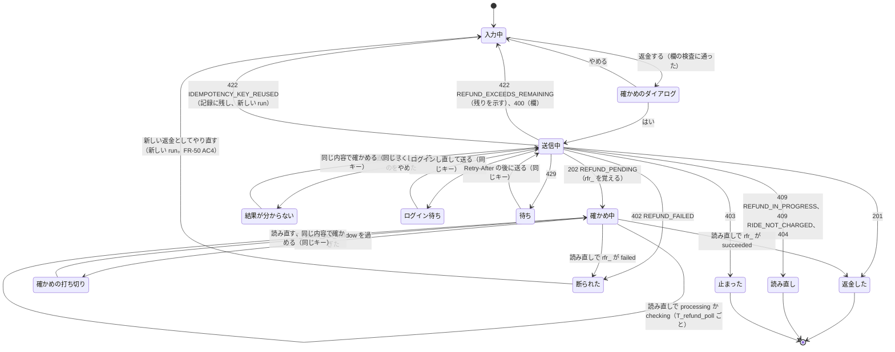

# 詳細設計: ELM-03 管理とエンジニアの画面

状態: 回答反映済み · 更新: 2026-11-08 · 第 4 段階（全 4 段階）

## 要約

ELM-03（`apps/web-backoffice`）を 20 のモジュールに分けた。業務のモジュールは 13 ある（苦情、対処、乗客のアカウント、ドライバーと車両、停止と再開、設定の符号、請求、返金、履歴の検索、依頼の位置、テスト用の印、位置の表示、顔写真）。ほかに、ログイン、セッション、画面の移り先、操作の進め方、パスキー、エラーの記録、組み立ての 7 つを置いた。API の呼び出し、記録の一時の保存、地図、部品、文言は共有のパッケージ `packages/web-shared`（持ち主 ELM-01）を使う。ELM-01 はまだ設計されていないので、この報告書に「共有のパッケージに求める約束」を書き、ELM-01 と ELM-04 の詳細設計がそれを満たす形にした。

いちばん難しい振る舞いは三つある。一つ目は、結果が分からない操作を同じ冪等キーのまま持ち続けること（セッションが切れてログインし直しても、画面と控えを保つ。MOD-20、MOD-02）。二つ目は、設定の符号を一度だけ示し、どこにも残さないこと（MOD-09）。三つ目は、返金の結果が定まるまで追い、結果が分からない間は新しい返金を出させないこと（MOD-12）。

要合意は、web-shared を通じて全部の SPA に及ぶライブラリの選択（DEC-56〜59、64。選択は質問 2 で確認済み）、符号を写す操作で受け入れる危険（DEC-62。質問 4 で確認済み）、設計上の値（返金を読み直す間隔と長さ、パスキーの失敗の回数、写真の大きさ、取り置きの量）。指摘は第 3 段階に 3 件、第 2 段階に 2 件出した（どれも軽微）。前提 12 件（質問 5）は回答がなく、推定のまま。

## 入力

| 出どころ | 得たもの |
|---|---|
| `elm/ELM-03.yaml`（版 3） | 責務、FR-01・37・40・45〜50、DRV-21・25・28・29、DEC-12・19・20・23・31・33、ELM-16 で動く |
| `ifc/IFC-28.yaml`・`IFC-29.yaml`（画面、版 2） | 提供する二つの画面の操作、エラーの決まり、冪等キー、版の扱い、WCAG 2.2 AA の記述 |
| `ifc/IFC-01.yaml`・`IFC-05.yaml`・`IFC-06.yaml`・`IFC-07.yaml`・`IFC-16.yaml` と `ifc/specs/auth`・`records`・`admin`・`engineer.openapi.yaml` | 使う操作 31 件（認証 9、記録 1、管理 16、エンジニア 3、地図 2。使わない操作 3 件を除く）、型、エラーの符号、欄の誤りの形（`field` は JSON Pointer、`code`、`message`） |
| `dec/` | DEC-12（返金のキーは返金の要求ごと）、15（座標の表を読める役割）、16（URL に個人情報を入れない）、18・44（トレース ID）、19（履歴はこの画面、ログは Logs Explorer。技術的負債）、20・43（パスキー、セッションの長さ）、23（役割ごとの SPA、PC のブラウザ）、24（React Aria は第 4 段階で決める）、25・26（偽物でテスト、パッケージと依存の規則）、31（管理の操作の記録）、33・50（タイムアウト）、38〜49（共通の約束事）、55（回数の制限） |
| `drv/` | DRV-21・25・28・29。原則の DRV-30（お金の操作は繰り返しても一度だけ）と DRV-32（ログに個人情報を残さない）。DRV-24 の範囲は乗客とドライバーの Web アプリだけ |
| `docs/quality/` | FR の受け入れ基準 39 件（FR-01 6、FR-37 3、FR-40 4、FR-45 4、FR-46 3、FR-47 4、FR-48 7、FR-49 4、FR-50 4）。QR-16・17・20・22・23・30・32・34・38・39・43・44・47・48。NFR-08・16・18・22・23・31・32・40・42。USR-03・04、CUJ-10・14・16（CUJ-14 と CUJ-16 は手順が空） |
| `3-high-level-design.md` | 共通の約束事、CUJ-01-D・10・14・16 の流れ、管理とエンジニアの画面の移り変わり、要素をまたぐ状態（ドライバーの受付、操作キー、設定の符号、苦情）、受け入れ基準のトレース、設計上の値 |
| `2-architecture.md` | コードの分け方（`apps/web-backoffice`、`packages/web-shared` の持ち主は ELM-01、`packages/contracts` の持ち主は ELM-04）と依存の規則、脅威のモデルの F11 |
| `fnd/` | この段への指摘はない。ELM-03 の入力にかかわる未解決の指摘は FND-54（符号を渡す手段）、56・71・72（返金の結果が分からないとき）、63、74〜76（IFC の書き方）。どれも第 2 段階か第 3 段階が決めるもので、この段は今の IFC に合わせて設計した |
| Context7 の文書（2026-11-08） | @simplewebauthn/browser 13.3（`startAuthentication({optionsJSON})`、`startRegistration({optionsJSON})`、`browserSupportsWebAuthn()`、`WebAuthnError` の符号、取り消しは `NotAllowedError`）。TanStack Query 5.90（`retry: false`、`staleTime`、`gcTime` の既定 5 分、`refetchOnWindowFocus` の既定は true）。React Aria Components（`FileTrigger` の `acceptedFileTypes`、`Form` の `validationErrors`） |
| リポジトリ | 製品のコードはない。すべて新設 |

## モジュール



図を読みやすくするため、WS-UI、WS-TEXT、contracts への矢印は省いた（どのモジュールも使ってよい）。WS-API を使うのは API を呼ぶ 16 のモジュール（MOD-01、02、04、06〜16、20）、WS-REC を使うのは MOD-18、WS-MAP を使うのは MOD-05 だけ。

依存の向き: 業務のモジュールは、操作の進め方（MOD-20）と画面の移り先（MOD-03）に依存する。どちらも業務の規則を持たず、変わりにくい。MOD-03 は何にも依存せず、セッションの状態は組み立て（MOD-19）から受け取る。そのため MOD-02 → MOD-01 → MOD-20 → MOD-03 の向きに循環ができない（作業用の `check_deps.py` で循環がないことと、作る順を確かめた）。画面の中に別のモジュールを埋め込むとき（苦情の詳細の中の対処の記録、請求の記録の中の返金）は、埋め込む側が埋め込まれる側に依存し、埋め込まれる側は結果を呼び出しの引数（`onRecorded`、`refresh`）で返す。

CI で確かめる依存の規則（dependency-cruiser。DEC-26 の候補）:

1. `apps/web-backoffice` は `fetch`、`XMLHttpRequest`、`EventSource` を使わない。サーバーへの要求はすべて WS-API を通す（DEC-48 の送り直しは一か所、FR-37 AC1 のトレース ID）。
2. `navigator.credentials` と `@simplewebauthn/browser` を使うのは MOD-17 だけ（QR-44）。
3. Google Maps のライブラリと `google.maps` を使うのは web-shared の WS-MAP だけ。`apps/web-backoffice` は使わない（NFR-42）。
4. `apps/web-backoffice` は `localStorage`、`sessionStorage`、`indexedDB`、`document.cookie` を使わない（DEC-65。ブラウザに置くのは web-shared の WS-REC の記録だけ）。
5. 業務のモジュールどうしの読み込みは、図の矢印（MOD-04 → 05・06・16、MOD-07 → 08・09・16、MOD-10 → 09、MOD-11 → 12、MOD-14 → 05）だけ。すべての画面を読み込むのは MOD-19 だけ。
6. `apps/web-backoffice` は `apps/server`、`packages/application`、`packages/domain`、`packages/adapters` を読み込まない（第 2 段階の規則）。`packages/web-shared` は `apps/web-backoffice` を読み込まない。
7. `console.error` と `console.log` を使わない（Oxlint の no-console）。エラーは MOD-18 で記録する。

| MOD | 名前 | 責務 | 公開範囲 | 依存 | FR | IFC | 今の構造との差分 | 根拠 |
|---|---|---|---|---|---|---|---|---|
| MOD-01 | スタッフのログイン | 役割のアカウントのパスワードとパスキーの手順を進め、役割の経路を使えるセッションにする | 公開 | MOD-17、MOD-20 | FR-01 | IFC-01、IFC-28（エンジニアの画面も同じログイン） | 新設 | 推定 |
| MOD-02 | セッションと役割 | いまのセッションと役割を保ち、切れたときにログインし直させる | 内部 | MOD-01 | FR-01 | IFC-01 | 新設 | 推定 |
| MOD-03 | 画面の移り先 | 画面の移り先を、役割、版、未保存の入力に合わせて決める | 内部 | なし | FR-01 | — | 新設 | 推定 |
| MOD-04 | 苦情の調べ | 苦情を絞り込んで開き、その乗車の記録を一つの画面に示す | 公開 | MOD-03、05、06、16 | FR-45、FR-49 | IFC-06、IFC-28 | 新設 | 推定 |
| MOD-05 | 記録した位置の表示 | 依頼の記録した位置を表と地図で示す | 内部 | なし | FR-45、FR-40 | IFC-16 | 新設 | 推定 |
| MOD-06 | 対処の記録 | 苦情への対処と理由を記録する | 公開 | MOD-03、MOD-20 | FR-46、FR-47 | IFC-06、IFC-28 | 新設 | 推定 |
| MOD-07 | ドライバーと車両の登録 | ドライバーと車両の登録の内容を作り、示し、直す | 公開 | MOD-03、08、09、16、20 | FR-48 | IFC-06、IFC-28 | 新設 | 推定 |
| MOD-08 | 配車の停止と再開 | ドライバーの配車を理由とともに止め、また始められるようにする | 内部 | MOD-03、MOD-20 | FR-47 | IFC-06 | 新設 | 推定 |
| MOD-09 | 設定の符号の受け渡し | 設定の符号を一度だけ示し、示せなかったときは出し直させる | 内部 | MOD-03、MOD-20 | FR-48 | IFC-06 | 新設 | 推定 |
| MOD-10 | 乗客のアカウント | 参加者の乗客のアカウントを作り、一覧で示す | 公開 | MOD-03、09、20 | FR-48 | IFC-06、IFC-28 | 新設 | 推定 |
| MOD-11 | 請求の記録 | 依頼の請求の記録を開いて示す | 公開 | MOD-03、MOD-12 | FR-49 | IFC-06、IFC-28 | 新設 | 推定 |
| MOD-12 | 返金 | 請求の一部か全部を一度だけ返金し、結果が定まるまで追う | 内部 | MOD-03、MOD-20 | FR-50 | IFC-06 | 新設 | 推定 |
| MOD-13 | 状態の履歴の検索 | 条件に合う状態の履歴とブラウザのエラーを時刻順に示し、Logs Explorer へつなぐ | 公開 | MOD-03 | FR-40 | IFC-07、IFC-29 | 新設 | 推定 |
| MOD-14 | 依頼の位置の調べ | エンジニアに依頼の位置の記録と受信の記録を示す | 公開 | MOD-03、MOD-05 | FR-40 | IFC-07、IFC-29 | 新設 | 推定 |
| MOD-15 | テスト用の印 | アカウントのテスト用の印を付け外しする | 公開 | MOD-03、MOD-20 | FR-01 | IFC-07、IFC-29 | 新設 | 推定 |
| MOD-16 | ドライバーの顔写真 | ドライバーの顔写真を読み込み、画面の間で使い回す | 内部 | なし | FR-45、FR-48 | IFC-06 | 新設 | 推定 |
| MOD-17 | パスキーの端末の操作 | 端末のパスキーで、確かめと登録の応答を作る | 内部 | なし | FR-01 | — | 新設 | 推定 |
| MOD-18 | 画面のエラーの記録 | この画面で起きたエラーを、入力の値を含めずに記録へ渡す | 内部 | なし | FR-37 | IFC-05 | 新設 | 推定 |
| MOD-19 | 画面の組み立て | どの画面をどの URL に置き、どの役割に見せるかを組み立てる | 内部 | MOD-01〜04、07、10、11、13〜15、18 | FR-01 | — | 新設 | 推定 |
| MOD-20 | 状態を変える操作の進め方 | 状態を変える操作一つを、冪等キーを保ったまま結果が定まるまで進める | 内部 | MOD-03 | FR-37、FR-50 | — | 新設 | 推定 |

公開範囲の「公開」は、提供する画面のインタフェース（IFC-28、IFC-29）の操作を受け持つモジュール。ほかのコンポーネントから呼ばれるモジュールはない。

## 割り当て

受け入れ基準のうち、ELM-03 の振る舞いを含まないものは「—」とし、受け持つ要素を書いた。

| FR か IFC | 基準か操作 | MOD |
|---|---|---|
| FR-01 | AC1: 乗客とドライバーが設定の符号でパスワードを決める | —（ELM-01・02 と ELM-04。ELM-03 は符号を出す側で、FR-48 AC1・2・6 で受け持つ） |
| FR-01 | AC2: 使った・古い・正しくない符号では決めさせない | —（ELM-01・02 と ELM-04） |
| FR-01 | AC3: ログインしていない人にはログインと設定の画面だけ | MOD-03（ELM-03 では、セッションがないときに開けるのはログインと最初のアカウントの画面だけ。設定の符号の画面は ELM-03 にない） |
| FR-01 | AC4: 運営・サポート担当は用意されたアカウントでログインし、管理の画面を使う | MOD-01（最初のアカウントの作成、パスワードとパスキー）、MOD-02、MOD-19 |
| FR-01 | AC5: 誤った資格情報ではログインさせずその旨を示す | MOD-01 |
| FR-01 | AC6: テスト用の印を付けられる | MOD-15 |
| FR-37 | AC1: 一つの操作のログが同じトレース ID を持つ | API を呼ぶ 16 のモジュールが WS-API だけを通す（依存の規則 1）。操作ごとのトレース ID は MOD-20 と WS-API |
| FR-37 | AC2: 外部サービスへの要求と応答のログにもトレース ID | —（ELM-04） |
| FR-37 | AC3: エラーの応答のトレース ID をブラウザのエラーの記録と結ぶ | MOD-18（記録に traceId）。画面はエラーの文と問い合わせ番号（traceId）を並べて示す（WS-UI の ErrorNotice） |
| FR-40 | AC1: 依頼 ID で探すと履歴と関係するログを時刻順に | MOD-13（履歴とブラウザのエラーを時刻順に示し、各行から Logs Explorer を開く。ログを一つの時刻順に並べるのは DEC-19 の技術的負債で Logs Explorer 側） |
| FR-40 | AC2: トレース ID で探すとブラウザ・サーバー・外部のログを時刻順に | MOD-13（ブラウザのエラーと履歴。サーバーと外部のログは行のリンクから Logs Explorer） |
| FR-40 | AC3: 利用者 ID、時間の範囲、エラーの種類でも探せる | MOD-13 |
| FR-40 | AC4: 合うものがないときその旨を示す | MOD-13 |
| FR-45 | AC1: 苦情を状態、種類、受付の時刻とともに一覧にし、状態と種類で絞る | MOD-04 |
| FR-45 | AC2: 開くと報告、乗車の記録、ドライバーと車、評価値、過去の苦情を一つの画面に | MOD-04（MOD-05 と MOD-16 を埋め込む） |
| FR-45 | AC3: 記録した位置は履歴の四つの操作の位置と受信の記録で示す | MOD-04（読み込みと突き合わせ）、MOD-05（示す） |
| FR-45 | AC4: 受信の記録がないときはそのことを示す | MOD-05 |
| FR-46 | AC1: 対処と理由を記録し、対処済みにする | MOD-06 |
| FR-46 | AC2: 内容がないとき記録せず入れるよう示す | MOD-06 |
| FR-46 | AC3: 対処を変えるとき前の記録を残して足す | MOD-06（MOD-04 が対処の履歴を示す） |
| FR-47 | AC1: 停止すると受付を止め、迎車中と乗車中は続く | MOD-08（ドライバーの画面）、MOD-06（対処の「配車を停止する」） |
| FR-47 | AC2: 停止中は受付を始めさせない | —（ELM-02 と ELM-04） |
| FR-47 | AC3: 再開すると受付を始められる | MOD-08 |
| FR-47 | AC4: 停止と再開の時刻、担当、理由を記録する | MOD-08（理由を求める。記録はサーバー。DEC-31） |
| FR-48 | AC1: 乗客を登録すると符号を示す | MOD-10（作成）、MOD-09（示す） |
| FR-48 | AC2: ドライバーと車両をすべて入れて登録すると符号を示す | MOD-07（登録）、MOD-09（示す） |
| FR-48 | AC3: 欠けている項目を示す | MOD-10、MOD-07 |
| FR-48 | AC4: 同じ連絡先のアカウントがあるとき作らずその旨 | MOD-10、MOD-07 |
| FR-48 | AC5: 登録済みのナンバーは登録せずその旨 | MOD-07 |
| FR-48 | AC6: 符号の出し直しで前の符号は使えない | MOD-09 |
| FR-48 | AC7: 車両の変更は次の依頼から乗客に示す | MOD-07 |
| FR-49 | AC1: 依頼を開くと料金、変化、請求、決済の状態、返金、残りを示す | MOD-11 |
| FR-49 | AC2: 請求額と確定した料金が違うときその差を示す | MOD-11 |
| FR-49 | AC3: 決済のサービスと一致しなかった項目を示す | MOD-11 |
| FR-49 | AC4: 苦情から請求の記録を開ける | MOD-04（リンク）、MOD-11（依頼 ID で開く） |
| FR-50 | AC1: 額と理由で返金し、記録する | MOD-12 |
| FR-50 | AC2: 残りを超える額は受け付けずその旨 | MOD-12 |
| FR-50 | AC3: 返金の要求ごとに一意のキー、二度届いても一度だけ | MOD-12、MOD-20 |
| FR-50 | AC4: 失敗は完了と示さず理由を示す。答えがなければ同じキー、失敗の後は新しいキー | MOD-12、MOD-20 |
| IFC-01 | GET /api/v1/config | MOD-02 |
| IFC-01 | POST /api/v1/auth/login | MOD-01 |
| IFC-01 | POST /api/v1/auth/passkeys/authentication-options | MOD-01 |
| IFC-01 | POST /api/v1/auth/passkeys/authenticate | MOD-01 |
| IFC-01 | POST /api/v1/auth/passkeys/registration-options | MOD-01 |
| IFC-01 | POST /api/v1/auth/passkeys/register | MOD-01 |
| IFC-01 | POST /api/v1/auth/setup | ELM-03 は使わない（参加者の操作） |
| IFC-01 | POST /api/v1/auth/staff-bootstrap | MOD-01 |
| IFC-01 | GET /api/v1/auth/session | MOD-02 |
| IFC-01 | POST /api/v1/auth/logout | MOD-02 |
| IFC-05 | POST /api/v1/records/displays | ELM-03 は使わない（SLI-02 の相手の画面は乗客とドライバー） |
| IFC-05 | POST /api/v1/records/client-errors | MOD-18（WS-REC を通す） |
| IFC-05 | POST /api/v1/records/screen-events | ELM-03 は使わない（乗客の画面の出来事） |
| IFC-06 | GET /api/v1/admin/complaints | MOD-04 |
| IFC-06 | GET /api/v1/admin/complaints/{complaintId} | MOD-04 |
| IFC-06 | POST /api/v1/admin/complaints/{complaintId}/actions | MOD-06 |
| IFC-06 | GET /api/v1/admin/passengers | MOD-10 |
| IFC-06 | POST /api/v1/admin/passengers | MOD-10 |
| IFC-06 | POST /api/v1/admin/passengers/{passengerId}/setup-code | MOD-09 |
| IFC-06 | GET /api/v1/admin/drivers | MOD-07 |
| IFC-06 | POST /api/v1/admin/drivers | MOD-07 |
| IFC-06 | GET /api/v1/admin/drivers/{driverId} | MOD-07 |
| IFC-06 | GET /api/v1/admin/drivers/{driverId}/photo | MOD-16 |
| IFC-06 | PATCH /api/v1/admin/drivers/{driverId} | MOD-07 |
| IFC-06 | POST /api/v1/admin/drivers/{driverId}/setup-code | MOD-09 |
| IFC-06 | POST /api/v1/admin/drivers/{driverId}/suspend | MOD-08 |
| IFC-06 | POST /api/v1/admin/drivers/{driverId}/resume | MOD-08 |
| IFC-06 | GET /api/v1/admin/rides/{rideId}/billing | MOD-11 |
| IFC-06 | POST /api/v1/admin/rides/{rideId}/refunds | MOD-12 |
| IFC-07 | POST /api/v1/engineer/history-search | MOD-13 |
| IFC-07 | GET /api/v1/engineer/rides/{rideId}/positions | MOD-14 |
| IFC-07 | PATCH /api/v1/engineer/accounts/{accountId} | MOD-15 |
| IFC-16 | Maps JavaScript API の読み込み | MOD-05（WS-MAP を通す） |
| IFC-16 | 地図、マーカー、経路の線 | MOD-05（マーカーだけ。経路の線は示さない。FR-45 AC3 は地図のサービスの経路を持たない） |
| IFC-28 | ログイン | MOD-01（MOD-02 がセッションを保つ） |
| IFC-28 | 苦情の一覧と詳細 | MOD-04 |
| IFC-28 | 対処の記録 | MOD-06 |
| IFC-28 | 乗客のアカウント | MOD-10。符号の表示と出し直しは MOD-09（説明: 画面の一つの操作が、作成（FR-48 AC1）と符号の受け渡し（AC6）の二つの責務を含む。符号は乗客とドライバーで同じ扱いなので一つのモジュールにした） |
| IFC-28 | ドライバー | MOD-07。停止と再開は MOD-08、符号は MOD-09（説明: 画面の一つの操作が FR-48 と FR-47 を含む。変わる理由が違うので分けた） |
| IFC-28 | 請求と返金 | MOD-11。返金は MOD-12（説明: 請求の記録を示すこと（FR-49）と返金を進めること（FR-50）は変わる理由と状態が違う） |
| IFC-29 | 状態の履歴の検索 | MOD-13 |
| IFC-29 | 依頼の位置 | MOD-14 |
| IFC-29 | テスト用の印 | MOD-15 |

設計を動かす要求の割り当て:

| 要求 | MOD | 何をするか |
|---|---|---|
| DRV-21 個人情報保護法 | MOD-02、03、04、05、14、16、18、19 | 個人情報をブラウザの保存領域と URL に置かない（DEC-65、DEC-16）。ログアウトとアカウントの切り替えでメモリの中を消す。位置は役割の画面だけで示す。エラーの記録に個人情報を入れない |
| DRV-25 役割ごとの権限 | MOD-02、03、19 | 役割に合う画面だけを示す（守りはサーバー。画面は案内だけ） |
| DRV-28 一つのトレース ID | MOD-13、18、20 | 操作ごとのトレース ID、エラーの文に問い合わせ番号、検索の行から Logs Explorer |
| DRV-29 守る | MOD-01、02、09、12、17、20 | パスキー、符号を一度だけ示す、秘密とパスワードを残さない、返金を一度だけ |
| DRV-30 お金の操作は一度だけ（原則） | MOD-12、MOD-20 | 結果が分からないときは同じキーでだけ送り直し、失敗と分かった後は新しい返金の要求。ELM-03 の drivers にない（FND-83） |
| DRV-32 ログに個人情報を残さない（原則） | MOD-05、MOD-18 | エラーの記録は決まった文と符号と ID だけ。座標は役割の画面の中だけ。ELM-03 の drivers にない（FND-83） |

## 型

署名で使う型。言語に依らない書き方で、`?` は null になりうること、`List<T>` は並び、`|` はどれか一つを表す。API の型そのもの（`ComplaintDetail`、`Billing`、`DriverView` など）は contracts の型（仕様書の components.schemas と同じ）を使い、ここには画面が足すものだけを書く。

```
-- 共通の約束事の型
Money          = { amount: Int (0 以上), currency: "jpy" }                       -- DEC-41
Instant        = Text                                                            -- UTC の RFC 3339、ミリ秒、Z（DEC-40）
AccountId      = Text  /^acc_[0-9A-HJKMNP-TV-Z]{26}$/                            -- DEC-39。ほかも同じ形
DriverId       = Text  /^drv_…$/      RideId = Text /^ride_…$/      ComplaintId = Text /^cmp_…$/
ChargeId       = Text  /^mop_…$/      RefundRequestId = Text /^rfr_…$/
TraceId        = Text  /^[0-9a-f]{32}$/                                          -- DEC-44
IdempotencyKey = Text  （UUIDv4）                                                 -- DEC-48
Cursor         = Text?（200 文字まで。null は終わり）                              -- DEC-42
Page<T>        = { items: List<T>, nextCursor: Cursor }
Role           = "passenger" | "driver" | "operator" | "engineer"
StaffRole      = "operator" | "engineer"

-- セッション（MOD-01、MOD-02）
StaffSession   = { accountId: AccountId, roles: Set<Role>, testAccount: Bool,
                   nextStep: "none" | "passkey" | "passkey_registration" }
SessionState   = Checking | Anonymous | NeedsPasskey(StaffSession) | NeedsPasskeyRegistration(StaffSession)
               | Active(StaffSession) | NoStaffRole(StaffSession) | Expired(previous: AccountId) | Unreachable
Credentials    = { email: Text (254 文字まで), password: Text (12〜128 文字) }
StaffBootstrap = { bootstrapSecret: Text (32 文字以上), email: Text, password: Text (12〜128 文字) }
SignInStep     = NeedPasskey(StaffSession) | NeedPasskeyRegistration(StaffSession) | SignedIn(StaffSession)
               | NoStaffRole(StaffSession)
BackofficeConfig = { mapsBrowserKey: Text?, serverVersion: Text }

-- API の呼び出しの結果（WS-API が返す。「共有のパッケージに求める約束」）
Operation      = { name: Text, key: IdempotencyKey, traceId: TraceId }
FieldError     = { field: Text (JSON Pointer。例 "/vehicle/plateNumber"), code: Text, message: Text? }
Problem        = { status: Int, code: Text, title: Text, detail: Text?, traceId: TraceId,
                   errors: List<FieldError>, retryAfterSeconds: Int?, remainingRefundable: Money? }
ApiError       = Answered(Problem)                         -- サーバーが答えた
               | Unknown{ traceId: TraceId, cause: "timeout" | "network" | "server" }   -- 送り直しを尽くしても答えがない
CallResult<T>  = Ok{ status: Int, data: T } | Err(ApiError)

-- 操作の進め方（MOD-20）
OperationOutcome<T> = Done{ status: Int, data: T }        -- 2xx（202 を除く）。キーを閉じる
                    | Pending{ data: T }                  -- 202。キーを保つ
                    | Rejected(Problem)                   -- 業務か欄の断り。キーを閉じる
                    | NeedsLogin                          -- 401 UNAUTHENTICATED。キーを保つ
                    | Waiting{ retryAfterSeconds: Int }   -- 429。キーを保つ
                    | Stopped(Problem)                    -- 403、404。キーを閉じる
                    | KeyReused(Problem)                  -- 422 IDEMPOTENCY_KEY_REUSED。次は新しいキー
                    | Unknown{ traceId: TraceId }         -- 答えがない。キーを保つ
RunState       = 入力中 | 送信中 | 終わった | 結果待ち | 結果が分からない | ログイン待ち | 待ち | 止まった

-- 苦情と対処（MOD-04、MOD-06）
ComplaintType  = "wrong_vehicle" | "driver_behavior" | "vehicle_cleanliness" | "driving" | "billing_error" | "other"
ComplaintFilter = { status: "open" | "handled" | null, type: ComplaintType? }
ActionType     = "no_action" | "warning" | "suspend" | "other"
ActionDraft    = { action: ActionType?, reason: Text }

-- アカウントとドライバー（MOD-07〜10）
PassengerDraft = { name: Text (1〜100 文字), email: Text }
VehicleDraft   = { model: Text (1〜100), color: Text (1〜50), plateNumber: Text (1〜30) }
PhotoFile      = { base64: Text, mime: "image/jpeg", width: Int, height: Int, bytes: Int }
DriverDraft    = { name: Text (1〜100), email: Text, photo: PhotoFile?, vehicle: VehicleDraft }
VehiclePatch   = { model: Text?, color: Text?, plateNumber: Text? }       -- 変えた欄だけ
SetupSubject   = Passenger{ passengerId: AccountId, name: Text } | Driver{ driverId: DriverId, accountId: AccountId?, name: Text }
SetupCodeIssue = { subject: SetupSubject, code: Text?（/^[A-Z0-9]{10}$/。null は同じキーの送り直しで符号が伏せられた）,
                   expiresAt: Instant }

-- 請求と返金（MOD-11、MOD-12）
RefundDraft    = { chargeId: ChargeId, amount: Int (円), reason: Text (1〜1000) }
RefundState    = 入力中 | 確かめのダイアログ | 送信中 | 返金した | 確かめ中(RefundRequestId) | 確かめの打ち切り(RefundRequestId)
               | 断られた(reason: Text) | 読み直し | 結果が分からない | ログイン待ち | 待ち | 止まった

-- 検索と位置（MOD-05、MOD-13、MOD-14）
LocalMinute    = Text "YYYY-MM-DDTHH:mm"（日本時間の入力欄の値）
HistorySearchDraft = { rideId: Text?, traceId: Text?, accountId: Text?, from: LocalMinute?, to: LocalMinute?,
                       errorKind: ClientErrorKind? }
ClientErrorKind = "render" | "request" | "geolocation" | "wake_lock" | "audio" | "map" | "payment_element" | "stream"
SearchRow      = StateChange{ at: Instant, changeId, rideId, type: Text, actor: {kind: Text, accountId: AccountId?},
                              traceId: TraceId?, logsUrl: Text? }
               | ClientErrorRow{ at: Instant, clientErrorId, kind: Text, traceId: TraceId, rideId: RideId?, logsUrl: Text }
Point          = { lat: Number (-90〜90), lng: Number (-180〜180) }
OpPosition     = { operation: "arrived" | "started" | "no_show" | "ended", at: Instant?,
                   position: { point: Point, accuracyM: Number, measuredAt: Instant }?, missingReason: Text? }
Receipt        = { receivedAt: Instant, point: Point, accuracyM: Number, speedMps: Number? }
RecordedPositions = { pickup: Place?, dropoff: Place?, operations: List<OpPosition>, receipts: List<Receipt> }
```

## 共有のパッケージに求める約束

`packages/web-shared` の持ち主は ELM-01、`packages/contracts` の持ち主は ELM-04（第 2 段階のコードの分け方）。ELM-03 は読み込むだけなので、ELM-03 が使う部分の約束をここに書く。ELM-01 と ELM-04 の詳細設計は、これを満たすように設計する。変えるときは ELM-03 のこの段を動かし直す。

### WS-API（API の呼び出し。web-shared、持ち主 ELM-01）

| 操作 | 事前条件 | 事後条件 | エラー |
|---|---|---|---|
| `newOperation(name: Text) -> Operation` | なし | 新しい UUIDv4 のキーと、新しいトレース ID を持つ控えを返す。返した控えは「応答待ちの操作」に数える | なし |
| `settle(op: Operation) -> Unit` | なし | その控えを応答待ちの数から外す | なし |
| `call<T>(req: ApiRequest) -> CallResult<T>` ApiRequest = { method, path（/api/v1/ で始まる）, body?, kind: "read" \| "change" \| "session" \| "once", operation?, responseType: "json" \| "blob", suppressAuthEvent: Bool } | `kind = "change"` なら `operation` がある | 要求ごとに `traceparent`（00-トレース ID-新しいスパン ID-01）と `X-Client-Trace-Id` を付ける。`change` は `Idempotency-Key` に控えのキーを付け、すべての試みで同じキーと同じトレース ID を使う。一回の試みは 15 秒で切る（DEC-50）。`read`、`change`、`session` は、ネットワークの誤り、タイムアウト、500、503 のとき 1、2、4 秒の間を置いて 3 回まで送り直す。`change` は 409 OPERATION_IN_PROGRESS のとき Retry-After だけ待って同じキーで送り直し、同じ 3 回に数える（DEC-48）。`once` は送り直さない。2xx は `Ok`。problem+json は `Answered(Problem)`。送り直しを尽くしても答えがなければ `Unknown`。どの応答でも `X-App-Version` を作ったときの版と比べ、違えば版の違いを知らせる | 例外を投げない。すべて結果で返す |
| `abort(op: Operation) -> Unit` | その控えの要求が動いている | 待つのをやめ、その `call` は `Unknown{cause: "timeout"}` を返す（サーバーの処理は止まらない） | なし |
| `pendingOperations() -> Int` | なし | 控えを作って `settle` していない数 | なし |
| `onUnauthenticated(f: () -> Unit)` | なし | `suppressAuthEvent` のない要求が 401 UNAUTHENTICATED を受けたら f を一度呼ぶ | なし |
| `onVersionMismatch(f: (serverVersion: Text) -> Unit)` | なし | 応答の版が作ったときの版と違うたびに f を呼ぶ | なし |
| `buildVersion() -> Text` | なし | 組み立てたときに埋めた版（ELM-06 が APP_VERSION と同じ値を埋める） | なし |

### WS-REC（記録の一時の保存。web-shared、持ち主 ELM-01）

| 操作 | 事前条件 | 事後条件 | エラー |
|---|---|---|---|
| `recordClientError(e: { kind: ClientErrorKind, message: Text (500 文字まで), traceId: TraceId, rideId: RideId? }) -> Unit` | message は呼ぶ側が決まった文から作り、入力の値、座標、連絡先、符号を含まない | clientErrorId（UUIDv4）、occurredAt、browser（200 文字まで）を付けてブラウザに保ち、すぐ `POST /api/v1/records/client-errors` で送る（100 件まで一度に）。400 は捨て、401、500、503、ネットワークの誤りは保って後で送る（次の記録のとき、ログインの後、30 秒ごと）。保つのは最大 500 件、7 日まで（IFC-05 の仮の値）で、超えたら古いものから捨てる | 例外を投げない |

### WS-MAP（地図の表示。web-shared、持ち主 ELM-01）

| 操作 | 事前条件 | 事後条件 | エラー |
|---|---|---|---|
| `MapView({ points: List<MapPoint{ point: Point, label: Text, kind: Text }>, apiKey: Text?, ariaLabel: Text, onFailure: () -> Unit })` | なし | 版を固めた Maps JavaScript API を鍵で読み込み、点がすべて入る範囲でマーカーを描く。ブラウザから Places も Routes も呼ばない（IFC-16） | 鍵がない、読み込めない、`gm_authFailure` のときは何も描かず `onFailure` を呼び、`kind: "map"` で WS-REC に記録する |

### WS-UI（画面の部品。web-shared、持ち主 ELM-01）

React Aria Components（DEC-56）で作った部品: Button、TextField、TextArea、NumberField（円の整数）、Select、RadioGroup、Form（`validationErrors` で欄の誤りを示す）、Table、Dialog と AlertDialog、Link、FileTrigger、ProgressBar、StatusRegion（`aria-live="polite"` で結果を読み上げる）、ErrorNotice（エラーの文と「問い合わせ番号: トレース ID」を並べ、読み直しの操作を付けられる）。画面が移ったら見出し（h1）に焦点を移す部品。どれも WCAG 2.2 AA の自動の確かめ（axe）に通る。

### WS-TEXT（文言と表し方。web-shared、持ち主 ELM-01）

| 操作 | 事後条件 |
|---|---|
| `t(key: Text, params) -> Text` | 文言のモジュールの文（DEC-46）。管理の画面の文は文言のモジュールの「backoffice」の部分に置き、`apps/web-backoffice` だけが読み込む（乗客とドライバーの組み立てには入らない） |
| `problemText(code: Text) -> Text`、`fieldErrorText(code: Text) -> Text` | contracts の符号の一覧の日本語の文 |
| `formatYen(m: Money) -> Text` | 「1,234 円」 |
| `formatDateTimeJst(t: Instant) -> Text`、`formatDateTimeJstMs(t: Instant) -> Text`、`formatTimeJst(t: Instant) -> Text` | 「2026/11/03 14:05」「2026/11/03 14:05:09.123」「14:05」（日本時間） |
| `jstMinuteToInstant(v: LocalMinute, edge: "start" \| "end") -> Instant` | 日本時間（UTC+9、夏時間なし）の分を UTC にする。start は 00.000 秒、end は 59.999 秒 |

### contracts（型と入力の検査。持ち主 ELM-04）

- IFC-01、IFC-05、IFC-06、IFC-07 の要求と応答の型（仕様書の components.schemas と同じ）。
- 入力の検査: Credentials、StaffBootstrap、PassengerRegistration、DriverRegistration、DriverPatch、ActionRequest、ReasonRequest、RefundRequest、HistorySearchRequest、AccountPatch と ID のパターン。誤りはサーバーの `Problem.errors` と同じ `field`（JSON Pointer）と `code` で返す。画面とサーバーの誤りを同じ形で示すため。
- 誤りの符号の一覧（問題の符号と欄の誤りの符号）と日本語の文（DEC-38、DEC-46）。この画面が示す文は「画面」の節の「誤りの文」の表に書いた。

### ほかのコンポーネントへの引き継ぎ

| 相手 | 求めること | もと |
|---|---|---|
| ELM-04（サーバー） | `/backoffice/` の下の静的なファイルを配り、知らない経路は `/backoffice/index.html` を返す（DEC-60）。`index.html` は取り置かせず（no-cache）、名前に指紋を持つファイルは長く取り置かせる | DEC-23、DEC-60 |
| ELM-04 | 管理の画面の応答に CSP を付ける。インラインのスクリプトと eval を許さない（ELM-03 は使わない）。スクリプトは自分の入口と Google Maps だけ（Stripe は要らない）。画像は `blob:`（顔写真）と地図の配信元を許す。`frame-ancestors 'none'` | DEC-23 |
| ELM-04 | パスキーの options と応答は WebAuthn の JSON の形（@simplewebauthn/browser 13 が読み書きする形）にする | DEC-59 |
| ELM-06（配備の仕組み） | 管理の画面の組み立てに、サーバーの APP_VERSION と同じ版を埋める。CI のゲートで ELM-03 のテスト（単体、部品、画面の自動テストと axe）を動かす | DEC-49、DEC-27 |

## モジュールの詳細

### 状態を変える操作の進め方（MOD-20。共通の状態遷移）

状態を変える操作（MOD-01 の最初のアカウントとパスキーの登録、MOD-06〜10、MOD-12、MOD-15）は、すべてこの状態遷移で進める。操作ごとの違い（202 の扱い、業務の断りの文）は各モジュールに書く。

#### インタフェース

| 操作 | 事前条件 | 事後条件 | エラー |
|---|---|---|---|
| `start(name: Text) -> OperationRun` | なし | 控え（キーとトレース ID）を一つ作り、状態は入力中 | なし |
| `run.send(req: ApiRequest) -> OperationOutcome<T>` | run が閉じていない。欄の検査に通っている | 送信中にし、WS-API に `kind: "change"` と控えで送る。結果を下の判断表で分ける。Done、Rejected、Stopped、KeyReused は run を閉じる（そのキーは二度と使わない）。Pending、NeedsLogin、Waiting、Unknown は run を開いたままにする（次の send も同じキー）。送信中に二度目の send が来たら、同じ結果を待つ（二度押しは一つにまとまる） | 例外を投げない |
| `run.stopWaiting() -> Unit` | 送信中 | WS-API の `abort` で待つのをやめ、結果が分からないにする | なし |
| `run.abandon() -> Unit` | なし | 控えを捨てる。結果が分からないままなら、画面を離れる前に確かめる（MOD-03） | なし |
| `run.state -> RunState` | なし | 今の状態 | なし |

不変条件: 一つの run は一つのキーだけを使う。閉じた run は送らない。送信中、結果待ち、結果が分からない、ログイン待ち、待ちの run は、MOD-03 に未保存として届け出る（版の読み直しを止め、画面を離れるときに確かめる）。

#### 振る舞い



別のアカウントでログインし直したときは、MOD-02 が画面を読み込み直してすべてを消すので、run も残らない。結果が分からない run から新しいキーに移る道はない（DEC-48 の「応答が分からないときは同じキーでだけ送り直す」、DRV-30）。

判断表（結果の分け方。単体テストのもと）:

| 応答 | 符号 | 結果 | キー |
|---|---|---|---|
| 2xx（202 を除く） | — | Done | 閉じる |
| 202 | 保留の符号（REFUND_PENDING など） | Pending | 保つ |
| 400 | どれでも（INVALID_REQUEST、SEARCH_CONDITION_REQUIRED、RANGE_TOO_WIDE、PASSKEY_REGISTRATION_FAILED） | Rejected | 閉じる |
| 401 | UNAUTHENTICATED | NeedsLogin | 保つ |
| 401 | そのほか（BOOTSTRAP_SECRET_INVALID） | Rejected | 閉じる |
| 402 | REFUND_FAILED | Rejected | 閉じる |
| 403 | FORBIDDEN | Stopped | 閉じる |
| 404 | NOT_FOUND | Stopped | 閉じる |
| 409 | OPERATION_IN_PROGRESS（WS-API の送り直しを尽くした後に残ったもの） | Unknown | 保つ |
| 409 | そのほか（EMAIL_ALREADY_REGISTERED、PLATE_ALREADY_REGISTERED、REFUND_IN_PROGRESS、RIDE_NOT_CHARGED、ALREADY_BOOTSTRAPPED） | Rejected | 閉じる |
| 413 | PHOTO_TOO_LARGE | Rejected | 閉じる |
| 422 | IDEMPOTENCY_KEY_REUSED | KeyReused | 閉じる |
| 422 | そのほか（PHOTO_INVALID、REFUND_EXCEEDS_REMAINING） | Rejected | 閉じる |
| 429 | RATE_LIMITED | Waiting | 保つ |
| 500、503、ネットワークの誤り、タイムアウト | WS-API の送り直しを尽くした後 | Unknown | 保つ |
| — | 待つのをやめた | Unknown | 保つ |

業務か欄の断りの後に新しいキーにするのは、直した入力を同じキーで送ると 422 IDEMPOTENCY_KEY_REUSED になりうるため（サーバーが断りを最初の結果として保つかは IFC にない。どちらでも新しいキーなら正しく動く）。429 の後に同じキーを使えるのは、回数の制限は冪等の処理の前に断り、キーを書かないため（DEC-55。もし書いていても、同じ中身の同じキーは最初の結果を返すだけ）。

#### 並行性とエラー

画面の一つの操作に run は一つ。ボタンは送信中に押せなくし、それでも届いた二度目の send は同じ結果を待つ。送信中が 15 秒（一回目のタイムアウト）を超えたら「応答を待っています（n 回目）」と「待つのをやめる」を示す。送り直しを尽くすまでの最悪は 67 秒（4 回 × 15 秒 + 1 + 2 + 4 秒。計算）。KeyReused は画面の誤りなので MOD-18 に `kind: "request"` で記録する。Stopped の 403 も同じ。エラーの文には必ず問い合わせ番号（Problem の traceId、答えがなければ控えのトレース ID）を添える。

#### 確かめ方

| 確かめること | どう確かめるか |
|---|---|
| 判断表の 16 行 | WS-API の偽物で各応答を返す単体テスト（判断表から作る） |
| 二度押しが一つの要求になる | 送信中に二度 send して、偽物が受けた要求が一つで、キーが同じことを確かめる単体テスト |
| 閉じた run は送らない、開いた run は同じキー | Rejected の後の send が新しい run を求めること、Unknown の後の send が同じキーで送ることを確かめる単体テスト |
| 未保存の届け出 | 送信中、結果が分からない、ログイン待ちで MOD-03 の `hasUnsaved()` が真になる単体テスト |
| 送り直しの最悪の待ちと「待つのをやめる」 | 偽の時計で、15 秒を過ぎたら表示が出て、押すと結果が分からないになる部品のテスト |

### MOD-01 スタッフのログイン

#### インタフェース

| 操作 | 事前条件 | 事後条件 | エラー |
|---|---|---|---|
| 画面: `StaffSignIn({ mode: "first" \| "relogin", onSignedIn: (s: StaffSession) -> Unit })` | なし | ログインした StaffSession を `onSignedIn` で返す（セッションを持つのは MOD-02） | 下の操作のエラーを画面に示す |
| `submitPassword(c: Credentials) -> SignInStep` | c が contracts の Credentials の検査に通る | `POST /api/v1/auth/login`（`kind: "session"`、`suppressAuthEvent`）。下の判断表で次の段を決める | InvalidCredentials（401。FR-01 AC5）、Locked{until: Instant}（429 ACCOUNT_LOCKED。retryAfterSeconds から）、RateLimited{retryAfterSeconds}（429 RATE_LIMITED）、Invalid(FieldError の並び)（400）、Forbidden（403）、Unreachable{traceId}（答えがない） |
| `verifyPasskey() -> SignedIn(StaffSession)` | 段が NeedPasskey（パスワードのセッションがある） | `POST …/passkeys/authentication-options`（`kind: "read"`）→ MOD-17 `authenticate` → `POST …/passkeys/authenticate`（`kind: "once"`。同じ応答は二度使えないので送り直さない）。nextStep が none になる | PasskeyCancelled、PasskeyUnsupported、PasskeyFailed（401 PASSKEY_FAILED）、SessionLost（401 UNAUTHENTICATED）、Unreachable（答えがなければ、もう一度 options から始める） |
| `registerPasskey() -> SignedIn(StaffSession)` | 段が NeedPasskeyRegistration | `POST …/passkeys/registration-options` → MOD-17 `register` → `POST …/passkeys/register` を MOD-20 の run（キーあり）で送る。答えがないときは同じキーで確かめる | PasskeyCancelled、PasskeyUnsupported、AlreadyRegistered、RegistrationFailed（400 PASSKEY_REGISTRATION_FAILED）、SessionLost、MOD-20 の結果 |
| `bootstrap(b: StaffBootstrap) -> NeedPasskeyRegistration(StaffSession)` | b が contracts の StaffBootstrap の検査に通る | `POST /api/v1/auth/staff-bootstrap` を MOD-20 の run で送る。最初の役割のアカウントとセッションができ、次はパスキーの登録 | SecretInvalid（401 BOOTSTRAP_SECRET_INVALID）、AlreadyBootstrapped（409）、Invalid（400）、MOD-20 の結果 |

不変条件: パスワードと最初のアカウントの秘密は、入力欄と送る要求の中にだけあり、要求が終わったら欄を空にする。保存領域、URL、記録、ログに書かない。`SignedIn` を返すのは、nextStep が none で、役割に operator か engineer があるときだけ。

#### 振る舞い



最初のアカウント（`/backoffice/bootstrap`）:



判断表（ログインの応答 → 次の段）:

| 応答 | 符号 | nextStep | 役割に operator か engineer | 次 |
|---|---|---|---|---|
| 200 | — | passkey | どれでも | パスキーの確かめ |
| 200 | — | passkey_registration | どれでも | パスキーの登録 |
| 200 | — | none | ある | ログインした |
| 200 | — | none | ない | 権限がない（「このアカウントでは管理の画面を使えません」とログアウト） |
| 401 | INVALID_CREDENTIALS | — | — | 「メールアドレスかパスワードが違います」（どちらかは言わない。FR-01 AC5） |
| 429 | ACCOUNT_LOCKED | — | — | 「続けて失敗したため、HH:mm まで止めています」 |
| 429 | RATE_LIMITED | — | — | 「しばらく待ってからもう一度（n 秒）」 |
| 400 | INVALID_REQUEST | — | — | 欄の誤り |
| 403 | FORBIDDEN | — | — | 「画面の誤りです」と問い合わせ番号。MOD-18 に記録 |
| 答えがない | — | — | — | 「つながりません。もう一度送ってください」 |

#### 並行性とエラー

段ごとに動く要求は一つ（ボタンを送信中に押せなくする）。パスキーの手続きは一度に一つで、新しく始めると前の手続きは MOD-17 が止める。ログインはキーを持たず（DEC-48 の例外）、WS-API が送り直してよい（新しいセッションを作るだけ）。パスキーの確かめの送信だけは送り直さない（`kind: "once"`）。答えがなければ options から始め直す。エラーの記録にメールアドレスを入れない。

#### 確かめ方

| 確かめること | どう確かめるか |
|---|---|
| ログインの応答の判断表 10 行（FR-01 AC5 を含む） | WS-API の偽物の単体テスト |
| パスキーの失敗の扱い（取り消し、PASSKEY_FAILED が 3 回、UNAUTHENTICATED、使えないブラウザ） | MOD-17 の偽物の単体テスト |
| 最初のアカウントの流れ（201、401、409、答えがない → 同じキー） | MSW で仕様書の例を返す部品のテスト |
| 最初のアカウント → パスキーの登録 → ログアウト → ログイン → パスキー → 苦情の一覧（FR-01 AC4） | 手元のサーバーと偽物で動かす Playwright の画面の自動テスト。Chromium の仮の認証器（CDP の WebAuthn.addVirtualAuthenticator） |
| パスワードと秘密を残さない | 終わった後に DOM と保存領域に残らず、WS-REC に渡した記録にメールアドレスがないことを確かめる部品のテスト |

### MOD-02 セッションと役割

#### インタフェース

| 操作 | 事前条件 | 事後条件 | エラー |
|---|---|---|---|
| `start() -> SessionState` | アプリを開いた | `GET /api/v1/auth/session`（`suppressAuthEvent`）。401 は Anonymous、nextStep と役割で NeedsPasskey、NeedsPasskeyRegistration、Active、NoStaffRole にする | 答えがなければ Unreachable（もう一度の操作を示す） |
| `state() -> SessionState`（購読できる） | なし | 今の状態 | なし |
| `hasRole(r: StaffRole) -> Bool` | なし | Active で、その役割があるときだけ真 | なし |
| `config() -> BackofficeConfig` | Active | `GET /api/v1/config` を Active になったときに一度読む。mapsBrowserKey はログインしたセッションの応答にだけある（IFC-01） | 読めなければ mapsBrowserKey を null にする（地図は出ず、MOD-05 は表だけを示す） |
| `handleUnauthenticated() -> Unit` | WS-API が 401 UNAUTHENTICATED を知らせた | Active なら Expired(前のアカウント) にし、ログインし直しの重ねた画面（MOD-01 の relogin）を出す。下の画面は消さない | なし |
| `completeRelogin(s: StaffSession) -> Unit` | Expired | 同じアカウントなら Active に戻し、重ねた画面を閉じる（画面と run は残る）。別のアカウントなら `resetAll()` | なし |
| `logout() -> Unit` | なし | `POST /api/v1/auth/logout`（`kind: "session"`）。応答に関わらず `resetAll()` | なし（失敗してもサーバーのセッションは期限で消える） |
| `resetAll() -> Unit` | なし | メモリの中の取り置き、顔写真、run、符号を捨てるため、ページを `/backoffice/` で読み込み直す | なし |

不変条件: Active なら nextStep は none で、役割に operator か engineer がある。前のアカウントのデータを別のアカウントに示さない（別のアカウントでログインし直したらページを読み込み直す）。

#### 振る舞い



#### 並行性とエラー

同時に届いた 401 は、一度だけ Expired にする（二度目からは何もしない）。Expired の間、重ねた画面が下の画面の操作を受けない（モーダル）ので、新しい要求は出ない。401 を受けた読み込みは、Active に戻ったら読み直す（TanStack Query の無効化）。

#### 確かめ方

| 確かめること | どう確かめるか |
|---|---|
| 状態遷移図のすべての遷移 | 状態と出来事の組の単体テスト |
| 使っている途中の 401 で重ねた画面が出て、同じアカウントなら画面の入力と run が残る | MSW で 401 を返す部品のテスト |
| 別のアカウント、ログアウトで、前のデータが消える | 読み込み直しが呼ばれ、取り置きが空になることの部品のテスト。ログアウトの要求が失敗しても読み込み直す |
| 役割のない参加者のアカウントで開いた | 権限がないの画面で、管理の API を一つも呼ばないことの部品のテスト |

### MOD-03 画面の移り先

#### インタフェース

| 操作 | 事前条件 | 事後条件 | エラー |
|---|---|---|---|
| `path(screen: ScreenId, params) -> Text` | params は ID のパターンに合う | `/backoffice/` の下の URL。ID のほかの値（名前、連絡先、位置、検索の条件）を入れない（DEC-16） | InvalidParam（プログラムの誤り。テストで捕まえる） |
| `RequireRole({ session: SessionState, roles: Set<StaffRole>, children })` | なし | session が Active で roles のどれかがあれば children を示す。Anonymous ならログインの画面（戻り先の経路をメモリに持つ）。役割がなければ「この画面を使う権限がありません」 | なし |
| `markUnsaved(id: Text, unsaved: Bool) -> Unit`、`hasUnsaved() -> Bool`、`hasBlocking() -> Bool` | なし | 未保存の入力（欄の変更）と、止める理由（送信中や結果が分からない run、表示中の設定の符号）を数える | なし |
| `confirmLeave() -> Bool` | なし | 未保存か止める理由があれば「保存していない入力（または結果の分からない操作）があります。移りますか」を確かめる。ブラウザを閉じるときも beforeunload で確かめる | なし |
| `onVersionMismatch(serverVersion: Text) -> Unit`、`tryReload(trigger: "navigation" \| "banner") -> Unit` | なし | 下の判断表で読み直すか待つかを決める | なし |

不変条件: なし（状態は未保存の数と、新しい版があるかだけ）。

#### 振る舞い

判断表（版の読み直し。DEC-49）:

| 新しい版 | 止める理由（応答待ちの操作か、表示中の符号） | 未保存の入力 | きっかけ | 振る舞い |
|---|---|---|---|---|
| ない | — | — | — | 何もしない |
| ある | ある | どれでも | 画面の移り | 読み直さず、帯「新しい版があります。操作が終わったら読み直します」を出す |
| ある | ある | どれでも | 帯のボタン | ボタンを押せない（理由を示す） |
| ある | ない | ある | 画面の移り | 読み直さず、帯を出す |
| ある | ない | ある | 帯のボタン | 「入力が消えます。読み直しますか」と確かめ、はいなら読み直す |
| ある | ない | ない | 画面の移り | 読み直す |
| ある | ない | ない | 帯のボタン | 読み直す |

16 の組を 7 行で覆う（「ない」の行が 8 組、止める理由ありの 2 行が 4 組、残りの 4 行が 1 組ずつ）。読み直した後は MOD-02 の `start()` からやり直し、画面は GET で今の状態を取り直す。

#### 並行性とエラー

なし（画面の中の同期の処理だけ）。

#### 確かめ方

| 確かめること | どう確かめるか |
|---|---|
| 版の読み直しの判断表 7 行 | 単体テスト |
| URL に ID のほかを入れない（DEC-16） | 経路の表のすべての経路について、引数が `…Id` の名前で ID のパターンを持ち、問い合わせの文字を使わないことを確かめる単体テスト |
| 役割の案内 | operator だけ、engineer だけ、両方、なしの 4 つのアカウントで、各経路が示すものを確かめる部品のテスト |
| 離れるときの確かめ | 未保存と結果が分からない run で、確かめのダイアログと beforeunload が出る部品のテスト |

### MOD-04 苦情の調べ

#### インタフェース

| 操作 | 事前条件 | 事後条件 | エラー |
|---|---|---|---|
| `listComplaints(f: ComplaintFilter, cursor: Cursor) -> Page<ComplaintListItem>` | f の値は列挙の中 | `GET /api/v1/admin/complaints?status=&type=&cursor=&limit=20`（`kind: "read"`）。新しい順。合うものがなければ空 | 共通（答えがない、403、429。401 は MOD-02） |
| `getComplaint(id: ComplaintId) -> ComplaintDetail` | id がパターンに合う | `GET /api/v1/admin/complaints/{id}`。開くたびに読む | NotFound（404 →「この苦情は見つかりません」と一覧へのリンク）、共通 |
| `toRecordedPositions(ride: ComplaintDetail.ride) -> RecordedPositions` | なし | 履歴の四つの操作（arrived、started、no_show、ended）の行を、positionId で positions に突き合わせる。位置のない行は noPositionReason を missingReason にする。receipts を Receipt にする | なし（突き合わせられない positionId は「位置の記録が見つかりません」として missingReason にする） |
| 画面: `ComplaintListScreen`、`ComplaintDetailScreen({ complaintId })` | operator の役割 | 下の「画面」の節のとおり | 共通 |

不変条件: なし（状態は取り置きだけ）。

#### 振る舞い

一覧は「未対応」で絞って開く（CUJ-14 の流れの status open）。絞り込みを変えたら前の読み込みを止めて読み直し、遅れて届いた古い応答は使わない（TanStack Query のキーが変わるので、古いキーの結果は画面に出ない）。「さらに読み込む」は nextCursor で次の 20 件を足す。

詳細は、報告、乗車（状態、乗る場所と降りる場所、示した料金、請求した額、「請求の記録を開く」）、状態の履歴、記録した位置（MOD-05）、ドライバー（顔写真は MOD-16、名前、車種、色、ナンバー、評価値の平均と件数、ドライバーの画面へのリンク）、過去の苦情、対処の履歴と対処の記録（MOD-06）を一つの画面に並べる。対処を記録したら、応答の詳細で画面を替え、一覧の取り置きを無効にする（MOD-06 の `onRecorded`）。

#### 並行性とエラー

一覧の取り置きは 30 秒で古いとみなし、画面に戻るか前面に戻ったら読み直す。詳細は開くたびに読む。エラーは ErrorNotice（文と問い合わせ番号と「読み直す」）で示す。

#### 確かめ方

| 確かめること | どう確かめるか |
|---|---|
| FR-45 AC1（状態と種類で絞る、受付の時刻、空のときの文） | MSW の部品のテスト |
| FR-45 AC2（詳細の各部分が一つの画面にある） | 仕様書の例の詳細で、各部分の見出しと値が出ることの部品のテスト |
| FR-45 AC3（四つの操作の位置の突き合わせ、位置がない操作の印） | `toRecordedPositions` の単体テスト（四つとも位置あり、一つは position_unavailable、突き合わせられない positionId） |
| FR-49 AC4（苦情から請求の記録へ） | リンクが `/backoffice/rides/{rideId}/billing` を指す部品のテスト |
| CUJ-14 の通し | Playwright（苦情の一覧 → 詳細 → 対処「配車を停止する」→ ドライバーの一覧で停止中） |

### MOD-05 記録した位置の表示

#### インタフェース

| 操作 | 事前条件 | 事後条件 | エラー |
|---|---|---|---|
| 画面の部品: `RecordedPositionsView({ positions: RecordedPositions, mapsKey: Text? })` | 座標が範囲の中 | 三つを示す。(1) 四つの操作の表（操作の名前、時刻、緯度と経度を小数点以下 6 桁、誤差 m。位置のない操作は理由）。(2) 受信の記録の表（受けた時刻、緯度と経度、誤差、速さ）。空なら「位置の受信の記録はありません（保存期間を過ぎたか、受信がありませんでした）」（FR-45 AC4）。(3) WS-MAP の地図（乗る場所と降りる場所、四つの操作、受信の点） | 地図が出ないとき（鍵がない、読み込めない、`gm_authFailure`）は「地図を表示できません。表で確かめてください」を示す（IFC-16）。表はいつも示す |
| `fromEngineer(r: RidePositions) -> RecordedPositions` | なし | 位置（changeType と position）を OpPosition に、受信を Receipt にする | なし |

不変条件: 状態を持たない。座標は画面と WS-MAP にだけ渡す（記録やログに渡さない。DRV-32）。

#### 振る舞い

表を主にし、地図は補いにする（地図の領域の名前は「地図（同じ内容を表で示します）」）。地図の操作は見るだけで、ドラッグで決める操作はない。

#### 並行性とエラー

なし。地図の失敗は WS-MAP が記録する。

#### 確かめ方

| 確かめること | どう確かめるか |
|---|---|
| FR-45 AC4（受信が空のときの文） | 部品のテスト |
| 地図が出ないときも表がある（IFC-16） | WS-MAP の偽物が `onFailure` を呼ぶ部品のテスト |
| `fromEngineer` | 単体テスト |
| アクセシビリティ | axe（表の見出し、地図の領域の名前） |

### MOD-06 対処の記録

#### インタフェース

| 操作 | 事前条件 | 事後条件 | エラー |
|---|---|---|---|
| `recordAction(id: ComplaintId, d: ActionDraft, run: OperationRun) -> ComplaintDetail` | d.action がある。1 ≤ 理由の長さ ≤ 1000（contracts の ActionRequest）。suspend なら確かめのダイアログで「はい」 | `POST /api/v1/admin/complaints/{id}/actions` を run で送る。サーバーは対処を足し、苦情を対処済みにし（FR-46 AC1）、suspend ならドライバーを停止する（FR-47 AC1）。201 の詳細を `onRecorded` で返す | Invalid（400 →「対処の内容と理由を入れてください」。FR-46 AC2）、NotFound（404）、MOD-20 の結果 |
| 画面の部品: `ActionForm({ complaintId, status, onRecorded })` | operator | 対処済みの苦情では見出しを「対処を変える（前の記録は残ります）」にする（FR-46 AC3） | — |

不変条件: なし。

#### 振る舞い

| 対処 | 確かめのダイアログ | 送る |
|---|---|---|
| suspend | はい | 送る |
| suspend | いいえ | 送らない（入力は残す） |
| no_action、warning、other | 出さない | 送る |

suspend の確かめの文は「このドライバーの配車を停止します。受付を止め、依頼の一覧を示しません。迎車中と乗車中の依頼は終わるまで続きます」。

#### 並行性とエラー

MOD-20 のとおり。入力を変えたら MOD-03 に未保存を届け出て、記録したら外す。

#### 確かめ方

| 確かめること | どう確かめるか |
|---|---|
| FR-46 AC1〜3 | MSW の部品のテスト（201 で onRecorded、400 の文、対処済みの見出し） |
| 判断表 3 行 | 単体テスト |
| FR-47 AC1（対処の停止） | Playwright（CUJ-14 の通し） |

### MOD-07 ドライバーと車両の登録

#### インタフェース

| 操作 | 事前条件 | 事後条件 | エラー |
|---|---|---|---|
| `listDrivers(cursor: Cursor) -> Page<DriverView>` | なし | `GET /api/v1/admin/drivers` | 共通 |
| `getDriver(id: DriverId) -> DriverView` | id がパターンに合う | `GET /api/v1/admin/drivers/{id}`。開くたびに読む | NotFound、共通 |
| `preparePhoto(f: File) -> PhotoFile` | 担当が選んだファイル | 種類が image/jpeg か image/png で 5 MB 以下なら、長い辺を D_photo_max_px 以下にした JPEG（質 0.85）に描き直して返す。描き直しで付帯情報（撮った位置を含む）が落ちる | PhotoTypeInvalid（「JPEG か PNG の写真を選んでください」）、PhotoTooLarge（「5 MB 以下の写真を選んでください」）、PhotoUnreadable（「写真を読み込めませんでした」） |
| `registerDriver(d: DriverDraft, run: OperationRun) -> DriverCreated` | d が contracts の DriverRegistration の検査に通り、写真が用意できている | `POST /api/v1/admin/drivers` を run で送る。ドライバー、車両、アカウントができる（FR-48 AC2）。結果を MOD-09 の `show` に渡し、アカウントの ID（accountId）も示す | Invalid（400。欄ごと。FR-48 AC3）、PlateTaken（409 PLATE_ALREADY_REGISTERED。ナンバーの欄。AC5）、EmailTaken（409 EMAIL_ALREADY_REGISTERED。メールアドレスの欄。AC4）、PhotoTooLarge（413）、PhotoInvalid（422）、MOD-20 の結果 |
| `changeVehicle(id: DriverId, v: VehiclePatch, run: OperationRun) -> DriverView` | 一つ以上の欄を変えた。各欄が contracts の DriverPatch の検査に通る | `PATCH /api/v1/admin/drivers/{id}` を run で送る。次の依頼から乗客に示す（FR-48 AC7。画面に添える） | PlateTaken（409）、Invalid、NotFound、MOD-20 の結果 |
| 画面: `DriverListScreen`、`DriverRegisterScreen`、`DriverDetailScreen({ driverId })` | operator | 「画面」の節のとおり | 共通 |

不変条件: なし。写真のデータは送る前のメモリにだけ持ち、送ったら捨てる。

#### 振る舞い

登録の画面は、名前、メールアドレス、顔写真（選ぶと縮めた写真を見本として示す）、車種、色、ナンバーの 6 つの欄。欄の誤りは、サーバーの `errors[].field`（JSON Pointer）を欄に当てて示す（`/name`、`/email`、`/photo`、`/vehicle/model`、`/vehicle/color`、`/vehicle/plateNumber`）。当てられない誤りはフォームの上に示す。

詳細の画面は、登録の内容、顔写真、受付（受付していない、受付中）、停止中か、設定を済ませたか、評価値、登録した日時と、三つの操作（車両を変える、設定の符号を出し直す（MOD-09）、配車を停止・再開する（MOD-08））を示す。

#### 並行性とエラー

二つのタブで同じドライバーの車両を変えたときは、後から届いた方が残る（サーバーに版の確かめがない。担当は一人なので受け入れる）。登録と変更の後は一覧の取り置きを無効にする。

#### 確かめ方

| 確かめること | どう確かめるか |
|---|---|
| 写真の用意（種類、5 MB、縮める、付帯情報が落ちる） | 位置の付帯情報を持つ JPEG を入れ、出力に付帯情報がなく長い辺が 1600 px 以下になる単体テスト |
| FR-48 AC2〜5、7 | MSW の部品のテスト（欄の誤りの当て方、409 の欄、変更の後の表示の文） |
| 登録で符号が一度だけ出る（FR-48 AC2） | Playwright（MOD-09 と通し） |

### MOD-08 配車の停止と再開

#### インタフェース

| 操作 | 事前条件 | 事後条件 | エラー |
|---|---|---|---|
| `suspend(id: DriverId, reason: Text, run: OperationRun) -> DriverView` | 1 ≤ 理由の長さ ≤ 1000。確かめのダイアログで「はい」 | `POST …/drivers/{id}/suspend` を run で送る。suspended が真、受付は止まる（FR-47 AC1）。もう停止中でも 200 | Invalid、NotFound、MOD-20 の結果 |
| `resume(id: DriverId, reason: Text, run: OperationRun) -> DriverView` | 同上 | `POST …/drivers/{id}/resume`。suspended が偽（FR-47 AC3） | 同上 |
| 画面の部品: `SuspensionControl({ driver: DriverView, onChanged })` | operator | 下の判断表のボタンを示す | — |

不変条件: なし。

#### 振る舞い

| 停止中 | 示すボタン | ダイアログの文 |
|---|---|---|
| いいえ | 配車を停止する | 「受付を止め、依頼の一覧を示しません。迎車中と乗車中の依頼は終わるまで続きます。理由を入れてください」 |
| はい | 配車を再開する | 「受付を始められるようにします。理由を入れてください」 |

#### 並行性とエラー

MOD-20 のとおり。応答の DriverView で詳細を替え、一覧を無効にする。

#### 確かめ方

| 確かめること | どう確かめるか |
|---|---|
| 判断表 2 行、理由が要る（FR-47 AC4） | 部品のテスト |
| FR-47 AC1・AC3 | MSW の部品のテスト（応答で停止中の表示が替わる） |

### MOD-09 設定の符号の受け渡し

#### インタフェース

| 操作 | 事前条件 | 事後条件 | エラー |
|---|---|---|---|
| `show(issue: SetupCodeIssue) -> Unit` | 作成、登録、出し直しの 201 の結果 | code があれば、閉じるまで符号と期限（日本時間）を示すダイアログを開く。code が null なら「符号を表示できませんでした（応答が届かなかったため）。出し直してください」と出し直しのボタンを示す | なし |
| `reissue(subject: SetupSubject) -> SetupCodeIssue` | 確かめのダイアログで「はい」（「前の符号は使えなくなります。本人が新しい符号でパスワードを決めると、今のパスワードは使えなくなり、ほかの端末のログインも切れます」） | 押すたびに新しい run（新しいキー）で、乗客は `POST …/passengers/{passengerId}/setup-code`、ドライバーは `POST …/drivers/{driverId}/setup-code` を送る。前の符号は使えない（FR-48 AC6）。結果を `show` に渡す | NotFound、MOD-20 の結果（結果が分からないときは同じ run で確かめる。最初の結果が返ると code は null なので、もう一度出し直しを案内する） |
| `copy() -> Unit` | 符号を示している | 符号をクリップボードに写す（DEC-62） | 写せなければ「写せませんでした。画面の符号を伝えてください」 |

不変条件: 符号はダイアログの部品のメモリにだけあり、一度に一つまで。保存領域、URL、記録、ログ、エラーの文に入れない。ダイアログを閉じたら、メモリから消して二度と示さない。符号を示している間は MOD-03 に止める理由を届け出る（版の読み直しで符号を失わない）。

#### 振る舞い



出し直しのボタンは、乗客の一覧の各行とドライバーの詳細にもあり、どれも `reissue` から入る。

| 操作 | 応答 | setupCode | 示すもの |
|---|---|---|---|
| 乗客の作成、ドライバーの登録、出し直し | 201 | ある | 符号（5 文字ずつ二つに分けた等幅の文字。読み上げは 1 文字ずつ）、「24 時間有効（HH:mm まで）」、「この符号は今だけ表示されます。本人に渡してください」 |
| 乗客の作成、ドライバーの登録 | 201 | ない | 「アカウントは作りました。符号を表示できなかったので、出し直してください」と出し直しのボタン |
| 出し直し | 201 | ない | 「符号を表示できませんでした。もう一度出し直してください」と出し直しのボタン |

#### 並行性とエラー

符号のダイアログはモーダルで、一度に一つ。示している間に別の操作は始まらない。符号を写したクリップボードの中身は、システムの外の扱い（渡す手段は範囲外。FND-54）。

#### 確かめ方

| 確かめること | どう確かめるか |
|---|---|
| 判断表 3 行と状態遷移 | 単体テスト |
| 閉じたら符号が DOM、保存領域、記録に残らない | 部品のテスト（保存領域の書き込みを見張る。WS-REC に渡した記録を調べる） |
| 応答が届かず同じキーで送り直すと符号が null になり、出し直せる（FR-48 AC6） | MSW で一度目の応答を落とす部品のテストと、Playwright |
| 版の読み直しで符号を失わない | 符号を示している間に版の違いを起こし、読み直さないことの部品のテスト |

### MOD-10 乗客のアカウント

#### インタフェース

| 操作 | 事前条件 | 事後条件 | エラー |
|---|---|---|---|
| `listPassengers(cursor: Cursor) -> Page<PassengerView>` | なし | `GET /api/v1/admin/passengers`。新しい順 | 共通 |
| `createPassenger(d: PassengerDraft, run: OperationRun) -> PassengerCreated` | d が contracts の PassengerRegistration の検査に通る | `POST /api/v1/admin/passengers` を run で送る。アカウントができ（FR-48 AC1）、結果を MOD-09 の `show` に渡す | Invalid（400。欄ごと。AC3）、EmailTaken（409。メールアドレスの欄に「このメールアドレスのアカウントはもうあります」。AC4）、MOD-20 の結果 |
| 画面: `PassengerAccountsScreen` | operator | 一覧（名前、メールアドレス、「設定待ち」）、作成のフォーム、各行の符号の出し直し | 共通 |

不変条件: なし。

#### 振る舞い

作成は一覧の上のフォーム（名前とメールアドレス）。作ったら一覧を無効にして読み直し、符号のダイアログを開く。

#### 並行性とエラー

MOD-20 のとおり。

#### 確かめ方

| 確かめること | どう確かめるか |
|---|---|
| FR-48 AC1・3・4 | MSW の部品のテスト |

### MOD-11 請求の記録

#### インタフェース

| 操作 | 事前条件 | 事後条件 | エラー |
|---|---|---|---|
| `openBilling(rideId: RideId) -> Billing` | rideId がパターンに合う | `GET /api/v1/admin/rides/{rideId}/billing`。開くたびと、MOD-12 が求めるたびに読む | NotFound（「この依頼は見つかりません」）、共通 |
| 画面: `RideIdLookup`（`/backoffice/billing`） | operator | 依頼 ID を入れて請求の記録を開く。パターンに合わなければ「ride_ で始まる依頼 ID を入れてください」 | — |
| 画面: `BillingScreen({ rideId })` | operator | 下の振る舞いのとおり。返金の入力に MOD-12 を埋め込み、`refresh = () -> openBilling(rideId)` を渡す | 共通 |

不変条件: なし。

#### 振る舞い

示すもの（FR-49 AC1）: 手配で示した料金、料金の変化（時刻、前、後）、請求（種類、額、状態、時刻、返金できる残り）、返金（額、状態、理由、担当（自分なら「自分」）、時刻）、決済の状態（13 値の名前。「画面」の節）。

差（FR-49 AC2）: differences が空でなければ、表の上に「請求額と確定した料金が違います」と、種類ごとの確定した料金と請求した額を目立たせて示す。

突き合わせ（FR-49 AC3）: reconciliation のうち matched が偽の日を「Stripe の記録と一致しませんでした（YYYY/MM/DD の突き合わせ）」と一致しなかった項目で示す。一致した日は件数だけ。

判断表（請求ごとに返金の入力を示すか）:

| 請求の状態 | 返金できる残り | 同じ依頼に処理中か確かめ中の返金 | 返金の入力 |
|---|---|---|---|
| succeeded | 1 円以上 | ない | 示す |
| succeeded | 1 円以上 | ある | 示さず「確かめ中の返金が定まるまで返金できません」 |
| succeeded | 0 円 | どれでも | 示さず「返金できる残りはありません」 |
| processing、checking | どれでも | どれでも | 示さず「請求の結果を確かめています」 |
| failed | どれでも | どれでも | 示さない |

16 の組（状態 4 × 残り 2 × 返金 2）を 5 行で覆う。

#### 並行性とエラー

取り置きは使わず開くたびに読む（返金の残りは今の値で示す）。MOD-12 が結果待ちの間は MOD-12 の求めで読み直す。

#### 確かめ方

| 確かめること | どう確かめるか |
|---|---|
| FR-49 AC1〜3 | 仕様書の例を広げた請求の記録（料金の変化、差、一致しない日）の部品のテスト |
| 返金の入力の判断表 5 行 | 単体テスト |
| FR-49 AC4 | MOD-04 のリンクから開く部品のテスト |

### MOD-12 返金

#### インタフェース

| 操作 | 事前条件 | 事後条件 | エラー |
|---|---|---|---|
| 画面の部品: `RefundForm({ rideId, charge, refresh: () -> Billing })` | MOD-11 の判断表で入力を示す請求 | 下の状態遷移図のとおり | — |
| `refund(rideId: RideId, d: RefundDraft, run: OperationRun) -> RefundState` | 1 ≤ 額 ≤ 請求の返金できる残り（画面の先の確かめ。決めるのはサーバー）。1 ≤ 理由の長さ ≤ 1000。確かめのダイアログで額と請求の種類を見て「はい」 | `POST /api/v1/admin/rides/{rideId}/refunds` を run で送る（`chargeId`、`amount: {amount, currency: "jpy"}`、`reason`）。201 は返金した（FR-50 AC1）。202 は rfr_ を覚えて確かめ中にし、T_refund_poll ごとに `refresh` で読み直す | ExceedsRemaining（422。remainingRefundable を示す。AC2）、Failed（402。理由を示し、完了と示さない。AC4）、InProgress・NotCharged（409。読み直して今の状態を示す）、Invalid（400）、MOD-20 の結果（結果が分からないときは同じキーでだけ確かめる。AC4） |

不変条件: 一つの返金の要求は一つの run（一つのキー）。結果が分からない、確かめ中の間は、同じ依頼の新しい返金を出させない（MOD-11 の判断表と、この部品の状態）。失敗と分かった後のやり直しだけが新しい run（FR-50 AC4、DRV-30）。

#### 振る舞い



確かめ中に画面を離れてよい（サーバーが確かめを続け、請求の記録を開き直せば結果が分かる）。結果が分からない間に離れるときは MOD-03 が確かめる（サーバーは返金を始めたか分からないので、同じキーで確かめる機会を失う）。確かめの打ち切りでは「まだ確かめています。後で請求の記録を開き直してください」と、読み直すボタンを示す。

#### 並行性とエラー

二度押しは同じ run にまとまる。二つのタブで同じ請求に別々の返金を出すと、残りの範囲で二つとも通りうる（別々の返金の要求として正しい。確かめのダイアログで額と、今までの返金を示して防ぐ）。確かめ中の読み直しは 1 分に 12 回で、回数の制限（そのほかの経路、1 分に 120 回）の 10%（計算）。

#### 確かめ方

| 確かめること | どう確かめるか |
|---|---|
| 状態遷移図のすべての遷移 | WS-API の偽物と偽の時計の単体テスト |
| FR-50 AC2（残りを超える額と、示す残り） | MSW の部品のテスト |
| FR-50 AC3・AC4（答えがないときは同じキー、失敗の後は新しいキー、結果が分からない間は新しい返金を出せない） | 偽物が受けたキーを数える単体テスト。Playwright で Stripe の偽物の成功、断り（402）、無応答 → 202 → 成功を通す |
| 二重に返金しない（NFR-08 の画面の側） | Playwright で、応答を落として同じキーで確かめ、偽物の返金が一回だけのこと |

### MOD-13 状態の履歴の検索

#### インタフェース

| 操作 | 事前条件 | 事後条件 | エラー |
|---|---|---|---|
| `search(d: HistorySearchDraft) -> { rows: List<SearchRow>, nextCursor: Cursor }` | 下の判断表で「送る」。ID はパターンに合う | 日本時間の分を `jstMinuteToInstant` で UTC にし（from は start、to は end）、`POST /api/v1/engineer/history-search`（`kind: "read"`。条件は本文で送る。DEC-16）。items と clientErrors を時刻の順に一つの並びにする（同じ時刻なら状態の変化を先に） | ConditionRequired（400 SEARCH_CONDITION_REQUIRED）、RangeTooWide（400 RANGE_TOO_WIDE）、Invalid（400）、共通 |
| `more(cursor: Cursor) -> 同上` | 前の結果の nextCursor | 同じ条件で次を読み、並びに足して並べ直す（FND-80 の答えで変わりうる） | 同上 |
| 画面: `HistorySearchScreen` | engineer | 条件のフォームと結果の表 | — |

不変条件: なし。検索の条件は画面のメモリにだけ持ち、URL に入れない（DEC-16）。

#### 振る舞い

判断表（送る前の確かめ）:

| ID か種類の条件 | 時間の欄 | 範囲 | 振る舞い |
|---|---|---|---|
| ない | どちらも空 | — | 送らない。「条件を一つ以上入れてください」 |
| どれでも | 片方だけ | — | 送らない。「時間の範囲は始めと終わりの両方を入れてください」 |
| どれでも | 両方 | 始めが終わりより後 | 送らない。「始めを終わりより前にしてください」 |
| どれでも | 両方 | 31 日を超える | 送らない。「31 日以内にしてください」 |
| どれでも | 両方 | 31 日以内 | 送る |
| ある | どちらも空 | — | 送る |

10 の組（ID か種類 2 × 時間の欄が空 1・片方 1・両方で範囲 3）を 6 行で覆う。

結果の表の列: 時刻（YYYY/MM/DD HH:mm:ss.SSS、日本時間）、種類（状態の変化は変化の名前、ブラウザのエラーは種類の名前）、依頼 ID、操作した人（種類とアカウントの ID）、トレース ID、操作。操作は「Logs Explorer で開く」（logsUrl。新しいタブ、`rel="noopener noreferrer"`）、依頼 ID がある行の「依頼の位置」（MOD-14）、トレース ID の「このトレース ID で探す」（条件に入れて探し直す）。結果が空なら「条件に合う記録はありません」（FR-40 AC4）。

エラーの種類の選択肢は、ブラウザのエラーの種類（ClientErrorKind の 8 つ）と「指定しない」（FND-80 の答えで変わりうる）。

#### 並行性とエラー

探し直したら前の読み込みを止める。結果は取り置かない（調べるたびに今の記録を読む）。

#### 確かめ方

| 確かめること | どう確かめるか |
|---|---|
| 送る前の判断表 6 行 | 単体テスト |
| 日本時間の換算（例: 2026-11-03T00:00 の start は 2026-11-02T15:00:00.000Z、end は 2026-11-02T15:00:59.999Z） | 単体テスト（月と年の境目を含む） |
| 二つの並びを時刻の順に一つにする | 単体テスト（同じ時刻、片方が空） |
| FR-40 AC1〜4 | MSW の部品のテスト（各条件、空の文、RANGE_TOO_WIDE の文、リンクの属性） |
| CUJ-10 の通し | Playwright（依頼 ID で探す → 行のリンクが Logs Explorer の URL） |

### MOD-14 依頼の位置の調べ

#### インタフェース

| 操作 | 事前条件 | 事後条件 | エラー |
|---|---|---|---|
| `openRidePositions(rideId: RideId) -> RecordedPositions` | rideId がパターンに合う | `GET /api/v1/engineer/rides/{rideId}/positions` を MOD-05 の `fromEngineer` で変えて示す | NotFound、共通 |
| 画面: `RidePositionsScreen({ rideId })` | engineer | 依頼 ID の入力と MOD-05 | — |

不変条件: なし。

#### 振る舞い

開くたびに読む。依頼 ID の入力から開いたときも、検索の行から開いたときも同じ経路（`/backoffice/engineer/rides/{rideId}/positions`）。

#### 並行性とエラー

なし（読むだけ）。

#### 確かめ方

| 確かめること | どう確かめるか |
|---|---|
| 位置と受信を示す、404 の文 | MSW の部品のテスト |

### MOD-15 テスト用の印

#### インタフェース

| 操作 | 事前条件 | 事後条件 | エラー |
|---|---|---|---|
| `setTestAccount(id: AccountId, value: Bool, run: OperationRun) -> Account` | id がパターンに合う。付けるか外すかを担当が選んだ | `PATCH /api/v1/engineer/accounts/{id}`（`{testAccount: value}`）を run で送る。印が value になり、後の記録に写る（FR-01 AC6） | NotFound、Invalid、MOD-20 の結果 |
| 画面: `TestAccountScreen` | engineer | アカウントの ID の入力と「テスト用にする」「テスト用を外す」の二つのボタン。結果に「acc_… の印: テスト用（役割: …）」を示す | — |

不変条件: なし。

#### 振る舞い

今の印を前もって読む操作がない（FND-81）ので、付けるか外すかをはっきり選んで送り、応答で今の値を示す。同じ値を何度送っても結果は同じ。

#### 並行性とエラー

MOD-20 のとおり。

#### 確かめ方

| 確かめること | どう確かめるか |
|---|---|
| FR-01 AC6（付けると印が真、外すと偽） | MSW の部品のテスト |

### MOD-16 ドライバーの顔写真

#### インタフェース

| 操作 | 事前条件 | 事後条件 | エラー |
|---|---|---|---|
| `photoUrl(id: DriverId) -> ObjectUrl \| Unavailable` | id がパターンに合う | 取り置きにあればそれを返す。なければ `GET /api/v1/admin/drivers/{id}/photo` を WS-API で読み（`responseType: "blob"`。トレース ID の見出しが付く）、`URL.createObjectURL` で作った URL を取り置いて返す | NotFound（「写真はありません」）、そのほかは「写真を読み込めませんでした」と読み直しの操作 |
| 画面の部品: `DriverPhoto({ driverId, name })` | なし | 代わりの文「（名前）の顔写真」を付けた画像 | — |

不変条件: 取り置く URL は N_photo_cache 個まで。超えたら最も前に使ったものを `URL.revokeObjectURL` で捨てる。ページを読み込み直すとすべて消える。保存領域に書かない。

#### 振る舞い

取り置きは最近使った順の一覧（LRU）。写真を変える操作はないので、無効にするのは読み込み直しのときだけ。

#### 並行性とエラー

同じドライバーの写真を同時に求めたら、一つの読み込みを待つ。

#### 確かめ方

| 確かめること | どう確かめるか |
|---|---|
| 51 枚目で最も古いものを捨て、revoke を呼ぶ | 単体テスト |
| 404 の代わりの文 | 部品のテスト |

### MOD-17 パスキーの端末の操作

#### インタフェース

| 操作 | 事前条件 | 事後条件 | エラー |
|---|---|---|---|
| `isSupported() -> Bool` | なし | `browserSupportsWebAuthn()` | なし |
| `authenticate(optionsJSON: Json) -> Json` | サーバーの authentication-options の応答 | `startAuthentication({ optionsJSON })` の応答（AuthenticationResponseJSON）。前の手続きが動いていれば止まる | Cancelled（`WebAuthnError` で cause が `NotAllowedError`）、Aborted（ERROR_CEREMONY_ABORTED）、Unsupported（「WebAuthn is not supported」）、Failed{code}（そのほかの WebAuthnError） |
| `register(optionsJSON: Json) -> Json` | サーバーの registration-options の応答 | `startRegistration({ optionsJSON })` の応答（RegistrationResponseJSON） | Cancelled、Aborted、Unsupported、AlreadyRegistered（ERROR_AUTHENTICATOR_PREVIOUSLY_REGISTERED）、Failed{code} |

不変条件: 状態を持たない。`navigator.credentials` と @simplewebauthn/browser を使うのはこのモジュールだけ（依存の規則 2）。

#### 振る舞い

ライブラリの誤りを上の四つか五つに置き換えるだけ。

#### 並行性とエラー

手続きは一度に一つ（ライブラリが前の手続きを止める）。

#### 確かめ方

| 確かめること | どう確かめるか |
|---|---|
| 誤りの置き換え（各符号と NotAllowedError） | ライブラリを偽物にした単体テスト |
| 本物のブラウザでの確かめと登録 | Playwright と Chromium の仮の認証器 |

### MOD-18 画面のエラーの記録

#### インタフェース

| 操作 | 事前条件 | 事後条件 | エラー |
|---|---|---|---|
| `install() -> Unit` | アプリの始め（MOD-19） | React の誤りの境界（描画の誤り）と、`window.onerror`、`unhandledrejection` を取り付ける。捕まえた誤りを `kind: "render"` で WS-REC に渡し、境界は「画面で問題が起きました（問い合わせ番号 …）。読み込み直してください」と読み込み直しのボタンを示す | なし |
| `recordRequestProblem(e: ApiError, operation: Text, rideId: RideId?) -> Unit` | 403、KeyReused、判断表にない応答を受けた | `kind: "request"`、message は「操作の名前 状態の符号 誤りの符号」だけ、traceId は Problem の traceId か控えのトレース ID で WS-REC に渡す | なし |
| `scrub(message: Text) -> Text` | なし | 決まった文の外から入りうる値を伏せる（10 文字ちょうどの英大文字と数字の語、メールアドレスの形、小数点以下 5 桁以上の数）。どの記録もこれを通す | なし |

不変条件: 記録の message は決まった文、符号、ID からだけ作り、入力の値、応答の本文、座標、連絡先、名前、符号、秘密を入れない（DEC-23、DEC-44、DRV-32）。`scrub` はその上の重ねの守り。

#### 振る舞い

描画の誤りは境界で止め、画面全体を失わない（境界は経路ごとに置く。MOD-19）。地図の誤りは WS-MAP が自分で記録する。

#### 並行性とエラー

同じ誤りが続いて出たら、同じ message と同じ経路のものは 1 分に一つにまとめる（記録の回数の制限、1 分に 60 回の内に収める）。

#### 確かめ方

| 確かめること | どう確かめるか |
|---|---|
| `scrub` の各規則（符号、メールアドレス、座標。ULID の ID は伏せない） | 単体テスト |
| 境界が画面を守り、記録を一つ渡す | 部品のテスト |
| 画面の自動テストの記録に個人情報と符号がない（NFR-40 の画面の側） | Playwright の実行で WS-REC に渡した記録を集めて調べる CI の確かめ |

### MOD-19 画面の組み立て

#### インタフェース

| 操作 | 事前条件 | 事後条件 | エラー |
|---|---|---|---|
| `main() -> Unit` | `/backoffice/` の下のどの URL でも | MOD-18 の `install`、TanStack Query の QueryClient（`retry: false`。送り直しは WS-API だけ。一覧の staleTime 30 秒、gcTime は既定の 5 分、前面に戻ったら読み直す）、MOD-02 の `start`、WS-API の `onUnauthenticated` と `onVersionMismatch` の取り付け、経路の表（「画面」の節）で画面を組み立てる。外枠は見出しの帯（アカウントの ID、役割、ログアウト）、役割ごとのメニュー、帯（通信できない、新しい版、セッションが切れた） | なし |

不変条件: なし。

#### 振る舞い

`/backoffice/` を開いたら、operator の役割があれば苦情の一覧、engineer の役割だけなら状態の履歴の検索に移る。各経路に誤りの境界と、`RequireRole` を置く。

#### 並行性とエラー

なし。

#### 確かめ方

| 確かめること | どう確かめるか |
|---|---|
| 経路の表の各経路が、許す役割で開き、ほかの役割で「権限がありません」 | Playwright の通しの確かめ |
| QueryClient が送り直さない | 部品のテスト（偽物が 503 を返したとき、TanStack Query からの要求が一回で、WS-API の送り直しだけが起きる） |
| アクセシビリティ | Playwright と @axe-core/playwright で、すべての経路と主なダイアログを WCAG 2.2 AA の自動の確かめにかけ、違反 0 件 |

## データ

ELM-03 が持ち主のデータの実体はない（DAT-01〜29 のどれも、持ち主は ELM-03 でない）。表は設計しない。ほかのコンポーネントから直接読まれる表も、構造の変更もない。

ブラウザに置くもの（DEC-65）: ELM-03 自身は保存領域（localStorage、sessionStorage、IndexedDB、クッキー）を使わない。セッションのクッキーはサーバーが付け（HttpOnly）、ELM-03 からは読めない。ブラウザに残るのは web-shared の WS-REC が保つブラウザのエラーの記録だけで、決まった文と符号と ID だけを持つ。下書き、検索の条件、写真、符号、パスワード、秘密はメモリにだけ持ち、ページを閉じるか読み込み直すと消える。

メモリの中の構造と、その上限:

| 構造 | 持つもの | 上限 |
|---|---|---|
| TanStack Query の取り置き | API の応答（一覧、詳細、請求の記録） | 使われなくなって 5 分で捨てる（gcTime の既定）。件数は一覧の 20 件ずつと開いた詳細だけ |
| 顔写真の URL（MOD-16） | 顔写真の object URL | 50 個（N_photo_cache）。300 KiB として 14.6 MiB（計算） |
| run（MOD-20） | 操作の控え（キー、トレース ID） | 画面の操作の数だけ（一つの画面に数個） |
| 符号（MOD-09） | 示している設定の符号 | 一つ |
| セッション（MOD-02） | StaffSession と BackofficeConfig | 一つ |

## 取り置き

| 取り置き | 持つもの | キー | 新しいとみなす間 | 無効にするとき |
|---|---|---|---|---|
| 苦情の一覧 | ComplaintListItem のページ | ["complaints", status, type] と cursor | 30 秒 | 対処を記録したとき、画面に戻ったとき、前面に戻ったとき |
| 苦情の詳細 | ComplaintDetail | ["complaint", complaintId] | 0 秒（開くたびに読む） | 対処の応答で替える |
| 乗客の一覧 | PassengerView のページ | ["passengers"] と cursor | 30 秒 | 作成と符号の出し直しの後 |
| ドライバーの一覧 | DriverView のページ | ["drivers"] と cursor | 30 秒 | 登録、変更、停止、再開、符号の出し直しの後 |
| ドライバーの詳細 | DriverView | ["driver", driverId] | 0 秒 | 変更、停止、再開の応答で替える |
| 請求の記録 | Billing | ["billing", rideId] | 0 秒 | 返金の結果と、確かめ中の読み直し |
| 顔写真 | object URL | driverId | ページを閉じるまで（LRU で 50 個） | 読み込み直し |
| 設定（MOD-02） | mapsBrowserKey、サーバーの版 | — | Active の間 | ログアウト、別のアカウント |

状態の履歴の検索と依頼の位置は取り置かない（調べるたびに今の記録を読む）。取り置きが切れたとき（読み込みの失敗）は、古い値を示さず ErrorNotice と読み直しを示す。ただし前面に戻ったときの読み直しが失敗したときは、今の値を残して小さな知らせを出す。

## 画面

### 経路の表

| 画面 | URL（/backoffice の下） | 役割 | MOD |
|---|---|---|---|
| 始めの画面 | / | — | MOD-19（operator なら /complaints、engineer だけなら /engineer/search） |
| ログイン | /login | なし | MOD-01 |
| 最初のアカウント | /bootstrap | なし（ログインの画面からはつながない。DEC-60） | MOD-01 |
| 苦情の一覧 | /complaints | operator | MOD-04 |
| 苦情の詳細 | /complaints/{complaintId} | operator | MOD-04、05、06、16 |
| 乗客のアカウント | /passengers | operator | MOD-10、09 |
| ドライバーの一覧 | /drivers | operator | MOD-07 |
| ドライバーの登録 | /drivers/new | operator | MOD-07、09 |
| ドライバーの詳細 | /drivers/{driverId} | operator | MOD-07、08、09、16 |
| 請求の記録を開く | /billing | operator | MOD-11 |
| 請求の記録と返金 | /rides/{rideId}/billing | operator | MOD-11、12 |
| 状態の履歴の検索 | /engineer/search | engineer | MOD-13 |
| 依頼の位置 | /engineer/rides/{rideId}/positions | engineer | MOD-14、05 |
| テスト用の印 | /engineer/test-accounts | engineer | MOD-15 |
| 権限がない | （役割のない経路を開いたとき） | — | MOD-03 |

どの画面も、題（`<title>` は「苦情の一覧 | 管理」の形）、見出し（h1）、外枠（MOD-19）を持つ。

### 画面ごとの中身

| 画面 | 部品と示すもの | 受け取るもの | 状態 |
|---|---|---|---|
| ログイン | メールアドレス（`autocomplete="username"`）、パスワード（`autocomplete="current-password"`。貼り付けとパスワードの管理の道具を妨げない）、ログインのボタン。パスキーの段では「パスキーで確かめる」と「パスワードからやり直す」 | メールアドレス、パスワード | 入力、送信中、誤り（判断表の文）、パスキーの確かめ、パスキーの登録、使えないブラウザ、権限がない |
| 最初のアカウント | 秘密（パスワードの欄の形）、メールアドレス、パスワード（`autocomplete="new-password"`） | 3 つ | 入力、作成中、誤り、もうある、結果が分からない |
| 苦情の一覧 | 絞り込み（状態: すべて・未対応・対処済み、種類: すべてと 6 つ）、表（受付の時刻、種類、状態、依頼 ID、ドライバー ID）、さらに読み込む | 絞り込み | 読み込み中、空（「該当する苦情はありません」）、一覧、誤り |
| 苦情の詳細 | 報告、乗車、状態の履歴、記録した位置、ドライバー、過去の苦情、対処の履歴、対処の記録 | 対処と理由 | 読み込み中、詳細、見つからない、誤り、対処の送信中、記録した（「対処を記録しました」を読み上げる） |
| 乗客のアカウント | 作成のフォーム、表（名前、メールアドレス、設定待ち、符号の出し直し） | 名前、メールアドレス | 読み込み中、空（「乗客のアカウントはまだありません」）、一覧、作成の送信中、符号のダイアログ |
| ドライバーの一覧 | 表（名前、車種、色、ナンバー、受付、停止中、設定待ち、評価値）、登録のボタン | なし | 読み込み中、空、一覧、誤り |
| ドライバーの登録 | 6 つの欄、写真の見本 | 名前、メールアドレス、写真、車種、色、ナンバー | 入力、写真の用意中、送信中、欄の誤り、符号のダイアログ（アカウントの ID も示す） |
| ドライバーの詳細 | 登録の内容、顔写真、状態、車両の変更、符号の出し直し、停止と再開 | 車両の欄、理由 | 読み込み中、詳細、見つからない、各操作の送信中と結果 |
| 請求の記録を開く | 依頼 ID の欄 | 依頼 ID | 入力、パターンの誤り |
| 請求の記録と返金 | 料金、変化、請求、返金、決済の状態、差、突き合わせ、請求ごとの返金の入力 | 額、理由 | 読み込み中、記録、見つからない、誤り、返金の各状態（MOD-12） |
| 状態の履歴の検索 | 条件（依頼 ID、トレース ID、利用者 ID、始めと終わり（日本時間）、エラーの種類）、結果の表、さらに読み込む | 条件 | 入力、送る前の誤り、読み込み中、空（「条件に合う記録はありません」）、結果、誤り |
| 依頼の位置 | 依頼 ID の欄、MOD-05 | 依頼 ID | 入力、読み込み中、位置、見つからない、誤り |
| テスト用の印 | アカウントの ID の欄、二つのボタン、結果 | アカウントの ID | 入力、送信中、結果、見つからない、誤り |

### 示す名前

| 値 | 名前 |
|---|---|
| 苦情の種類 | wrong_vehicle 違う車だった、driver_behavior ドライバーの態度、vehicle_cleanliness 車内の清潔さ、driving 運転、billing_error 請求の誤り、other その他 |
| 苦情の状態 | open 未対応、handled 対処済み |
| 対処 | no_action 対処しない、warning 注意する、suspend 配車を停止する、other その他 |
| 依頼の状態 | booking 手配中、hold_checking 押さえを確かめ中、not_booked 手配しなかった、searching ドライバーを探している、accepted 迎車中、arrived 迎車の到着、in_progress 乗車中、ended 乗車が終わった、cancelled 取り消し、no_show 不在 |
| 状態の変化の種類 | requested 手配、accepted 許諾、driver_cancelled ドライバーの取り消し、relisted 探し直し、cancelled 取り消し、arrived 迎車の到着、started 運転の開始、no_show 不在、ended 乗車の終了、destination_changed 降車場所の変更、destination_change_abandoned 降車場所の変更の取りやめ、threshold_lowered しきい値を下げた、charged 請求した、charge_failed 請求の失敗、refunded 返金した、hold_released 押さえの解放、not_booked 手配しなかった。知らない種類はそのまま示す |
| 決済の状態 | none 押さえも請求もない、holding 押さえの処理中、hold_checking 押さえを確かめ中、held 押さえている、release_checking 押さえの取り消しを確かめ中、released 押さえを取り消した、capturing 確定の処理中、checking 請求を確かめ中、paid 支払い済み、unpaid 未払い、unpaid_checking 未払いの支払いを確かめ中、partially_refunded 一部を返金した、refunded 全額を返金した |
| 請求の種類 | fare 運賃、cancellation_fee キャンセル料、no_show_fee 不在の料金、unpaid_settlement 未払いの支払い |
| 請求と返金の状態 | processing 処理中、succeeded 成功、failed 失敗、checking 確かめ中 |
| 受付 | off 受付していない、receiving 受付中。suspended が真なら「停止中」を並べる |
| ブラウザのエラーの種類 | render 画面、request 要求、geolocation 位置情報、wake_lock 画面の点灯、audio 音、map 地図、payment_element カードの入力、stream 配信 |

状態は色だけで表さず、いつも名前の文字を添える。

### 入力の検査と誤りの文

欄の検査は contracts の検査をそのまま使い、送る前に示す。サーバーの欄の誤りも同じ欄に示す。

| 欄 | 規則 | 文 |
|---|---|---|
| メールアドレス | 必須、メールアドレスの形、254 文字まで | 「メールアドレスを入れてください」「メールアドレスの形で入れてください」 |
| パスワード | 必須、12〜128 文字 | 「12 文字以上で入れてください」 |
| 最初のアカウントの秘密 | 必須、32 文字以上 | 「秘密を入れてください」 |
| 名前 | 必須、1〜100 文字 | 「名前を入れてください」「100 文字以内で入れてください」 |
| 写真 | 必須、JPEG か PNG、5 MB 以下 | 「顔写真を選んでください」「JPEG か PNG の写真を選んでください」「5 MB 以下の写真を選んでください」 |
| 車種・色・ナンバー | 必須、100・50・30 文字まで | 「（欄の名前）を入れてください」「n 文字以内で入れてください」 |
| 対処 | 必須 | 「対処を選んでください」 |
| 理由（対処、停止、再開、返金） | 必須、1000 文字まで | 「理由を入れてください」「1000 文字以内で入れてください」 |
| 返金の額 | 必須、1 円以上の整数、返金できる残り以下 | 「1 円以上の額を入れてください」「返金できる残りは n 円です」 |
| 依頼 ID、トレース ID、アカウントの ID | パターン | 「ride_ で始まる依頼 ID を入れてください」「32 桁の 16 進のトレース ID を入れてください」「acc_ で始まるアカウントの ID を入れてください」 |

誤りの符号ごとの文（contracts の符号の一覧に求める文）:

| 符号 | 文 |
|---|---|
| INVALID_CREDENTIALS | メールアドレスかパスワードが違います |
| ACCOUNT_LOCKED | 続けて失敗したため、HH:mm までログインを止めています |
| PASSKEY_FAILED | パスキーで確かめられませんでした。もう一度確かめてください |
| PASSKEY_REGISTRATION_FAILED | パスキーを登録できませんでした。もう一度登録してください |
| BOOTSTRAP_SECRET_INVALID | 秘密が違います |
| ALREADY_BOOTSTRAPPED | 最初のアカウントはもうあります。ログインしてください |
| EMAIL_ALREADY_REGISTERED | このメールアドレスのアカウントはもうあります |
| PLATE_ALREADY_REGISTERED | このナンバーはもう登録されています |
| PHOTO_TOO_LARGE | 5 MB 以下の写真を選んでください |
| PHOTO_INVALID | JPEG か PNG の写真を選んでください |
| REFUND_EXCEEDS_REMAINING | 返金できる残りは n 円です |
| REFUND_IN_PROGRESS | この依頼には確かめ中の返金があります。結果が定まるまで返金できません |
| RIDE_NOT_CHARGED | この依頼には請求がありません |
| REFUND_FAILED | 返金できませんでした（理由）。やり直すときは新しい返金として送ります |
| SEARCH_CONDITION_REQUIRED | 条件を一つ以上入れてください |
| RANGE_TOO_WIDE | 時間の範囲を 31 日以内にしてください |
| NOT_FOUND | 見つかりません。画面を読み直してください |
| FORBIDDEN | この操作はできません（画面の誤り）。問い合わせ番号を添えて知らせてください |
| RATE_LIMITED | 操作が多すぎます。n 秒待ってからもう一度送ってください |
| OPERATION_IN_PROGRESS、INTERNAL_ERROR、ROUTE_TIMEOUT、DEPENDENCY_UNAVAILABLE（送り直しを尽くした後） | 結果を確かめられませんでした。「同じ内容で確かめる」を押してください（読むだけの操作は「読み直す」） |
| IDEMPOTENCY_KEY_REUSED | 送り直しの誤りです。もう一度送ってください（問い合わせ番号を記録しました） |

どのエラーの文にも「問い合わせ番号: トレース ID」を添える（FR-37 AC3、DRV-28）。

### アクセシビリティ

IFC-28・29 は WCAG 2.2 AA を求める（その出どころが DRV-24 でないことは FND-79）。この設計は AA を目標にし、自動の確かめで満たす（DEC-66。質問 3 で確認済み）。

- 部品は React Aria Components（DEC-56）で作り、名前、役割、状態をブラウザに伝える。焦点の順は見た目の順。画面が移ったら h1 に焦点を移す。
- 欄はどれも見える名前を持ち、誤りは欄に結び付けて示す（`aria-describedby`。React Aria の Form）。結果（記録した、返金した、確かめ中）は StatusRegion で読み上げる。
- 表は見出しのセルと題を持つ。地図には同じ内容の表がいつもあり、地図の操作はない（ドラッグの操作がない）。
- 文字と背景の差は 4.5:1 以上（大きい文字は 3:1）。焦点の印は見え、ほかのものに隠れない（2.4.7、2.4.11）。押す的は 24 × 24 CSS px 以上（2.5.8）。
- ログインは記憶や計算を求めない（3.3.8）。パスワードの欄は貼り付けとパスワードの管理の道具を妨げず、パスキーも使える。
- 符号は等幅の文字で 5 文字ずつ分け、読み上げは 1 文字ずつにする（`aria-label` に文字を空白で区切って入れる）。

確かめは、Playwright と @axe-core/playwright ですべての経路と主なダイアログを自動で確かめ、違反 0 件を CI のゲートにする。人の確かめ（NFR-23）はこの画面にかけない（QR-48 と NFR-22・23 の範囲は乗客とドライバーの画面）。

## 設計上の値

| 値 | 仮の値 | もと | 収まる予算かタイムアウト |
|---|---|---|---|
| T_refund_poll（返金の確かめ中の読み直しの間） | 5 秒 | DEC-04 の P_sweep（見回り 5 秒）。それより速く読んでも結果は変わらない | 1 分に 12 回。回数の制限（そのほかの経路、1 分に 120 回）の 10%（計算） |
| T_refund_poll_window（読み直しを続ける長さ） | 120 秒 | T_op_stale（30 秒）の 4 倍。処理中が確かめ中になり、見回りが何度か Stripe を照らす間 | 24 回（計算）。上と同じ制限の内 |
| N_passkey_fail（パスワードからやり直させるまでの、続けてのパスキーの失敗） | 3 回 | 提案。打ち間違えでない失敗が続くときは、パスワードの段から始め直す方が早い | — |
| 「待つのをやめる」を示すまで | 15 秒 | DEC-50 のブラウザのタイムアウト（一回目の試みが切れたとき） | 送り直しを尽くすまでの最悪 67 秒（4 回 × 15 秒 + 1 + 2 + 4 秒。計算） |
| 一覧の新しさ（staleTime） | 30 秒 | 提案。担当は一人で、前面に戻ると読み直す | — |
| 使われなくなった取り置きを捨てるまで（gcTime） | 5 分 | TanStack Query の既定 | — |
| 詳細と請求の記録の新しさ | 0 秒（開くたびに読む） | 苦情、ドライバー、返金の残りは今の状態で示す（FR-49 AC1） | — |
| 一覧の件数（limit） | 20 | DEC-42 の既定（入力） | — |
| N_photo_cache（顔写真の取り置き） | 50 個 | 提案。苦情とドライバーの画面の行き来に足りる | 300 KiB として 14.6 MiB（計算） |
| D_photo_max_px（送る写真の長い辺） | 1600 px | 提案。乗客の画面の写真より大きく、送る量を 1 MiB 以下にする | 1600 × 1200 で base64 0.46〜0.92 MiB、3 Mbps で 1.3〜2.6 秒（計算）。5 MB のまま送ると base64 6.67 MiB で、3 Mbps では 18.6 秒かかり 15 秒を超える（計算） |
| 写真の JPEG の質 | 0.85 | 提案（顔が見分けられ、量が小さい） | — |
| 検索の時間の範囲 | 31 日まで | IFC-07（入力） | — |

どの値も第 3 段階の予算とタイムアウト（ブラウザ 15 秒、送り直し 3 回、回数の制限）の内に収まる。収まらないものはない。

## 決定

| DEC | 問い | 選んだ案 | 退けた案 |
|---|---|---|---|
| DEC-56 | 画面の部品をどのライブラリで作るか（DEC-24 が第 4 段階に任せた） | React Aria Components | Radix UI（スタイルのない部品は同じだが、日本語の日付と数の入力と FileTrigger を足す手間がある）。自分で作る（WCAG の確かめを一人で背負う） |
| DEC-57 | API の応答の取り置きと読み直しをどう扱うか | TanStack Query 5（送り直しを切る） | 自分で作るフック（取り置き、古い応答の捨て方、前面に戻ったときの読み直しを作る手間）。SWR（送り直しと取り置きの切り方の選択肢が少ない） |
| DEC-58 | 画面の経路をどう扱うか | React Router 7（宣言の形） | TanStack Router（型の守りは強いが学ぶものが増える）。自分で作る（戻るボタンと経路の引数を作る手間） |
| DEC-59 | パスキーをブラウザでどう扱うか | @simplewebauthn/browser 13 | ブラウザの JSON の関数（`PublicKeyCredential.parseRequestOptionsFromJSON`。対応していないブラウザが残る）。Better Auth のクライアント（API は IFC-01 の独自の経路で、包みが合わない） |
| DEC-60 | 管理とエンジニアの画面をどの URL に置くか | `/backoffice/` の下。経路の引数は ID だけ。最初のアカウントの画面はログインからつながない | `/admin/`（エンジニアの画面も入るので名前が合わない）。別の名前のサービス（DEC-06 の一つのサービス、同じ入口に反する） |
| DEC-61 | 使っている途中でセッションが切れたとき、結果の分からない操作をどう扱うか | 重ねた画面でログインし直し、下の画面と控えを保つ。同じアカウントなら同じキーで送れる。別のアカウントならページを読み込み直してすべて消す | ログインの画面に移り、控えを sessionStorage に保つ（個人情報と控えをブラウザに残す）。切れたら控えを捨てる（結果の分からない操作を同じキーで確かめられない） |
| DEC-62 | 設定の符号をどう示すか | 閉じるまで示すダイアログ、写す操作あり、どこにも残さない。null なら新しいキーで出し直し | 数分で自動で閉じる（担当が本人に渡す前に消えうる）。写す操作なし（手で書き写して誤る） |
| DEC-63 | ドライバーの写真をどう送るか | 送る前に長い辺 1600 px の JPEG に描き直す（付帯情報が落ちる） | そのまま送る（遅い回線で 15 秒を超え、撮った位置などの付帯情報がサーバーに届く。落とすのはサーバー） |
| DEC-64 | 画面のテストをどの道具で行うか | 部品のテストは Vitest と Testing Library と MSW。画面の自動テストは Playwright と @axe-core/playwright と Chromium の仮の認証器 | 部品のテストでも手元のサーバーを動かす（遅く、誤りの応答を起こしにくい）。Cypress（DEC-25 が Playwright を挙げる） |
| DEC-65 | 画面のデータをブラウザのどこに置くか | メモリだけ。保存領域を使わない（ブラウザのエラーの記録を除く） | 下書きを sessionStorage に保つ（読み込み直しに強いが、個人情報が残る）。localStorage に取り置く（同じ PC の別の人に残る） |
| DEC-66 | 管理とエンジニアの画面のアクセシビリティをどこまで確かめるか | WCAG 2.2 AA を目標にし、axe の自動の確かめを CI のゲートにする。人の確かめはしない（質問 3） | AA を求めない（IFC-28・29 と合わない）。人の確かめもする（QR-48 と NFR-22・23 の範囲を品質チェーンで広げる手間） |

DEC-56〜59 と 64 は質問 2、DEC-62 は質問 4、DEC-66 は質問 3 で確認済み。DEC-60、61、63、65 は推定（前提の質問 5 は回答なし）。

## 指摘

この段への指摘（ELM-03）はない。この段から出した指摘:

| FND | 宛先 | 重さ | 何か |
|---|---|---|---|
| FND-79 | 第 3 段階 | 軽微 | IFC-28・29 は WCAG 2.2 AA の出どころを DRV-24 とするが、DRV-24、QR-48、NFR-22・23 の範囲は乗客とドライバーの画面だけ |
| FND-80 | 第 3 段階 | 軽微 | IFC-07 の検索の約束の欠け（一つの nextCursor が二つの並びをどう続けるか、errorKind の値、時間の範囲の片側と端の含み方） |
| FND-81 | 第 3 段階 | 軽微 | DriverView に accountId がなく、IFC-07 に今のテスト用の印を読む操作がない。ドライバーのアカウントに印を付ける ID を後から得られない |
| FND-82 | 第 2 段階 | 軽微 | 役割のアカウントのパスキーやパスワードを失ったときの戻し方がない（最初のアカウントは役割のアカウントが一つもないときだけ） |
| FND-83 | 第 2 段階 | 軽微 | ELM-03 は返金（DRV-30）とブラウザのエラーの記録（DRV-32）を行うが、drivers に二つの原則がない |

## 品質チェーンへの課題

| # | 課題 | 品質チェーンの項目 | 変えることの提案 | 品質チェーンの段 |
|---|---|---|---|---|
| 1 | FR-38 は乗客とドライバーのブラウザのエラーだけを記録の対象にするが、設計は管理とエンジニアの画面のエラーも記録する（IFC-05 の利用側に ELM-03、IFC-06・07 の 403 の決まり）。トレースの元になる FR がない | FR-38 | FR-38 AC1 の対象に管理とエンジニアの画面を足すか、足さないと決める | quality-in-use-to-functional-requirements |

## 要合意

| 項目 | 合意すること | 承認者の候補 |
|---|---|---|
| DEC-56、57、58、59、64 | web-shared を通じて乗客とドライバーの画面にも及ぶライブラリの選択（選択は質問 2 で確認済み。合意はまだ） | 開発の責任者 |
| DEC-62 | 符号を写す操作で、クリップボードに符号が残る危険を受け入れる（示し方は質問 4 で確認済み。合意はまだ） | 開発の責任者、プロダクトオーナー |
| MOD-01、07、12、16、19、20 | 設計上の値（N_passkey_fail、D_photo_max_px と質、T_refund_poll と T_refund_poll_window、N_photo_cache、一覧の新しさ、「待つのをやめる」を示すまで） | 開発の責任者 |

「共有のパッケージに求める約束」は項目ではないが、ELM-01 と ELM-04 の詳細設計がこれを満たすことを、詳細設計の索引の引き継ぎに書いた（進め方は質問 1 で確認済み）。

## 質問と回答

| # | 質問 | 下書きの答え | 回答 | 変えたこと |
|---|---|---|---|---|
| 1 | web-shared（持ち主 ELM-01）が設計される前に ELM-03 を設計する。どう進めるか（第 3 段階が ELM-03 を ELM-01 の後に勧めた理由で、コンポーネントを選ぶときに見落としていた） | ELM-03 が求める約束を書き、ELM-01 と ELM-04 の設計がそれを満たす | 求める約束を書く | なし（下書きのとおり。「共有のパッケージに求める約束」を確認済みにし、索引に引き継ぎを書いた） |
| 2 | 全部の SPA に及ぶライブラリの選択（React Aria Components、TanStack Query 5、React Router 7、@simplewebauthn/browser 13、MSW と Playwright と axe） | このまま選ぶ | このまま選ぶ | DEC-56〜59・64 を確認済みにした（合意はまだ） |
| 3 | 管理とエンジニアの画面のアクセシビリティ（IFC-28・29 は AA を求めるが、DRV-24・QR-48・NFR-22・23 の範囲外） | WCAG 2.2 AA を目標に、自動の確かめ（axe）だけ。人の確かめはしない | AA を目標に自動だけ | DEC-66 を足した。品質チェーンへの課題にはしない。FND-79 は残す |
| 4 | 設定の符号の示し方 | 閉じるまで示し、写す操作あり | 閉じるまで示し写せる | DEC-62 を確認済みにした（クリップボードの危険は要合意） |
| 5 | 前提 12 件（PC の最新のブラウザだけ、ブラウザに個人情報を残さない、URL は /backoffice/、別のアカウントなら全部消す、返金は 5 秒ごとに 120 秒、パスキーは 3 回で戻す、写真は縮めて送る、苦情は未対応で開く、時間の範囲は両端、検索の種類はブラウザのエラー、停止に確かめのダイアログ、一覧は 30 秒で古い）のうち違うもの | すべて置く | 回答なし | なし（推定のまま。DEC-60・61・63・65 と MOD-01・04・07・12・13 の値は推定） |

## 未解決の点

- web-shared の WS-API、WS-REC、WS-MAP、WS-UI、WS-TEXT と contracts の検査と文は、ELM-01 と ELM-04 の詳細設計が決める。この報告書の約束と違えば、この段を動かし直す。
- 返金の結果が分からないときのサーバーの扱いは、第 2 段階と第 3 段階の未解決の指摘（FND-56、71、72）で変わりうる。画面が受ける IFC-06 の決まり（201、202、402、409）は変わらない見込みだが、確かめ中が押さえの期限まで続く形になれば、MOD-12 の確かめの打ち切りの文を見直す。
- FND-80、81 の答えで MOD-13（続きの読み方、エラーの種類）と MOD-15（今の印の読み方）が変わりうる。
- Maps JavaScript API の読み込む版（WS-MAP。ELM-01 が決める）。
- サーバーのパスキーの形（Better Auth を使うなら、その options と応答が @simplewebauthn/browser の形と合うか。ELM-04 で確かめる）。
- 役割のアカウントを失ったときの戻し方（FND-82）。
- 前提 12 件（質問 5）は回答がなく推定のまま。違うものがあれば、この段を動かし直して直す。

## 出口の条件

| 条件 | 結果 |
|---|---|
| 割り当てられた FR の受け入れ基準がすべてモジュールにある | ELM-03 の振る舞いを含む 35 件はすべてモジュールに割り当てた。残る 4 件（FR-01 AC1・AC2、FR-37 AC2、FR-47 AC2）は ELM-03 の振る舞いを含まないので、受け持つ要素を書いた |
| 提供と利用のインタフェースの操作がすべてモジュールにある | 提供 9 件（IFC-28 の 6、IFC-29 の 3）と利用 31 件はすべて一つのモジュールにある（画面の操作で二つ以上にまたがる 3 件は説明を書いた）。利用側に名前のある操作のうち使わない 3 件（setup、displays、screen-events）は理由を書いた |
| どのモジュールも責務が一つで、約束、振る舞い、データ、確かめ方を持つ | 20 件すべて |
| 状態を持つモジュールの状態と遷移、判断表の組 | 状態遷移図 6 つ（MOD-20、MOD-01 の二つ、MOD-02、MOD-09、MOD-12。MOD-03 は判断表）は、タイムアウトと誤りを含む。判断表 8 つ（MOD-20、01、03、06、08、09、11、13）は組をすべて覆い、重ならない（MOD-03 は 16 組を 7 行、MOD-11 は 16 組を 5 行、MOD-13 は 10 組を 6 行。ほかは列挙の値ごと） |
| 依存に循環がなく、共通の約束事に従う | `check_deps.py` で循環がないことを確かめた。依存の規則 7 つを CI で確かめる |
| 持ち主のデータの実体の表 | 持ち主のデータの実体はない |
| 状態を変える呼び出しに、タイムアウトの後に結果を確定させる状態がある | MOD-20 の「結果が分からない」（同じキーで確かめる）と、MOD-12 の「確かめ中」「確かめの打ち切り」 |
| 設計上の値に値ともとがあり、第 3 段階の予算に収まる | 12 件すべて。収まらないものはない |
| 索引がすべてのコンポーネントを状態とともに挙げる | `4-detailed-design.md` に 7 件 |
| この段への未解決の指摘をすべて決める | ELM-03 への指摘はない |

## 範囲外

- 設定の符号を本人に渡す手段（第 3 段階の範囲外と同じ。この設計は一度だけ示し、写せるところまで）。
- 担当のアカウントを増やす、役割を変える、パスワードを変える操作（IFC-01・06 にない。FND-82）。

## 次へ

1. 別の文脈で `design-review` を ELM-03 に動かす。とくに、共通の操作の状態遷移と結果の判断表（MOD-20）、セッションが切れたときの控え（MOD-02、DEC-61）、符号の一度だけの表示（MOD-09）、返金の状態遷移（MOD-12）、web-shared に求める約束を読んでもらう。
2. 指摘 FND-79〜83 の決着の後、この段を ELM-03 に動かし直す。
3. 次のコンポーネントを設計する。web-shared の持ち主の ELM-01 を先にすると、この報告書の「共有のパッケージに求める約束」をそこで決められる。
